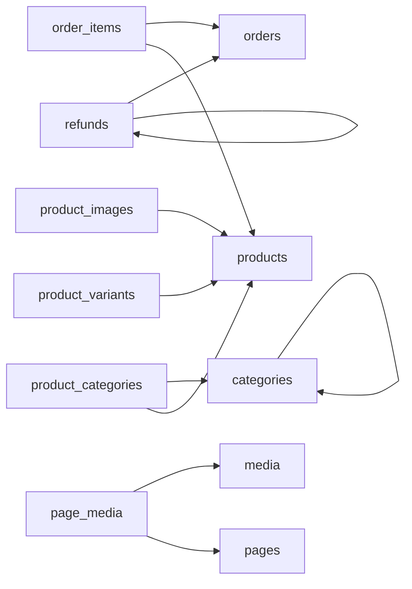
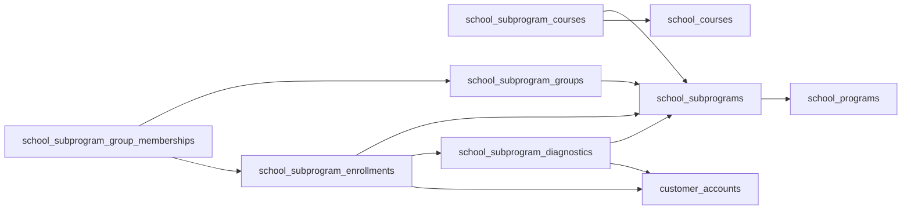
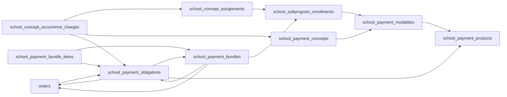
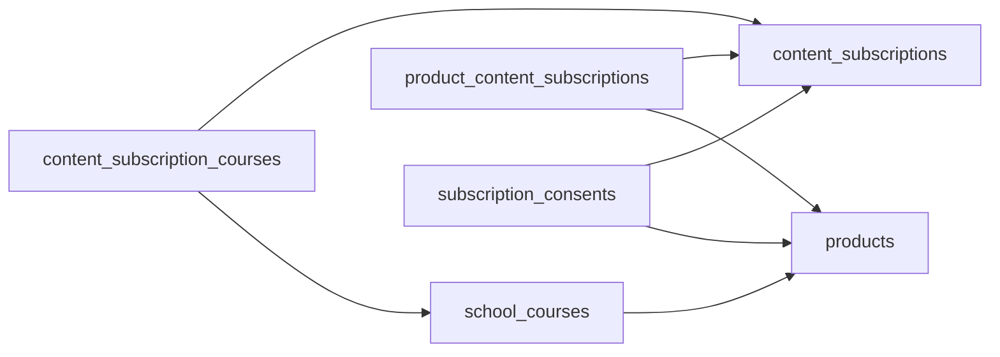

# Mapa exhaustivo de datos, SQL, código y rutas — hasta 0095

> **Alcance:** instantánea del código del repositorio y de las 97 migraciones `0001`–`0095` existentes al generar este mapa. Se reconstruyó SQLite en memoria, sin leer bases reales ni aplicar migraciones persistentes. No presupone que una instalación concreta haya aplicado esas migraciones.

## Cómo consultar este mapa

1. Para un cambio de negocio empieza por [la guía por tareas](#guía-de-cambios-por-negocio), después abre el diccionario de la tabla y sus archivos enlazados.
2. En cada tabla consulta columnas, relaciones declaradas, índices, disparadores y el `CREATE` final. Las notas `SQL:` distinguen restricciones declaradas de la validación de aplicación.
3. Para una pantalla o API usa [el índice completo de rutas](#índice-de-rutas-y-endpoints). Los parámetros `[id]`, `[slug]` y `[...key]` son marcadores, no valores literales.
4. Los enlaces de rutas de cada tabla proceden de una exploración estática de importaciones; son **posibles dependencias**, no prueban que cada consulta se ejecute en todas las peticiones. Las consultas SQL dinámicas, reexportaciones o dependencias externas pueden no detectarse. Para una decisión definitiva, sigue el código.
5. El listado de migraciones conserva ambos archivos con prefijo `0033` y ambos con `0053`: son 97 archivos, no 95. No reescribas migraciones ya aplicadas; agrega una nueva.

## Lectura correcta de tipos y reglas

- D1 usa SQLite: `TEXT`, `INTEGER`, `REAL`, `BLOB` y afinidades son tipos declarados, no un sistema `STRICT` salvo que el `CREATE` lo indique. Los formatos JSON, fechas, importes y enumeraciones también pueden estar validados en TypeScript.
- `PK n` indica posición en clave primaria compuesta; `NOT NULL` refleja exactamente `PRAGMA table_xinfo`. En SQLite una clave primaria `TEXT` ordinaria puede mostrar `notnull=0`; no se debe inferir `NOT NULL` sin la declaración o una regla de aplicación.
- `DEFAULT` es la expresión SQL, no necesariamente un valor ya almacenado. `NULL permitido` describe el esquema, no indica que el flujo acepte omitir el dato.
- `CHECK`, `UNIQUE`, claves foráneas, índices parciales y disparadores aparecen en el DDL y los apartados de cada tabla. `REFERENCES` describe el esquema; la activación de comprobaciones depende del entorno y de D1.
- Los campos de fecha suelen ser `TEXT`; `*_on` suele ser fecha de calendario y `*_at` instante, pero confirma formato y zona en el código. En el calendario de conceptos escolares se usa `America/Mexico_City`, fin de cobertura inclusivo e instantes de fin exclusivos.
- Importes `*_cents`/`*_minor` son enteros en unidades menores; no siempre son centavos de dos decimales. Usa `formatPrice`, `toMajorUnits` y `minorUnitsPerMajor`; no hagas conversiones fijas.
- `*_json` e instantáneas son representaciones serializadas; SQL no garantiza por sí solo su estructura salvo `CHECK`. Los sufijos `_key` pueden ser claves R2, no archivos almacenados en D1.
- No copies correos, direcciones, tokens, contraseñas, facturas, credenciales ni datos de alumnos. Campos de token, hashes y referencias externas requieren especial cuidado. Los ejemplos de este documento no contienen datos reales.

## Arquitectura y límites

- [Migraciones D1](../migrations/) definen estructura y transformaciones históricas; la lógica de calendario, autorización y cobro vive principalmente en `src/features`, no en una consulta manual.
- [Configuración de infraestructura](../wrangler.jsonc) declara `DB` (D1) y buckets R2. [Tipos de entorno](../src/env.d.ts) y `import { env } from 'cloudflare:workers'` describen bindings. R2 guarda objetos; las tablas suelen guardar claves y metadatos.
- [Middleware](../src/middleware.ts) protege `/admin` y `/api/admin` en producción, con excepciones de arranque y diferencias en `astro dev`. Otras rutas de cuenta, escuela, proveedores y recursos deben verificar su propia autenticación/autorización; no presupongas que todo `/api` está protegido por ese prefijo.
- [Worker programado](../src/worker.ts) reconcilia calendarios, conceptos, vencimientos, notificaciones y otros trabajos; la ejecución programada no equivale a una petición de usuario.
- [MCP](../mcp/src/index.ts) es un Worker y paquete independiente con `/mcp`, herramientas y acceso D1/API; [su paquete](../mcp/package.json) tiene dependencias separadas. No se afirma que sea un repositorio Git separado.
- El carrito usa principalmente cookie y helpers de [cart](../src/features/cart/); no busques una tabla de carrito si el flujo usa cookie. El catálogo, checkout, correo, búsqueda y almacenamiento siguen puertos/adaptadores.

## Guía de cambios por negocio

| Quiero modificar… | Tablas de partida | Código y pantallas de partida | Precaución |
|---|---|---|---|
| Nombre, precio, existencias o variantes de productos | [`products`](#tabla-products), [`product_variants`](#tabla-product_variants), [`product_extras`](#tabla-product_extras), [`product_images`](#tabla-product_images) | [`src/features/products/db.ts`](../src/features/products/db.ts), [`src/features/products/form.ts`](../src/features/products/form.ts), [`src/pages/admin/products/index.astro`](../src/pages/admin/products/index.astro), [`src/pages/api/admin/products.ts`](../src/pages/api/admin/products.ts) | Los importes son unidades menores; reservas y liquidación también afectan inventario. |
| Categorías, búsqueda y FTS | [`categories`](#tabla-categories), [`product_categories`](#tabla-product_categories), [`products_fts`](#tabla-products_fts) | [`src/features/categories/db.ts`](../src/features/categories/db.ts), [`src/features/products/search.ts`](../src/features/products/search.ts), [`src/features/search/index.ts`](../src/features/search/index.ts) | FTS5 tiene tablas sombra y disparadores; sanitizar MATCH. |
| Pedido, checkout, reservas o reembolso | [`orders`](#tabla-orders), [`order_items`](#tabla-order_items), [`checkout_reservations`](#tabla-checkout_reservations), [`pending_payments`](#tabla-pending_payments), [`refunds`](#tabla-refunds), [`refund_sync_events`](#tabla-refund_sync_events) | [`src/pages/api/checkout.ts`](../src/pages/api/checkout.ts), [`src/pages/api/webhook.ts`](../src/pages/api/webhook.ts), [`src/features/orders/reservations.ts`](../src/features/orders/reservations.ts), [`src/features/refunds`](../src/features/refunds) | Un pedido es pagado; validar idempotencia, importes y confirmación del proveedor. |
| Envíos y etiquetas | [`orders`](#tabla-orders), [`shipping_labels`](#tabla-shipping_labels), [`shipping_label_attempts`](#tabla-shipping_label_attempts) | [`src/features/shipping`](../src/features/shipping), [`src/features/orders/tracking.ts`](../src/features/orders/tracking.ts), [`src/pages/admin/orders`](../src/pages/admin/orders) | Conservar instantáneas históricas y errores de proveedor. |
| Archivos, imágenes y logo | [`media`](#tabla-media), [`product_images`](#tabla-product_images), [`page_media`](#tabla-page_media) | [`src/features/media`](../src/features/media), [`src/features/storage`](../src/features/storage), [`src/pages/api/admin/media`](../src/pages/api/admin/media) | Media es dueño de los objetos; quitar una asociación no debe borrar el archivo. |
| Configuración, autenticación y secretos | [`settings`](#tabla-settings), [`customer_accounts`](#tabla-customer_accounts), [`customer_profiles`](#tabla-customer_profiles) | [`src/features/settings/db.ts`](../src/features/settings/db.ts), [`src/features/auth`](../src/features/auth), [`src/features/secrets/store.ts`](../src/features/secrets/store.ts), [`src/middleware.ts`](../src/middleware.ts) | La configuración operativa vive en D1; secretos cifrados o bindings, nunca en el repositorio. |
| Planes de suscripción y consentimiento | [`content_subscriptions`](#tabla-content_subscriptions), [`content_subscription_courses`](#tabla-content_subscription_courses), [`customer_subscriptions`](#tabla-customer_subscriptions), [`subscription_consents`](#tabla-subscription_consents) | [`src/features/subscriptions`](../src/features/subscriptions), [`src/pages/api/subscriptions`](../src/pages/api/subscriptions) | Preservar versión de términos y validar estado con Stripe. |
| Conferencias y accesos | [`conferences`](#tabla-conferences), [`conference_sessions`](#tabla-conference_sessions), [`conference_participants`](#tabla-conference_participants), [`conference_access`](#tabla-conference_access), [`product_conferences`](#tabla-product_conferences) | [`src/features/conferences`](../src/features/conferences), [`src/pages/admin/conferencias`](../src/pages/admin/conferencias), [`src/pages/api`](../src/pages/api) | Una excepción no puede revocar enlaces o códigos ya compartidos. |
| Programas, subprogramas y diagnósticos | [`school_programs`](#tabla-school_programs), [`school_subprograms`](#tabla-school_subprograms), [`school_subprogram_questions`](#tabla-school_subprogram_questions), [`school_subprogram_diagnostics`](#tabla-school_subprogram_diagnostics), [`school_subprogram_enrollments`](#tabla-school_subprogram_enrollments) | [`src/features/school/programs.ts`](../src/features/school/programs.ts), [`src/features/school/subprogramDiagnostics.ts`](../src/features/school/subprogramDiagnostics.ts), [`src/features/school/subprogramBilling.ts`](../src/features/school/subprogramBilling.ts), [`src/pages/admin/programas.astro`](../src/pages/admin/programas.astro) | Aprobar crea una inscripción y cargos; conservar respuestas e historial. |
| Grupos escolares y varios grupos por alumno | [`school_subprogram_groups`](#tabla-school_subprogram_groups), [`school_subprogram_group_memberships`](#tabla-school_subprogram_group_memberships), [`school_subprogram_group_courses`](#tabla-school_subprogram_group_courses), [`school_subprogram_enrollments`](#tabla-school_subprogram_enrollments) | [`src/features/school/groups.ts`](../src/features/school/groups.ts), [`src/features/school/subprogramAccess.ts`](../src/features/school/subprogramAccess.ts), [`src/pages/admin/escuela/grupos.astro`](../src/pages/admin/escuela/grupos.astro), [`src/pages/account/grupos-escolares.astro`](../src/pages/account/grupos-escolares.astro) | La tabla de membresía anterior existe por compatibilidad; no volver a imponer un solo grupo. |
| Conceptos, cobertura, gracia o pagos recurrentes | [`school_payment_modalities`](#tabla-school_payment_modalities), [`school_payment_concepts`](#tabla-school_payment_concepts), [`school_concept_assignments`](#tabla-school_concept_assignments), [`school_concept_occurrence_charges`](#tabla-school_concept_occurrence_charges), [`school_payment_obligations`](#tabla-school_payment_obligations) | [`src/features/school/paymentConcepts.ts`](../src/features/school/paymentConcepts.ts), [`src/features/school/conceptCoverage.ts`](../src/features/school/conceptCoverage.ts), [`src/features/school/conceptOccurrences.ts`](../src/features/school/conceptOccurrences.ts), [`src/features/school/conceptBilling.ts`](../src/features/school/conceptBilling.ts), [`src/pages/admin/escuela/esquemas`](../src/pages/admin/escuela/esquemas) | Guardar pagados; sincronizar pendientes con bloqueo atómico; recurrencias se generan hasta 12 meses. |
| Agrupar, iniciar o confirmar un pago escolar | [`school_payment_bundles`](#tabla-school_payment_bundles), [`school_payment_bundle_items`](#tabla-school_payment_bundle_items), [`school_payment_obligations`](#tabla-school_payment_obligations), [`orders`](#tabla-orders) | [`src/features/school/conceptBundles.ts`](../src/features/school/conceptBundles.ts), [`src/features/school/paymentBundles.ts`](../src/features/school/paymentBundles.ts), [`src/pages/api/escuela/pagos/checkout.ts`](../src/pages/api/escuela/pagos/checkout.ts), [`src/features/school/subprogramSettlement.ts`](../src/features/school/subprogramSettlement.ts) | No confiar en una redirección; liquidar con confirmación, comprobar importe y respetar pagos en curso. |
| Política de acceso, becas o bajas | [`school_manual_access`](#tabla-school_manual_access), [`school_extended_manual_access`](#tabla-school_extended_manual_access), [`school_subprogram_scholarship_periods`](#tabla-school_subprogram_scholarship_periods), [`school_subprogram_enrollments`](#tabla-school_subprogram_enrollments) | [`src/features/school/enrollmentEligibility.ts`](../src/features/school/enrollmentEligibility.ts), [`src/features/school/subprogramAccess.ts`](../src/features/school/subprogramAccess.ts), [`src/features/school/scholarships.ts`](../src/features/school/scholarships.ts), [`src/features/school/withdrawals.ts`](../src/features/school/withdrawals.ts) | Acceso depende de estados y pago no reembolsado; no borrar historial. |
| Cursos, lecciones, avance y evaluación | [`school_courses`](#tabla-school_courses), [`school_lessons`](#tabla-school_lessons), [`school_course_progress`](#tabla-school_course_progress), [`school_lesson_progress`](#tabla-school_lesson_progress) | [`src/features/school/courseAccess.ts`](../src/features/school/courseAccess.ts), [`src/features/mathTexts`](../src/features/mathTexts), [`src/pages/escuela`](../src/pages/escuela), [`src/pages/admin/escuela`](../src/pages/admin/escuela) | Distinguir publicación, recursos privados, revisiones y acceso académico. |
| Doman, XML, TeX, audio, video o GeoGebra | [`school_lesson_progress`](#tabla-school_lesson_progress), [`school_doman_audio_assets`](#tabla-school_doman_audio_assets), [`school_course_video_assets`](#tabla-school_course_video_assets), [`school_course_geogebra_assets`](#tabla-school_course_geogebra_assets), [`school_latex_drafts`](#tabla-school_latex_drafts) | [`src/features/mathTexts/xmlCourse.ts`](../src/features/mathTexts/xmlCourse.ts), [`src/features/school/xmlLessonLimits.ts`](../src/features/school/xmlLessonLimits.ts), [`src/features/school/domanR2.ts`](../src/features/school/domanR2.ts), [`src/pages/admin/escuela/xml.astro`](../src/pages/admin/escuela/xml.astro) | Aplicar saneado, políticas temporales y autorización de recursos privados. |
| Revistas, comunidad o publicidad | [`math_magazines`](#tabla-math_magazines), [`math_magazine_issues`](#tabla-math_magazine_issues), [`social_groups`](#tabla-social_groups), [`social_posts`](#tabla-social_posts), [`advertising_inquiries`](#tabla-advertising_inquiries) | [`src/features/magazines`](../src/features/magazines), [`src/features/advertising`](../src/features/advertising), [`src/pages/api/social.ts`](../src/pages/api/social.ts), [`src/pages/revistas`](../src/pages/revistas) | Respetar visibilidad, estado y privacidad de usuarios. |
| API y herramientas MCP | [`products`](#tabla-products), [`orders`](#tabla-orders), [`settings`](#tabla-settings) | [`src/pages/api`](../src/pages/api), [`mcp/src/index.ts`](../mcp/src/index.ts), [`mcp/package.json`](../mcp/package.json) | MCP es Worker/paquete separado; no mover sus dependencias al paquete raíz. |

## Flujos y relaciones importantes

### Del diagnóstico al acceso y al cobro

`school_subprograms` → preguntas/secciones → `school_subprogram_diagnostics` → `school_subprogram_enrollments`. Una inscripción puede relacionarse con varios grupos a través de `school_subprogram_group_memberships`. El esquema elegido es `school_payment_modalities`; el código no debe confundir este nombre histórico SQL con la etiqueta visible «esquema de pago».

En el flujo de conceptos, `school_payment_concepts` define condiciones; `school_concept_assignments` registra revisión y horizonte; `school_concept_occurrence_charges` vincula cada período con `school_payment_obligations`. La versión anterior `school_concept_charges` se copió en 0093 y permanece como tabla histórica, no es la fuente de las nuevas consultas. `school_payment_bundles`/`school_payment_bundle_items` agrupan obligaciones y un pedido confirmado queda en `orders`.

El fin de cobertura explícito es inclusivo; el límite interno es exclusivo. Si se prohíbe pagar después del inicio se cancela el cargo no bloqueado al llegar el límite; un checkout iniciado antes se respeta. La gracia regula acceso, no extiende por sí sola el período en que se permite pagar. El acceso se verifica en [enrollmentEligibility.ts](../src/features/school/enrollmentEligibility.ts), incluidas las comprobaciones de pago y reembolso.

Los esquemas anteriores usan `school_subprogram_payment_schedules` y conservan su propio flujo. Un esquema de conceptos se activa solo bajo las restricciones vigentes en [conceptBilling.ts](../src/features/school/conceptBilling.ts); el reingreso con conceptos no está implementado. El modo de prueba solo acepta demo y puede conceder acceso simulado.

### Confirmación y pedido

El cliente inicia checkout; se bloquea una obligación o paquete. El proveedor confirma mediante webhook o reconciliación; el código verifica identidad, importe, moneda y estado antes de asentar el pedido y las obligaciones. Reembolsar no equivale a borrar el pedido: los predicados de acceso comprueban también el reembolso. Ver [checkout escolar](../src/pages/api/escuela/pagos/checkout.ts), [agrupación](../src/features/school/paymentBundles.ts), [webhook](../src/pages/api/webhook.ts) y [reembolsos](../src/features/refunds/).

### Relaciones sin FK formal

El inventario distingue `FOREIGN KEY` declaradas de asociaciones de aplicación por correo, claves R2, identificadores externos, JSON o instantáneas. Ausencia de FK **no** significa que el dato no esté relacionado; tampoco autoriza cambiarlo directamente. La columna de cada tabla y el índice de archivos permiten localizar el flujo.

## Índice de tablas por dominio

### Catálogo, contenido y configuración

- [`categories`](#tabla-categories) — Categorías del catálogo; el campo padre permite construir una jerarquía.
- [`media`](#tabla-media) — Inventario central de archivos; almacena metadatos y claves, no el contenido del objeto R2.
- [`menu_items`](#tabla-menu_items) — Elementos y jerarquía de navegación configurados para la interfaz.
- [`page_media`](#tabla-page_media) — Asociaciones entre páginas y archivos de la biblioteca de medios.
- [`pages`](#tabla-pages) — Páginas de contenido administradas por el comercio, incluidas su publicación y presentación.
- [`product_categories`](#tabla-product_categories) — Asociación muchos a muchos entre productos y categorías.
- [`product_extras`](#tabla-product_extras) — Opciones adicionales asociadas al producto y sus ajustes de precio.
- [`product_images`](#tabla-product_images) — Asociaciones y orden de las imágenes de un producto.
- [`product_variants`](#tabla-product_variants) — Variantes vendibles de un producto con precio, inventario e imagen propios.
- [`products`](#tabla-products) — Catálogo comercial de productos, sus precios, publicación, inventario y presentación.
- [`products_fts`](#tabla-products_fts) — Índice virtual FTS5 de búsqueda de productos; se mantiene mediante disparadores.
- [`products_fts_config`](#tabla-products_fts_config) — Tabla sombra interna de configuración de FTS5; no manipular directamente.
- [`products_fts_data`](#tabla-products_fts_data) — Tabla sombra interna de datos del índice FTS5; no manipular directamente.
- [`products_fts_docsize`](#tabla-products_fts_docsize) — Tabla sombra interna de tamaños de documentos FTS5; no manipular directamente.
- [`products_fts_idx`](#tabla-products_fts_idx) — Tabla sombra interna de segmentos del índice FTS5; no manipular directamente.
- [`settings`](#tabla-settings) — Configuración operativa por clave/valor de la tienda; incluye referencias y secretos cifrados.

### Clientes e identidad

- [`customer_accounts`](#tabla-customer_accounts) — Identidades de cuentas de clientes y numeración de cliente.
- [`customer_email_aliases`](#tabla-customer_email_aliases) — Alias entre correos anteriores y actuales para preservar referencias históricas.
- [`customer_messages`](#tabla-customer_messages) — Mensajes enviados por clientes o gestionados por la tienda.
- [`customer_profiles`](#tabla-customer_profiles) — Datos de perfil y contacto del cliente.

### Comunidad social

- [`social_comment_likes`](#tabla-social_comment_likes) — Reacciones de clientes a comentarios sociales.
- [`social_comments`](#tabla-social_comments) — Comentarios asociados a publicaciones sociales.
- [`social_group_members`](#tabla-social_group_members) — Membresías de clientes en grupos sociales.
- [`social_groups`](#tabla-social_groups) — Grupos sociales disponibles en el área comunitaria.
- [`social_notifications`](#tabla-social_notifications) — Notificaciones de actividad social por destinatario.
- [`social_post_likes`](#tabla-social_post_likes) — Reacciones de clientes a publicaciones sociales.
- [`social_posts`](#tabla-social_posts) — Publicaciones realizadas en grupos sociales.
- [`social_saved_posts`](#tabla-social_saved_posts) — Publicaciones guardadas por un usuario.

### Conferencias

- [`conference_access`](#tabla-conference_access) — Accesos de clientes a conferencias asociados a compra u otra fuente.
- [`conference_participants`](#tabla-conference_participants) — Participantes e invitaciones de conferencias.
- [`conference_sessions`](#tabla-conference_sessions) — Sesiones programadas de una conferencia.
- [`conferences`](#tabla-conferences) — Conferencias administradas, descripción y datos generales de acceso.
- [`product_conferences`](#tabla-product_conferences) — Relación entre productos comerciales y conferencias.

### Escuela: cursos, lecciones y recursos

- [`school_course_access_overrides`](#tabla-school_course_access_overrides) — Excepciones explícitas de acceso a cursos por alumno.
- [`school_course_assignments`](#tabla-school_course_assignments) — Asignaciones de cursos a alumnos y su estado.
- [`school_course_download_assets`](#tabla-school_course_download_assets) — Metadatos y referencias a archivos descargables de cursos.
- [`school_course_geogebra_assets`](#tabla-school_course_geogebra_assets) — Referencias y metadatos de construcciones GeoGebra de cursos.
- [`school_course_prerequisites`](#tabla-school_course_prerequisites) — Relación de prerrequisitos entre cursos escolares.
- [`school_course_progress`](#tabla-school_course_progress) — Avance de cada alumno dentro de un curso.
- [`school_course_revisions`](#tabla-school_course_revisions) — Revisiones históricas del contenido o configuración de un curso.
- [`school_course_video_assets`](#tabla-school_course_video_assets) — Referencias y metadatos de videos asociados a cursos.
- [`school_courses`](#tabla-school_courses) — Catálogo académico de cursos y lecturas, publicación, contenido y políticas de acceso.
- [`school_doman_audio_assets`](#tabla-school_doman_audio_assets) — Recursos de audio Doman, metadatos y referencias a almacenamiento.
- [`school_doman_audio_labels`](#tabla-school_doman_audio_labels) — Etiquetas o asociaciones de recursos de audio Doman.
- [`school_extended_manual_access`](#tabla-school_extended_manual_access) — Excepciones individuales de acceso a otros recursos escolares.
- [`school_latex_drafts`](#tabla-school_latex_drafts) — Borradores de respuestas o ejercicios escritos en LaTeX.
- [`school_lesson_progress`](#tabla-school_lesson_progress) — Avance, respuestas, temporalidad y calificaciones de un alumno por lección.
- [`school_lesson_resubmission_controls`](#tabla-school_lesson_resubmission_controls) — Controles de reapertura o nuevo intento de entrega de una lección.
- [`school_lesson_revisions`](#tabla-school_lesson_revisions) — Revisiones históricas del contenido de una lección.
- [`school_lessons`](#tabla-school_lessons) — Lecciones y actividades pertenecientes a cursos, incluidos contenidos y políticas.
- [`school_manual_access`](#tabla-school_manual_access) — Excepciones individuales de acceso a cursos escolares.
- [`school_notifications`](#tabla-school_notifications) — Notificaciones escolares dirigidas a alumnos.
- [`school_periods`](#tabla-school_periods) — Períodos del modelo escolar anterior y sus límites temporales.

### Escuela: pagos, coberturas y acceso

- [`school_concept_assignments`](#tabla-school_concept_assignments) — Revisión sincronizada y horizonte de conceptos para una inscripción.
- [`school_concept_charges`](#tabla-school_concept_charges) — Relación histórica previa a 0093 entre inscripción, concepto y obligación; conservada tras copiarse.
- [`school_concept_occurrence_charges`](#tabla-school_concept_occurrence_charges) — Una obligación por ocurrencia de concepto e inscripción, con plazos y estado de retiro.
- [`school_fee_payments`](#tabla-school_fee_payments) — Historial de pagos escolares y sus referencias a obligaciones o pedidos.
- [`school_manual_access_payment`](#tabla-school_manual_access_payment) — Vínculo de un acceso manual condicionado con una obligación de pago.
- [`school_payment_bundle_items`](#tabla-school_payment_bundle_items) — Instantáneas de cada obligación incluida en un cobro agrupado.
- [`school_payment_bundles`](#tabla-school_payment_bundles) — Cabecera de un checkout que reúne cargos escolares de una inscripción.
- [`school_payment_concepts`](#tabla-school_payment_concepts) — Definiciones editables de conceptos y reglas de cobertura, pago y recurrencia.
- [`school_payment_modalities`](#tabla-school_payment_modalities) — Esquemas de pago escolares y sus políticas; el nombre SQL histórico conserva modality.
- [`school_payment_obligations`](#tabla-school_payment_obligations) — Cargos escolares individuales, fechas, importes, estado y bloqueo de checkout.
- [`school_payment_products`](#tabla-school_payment_products) — Productos privados que sirven de base para cobros escolares.
- [`school_stripe_events`](#tabla-school_stripe_events) — Eventos Stripe relacionados con procesos escolares y su procesamiento.
- [`school_subprogram_payment_schedules`](#tabla-school_subprogram_payment_schedules) — Calendarios heredados de pagos de una inscripción y un esquema.
- [`school_subprogram_scholarship_periods`](#tabla-school_subprogram_scholarship_periods) — Períodos cubiertos por becas de calendarios escolares.
- [`school_subscriptions`](#tabla-school_subscriptions) — Suscripciones escolares del modelo anterior y sus referencias de proveedor.

### Escuela: programas, diagnósticos y grupos

- [`school_program_views`](#tabla-school_program_views) — Registro de vistas o interacciones de alumnos con programas.
- [`school_programs`](#tabla-school_programs) — Programas escolares de nivel superior mostrados en el catálogo académico.
- [`school_subprogram_approval_emails`](#tabla-school_subprogram_approval_emails) — Cola y seguimiento de correos de aprobación de diagnósticos.
- [`school_subprogram_courses`](#tabla-school_subprogram_courses) — Relación entre subprogramas y cursos incluidos.
- [`school_subprogram_diagnostic_sections`](#tabla-school_subprogram_diagnostic_sections) — Secciones e instrucciones del diagnóstico de un subprograma.
- [`school_subprogram_diagnostics`](#tabla-school_subprogram_diagnostics) — Diagnósticos enviados por alumnos, sus respuestas y revisión.
- [`school_subprogram_enrollments`](#tabla-school_subprogram_enrollments) — Inscripciones de alumnos en subprogramas y su estado de permanencia.
- [`school_subprogram_faqs`](#tabla-school_subprogram_faqs) — Preguntas frecuentes configuradas para un subprograma.
- [`school_subprogram_group_courses`](#tabla-school_subprogram_group_courses) — Alcance de cursos asignados a un grupo escolar.
- [`school_subprogram_group_members`](#tabla-school_subprogram_group_members) — Membresía histórica anterior al soporte de varios grupos; conservar por compatibilidad.
- [`school_subprogram_group_memberships`](#tabla-school_subprogram_group_memberships) — Membresías actuales de inscripciones en uno o varios grupos.
- [`school_subprogram_groups`](#tabla-school_subprogram_groups) — Grupos de un subprograma y su descripción, horarios y reglas.
- [`school_subprogram_questions`](#tabla-school_subprogram_questions) — Preguntas y configuración de respuestas del diagnóstico.
- [`school_subprograms`](#tabla-school_subprograms) — Subprogramas de un programa: información pública y políticas de inscripción.

### Escuela: universidad y trayectoria

- [`school_academic_cycles`](#tabla-school_academic_cycles) — Ciclos académicos con sus fechas y estado.
- [`school_area_diagnostics`](#tabla-school_area_diagnostics) — Diagnósticos de área y resultados de alumnos.
- [`school_areas`](#tabla-school_areas) — Áreas académicas para clasificar el trayecto universitario.
- [`school_calendar_events`](#tabla-school_calendar_events) — Eventos del calendario académico.
- [`school_career_courses`](#tabla-school_career_courses) — Relación de cursos con una carrera y su función en ella.
- [`school_careers`](#tabla-school_careers) — Carreras académicas y su información.
- [`school_classroom_messages`](#tabla-school_classroom_messages) — Mensajes asociados a aulas.
- [`school_classroom_students`](#tabla-school_classroom_students) — Membresía de alumnos en aulas.
- [`school_classroom_teachers`](#tabla-school_classroom_teachers) — Asignación de docentes a aulas.
- [`school_classrooms`](#tabla-school_classrooms) — Aulas o grupos académicos vinculados con cursos y ciclos.
- [`school_cycle_students`](#tabla-school_cycle_students) — Participación de alumnos en ciclos académicos.
- [`school_enrollment_applications`](#tabla-school_enrollment_applications) — Solicitudes de inscripción y datos de seguimiento.
- [`school_number_sequences`](#tabla-school_number_sequences) — Secuencias de numeración para identidades escolares.
- [`school_student_intake`](#tabla-school_student_intake) — Datos iniciales de incorporación del alumno.
- [`school_student_interests`](#tabla-school_student_interests) — Áreas o intereses declarados por alumnos.
- [`school_students`](#tabla-school_students) — Identidad académica del estudiante y su carrera.
- [`school_teacher_courses`](#tabla-school_teacher_courses) — Relación de docentes con cursos que imparten.
- [`school_teachers`](#tabla-school_teachers) — Identidad académica y datos del docente.

### Lecturas y revistas matemáticas

- [`math_magazine_issue_notifications`](#tabla-math_magazine_issue_notifications) — Estado de notificaciones de nuevas ediciones de revista.
- [`math_magazine_issues`](#tabla-math_magazine_issues) — Ediciones de una revista y sus recursos publicados.
- [`math_magazines`](#tabla-math_magazines) — Catálogo y configuración editorial de revistas matemáticas.
- [`math_texts`](#tabla-math_texts) — Catálogo de textos matemáticos y sus fuentes de contenido.

### Otros módulos

- [`advertising_inquiries`](#tabla-advertising_inquiries) — Solicitudes de publicidad, preferencias de campaña y estado del aviso administrativo.

### Pedidos, pagos, inventario y envíos

- [`checkout_reservations`](#tabla-checkout_reservations) — Reservas temporales de inventario durante el checkout.
- [`order_guest_access`](#tabla-order_guest_access) — Acceso de invitado vinculado a pedidos; contiene datos sensibles de acceso.
- [`order_inventory_exceptions`](#tabla-order_inventory_exceptions) — Incidencias de inventario detectadas durante la liquidación de pedidos.
- [`order_item_ids`](#tabla-order_item_ids) — Identificadores alternos de líneas de pedido.
- [`order_items`](#tabla-order_items) — Líneas compradas, importes y copias históricas del producto o recurso entregado.
- [`order_notifications`](#tabla-order_notifications) — Cola y seguimiento de notificaciones vinculadas a pedidos.
- [`order_reference_aliases`](#tabla-order_reference_aliases) — Referencias alternativas para localizar pedidos existentes.
- [`orders`](#tabla-orders) — Pedidos asentados y su instantánea de importes, estado, cliente, pago y envío.
- [`pending_payments`](#tabla-pending_payments) — Pagos en curso, incluido el estado necesario para confirmar o caducar facturas Lightning/demo.
- [`refund_sync_events`](#tabla-refund_sync_events) — Eventos y reclamaciones de sincronización de reembolsos.
- [`refunds`](#tabla-refunds) — Reembolsos, estado de procesamiento y referencias a proveedor y pedido.
- [`shipping_label_attempts`](#tabla-shipping_label_attempts) — Historial de intentos para crear o procesar etiquetas de envío.
- [`shipping_labels`](#tabla-shipping_labels) — Etiquetas de envío y sus referencias externas asociadas a pedidos.

### Suscripciones comerciales

- [`content_subscription_courses`](#tabla-content_subscription_courses) — Relación entre planes de contenido y cursos incluidos.
- [`content_subscriptions`](#tabla-content_subscriptions) — Planes comerciales de suscripción y condiciones de acceso a contenidos.
- [`customer_subscriptions`](#tabla-customer_subscriptions) — Suscripciones de clientes y vínculos con el proveedor de cobros.
- [`product_content_subscriptions`](#tabla-product_content_subscriptions) — Relación entre productos comerciales y planes de suscripción.
- [`subscription_consents`](#tabla-subscription_consents) — Aceptaciones y versiones de textos legales de suscripciones.
- [`subscription_renewal_reminders`](#tabla-subscription_renewal_reminders) — Seguimiento de recordatorios de renovación de suscripciones.

## Relaciones visuales declaradas por SQL

Las flechas siguientes representan referencias `FOREIGN KEY` reales **hija → tabla referenciada**. Se omiten cardinalidades y las relaciones no declaradas. El diccionario posterior contiene todas las columnas y acciones por referencia.

### Comercio



### Programas escolares



### Cobros escolares



### Suscripciones y cursos



## Diccionario completo de tablas

<a id="tabla-advertising_inquiries"></a>
### `advertising_inquiries`

Solicitudes de publicidad, preferencias de campaña y estado del aviso administrativo.

**Migraciones que la mencionan:** [`0074_advertising_inquiries.sql`](../migrations/0074_advertising_inquiries.sql).

**Archivos con referencia SQL literal:** [`src/features/advertising/notifications.ts`](../src/features/advertising/notifications.ts) (escritura/lectura); [`src/pages/admin/publicidad.astro`](../src/pages/admin/publicidad.astro) (lectura); [`src/pages/api/advertising-inquiries.ts`](../src/pages/api/advertising-inquiries.ts) (escritura/lectura).

**Rutas que la mencionan directamente o alcanzan un archivo que la menciona:** [`/admin/publicidad`](../src/pages/admin/publicidad.astro), [`/api/advertising-inquiries`](../src/pages/api/advertising-inquiries.ts).

| Columna | Tipo declarado | Nulidad / clave / valor predeterminado | Para qué sirve y valores |
|---|---|---|---|
| `id` | `TEXT` | NULL no prohibido; PK posición 1 | Identificador de la fila; su formato concreto lo establece el código que la crea. |
| `company_name` | `TEXT` | NOT NULL | Nombre de la empresa que solicita publicidad. |
| `contact_name` | `TEXT` | NOT NULL | Nombre de la persona de contacto de la solicitud publicitaria. |
| `email` | `TEXT` | NOT NULL | Correo electrónico asociado a la fila; puede ser dato personal. |
| `phone` | `TEXT` | NOT NULL; DEFAULT `''` | Número telefónico de contacto declarado; puede ser dato personal. |
| `website` | `TEXT` | NOT NULL; DEFAULT `''` | Sitio web declarado en la solicitud publicitaria. |
| `format_preference` | `TEXT` | NOT NULL | Preferencia de formato indicada en la solicitud publicitaria. |
| `monthly_views` | `INTEGER` | NULL no prohibido | Número de visualizaciones mensuales declarado en la solicitud publicitaria. |
| `monthly_budget_minor` | `INTEGER` | NULL no prohibido | Importe de mensual presupuesto en unidades menores de la moneda asociada; normalmente se maneja como entero. |
| `message` | `TEXT` | NOT NULL; DEFAULT `''` | Mensaje textual de la solicitud publicitaria o notificación escolar. |
| `notification_status` | `TEXT` | NOT NULL; DEFAULT `'pending'` | Estado de notificación; los valores SQL exactos, si existen, están en la definición de la tabla. SQL: `CHECK(notification_status IN ('pending','sending','sent'))`. |
| `notification_attempts` | `INTEGER` | NOT NULL; DEFAULT `0` | Número de intentos de notificación de la solicitud publicitaria. |
| `notification_claimed_at` | `TEXT` | NULL no prohibido | Fecha y hora de notificación reclamado, si el flujo registra ese evento. |
| `notification_sent_at` | `TEXT` | NULL no prohibido | Fecha y hora de notificación envío, si el flujo registra ese evento. |
| `notification_error` | `TEXT` | NULL no prohibido | Detalle del último error al notificar la solicitud publicitaria. |
| `created_at` | `TEXT` | NOT NULL; DEFAULT `strftime('%Y-%m-%dT%H:%M:%fZ','now')` | Fecha y hora de creación según la expresión predeterminada o el código que inserta. |

**Referencias declaradas:** ninguna en `PRAGMA foreign_key_list`; pueden existir relaciones de aplicación.

**Índices y unicidad:**

- `idx_advertising_inquiries_created`: no único, no parcial, origen `c`, claves `created_at`; SQL: `CREATE INDEX idx_advertising_inquiries_created ON advertising_inquiries(created_at DESC)`.
- `sqlite_autoindex_advertising_inquiries_1`: único, no parcial, origen `pk`, claves `id`.

<details><summary>Definición SQL final completa (incluye CHECK y restricciones de tabla)</summary>

```sql
CREATE TABLE advertising_inquiries (
  id TEXT PRIMARY KEY,
  company_name TEXT NOT NULL,
  contact_name TEXT NOT NULL,
  email TEXT NOT NULL,
  phone TEXT NOT NULL DEFAULT '',
  website TEXT NOT NULL DEFAULT '',
  format_preference TEXT NOT NULL,
  monthly_views INTEGER,
  monthly_budget_minor INTEGER,
  message TEXT NOT NULL DEFAULT '',
  notification_status TEXT NOT NULL DEFAULT 'pending' CHECK(notification_status IN ('pending','sending','sent')),
  notification_attempts INTEGER NOT NULL DEFAULT 0,
  notification_claimed_at TEXT,
  notification_sent_at TEXT,
  notification_error TEXT,
  created_at TEXT NOT NULL DEFAULT (strftime('%Y-%m-%dT%H:%M:%fZ','now'))
);
```
</details>

<a id="tabla-categories"></a>
### `categories`

Categorías del catálogo; el campo padre permite construir una jerarquía.

**Migraciones que la mencionan:** [`0004_categories.sql`](../migrations/0004_categories.sql), [`0033_public_ids.sql`](../migrations/0033_public_ids.sql).

**Archivos con referencia SQL literal:** [`src/features/categories/db.ts`](../src/features/categories/db.ts) (escritura/lectura); [`src/features/categories/slug.ts`](../src/features/categories/slug.ts) (lectura); [`src/features/navigation/db.ts`](../src/features/navigation/db.ts) (lectura).

**Rutas que la mencionan directamente o alcanzan un archivo que la menciona:** [`/`](../src/pages/index.astro), [`/404`](../src/pages/404.astro), [`/account`](../src/pages/account/index.astro), [`/account/calendar`](../src/pages/account/calendar.astro), [`/account/conferences`](../src/pages/account/conferences.astro), [`/account/courses`](../src/pages/account/courses.astro), [`/account/grupos-escolares`](../src/pages/account/grupos-escolares.astro), [`/account/index2`](../src/pages/account/index2.astro), [`/account/login`](../src/pages/account/login.astro), [`/account/messages`](../src/pages/account/messages.astro), [`/account/notificaciones`](../src/pages/account/notificaciones.astro), [`/account/payments`](../src/pages/account/payments.astro), [`/account/profile`](../src/pages/account/profile.astro), [`/account/readings`](../src/pages/account/readings.astro), [`/account/revistas`](../src/pages/account/revistas.astro), [`/account/social`](../src/pages/account/social.astro), [`/account/suscripciones`](../src/pages/account/suscripciones.astro), [`/acerca-de`](../src/pages/acerca-de.astro), [`/admin/categories`](../src/pages/admin/categories/index.astro), [`/admin/categories/\[id\]/edit`](../src/pages/admin/categories/%5Bid%5D/edit.astro), [`/admin/categories/new`](../src/pages/admin/categories/new.astro), [`/admin/login`](../src/pages/admin/login.astro), [`/admin/navigation`](../src/pages/admin/navigation.astro), [`/admin/pages`](../src/pages/admin/pages/index.astro), [`/admin/products`](../src/pages/admin/products/index.astro), [`/admin/products/\[id\]/edit`](../src/pages/admin/products/%5Bid%5D/edit.astro), [`/admin/products/new`](../src/pages/admin/products/new.astro), [`/admin/settings`](../src/pages/admin/settings.astro), [`/anunciarte`](../src/pages/anunciarte.astro), [`/api/admin/categories`](../src/pages/api/admin/categories.ts), [`/api/admin/categories/\[id\]`](../src/pages/api/admin/categories/%5Bid%5D.ts), [`/api/admin/navigation`](../src/pages/api/admin/navigation.ts), [`/api/admin/products`](../src/pages/api/admin/products.ts), [`/api/admin/products/\[id\]`](../src/pages/api/admin/products/%5Bid%5D.ts), [`/api/admin/search/reindex`](../src/pages/api/admin/search/reindex.ts), [`/api/products`](../src/pages/api/products/index.ts), [`/api/products/\[slug\]`](../src/pages/api/products/%5Bslug%5D.ts), [`/buscar`](../src/pages/buscar.astro), [`/cart`](../src/pages/cart.astro), [`/categories/\[slug\]`](../src/pages/categories/%5Bslug%5D.astro), [`/checkout`](../src/pages/checkout.astro), [`/contacto`](../src/pages/contacto.astro), [`/cookies`](../src/pages/cookies.astro), [`/donar`](../src/pages/donar.astro), [`/escuela`](../src/pages/escuela/index.astro), [`/escuela/alumno`](../src/pages/escuela/alumno.astro), [`/escuela/aulas/\[id\]`](../src/pages/escuela/aulas/%5Bid%5D.astro), [`/escuela/cursos/\[curso\]/\[slug\]`](../src/pages/escuela/cursos/%5Bcurso%5D/%5Bslug%5D.astro), [`/escuela/diagnostico`](../src/pages/escuela/diagnostico.astro), [`/escuela/docente`](../src/pages/escuela/docente.astro), [`/escuela/index2`](../src/pages/escuela/index2.astro), [`/escuela/inscripcion`](../src/pages/escuela/inscripcion.astro), [`/escuela/mi-escuela`](../src/pages/escuela/mi-escuela/index.astro), [`/escuela/mi-escuela/avance`](../src/pages/escuela/mi-escuela/avance.astro), [`/escuela/mi-escuela/calificaciones`](../src/pages/escuela/mi-escuela/calificaciones.astro), [`/escuela/mi-escuela/index2`](../src/pages/escuela/mi-escuela/index2.astro), [`/escuela/mi-escuela/index3`](../src/pages/escuela/mi-escuela/index3.astro), [`/escuela/mi-escuela/index4`](../src/pages/escuela/mi-escuela/index4.astro), [`/escuela/mi-escuela/index5`](../src/pages/escuela/mi-escuela/index5.astro), [`/escuela/mi-escuela/mi-escuela-index`](../src/pages/escuela/mi-escuela/mi-escuela-index.astro), [`/express`](../src/pages/express.astro), [`/feed`](../src/pages/feed.astro), [`/grupos`](../src/pages/grupos/index.astro), [`/grupos/\[slug\]`](../src/pages/grupos/%5Bslug%5D.astro), [`/lecturas/\[slug\]`](../src/pages/lecturas/%5Bslug%5D.astro), [`/llms.txt`](../src/pages/llms.txt.ts), [`/order/\[token\]`](../src/pages/order/%5Btoken%5D.astro), [`/order/\[token\]/text/\[itemPublicId\]`](../src/pages/order/%5Btoken%5D/text/%5BitemPublicId%5D.astro), [`/pages/\[slug\]`](../src/pages/pages/%5Bslug%5D.astro), [`/pay/\[publicId\]`](../src/pages/pay/%5BpublicId%5D.astro), [`/payment-setup`](../src/pages/payment-setup.astro), [`/preguntas-frecuentes`](../src/pages/preguntas-frecuentes.astro), [`/privacidad`](../src/pages/privacidad.astro), [`/products`](../src/pages/products/index.astro), [`/products/\[slug\]`](../src/pages/products/%5Bslug%5D.astro), [`/programas/lectura`](../src/pages/programas/lectura.astro), [`/programas/matematicas`](../src/pages/programas/matematicas.astro), [`/revistas/\[slug\]`](../src/pages/revistas/%5Bslug%5D.astro), [`/revistas/\[slug\]/\[edicion\]`](../src/pages/revistas/%5Bslug%5D/%5Bedicion%5D.astro), [`/search`](../src/pages/search.astro), [`/shop`](../src/pages/shop.astro), [`/sitemap.xml`](../src/pages/sitemap.xml.ts), [`/subprogramas/\[id\]`](../src/pages/subprogramas/%5Bid%5D.astro), [`/suscripciones/\[slug\]/politicas`](../src/pages/suscripciones/%5Bslug%5D/politicas.astro), [`/terminos-y-condiciones`](../src/pages/terminos-y-condiciones.astro).

| Columna | Tipo declarado | Nulidad / clave / valor predeterminado | Para qué sirve y valores |
|---|---|---|---|
| `id` | `INTEGER` | NULL no prohibido; PK posición 1 | Identificador de la fila; su formato concreto lo establece el código que la crea. |
| `name` | `TEXT` | NOT NULL | Nombre del registro. |
| `slug` | `TEXT` | NOT NULL | Identificador legible usado en rutas o búsquedas; ver su índice único y el generador. |
| `parent_id` | `INTEGER` | NULL no prohibido | Identificador que referencia `categories.id`; la acción SQL está en las relaciones de esta tabla. |
| `created_at` | `TEXT` | NOT NULL; DEFAULT `datetime('now')` | Fecha y hora de creación según la expresión predeterminada o el código que inserta. |
| `public_id` | `TEXT` | NULL no prohibido | Identificador público estable usado fuera de la clave interna; revisar su generador y los índices de unicidad. |

**Referencias declaradas:**

- FK #0 posición 0: `parent_id` → [`categories`](#tabla-categories).`id`; al actualizar `NO ACTION`, al borrar `NO ACTION`, match `NONE`.

**Referenciada por:** [`categories`](#tabla-categories).`parent_id`, [`product_categories`](#tabla-product_categories).`category_id`.

**Índices y unicidad:**

- `idx_categories_public_id`: único, parcial, origen `c`, claves `public_id`; SQL: `CREATE UNIQUE INDEX idx_categories_public_id       ON categories(public_id)       WHERE public_id IS NOT NULL`.
- `idx_categories_parent`: no único, no parcial, origen `c`, claves `parent_id`; SQL: `CREATE INDEX idx_categories_parent ON categories(parent_id)`.
- `sqlite_autoindex_categories_1`: único, no parcial, origen `u`, claves `slug`.

<details><summary>Definición SQL final completa (incluye CHECK y restricciones de tabla)</summary>

```sql
CREATE TABLE categories (
  id         INTEGER PRIMARY KEY AUTOINCREMENT,
  name       TEXT NOT NULL,
  slug       TEXT NOT NULL UNIQUE,
  parent_id  INTEGER REFERENCES categories(id),
  created_at TEXT NOT NULL DEFAULT (datetime('now'))
, public_id TEXT);
```
</details>

<a id="tabla-checkout_reservations"></a>
### `checkout_reservations`

Reservas temporales de inventario durante el checkout.

**Migraciones que la mencionan:** [`0021_checkout_reservations.sql`](../migrations/0021_checkout_reservations.sql), [`0039_digital_delivery.sql`](../migrations/0039_digital_delivery.sql).

**Archivos con referencia SQL literal:** [`src/features/orders/db.ts`](../src/features/orders/db.ts) (escritura/lectura); [`src/features/orders/guestAccess.ts`](../src/features/orders/guestAccess.ts) (lectura); [`src/features/orders/reservations.ts`](../src/features/orders/reservations.ts) (escritura/lectura).

**Rutas que la mencionan directamente o alcanzan un archivo que la menciona:** [`/account`](../src/pages/account/index.astro), [`/account/index2`](../src/pages/account/index2.astro), [`/account/payments`](../src/pages/account/payments.astro), [`/account/readings`](../src/pages/account/readings.astro), [`/admin`](../src/pages/admin/index.astro), [`/admin/categories`](../src/pages/admin/categories/index.astro), [`/admin/categories/\[id\]/edit`](../src/pages/admin/categories/%5Bid%5D/edit.astro), [`/admin/categories/new`](../src/pages/admin/categories/new.astro), [`/admin/conferencias`](../src/pages/admin/conferencias/index.astro), [`/admin/conferencias/\[id\]`](../src/pages/admin/conferencias/%5Bid%5D.astro), [`/admin/contacto`](../src/pages/admin/contacto.astro), [`/admin/customers`](../src/pages/admin/customers/index.astro), [`/admin/customers/\[email\]`](../src/pages/admin/customers/%5Bemail%5D.astro), [`/admin/customers/\[email\]/access`](../src/pages/admin/customers/%5Bemail%5D/access.astro), [`/admin/donaciones`](../src/pages/admin/donaciones.astro), [`/admin/escuela`](../src/pages/admin/escuela/index.astro), [`/admin/escuela/administracion`](../src/pages/admin/escuela/administracion.astro), [`/admin/escuela/audio-doman`](../src/pages/admin/escuela/audio-doman.astro), [`/admin/escuela/avance`](../src/pages/admin/escuela/avance.astro), [`/admin/escuela/calificaciones`](../src/pages/admin/escuela/calificaciones.astro), [`/admin/escuela/descargas`](../src/pages/admin/escuela/descargas.astro), [`/admin/escuela/diagnosticos-subprogramas`](../src/pages/admin/escuela/diagnosticos-subprogramas.astro), [`/admin/escuela/editar`](../src/pages/admin/escuela/editar.astro), [`/admin/escuela/esquemas/\[id\]`](../src/pages/admin/escuela/esquemas/%5Bid%5D.astro), [`/admin/escuela/evaluaciones`](../src/pages/admin/escuela/evaluaciones.astro), [`/admin/escuela/geogebra`](../src/pages/admin/escuela/geogebra.astro), [`/admin/escuela/grupos`](../src/pages/admin/escuela/grupos.astro), [`/admin/escuela/index2`](../src/pages/admin/escuela/index2.astro), [`/admin/escuela/lecturas`](../src/pages/admin/escuela/lecturas.astro), [`/admin/escuela/orden-lecciones`](../src/pages/admin/escuela/orden-lecciones.astro), [`/admin/escuela/pagos`](../src/pages/admin/escuela/pagos.astro), [`/admin/escuela/tex`](../src/pages/admin/escuela/tex.astro), [`/admin/escuela/tex-alumnos`](../src/pages/admin/escuela/tex-alumnos.astro), [`/admin/escuela/tex-alumnos/\[id\]`](../src/pages/admin/escuela/tex-alumnos/%5Bid%5D.astro), [`/admin/escuela/universidad`](../src/pages/admin/escuela/universidad.astro), [`/admin/escuela/videos`](../src/pages/admin/escuela/videos.astro), [`/admin/escuela/xml`](../src/pages/admin/escuela/xml.astro), [`/admin/grupos`](../src/pages/admin/grupos.astro), [`/admin/media`](../src/pages/admin/media/index.astro), [`/admin/messages`](../src/pages/admin/messages/index.astro), [`/admin/messages/\[email\]`](../src/pages/admin/messages/%5Bemail%5D.astro), [`/admin/navigation`](../src/pages/admin/navigation.astro), [`/admin/orders`](../src/pages/admin/orders/index.astro), [`/admin/orders/\[id\]`](../src/pages/admin/orders/%5Bid%5D.astro), [`/admin/orders/export.csv`](../src/pages/admin/orders/export.csv.ts), [`/admin/pages`](../src/pages/admin/pages/index.astro), [`/admin/pages/\[id\]/edit`](../src/pages/admin/pages/%5Bid%5D/edit.astro), [`/admin/pages/new`](../src/pages/admin/pages/new.astro), [`/admin/products`](../src/pages/admin/products/index.astro), [`/admin/products/\[id\]/edit`](../src/pages/admin/products/%5Bid%5D/edit.astro), [`/admin/products/new`](../src/pages/admin/products/new.astro), [`/admin/programas`](../src/pages/admin/programas.astro), [`/admin/publicidad`](../src/pages/admin/publicidad.astro), [`/admin/revistas`](../src/pages/admin/revistas.astro), [`/admin/revistas/ediciones`](../src/pages/admin/revistas/ediciones.astro), [`/admin/settings`](../src/pages/admin/settings.astro), [`/admin/setup`](../src/pages/admin/setup.astro), [`/admin/shipping`](../src/pages/admin/shipping.astro), [`/admin/suscripciones`](../src/pages/admin/suscripciones.astro), [`/admin/textos-matematicos`](../src/pages/admin/textos-matematicos/index.astro), [`/api/admin/orders/\[id\]`](../src/pages/api/admin/orders/%5Bid%5D.ts), [`/api/admin/refunds`](../src/pages/api/admin/refunds.ts), [`/api/checkout`](../src/pages/api/checkout.ts), [`/api/escuela/pagos/checkout`](../src/pages/api/escuela/pagos/checkout.ts), [`/api/subscriptions/cancel`](../src/pages/api/subscriptions/cancel.ts), [`/api/subscriptions/checkout`](../src/pages/api/subscriptions/checkout.ts), [`/api/webhook`](../src/pages/api/webhook.ts), [`/api/webhook/\[provider\]`](../src/pages/api/webhook/%5Bprovider%5D.ts), [`/cart`](../src/pages/cart.astro), [`/checkout`](../src/pages/checkout.astro), [`/express`](../src/pages/express.astro), [`/order/\[token\]`](../src/pages/order/%5Btoken%5D.astro), [`/order/\[token\]/download/\[itemPublicId\]`](../src/pages/order/%5Btoken%5D/download/%5BitemPublicId%5D.ts), [`/order/\[token\]/status`](../src/pages/order/%5Btoken%5D/status.ts), [`/order/\[token\]/text/\[itemPublicId\]`](../src/pages/order/%5Btoken%5D/text/%5BitemPublicId%5D.astro), [`/pay/\[publicId\]`](../src/pages/pay/%5BpublicId%5D.astro), [`/products/\[slug\]`](../src/pages/products/%5Bslug%5D.astro).

| Columna | Tipo declarado | Nulidad / clave / valor predeterminado | Para qué sirve y valores |
|---|---|---|---|
| `public_id` | `TEXT` | NULL no prohibido; PK posición 1 | Identificador público estable usado fuera de la clave interna; revisar su generador y los índices de unicidad. |
| `items` | `TEXT` | NOT NULL | Instantánea serializada de las líneas de la operación; verificar su estructura en el código consumidor. |
| `payment_method` | `TEXT` | NOT NULL | Identificador del método de pago usado en la reserva o el pedido; consultar el proveedor. |
| `status` | `TEXT` | NOT NULL; DEFAULT `'active'` | Estado del ciclo de vida; los valores impuestos por SQL aparecen en la definición completa de la tabla. |
| `expires_at` | `TEXT` | NOT NULL | Fecha y hora de caducidad, si el flujo registra ese evento. |
| `created_at` | `TEXT` | NOT NULL; DEFAULT `datetime('now')` | Fecha y hora de creación según la expresión predeterminada o el código que inserta. |
| `terminal_at` | `TEXT` | NULL no prohibido | Fecha y hora de terminal, si el flujo registra ese evento. |

**Referencias declaradas:** ninguna en `PRAGMA foreign_key_list`; pueden existir relaciones de aplicación.

**Índices y unicidad:**

- `idx_checkout_reservations_expiry`: no único, no parcial, origen `c`, claves `payment_method`, `status`, `expires_at`; SQL: `CREATE INDEX idx_checkout_reservations_expiry   ON checkout_reservations(payment_method, status, expires_at)`.
- `sqlite_autoindex_checkout_reservations_1`: único, no parcial, origen `pk`, claves `public_id`.

<details><summary>Definición SQL final completa (incluye CHECK y restricciones de tabla)</summary>

```sql
CREATE TABLE checkout_reservations (
  public_id   TEXT PRIMARY KEY,
  items       TEXT NOT NULL,
  payment_method TEXT NOT NULL,
  status      TEXT NOT NULL DEFAULT 'active', -- active | payment_pending | settled | released
  expires_at  TEXT NOT NULL,
  created_at  TEXT NOT NULL DEFAULT (datetime('now'))
, terminal_at TEXT);
```
</details>

<a id="tabla-conference_access"></a>
### `conference_access`

Accesos de clientes a conferencias asociados a compra u otra fuente.

**Migraciones que la mencionan:** [`0049_conference_access.sql`](../migrations/0049_conference_access.sql), [`0051_conference_order_live_details.sql`](../migrations/0051_conference_order_live_details.sql).

**Archivos con referencia SQL literal:** [`src/features/conferences/access.ts`](../src/features/conferences/access.ts) (escritura/lectura); [`src/features/conferences/db.ts`](../src/features/conferences/db.ts) (lectura).

**Rutas que la mencionan directamente o alcanzan un archivo que la menciona:** [`/`](../src/pages/index.astro), [`/account/conferences`](../src/pages/account/conferences.astro), [`/admin/conferencias`](../src/pages/admin/conferencias/index.astro), [`/admin/conferencias/\[id\]`](../src/pages/admin/conferencias/%5Bid%5D.astro), [`/admin/products/\[id\]/edit`](../src/pages/admin/products/%5Bid%5D/edit.astro), [`/admin/products/new`](../src/pages/admin/products/new.astro), [`/api/admin/orders/\[id\]`](../src/pages/api/admin/orders/%5Bid%5D.ts), [`/api/admin/products`](../src/pages/api/admin/products.ts), [`/api/admin/products/\[id\]`](../src/pages/api/admin/products/%5Bid%5D.ts), [`/api/admin/refunds`](../src/pages/api/admin/refunds.ts), [`/api/webhook`](../src/pages/api/webhook.ts), [`/api/webhook/\[provider\]`](../src/pages/api/webhook/%5Bprovider%5D.ts), [`/order/\[token\]`](../src/pages/order/%5Btoken%5D.astro), [`/order/\[token\]/status`](../src/pages/order/%5Btoken%5D/status.ts), [`/pay/\[publicId\]`](../src/pages/pay/%5BpublicId%5D.astro).

| Columna | Tipo declarado | Nulidad / clave / valor predeterminado | Para qué sirve y valores |
|---|---|---|---|
| `id` | `INTEGER` | NULL no prohibido; PK posición 1 | Identificador de la fila; su formato concreto lo establece el código que la crea. |
| `order_id` | `INTEGER` | NOT NULL | Identificador que referencia `orders.id`; la acción SQL está en las relaciones de esta tabla. |
| `order_item_id` | `INTEGER` | NOT NULL | Identificador que referencia `order_items.id`; la acción SQL está en las relaciones de esta tabla. |
| `seat_number` | `INTEGER` | NOT NULL | Número de asiento asignado al acceso a la conferencia. SQL: `CHECK (seat_number > 0)`. |
| `access_key` | `TEXT` | NOT NULL | Clave o referencia de acceso; puede identificar un recurso externo, no necesariamente contener el recurso. |
| `zoom_url` | `TEXT` | NOT NULL | URL o enlace de Zoom; su destino y validación dependen del flujo. |
| `instructions` | `TEXT` | NOT NULL; DEFAULT `''` | Instrucciones para usar el acceso a la conferencia. |
| `created_at` | `TEXT` | NOT NULL; DEFAULT `datetime('now')` | Fecha y hora de creación según la expresión predeterminada o el código que inserta. |
| `conference_id` | `INTEGER` | NULL no prohibido | Identificador de conferencia; la relación no está declarada como FK para esta columna, revisar el código consumidor. |

**Referencias declaradas:**

- FK #0 posición 0: `order_item_id` → [`order_items`](#tabla-order_items).`id`; al actualizar `NO ACTION`, al borrar `CASCADE`, match `NONE`.
- FK #1 posición 0: `order_id` → [`orders`](#tabla-orders).`id`; al actualizar `NO ACTION`, al borrar `CASCADE`, match `NONE`.

**Índices y unicidad:**

- `idx_conference_access_conference`: no único, no parcial, origen `c`, claves `conference_id`, `order_id`; SQL: `CREATE INDEX idx_conference_access_conference   ON conference_access(conference_id, order_id)`.
- `idx_conference_access_order`: no único, no parcial, origen `c`, claves `order_id`, `order_item_id`, `seat_number`; SQL: `CREATE INDEX idx_conference_access_order   ON conference_access(order_id, order_item_id, seat_number)`.
- `sqlite_autoindex_conference_access_2`: único, no parcial, origen `u`, claves `order_item_id`, `seat_number`.
- `sqlite_autoindex_conference_access_1`: único, no parcial, origen `u`, claves `access_key`.

<details><summary>Definición SQL final completa (incluye CHECK y restricciones de tabla)</summary>

```sql
CREATE TABLE conference_access (
  id INTEGER PRIMARY KEY AUTOINCREMENT,
  order_id INTEGER NOT NULL REFERENCES orders(id) ON DELETE CASCADE,
  order_item_id INTEGER NOT NULL REFERENCES order_items(id) ON DELETE CASCADE,
  seat_number INTEGER NOT NULL CHECK (seat_number > 0),
  access_key TEXT NOT NULL UNIQUE,
  zoom_url TEXT NOT NULL,
  instructions TEXT NOT NULL DEFAULT '',
  created_at TEXT NOT NULL DEFAULT (datetime('now')), conference_id INTEGER,
  UNIQUE(order_item_id, seat_number)
);
```
</details>

<a id="tabla-conference_participants"></a>
### `conference_participants`

Participantes e invitaciones de conferencias.

**Migraciones que la mencionan:** [`0050_zoom_conferences.sql`](../migrations/0050_zoom_conferences.sql), [`0078_school_groups.sql`](../migrations/0078_school_groups.sql).

**Archivos con referencia SQL literal:** [`src/features/conferences/access.ts`](../src/features/conferences/access.ts) (escritura); [`src/features/conferences/db.ts`](../src/features/conferences/db.ts) (escritura/lectura).

**Rutas que la mencionan directamente o alcanzan un archivo que la menciona:** [`/`](../src/pages/index.astro), [`/account/conferences`](../src/pages/account/conferences.astro), [`/admin/conferencias`](../src/pages/admin/conferencias/index.astro), [`/admin/conferencias/\[id\]`](../src/pages/admin/conferencias/%5Bid%5D.astro), [`/admin/products/\[id\]/edit`](../src/pages/admin/products/%5Bid%5D/edit.astro), [`/admin/products/new`](../src/pages/admin/products/new.astro), [`/api/admin/orders/\[id\]`](../src/pages/api/admin/orders/%5Bid%5D.ts), [`/api/admin/products`](../src/pages/api/admin/products.ts), [`/api/admin/products/\[id\]`](../src/pages/api/admin/products/%5Bid%5D.ts), [`/api/admin/refunds`](../src/pages/api/admin/refunds.ts), [`/api/webhook`](../src/pages/api/webhook.ts), [`/api/webhook/\[provider\]`](../src/pages/api/webhook/%5Bprovider%5D.ts), [`/order/\[token\]`](../src/pages/order/%5Btoken%5D.astro), [`/order/\[token\]/status`](../src/pages/order/%5Btoken%5D/status.ts), [`/pay/\[publicId\]`](../src/pages/pay/%5BpublicId%5D.astro).

| Columna | Tipo declarado | Nulidad / clave / valor predeterminado | Para qué sirve y valores |
|---|---|---|---|
| `id` | `INTEGER` | NULL no prohibido; PK posición 1 | Identificador de la fila; su formato concreto lo establece el código que la crea. |
| `public_id` | `TEXT` | NOT NULL | Identificador público estable usado fuera de la clave interna; revisar su generador y los índices de unicidad. |
| `conference_id` | `INTEGER` | NOT NULL | Identificador que referencia `conferences.id`; la acción SQL está en las relaciones de esta tabla. |
| `name` | `TEXT` | NOT NULL; DEFAULT `''` | Nombre del registro. |
| `email` | `TEXT` | NOT NULL | Correo electrónico asociado a la fila; puede ser dato personal. |
| `access_key` | `TEXT` | NOT NULL | Clave o referencia de acceso; puede identificar un recurso externo, no necesariamente contener el recurso. |
| `source_order_id` | `INTEGER` | NULL no prohibido | Identificador de fuente pedido; la relación no está declarada como FK para esta columna, revisar el código consumidor. |
| `status` | `TEXT` | NOT NULL; DEFAULT `'pending'` | Estado del ciclo de vida; los valores impuestos por SQL aparecen en la definición completa de la tabla. SQL: `CHECK (status IN ('pending','invited','failed'))`. |
| `invited_at` | `TEXT` | NULL no prohibido | Fecha y hora de invitación, si el flujo registra ese evento. |
| `last_email_at` | `TEXT` | NULL no prohibido | Fecha y hora de último correo, si el flujo registra ese evento. |
| `created_at` | `TEXT` | NOT NULL; DEFAULT `CURRENT_TIMESTAMP` | Fecha y hora de creación según la expresión predeterminada o el código que inserta. |
| `manual_invitation` | `INTEGER` | NOT NULL; DEFAULT `0` | Indicador de invitación manual del participante de conferencia. |

**Referencias declaradas:**

- FK #0 posición 0: `conference_id` → [`conferences`](#tabla-conferences).`id`; al actualizar `NO ACTION`, al borrar `CASCADE`, match `NONE`.

**Índices y unicidad:**

- `idx_conference_participants_conference`: no único, no parcial, origen `c`, claves `conference_id`, `created_at`; SQL: `CREATE INDEX idx_conference_participants_conference ON conference_participants(conference_id, created_at)`.
- `sqlite_autoindex_conference_participants_2`: único, no parcial, origen `u`, claves `conference_id`, `email`.
- `sqlite_autoindex_conference_participants_1`: único, no parcial, origen `u`, claves `public_id`.

<details><summary>Definición SQL final completa (incluye CHECK y restricciones de tabla)</summary>

```sql
CREATE TABLE conference_participants (
  id INTEGER PRIMARY KEY AUTOINCREMENT,
  public_id TEXT NOT NULL UNIQUE,
  conference_id INTEGER NOT NULL REFERENCES conferences(id) ON DELETE CASCADE,
  name TEXT NOT NULL DEFAULT '',
  email TEXT NOT NULL,
  access_key TEXT NOT NULL,
  source_order_id INTEGER,
  status TEXT NOT NULL DEFAULT 'pending' CHECK (status IN ('pending','invited','failed')),
  invited_at TEXT,
  last_email_at TEXT,
  created_at TEXT NOT NULL DEFAULT CURRENT_TIMESTAMP, manual_invitation INTEGER NOT NULL DEFAULT 0,
  UNIQUE(conference_id, email)
);
```
</details>

<a id="tabla-conference_sessions"></a>
### `conference_sessions`

Sesiones programadas de una conferencia.

**Migraciones que la mencionan:** [`0050_zoom_conferences.sql`](../migrations/0050_zoom_conferences.sql).

**Archivos con referencia SQL literal:** [`src/features/conferences/access.ts`](../src/features/conferences/access.ts) (lectura); [`src/features/conferences/db.ts`](../src/features/conferences/db.ts) (escritura/lectura).

**Rutas que la mencionan directamente o alcanzan un archivo que la menciona:** [`/`](../src/pages/index.astro), [`/account/conferences`](../src/pages/account/conferences.astro), [`/admin/conferencias`](../src/pages/admin/conferencias/index.astro), [`/admin/conferencias/\[id\]`](../src/pages/admin/conferencias/%5Bid%5D.astro), [`/admin/products/\[id\]/edit`](../src/pages/admin/products/%5Bid%5D/edit.astro), [`/admin/products/new`](../src/pages/admin/products/new.astro), [`/api/admin/orders/\[id\]`](../src/pages/api/admin/orders/%5Bid%5D.ts), [`/api/admin/products`](../src/pages/api/admin/products.ts), [`/api/admin/products/\[id\]`](../src/pages/api/admin/products/%5Bid%5D.ts), [`/api/admin/refunds`](../src/pages/api/admin/refunds.ts), [`/api/webhook`](../src/pages/api/webhook.ts), [`/api/webhook/\[provider\]`](../src/pages/api/webhook/%5Bprovider%5D.ts), [`/order/\[token\]`](../src/pages/order/%5Btoken%5D.astro), [`/order/\[token\]/status`](../src/pages/order/%5Btoken%5D/status.ts), [`/pay/\[publicId\]`](../src/pages/pay/%5BpublicId%5D.astro).

| Columna | Tipo declarado | Nulidad / clave / valor predeterminado | Para qué sirve y valores |
|---|---|---|---|
| `id` | `INTEGER` | NULL no prohibido; PK posición 1 | Identificador de la fila; su formato concreto lo establece el código que la crea. |
| `conference_id` | `INTEGER` | NOT NULL | Identificador que referencia `conferences.id`; la acción SQL está en las relaciones de esta tabla. |
| `title` | `TEXT` | NOT NULL | Título que identifica o presenta este registro. |
| `starts_at` | `TEXT` | NOT NULL | Fecha y hora de inicio, si el flujo registra ese evento. |
| `duration_minutes` | `INTEGER` | NOT NULL; DEFAULT `60` | Cantidad de minutos de duración. |
| `time_zone` | `TEXT` | NOT NULL; DEFAULT `'UTC'` | Identificador de zona horaria usado para interpretar la sesión de conferencia. |
| `zoom_meeting_id` | `TEXT` | NULL no prohibido | Identificador de Zoom reunión; la relación no está declarada como FK para esta columna, revisar el código consumidor. |
| `join_url` | `TEXT` | NULL no prohibido | URL o enlace de ingreso; su destino y validación dependen del flujo. |
| `passcode` | `TEXT` | NULL no prohibido | Código de acceso sensible de la reunión o recurso; no publicarlo. |
| `created_at` | `TEXT` | NOT NULL; DEFAULT `CURRENT_TIMESTAMP` | Fecha y hora de creación según la expresión predeterminada o el código que inserta. |

**Referencias declaradas:**

- FK #0 posición 0: `conference_id` → [`conferences`](#tabla-conferences).`id`; al actualizar `NO ACTION`, al borrar `CASCADE`, match `NONE`.

**Índices y unicidad:**

- `idx_conference_sessions_conference`: no único, no parcial, origen `c`, claves `conference_id`, `starts_at`; SQL: `CREATE INDEX idx_conference_sessions_conference ON conference_sessions(conference_id, starts_at)`.

<details><summary>Definición SQL final completa (incluye CHECK y restricciones de tabla)</summary>

```sql
CREATE TABLE conference_sessions (
  id INTEGER PRIMARY KEY AUTOINCREMENT,
  conference_id INTEGER NOT NULL REFERENCES conferences(id) ON DELETE CASCADE,
  title TEXT NOT NULL,
  starts_at TEXT NOT NULL,
  duration_minutes INTEGER NOT NULL DEFAULT 60,
  time_zone TEXT NOT NULL DEFAULT 'UTC',
  zoom_meeting_id TEXT,
  join_url TEXT,
  passcode TEXT,
  created_at TEXT NOT NULL DEFAULT CURRENT_TIMESTAMP
);
```
</details>

<a id="tabla-conferences"></a>
### `conferences`

Conferencias administradas, descripción y datos generales de acceso.

**Migraciones que la mencionan:** [`0050_zoom_conferences.sql`](../migrations/0050_zoom_conferences.sql), [`0078_school_groups.sql`](../migrations/0078_school_groups.sql).

**Archivos con referencia SQL literal:** [`src/features/conferences/access.ts`](../src/features/conferences/access.ts) (lectura); [`src/features/conferences/db.ts`](../src/features/conferences/db.ts) (escritura/lectura); [`src/features/school/groups.ts`](../src/features/school/groups.ts) (lectura); [`src/pages/admin/customers/\[email\]/access.astro`](../src/pages/admin/customers/%5Bemail%5D/access.astro) (lectura); [`src/pages/admin/escuela/grupos.astro`](../src/pages/admin/escuela/grupos.astro) (lectura).

**Rutas que la mencionan directamente o alcanzan un archivo que la menciona:** [`/`](../src/pages/index.astro), [`/account/conferences`](../src/pages/account/conferences.astro), [`/account/grupos-escolares`](../src/pages/account/grupos-escolares.astro), [`/admin/conferencias`](../src/pages/admin/conferencias/index.astro), [`/admin/conferencias/\[id\]`](../src/pages/admin/conferencias/%5Bid%5D.astro), [`/admin/customers/\[email\]/access`](../src/pages/admin/customers/%5Bemail%5D/access.astro), [`/admin/escuela/grupos`](../src/pages/admin/escuela/grupos.astro), [`/admin/products/\[id\]/edit`](../src/pages/admin/products/%5Bid%5D/edit.astro), [`/admin/products/new`](../src/pages/admin/products/new.astro), [`/api/admin/orders/\[id\]`](../src/pages/api/admin/orders/%5Bid%5D.ts), [`/api/admin/products`](../src/pages/api/admin/products.ts), [`/api/admin/products/\[id\]`](../src/pages/api/admin/products/%5Bid%5D.ts), [`/api/admin/refunds`](../src/pages/api/admin/refunds.ts), [`/api/webhook`](../src/pages/api/webhook.ts), [`/api/webhook/\[provider\]`](../src/pages/api/webhook/%5Bprovider%5D.ts), [`/order/\[token\]`](../src/pages/order/%5Btoken%5D.astro), [`/order/\[token\]/status`](../src/pages/order/%5Btoken%5D/status.ts), [`/pay/\[publicId\]`](../src/pages/pay/%5BpublicId%5D.astro).

| Columna | Tipo declarado | Nulidad / clave / valor predeterminado | Para qué sirve y valores |
|---|---|---|---|
| `id` | `INTEGER` | NULL no prohibido; PK posición 1 | Identificador de la fila; su formato concreto lo establece el código que la crea. |
| `public_id` | `TEXT` | NOT NULL | Identificador público estable usado fuera de la clave interna; revisar su generador y los índices de unicidad. |
| `title` | `TEXT` | NOT NULL | Título que identifica o presenta este registro. |
| `description` | `TEXT` | NOT NULL; DEFAULT `''` | Descripción textual del registro. |
| `status` | `TEXT` | NOT NULL; DEFAULT `'draft'` | Estado del ciclo de vida; los valores impuestos por SQL aparecen en la definición completa de la tabla. SQL: `CHECK (status IN ('draft','published','cancelled','completed'))`. |
| `created_at` | `TEXT` | NOT NULL; DEFAULT `CURRENT_TIMESTAMP` | Fecha y hora de creación según la expresión predeterminada o el código que inserta. |
| `updated_at` | `TEXT` | NOT NULL; DEFAULT `CURRENT_TIMESTAMP` | Fecha y hora de última actualización cuando el flujo que escribe la mantiene. |

**Referencias declaradas:** ninguna en `PRAGMA foreign_key_list`; pueden existir relaciones de aplicación.

**Referenciada por:** [`conference_participants`](#tabla-conference_participants).`conference_id`, [`conference_sessions`](#tabla-conference_sessions).`conference_id`, [`product_conferences`](#tabla-product_conferences).`conference_id`, [`school_subprogram_groups`](#tabla-school_subprogram_groups).`conference_id`.

**Índices y unicidad:**

- `sqlite_autoindex_conferences_1`: único, no parcial, origen `u`, claves `public_id`.

<details><summary>Definición SQL final completa (incluye CHECK y restricciones de tabla)</summary>

```sql
CREATE TABLE conferences (
  id INTEGER PRIMARY KEY AUTOINCREMENT,
  public_id TEXT NOT NULL UNIQUE,
  title TEXT NOT NULL,
  description TEXT NOT NULL DEFAULT '',
  status TEXT NOT NULL DEFAULT 'draft' CHECK (status IN ('draft','published','cancelled','completed')),
  created_at TEXT NOT NULL DEFAULT CURRENT_TIMESTAMP,
  updated_at TEXT NOT NULL DEFAULT CURRENT_TIMESTAMP
);
```
</details>

<a id="tabla-content_subscription_courses"></a>
### `content_subscription_courses`

Relación entre planes de contenido y cursos incluidos.

**Migraciones que la mencionan:** [`0071_content_subscriptions_and_product_sections.sql`](../migrations/0071_content_subscriptions_and_product_sections.sql).

**Archivos con referencia SQL literal:** [`src/features/school/courseAccess.ts`](../src/features/school/courseAccess.ts) (lectura); [`src/features/school/domanStudentAccess.ts`](../src/features/school/domanStudentAccess.ts) (lectura); [`src/pages/account/index.astro`](../src/pages/account/index.astro) (lectura); [`src/pages/admin/suscripciones.astro`](../src/pages/admin/suscripciones.astro) (escritura/lectura); [`src/pages/api/escuela/cursos/\[curso\]/\[slug\].ts`](../src/pages/api/escuela/cursos/%5Bcurso%5D/%5Bslug%5D.ts) (lectura); [`src/pages/api/escuela/cursos/\[curso\]/\[slug\]/descargas/\[ref\].ts`](../src/pages/api/escuela/cursos/%5Bcurso%5D/%5Bslug%5D/descargas/%5Bref%5D.ts) (lectura); [`src/pages/api/escuela/cursos/\[curso\]/\[slug\]/geogebra/\[ref\].ts`](../src/pages/api/escuela/cursos/%5Bcurso%5D/%5Bslug%5D/geogebra/%5Bref%5D.ts) (lectura); [`src/pages/api/escuela/cursos/\[curso\]/\[slug\]/videos/\[ref\].ts`](../src/pages/api/escuela/cursos/%5Bcurso%5D/%5Bslug%5D/videos/%5Bref%5D.ts) (lectura); [`src/pages/api/escuela/cursos/\[curso\]/latex.ts`](../src/pages/api/escuela/cursos/%5Bcurso%5D/latex.ts) (lectura); [`src/pages/api/lecturas/\[curso\]/\[leccion\]/videos/\[ref\].ts`](../src/pages/api/lecturas/%5Bcurso%5D/%5Bleccion%5D/videos/%5Bref%5D.ts) (lectura); [`src/pages/index.astro`](../src/pages/index.astro) (lectura); [`src/pages/lecturas/\[slug\].astro`](../src/pages/lecturas/%5Bslug%5D.astro) (lectura).

**Rutas que la mencionan directamente o alcanzan un archivo que la menciona:** [`/`](../src/pages/index.astro), [`/account`](../src/pages/account/index.astro), [`/account/courses`](../src/pages/account/courses.astro), [`/admin/suscripciones`](../src/pages/admin/suscripciones.astro), [`/api/escuela/cursos/\[curso\]/\[slug\]`](../src/pages/api/escuela/cursos/%5Bcurso%5D/%5Bslug%5D.ts), [`/api/escuela/cursos/\[curso\]/\[slug\]/audio/\[id\]`](../src/pages/api/escuela/cursos/%5Bcurso%5D/%5Bslug%5D/audio/%5Bid%5D.ts), [`/api/escuela/cursos/\[curso\]/\[slug\]/descargas/\[ref\]`](../src/pages/api/escuela/cursos/%5Bcurso%5D/%5Bslug%5D/descargas/%5Bref%5D.ts), [`/api/escuela/cursos/\[curso\]/\[slug\]/doman-audio`](../src/pages/api/escuela/cursos/%5Bcurso%5D/%5Bslug%5D/doman-audio.ts), [`/api/escuela/cursos/\[curso\]/\[slug\]/geogebra/\[ref\]`](../src/pages/api/escuela/cursos/%5Bcurso%5D/%5Bslug%5D/geogebra/%5Bref%5D.ts), [`/api/escuela/cursos/\[curso\]/\[slug\]/videos/\[ref\]`](../src/pages/api/escuela/cursos/%5Bcurso%5D/%5Bslug%5D/videos/%5Bref%5D.ts), [`/api/escuela/cursos/\[curso\]/latex`](../src/pages/api/escuela/cursos/%5Bcurso%5D/latex.ts), [`/api/lecturas/\[curso\]/\[leccion\]/videos/\[ref\]`](../src/pages/api/lecturas/%5Bcurso%5D/%5Bleccion%5D/videos/%5Bref%5D.ts), [`/escuela/cursos/\[curso\]/\[slug\]`](../src/pages/escuela/cursos/%5Bcurso%5D/%5Bslug%5D.astro), [`/escuela/mi-escuela`](../src/pages/escuela/mi-escuela/index.astro), [`/escuela/mi-escuela/calificaciones`](../src/pages/escuela/mi-escuela/calificaciones.astro), [`/lecturas/\[slug\]`](../src/pages/lecturas/%5Bslug%5D.astro), [`/order/\[token\]`](../src/pages/order/%5Btoken%5D.astro), [`/order/\[token\]/download/\[itemPublicId\]`](../src/pages/order/%5Btoken%5D/download/%5BitemPublicId%5D.ts), [`/order/\[token\]/status`](../src/pages/order/%5Btoken%5D/status.ts), [`/order/\[token\]/text/\[itemPublicId\]`](../src/pages/order/%5Btoken%5D/text/%5BitemPublicId%5D.astro).

| Columna | Tipo declarado | Nulidad / clave / valor predeterminado | Para qué sirve y valores |
|---|---|---|---|
| `subscription_id` | `TEXT` | NOT NULL; PK posición 1 | Identificador que referencia `content_subscriptions.id`; la acción SQL está en las relaciones de esta tabla. |
| `course_id` | `TEXT` | NOT NULL; PK posición 2 | Identificador que referencia `school_courses.id`; la acción SQL está en las relaciones de esta tabla. |

**Referencias declaradas:**

- FK #0 posición 0: `course_id` → [`school_courses`](#tabla-school_courses).`id`; al actualizar `NO ACTION`, al borrar `CASCADE`, match `NONE`.
- FK #1 posición 0: `subscription_id` → [`content_subscriptions`](#tabla-content_subscriptions).`id`; al actualizar `NO ACTION`, al borrar `CASCADE`, match `NONE`.

**Índices y unicidad:**

- `idx_content_subscription_courses_course`: no único, no parcial, origen `c`, claves `course_id`, `subscription_id`; SQL: `CREATE INDEX idx_content_subscription_courses_course ON content_subscription_courses(course_id,subscription_id)`.
- `sqlite_autoindex_content_subscription_courses_1`: único, no parcial, origen `pk`, claves `subscription_id`, `course_id`.

<details><summary>Definición SQL final completa (incluye CHECK y restricciones de tabla)</summary>

```sql
CREATE TABLE content_subscription_courses (
  subscription_id TEXT NOT NULL REFERENCES content_subscriptions(id) ON DELETE CASCADE,
  course_id TEXT NOT NULL REFERENCES school_courses(id) ON DELETE CASCADE,
  PRIMARY KEY(subscription_id,course_id)
);
```
</details>

<a id="tabla-content_subscriptions"></a>
### `content_subscriptions`

Planes comerciales de suscripción y condiciones de acceso a contenidos.

**Migraciones que la mencionan:** [`0071_content_subscriptions_and_product_sections.sql`](../migrations/0071_content_subscriptions_and_product_sections.sql), [`0072_subscription_legal_consent.sql`](../migrations/0072_subscription_legal_consent.sql), [`0073_math_magazines.sql`](../migrations/0073_math_magazines.sql).

**Archivos con referencia SQL literal:** [`src/features/magazines/access.ts`](../src/features/magazines/access.ts) (lectura); [`src/features/orders/recordWebhook.ts`](../src/features/orders/recordWebhook.ts) (lectura); [`src/features/storefront/productDetail.ts`](../src/features/storefront/productDetail.ts) (lectura); [`src/features/subscriptions/catalog.ts`](../src/features/subscriptions/catalog.ts) (lectura); [`src/features/subscriptions/renewalReminder.ts`](../src/features/subscriptions/renewalReminder.ts) (lectura); [`src/pages/account/revistas.astro`](../src/pages/account/revistas.astro) (lectura); [`src/pages/account/suscripciones.astro`](../src/pages/account/suscripciones.astro) (lectura); [`src/pages/admin/products/\[id\]/edit.astro`](../src/pages/admin/products/%5Bid%5D/edit.astro) (lectura); [`src/pages/admin/products/new.astro`](../src/pages/admin/products/new.astro) (lectura); [`src/pages/admin/revistas.astro`](../src/pages/admin/revistas.astro) (lectura); [`src/pages/admin/revistas/ediciones.astro`](../src/pages/admin/revistas/ediciones.astro) (lectura); [`src/pages/admin/suscripciones.astro`](../src/pages/admin/suscripciones.astro) (escritura/lectura); [`src/pages/api/subscriptions/checkout.ts`](../src/pages/api/subscriptions/checkout.ts) (lectura); [`src/pages/index.astro`](../src/pages/index.astro) (lectura); [`src/pages/revistas/\[slug\].astro`](../src/pages/revistas/%5Bslug%5D.astro) (lectura); [`src/pages/suscripciones/\[slug\]/politicas.astro`](../src/pages/suscripciones/%5Bslug%5D/politicas.astro) (lectura).

**Rutas que la mencionan directamente o alcanzan un archivo que la menciona:** [`/`](../src/pages/index.astro), [`/account/revistas`](../src/pages/account/revistas.astro), [`/account/suscripciones`](../src/pages/account/suscripciones.astro), [`/admin/products/\[id\]/edit`](../src/pages/admin/products/%5Bid%5D/edit.astro), [`/admin/products/new`](../src/pages/admin/products/new.astro), [`/admin/revistas`](../src/pages/admin/revistas.astro), [`/admin/revistas/ediciones`](../src/pages/admin/revistas/ediciones.astro), [`/admin/suscripciones`](../src/pages/admin/suscripciones.astro), [`/api/admin/products`](../src/pages/api/admin/products.ts), [`/api/admin/products/\[id\]`](../src/pages/api/admin/products/%5Bid%5D.ts), [`/api/revistas/\[revista\]/\[edicion\]/geogebra/\[ref\]`](../src/pages/api/revistas/%5Brevista%5D/%5Bedicion%5D/geogebra/%5Bref%5D.ts), [`/api/revistas/\[revista\]/\[edicion\]/videos/\[ref\]`](../src/pages/api/revistas/%5Brevista%5D/%5Bedicion%5D/videos/%5Bref%5D.ts), [`/api/subscriptions/checkout`](../src/pages/api/subscriptions/checkout.ts), [`/api/webhook`](../src/pages/api/webhook.ts), [`/api/webhook/\[provider\]`](../src/pages/api/webhook/%5Bprovider%5D.ts), [`/pay/\[publicId\]`](../src/pages/pay/%5BpublicId%5D.astro), [`/products/\[slug\]`](../src/pages/products/%5Bslug%5D.astro), [`/revistas/\[slug\]`](../src/pages/revistas/%5Bslug%5D.astro), [`/revistas/\[slug\]/\[edicion\]`](../src/pages/revistas/%5Bslug%5D/%5Bedicion%5D.astro), [`/suscripciones/\[slug\]/politicas`](../src/pages/suscripciones/%5Bslug%5D/politicas.astro).

| Columna | Tipo declarado | Nulidad / clave / valor predeterminado | Para qué sirve y valores |
|---|---|---|---|
| `id` | `TEXT` | NULL no prohibido; PK posición 1 | Identificador de la fila; su formato concreto lo establece el código que la crea. |
| `slug` | `TEXT` | NOT NULL | Identificador legible usado en rutas o búsquedas; ver su índice único y el generador. |
| `title` | `TEXT` | NOT NULL | Título que identifica o presenta este registro. |
| `description` | `TEXT` | NOT NULL; DEFAULT `''` | Descripción textual del registro. |
| `stripe_price_id` | `TEXT` | NOT NULL | Identificador de Stripe precio; la relación no está declarada como FK para esta columna, revisar el código consumidor. |
| `unit_amount_minor` | `INTEGER` | NOT NULL | Importe unitario entero en unidades menores de la moneda. SQL: `CHECK (unit_amount_minor > 0)`. |
| `currency` | `TEXT` | NOT NULL; DEFAULT `'mxn'` | Código de moneda utilizado por el importe asociado; el formato concreto se valida en los flujos. SQL: `CHECK (length(currency)=3)`. |
| `interval_unit` | `TEXT` | NOT NULL | Tipo o unidad de intervalo; revisar el CHECK y el validador de aplicación. SQL: `CHECK (interval_unit IN ('month','year'))`. |
| `interval_count` | `INTEGER` | NOT NULL; DEFAULT `1` | Cantidad de intervalo. SQL: `CHECK (interval_count BETWEEN 1 AND 12)`. |
| `status` | `TEXT` | NOT NULL; DEFAULT `'draft'` | Estado del ciclo de vida; los valores impuestos por SQL aparecen en la definición completa de la tabla. SQL: `CHECK (status IN ('draft','active','archived'))`. |
| `created_at` | `TEXT` | NOT NULL; DEFAULT `strftime('%Y-%m-%dT%H:%M:%fZ','now')` | Fecha y hora de creación según la expresión predeterminada o el código que inserta. |
| `updated_at` | `TEXT` | NOT NULL; DEFAULT `strftime('%Y-%m-%dT%H:%M:%fZ','now')` | Fecha y hora de última actualización cuando el flujo que escribe la mantiene. |
| `refund_policy_text` | `TEXT` | NOT NULL; DEFAULT `''` | Texto de la política de reembolso del plan de suscripción. |
| `privacy_notice_text` | `TEXT` | NOT NULL; DEFAULT `''` | Texto del aviso de privacidad asociado al plan de suscripción. |
| `privacy_notice_url` | `TEXT` | NOT NULL; DEFAULT `''` | URL o enlace de privacidad aviso; su destino y validación dependen del flujo. |
| `subscription_terms_text` | `TEXT` | NOT NULL; DEFAULT `''` | Texto de las condiciones de suscripción presentadas para consentimiento. |
| `magazine_id` | `TEXT` | NULL no prohibido | Identificador que referencia `math_magazines.id`; la acción SQL está en las relaciones de esta tabla. |
| `magazine_access` | `TEXT` | NULL no prohibido | Indicador o política de acceso a revistas incluida en el plan de contenido. SQL: `CHECK(magazine_access IN ('latest','all'))`. |

**Referencias declaradas:**

- FK #0 posición 0: `magazine_id` → [`math_magazines`](#tabla-math_magazines).`id`; al actualizar `NO ACTION`, al borrar `NO ACTION`, match `NONE`.

**Referenciada por:** [`content_subscription_courses`](#tabla-content_subscription_courses).`subscription_id`, [`product_content_subscriptions`](#tabla-product_content_subscriptions).`subscription_id`, [`school_subscriptions`](#tabla-school_subscriptions).`content_subscription_id`, [`subscription_consents`](#tabla-subscription_consents).`content_subscription_id`.

**Índices y unicidad:**

- `idx_content_subscriptions_magazine`: no único, no parcial, origen `c`, claves `magazine_id`, `magazine_access`, `status`; SQL: `CREATE INDEX idx_content_subscriptions_magazine ON content_subscriptions(magazine_id,magazine_access,status)`.
- `idx_content_subscriptions_active`: no único, no parcial, origen `c`, claves `status`, `title`; SQL: `CREATE INDEX idx_content_subscriptions_active ON content_subscriptions(status,title COLLATE NOCASE)`.
- `sqlite_autoindex_content_subscriptions_3`: único, no parcial, origen `u`, claves `stripe_price_id`.
- `sqlite_autoindex_content_subscriptions_2`: único, no parcial, origen `u`, claves `slug`.
- `sqlite_autoindex_content_subscriptions_1`: único, no parcial, origen `pk`, claves `id`.

<details><summary>Definición SQL final completa (incluye CHECK y restricciones de tabla)</summary>

```sql
CREATE TABLE content_subscriptions (
  id TEXT PRIMARY KEY,
  slug TEXT NOT NULL UNIQUE,
  title TEXT NOT NULL,
  description TEXT NOT NULL DEFAULT '',
  stripe_price_id TEXT NOT NULL UNIQUE,
  unit_amount_minor INTEGER NOT NULL CHECK (unit_amount_minor > 0),
  currency TEXT NOT NULL DEFAULT 'mxn' CHECK (length(currency)=3),
  interval_unit TEXT NOT NULL CHECK (interval_unit IN ('month','year')),
  interval_count INTEGER NOT NULL DEFAULT 1 CHECK (interval_count BETWEEN 1 AND 12),
  status TEXT NOT NULL DEFAULT 'draft' CHECK (status IN ('draft','active','archived')),
  created_at TEXT NOT NULL DEFAULT (strftime('%Y-%m-%dT%H:%M:%fZ','now')),
  updated_at TEXT NOT NULL DEFAULT (strftime('%Y-%m-%dT%H:%M:%fZ','now'))
, refund_policy_text TEXT NOT NULL DEFAULT '', privacy_notice_text TEXT NOT NULL DEFAULT '', privacy_notice_url TEXT NOT NULL DEFAULT '', subscription_terms_text TEXT NOT NULL DEFAULT '', magazine_id TEXT REFERENCES math_magazines(id), magazine_access TEXT CHECK(magazine_access IN ('latest','all')));
```
</details>

<a id="tabla-customer_accounts"></a>
### `customer_accounts`

Identidades de cuentas de clientes y numeración de cliente.

**Migraciones que la mencionan:** [`0062_school_university_identity.sql`](../migrations/0062_school_university_identity.sql), [`0077_school_subprogram_journey.sql`](../migrations/0077_school_subprogram_journey.sql), [`0083_school_manual_access.sql`](../migrations/0083_school_manual_access.sql), [`0087_school_extended_manual_access.sql`](../migrations/0087_school_extended_manual_access.sql).

**Archivos con referencia SQL literal:** [`src/features/auth/customerIdentity.ts`](../src/features/auth/customerIdentity.ts) (escritura/lectura); [`src/features/conferences/access.ts`](../src/features/conferences/access.ts) (lectura); [`src/features/conferences/db.ts`](../src/features/conferences/db.ts) (lectura); [`src/features/customers/profiles.ts`](../src/features/customers/profiles.ts) (lectura); [`src/features/magazines/access.ts`](../src/features/magazines/access.ts) (lectura); [`src/features/school/conceptBilling.ts`](../src/features/school/conceptBilling.ts) (lectura); [`src/features/school/courseAccess.ts`](../src/features/school/courseAccess.ts) (lectura); [`src/features/school/groups.ts`](../src/features/school/groups.ts) (lectura); [`src/features/school/homeSummary.ts`](../src/features/school/homeSummary.ts) (lectura); [`src/features/school/manualAccess.ts`](../src/features/school/manualAccess.ts) (lectura); [`src/features/school/manualPayments.ts`](../src/features/school/manualPayments.ts) (lectura); [`src/features/school/subprogramApprovalEmail.ts`](../src/features/school/subprogramApprovalEmail.ts) (lectura); [`src/features/school/subprogramBilling.ts`](../src/features/school/subprogramBilling.ts) (lectura); [`src/features/school/withdrawals.ts`](../src/features/school/withdrawals.ts) (lectura); [`src/pages/account/revistas.astro`](../src/pages/account/revistas.astro) (lectura); [`src/pages/account/verify-email.astro`](../src/pages/account/verify-email.astro) (escritura); [`src/pages/admin/escuela/diagnosticos-subprogramas.astro`](../src/pages/admin/escuela/diagnosticos-subprogramas.astro) (lectura); [`src/pages/admin/escuela/grupos.astro`](../src/pages/admin/escuela/grupos.astro) (lectura); [`src/pages/admin/escuela/universidad.astro`](../src/pages/admin/escuela/universidad.astro) (lectura).

**Rutas que la mencionan directamente o alcanzan un archivo que la menciona:** [`/`](../src/pages/index.astro), [`/account`](../src/pages/account/index.astro), [`/account/conferences`](../src/pages/account/conferences.astro), [`/account/courses`](../src/pages/account/courses.astro), [`/account/grupos-escolares`](../src/pages/account/grupos-escolares.astro), [`/account/login`](../src/pages/account/login.astro), [`/account/payments`](../src/pages/account/payments.astro), [`/account/profile`](../src/pages/account/profile.astro), [`/account/revistas`](../src/pages/account/revistas.astro), [`/account/social`](../src/pages/account/social.astro), [`/account/verify`](../src/pages/account/verify.astro), [`/account/verify-email`](../src/pages/account/verify-email.astro), [`/admin/conferencias`](../src/pages/admin/conferencias/index.astro), [`/admin/conferencias/\[id\]`](../src/pages/admin/conferencias/%5Bid%5D.astro), [`/admin/customers/\[email\]`](../src/pages/admin/customers/%5Bemail%5D.astro), [`/admin/customers/\[email\]/access`](../src/pages/admin/customers/%5Bemail%5D/access.astro), [`/admin/escuela/diagnosticos-subprogramas`](../src/pages/admin/escuela/diagnosticos-subprogramas.astro), [`/admin/escuela/esquemas/\[id\]`](../src/pages/admin/escuela/esquemas/%5Bid%5D.astro), [`/admin/escuela/grupos`](../src/pages/admin/escuela/grupos.astro), [`/admin/escuela/pagos`](../src/pages/admin/escuela/pagos.astro), [`/admin/escuela/universidad`](../src/pages/admin/escuela/universidad.astro), [`/admin/products/\[id\]/edit`](../src/pages/admin/products/%5Bid%5D/edit.astro), [`/admin/products/new`](../src/pages/admin/products/new.astro), [`/api/admin/orders/\[id\]`](../src/pages/api/admin/orders/%5Bid%5D.ts), [`/api/admin/products`](../src/pages/api/admin/products.ts), [`/api/admin/products/\[id\]`](../src/pages/api/admin/products/%5Bid%5D.ts), [`/api/admin/refunds`](../src/pages/api/admin/refunds.ts), [`/api/escuela/cursos/\[curso\]/\[slug\]`](../src/pages/api/escuela/cursos/%5Bcurso%5D/%5Bslug%5D.ts), [`/api/escuela/cursos/\[curso\]/\[slug\]/audio/\[id\]`](../src/pages/api/escuela/cursos/%5Bcurso%5D/%5Bslug%5D/audio/%5Bid%5D.ts), [`/api/escuela/cursos/\[curso\]/\[slug\]/descargas/\[ref\]`](../src/pages/api/escuela/cursos/%5Bcurso%5D/%5Bslug%5D/descargas/%5Bref%5D.ts), [`/api/escuela/cursos/\[curso\]/\[slug\]/doman-audio`](../src/pages/api/escuela/cursos/%5Bcurso%5D/%5Bslug%5D/doman-audio.ts), [`/api/escuela/cursos/\[curso\]/\[slug\]/geogebra/\[ref\]`](../src/pages/api/escuela/cursos/%5Bcurso%5D/%5Bslug%5D/geogebra/%5Bref%5D.ts), [`/api/escuela/cursos/\[curso\]/\[slug\]/videos/\[ref\]`](../src/pages/api/escuela/cursos/%5Bcurso%5D/%5Bslug%5D/videos/%5Bref%5D.ts), [`/api/escuela/cursos/\[curso\]/latex`](../src/pages/api/escuela/cursos/%5Bcurso%5D/latex.ts), [`/api/escuela/pagos/checkout`](../src/pages/api/escuela/pagos/checkout.ts), [`/api/lecturas/\[curso\]/\[leccion\]/videos/\[ref\]`](../src/pages/api/lecturas/%5Bcurso%5D/%5Bleccion%5D/videos/%5Bref%5D.ts), [`/api/revistas/\[revista\]/\[edicion\]/geogebra/\[ref\]`](../src/pages/api/revistas/%5Brevista%5D/%5Bedicion%5D/geogebra/%5Bref%5D.ts), [`/api/revistas/\[revista\]/\[edicion\]/videos/\[ref\]`](../src/pages/api/revistas/%5Brevista%5D/%5Bedicion%5D/videos/%5Bref%5D.ts), [`/api/webhook`](../src/pages/api/webhook.ts), [`/api/webhook/\[provider\]`](../src/pages/api/webhook/%5Bprovider%5D.ts), [`/escuela/alumno`](../src/pages/escuela/alumno.astro), [`/escuela/aulas/\[id\]`](../src/pages/escuela/aulas/%5Bid%5D.astro), [`/escuela/cursos/\[curso\]/\[slug\]`](../src/pages/escuela/cursos/%5Bcurso%5D/%5Bslug%5D.astro), [`/escuela/docente`](../src/pages/escuela/docente.astro), [`/escuela/inscripcion`](../src/pages/escuela/inscripcion.astro), [`/escuela/mi-escuela`](../src/pages/escuela/mi-escuela/index.astro), [`/escuela/mi-escuela/calificaciones`](../src/pages/escuela/mi-escuela/calificaciones.astro), [`/order/\[token\]`](../src/pages/order/%5Btoken%5D.astro), [`/order/\[token\]/download/\[itemPublicId\]`](../src/pages/order/%5Btoken%5D/download/%5BitemPublicId%5D.ts), [`/order/\[token\]/status`](../src/pages/order/%5Btoken%5D/status.ts), [`/order/\[token\]/text/\[itemPublicId\]`](../src/pages/order/%5Btoken%5D/text/%5BitemPublicId%5D.astro), [`/pay/\[publicId\]`](../src/pages/pay/%5BpublicId%5D.astro), [`/revistas/\[slug\]`](../src/pages/revistas/%5Bslug%5D.astro), [`/revistas/\[slug\]/\[edicion\]`](../src/pages/revistas/%5Bslug%5D/%5Bedicion%5D.astro), [`/subprogramas/\[id\]`](../src/pages/subprogramas/%5Bid%5D.astro).

| Columna | Tipo declarado | Nulidad / clave / valor predeterminado | Para qué sirve y valores |
|---|---|---|---|
| `email` | `TEXT` | NULL no prohibido; PK posición 1 | Correo electrónico asociado a la fila; puede ser dato personal. |
| `client_number` | `TEXT` | NOT NULL | Número de cliente usado para vincular la identidad con registros académicos. SQL: `CHECK (length(client_number)=10 AND client_number NOT GLOB '*[^0-9]*')`. |
| `password_hash` | `TEXT` | NULL no prohibido | Hash de contraseña; nunca es una contraseña en texto plano ni debe copiarse a documentación. |
| `created_at` | `TEXT` | NOT NULL; DEFAULT `strftime('%Y-%m-%dT%H:%M:%fZ','now')` | Fecha y hora de creación según la expresión predeterminada o el código que inserta. |
| `updated_at` | `TEXT` | NOT NULL; DEFAULT `strftime('%Y-%m-%dT%H:%M:%fZ','now')` | Fecha y hora de última actualización cuando el flujo que escribe la mantiene. |

**Referencias declaradas:** ninguna en `PRAGMA foreign_key_list`; pueden existir relaciones de aplicación.

**Referenciada por:** [`school_classroom_messages`](#tabla-school_classroom_messages).`sender_client_number`, [`school_enrollment_applications`](#tabla-school_enrollment_applications).`client_number`, [`school_extended_manual_access`](#tabla-school_extended_manual_access).`client_number`, [`school_manual_access`](#tabla-school_manual_access).`client_number`, [`school_students`](#tabla-school_students).`client_number`, [`school_subprogram_diagnostics`](#tabla-school_subprogram_diagnostics).`client_number`, [`school_subprogram_enrollments`](#tabla-school_subprogram_enrollments).`client_number`, [`school_teachers`](#tabla-school_teachers).`client_number`.

**Índices y unicidad:**

- `idx_customer_accounts_client_number`: no único, no parcial, origen `c`, claves `client_number`; SQL: `CREATE INDEX idx_customer_accounts_client_number ON customer_accounts(client_number)`.
- `sqlite_autoindex_customer_accounts_2`: único, no parcial, origen `u`, claves `client_number`.
- `sqlite_autoindex_customer_accounts_1`: único, no parcial, origen `pk`, claves `email`.

<details><summary>Definición SQL final completa (incluye CHECK y restricciones de tabla)</summary>

```sql
CREATE TABLE customer_accounts (
  email TEXT PRIMARY KEY COLLATE NOCASE,
  client_number TEXT NOT NULL UNIQUE CHECK (length(client_number)=10 AND client_number NOT GLOB '*[^0-9]*'),
  password_hash TEXT,
  created_at TEXT NOT NULL DEFAULT (strftime('%Y-%m-%dT%H:%M:%fZ','now')),
  updated_at TEXT NOT NULL DEFAULT (strftime('%Y-%m-%dT%H:%M:%fZ','now'))
);
```
</details>

<a id="tabla-customer_email_aliases"></a>
### `customer_email_aliases`

Alias entre correos anteriores y actuales para preservar referencias históricas.

**Migraciones que la mencionan:** [`0053_customer_profiles_and_messages.sql`](../migrations/0053_customer_profiles_and_messages.sql).

**Archivos con referencia SQL literal:** [`src/features/conferences/access.ts`](../src/features/conferences/access.ts) (lectura); [`src/features/customers/profiles.ts`](../src/features/customers/profiles.ts) (lectura); [`src/features/orders/courseRestrictions.ts`](../src/features/orders/courseRestrictions.ts) (lectura); [`src/features/orders/recordWebhook.ts`](../src/features/orders/recordWebhook.ts) (lectura); [`src/features/payments/checkout/settle.ts`](../src/features/payments/checkout/settle.ts) (lectura); [`src/features/school/paymentBundles.ts`](../src/features/school/paymentBundles.ts) (lectura); [`src/features/school/subprogramSettlement.ts`](../src/features/school/subprogramSettlement.ts) (lectura); [`src/pages/account/verify-email.astro`](../src/pages/account/verify-email.astro) (escritura); [`src/pages/account/verify.astro`](../src/pages/account/verify.astro) (lectura).

**Rutas que la mencionan directamente o alcanzan un archivo que la menciona:** [`/account`](../src/pages/account/index.astro), [`/account/conferences`](../src/pages/account/conferences.astro), [`/account/payments`](../src/pages/account/payments.astro), [`/account/profile`](../src/pages/account/profile.astro), [`/account/social`](../src/pages/account/social.astro), [`/account/verify`](../src/pages/account/verify.astro), [`/account/verify-email`](../src/pages/account/verify-email.astro), [`/admin/customers/\[email\]`](../src/pages/admin/customers/%5Bemail%5D.astro), [`/admin/escuela/pagos`](../src/pages/admin/escuela/pagos.astro), [`/api/admin/orders/\[id\]`](../src/pages/api/admin/orders/%5Bid%5D.ts), [`/api/admin/refunds`](../src/pages/api/admin/refunds.ts), [`/api/escuela/pagos/checkout`](../src/pages/api/escuela/pagos/checkout.ts), [`/api/webhook`](../src/pages/api/webhook.ts), [`/api/webhook/\[provider\]`](../src/pages/api/webhook/%5Bprovider%5D.ts), [`/escuela/aulas/\[id\]`](../src/pages/escuela/aulas/%5Bid%5D.astro), [`/escuela/inscripcion`](../src/pages/escuela/inscripcion.astro), [`/order/\[token\]`](../src/pages/order/%5Btoken%5D.astro), [`/order/\[token\]/download/\[itemPublicId\]`](../src/pages/order/%5Btoken%5D/download/%5BitemPublicId%5D.ts), [`/order/\[token\]/status`](../src/pages/order/%5Btoken%5D/status.ts), [`/order/\[token\]/text/\[itemPublicId\]`](../src/pages/order/%5Btoken%5D/text/%5BitemPublicId%5D.astro), [`/pay/\[publicId\]`](../src/pages/pay/%5BpublicId%5D.astro).

| Columna | Tipo declarado | Nulidad / clave / valor predeterminado | Para qué sirve y valores |
|---|---|---|---|
| `old_email` | `TEXT` | NULL no prohibido; PK posición 1 | Correo anterior conservado como alias. |
| `current_email` | `TEXT` | NOT NULL | Correo actual al que apunta el alias. |
| `verified_at` | `TEXT` | NOT NULL; DEFAULT `datetime('now')` | Fecha y hora de verificación, si el flujo registra ese evento. |
| `created_at` | `TEXT` | NOT NULL; DEFAULT `datetime('now')` | Fecha y hora de creación según la expresión predeterminada o el código que inserta. |

**Referencias declaradas:** ninguna en `PRAGMA foreign_key_list`; pueden existir relaciones de aplicación.

**Índices y unicidad:**

- `idx_customer_email_aliases_current`: no único, no parcial, origen `c`, claves `current_email`; SQL: `CREATE INDEX idx_customer_email_aliases_current ON customer_email_aliases(current_email COLLATE NOCASE)`.
- `sqlite_autoindex_customer_email_aliases_1`: único, no parcial, origen `pk`, claves `old_email`.

<details><summary>Definición SQL final completa (incluye CHECK y restricciones de tabla)</summary>

```sql
CREATE TABLE customer_email_aliases (
  old_email TEXT PRIMARY KEY COLLATE NOCASE,
  current_email TEXT NOT NULL COLLATE NOCASE,
  verified_at TEXT NOT NULL DEFAULT (datetime('now')),
  created_at TEXT NOT NULL DEFAULT (datetime('now'))
);
```
</details>

<a id="tabla-customer_messages"></a>
### `customer_messages`

Mensajes enviados por clientes o gestionados por la tienda.

**Migraciones que la mencionan:** [`0053_customer_profiles_and_messages.sql`](../migrations/0053_customer_profiles_and_messages.sql).

**Archivos con referencia SQL literal:** [`src/pages/account/index.astro`](../src/pages/account/index.astro) (lectura); [`src/pages/account/verify-email.astro`](../src/pages/account/verify-email.astro) (escritura); [`src/pages/admin/customers/\[email\].astro`](../src/pages/admin/customers/%5Bemail%5D.astro) (lectura); [`src/pages/admin/messages/index.astro`](../src/pages/admin/messages/index.astro) (lectura); [`src/pages/api/account/messages.ts`](../src/pages/api/account/messages.ts) (escritura/lectura); [`src/pages/api/admin/customers/\[email\]/messages.ts`](../src/pages/api/admin/customers/%5Bemail%5D/messages.ts) (escritura/lectura).

**Rutas que la mencionan directamente o alcanzan un archivo que la menciona:** [`/account`](../src/pages/account/index.astro), [`/account/verify-email`](../src/pages/account/verify-email.astro), [`/admin/customers/\[email\]`](../src/pages/admin/customers/%5Bemail%5D.astro), [`/admin/messages`](../src/pages/admin/messages/index.astro), [`/api/account/messages`](../src/pages/api/account/messages.ts), [`/api/admin/customers/\[email\]/messages`](../src/pages/api/admin/customers/%5Bemail%5D/messages.ts).

| Columna | Tipo declarado | Nulidad / clave / valor predeterminado | Para qué sirve y valores |
|---|---|---|---|
| `id` | `TEXT` | NULL no prohibido; PK posición 1 | Identificador de la fila; su formato concreto lo establece el código que la crea. |
| `customer_email` | `TEXT` | NOT NULL | Correo del cliente asociado a la operación. |
| `sender_role` | `TEXT` | NOT NULL | Rol del remitente del mensaje; consultar el CHECK y el código de mensajería. SQL: `CHECK (sender_role IN ('customer','admin'))`. |
| `sender_label` | `TEXT` | NOT NULL; DEFAULT `''` | Etiqueta legible que identifica a quien envió el mensaje. |
| `body` | `TEXT` | NOT NULL | Cuerpo textual del mensaje o notificación. SQL: `CHECK (length(body) BETWEEN 1 AND 5000)`. |
| `created_at` | `TEXT` | NOT NULL; DEFAULT `strftime('%Y-%m-%dT%H:%M:%fZ','now')` | Fecha y hora de creación según la expresión predeterminada o el código que inserta. |
| `read_at` | `TEXT` | NULL no prohibido | Fecha y hora de lectura, si el flujo registra ese evento. |

**Referencias declaradas:** ninguna en `PRAGMA foreign_key_list`; pueden existir relaciones de aplicación.

**Índices y unicidad:**

- `idx_customer_messages_unread`: no único, no parcial, origen `c`, claves `customer_email`, `sender_role`, `read_at`; SQL: `CREATE INDEX idx_customer_messages_unread ON customer_messages(customer_email COLLATE NOCASE, sender_role, read_at)`.
- `idx_customer_messages_thread_date`: no único, no parcial, origen `c`, claves `customer_email`, `created_at`; SQL: `CREATE INDEX idx_customer_messages_thread_date ON customer_messages(customer_email COLLATE NOCASE, created_at DESC)`.
- `sqlite_autoindex_customer_messages_1`: único, no parcial, origen `pk`, claves `id`.

<details><summary>Definición SQL final completa (incluye CHECK y restricciones de tabla)</summary>

```sql
CREATE TABLE customer_messages (
  id TEXT PRIMARY KEY,
  customer_email TEXT NOT NULL COLLATE NOCASE,
  sender_role TEXT NOT NULL CHECK (sender_role IN ('customer','admin')),
  sender_label TEXT NOT NULL DEFAULT '',
  body TEXT NOT NULL CHECK (length(body) BETWEEN 1 AND 5000),
  created_at TEXT NOT NULL DEFAULT (strftime('%Y-%m-%dT%H:%M:%fZ','now')),
  read_at TEXT
);
```
</details>

<a id="tabla-customer_profiles"></a>
### `customer_profiles`

Datos de perfil y contacto del cliente.

**Migraciones que la mencionan:** [`0053_customer_profiles_and_messages.sql`](../migrations/0053_customer_profiles_and_messages.sql), [`0075_social_groups.sql`](../migrations/0075_social_groups.sql).

**Archivos con referencia SQL literal:** [`src/features/customers/db.ts`](../src/features/customers/db.ts) (lectura); [`src/features/customers/profiles.ts`](../src/features/customers/profiles.ts) (escritura/lectura); [`src/pages/account/profile.astro`](../src/pages/account/profile.astro) (escritura); [`src/pages/account/verify-email.astro`](../src/pages/account/verify-email.astro) (escritura); [`src/pages/admin/customers/\[email\].astro`](../src/pages/admin/customers/%5Bemail%5D.astro) (escritura); [`src/pages/admin/messages/\[email\].astro`](../src/pages/admin/messages/%5Bemail%5D.astro) (lectura); [`src/pages/admin/messages/index.astro`](../src/pages/admin/messages/index.astro) (lectura); [`src/pages/api/social.ts`](../src/pages/api/social.ts) (lectura).

**Rutas que la mencionan directamente o alcanzan un archivo que la menciona:** [`/account`](../src/pages/account/index.astro), [`/account/conferences`](../src/pages/account/conferences.astro), [`/account/profile`](../src/pages/account/profile.astro), [`/account/social`](../src/pages/account/social.astro), [`/account/verify-email`](../src/pages/account/verify-email.astro), [`/admin`](../src/pages/admin/index.astro), [`/admin/customers`](../src/pages/admin/customers/index.astro), [`/admin/customers/\[email\]`](../src/pages/admin/customers/%5Bemail%5D.astro), [`/admin/messages`](../src/pages/admin/messages/index.astro), [`/admin/messages/\[email\]`](../src/pages/admin/messages/%5Bemail%5D.astro), [`/api/social`](../src/pages/api/social.ts), [`/escuela/aulas/\[id\]`](../src/pages/escuela/aulas/%5Bid%5D.astro), [`/escuela/inscripcion`](../src/pages/escuela/inscripcion.astro).

| Columna | Tipo declarado | Nulidad / clave / valor predeterminado | Para qué sirve y valores |
|---|---|---|---|
| `email` | `TEXT` | NULL no prohibido; PK posición 1 | Correo electrónico asociado a la fila; puede ser dato personal. |
| `full_name` | `TEXT` | NOT NULL; DEFAULT `''` | Nombre completo del cliente registrado en su perfil. |
| `age` | `INTEGER` | NULL no prohibido | Edad declarada en el perfil; no es una fecha de nacimiento. SQL: `CHECK (age IS NULL OR (age >= 5 AND age <= 120))`. |
| `education_level` | `TEXT` | NOT NULL; DEFAULT `''` | Nivel educativo descrito en el perfil o requerido/descrito por el subprograma. |
| `institution` | `TEXT` | NOT NULL; DEFAULT `''` | Institución declarada en el perfil del cliente. |
| `academic_interests` | `TEXT` | NOT NULL; DEFAULT `''` | Intereses académicos descritos en el perfil del cliente. |
| `academic_goals` | `TEXT` | NOT NULL; DEFAULT `''` | Objetivos académicos descritos en el perfil del cliente. |
| `profile_locked` | `INTEGER` | NOT NULL; DEFAULT `0` | Indicador de bloqueo de edición del perfil según la política del sistema. SQL: `CHECK (profile_locked IN (0,1))`. |
| `payment_status` | `TEXT` | NOT NULL; DEFAULT `'unknown'` | Estado de pago; los valores SQL exactos, si existen, están en la definición de la tabla. SQL: `CHECK (payment_status IN ('unknown','pending','confirmed','overdue','waived'))`. |
| `next_payment_at` | `TEXT` | NULL no prohibido | Fecha y hora de siguiente pago, si el flujo registra ese evento. |
| `payment_notes` | `TEXT` | NOT NULL; DEFAULT `''` | Notas de pago incluidas en el perfil del cliente. |
| `admin_notes` | `TEXT` | NOT NULL; DEFAULT `''` | Notas internas de administración relativas a este registro. |
| `created_at` | `TEXT` | NOT NULL; DEFAULT `datetime('now')` | Fecha y hora de creación según la expresión predeterminada o el código que inserta. |
| `updated_at` | `TEXT` | NOT NULL; DEFAULT `datetime('now')` | Fecha y hora de última actualización cuando el flujo que escribe la mantiene. |
| `social_avatar_image_key` | `TEXT` | NULL no prohibido | Clave o referencia de social avatar imagen; puede identificar un recurso externo, no necesariamente contener el recurso. |

**Referencias declaradas:** ninguna en `PRAGMA foreign_key_list`; pueden existir relaciones de aplicación.

**Índices y unicidad:**

- `idx_customer_profiles_name`: no único, no parcial, origen `c`, claves `full_name`; SQL: `CREATE INDEX idx_customer_profiles_name ON customer_profiles(full_name COLLATE NOCASE)`.
- `sqlite_autoindex_customer_profiles_1`: único, no parcial, origen `pk`, claves `email`.

<details><summary>Definición SQL final completa (incluye CHECK y restricciones de tabla)</summary>

```sql
CREATE TABLE customer_profiles (
  email TEXT PRIMARY KEY COLLATE NOCASE,
  full_name TEXT NOT NULL DEFAULT '',
  age INTEGER CHECK (age IS NULL OR (age >= 5 AND age <= 120)),
  education_level TEXT NOT NULL DEFAULT '',
  institution TEXT NOT NULL DEFAULT '',
  academic_interests TEXT NOT NULL DEFAULT '',
  academic_goals TEXT NOT NULL DEFAULT '',
  profile_locked INTEGER NOT NULL DEFAULT 0 CHECK (profile_locked IN (0,1)),
  payment_status TEXT NOT NULL DEFAULT 'unknown' CHECK (payment_status IN ('unknown','pending','confirmed','overdue','waived')),
  next_payment_at TEXT,
  payment_notes TEXT NOT NULL DEFAULT '',
  admin_notes TEXT NOT NULL DEFAULT '',
  created_at TEXT NOT NULL DEFAULT (datetime('now')),
  updated_at TEXT NOT NULL DEFAULT (datetime('now'))
, social_avatar_image_key TEXT);
```
</details>

<a id="tabla-customer_subscriptions"></a>
### `customer_subscriptions`

Suscripciones de clientes y vínculos con el proveedor de cobros.

**Migraciones que la mencionan:** [`0043_create_customer_subscriptions.sql`](../migrations/0043_create_customer_subscriptions.sql).

**Archivos con referencia SQL literal:** [`src/features/subscriptions/access.ts`](../src/features/subscriptions/access.ts) (lectura).

| Columna | Tipo declarado | Nulidad / clave / valor predeterminado | Para qué sirve y valores |
|---|---|---|---|
| `id` | `INTEGER` | NULL no prohibido; PK posición 1 | Identificador de la fila; su formato concreto lo establece el código que la crea. |
| `customer_id` | `TEXT` | NOT NULL | Identificador de cliente; la relación no está declarada como FK para esta columna, revisar el código consumidor. |
| `subscription_key` | `TEXT` | NOT NULL | Clave o referencia de suscripción; puede identificar un recurso externo, no necesariamente contener el recurso. |
| `status` | `TEXT` | NOT NULL; DEFAULT `'active'` | Estado del ciclo de vida; los valores impuestos por SQL aparecen en la definición completa de la tabla. SQL: `CHECK (status IN ('active', 'cancelled', 'expired'))`. |
| `starts_at` | `TEXT` | NOT NULL | Fecha y hora de inicio, si el flujo registra ese evento. |
| `expires_at` | `TEXT` | NULL no prohibido | Fecha y hora de caducidad, si el flujo registra ese evento. |
| `created_at` | `TEXT` | NOT NULL; DEFAULT `CURRENT_TIMESTAMP` | Fecha y hora de creación según la expresión predeterminada o el código que inserta. |

**Referencias declaradas:** ninguna en `PRAGMA foreign_key_list`; pueden existir relaciones de aplicación.

**Índices y unicidad:**

- `idx_customer_subscriptions_lookup`: no único, no parcial, origen `c`, claves `customer_id`, `subscription_key`, `status`; SQL: `CREATE INDEX idx_customer_subscriptions_lookup ON customer_subscriptions (     customer_id,     subscription_key,     status )`.

<details><summary>Definición SQL final completa (incluye CHECK y restricciones de tabla)</summary>

```sql
CREATE TABLE customer_subscriptions (
    id INTEGER PRIMARY KEY AUTOINCREMENT,

    customer_id TEXT NOT NULL,
    subscription_key TEXT NOT NULL,

    status TEXT NOT NULL DEFAULT 'active'
        CHECK (status IN ('active', 'cancelled', 'expired')),

    starts_at TEXT NOT NULL,
    expires_at TEXT,

    created_at TEXT NOT NULL DEFAULT CURRENT_TIMESTAMP
);
```
</details>

<a id="tabla-math_magazine_issue_notifications"></a>
### `math_magazine_issue_notifications`

Estado de notificaciones de nuevas ediciones de revista.

**Migraciones que la mencionan:** [`0073_math_magazines.sql`](../migrations/0073_math_magazines.sql).

**Archivos con referencia SQL literal:** [`src/features/magazines/notifications.ts`](../src/features/magazines/notifications.ts) (escritura/lectura); [`src/pages/admin/revistas/ediciones.astro`](../src/pages/admin/revistas/ediciones.astro) (escritura).

**Rutas que la mencionan directamente o alcanzan un archivo que la menciona:** [`/admin/revistas/ediciones`](../src/pages/admin/revistas/ediciones.astro).

| Columna | Tipo declarado | Nulidad / clave / valor predeterminado | Para qué sirve y valores |
|---|---|---|---|
| `issue_id` | `TEXT` | NOT NULL; PK posición 1 | Identificador que referencia `math_magazine_issues.id`; la acción SQL está en las relaciones de esta tabla. |
| `student_email` | `TEXT` | NOT NULL; PK posición 2 | Correo del alumno al que pertenece la operación. |
| `status` | `TEXT` | NOT NULL; DEFAULT `'pending'` | Estado del ciclo de vida; los valores impuestos por SQL aparecen en la definición completa de la tabla. SQL: `CHECK(status IN ('pending','sending','sent'))`. |
| `attempts` | `INTEGER` | NOT NULL; DEFAULT `0` | Número de intentos registrados de envío o sincronización. |
| `claimed_at` | `TEXT` | NULL no prohibido | Fecha y hora de reclamado, si el flujo registra ese evento. |
| `sent_at` | `TEXT` | NULL no prohibido | Fecha y hora de envío, si el flujo registra ese evento. |
| `last_error` | `TEXT` | NULL no prohibido | Último error registrado en los intentos de envío o sincronización. |

**Referencias declaradas:**

- FK #0 posición 0: `issue_id` → [`math_magazine_issues`](#tabla-math_magazine_issues).`id`; al actualizar `NO ACTION`, al borrar `CASCADE`, match `NONE`.

**Índices y unicidad:**

- `idx_math_magazine_issue_notifications_pending`: no único, no parcial, origen `c`, claves `status`, `claimed_at`; SQL: `CREATE INDEX idx_math_magazine_issue_notifications_pending   ON math_magazine_issue_notifications(status,claimed_at)`.
- `sqlite_autoindex_math_magazine_issue_notifications_1`: único, no parcial, origen `pk`, claves `issue_id`, `student_email`.

<details><summary>Definición SQL final completa (incluye CHECK y restricciones de tabla)</summary>

```sql
CREATE TABLE math_magazine_issue_notifications (
  issue_id TEXT NOT NULL REFERENCES math_magazine_issues(id) ON DELETE CASCADE,
  student_email TEXT NOT NULL COLLATE NOCASE,
  status TEXT NOT NULL DEFAULT 'pending' CHECK(status IN ('pending','sending','sent')),
  attempts INTEGER NOT NULL DEFAULT 0,
  claimed_at TEXT,
  sent_at TEXT,
  last_error TEXT,
  PRIMARY KEY(issue_id,student_email)
);
```
</details>

<a id="tabla-math_magazine_issues"></a>
### `math_magazine_issues`

Ediciones de una revista y sus recursos publicados.

**Migraciones que la mencionan:** [`0073_math_magazines.sql`](../migrations/0073_math_magazines.sql).

**Archivos con referencia SQL literal:** [`src/features/magazines/access.ts`](../src/features/magazines/access.ts) (lectura); [`src/features/magazines/notifications.ts`](../src/features/magazines/notifications.ts) (lectura); [`src/pages/account/revistas.astro`](../src/pages/account/revistas.astro) (lectura); [`src/pages/admin/revistas.astro`](../src/pages/admin/revistas.astro) (lectura); [`src/pages/admin/revistas/ediciones.astro`](../src/pages/admin/revistas/ediciones.astro) (escritura/lectura); [`src/pages/api/revistas/\[revista\]/\[edicion\]/geogebra/\[ref\].ts`](../src/pages/api/revistas/%5Brevista%5D/%5Bedicion%5D/geogebra/%5Bref%5D.ts) (lectura); [`src/pages/api/revistas/\[revista\]/\[edicion\]/videos/\[ref\].ts`](../src/pages/api/revistas/%5Brevista%5D/%5Bedicion%5D/videos/%5Bref%5D.ts) (lectura); [`src/pages/index.astro`](../src/pages/index.astro) (lectura); [`src/pages/revistas/\[slug\].astro`](../src/pages/revistas/%5Bslug%5D.astro) (lectura); [`src/pages/revistas/\[slug\]/\[edicion\].astro`](../src/pages/revistas/%5Bslug%5D/%5Bedicion%5D.astro) (lectura).

**Rutas que la mencionan directamente o alcanzan un archivo que la menciona:** [`/`](../src/pages/index.astro), [`/account/revistas`](../src/pages/account/revistas.astro), [`/admin/revistas`](../src/pages/admin/revistas.astro), [`/admin/revistas/ediciones`](../src/pages/admin/revistas/ediciones.astro), [`/api/revistas/\[revista\]/\[edicion\]/geogebra/\[ref\]`](../src/pages/api/revistas/%5Brevista%5D/%5Bedicion%5D/geogebra/%5Bref%5D.ts), [`/api/revistas/\[revista\]/\[edicion\]/videos/\[ref\]`](../src/pages/api/revistas/%5Brevista%5D/%5Bedicion%5D/videos/%5Bref%5D.ts), [`/revistas/\[slug\]`](../src/pages/revistas/%5Bslug%5D.astro), [`/revistas/\[slug\]/\[edicion\]`](../src/pages/revistas/%5Bslug%5D/%5Bedicion%5D.astro).

| Columna | Tipo declarado | Nulidad / clave / valor predeterminado | Para qué sirve y valores |
|---|---|---|---|
| `id` | `TEXT` | NULL no prohibido; PK posición 1 | Identificador de la fila; su formato concreto lo establece el código que la crea. |
| `magazine_id` | `TEXT` | NOT NULL | Identificador que referencia `math_magazines.id`; la acción SQL está en las relaciones de esta tabla. |
| `slug` | `TEXT` | NOT NULL | Identificador legible usado en rutas o búsquedas; ver su índice único y el generador. |
| `issue_number` | `TEXT` | NOT NULL | Número editorial de la edición de la revista. |
| `volume` | `TEXT` | NOT NULL; DEFAULT `''` | Volumen editorial de la edición de revista. |
| `title` | `TEXT` | NOT NULL | Título que identifica o presenta este registro. |
| `author` | `TEXT` | NOT NULL; DEFAULT `''` | Autor indicado en los metadatos editoriales. |
| `issue_date` | `TEXT` | NOT NULL | Fecha de edición; consultar el flujo para formato y límites. |
| `summary` | `TEXT` | NOT NULL; DEFAULT `''` | Resumen descriptivo de la edición, curso o lección. |
| `xml_source_key` | `TEXT` | NOT NULL | Clave o referencia de XML fuente; puede identificar un recurso externo, no necesariamente contener el recurso. |
| `xml_filename` | `TEXT` | NOT NULL | Nombre del archivo XML fuente del curso o edición. |
| `cover_image_key` | `TEXT` | NULL no prohibido | Clave o referencia de portada imagen; puede identificar un recurso externo, no necesariamente contener el recurso. |
| `status` | `TEXT` | NOT NULL; DEFAULT `'draft'` | Estado del ciclo de vida; los valores impuestos por SQL aparecen en la definición completa de la tabla. SQL: `CHECK(status IN ('draft','published','archived'))`. |
| `created_at` | `TEXT` | NOT NULL; DEFAULT `strftime('%Y-%m-%dT%H:%M:%fZ','now')` | Fecha y hora de creación según la expresión predeterminada o el código que inserta. |
| `updated_at` | `TEXT` | NOT NULL; DEFAULT `strftime('%Y-%m-%dT%H:%M:%fZ','now')` | Fecha y hora de última actualización cuando el flujo que escribe la mantiene. |

**Referencias declaradas:**

- FK #0 posición 0: `magazine_id` → [`math_magazines`](#tabla-math_magazines).`id`; al actualizar `NO ACTION`, al borrar `CASCADE`, match `NONE`.

**Referenciada por:** [`math_magazine_issue_notifications`](#tabla-math_magazine_issue_notifications).`issue_id`.

**Índices y unicidad:**

- `idx_math_magazine_issues_publication`: no único, no parcial, origen `c`, claves `magazine_id`, `status`, `issue_date`; SQL: `CREATE INDEX idx_math_magazine_issues_publication ON math_magazine_issues(magazine_id,status,issue_date DESC)`.
- `sqlite_autoindex_math_magazine_issues_3`: único, no parcial, origen `u`, claves `magazine_id`, `volume`, `issue_number`.
- `sqlite_autoindex_math_magazine_issues_2`: único, no parcial, origen `u`, claves `magazine_id`, `slug`.
- `sqlite_autoindex_math_magazine_issues_1`: único, no parcial, origen `pk`, claves `id`.

<details><summary>Definición SQL final completa (incluye CHECK y restricciones de tabla)</summary>

```sql
CREATE TABLE math_magazine_issues (
  id TEXT PRIMARY KEY,
  magazine_id TEXT NOT NULL REFERENCES math_magazines(id) ON DELETE CASCADE,
  slug TEXT NOT NULL,
  issue_number TEXT NOT NULL,
  volume TEXT NOT NULL DEFAULT '',
  title TEXT NOT NULL,
  author TEXT NOT NULL DEFAULT '',
  issue_date TEXT NOT NULL,
  summary TEXT NOT NULL DEFAULT '',
  xml_source_key TEXT NOT NULL,
  xml_filename TEXT NOT NULL,
  cover_image_key TEXT,
  status TEXT NOT NULL DEFAULT 'draft' CHECK(status IN ('draft','published','archived')),
  created_at TEXT NOT NULL DEFAULT (strftime('%Y-%m-%dT%H:%M:%fZ','now')),
  updated_at TEXT NOT NULL DEFAULT (strftime('%Y-%m-%dT%H:%M:%fZ','now')),
  UNIQUE(magazine_id,slug),
  UNIQUE(magazine_id,volume,issue_number)
);
```
</details>

<a id="tabla-math_magazines"></a>
### `math_magazines`

Catálogo y configuración editorial de revistas matemáticas.

**Migraciones que la mencionan:** [`0073_math_magazines.sql`](../migrations/0073_math_magazines.sql).

**Archivos con referencia SQL literal:** [`src/features/magazines/notifications.ts`](../src/features/magazines/notifications.ts) (lectura); [`src/pages/account/revistas.astro`](../src/pages/account/revistas.astro) (lectura); [`src/pages/admin/customers/\[email\]/access.astro`](../src/pages/admin/customers/%5Bemail%5D/access.astro) (lectura); [`src/pages/admin/revistas.astro`](../src/pages/admin/revistas.astro) (escritura/lectura); [`src/pages/admin/revistas/ediciones.astro`](../src/pages/admin/revistas/ediciones.astro) (lectura); [`src/pages/admin/suscripciones.astro`](../src/pages/admin/suscripciones.astro) (lectura); [`src/pages/api/revistas/\[revista\]/\[edicion\]/geogebra/\[ref\].ts`](../src/pages/api/revistas/%5Brevista%5D/%5Bedicion%5D/geogebra/%5Bref%5D.ts) (lectura); [`src/pages/api/revistas/\[revista\]/\[edicion\]/videos/\[ref\].ts`](../src/pages/api/revistas/%5Brevista%5D/%5Bedicion%5D/videos/%5Bref%5D.ts) (lectura); [`src/pages/index.astro`](../src/pages/index.astro) (lectura); [`src/pages/revistas/\[slug\].astro`](../src/pages/revistas/%5Bslug%5D.astro) (lectura); [`src/pages/revistas/\[slug\]/\[edicion\].astro`](../src/pages/revistas/%5Bslug%5D/%5Bedicion%5D.astro) (lectura).

**Rutas que la mencionan directamente o alcanzan un archivo que la menciona:** [`/`](../src/pages/index.astro), [`/account/revistas`](../src/pages/account/revistas.astro), [`/admin/customers/\[email\]/access`](../src/pages/admin/customers/%5Bemail%5D/access.astro), [`/admin/revistas`](../src/pages/admin/revistas.astro), [`/admin/revistas/ediciones`](../src/pages/admin/revistas/ediciones.astro), [`/admin/suscripciones`](../src/pages/admin/suscripciones.astro), [`/api/revistas/\[revista\]/\[edicion\]/geogebra/\[ref\]`](../src/pages/api/revistas/%5Brevista%5D/%5Bedicion%5D/geogebra/%5Bref%5D.ts), [`/api/revistas/\[revista\]/\[edicion\]/videos/\[ref\]`](../src/pages/api/revistas/%5Brevista%5D/%5Bedicion%5D/videos/%5Bref%5D.ts), [`/revistas/\[slug\]`](../src/pages/revistas/%5Bslug%5D.astro), [`/revistas/\[slug\]/\[edicion\]`](../src/pages/revistas/%5Bslug%5D/%5Bedicion%5D.astro).

| Columna | Tipo declarado | Nulidad / clave / valor predeterminado | Para qué sirve y valores |
|---|---|---|---|
| `id` | `TEXT` | NULL no prohibido; PK posición 1 | Identificador de la fila; su formato concreto lo establece el código que la crea. |
| `slug` | `TEXT` | NOT NULL | Identificador legible usado en rutas o búsquedas; ver su índice único y el generador. |
| `title` | `TEXT` | NOT NULL | Título que identifica o presenta este registro. |
| `description` | `TEXT` | NOT NULL; DEFAULT `''` | Descripción textual del registro. |
| `publisher` | `TEXT` | NOT NULL; DEFAULT `''` | Entidad editora indicada en los metadatos de la revista. |
| `editor` | `TEXT` | NOT NULL; DEFAULT `''` | Editor o responsable editorial indicado para la revista. |
| `issn_print` | `TEXT` | NOT NULL; DEFAULT `''` | ISSN declarado para la edición impresa de la revista. |
| `issn_online` | `TEXT` | NOT NULL; DEFAULT `''` | ISSN declarado para la edición electrónica de la revista. |
| `website_url` | `TEXT` | NOT NULL; DEFAULT `''` | URL o enlace de sitio web; su destino y validación dependen del flujo. |
| `contact_email` | `TEXT` | NOT NULL; DEFAULT `''` | Correo de contacto indicado para la revista. |
| `copyright_notice` | `TEXT` | NOT NULL; DEFAULT `''` | Aviso de derechos de autor mostrado en la revista. |
| `language` | `TEXT` | NOT NULL; DEFAULT `'es'` | Idioma indicado en los metadatos de la revista. |
| `frequency` | `TEXT` | NOT NULL; DEFAULT `''` | Frecuencia editorial declarada de la revista. |
| `cover_image_key` | `TEXT` | NULL no prohibido | Clave o referencia de portada imagen; puede identificar un recurso externo, no necesariamente contener el recurso. |
| `status` | `TEXT` | NOT NULL; DEFAULT `'draft'` | Estado del ciclo de vida; los valores impuestos por SQL aparecen en la definición completa de la tabla. SQL: `CHECK(status IN ('draft','published','archived'))`. |
| `created_at` | `TEXT` | NOT NULL; DEFAULT `strftime('%Y-%m-%dT%H:%M:%fZ','now')` | Fecha y hora de creación según la expresión predeterminada o el código que inserta. |
| `updated_at` | `TEXT` | NOT NULL; DEFAULT `strftime('%Y-%m-%dT%H:%M:%fZ','now')` | Fecha y hora de última actualización cuando el flujo que escribe la mantiene. |

**Referencias declaradas:** ninguna en `PRAGMA foreign_key_list`; pueden existir relaciones de aplicación.

**Referenciada por:** [`content_subscriptions`](#tabla-content_subscriptions).`magazine_id`, [`math_magazine_issues`](#tabla-math_magazine_issues).`magazine_id`.

**Índices y unicidad:**

- `sqlite_autoindex_math_magazines_2`: único, no parcial, origen `u`, claves `slug`.
- `sqlite_autoindex_math_magazines_1`: único, no parcial, origen `pk`, claves `id`.

<details><summary>Definición SQL final completa (incluye CHECK y restricciones de tabla)</summary>

```sql
CREATE TABLE math_magazines (
  id TEXT PRIMARY KEY,
  slug TEXT NOT NULL UNIQUE,
  title TEXT NOT NULL,
  description TEXT NOT NULL DEFAULT '',
  publisher TEXT NOT NULL DEFAULT '',
  editor TEXT NOT NULL DEFAULT '',
  issn_print TEXT NOT NULL DEFAULT '',
  issn_online TEXT NOT NULL DEFAULT '',
  website_url TEXT NOT NULL DEFAULT '',
  contact_email TEXT NOT NULL DEFAULT '',
  copyright_notice TEXT NOT NULL DEFAULT '',
  language TEXT NOT NULL DEFAULT 'es',
  frequency TEXT NOT NULL DEFAULT '',
  cover_image_key TEXT,
  status TEXT NOT NULL DEFAULT 'draft' CHECK(status IN ('draft','published','archived')),
  created_at TEXT NOT NULL DEFAULT (strftime('%Y-%m-%dT%H:%M:%fZ','now')),
  updated_at TEXT NOT NULL DEFAULT (strftime('%Y-%m-%dT%H:%M:%fZ','now'))
);
```
</details>

<a id="tabla-math_texts"></a>
### `math_texts`

Catálogo de textos matemáticos y sus fuentes de contenido.

**Migraciones que la mencionan:** [`0052_math_text_library.sql`](../migrations/0052_math_text_library.sql).

**Archivos con referencia SQL literal:** [`src/features/mathTexts/db.ts`](../src/features/mathTexts/db.ts) (escritura/lectura); [`src/features/orders/db.ts`](../src/features/orders/db.ts) (lectura).

**Rutas que la mencionan directamente o alcanzan un archivo que la menciona:** [`/account`](../src/pages/account/index.astro), [`/account/index2`](../src/pages/account/index2.astro), [`/account/payments`](../src/pages/account/payments.astro), [`/admin`](../src/pages/admin/index.astro), [`/admin/categories`](../src/pages/admin/categories/index.astro), [`/admin/categories/\[id\]/edit`](../src/pages/admin/categories/%5Bid%5D/edit.astro), [`/admin/categories/new`](../src/pages/admin/categories/new.astro), [`/admin/conferencias`](../src/pages/admin/conferencias/index.astro), [`/admin/conferencias/\[id\]`](../src/pages/admin/conferencias/%5Bid%5D.astro), [`/admin/contacto`](../src/pages/admin/contacto.astro), [`/admin/customers`](../src/pages/admin/customers/index.astro), [`/admin/customers/\[email\]`](../src/pages/admin/customers/%5Bemail%5D.astro), [`/admin/customers/\[email\]/access`](../src/pages/admin/customers/%5Bemail%5D/access.astro), [`/admin/donaciones`](../src/pages/admin/donaciones.astro), [`/admin/escuela`](../src/pages/admin/escuela/index.astro), [`/admin/escuela/administracion`](../src/pages/admin/escuela/administracion.astro), [`/admin/escuela/audio-doman`](../src/pages/admin/escuela/audio-doman.astro), [`/admin/escuela/avance`](../src/pages/admin/escuela/avance.astro), [`/admin/escuela/calificaciones`](../src/pages/admin/escuela/calificaciones.astro), [`/admin/escuela/descargas`](../src/pages/admin/escuela/descargas.astro), [`/admin/escuela/diagnosticos-subprogramas`](../src/pages/admin/escuela/diagnosticos-subprogramas.astro), [`/admin/escuela/editar`](../src/pages/admin/escuela/editar.astro), [`/admin/escuela/esquemas/\[id\]`](../src/pages/admin/escuela/esquemas/%5Bid%5D.astro), [`/admin/escuela/evaluaciones`](../src/pages/admin/escuela/evaluaciones.astro), [`/admin/escuela/geogebra`](../src/pages/admin/escuela/geogebra.astro), [`/admin/escuela/grupos`](../src/pages/admin/escuela/grupos.astro), [`/admin/escuela/index2`](../src/pages/admin/escuela/index2.astro), [`/admin/escuela/lecturas`](../src/pages/admin/escuela/lecturas.astro), [`/admin/escuela/orden-lecciones`](../src/pages/admin/escuela/orden-lecciones.astro), [`/admin/escuela/pagos`](../src/pages/admin/escuela/pagos.astro), [`/admin/escuela/tex`](../src/pages/admin/escuela/tex.astro), [`/admin/escuela/tex-alumnos`](../src/pages/admin/escuela/tex-alumnos.astro), [`/admin/escuela/tex-alumnos/\[id\]`](../src/pages/admin/escuela/tex-alumnos/%5Bid%5D.astro), [`/admin/escuela/universidad`](../src/pages/admin/escuela/universidad.astro), [`/admin/escuela/videos`](../src/pages/admin/escuela/videos.astro), [`/admin/escuela/xml`](../src/pages/admin/escuela/xml.astro), [`/admin/grupos`](../src/pages/admin/grupos.astro), [`/admin/media`](../src/pages/admin/media/index.astro), [`/admin/messages`](../src/pages/admin/messages/index.astro), [`/admin/messages/\[email\]`](../src/pages/admin/messages/%5Bemail%5D.astro), [`/admin/navigation`](../src/pages/admin/navigation.astro), [`/admin/orders`](../src/pages/admin/orders/index.astro), [`/admin/orders/\[id\]`](../src/pages/admin/orders/%5Bid%5D.astro), [`/admin/orders/export.csv`](../src/pages/admin/orders/export.csv.ts), [`/admin/pages`](../src/pages/admin/pages/index.astro), [`/admin/pages/\[id\]/edit`](../src/pages/admin/pages/%5Bid%5D/edit.astro), [`/admin/pages/new`](../src/pages/admin/pages/new.astro), [`/admin/products`](../src/pages/admin/products/index.astro), [`/admin/products/\[id\]/edit`](../src/pages/admin/products/%5Bid%5D/edit.astro), [`/admin/products/new`](../src/pages/admin/products/new.astro), [`/admin/programas`](../src/pages/admin/programas.astro), [`/admin/publicidad`](../src/pages/admin/publicidad.astro), [`/admin/revistas`](../src/pages/admin/revistas.astro), [`/admin/revistas/ediciones`](../src/pages/admin/revistas/ediciones.astro), [`/admin/settings`](../src/pages/admin/settings.astro), [`/admin/setup`](../src/pages/admin/setup.astro), [`/admin/shipping`](../src/pages/admin/shipping.astro), [`/admin/suscripciones`](../src/pages/admin/suscripciones.astro), [`/admin/textos-matematicos`](../src/pages/admin/textos-matematicos/index.astro), [`/api/admin/math-texts`](../src/pages/api/admin/math-texts.ts), [`/api/admin/orders/\[id\]`](../src/pages/api/admin/orders/%5Bid%5D.ts), [`/api/admin/refunds`](../src/pages/api/admin/refunds.ts), [`/api/checkout`](../src/pages/api/checkout.ts), [`/api/escuela/pagos/checkout`](../src/pages/api/escuela/pagos/checkout.ts), [`/api/subscriptions/cancel`](../src/pages/api/subscriptions/cancel.ts), [`/api/subscriptions/checkout`](../src/pages/api/subscriptions/checkout.ts), [`/api/webhook`](../src/pages/api/webhook.ts), [`/api/webhook/\[provider\]`](../src/pages/api/webhook/%5Bprovider%5D.ts), [`/cart`](../src/pages/cart.astro), [`/checkout`](../src/pages/checkout.astro), [`/express`](../src/pages/express.astro), [`/order/\[token\]`](../src/pages/order/%5Btoken%5D.astro), [`/order/\[token\]/download/\[itemPublicId\]`](../src/pages/order/%5Btoken%5D/download/%5BitemPublicId%5D.ts), [`/order/\[token\]/status`](../src/pages/order/%5Btoken%5D/status.ts), [`/order/\[token\]/text/\[itemPublicId\]`](../src/pages/order/%5Btoken%5D/text/%5BitemPublicId%5D.astro), [`/pay/\[publicId\]`](../src/pages/pay/%5BpublicId%5D.astro), [`/products/\[slug\]`](../src/pages/products/%5Bslug%5D.astro).

| Columna | Tipo declarado | Nulidad / clave / valor predeterminado | Para qué sirve y valores |
|---|---|---|---|
| `id` | `INTEGER` | NULL no prohibido; PK posición 1 | Identificador de la fila; su formato concreto lo establece el código que la crea. |
| `title` | `TEXT` | NOT NULL | Título que identifica o presenta este registro. |
| `description` | `TEXT` | NULL no prohibido | Descripción textual del registro. |
| `source_tex` | `TEXT` | NOT NULL | Código fuente TeX del texto matemático. |
| `file_name` | `TEXT` | NOT NULL | Nombre del archivo asociado al recurso; no contiene el archivo. |
| `created_at` | `TEXT` | NOT NULL; DEFAULT `datetime('now')` | Fecha y hora de creación según la expresión predeterminada o el código que inserta. |
| `updated_at` | `TEXT` | NOT NULL; DEFAULT `datetime('now')` | Fecha y hora de última actualización cuando el flujo que escribe la mantiene. |

**Referencias declaradas:** ninguna en `PRAGMA foreign_key_list`; pueden existir relaciones de aplicación.

**Referenciada por:** [`products`](#tabla-products).`math_text_id`.

**Índices:** ninguno declarado en el esquema reconstruido.

<details><summary>Definición SQL final completa (incluye CHECK y restricciones de tabla)</summary>

```sql
CREATE TABLE math_texts (
  id INTEGER PRIMARY KEY AUTOINCREMENT,
  title TEXT NOT NULL,
  description TEXT,
  source_tex TEXT NOT NULL,
  file_name TEXT NOT NULL,
  created_at TEXT NOT NULL DEFAULT (datetime('now')),
  updated_at TEXT NOT NULL DEFAULT (datetime('now'))
);
```
</details>

<a id="tabla-media"></a>
### `media`

Inventario central de archivos; almacena metadatos y claves, no el contenido del objeto R2.

**Migraciones que la mencionan:** [`0026_pages_media.sql`](../migrations/0026_pages_media.sql), [`0029_media_dimensions.sql`](../migrations/0029_media_dimensions.sql), [`0033_public_ids.sql`](../migrations/0033_public_ids.sql).

**Archivos con referencia SQL literal:** [`src/features/media/MediaPicker.astro`](../src/features/media/MediaPicker.astro) (lectura); [`src/features/media/db.ts`](../src/features/media/db.ts) (escritura/lectura); [`src/features/media/usage.ts`](../src/features/media/usage.ts) (lectura); [`src/features/school/groups.ts`](../src/features/school/groups.ts) (lectura); [`src/pages/admin/escuela/grupos.astro`](../src/pages/admin/escuela/grupos.astro) (lectura); [`src/pages/admin/products/\[id\]/edit.astro`](../src/pages/admin/products/%5Bid%5D/edit.astro) (lectura); [`src/pages/admin/settings.astro`](../src/pages/admin/settings.astro) (lectura).

**Rutas que la mencionan directamente o alcanzan un archivo que la menciona:** [`/`](../src/pages/index.astro), [`/account/grupos-escolares`](../src/pages/account/grupos-escolares.astro), [`/account/profile`](../src/pages/account/profile.astro), [`/admin/escuela/grupos`](../src/pages/admin/escuela/grupos.astro), [`/admin/grupos`](../src/pages/admin/grupos.astro), [`/admin/media`](../src/pages/admin/media/index.astro), [`/admin/pages/\[id\]/edit`](../src/pages/admin/pages/%5Bid%5D/edit.astro), [`/admin/products`](../src/pages/admin/products/index.astro), [`/admin/products/\[id\]/edit`](../src/pages/admin/products/%5Bid%5D/edit.astro), [`/admin/revistas`](../src/pages/admin/revistas.astro), [`/admin/revistas/ediciones`](../src/pages/admin/revistas/ediciones.astro), [`/admin/settings`](../src/pages/admin/settings.astro), [`/api/admin/media`](../src/pages/api/admin/media.ts), [`/api/admin/media/\[id\]`](../src/pages/api/admin/media/%5Bid%5D.ts), [`/api/admin/orders/\[id\]`](../src/pages/api/admin/orders/%5Bid%5D.ts), [`/api/admin/pages/\[id\]`](../src/pages/api/admin/pages/%5Bid%5D.ts), [`/api/admin/products`](../src/pages/api/admin/products.ts), [`/api/admin/products/\[id\]`](../src/pages/api/admin/products/%5Bid%5D.ts), [`/api/admin/products/\[id\]/images`](../src/pages/api/admin/products/%5Bid%5D/images.ts), [`/api/admin/refunds`](../src/pages/api/admin/refunds.ts), [`/api/checkout`](../src/pages/api/checkout.ts), [`/api/products`](../src/pages/api/products/index.ts), [`/api/products/\[slug\]`](../src/pages/api/products/%5Bslug%5D.ts), [`/api/webhook`](../src/pages/api/webhook.ts), [`/api/webhook/\[provider\]`](../src/pages/api/webhook/%5Bprovider%5D.ts), [`/cart`](../src/pages/cart.astro), [`/categories/\[slug\]`](../src/pages/categories/%5Bslug%5D.astro), [`/express`](../src/pages/express.astro), [`/pages/\[slug\]`](../src/pages/pages/%5Bslug%5D.astro), [`/partials/cart`](../src/pages/partials/cart.astro), [`/pay/\[publicId\]`](../src/pages/pay/%5BpublicId%5D.astro), [`/products`](../src/pages/products/index.astro), [`/products/\[slug\]`](../src/pages/products/%5Bslug%5D.astro), [`/search`](../src/pages/search.astro), [`/shop`](../src/pages/shop.astro).

| Columna | Tipo declarado | Nulidad / clave / valor predeterminado | Para qué sirve y valores |
|---|---|---|---|
| `id` | `INTEGER` | NULL no prohibido; PK posición 1 | Identificador de la fila; su formato concreto lo establece el código que la crea. |
| `image_key` | `TEXT` | NOT NULL | Clave del objeto de imagen almacenado en R2 o asociado a medios; no contiene el archivo. |
| `original_name` | `TEXT` | NOT NULL | Nombre original del archivo al cargarlo en la biblioteca de medios. |
| `mime_type` | `TEXT` | NULL no prohibido | Tipo o unidad de MIME; revisar el CHECK y el validador de aplicación. |
| `size_bytes` | `INTEGER` | NULL no prohibido | Tamaño del archivo de la biblioteca de medios, en bytes. |
| `created_at` | `TEXT` | NOT NULL; DEFAULT `datetime('now')` | Fecha y hora de creación según la expresión predeterminada o el código que inserta. |
| `width` | `INTEGER` | NULL no prohibido | Anchura registrada de la imagen, en píxeles. |
| `height` | `INTEGER` | NULL no prohibido | Altura registrada de la imagen, en píxeles. |
| `public_id` | `TEXT` | NULL no prohibido | Identificador público estable usado fuera de la clave interna; revisar su generador y los índices de unicidad. |

**Referencias declaradas:** ninguna en `PRAGMA foreign_key_list`; pueden existir relaciones de aplicación.

**Referenciada por:** [`page_media`](#tabla-page_media).`media_id`.

**Índices y unicidad:**

- `idx_media_public_id`: único, parcial, origen `c`, claves `public_id`; SQL: `CREATE UNIQUE INDEX idx_media_public_id            ON media(public_id)            WHERE public_id IS NOT NULL`.
- `media_created`: no único, no parcial, origen `c`, claves `created_at`, `id`; SQL: `CREATE INDEX media_created   ON media (created_at DESC, id DESC)`.
- `sqlite_autoindex_media_1`: único, no parcial, origen `u`, claves `image_key`.

<details><summary>Definición SQL final completa (incluye CHECK y restricciones de tabla)</summary>

```sql
CREATE TABLE media (
  id            INTEGER PRIMARY KEY AUTOINCREMENT,
  image_key     TEXT    NOT NULL UNIQUE,
  original_name TEXT    NOT NULL,
  -- Nullable: rows backfilled below come from R2 objects that cannot be
  -- inspected from D1, so legacy entries carry no type/size. The admin grid
  -- renders those without the metadata rather than showing zeros.
  mime_type     TEXT,
  size_bytes    INTEGER,
  created_at    TEXT    NOT NULL DEFAULT (datetime('now'))
, width INTEGER, height INTEGER, public_id TEXT);
```
</details>

<a id="tabla-menu_items"></a>
### `menu_items`

Elementos y jerarquía de navegación configurados para la interfaz.

**Migraciones que la mencionan:** [`0028_nav_menus.sql`](../migrations/0028_nav_menus.sql), [`0033_public_ids.sql`](../migrations/0033_public_ids.sql).

**Archivos con referencia SQL literal:** [`src/features/navigation/admin.ts`](../src/features/navigation/admin.ts) (lectura); [`src/features/navigation/db.ts`](../src/features/navigation/db.ts) (escritura/lectura).

**Rutas que la mencionan directamente o alcanzan un archivo que la menciona:** [`/`](../src/pages/index.astro), [`/404`](../src/pages/404.astro), [`/account`](../src/pages/account/index.astro), [`/account/calendar`](../src/pages/account/calendar.astro), [`/account/conferences`](../src/pages/account/conferences.astro), [`/account/courses`](../src/pages/account/courses.astro), [`/account/grupos-escolares`](../src/pages/account/grupos-escolares.astro), [`/account/index2`](../src/pages/account/index2.astro), [`/account/login`](../src/pages/account/login.astro), [`/account/messages`](../src/pages/account/messages.astro), [`/account/notificaciones`](../src/pages/account/notificaciones.astro), [`/account/payments`](../src/pages/account/payments.astro), [`/account/profile`](../src/pages/account/profile.astro), [`/account/readings`](../src/pages/account/readings.astro), [`/account/revistas`](../src/pages/account/revistas.astro), [`/account/social`](../src/pages/account/social.astro), [`/account/suscripciones`](../src/pages/account/suscripciones.astro), [`/acerca-de`](../src/pages/acerca-de.astro), [`/admin/categories`](../src/pages/admin/categories/index.astro), [`/admin/login`](../src/pages/admin/login.astro), [`/admin/navigation`](../src/pages/admin/navigation.astro), [`/admin/pages`](../src/pages/admin/pages/index.astro), [`/admin/products`](../src/pages/admin/products/index.astro), [`/admin/settings`](../src/pages/admin/settings.astro), [`/anunciarte`](../src/pages/anunciarte.astro), [`/api/admin/navigation`](../src/pages/api/admin/navigation.ts), [`/buscar`](../src/pages/buscar.astro), [`/cart`](../src/pages/cart.astro), [`/categories/\[slug\]`](../src/pages/categories/%5Bslug%5D.astro), [`/checkout`](../src/pages/checkout.astro), [`/contacto`](../src/pages/contacto.astro), [`/cookies`](../src/pages/cookies.astro), [`/donar`](../src/pages/donar.astro), [`/escuela`](../src/pages/escuela/index.astro), [`/escuela/alumno`](../src/pages/escuela/alumno.astro), [`/escuela/aulas/\[id\]`](../src/pages/escuela/aulas/%5Bid%5D.astro), [`/escuela/cursos/\[curso\]/\[slug\]`](../src/pages/escuela/cursos/%5Bcurso%5D/%5Bslug%5D.astro), [`/escuela/diagnostico`](../src/pages/escuela/diagnostico.astro), [`/escuela/docente`](../src/pages/escuela/docente.astro), [`/escuela/index2`](../src/pages/escuela/index2.astro), [`/escuela/inscripcion`](../src/pages/escuela/inscripcion.astro), [`/escuela/mi-escuela`](../src/pages/escuela/mi-escuela/index.astro), [`/escuela/mi-escuela/avance`](../src/pages/escuela/mi-escuela/avance.astro), [`/escuela/mi-escuela/calificaciones`](../src/pages/escuela/mi-escuela/calificaciones.astro), [`/escuela/mi-escuela/index2`](../src/pages/escuela/mi-escuela/index2.astro), [`/escuela/mi-escuela/index3`](../src/pages/escuela/mi-escuela/index3.astro), [`/escuela/mi-escuela/index4`](../src/pages/escuela/mi-escuela/index4.astro), [`/escuela/mi-escuela/index5`](../src/pages/escuela/mi-escuela/index5.astro), [`/escuela/mi-escuela/mi-escuela-index`](../src/pages/escuela/mi-escuela/mi-escuela-index.astro), [`/express`](../src/pages/express.astro), [`/feed`](../src/pages/feed.astro), [`/grupos`](../src/pages/grupos/index.astro), [`/grupos/\[slug\]`](../src/pages/grupos/%5Bslug%5D.astro), [`/lecturas/\[slug\]`](../src/pages/lecturas/%5Bslug%5D.astro), [`/order/\[token\]`](../src/pages/order/%5Btoken%5D.astro), [`/order/\[token\]/text/\[itemPublicId\]`](../src/pages/order/%5Btoken%5D/text/%5BitemPublicId%5D.astro), [`/pages/\[slug\]`](../src/pages/pages/%5Bslug%5D.astro), [`/pay/\[publicId\]`](../src/pages/pay/%5BpublicId%5D.astro), [`/payment-setup`](../src/pages/payment-setup.astro), [`/preguntas-frecuentes`](../src/pages/preguntas-frecuentes.astro), [`/privacidad`](../src/pages/privacidad.astro), [`/products`](../src/pages/products/index.astro), [`/products/\[slug\]`](../src/pages/products/%5Bslug%5D.astro), [`/programas/lectura`](../src/pages/programas/lectura.astro), [`/programas/matematicas`](../src/pages/programas/matematicas.astro), [`/revistas/\[slug\]`](../src/pages/revistas/%5Bslug%5D.astro), [`/revistas/\[slug\]/\[edicion\]`](../src/pages/revistas/%5Bslug%5D/%5Bedicion%5D.astro), [`/search`](../src/pages/search.astro), [`/shop`](../src/pages/shop.astro), [`/subprogramas/\[id\]`](../src/pages/subprogramas/%5Bid%5D.astro), [`/suscripciones/\[slug\]/politicas`](../src/pages/suscripciones/%5Bslug%5D/politicas.astro), [`/terminos-y-condiciones`](../src/pages/terminos-y-condiciones.astro).

| Columna | Tipo declarado | Nulidad / clave / valor predeterminado | Para qué sirve y valores |
|---|---|---|---|
| `id` | `INTEGER` | NULL no prohibido; PK posición 1 | Identificador de la fila; su formato concreto lo establece el código que la crea. |
| `location` | `TEXT` | NOT NULL | Ubicación de navegación del elemento de menú; consultar los valores admitidos por el gestor. SQL: `CHECK (location IN ('header', 'footer'))`. |
| `target_type` | `TEXT` | NOT NULL | Tipo o unidad de destino; revisar el CHECK y el validador de aplicación. SQL: `CHECK (                 target_type IN ('home', 'catalog', 'page', 'product', 'category')               )`. |
| `target_id` | `INTEGER` | NULL no prohibido | Identificador de destino; la relación no está declarada como FK para esta columna, revisar el código consumidor. |
| `label` | `TEXT` | NULL no prohibido | Etiqueta legible que se muestra para el elemento de menú, variante o extra. |
| `position` | `INTEGER` | NOT NULL; DEFAULT `0` | Posición de orden relativo en la interfaz o lista. |
| `created_at` | `TEXT` | NOT NULL; DEFAULT `datetime('now')` | Fecha y hora de creación según la expresión predeterminada o el código que inserta. |
| `public_id` | `TEXT` | NULL no prohibido | Identificador público estable usado fuera de la clave interna; revisar su generador y los índices de unicidad. |

**Referencias declaradas:** ninguna en `PRAGMA foreign_key_list`; pueden existir relaciones de aplicación.

**Índices y unicidad:**

- `idx_menu_items_public_id`: único, parcial, origen `c`, claves `public_id`; SQL: `CREATE UNIQUE INDEX idx_menu_items_public_id       ON menu_items(public_id)       WHERE public_id IS NOT NULL`.
- `idx_menu_items_singleton`: único, parcial, origen `c`, claves `location`, `target_type`; SQL: `CREATE UNIQUE INDEX idx_menu_items_singleton   ON menu_items(location, target_type)   WHERE target_type IN ('home', 'catalog')`.
- `idx_menu_items_location`: no único, no parcial, origen `c`, claves `location`, `position`, `id`; SQL: `CREATE INDEX idx_menu_items_location ON menu_items(location, position, id)`.

<details><summary>Definición SQL final completa (incluye CHECK y restricciones de tabla)</summary>

```sql
CREATE TABLE menu_items (
  id          INTEGER PRIMARY KEY AUTOINCREMENT,
  location    TEXT    NOT NULL CHECK (location IN ('header', 'footer')),
  target_type TEXT    NOT NULL CHECK (
                target_type IN ('home', 'catalog', 'page', 'product', 'category')
              ),
  target_id   INTEGER,
  label       TEXT,
  position    INTEGER NOT NULL DEFAULT 0,
  created_at  TEXT    NOT NULL DEFAULT (datetime('now')), public_id TEXT,

  -- 'home' and 'catalog' have no row to point at; the other three are
  -- meaningless without one. Without this a 'product' item with a NULL target_id
  -- is representable and silently resolves to nothing.
  CHECK (
    (target_type IN ('home', 'catalog') AND target_id IS NULL) OR
    (target_type IN ('page', 'product', 'category') AND target_id IS NOT NULL)
  )
);
```
</details>

<a id="tabla-order_guest_access"></a>
### `order_guest_access`

Acceso de invitado vinculado a pedidos; contiene datos sensibles de acceso.

**Migraciones que la mencionan:** [`0033_public_ids.sql`](../migrations/0033_public_ids.sql), [`0039_digital_delivery.sql`](../migrations/0039_digital_delivery.sql).

**Archivos con referencia SQL literal:** [`src/features/orders/guestAccess.ts`](../src/features/orders/guestAccess.ts) (escritura/lectura).

**Rutas que la mencionan directamente o alcanzan un archivo que la menciona:** [`/account`](../src/pages/account/index.astro), [`/account/index2`](../src/pages/account/index2.astro), [`/account/readings`](../src/pages/account/readings.astro), [`/api/admin/orders/\[id\]`](../src/pages/api/admin/orders/%5Bid%5D.ts), [`/api/admin/refunds`](../src/pages/api/admin/refunds.ts), [`/api/checkout`](../src/pages/api/checkout.ts), [`/api/escuela/pagos/checkout`](../src/pages/api/escuela/pagos/checkout.ts), [`/api/webhook`](../src/pages/api/webhook.ts), [`/api/webhook/\[provider\]`](../src/pages/api/webhook/%5Bprovider%5D.ts), [`/checkout`](../src/pages/checkout.astro), [`/order/\[token\]`](../src/pages/order/%5Btoken%5D.astro), [`/order/\[token\]/download/\[itemPublicId\]`](../src/pages/order/%5Btoken%5D/download/%5BitemPublicId%5D.ts), [`/order/\[token\]/status`](../src/pages/order/%5Btoken%5D/status.ts), [`/order/\[token\]/text/\[itemPublicId\]`](../src/pages/order/%5Btoken%5D/text/%5BitemPublicId%5D.astro), [`/pay/\[publicId\]`](../src/pages/pay/%5BpublicId%5D.astro).

| Columna | Tipo declarado | Nulidad / clave / valor predeterminado | Para qué sirve y valores |
|---|---|---|---|
| `order_public_id` | `TEXT` | NOT NULL; PK posición 1 | Identificador de pedido público; la relación no está declarada como FK para esta columna, revisar el código consumidor. |
| `access_token` | `TEXT` | NOT NULL | Token de acceso sensible; no publicarlo ni introducir valores reales en el repositorio. |
| `generation` | `INTEGER` | NOT NULL; DEFAULT `1` | Generación del acceso de invitado, usada por el flujo de emisión y revocación. |
| `created_at` | `TEXT` | NOT NULL; DEFAULT `datetime('now')` | Fecha y hora de creación según la expresión predeterminada o el código que inserta. |
| `rotated_at` | `TEXT` | NULL no prohibido | Fecha y hora de rotated, si el flujo registra ese evento. |
| `hidden_at` | `TEXT` | NULL no prohibido | Fecha y hora de ocultación, si el flujo registra ese evento. |

**Referencias declaradas:** ninguna en `PRAGMA foreign_key_list`; pueden existir relaciones de aplicación.

**Índices y unicidad:**

- `sqlite_autoindex_order_guest_access_2`: único, no parcial, origen `u`, claves `access_token`.
- `sqlite_autoindex_order_guest_access_1`: único, no parcial, origen `pk`, claves `order_public_id`.

<details><summary>Definición SQL final completa (incluye CHECK y restricciones de tabla)</summary>

```sql
CREATE TABLE order_guest_access (
  order_public_id TEXT NOT NULL PRIMARY KEY,
  access_token    TEXT NOT NULL UNIQUE,
  generation      INTEGER NOT NULL DEFAULT 1,
  created_at      TEXT NOT NULL DEFAULT (datetime('now')),
  rotated_at      TEXT
, hidden_at TEXT);
```
</details>

<a id="tabla-order_inventory_exceptions"></a>
### `order_inventory_exceptions`

Incidencias de inventario detectadas durante la liquidación de pedidos.

**Migraciones que la mencionan:** [`0039_digital_delivery.sql`](../migrations/0039_digital_delivery.sql).

**Archivos con referencia SQL literal:** [`src/features/orders/db.ts`](../src/features/orders/db.ts) (escritura/lectura).

**Rutas que la mencionan directamente o alcanzan un archivo que la menciona:** [`/account`](../src/pages/account/index.astro), [`/account/index2`](../src/pages/account/index2.astro), [`/account/payments`](../src/pages/account/payments.astro), [`/admin`](../src/pages/admin/index.astro), [`/admin/categories`](../src/pages/admin/categories/index.astro), [`/admin/categories/\[id\]/edit`](../src/pages/admin/categories/%5Bid%5D/edit.astro), [`/admin/categories/new`](../src/pages/admin/categories/new.astro), [`/admin/conferencias`](../src/pages/admin/conferencias/index.astro), [`/admin/conferencias/\[id\]`](../src/pages/admin/conferencias/%5Bid%5D.astro), [`/admin/contacto`](../src/pages/admin/contacto.astro), [`/admin/customers`](../src/pages/admin/customers/index.astro), [`/admin/customers/\[email\]`](../src/pages/admin/customers/%5Bemail%5D.astro), [`/admin/customers/\[email\]/access`](../src/pages/admin/customers/%5Bemail%5D/access.astro), [`/admin/donaciones`](../src/pages/admin/donaciones.astro), [`/admin/escuela`](../src/pages/admin/escuela/index.astro), [`/admin/escuela/administracion`](../src/pages/admin/escuela/administracion.astro), [`/admin/escuela/audio-doman`](../src/pages/admin/escuela/audio-doman.astro), [`/admin/escuela/avance`](../src/pages/admin/escuela/avance.astro), [`/admin/escuela/calificaciones`](../src/pages/admin/escuela/calificaciones.astro), [`/admin/escuela/descargas`](../src/pages/admin/escuela/descargas.astro), [`/admin/escuela/diagnosticos-subprogramas`](../src/pages/admin/escuela/diagnosticos-subprogramas.astro), [`/admin/escuela/editar`](../src/pages/admin/escuela/editar.astro), [`/admin/escuela/esquemas/\[id\]`](../src/pages/admin/escuela/esquemas/%5Bid%5D.astro), [`/admin/escuela/evaluaciones`](../src/pages/admin/escuela/evaluaciones.astro), [`/admin/escuela/geogebra`](../src/pages/admin/escuela/geogebra.astro), [`/admin/escuela/grupos`](../src/pages/admin/escuela/grupos.astro), [`/admin/escuela/index2`](../src/pages/admin/escuela/index2.astro), [`/admin/escuela/lecturas`](../src/pages/admin/escuela/lecturas.astro), [`/admin/escuela/orden-lecciones`](../src/pages/admin/escuela/orden-lecciones.astro), [`/admin/escuela/pagos`](../src/pages/admin/escuela/pagos.astro), [`/admin/escuela/tex`](../src/pages/admin/escuela/tex.astro), [`/admin/escuela/tex-alumnos`](../src/pages/admin/escuela/tex-alumnos.astro), [`/admin/escuela/tex-alumnos/\[id\]`](../src/pages/admin/escuela/tex-alumnos/%5Bid%5D.astro), [`/admin/escuela/universidad`](../src/pages/admin/escuela/universidad.astro), [`/admin/escuela/videos`](../src/pages/admin/escuela/videos.astro), [`/admin/escuela/xml`](../src/pages/admin/escuela/xml.astro), [`/admin/grupos`](../src/pages/admin/grupos.astro), [`/admin/media`](../src/pages/admin/media/index.astro), [`/admin/messages`](../src/pages/admin/messages/index.astro), [`/admin/messages/\[email\]`](../src/pages/admin/messages/%5Bemail%5D.astro), [`/admin/navigation`](../src/pages/admin/navigation.astro), [`/admin/orders`](../src/pages/admin/orders/index.astro), [`/admin/orders/\[id\]`](../src/pages/admin/orders/%5Bid%5D.astro), [`/admin/orders/export.csv`](../src/pages/admin/orders/export.csv.ts), [`/admin/pages`](../src/pages/admin/pages/index.astro), [`/admin/pages/\[id\]/edit`](../src/pages/admin/pages/%5Bid%5D/edit.astro), [`/admin/pages/new`](../src/pages/admin/pages/new.astro), [`/admin/products`](../src/pages/admin/products/index.astro), [`/admin/products/\[id\]/edit`](../src/pages/admin/products/%5Bid%5D/edit.astro), [`/admin/products/new`](../src/pages/admin/products/new.astro), [`/admin/programas`](../src/pages/admin/programas.astro), [`/admin/publicidad`](../src/pages/admin/publicidad.astro), [`/admin/revistas`](../src/pages/admin/revistas.astro), [`/admin/revistas/ediciones`](../src/pages/admin/revistas/ediciones.astro), [`/admin/settings`](../src/pages/admin/settings.astro), [`/admin/setup`](../src/pages/admin/setup.astro), [`/admin/shipping`](../src/pages/admin/shipping.astro), [`/admin/suscripciones`](../src/pages/admin/suscripciones.astro), [`/admin/textos-matematicos`](../src/pages/admin/textos-matematicos/index.astro), [`/api/admin/orders/\[id\]`](../src/pages/api/admin/orders/%5Bid%5D.ts), [`/api/admin/refunds`](../src/pages/api/admin/refunds.ts), [`/api/checkout`](../src/pages/api/checkout.ts), [`/api/escuela/pagos/checkout`](../src/pages/api/escuela/pagos/checkout.ts), [`/api/subscriptions/cancel`](../src/pages/api/subscriptions/cancel.ts), [`/api/subscriptions/checkout`](../src/pages/api/subscriptions/checkout.ts), [`/api/webhook`](../src/pages/api/webhook.ts), [`/api/webhook/\[provider\]`](../src/pages/api/webhook/%5Bprovider%5D.ts), [`/cart`](../src/pages/cart.astro), [`/checkout`](../src/pages/checkout.astro), [`/express`](../src/pages/express.astro), [`/order/\[token\]`](../src/pages/order/%5Btoken%5D.astro), [`/order/\[token\]/download/\[itemPublicId\]`](../src/pages/order/%5Btoken%5D/download/%5BitemPublicId%5D.ts), [`/order/\[token\]/status`](../src/pages/order/%5Btoken%5D/status.ts), [`/order/\[token\]/text/\[itemPublicId\]`](../src/pages/order/%5Btoken%5D/text/%5BitemPublicId%5D.astro), [`/pay/\[publicId\]`](../src/pages/pay/%5BpublicId%5D.astro), [`/products/\[slug\]`](../src/pages/products/%5Bslug%5D.astro).

| Columna | Tipo declarado | Nulidad / clave / valor predeterminado | Para qué sirve y valores |
|---|---|---|---|
| `id` | `INTEGER` | NULL no prohibido; PK posición 1 | Identificador de la fila; su formato concreto lo establece el código que la crea. |
| `public_id` | `TEXT` | NOT NULL | Identificador público estable usado fuera de la clave interna; revisar su generador y los índices de unicidad. |
| `order_id` | `INTEGER` | NOT NULL | Identificador que referencia `orders.id`; la acción SQL está en las relaciones de esta tabla. |
| `product_id` | `INTEGER` | NOT NULL | Identificador de producto; la relación no está declarada como FK para esta columna, revisar el código consumidor. |
| `variant_id` | `INTEGER` | NULL no prohibido | Identificador de variante; la relación no está declarada como FK para esta columna, revisar el código consumidor. |
| `requested_qty` | `INTEGER` | NOT NULL | Cantidad de solicitado. |
| `consumed_qty` | `INTEGER` | NOT NULL | Cantidad de consumido. |
| `shortfall_qty` | `INTEGER` | NOT NULL | Cantidad de faltante. |
| `resolved_at` | `TEXT` | NULL no prohibido | Fecha y hora de resolución, si el flujo registra ese evento. |
| `created_at` | `TEXT` | NOT NULL; DEFAULT `datetime('now')` | Fecha y hora de creación según la expresión predeterminada o el código que inserta. |

**Referencias declaradas:**

- FK #0 posición 0: `order_id` → [`orders`](#tabla-orders).`id`; al actualizar `NO ACTION`, al borrar `NO ACTION`, match `NONE`.

**Índices y unicidad:**

- `idx_inventory_exceptions_unresolved`: no único, no parcial, origen `c`, claves `resolved_at`, `created_at`; SQL: `CREATE INDEX idx_inventory_exceptions_unresolved   ON order_inventory_exceptions(resolved_at, created_at)`.
- `sqlite_autoindex_order_inventory_exceptions_1`: único, no parcial, origen `u`, claves `public_id`.

<details><summary>Definición SQL final completa (incluye CHECK y restricciones de tabla)</summary>

```sql
CREATE TABLE order_inventory_exceptions (
  id INTEGER PRIMARY KEY AUTOINCREMENT,
  public_id TEXT NOT NULL UNIQUE,
  order_id INTEGER NOT NULL REFERENCES orders(id),
  product_id INTEGER NOT NULL,
  variant_id INTEGER,
  requested_qty INTEGER NOT NULL,
  consumed_qty INTEGER NOT NULL,
  shortfall_qty INTEGER NOT NULL,
  resolved_at TEXT,
  created_at TEXT NOT NULL DEFAULT (datetime('now'))
);
```
</details>

<a id="tabla-order_item_ids"></a>
### `order_item_ids`

Identificadores alternos de líneas de pedido.

**Migraciones que la mencionan:** [`0039_digital_delivery.sql`](../migrations/0039_digital_delivery.sql).

**Archivos con referencia SQL literal:** [`scripts/backfill-public-ids.mjs`](../scripts/backfill-public-ids.mjs) (lectura); [`src/features/orders/db.ts`](../src/features/orders/db.ts) (escritura/lectura); [`src/features/orders/reservations.ts`](../src/features/orders/reservations.ts) (escritura/lectura).

**Rutas que la mencionan directamente o alcanzan un archivo que la menciona:** [`/account`](../src/pages/account/index.astro), [`/account/index2`](../src/pages/account/index2.astro), [`/account/payments`](../src/pages/account/payments.astro), [`/admin`](../src/pages/admin/index.astro), [`/admin/categories`](../src/pages/admin/categories/index.astro), [`/admin/categories/\[id\]/edit`](../src/pages/admin/categories/%5Bid%5D/edit.astro), [`/admin/categories/new`](../src/pages/admin/categories/new.astro), [`/admin/conferencias`](../src/pages/admin/conferencias/index.astro), [`/admin/conferencias/\[id\]`](../src/pages/admin/conferencias/%5Bid%5D.astro), [`/admin/contacto`](../src/pages/admin/contacto.astro), [`/admin/customers`](../src/pages/admin/customers/index.astro), [`/admin/customers/\[email\]`](../src/pages/admin/customers/%5Bemail%5D.astro), [`/admin/customers/\[email\]/access`](../src/pages/admin/customers/%5Bemail%5D/access.astro), [`/admin/donaciones`](../src/pages/admin/donaciones.astro), [`/admin/escuela`](../src/pages/admin/escuela/index.astro), [`/admin/escuela/administracion`](../src/pages/admin/escuela/administracion.astro), [`/admin/escuela/audio-doman`](../src/pages/admin/escuela/audio-doman.astro), [`/admin/escuela/avance`](../src/pages/admin/escuela/avance.astro), [`/admin/escuela/calificaciones`](../src/pages/admin/escuela/calificaciones.astro), [`/admin/escuela/descargas`](../src/pages/admin/escuela/descargas.astro), [`/admin/escuela/diagnosticos-subprogramas`](../src/pages/admin/escuela/diagnosticos-subprogramas.astro), [`/admin/escuela/editar`](../src/pages/admin/escuela/editar.astro), [`/admin/escuela/esquemas/\[id\]`](../src/pages/admin/escuela/esquemas/%5Bid%5D.astro), [`/admin/escuela/evaluaciones`](../src/pages/admin/escuela/evaluaciones.astro), [`/admin/escuela/geogebra`](../src/pages/admin/escuela/geogebra.astro), [`/admin/escuela/grupos`](../src/pages/admin/escuela/grupos.astro), [`/admin/escuela/index2`](../src/pages/admin/escuela/index2.astro), [`/admin/escuela/lecturas`](../src/pages/admin/escuela/lecturas.astro), [`/admin/escuela/orden-lecciones`](../src/pages/admin/escuela/orden-lecciones.astro), [`/admin/escuela/pagos`](../src/pages/admin/escuela/pagos.astro), [`/admin/escuela/tex`](../src/pages/admin/escuela/tex.astro), [`/admin/escuela/tex-alumnos`](../src/pages/admin/escuela/tex-alumnos.astro), [`/admin/escuela/tex-alumnos/\[id\]`](../src/pages/admin/escuela/tex-alumnos/%5Bid%5D.astro), [`/admin/escuela/universidad`](../src/pages/admin/escuela/universidad.astro), [`/admin/escuela/videos`](../src/pages/admin/escuela/videos.astro), [`/admin/escuela/xml`](../src/pages/admin/escuela/xml.astro), [`/admin/grupos`](../src/pages/admin/grupos.astro), [`/admin/media`](../src/pages/admin/media/index.astro), [`/admin/messages`](../src/pages/admin/messages/index.astro), [`/admin/messages/\[email\]`](../src/pages/admin/messages/%5Bemail%5D.astro), [`/admin/navigation`](../src/pages/admin/navigation.astro), [`/admin/orders`](../src/pages/admin/orders/index.astro), [`/admin/orders/\[id\]`](../src/pages/admin/orders/%5Bid%5D.astro), [`/admin/orders/export.csv`](../src/pages/admin/orders/export.csv.ts), [`/admin/pages`](../src/pages/admin/pages/index.astro), [`/admin/pages/\[id\]/edit`](../src/pages/admin/pages/%5Bid%5D/edit.astro), [`/admin/pages/new`](../src/pages/admin/pages/new.astro), [`/admin/products`](../src/pages/admin/products/index.astro), [`/admin/products/\[id\]/edit`](../src/pages/admin/products/%5Bid%5D/edit.astro), [`/admin/products/new`](../src/pages/admin/products/new.astro), [`/admin/programas`](../src/pages/admin/programas.astro), [`/admin/publicidad`](../src/pages/admin/publicidad.astro), [`/admin/revistas`](../src/pages/admin/revistas.astro), [`/admin/revistas/ediciones`](../src/pages/admin/revistas/ediciones.astro), [`/admin/settings`](../src/pages/admin/settings.astro), [`/admin/setup`](../src/pages/admin/setup.astro), [`/admin/shipping`](../src/pages/admin/shipping.astro), [`/admin/suscripciones`](../src/pages/admin/suscripciones.astro), [`/admin/textos-matematicos`](../src/pages/admin/textos-matematicos/index.astro), [`/api/admin/orders/\[id\]`](../src/pages/api/admin/orders/%5Bid%5D.ts), [`/api/admin/refunds`](../src/pages/api/admin/refunds.ts), [`/api/checkout`](../src/pages/api/checkout.ts), [`/api/escuela/pagos/checkout`](../src/pages/api/escuela/pagos/checkout.ts), [`/api/subscriptions/cancel`](../src/pages/api/subscriptions/cancel.ts), [`/api/subscriptions/checkout`](../src/pages/api/subscriptions/checkout.ts), [`/api/webhook`](../src/pages/api/webhook.ts), [`/api/webhook/\[provider\]`](../src/pages/api/webhook/%5Bprovider%5D.ts), [`/cart`](../src/pages/cart.astro), [`/checkout`](../src/pages/checkout.astro), [`/express`](../src/pages/express.astro), [`/order/\[token\]`](../src/pages/order/%5Btoken%5D.astro), [`/order/\[token\]/download/\[itemPublicId\]`](../src/pages/order/%5Btoken%5D/download/%5BitemPublicId%5D.ts), [`/order/\[token\]/status`](../src/pages/order/%5Btoken%5D/status.ts), [`/order/\[token\]/text/\[itemPublicId\]`](../src/pages/order/%5Btoken%5D/text/%5BitemPublicId%5D.astro), [`/pay/\[publicId\]`](../src/pages/pay/%5BpublicId%5D.astro), [`/products/\[slug\]`](../src/pages/products/%5Bslug%5D.astro).

| Columna | Tipo declarado | Nulidad / clave / valor predeterminado | Para qué sirve y valores |
|---|---|---|---|
| `public_id` | `TEXT` | NOT NULL; PK posición 1 | Identificador público estable usado fuera de la clave interna; revisar su generador y los índices de unicidad. |
| `order_public_id` | `TEXT` | NOT NULL | Identificador de pedido público; la relación no está declarada como FK para esta columna, revisar el código consumidor. |
| `created_at` | `TEXT` | NOT NULL; DEFAULT `datetime('now')` | Fecha y hora de creación según la expresión predeterminada o el código que inserta. |

**Referencias declaradas:** ninguna en `PRAGMA foreign_key_list`; pueden existir relaciones de aplicación.

**Índices y unicidad:**

- `idx_order_item_ids_order`: no único, no parcial, origen `c`, claves `order_public_id`; SQL: `CREATE INDEX idx_order_item_ids_order   ON order_item_ids(order_public_id)`.
- `sqlite_autoindex_order_item_ids_1`: único, no parcial, origen `pk`, claves `public_id`.

<details><summary>Definición SQL final completa (incluye CHECK y restricciones de tabla)</summary>

```sql
CREATE TABLE order_item_ids (
  public_id TEXT NOT NULL PRIMARY KEY,
  order_public_id TEXT NOT NULL,
  created_at TEXT NOT NULL DEFAULT (datetime('now'))
);
```
</details>

<a id="tabla-order_items"></a>
### `order_items`

Líneas compradas, importes y copias históricas del producto o recurso entregado.

**Migraciones que la mencionan:** [`0001_init.sql`](../migrations/0001_init.sql), [`0002_product_slug.sql`](../migrations/0002_product_slug.sql), [`0014_pending_payments.sql`](../migrations/0014_pending_payments.sql), [`0017_variants_extras.sql`](../migrations/0017_variants_extras.sql), [`0039_digital_delivery.sql`](../migrations/0039_digital_delivery.sql), [`0049_conference_access.sql`](../migrations/0049_conference_access.sql), [`0051_conference_order_live_details.sql`](../migrations/0051_conference_order_live_details.sql), [`0052_math_text_library.sql`](../migrations/0052_math_text_library.sql), [`0053_school_tex_source.sql`](../migrations/0053_school_tex_source.sql).

**Archivos con referencia SQL literal:** [`scripts/backfill-public-ids.mjs`](../scripts/backfill-public-ids.mjs) (lectura); [`src/features/conferences/access.ts`](../src/features/conferences/access.ts) (lectura); [`src/features/mathTexts/db.ts`](../src/features/mathTexts/db.ts) (escritura); [`src/features/orders/courseRestrictions.ts`](../src/features/orders/courseRestrictions.ts) (lectura); [`src/features/orders/db.ts`](../src/features/orders/db.ts) (escritura/lectura); [`src/features/orders/reservations.ts`](../src/features/orders/reservations.ts) (lectura); [`src/features/products/db.ts`](../src/features/products/db.ts) (escritura/lectura); [`src/features/school/courseAccess.ts`](../src/features/school/courseAccess.ts) (lectura); [`src/features/school/domanStudentAccess.ts`](../src/features/school/domanStudentAccess.ts) (lectura); [`src/features/school/texProducts.ts`](../src/features/school/texProducts.ts) (escritura); [`src/pages/account/index.astro`](../src/pages/account/index.astro) (lectura); [`src/pages/account/readings.astro`](../src/pages/account/readings.astro) (lectura); [`src/pages/admin/escuela/tex-alumnos.astro`](../src/pages/admin/escuela/tex-alumnos.astro) (lectura); [`src/pages/admin/escuela/tex-alumnos/\[id\].astro`](../src/pages/admin/escuela/tex-alumnos/%5Bid%5D.astro) (lectura); [`src/pages/admin/escuela/tex.astro`](../src/pages/admin/escuela/tex.astro) (escritura); [`src/pages/admin/escuela/xml.astro`](../src/pages/admin/escuela/xml.astro) (escritura); [`src/pages/api/escuela/cursos/\[curso\]/\[slug\].ts`](../src/pages/api/escuela/cursos/%5Bcurso%5D/%5Bslug%5D.ts) (lectura); [`src/pages/api/escuela/cursos/\[curso\]/\[slug\]/descargas/\[ref\].ts`](../src/pages/api/escuela/cursos/%5Bcurso%5D/%5Bslug%5D/descargas/%5Bref%5D.ts) (lectura); [`src/pages/api/escuela/cursos/\[curso\]/\[slug\]/geogebra/\[ref\].ts`](../src/pages/api/escuela/cursos/%5Bcurso%5D/%5Bslug%5D/geogebra/%5Bref%5D.ts) (lectura); [`src/pages/api/escuela/cursos/\[curso\]/\[slug\]/videos/\[ref\].ts`](../src/pages/api/escuela/cursos/%5Bcurso%5D/%5Bslug%5D/videos/%5Bref%5D.ts) (lectura); [`src/pages/api/escuela/cursos/\[curso\]/latex.ts`](../src/pages/api/escuela/cursos/%5Bcurso%5D/latex.ts) (lectura); [`src/pages/api/lecturas/\[curso\]/\[leccion\]/videos/\[ref\].ts`](../src/pages/api/lecturas/%5Bcurso%5D/%5Bleccion%5D/videos/%5Bref%5D.ts) (lectura); [`src/pages/lecturas/\[slug\].astro`](../src/pages/lecturas/%5Bslug%5D.astro) (lectura); [`src/pages/order/\[token\]/download/\[itemPublicId\].ts`](../src/pages/order/%5Btoken%5D/download/%5BitemPublicId%5D.ts) (escritura/lectura).

**Rutas que la mencionan directamente o alcanzan un archivo que la menciona:** [`/`](../src/pages/index.astro), [`/account`](../src/pages/account/index.astro), [`/account/courses`](../src/pages/account/courses.astro), [`/account/index2`](../src/pages/account/index2.astro), [`/account/payments`](../src/pages/account/payments.astro), [`/account/readings`](../src/pages/account/readings.astro), [`/admin`](../src/pages/admin/index.astro), [`/admin/categories`](../src/pages/admin/categories/index.astro), [`/admin/categories/\[id\]/edit`](../src/pages/admin/categories/%5Bid%5D/edit.astro), [`/admin/categories/new`](../src/pages/admin/categories/new.astro), [`/admin/conferencias`](../src/pages/admin/conferencias/index.astro), [`/admin/conferencias/\[id\]`](../src/pages/admin/conferencias/%5Bid%5D.astro), [`/admin/contacto`](../src/pages/admin/contacto.astro), [`/admin/customers`](../src/pages/admin/customers/index.astro), [`/admin/customers/\[email\]`](../src/pages/admin/customers/%5Bemail%5D.astro), [`/admin/customers/\[email\]/access`](../src/pages/admin/customers/%5Bemail%5D/access.astro), [`/admin/donaciones`](../src/pages/admin/donaciones.astro), [`/admin/escuela`](../src/pages/admin/escuela/index.astro), [`/admin/escuela/administracion`](../src/pages/admin/escuela/administracion.astro), [`/admin/escuela/audio-doman`](../src/pages/admin/escuela/audio-doman.astro), [`/admin/escuela/avance`](../src/pages/admin/escuela/avance.astro), [`/admin/escuela/calificaciones`](../src/pages/admin/escuela/calificaciones.astro), [`/admin/escuela/descargas`](../src/pages/admin/escuela/descargas.astro), [`/admin/escuela/diagnosticos-subprogramas`](../src/pages/admin/escuela/diagnosticos-subprogramas.astro), [`/admin/escuela/editar`](../src/pages/admin/escuela/editar.astro), [`/admin/escuela/esquemas/\[id\]`](../src/pages/admin/escuela/esquemas/%5Bid%5D.astro), [`/admin/escuela/evaluaciones`](../src/pages/admin/escuela/evaluaciones.astro), [`/admin/escuela/geogebra`](../src/pages/admin/escuela/geogebra.astro), [`/admin/escuela/grupos`](../src/pages/admin/escuela/grupos.astro), [`/admin/escuela/index2`](../src/pages/admin/escuela/index2.astro), [`/admin/escuela/lecturas`](../src/pages/admin/escuela/lecturas.astro), [`/admin/escuela/orden-lecciones`](../src/pages/admin/escuela/orden-lecciones.astro), [`/admin/escuela/pagos`](../src/pages/admin/escuela/pagos.astro), [`/admin/escuela/tex`](../src/pages/admin/escuela/tex.astro), [`/admin/escuela/tex-alumnos`](../src/pages/admin/escuela/tex-alumnos.astro), [`/admin/escuela/tex-alumnos/\[id\]`](../src/pages/admin/escuela/tex-alumnos/%5Bid%5D.astro), [`/admin/escuela/universidad`](../src/pages/admin/escuela/universidad.astro), [`/admin/escuela/videos`](../src/pages/admin/escuela/videos.astro), [`/admin/escuela/xml`](../src/pages/admin/escuela/xml.astro), [`/admin/grupos`](../src/pages/admin/grupos.astro), [`/admin/media`](../src/pages/admin/media/index.astro), [`/admin/messages`](../src/pages/admin/messages/index.astro), [`/admin/messages/\[email\]`](../src/pages/admin/messages/%5Bemail%5D.astro), [`/admin/navigation`](../src/pages/admin/navigation.astro), [`/admin/orders`](../src/pages/admin/orders/index.astro), [`/admin/orders/\[id\]`](../src/pages/admin/orders/%5Bid%5D.astro), [`/admin/orders/export.csv`](../src/pages/admin/orders/export.csv.ts), [`/admin/pages`](../src/pages/admin/pages/index.astro), [`/admin/pages/\[id\]/edit`](../src/pages/admin/pages/%5Bid%5D/edit.astro), [`/admin/pages/new`](../src/pages/admin/pages/new.astro), [`/admin/products`](../src/pages/admin/products/index.astro), [`/admin/products/\[id\]/edit`](../src/pages/admin/products/%5Bid%5D/edit.astro), [`/admin/products/new`](../src/pages/admin/products/new.astro), [`/admin/programas`](../src/pages/admin/programas.astro), [`/admin/publicidad`](../src/pages/admin/publicidad.astro), [`/admin/revistas`](../src/pages/admin/revistas.astro), [`/admin/revistas/ediciones`](../src/pages/admin/revistas/ediciones.astro), [`/admin/settings`](../src/pages/admin/settings.astro), [`/admin/setup`](../src/pages/admin/setup.astro), [`/admin/shipping`](../src/pages/admin/shipping.astro), [`/admin/suscripciones`](../src/pages/admin/suscripciones.astro), [`/admin/textos-matematicos`](../src/pages/admin/textos-matematicos/index.astro), [`/api/admin/categories`](../src/pages/api/admin/categories.ts), [`/api/admin/categories/\[id\]`](../src/pages/api/admin/categories/%5Bid%5D.ts), [`/api/admin/math-texts`](../src/pages/api/admin/math-texts.ts), [`/api/admin/navigation`](../src/pages/api/admin/navigation.ts), [`/api/admin/orders/\[id\]`](../src/pages/api/admin/orders/%5Bid%5D.ts), [`/api/admin/products`](../src/pages/api/admin/products.ts), [`/api/admin/products/\[id\]`](../src/pages/api/admin/products/%5Bid%5D.ts), [`/api/admin/products/\[id\]/images`](../src/pages/api/admin/products/%5Bid%5D/images.ts), [`/api/admin/refunds`](../src/pages/api/admin/refunds.ts), [`/api/admin/search/reindex`](../src/pages/api/admin/search/reindex.ts), [`/api/cart`](../src/pages/api/cart.ts), [`/api/checkout`](../src/pages/api/checkout.ts), [`/api/escuela/cursos/\[curso\]/\[slug\]`](../src/pages/api/escuela/cursos/%5Bcurso%5D/%5Bslug%5D.ts), [`/api/escuela/cursos/\[curso\]/\[slug\]/audio/\[id\]`](../src/pages/api/escuela/cursos/%5Bcurso%5D/%5Bslug%5D/audio/%5Bid%5D.ts), [`/api/escuela/cursos/\[curso\]/\[slug\]/descargas/\[ref\]`](../src/pages/api/escuela/cursos/%5Bcurso%5D/%5Bslug%5D/descargas/%5Bref%5D.ts), [`/api/escuela/cursos/\[curso\]/\[slug\]/doman-audio`](../src/pages/api/escuela/cursos/%5Bcurso%5D/%5Bslug%5D/doman-audio.ts), [`/api/escuela/cursos/\[curso\]/\[slug\]/geogebra/\[ref\]`](../src/pages/api/escuela/cursos/%5Bcurso%5D/%5Bslug%5D/geogebra/%5Bref%5D.ts), [`/api/escuela/cursos/\[curso\]/\[slug\]/videos/\[ref\]`](../src/pages/api/escuela/cursos/%5Bcurso%5D/%5Bslug%5D/videos/%5Bref%5D.ts), [`/api/escuela/cursos/\[curso\]/latex`](../src/pages/api/escuela/cursos/%5Bcurso%5D/latex.ts), [`/api/escuela/pagos/checkout`](../src/pages/api/escuela/pagos/checkout.ts), [`/api/lecturas/\[curso\]/\[leccion\]/videos/\[ref\]`](../src/pages/api/lecturas/%5Bcurso%5D/%5Bleccion%5D/videos/%5Bref%5D.ts), [`/api/products`](../src/pages/api/products/index.ts), [`/api/products/\[slug\]`](../src/pages/api/products/%5Bslug%5D.ts), [`/api/subscriptions/cancel`](../src/pages/api/subscriptions/cancel.ts), [`/api/subscriptions/checkout`](../src/pages/api/subscriptions/checkout.ts), [`/api/webhook`](../src/pages/api/webhook.ts), [`/api/webhook/\[provider\]`](../src/pages/api/webhook/%5Bprovider%5D.ts), [`/cart`](../src/pages/cart.astro), [`/categories/\[slug\]`](../src/pages/categories/%5Bslug%5D.astro), [`/checkout`](../src/pages/checkout.astro), [`/escuela/cursos/\[curso\]/\[slug\]`](../src/pages/escuela/cursos/%5Bcurso%5D/%5Bslug%5D.astro), [`/escuela/mi-escuela`](../src/pages/escuela/mi-escuela/index.astro), [`/escuela/mi-escuela/calificaciones`](../src/pages/escuela/mi-escuela/calificaciones.astro), [`/express`](../src/pages/express.astro), [`/lecturas/\[slug\]`](../src/pages/lecturas/%5Bslug%5D.astro), [`/llms.txt`](../src/pages/llms.txt.ts), [`/order/\[token\]`](../src/pages/order/%5Btoken%5D.astro), [`/order/\[token\]/download/\[itemPublicId\]`](../src/pages/order/%5Btoken%5D/download/%5BitemPublicId%5D.ts), [`/order/\[token\]/status`](../src/pages/order/%5Btoken%5D/status.ts), [`/order/\[token\]/text/\[itemPublicId\]`](../src/pages/order/%5Btoken%5D/text/%5BitemPublicId%5D.astro), [`/partials/cart`](../src/pages/partials/cart.astro), [`/partials/cart-count`](../src/pages/partials/cart-count.ts), [`/pay/\[publicId\]`](../src/pages/pay/%5BpublicId%5D.astro), [`/products`](../src/pages/products/index.astro), [`/products/\[slug\]`](../src/pages/products/%5Bslug%5D.astro), [`/search`](../src/pages/search.astro), [`/shop`](../src/pages/shop.astro), [`/sitemap.xml`](../src/pages/sitemap.xml.ts).

| Columna | Tipo declarado | Nulidad / clave / valor predeterminado | Para qué sirve y valores |
|---|---|---|---|
| `id` | `INTEGER` | NULL no prohibido; PK posición 1 | Identificador de la fila; su formato concreto lo establece el código que la crea. |
| `order_id` | `INTEGER` | NOT NULL | Identificador que referencia `orders.id`; la acción SQL está en las relaciones de esta tabla. |
| `product_id` | `INTEGER` | NULL no prohibido | Identificador que referencia `products.id`; la acción SQL está en las relaciones de esta tabla. |
| `name` | `TEXT` | NOT NULL | Nombre del registro. |
| `price_cents` | `INTEGER` | NOT NULL | Precio entero en unidades menores de la moneda aplicable. |
| `quantity` | `INTEGER` | NOT NULL; DEFAULT `1` | Cantidad de unidades de la línea u operación. |
| `variant_id` | `INTEGER` | NULL no prohibido | Identificador de variante; la relación no está declarada como FK para esta columna, revisar el código consumidor. |
| `public_id` | `TEXT` | NULL no prohibido | Identificador público estable usado fuera de la clave interna; revisar su generador y los índices de unicidad. |
| `file_key` | `TEXT` | NULL no prohibido | Clave del archivo en el almacenamiento configurado. |
| `file_name` | `TEXT` | NULL no prohibido | Nombre del archivo asociado al recurso; no contiene el archivo. |
| `file_mime` | `TEXT` | NULL no prohibido | Tipo MIME del archivo asociado al producto o a la instantánea del pedido. |
| `file_size_bytes` | `INTEGER` | NULL no prohibido | Tamaño del archivo, en bytes. |
| `downloads` | `INTEGER` | NOT NULL; DEFAULT `0` | Número de descargas registrado para la línea del pedido. |
| `math_text_id` | `INTEGER` | NULL no prohibido | Identificador de matemático texto; la relación no está declarada como FK para esta columna, revisar el código consumidor. |
| `math_text_title` | `TEXT` | NULL no prohibido | Título del texto matemático conservado en la línea del pedido. |
| `math_text_source` | `TEXT` | NULL no prohibido | Referencia o instantánea de la fuente del texto matemático en la línea del pedido. |
| `school_course_id` | `TEXT` | NULL no prohibido | Identificador que referencia `school_courses.id`; la acción SQL está en las relaciones de esta tabla. |

**Referencias declaradas:**

- FK #0 posición 0: `school_course_id` → [`school_courses`](#tabla-school_courses).`id`; al actualizar `NO ACTION`, al borrar `SET NULL`, match `NONE`.
- FK #1 posición 0: `product_id` → [`products`](#tabla-products).`id`; al actualizar `NO ACTION`, al borrar `NO ACTION`, match `NONE`.
- FK #2 posición 0: `order_id` → [`orders`](#tabla-orders).`id`; al actualizar `NO ACTION`, al borrar `NO ACTION`, match `NONE`.

**Referenciada por:** [`conference_access`](#tabla-conference_access).`order_item_id`.

**Índices y unicidad:**

- `idx_order_items_school_course`: no único, no parcial, origen `c`, claves `school_course_id`, `order_id`; SQL: `CREATE INDEX idx_order_items_school_course ON order_items(school_course_id,order_id)`.
- `idx_order_items_math_text`: no único, no parcial, origen `c`, claves `math_text_id`, `order_id`; SQL: `CREATE INDEX idx_order_items_math_text ON order_items(math_text_id, order_id)`.
- `idx_order_items_public_id`: único, parcial, origen `c`, claves `public_id`; SQL: `CREATE UNIQUE INDEX idx_order_items_public_id   ON order_items(public_id) WHERE public_id IS NOT NULL`.

**Disparadores:**

`trg_order_item_public_id_insert`:

```sql
CREATE TRIGGER trg_order_item_public_id_insert
BEFORE INSERT ON order_items
WHEN NEW.public_id IS NOT NULL
BEGIN
  SELECT RAISE(ABORT, 'order item public ID belongs to another order')
   WHERE EXISTS (
     SELECT 1 FROM order_item_ids i
     JOIN orders o ON o.id = NEW.order_id
     WHERE i.public_id = NEW.public_id AND i.order_public_id <> o.public_id
   );
  INSERT OR IGNORE INTO order_item_ids (public_id, order_public_id)
    SELECT NEW.public_id, public_id FROM orders WHERE id = NEW.order_id;
END;
```

`trg_order_item_public_id_update`:

```sql
CREATE TRIGGER trg_order_item_public_id_update
BEFORE UPDATE OF public_id ON order_items
WHEN NEW.public_id IS NOT NULL
BEGIN
  SELECT RAISE(ABORT, 'order item public ID belongs to another order')
   WHERE EXISTS (
     SELECT 1 FROM order_item_ids i
     JOIN orders o ON o.id = NEW.order_id
     WHERE i.public_id = NEW.public_id AND i.order_public_id <> o.public_id
   );
  INSERT OR IGNORE INTO order_item_ids (public_id, order_public_id)
    SELECT NEW.public_id, public_id FROM orders WHERE id = NEW.order_id;
END;
```

`trg_order_items_school_content_snapshot`:

```sql
CREATE TRIGGER trg_order_items_school_content_snapshot
AFTER INSERT ON order_items
WHEN NEW.product_id IS NOT NULL AND NEW.school_course_id IS NULL
BEGIN
  UPDATE order_items SET school_course_id=(SELECT c.id FROM school_courses c WHERE c.product_id=NEW.product_id LIMIT 1)
   WHERE id=NEW.id AND school_course_id IS NULL;
END;
```

<details><summary>Definición SQL final completa (incluye CHECK y restricciones de tabla)</summary>

```sql
CREATE TABLE order_items (
  id          INTEGER PRIMARY KEY AUTOINCREMENT,
  order_id    INTEGER NOT NULL REFERENCES orders(id),
  product_id  INTEGER REFERENCES products(id),
  name        TEXT    NOT NULL,
  price_cents INTEGER NOT NULL,
  quantity    INTEGER NOT NULL DEFAULT 1
, variant_id INTEGER, public_id TEXT, file_key TEXT, file_name TEXT, file_mime TEXT, file_size_bytes INTEGER, downloads INTEGER NOT NULL DEFAULT 0, math_text_id INTEGER, math_text_title TEXT, math_text_source TEXT, school_course_id TEXT REFERENCES school_courses(id) ON DELETE SET NULL);
```
</details>

<a id="tabla-order_notifications"></a>
### `order_notifications`

Cola y seguimiento de notificaciones vinculadas a pedidos.

**Migraciones que la mencionan:** [`0032_order_notifications.sql`](../migrations/0032_order_notifications.sql), [`0053_school_tex_source.sql`](../migrations/0053_school_tex_source.sql).

**Archivos con referencia SQL literal:** [`src/features/email/outbox.ts`](../src/features/email/outbox.ts) (lectura); [`src/features/email/outboxStore.ts`](../src/features/email/outboxStore.ts) (escritura/lectura); [`src/features/orders/db.ts`](../src/features/orders/db.ts) (escritura); [`src/features/orders/guestAccess.ts`](../src/features/orders/guestAccess.ts) (escritura); [`src/features/shipping/labelStore.ts`](../src/features/shipping/labelStore.ts) (escritura).

**Rutas que la mencionan directamente o alcanzan un archivo que la menciona:** [`/account`](../src/pages/account/index.astro), [`/account/index2`](../src/pages/account/index2.astro), [`/account/payments`](../src/pages/account/payments.astro), [`/account/readings`](../src/pages/account/readings.astro), [`/admin`](../src/pages/admin/index.astro), [`/admin/categories`](../src/pages/admin/categories/index.astro), [`/admin/categories/\[id\]/edit`](../src/pages/admin/categories/%5Bid%5D/edit.astro), [`/admin/categories/new`](../src/pages/admin/categories/new.astro), [`/admin/conferencias`](../src/pages/admin/conferencias/index.astro), [`/admin/conferencias/\[id\]`](../src/pages/admin/conferencias/%5Bid%5D.astro), [`/admin/contacto`](../src/pages/admin/contacto.astro), [`/admin/customers`](../src/pages/admin/customers/index.astro), [`/admin/customers/\[email\]`](../src/pages/admin/customers/%5Bemail%5D.astro), [`/admin/customers/\[email\]/access`](../src/pages/admin/customers/%5Bemail%5D/access.astro), [`/admin/donaciones`](../src/pages/admin/donaciones.astro), [`/admin/escuela`](../src/pages/admin/escuela/index.astro), [`/admin/escuela/administracion`](../src/pages/admin/escuela/administracion.astro), [`/admin/escuela/audio-doman`](../src/pages/admin/escuela/audio-doman.astro), [`/admin/escuela/avance`](../src/pages/admin/escuela/avance.astro), [`/admin/escuela/calificaciones`](../src/pages/admin/escuela/calificaciones.astro), [`/admin/escuela/descargas`](../src/pages/admin/escuela/descargas.astro), [`/admin/escuela/diagnosticos-subprogramas`](../src/pages/admin/escuela/diagnosticos-subprogramas.astro), [`/admin/escuela/editar`](../src/pages/admin/escuela/editar.astro), [`/admin/escuela/esquemas/\[id\]`](../src/pages/admin/escuela/esquemas/%5Bid%5D.astro), [`/admin/escuela/evaluaciones`](../src/pages/admin/escuela/evaluaciones.astro), [`/admin/escuela/geogebra`](../src/pages/admin/escuela/geogebra.astro), [`/admin/escuela/grupos`](../src/pages/admin/escuela/grupos.astro), [`/admin/escuela/index2`](../src/pages/admin/escuela/index2.astro), [`/admin/escuela/lecturas`](../src/pages/admin/escuela/lecturas.astro), [`/admin/escuela/orden-lecciones`](../src/pages/admin/escuela/orden-lecciones.astro), [`/admin/escuela/pagos`](../src/pages/admin/escuela/pagos.astro), [`/admin/escuela/tex`](../src/pages/admin/escuela/tex.astro), [`/admin/escuela/tex-alumnos`](../src/pages/admin/escuela/tex-alumnos.astro), [`/admin/escuela/tex-alumnos/\[id\]`](../src/pages/admin/escuela/tex-alumnos/%5Bid%5D.astro), [`/admin/escuela/universidad`](../src/pages/admin/escuela/universidad.astro), [`/admin/escuela/videos`](../src/pages/admin/escuela/videos.astro), [`/admin/escuela/xml`](../src/pages/admin/escuela/xml.astro), [`/admin/grupos`](../src/pages/admin/grupos.astro), [`/admin/media`](../src/pages/admin/media/index.astro), [`/admin/messages`](../src/pages/admin/messages/index.astro), [`/admin/messages/\[email\]`](../src/pages/admin/messages/%5Bemail%5D.astro), [`/admin/navigation`](../src/pages/admin/navigation.astro), [`/admin/orders`](../src/pages/admin/orders/index.astro), [`/admin/orders/\[id\]`](../src/pages/admin/orders/%5Bid%5D.astro), [`/admin/orders/export.csv`](../src/pages/admin/orders/export.csv.ts), [`/admin/pages`](../src/pages/admin/pages/index.astro), [`/admin/pages/\[id\]/edit`](../src/pages/admin/pages/%5Bid%5D/edit.astro), [`/admin/pages/new`](../src/pages/admin/pages/new.astro), [`/admin/products`](../src/pages/admin/products/index.astro), [`/admin/products/\[id\]/edit`](../src/pages/admin/products/%5Bid%5D/edit.astro), [`/admin/products/new`](../src/pages/admin/products/new.astro), [`/admin/programas`](../src/pages/admin/programas.astro), [`/admin/publicidad`](../src/pages/admin/publicidad.astro), [`/admin/revistas`](../src/pages/admin/revistas.astro), [`/admin/revistas/ediciones`](../src/pages/admin/revistas/ediciones.astro), [`/admin/settings`](../src/pages/admin/settings.astro), [`/admin/setup`](../src/pages/admin/setup.astro), [`/admin/shipping`](../src/pages/admin/shipping.astro), [`/admin/suscripciones`](../src/pages/admin/suscripciones.astro), [`/admin/textos-matematicos`](../src/pages/admin/textos-matematicos/index.astro), [`/api/admin/orders/\[id\]`](../src/pages/api/admin/orders/%5Bid%5D.ts), [`/api/admin/refunds`](../src/pages/api/admin/refunds.ts), [`/api/checkout`](../src/pages/api/checkout.ts), [`/api/escuela/pagos/checkout`](../src/pages/api/escuela/pagos/checkout.ts), [`/api/subscriptions/cancel`](../src/pages/api/subscriptions/cancel.ts), [`/api/subscriptions/checkout`](../src/pages/api/subscriptions/checkout.ts), [`/api/webhook`](../src/pages/api/webhook.ts), [`/api/webhook/\[provider\]`](../src/pages/api/webhook/%5Bprovider%5D.ts), [`/cart`](../src/pages/cart.astro), [`/checkout`](../src/pages/checkout.astro), [`/express`](../src/pages/express.astro), [`/order/\[token\]`](../src/pages/order/%5Btoken%5D.astro), [`/order/\[token\]/download/\[itemPublicId\]`](../src/pages/order/%5Btoken%5D/download/%5BitemPublicId%5D.ts), [`/order/\[token\]/status`](../src/pages/order/%5Btoken%5D/status.ts), [`/order/\[token\]/text/\[itemPublicId\]`](../src/pages/order/%5Btoken%5D/text/%5BitemPublicId%5D.astro), [`/pay/\[publicId\]`](../src/pages/pay/%5BpublicId%5D.astro), [`/products/\[slug\]`](../src/pages/products/%5Bslug%5D.astro).

| Columna | Tipo declarado | Nulidad / clave / valor predeterminado | Para qué sirve y valores |
|---|---|---|---|
| `order_id` | `INTEGER` | NOT NULL; PK posición 1 | Identificador que referencia `orders.id`; la acción SQL está en las relaciones de esta tabla. |
| `kind` | `TEXT` | NOT NULL; PK posición 2 | Categoría o clase del evento, reembolso o notificación; consultar CHECK y consumidor. |
| `state` | `TEXT` | NOT NULL; DEFAULT `'pending'` | Estado de entrega de la notificación; consultar CHECK y procesador. |
| `attempts` | `INTEGER` | NOT NULL; DEFAULT `0` | Número de intentos registrados de envío o sincronización. |
| `lease_expires_at` | `TEXT` | NULL no prohibido | Fecha y hora de reserva temporal caducidad, si el flujo registra ese evento. |
| `last_error` | `TEXT` | NULL no prohibido | Último error registrado en los intentos de envío o sincronización. |
| `created_at` | `TEXT` | NOT NULL; DEFAULT `datetime('now')` | Fecha y hora de creación según la expresión predeterminada o el código que inserta. |
| `sent_at` | `TEXT` | NULL no prohibido | Fecha y hora de envío, si el flujo registra ese evento. |

**Referencias declaradas:**

- FK #0 posición 0: `order_id` → [`orders`](#tabla-orders).`id`; al actualizar `NO ACTION`, al borrar `NO ACTION`, match `NONE`.

**Índices y unicidad:**

- `idx_order_notifications_unsent`: no único, no parcial, origen `c`, claves `state`, `lease_expires_at`, `created_at`; SQL: `CREATE INDEX idx_order_notifications_unsent   ON order_notifications (state, lease_expires_at, created_at)`.
- `sqlite_autoindex_order_notifications_1`: único, no parcial, origen `pk`, claves `order_id`, `kind`.

<details><summary>Definición SQL final completa (incluye CHECK y restricciones de tabla)</summary>

```sql
CREATE TABLE order_notifications (
  order_id INTEGER NOT NULL REFERENCES orders(id),
  kind TEXT NOT NULL,
  state TEXT NOT NULL DEFAULT 'pending',
  attempts INTEGER NOT NULL DEFAULT 0,
  lease_expires_at TEXT,
  last_error TEXT,
  created_at TEXT NOT NULL DEFAULT (datetime('now')),
  sent_at TEXT,
  PRIMARY KEY (order_id, kind)
);
```
</details>

<a id="tabla-order_reference_aliases"></a>
### `order_reference_aliases`

Referencias alternativas para localizar pedidos existentes.

**Migraciones que la mencionan:** [`0033_public_ids.sql`](../migrations/0033_public_ids.sql).

**Archivos con referencia SQL literal:** [`scripts/backfill-public-ids.mjs`](../scripts/backfill-public-ids.mjs) (escritura/lectura); [`src/features/orders/db.ts`](../src/features/orders/db.ts) (lectura).

**Rutas que la mencionan directamente o alcanzan un archivo que la menciona:** [`/account`](../src/pages/account/index.astro), [`/account/index2`](../src/pages/account/index2.astro), [`/account/payments`](../src/pages/account/payments.astro), [`/admin`](../src/pages/admin/index.astro), [`/admin/categories`](../src/pages/admin/categories/index.astro), [`/admin/categories/\[id\]/edit`](../src/pages/admin/categories/%5Bid%5D/edit.astro), [`/admin/categories/new`](../src/pages/admin/categories/new.astro), [`/admin/conferencias`](../src/pages/admin/conferencias/index.astro), [`/admin/conferencias/\[id\]`](../src/pages/admin/conferencias/%5Bid%5D.astro), [`/admin/contacto`](../src/pages/admin/contacto.astro), [`/admin/customers`](../src/pages/admin/customers/index.astro), [`/admin/customers/\[email\]`](../src/pages/admin/customers/%5Bemail%5D.astro), [`/admin/customers/\[email\]/access`](../src/pages/admin/customers/%5Bemail%5D/access.astro), [`/admin/donaciones`](../src/pages/admin/donaciones.astro), [`/admin/escuela`](../src/pages/admin/escuela/index.astro), [`/admin/escuela/administracion`](../src/pages/admin/escuela/administracion.astro), [`/admin/escuela/audio-doman`](../src/pages/admin/escuela/audio-doman.astro), [`/admin/escuela/avance`](../src/pages/admin/escuela/avance.astro), [`/admin/escuela/calificaciones`](../src/pages/admin/escuela/calificaciones.astro), [`/admin/escuela/descargas`](../src/pages/admin/escuela/descargas.astro), [`/admin/escuela/diagnosticos-subprogramas`](../src/pages/admin/escuela/diagnosticos-subprogramas.astro), [`/admin/escuela/editar`](../src/pages/admin/escuela/editar.astro), [`/admin/escuela/esquemas/\[id\]`](../src/pages/admin/escuela/esquemas/%5Bid%5D.astro), [`/admin/escuela/evaluaciones`](../src/pages/admin/escuela/evaluaciones.astro), [`/admin/escuela/geogebra`](../src/pages/admin/escuela/geogebra.astro), [`/admin/escuela/grupos`](../src/pages/admin/escuela/grupos.astro), [`/admin/escuela/index2`](../src/pages/admin/escuela/index2.astro), [`/admin/escuela/lecturas`](../src/pages/admin/escuela/lecturas.astro), [`/admin/escuela/orden-lecciones`](../src/pages/admin/escuela/orden-lecciones.astro), [`/admin/escuela/pagos`](../src/pages/admin/escuela/pagos.astro), [`/admin/escuela/tex`](../src/pages/admin/escuela/tex.astro), [`/admin/escuela/tex-alumnos`](../src/pages/admin/escuela/tex-alumnos.astro), [`/admin/escuela/tex-alumnos/\[id\]`](../src/pages/admin/escuela/tex-alumnos/%5Bid%5D.astro), [`/admin/escuela/universidad`](../src/pages/admin/escuela/universidad.astro), [`/admin/escuela/videos`](../src/pages/admin/escuela/videos.astro), [`/admin/escuela/xml`](../src/pages/admin/escuela/xml.astro), [`/admin/grupos`](../src/pages/admin/grupos.astro), [`/admin/media`](../src/pages/admin/media/index.astro), [`/admin/messages`](../src/pages/admin/messages/index.astro), [`/admin/messages/\[email\]`](../src/pages/admin/messages/%5Bemail%5D.astro), [`/admin/navigation`](../src/pages/admin/navigation.astro), [`/admin/orders`](../src/pages/admin/orders/index.astro), [`/admin/orders/\[id\]`](../src/pages/admin/orders/%5Bid%5D.astro), [`/admin/orders/export.csv`](../src/pages/admin/orders/export.csv.ts), [`/admin/pages`](../src/pages/admin/pages/index.astro), [`/admin/pages/\[id\]/edit`](../src/pages/admin/pages/%5Bid%5D/edit.astro), [`/admin/pages/new`](../src/pages/admin/pages/new.astro), [`/admin/products`](../src/pages/admin/products/index.astro), [`/admin/products/\[id\]/edit`](../src/pages/admin/products/%5Bid%5D/edit.astro), [`/admin/products/new`](../src/pages/admin/products/new.astro), [`/admin/programas`](../src/pages/admin/programas.astro), [`/admin/publicidad`](../src/pages/admin/publicidad.astro), [`/admin/revistas`](../src/pages/admin/revistas.astro), [`/admin/revistas/ediciones`](../src/pages/admin/revistas/ediciones.astro), [`/admin/settings`](../src/pages/admin/settings.astro), [`/admin/setup`](../src/pages/admin/setup.astro), [`/admin/shipping`](../src/pages/admin/shipping.astro), [`/admin/suscripciones`](../src/pages/admin/suscripciones.astro), [`/admin/textos-matematicos`](../src/pages/admin/textos-matematicos/index.astro), [`/api/admin/orders/\[id\]`](../src/pages/api/admin/orders/%5Bid%5D.ts), [`/api/admin/refunds`](../src/pages/api/admin/refunds.ts), [`/api/checkout`](../src/pages/api/checkout.ts), [`/api/escuela/pagos/checkout`](../src/pages/api/escuela/pagos/checkout.ts), [`/api/subscriptions/cancel`](../src/pages/api/subscriptions/cancel.ts), [`/api/subscriptions/checkout`](../src/pages/api/subscriptions/checkout.ts), [`/api/webhook`](../src/pages/api/webhook.ts), [`/api/webhook/\[provider\]`](../src/pages/api/webhook/%5Bprovider%5D.ts), [`/cart`](../src/pages/cart.astro), [`/checkout`](../src/pages/checkout.astro), [`/express`](../src/pages/express.astro), [`/order/\[token\]`](../src/pages/order/%5Btoken%5D.astro), [`/order/\[token\]/download/\[itemPublicId\]`](../src/pages/order/%5Btoken%5D/download/%5BitemPublicId%5D.ts), [`/order/\[token\]/status`](../src/pages/order/%5Btoken%5D/status.ts), [`/order/\[token\]/text/\[itemPublicId\]`](../src/pages/order/%5Btoken%5D/text/%5BitemPublicId%5D.astro), [`/pay/\[publicId\]`](../src/pages/pay/%5BpublicId%5D.astro), [`/products/\[slug\]`](../src/pages/products/%5Bslug%5D.astro).

| Columna | Tipo declarado | Nulidad / clave / valor predeterminado | Para qué sirve y valores |
|---|---|---|---|
| `reference` | `TEXT` | NOT NULL; PK posición 1 | Referencia alternativa mediante la cual se puede localizar el pedido. |
| `order_public_id` | `TEXT` | NOT NULL | Identificador de pedido público; la relación no está declarada como FK para esta columna, revisar el código consumidor. |

**Referencias declaradas:** ninguna en `PRAGMA foreign_key_list`; pueden existir relaciones de aplicación.

**Índices y unicidad:**

- `sqlite_autoindex_order_reference_aliases_2`: único, no parcial, origen `u`, claves `order_public_id`.
- `sqlite_autoindex_order_reference_aliases_1`: único, no parcial, origen `pk`, claves `reference`.

<details><summary>Definición SQL final completa (incluye CHECK y restricciones de tabla)</summary>

```sql
CREATE TABLE order_reference_aliases (
  reference       TEXT NOT NULL PRIMARY KEY,
  order_public_id TEXT NOT NULL UNIQUE
);
```
</details>

<a id="tabla-orders"></a>
### `orders`

Pedidos asentados y su instantánea de importes, estado, cliente, pago y envío.

**Migraciones que la mencionan:** [`0001_init.sql`](../migrations/0001_init.sql), [`0005_order_public_id.sql`](../migrations/0005_order_public_id.sql), [`0006_discounts.sql`](../migrations/0006_discounts.sql), [`0007_tax.sql`](../migrations/0007_tax.sql), [`0008_fulfillment.sql`](../migrations/0008_fulfillment.sql), [`0012_shipping.sql`](../migrations/0012_shipping.sql), [`0013_refunded_cents.sql`](../migrations/0013_refunded_cents.sql), [`0014_pending_payments.sql`](../migrations/0014_pending_payments.sql), [`0015_pending_shipping.sql`](../migrations/0015_pending_shipping.sql), [`0016_payment_method.sql`](../migrations/0016_payment_method.sql), [`0020_order_settlement_claim.sql`](../migrations/0020_order_settlement_claim.sql), [`0022_rename_provider_session.sql`](../migrations/0022_rename_provider_session.sql), [`0023_query_indexes.sql`](../migrations/0023_query_indexes.sql), [`0025_refunds.sql`](../migrations/0025_refunds.sql), [`0031_shipping_snapshot.sql`](../migrations/0031_shipping_snapshot.sql), [`0032_order_notifications.sql`](../migrations/0032_order_notifications.sql), [`0033_label_url.sql`](../migrations/0033_label_url.sql), [`0033_public_ids.sql`](../migrations/0033_public_ids.sql), [`0034_shipping_labels.sql`](../migrations/0034_shipping_labels.sql), [`0035_delivery_method.sql`](../migrations/0035_delivery_method.sql), [`0036_backfill_delivery_method.sql`](../migrations/0036_backfill_delivery_method.sql), [`0038_shipping_label_attempt_history.sql`](../migrations/0038_shipping_label_attempt_history.sql), [`0039_digital_delivery.sql`](../migrations/0039_digital_delivery.sql), [`0046_school_monthly_model.sql`](../migrations/0046_school_monthly_model.sql), [`0049_conference_access.sql`](../migrations/0049_conference_access.sql), [`0053_customer_profiles_and_messages.sql`](../migrations/0053_customer_profiles_and_messages.sql), [`0058_school_assigned_payments.sql`](../migrations/0058_school_assigned_payments.sql), [`0081_school_payment_bundles.sql`](../migrations/0081_school_payment_bundles.sql).

**Archivos con referencia SQL literal:** [`scripts/backfill-public-ids.mjs`](../scripts/backfill-public-ids.mjs) (lectura); [`src/features/conferences/access.ts`](../src/features/conferences/access.ts) (lectura); [`src/features/conferences/db.ts`](../src/features/conferences/db.ts) (lectura); [`src/features/customers/db.ts`](../src/features/customers/db.ts) (lectura); [`src/features/customers/profiles.ts`](../src/features/customers/profiles.ts) (lectura); [`src/features/mathTexts/db.ts`](../src/features/mathTexts/db.ts) (lectura); [`src/features/orders/db.ts`](../src/features/orders/db.ts) (escritura/lectura); [`src/features/orders/guestAccess.ts`](../src/features/orders/guestAccess.ts) (lectura); [`src/features/products/db.ts`](../src/features/products/db.ts) (lectura); [`src/features/refunds/db.ts`](../src/features/refunds/db.ts) (escritura/lectura); [`src/features/refunds/sync.ts`](../src/features/refunds/sync.ts) (escritura/lectura); [`src/features/school/courseAccess.ts`](../src/features/school/courseAccess.ts) (lectura); [`src/features/school/domanStudentAccess.ts`](../src/features/school/domanStudentAccess.ts) (lectura); [`src/features/school/enrollmentEligibility.ts`](../src/features/school/enrollmentEligibility.ts) (lectura); [`src/features/school/homeSummary.ts`](../src/features/school/homeSummary.ts) (lectura); [`src/features/school/manualGroupPayment.ts`](../src/features/school/manualGroupPayment.ts) (lectura); [`src/features/school/paymentBundles.ts`](../src/features/school/paymentBundles.ts) (escritura/lectura); [`src/features/school/reconcileDemoPayments.ts`](../src/features/school/reconcileDemoPayments.ts) (lectura); [`src/features/school/schoolCheckout.ts`](../src/features/school/schoolCheckout.ts) (lectura); [`src/features/school/subprogramSettlement.ts`](../src/features/school/subprogramSettlement.ts) (escritura); [`src/features/shipping/labelStore.ts`](../src/features/shipping/labelStore.ts) (escritura/lectura); [`src/pages/account/index.astro`](../src/pages/account/index.astro) (lectura); [`src/pages/account/payments.astro`](../src/pages/account/payments.astro) (lectura); [`src/pages/account/readings.astro`](../src/pages/account/readings.astro) (lectura); [`src/pages/account/verify-email.astro`](../src/pages/account/verify-email.astro) (escritura); [`src/pages/admin/escuela/administracion.astro`](../src/pages/admin/escuela/administracion.astro) (lectura); [`src/pages/admin/escuela/tex-alumnos.astro`](../src/pages/admin/escuela/tex-alumnos.astro) (lectura); [`src/pages/admin/escuela/tex-alumnos/\[id\].astro`](../src/pages/admin/escuela/tex-alumnos/%5Bid%5D.astro) (lectura); [`src/pages/api/escuela/cursos/\[curso\]/\[slug\].ts`](../src/pages/api/escuela/cursos/%5Bcurso%5D/%5Bslug%5D.ts) (lectura); [`src/pages/api/escuela/cursos/\[curso\]/\[slug\]/descargas/\[ref\].ts`](../src/pages/api/escuela/cursos/%5Bcurso%5D/%5Bslug%5D/descargas/%5Bref%5D.ts) (lectura); [`src/pages/api/escuela/cursos/\[curso\]/\[slug\]/geogebra/\[ref\].ts`](../src/pages/api/escuela/cursos/%5Bcurso%5D/%5Bslug%5D/geogebra/%5Bref%5D.ts) (lectura); [`src/pages/api/escuela/cursos/\[curso\]/\[slug\]/videos/\[ref\].ts`](../src/pages/api/escuela/cursos/%5Bcurso%5D/%5Bslug%5D/videos/%5Bref%5D.ts) (lectura); [`src/pages/api/escuela/cursos/\[curso\]/latex.ts`](../src/pages/api/escuela/cursos/%5Bcurso%5D/latex.ts) (lectura); [`src/pages/api/lecturas/\[curso\]/\[leccion\]/videos/\[ref\].ts`](../src/pages/api/lecturas/%5Bcurso%5D/%5Bleccion%5D/videos/%5Bref%5D.ts) (lectura); [`src/pages/lecturas/\[slug\].astro`](../src/pages/lecturas/%5Bslug%5D.astro) (lectura).

**Rutas que la mencionan directamente o alcanzan un archivo que la menciona:** [`/`](../src/pages/index.astro), [`/account`](../src/pages/account/index.astro), [`/account/conferences`](../src/pages/account/conferences.astro), [`/account/courses`](../src/pages/account/courses.astro), [`/account/grupos-escolares`](../src/pages/account/grupos-escolares.astro), [`/account/index2`](../src/pages/account/index2.astro), [`/account/payments`](../src/pages/account/payments.astro), [`/account/profile`](../src/pages/account/profile.astro), [`/account/readings`](../src/pages/account/readings.astro), [`/account/social`](../src/pages/account/social.astro), [`/account/verify-email`](../src/pages/account/verify-email.astro), [`/admin`](../src/pages/admin/index.astro), [`/admin/categories`](../src/pages/admin/categories/index.astro), [`/admin/categories/\[id\]/edit`](../src/pages/admin/categories/%5Bid%5D/edit.astro), [`/admin/categories/new`](../src/pages/admin/categories/new.astro), [`/admin/conferencias`](../src/pages/admin/conferencias/index.astro), [`/admin/conferencias/\[id\]`](../src/pages/admin/conferencias/%5Bid%5D.astro), [`/admin/contacto`](../src/pages/admin/contacto.astro), [`/admin/customers`](../src/pages/admin/customers/index.astro), [`/admin/customers/\[email\]`](../src/pages/admin/customers/%5Bemail%5D.astro), [`/admin/customers/\[email\]/access`](../src/pages/admin/customers/%5Bemail%5D/access.astro), [`/admin/donaciones`](../src/pages/admin/donaciones.astro), [`/admin/escuela`](../src/pages/admin/escuela/index.astro), [`/admin/escuela/administracion`](../src/pages/admin/escuela/administracion.astro), [`/admin/escuela/audio-doman`](../src/pages/admin/escuela/audio-doman.astro), [`/admin/escuela/avance`](../src/pages/admin/escuela/avance.astro), [`/admin/escuela/calificaciones`](../src/pages/admin/escuela/calificaciones.astro), [`/admin/escuela/descargas`](../src/pages/admin/escuela/descargas.astro), [`/admin/escuela/diagnosticos-subprogramas`](../src/pages/admin/escuela/diagnosticos-subprogramas.astro), [`/admin/escuela/editar`](../src/pages/admin/escuela/editar.astro), [`/admin/escuela/esquemas/\[id\]`](../src/pages/admin/escuela/esquemas/%5Bid%5D.astro), [`/admin/escuela/evaluaciones`](../src/pages/admin/escuela/evaluaciones.astro), [`/admin/escuela/geogebra`](../src/pages/admin/escuela/geogebra.astro), [`/admin/escuela/grupos`](../src/pages/admin/escuela/grupos.astro), [`/admin/escuela/index2`](../src/pages/admin/escuela/index2.astro), [`/admin/escuela/lecturas`](../src/pages/admin/escuela/lecturas.astro), [`/admin/escuela/orden-lecciones`](../src/pages/admin/escuela/orden-lecciones.astro), [`/admin/escuela/pagos`](../src/pages/admin/escuela/pagos.astro), [`/admin/escuela/tex`](../src/pages/admin/escuela/tex.astro), [`/admin/escuela/tex-alumnos`](../src/pages/admin/escuela/tex-alumnos.astro), [`/admin/escuela/tex-alumnos/\[id\]`](../src/pages/admin/escuela/tex-alumnos/%5Bid%5D.astro), [`/admin/escuela/universidad`](../src/pages/admin/escuela/universidad.astro), [`/admin/escuela/videos`](../src/pages/admin/escuela/videos.astro), [`/admin/escuela/xml`](../src/pages/admin/escuela/xml.astro), [`/admin/grupos`](../src/pages/admin/grupos.astro), [`/admin/media`](../src/pages/admin/media/index.astro), [`/admin/messages`](../src/pages/admin/messages/index.astro), [`/admin/messages/\[email\]`](../src/pages/admin/messages/%5Bemail%5D.astro), [`/admin/navigation`](../src/pages/admin/navigation.astro), [`/admin/orders`](../src/pages/admin/orders/index.astro), [`/admin/orders/\[id\]`](../src/pages/admin/orders/%5Bid%5D.astro), [`/admin/orders/export.csv`](../src/pages/admin/orders/export.csv.ts), [`/admin/pages`](../src/pages/admin/pages/index.astro), [`/admin/pages/\[id\]/edit`](../src/pages/admin/pages/%5Bid%5D/edit.astro), [`/admin/pages/new`](../src/pages/admin/pages/new.astro), [`/admin/products`](../src/pages/admin/products/index.astro), [`/admin/products/\[id\]/edit`](../src/pages/admin/products/%5Bid%5D/edit.astro), [`/admin/products/new`](../src/pages/admin/products/new.astro), [`/admin/programas`](../src/pages/admin/programas.astro), [`/admin/publicidad`](../src/pages/admin/publicidad.astro), [`/admin/revistas`](../src/pages/admin/revistas.astro), [`/admin/revistas/ediciones`](../src/pages/admin/revistas/ediciones.astro), [`/admin/settings`](../src/pages/admin/settings.astro), [`/admin/setup`](../src/pages/admin/setup.astro), [`/admin/shipping`](../src/pages/admin/shipping.astro), [`/admin/suscripciones`](../src/pages/admin/suscripciones.astro), [`/admin/textos-matematicos`](../src/pages/admin/textos-matematicos/index.astro), [`/api/admin/categories`](../src/pages/api/admin/categories.ts), [`/api/admin/categories/\[id\]`](../src/pages/api/admin/categories/%5Bid%5D.ts), [`/api/admin/math-texts`](../src/pages/api/admin/math-texts.ts), [`/api/admin/navigation`](../src/pages/api/admin/navigation.ts), [`/api/admin/orders/\[id\]`](../src/pages/api/admin/orders/%5Bid%5D.ts), [`/api/admin/products`](../src/pages/api/admin/products.ts), [`/api/admin/products/\[id\]`](../src/pages/api/admin/products/%5Bid%5D.ts), [`/api/admin/products/\[id\]/images`](../src/pages/api/admin/products/%5Bid%5D/images.ts), [`/api/admin/refunds`](../src/pages/api/admin/refunds.ts), [`/api/admin/search/reindex`](../src/pages/api/admin/search/reindex.ts), [`/api/cart`](../src/pages/api/cart.ts), [`/api/checkout`](../src/pages/api/checkout.ts), [`/api/escuela/cursos/\[curso\]/\[slug\]`](../src/pages/api/escuela/cursos/%5Bcurso%5D/%5Bslug%5D.ts), [`/api/escuela/cursos/\[curso\]/\[slug\]/audio/\[id\]`](../src/pages/api/escuela/cursos/%5Bcurso%5D/%5Bslug%5D/audio/%5Bid%5D.ts), [`/api/escuela/cursos/\[curso\]/\[slug\]/descargas/\[ref\]`](../src/pages/api/escuela/cursos/%5Bcurso%5D/%5Bslug%5D/descargas/%5Bref%5D.ts), [`/api/escuela/cursos/\[curso\]/\[slug\]/doman-audio`](../src/pages/api/escuela/cursos/%5Bcurso%5D/%5Bslug%5D/doman-audio.ts), [`/api/escuela/cursos/\[curso\]/\[slug\]/geogebra/\[ref\]`](../src/pages/api/escuela/cursos/%5Bcurso%5D/%5Bslug%5D/geogebra/%5Bref%5D.ts), [`/api/escuela/cursos/\[curso\]/\[slug\]/videos/\[ref\]`](../src/pages/api/escuela/cursos/%5Bcurso%5D/%5Bslug%5D/videos/%5Bref%5D.ts), [`/api/escuela/cursos/\[curso\]/latex`](../src/pages/api/escuela/cursos/%5Bcurso%5D/latex.ts), [`/api/escuela/pagos/checkout`](../src/pages/api/escuela/pagos/checkout.ts), [`/api/lecturas/\[curso\]/\[leccion\]/videos/\[ref\]`](../src/pages/api/lecturas/%5Bcurso%5D/%5Bleccion%5D/videos/%5Bref%5D.ts), [`/api/products`](../src/pages/api/products/index.ts), [`/api/products/\[slug\]`](../src/pages/api/products/%5Bslug%5D.ts), [`/api/subscriptions/cancel`](../src/pages/api/subscriptions/cancel.ts), [`/api/subscriptions/checkout`](../src/pages/api/subscriptions/checkout.ts), [`/api/webhook`](../src/pages/api/webhook.ts), [`/api/webhook/\[provider\]`](../src/pages/api/webhook/%5Bprovider%5D.ts), [`/cart`](../src/pages/cart.astro), [`/categories/\[slug\]`](../src/pages/categories/%5Bslug%5D.astro), [`/checkout`](../src/pages/checkout.astro), [`/escuela/aulas/\[id\]`](../src/pages/escuela/aulas/%5Bid%5D.astro), [`/escuela/cursos/\[curso\]/\[slug\]`](../src/pages/escuela/cursos/%5Bcurso%5D/%5Bslug%5D.astro), [`/escuela/inscripcion`](../src/pages/escuela/inscripcion.astro), [`/escuela/mi-escuela`](../src/pages/escuela/mi-escuela/index.astro), [`/escuela/mi-escuela/calificaciones`](../src/pages/escuela/mi-escuela/calificaciones.astro), [`/express`](../src/pages/express.astro), [`/lecturas/\[slug\]`](../src/pages/lecturas/%5Bslug%5D.astro), [`/llms.txt`](../src/pages/llms.txt.ts), [`/order/\[token\]`](../src/pages/order/%5Btoken%5D.astro), [`/order/\[token\]/download/\[itemPublicId\]`](../src/pages/order/%5Btoken%5D/download/%5BitemPublicId%5D.ts), [`/order/\[token\]/status`](../src/pages/order/%5Btoken%5D/status.ts), [`/order/\[token\]/text/\[itemPublicId\]`](../src/pages/order/%5Btoken%5D/text/%5BitemPublicId%5D.astro), [`/partials/cart`](../src/pages/partials/cart.astro), [`/partials/cart-count`](../src/pages/partials/cart-count.ts), [`/pay/\[publicId\]`](../src/pages/pay/%5BpublicId%5D.astro), [`/products`](../src/pages/products/index.astro), [`/products/\[slug\]`](../src/pages/products/%5Bslug%5D.astro), [`/search`](../src/pages/search.astro), [`/shop`](../src/pages/shop.astro), [`/sitemap.xml`](../src/pages/sitemap.xml.ts).

| Columna | Tipo declarado | Nulidad / clave / valor predeterminado | Para qué sirve y valores |
|---|---|---|---|
| `id` | `INTEGER` | NULL no prohibido; PK posición 1 | Identificador de la fila; su formato concreto lo establece el código que la crea. |
| `provider_session_id` | `TEXT` | NULL no prohibido | Identificador de la sesión entregado por el proveedor de pago. |
| `email` | `TEXT` | NULL no prohibido | Correo electrónico asociado a la fila; puede ser dato personal. |
| `amount_total_cents` | `INTEGER` | NOT NULL | Importe total entero en unidades menores de la moneda del pedido. |
| `currency` | `TEXT` | NOT NULL; DEFAULT `'usd'` | Código de moneda utilizado por el importe asociado; el formato concreto se valida en los flujos. |
| `status` | `TEXT` | NOT NULL; DEFAULT `'pending'` | Estado del ciclo de vida; los valores impuestos por SQL aparecen en la definición completa de la tabla. |
| `created_at` | `TEXT` | NOT NULL; DEFAULT `datetime('now')` | Fecha y hora de creación según la expresión predeterminada o el código que inserta. |
| `public_id` | `TEXT` | NULL no prohibido | Identificador público estable usado fuera de la clave interna; revisar su generador y los índices de unicidad. |
| `discount_cents` | `INTEGER` | NOT NULL; DEFAULT `0` | Importe de descuento en unidades menores de la moneda asociada; normalmente se maneja como entero. |
| `tax_cents` | `INTEGER` | NOT NULL; DEFAULT `0` | Importe de impuesto en unidades menores de la moneda asociada; normalmente se maneja como entero. |
| `fulfillment_status` | `TEXT` | NOT NULL; DEFAULT `'unfulfilled'` | Estado de cumplimiento; los valores SQL exactos, si existen, están en la definición de la tabla. |
| `tracking_carrier` | `TEXT` | NULL no prohibido | Nombre o identificador de la transportista del pedido. |
| `tracking_number` | `TEXT` | NULL no prohibido | Número de seguimiento de la etiqueta o envío del pedido. |
| `fulfilled_at` | `TEXT` | NULL no prohibido | Fecha y hora de cumplimiento, si el flujo registra ese evento. |
| `shipping_cents` | `INTEGER` | NOT NULL; DEFAULT `0` | Importe de envío en unidades menores de la moneda asociada; normalmente se maneja como entero. |
| `ship_address` | `TEXT` | NULL no prohibido | Dirección de envío serializada del pedido o pago pendiente; contiene datos personales. |
| `payment_method` | `TEXT` | NULL no prohibido | Identificador del método de pago usado en la reserva o el pedido; consultar el proveedor. |
| `settlement_token` | `TEXT` | NULL no prohibido; DEFAULT `'legacy'` | Token de liquidación usado para coordinar la operación. |
| `provider_payment_id` | `TEXT` | NULL no prohibido | Identificador de proveedor pago; la relación no está declarada como FK para esta columna, revisar el código consumidor. |
| `provider_refunded_cents` | `INTEGER` | NOT NULL; DEFAULT `0` | Importe de proveedor reembolsado en unidades menores de la moneda asociada; normalmente se maneja como entero. |
| `external_refunded_cents` | `INTEGER` | NOT NULL; DEFAULT `0` | Importe de externo reembolsado en unidades menores de la moneda asociada; normalmente se maneja como entero. |
| `refund_review_reason` | `TEXT` | NULL no prohibido | Motivo registrado para revisión manual del reembolso. |
| `refund_reviewed_at` | `TEXT` | NULL no prohibido | Fecha y hora de reembolso revisión, si el flujo registra ese evento. |
| `refund_reviewed_by` | `TEXT` | NULL no prohibido | Identidad de quien revisó el reembolso del pedido. |
| `refunded_cents` | `INTEGER` | NULL no prohibido | Importe reembolsado acumulado en unidades menores. Es columna generada. |
| `shipping_label` | `TEXT` | NULL no prohibido | Etiqueta descriptiva de la opción de envío elegida para el pedido. |
| `shipping_weight_grams` | `INTEGER` | NULL no prohibido | Peso total usado para el envío, en gramos. |
| `label_url` | `TEXT` | NULL no prohibido | URL o enlace de etiqueta; su destino y validación dependen del flujo. |
| `delivery_method` | `TEXT` | NULL no prohibido | Método de entrega seleccionado para el pedido o pago; consultar el CHECK y el checkout. |
| `school_payment_obligation_id` | `TEXT` | NULL no prohibido | Identificador que referencia `school_payment_obligations.id`; la acción SQL está en las relaciones de esta tabla. |

**Referencias declaradas:**

- FK #0 posición 0: `school_payment_obligation_id` → [`school_payment_obligations`](#tabla-school_payment_obligations).`id`; al actualizar `NO ACTION`, al borrar `NO ACTION`, match `NONE`.

**Referenciada por:** [`conference_access`](#tabla-conference_access).`order_id`, [`order_inventory_exceptions`](#tabla-order_inventory_exceptions).`order_id`, [`order_items`](#tabla-order_items).`order_id`, [`order_notifications`](#tabla-order_notifications).`order_id`, [`refunds`](#tabla-refunds).`order_id`, [`school_fee_payments`](#tabla-school_fee_payments).`order_id`, [`school_payment_bundles`](#tabla-school_payment_bundles).`order_id`, [`school_payment_obligations`](#tabla-school_payment_obligations).`bundle_order_id`, [`school_payment_obligations`](#tabla-school_payment_obligations).`order_id`, [`shipping_label_attempts`](#tabla-shipping_label_attempts).`order_id`, [`shipping_labels`](#tabla-shipping_labels).`order_id`.

**Índices y unicidad:**

- `idx_orders_school_payment_obligation`: no único, parcial, origen `c`, claves `school_payment_obligation_id`; SQL: `CREATE INDEX idx_orders_school_payment_obligation   ON orders(school_payment_obligation_id)   WHERE school_payment_obligation_id IS NOT NULL`.
- `orders_provider_payment`: no único, parcial, origen `c`, claves `provider_payment_id`; SQL: `CREATE INDEX orders_provider_payment   ON orders (provider_payment_id)   WHERE provider_payment_id IS NOT NULL`.
- `idx_orders_email_created`: no único, no parcial, origen `c`, claves `email`, `created_at`; SQL: `CREATE INDEX idx_orders_email_created ON orders(email, created_at DESC)`.
- `idx_orders_created`: no único, no parcial, origen `c`, claves `created_at`; SQL: `CREATE INDEX idx_orders_created ON orders(created_at DESC)`.
- `idx_orders_public_id`: único, no parcial, origen `c`, claves `public_id`; SQL: `CREATE UNIQUE INDEX idx_orders_public_id ON orders(public_id)`.
- `sqlite_autoindex_orders_1`: único, no parcial, origen `u`, claves `provider_session_id`.

<details><summary>Definición SQL final completa (incluye CHECK y restricciones de tabla)</summary>

```sql
CREATE TABLE orders (
  id                  INTEGER PRIMARY KEY AUTOINCREMENT,
  provider_session_id   TEXT    UNIQUE,
  email               TEXT,
  amount_total_cents  INTEGER NOT NULL,
  currency            TEXT    NOT NULL DEFAULT 'usd',
  status              TEXT    NOT NULL DEFAULT 'pending',
  created_at          TEXT    NOT NULL DEFAULT (datetime('now'))
, public_id TEXT, discount_cents INTEGER NOT NULL DEFAULT 0, tax_cents INTEGER NOT NULL DEFAULT 0, fulfillment_status TEXT NOT NULL DEFAULT 'unfulfilled', tracking_carrier TEXT, tracking_number TEXT, fulfilled_at TEXT, shipping_cents INTEGER NOT NULL DEFAULT 0, ship_address TEXT, payment_method TEXT, settlement_token TEXT DEFAULT 'legacy', provider_payment_id TEXT, provider_refunded_cents INTEGER NOT NULL DEFAULT 0, external_refunded_cents INTEGER NOT NULL DEFAULT 0, refund_review_reason TEXT, refund_reviewed_at TEXT, refund_reviewed_by TEXT, refunded_cents INTEGER
  GENERATED ALWAYS AS (
    MIN(amount_total_cents, provider_refunded_cents + external_refunded_cents)
  ) VIRTUAL, shipping_label TEXT, shipping_weight_grams INTEGER, label_url TEXT, delivery_method TEXT, school_payment_obligation_id TEXT REFERENCES school_payment_obligations(id));
```
</details>

<a id="tabla-page_media"></a>
### `page_media`

Asociaciones entre páginas y archivos de la biblioteca de medios.

**Migraciones que la mencionan:** [`0026_pages_media.sql`](../migrations/0026_pages_media.sql).

**Archivos con referencia SQL literal:** [`src/features/media/db.ts`](../src/features/media/db.ts) (escritura/lectura); [`src/features/media/usage.ts`](../src/features/media/usage.ts) (lectura); [`src/features/pages/db.ts`](../src/features/pages/db.ts) (escritura); [`src/features/pages/save.ts`](../src/features/pages/save.ts) (lectura).

**Rutas que la mencionan directamente o alcanzan un archivo que la menciona:** [`/`](../src/pages/index.astro), [`/account/profile`](../src/pages/account/profile.astro), [`/admin/grupos`](../src/pages/admin/grupos.astro), [`/admin/media`](../src/pages/admin/media/index.astro), [`/admin/pages`](../src/pages/admin/pages/index.astro), [`/admin/pages/\[id\]/edit`](../src/pages/admin/pages/%5Bid%5D/edit.astro), [`/admin/products`](../src/pages/admin/products/index.astro), [`/admin/products/\[id\]/edit`](../src/pages/admin/products/%5Bid%5D/edit.astro), [`/admin/revistas`](../src/pages/admin/revistas.astro), [`/admin/revistas/ediciones`](../src/pages/admin/revistas/ediciones.astro), [`/admin/settings`](../src/pages/admin/settings.astro), [`/api/admin/media`](../src/pages/api/admin/media.ts), [`/api/admin/media/\[id\]`](../src/pages/api/admin/media/%5Bid%5D.ts), [`/api/admin/navigation`](../src/pages/api/admin/navigation.ts), [`/api/admin/orders/\[id\]`](../src/pages/api/admin/orders/%5Bid%5D.ts), [`/api/admin/pages`](../src/pages/api/admin/pages.ts), [`/api/admin/pages/\[id\]`](../src/pages/api/admin/pages/%5Bid%5D.ts), [`/api/admin/products`](../src/pages/api/admin/products.ts), [`/api/admin/products/\[id\]`](../src/pages/api/admin/products/%5Bid%5D.ts), [`/api/admin/products/\[id\]/images`](../src/pages/api/admin/products/%5Bid%5D/images.ts), [`/api/admin/refunds`](../src/pages/api/admin/refunds.ts), [`/api/checkout`](../src/pages/api/checkout.ts), [`/api/products`](../src/pages/api/products/index.ts), [`/api/products/\[slug\]`](../src/pages/api/products/%5Bslug%5D.ts), [`/api/webhook`](../src/pages/api/webhook.ts), [`/api/webhook/\[provider\]`](../src/pages/api/webhook/%5Bprovider%5D.ts), [`/cart`](../src/pages/cart.astro), [`/categories/\[slug\]`](../src/pages/categories/%5Bslug%5D.astro), [`/express`](../src/pages/express.astro), [`/llms.txt`](../src/pages/llms.txt.ts), [`/pages/\[slug\]`](../src/pages/pages/%5Bslug%5D.astro), [`/partials/cart`](../src/pages/partials/cart.astro), [`/pay/\[publicId\]`](../src/pages/pay/%5BpublicId%5D.astro), [`/products`](../src/pages/products/index.astro), [`/products/\[slug\]`](../src/pages/products/%5Bslug%5D.astro), [`/search`](../src/pages/search.astro), [`/shop`](../src/pages/shop.astro), [`/sitemap.xml`](../src/pages/sitemap.xml.ts).

| Columna | Tipo declarado | Nulidad / clave / valor predeterminado | Para qué sirve y valores |
|---|---|---|---|
| `page_id` | `INTEGER` | NOT NULL; PK posición 1 | Identificador que referencia `pages.id`; la acción SQL está en las relaciones de esta tabla. |
| `media_id` | `INTEGER` | NOT NULL; PK posición 2 | Identificador que referencia `media.id`; la acción SQL está en las relaciones de esta tabla. |

**Referencias declaradas:**

- FK #0 posición 0: `media_id` → [`media`](#tabla-media).`id`; al actualizar `NO ACTION`, al borrar `NO ACTION`, match `NONE`.
- FK #1 posición 0: `page_id` → [`pages`](#tabla-pages).`id`; al actualizar `NO ACTION`, al borrar `NO ACTION`, match `NONE`.

**Índices y unicidad:**

- `page_media_media`: no único, no parcial, origen `c`, claves `media_id`, `page_id`; SQL: `CREATE INDEX page_media_media   ON page_media (media_id, page_id)`.
- `sqlite_autoindex_page_media_1`: único, no parcial, origen `pk`, claves `page_id`, `media_id`.

<details><summary>Definición SQL final completa (incluye CHECK y restricciones de tabla)</summary>

```sql
CREATE TABLE page_media (
  page_id  INTEGER NOT NULL REFERENCES pages(id),
  media_id INTEGER NOT NULL REFERENCES media(id),
  PRIMARY KEY (page_id, media_id)
);
```
</details>

<a id="tabla-pages"></a>
### `pages`

Páginas de contenido administradas por el comercio, incluidas su publicación y presentación.

**Migraciones que la mencionan:** [`0026_pages_media.sql`](../migrations/0026_pages_media.sql), [`0027_page_layout.sql`](../migrations/0027_page_layout.sql), [`0028_nav_menus.sql`](../migrations/0028_nav_menus.sql), [`0033_public_ids.sql`](../migrations/0033_public_ids.sql).

**Archivos con referencia SQL literal:** [`src/features/media/usage.ts`](../src/features/media/usage.ts) (lectura); [`src/features/navigation/db.ts`](../src/features/navigation/db.ts) (lectura); [`src/features/pages/db.ts`](../src/features/pages/db.ts) (escritura/lectura); [`src/features/pages/save.ts`](../src/features/pages/save.ts) (escritura/lectura); [`src/features/pages/slug.ts`](../src/features/pages/slug.ts) (lectura); [`src/features/settings/home.ts`](../src/features/settings/home.ts) (lectura).

**Rutas que la mencionan directamente o alcanzan un archivo que la menciona:** [`/`](../src/pages/index.astro), [`/404`](../src/pages/404.astro), [`/account`](../src/pages/account/index.astro), [`/account/calendar`](../src/pages/account/calendar.astro), [`/account/conferences`](../src/pages/account/conferences.astro), [`/account/courses`](../src/pages/account/courses.astro), [`/account/grupos-escolares`](../src/pages/account/grupos-escolares.astro), [`/account/index2`](../src/pages/account/index2.astro), [`/account/login`](../src/pages/account/login.astro), [`/account/messages`](../src/pages/account/messages.astro), [`/account/notificaciones`](../src/pages/account/notificaciones.astro), [`/account/payments`](../src/pages/account/payments.astro), [`/account/profile`](../src/pages/account/profile.astro), [`/account/readings`](../src/pages/account/readings.astro), [`/account/revistas`](../src/pages/account/revistas.astro), [`/account/social`](../src/pages/account/social.astro), [`/account/suscripciones`](../src/pages/account/suscripciones.astro), [`/acerca-de`](../src/pages/acerca-de.astro), [`/admin/categories`](../src/pages/admin/categories/index.astro), [`/admin/login`](../src/pages/admin/login.astro), [`/admin/media`](../src/pages/admin/media/index.astro), [`/admin/navigation`](../src/pages/admin/navigation.astro), [`/admin/pages`](../src/pages/admin/pages/index.astro), [`/admin/pages/\[id\]/edit`](../src/pages/admin/pages/%5Bid%5D/edit.astro), [`/admin/products`](../src/pages/admin/products/index.astro), [`/admin/settings`](../src/pages/admin/settings.astro), [`/anunciarte`](../src/pages/anunciarte.astro), [`/api/admin/media`](../src/pages/api/admin/media.ts), [`/api/admin/media/\[id\]`](../src/pages/api/admin/media/%5Bid%5D.ts), [`/api/admin/navigation`](../src/pages/api/admin/navigation.ts), [`/api/admin/pages`](../src/pages/api/admin/pages.ts), [`/api/admin/pages/\[id\]`](../src/pages/api/admin/pages/%5Bid%5D.ts), [`/buscar`](../src/pages/buscar.astro), [`/cart`](../src/pages/cart.astro), [`/categories/\[slug\]`](../src/pages/categories/%5Bslug%5D.astro), [`/checkout`](../src/pages/checkout.astro), [`/contacto`](../src/pages/contacto.astro), [`/cookies`](../src/pages/cookies.astro), [`/donar`](../src/pages/donar.astro), [`/escuela`](../src/pages/escuela/index.astro), [`/escuela/alumno`](../src/pages/escuela/alumno.astro), [`/escuela/aulas/\[id\]`](../src/pages/escuela/aulas/%5Bid%5D.astro), [`/escuela/cursos/\[curso\]/\[slug\]`](../src/pages/escuela/cursos/%5Bcurso%5D/%5Bslug%5D.astro), [`/escuela/diagnostico`](../src/pages/escuela/diagnostico.astro), [`/escuela/docente`](../src/pages/escuela/docente.astro), [`/escuela/index2`](../src/pages/escuela/index2.astro), [`/escuela/inscripcion`](../src/pages/escuela/inscripcion.astro), [`/escuela/mi-escuela`](../src/pages/escuela/mi-escuela/index.astro), [`/escuela/mi-escuela/avance`](../src/pages/escuela/mi-escuela/avance.astro), [`/escuela/mi-escuela/calificaciones`](../src/pages/escuela/mi-escuela/calificaciones.astro), [`/escuela/mi-escuela/index2`](../src/pages/escuela/mi-escuela/index2.astro), [`/escuela/mi-escuela/index3`](../src/pages/escuela/mi-escuela/index3.astro), [`/escuela/mi-escuela/index4`](../src/pages/escuela/mi-escuela/index4.astro), [`/escuela/mi-escuela/index5`](../src/pages/escuela/mi-escuela/index5.astro), [`/escuela/mi-escuela/mi-escuela-index`](../src/pages/escuela/mi-escuela/mi-escuela-index.astro), [`/express`](../src/pages/express.astro), [`/feed`](../src/pages/feed.astro), [`/grupos`](../src/pages/grupos/index.astro), [`/grupos/\[slug\]`](../src/pages/grupos/%5Bslug%5D.astro), [`/lecturas/\[slug\]`](../src/pages/lecturas/%5Bslug%5D.astro), [`/llms.txt`](../src/pages/llms.txt.ts), [`/order/\[token\]`](../src/pages/order/%5Btoken%5D.astro), [`/order/\[token\]/text/\[itemPublicId\]`](../src/pages/order/%5Btoken%5D/text/%5BitemPublicId%5D.astro), [`/pages/\[slug\]`](../src/pages/pages/%5Bslug%5D.astro), [`/pay/\[publicId\]`](../src/pages/pay/%5BpublicId%5D.astro), [`/payment-setup`](../src/pages/payment-setup.astro), [`/preguntas-frecuentes`](../src/pages/preguntas-frecuentes.astro), [`/privacidad`](../src/pages/privacidad.astro), [`/products`](../src/pages/products/index.astro), [`/products/\[slug\]`](../src/pages/products/%5Bslug%5D.astro), [`/programas/lectura`](../src/pages/programas/lectura.astro), [`/programas/matematicas`](../src/pages/programas/matematicas.astro), [`/revistas/\[slug\]`](../src/pages/revistas/%5Bslug%5D.astro), [`/revistas/\[slug\]/\[edicion\]`](../src/pages/revistas/%5Bslug%5D/%5Bedicion%5D.astro), [`/search`](../src/pages/search.astro), [`/shop`](../src/pages/shop.astro), [`/sitemap.xml`](../src/pages/sitemap.xml.ts), [`/subprogramas/\[id\]`](../src/pages/subprogramas/%5Bid%5D.astro), [`/suscripciones/\[slug\]/politicas`](../src/pages/suscripciones/%5Bslug%5D/politicas.astro), [`/terminos-y-condiciones`](../src/pages/terminos-y-condiciones.astro).

| Columna | Tipo declarado | Nulidad / clave / valor predeterminado | Para qué sirve y valores |
|---|---|---|---|
| `id` | `INTEGER` | NULL no prohibido; PK posición 1 | Identificador de la fila; su formato concreto lo establece el código que la crea. |
| `title` | `TEXT` | NOT NULL | Título que identifica o presenta este registro. |
| `slug` | `TEXT` | NOT NULL | Identificador legible usado en rutas o búsquedas; ver su índice único y el generador. |
| `body_markdown` | `TEXT` | NOT NULL; DEFAULT `''` | Cuerpo de la página en Markdown; se procesa sin habilitar HTML bruto. |
| `published` | `INTEGER` | NOT NULL; DEFAULT `0` | Indicador de publicación; consultar la definición y el código de lectura. |
| `created_at` | `TEXT` | NOT NULL; DEFAULT `datetime('now')` | Fecha y hora de creación según la expresión predeterminada o el código que inserta. |
| `updated_at` | `TEXT` | NOT NULL; DEFAULT `datetime('now')` | Fecha y hora de última actualización cuando el flujo que escribe la mantiene. |
| `layout` | `TEXT` | NOT NULL; DEFAULT `'standard'` | Clave del preset de presentación de la página; los presets los define features/pages/layouts.ts. |
| `public_id` | `TEXT` | NULL no prohibido | Identificador público estable usado fuera de la clave interna; revisar su generador y los índices de unicidad. |

**Referencias declaradas:** ninguna en `PRAGMA foreign_key_list`; pueden existir relaciones de aplicación.

**Referenciada por:** [`page_media`](#tabla-page_media).`page_id`.

**Índices y unicidad:**

- `idx_pages_public_id`: único, parcial, origen `c`, claves `public_id`; SQL: `CREATE UNIQUE INDEX idx_pages_public_id            ON pages(public_id)            WHERE public_id IS NOT NULL`.
- `pages_published_title`: no único, no parcial, origen `c`, claves `published`, `title`; SQL: `CREATE INDEX pages_published_title   ON pages (published, title COLLATE NOCASE)`.
- `sqlite_autoindex_pages_1`: único, no parcial, origen `u`, claves `slug`.

<details><summary>Definición SQL final completa (incluye CHECK y restricciones de tabla)</summary>

```sql
CREATE TABLE pages (
  id            INTEGER PRIMARY KEY AUTOINCREMENT,
  title         TEXT    NOT NULL,
  slug          TEXT    NOT NULL UNIQUE,
  body_markdown TEXT    NOT NULL DEFAULT '',
  published     INTEGER NOT NULL DEFAULT 0,
  created_at    TEXT    NOT NULL DEFAULT (datetime('now')),
  -- Application-maintained: every update sets datetime('now') explicitly.
  updated_at    TEXT    NOT NULL DEFAULT (datetime('now'))
, layout TEXT NOT NULL DEFAULT 'standard', public_id TEXT);
```
</details>

<a id="tabla-pending_payments"></a>
### `pending_payments`

Pagos en curso, incluido el estado necesario para confirmar o caducar facturas Lightning/demo.

**Migraciones que la mencionan:** [`0014_pending_payments.sql`](../migrations/0014_pending_payments.sql), [`0015_pending_shipping.sql`](../migrations/0015_pending_shipping.sql), [`0021_checkout_reservations.sql`](../migrations/0021_checkout_reservations.sql), [`0031_shipping_snapshot.sql`](../migrations/0031_shipping_snapshot.sql), [`0035_delivery_method.sql`](../migrations/0035_delivery_method.sql), [`0036_backfill_delivery_method.sql`](../migrations/0036_backfill_delivery_method.sql), [`0077_school_subprogram_journey.sql`](../migrations/0077_school_subprogram_journey.sql).

**Archivos con referencia SQL literal:** [`src/features/orders/db.ts`](../src/features/orders/db.ts) (escritura); [`src/features/orders/guestAccess.ts`](../src/features/orders/guestAccess.ts) (lectura); [`src/features/payments/lightning/pending.ts`](../src/features/payments/lightning/pending.ts) (escritura/lectura); [`src/features/school/paymentBundles.ts`](../src/features/school/paymentBundles.ts) (lectura); [`src/features/school/reconcileDemoPayments.ts`](../src/features/school/reconcileDemoPayments.ts) (lectura); [`src/features/school/schoolCheckout.ts`](../src/features/school/schoolCheckout.ts) (lectura); [`src/features/school/withdrawals.ts`](../src/features/school/withdrawals.ts) (lectura); [`src/pages/account/verify-email.astro`](../src/pages/account/verify-email.astro) (escritura).

**Rutas que la mencionan directamente o alcanzan un archivo que la menciona:** [`/account`](../src/pages/account/index.astro), [`/account/index2`](../src/pages/account/index2.astro), [`/account/payments`](../src/pages/account/payments.astro), [`/account/readings`](../src/pages/account/readings.astro), [`/account/verify-email`](../src/pages/account/verify-email.astro), [`/admin`](../src/pages/admin/index.astro), [`/admin/categories`](../src/pages/admin/categories/index.astro), [`/admin/categories/\[id\]/edit`](../src/pages/admin/categories/%5Bid%5D/edit.astro), [`/admin/categories/new`](../src/pages/admin/categories/new.astro), [`/admin/conferencias`](../src/pages/admin/conferencias/index.astro), [`/admin/conferencias/\[id\]`](../src/pages/admin/conferencias/%5Bid%5D.astro), [`/admin/contacto`](../src/pages/admin/contacto.astro), [`/admin/customers`](../src/pages/admin/customers/index.astro), [`/admin/customers/\[email\]`](../src/pages/admin/customers/%5Bemail%5D.astro), [`/admin/customers/\[email\]/access`](../src/pages/admin/customers/%5Bemail%5D/access.astro), [`/admin/donaciones`](../src/pages/admin/donaciones.astro), [`/admin/escuela`](../src/pages/admin/escuela/index.astro), [`/admin/escuela/administracion`](../src/pages/admin/escuela/administracion.astro), [`/admin/escuela/audio-doman`](../src/pages/admin/escuela/audio-doman.astro), [`/admin/escuela/avance`](../src/pages/admin/escuela/avance.astro), [`/admin/escuela/calificaciones`](../src/pages/admin/escuela/calificaciones.astro), [`/admin/escuela/descargas`](../src/pages/admin/escuela/descargas.astro), [`/admin/escuela/diagnosticos-subprogramas`](../src/pages/admin/escuela/diagnosticos-subprogramas.astro), [`/admin/escuela/editar`](../src/pages/admin/escuela/editar.astro), [`/admin/escuela/esquemas/\[id\]`](../src/pages/admin/escuela/esquemas/%5Bid%5D.astro), [`/admin/escuela/evaluaciones`](../src/pages/admin/escuela/evaluaciones.astro), [`/admin/escuela/geogebra`](../src/pages/admin/escuela/geogebra.astro), [`/admin/escuela/grupos`](../src/pages/admin/escuela/grupos.astro), [`/admin/escuela/index2`](../src/pages/admin/escuela/index2.astro), [`/admin/escuela/lecturas`](../src/pages/admin/escuela/lecturas.astro), [`/admin/escuela/orden-lecciones`](../src/pages/admin/escuela/orden-lecciones.astro), [`/admin/escuela/pagos`](../src/pages/admin/escuela/pagos.astro), [`/admin/escuela/tex`](../src/pages/admin/escuela/tex.astro), [`/admin/escuela/tex-alumnos`](../src/pages/admin/escuela/tex-alumnos.astro), [`/admin/escuela/tex-alumnos/\[id\]`](../src/pages/admin/escuela/tex-alumnos/%5Bid%5D.astro), [`/admin/escuela/universidad`](../src/pages/admin/escuela/universidad.astro), [`/admin/escuela/videos`](../src/pages/admin/escuela/videos.astro), [`/admin/escuela/xml`](../src/pages/admin/escuela/xml.astro), [`/admin/grupos`](../src/pages/admin/grupos.astro), [`/admin/media`](../src/pages/admin/media/index.astro), [`/admin/messages`](../src/pages/admin/messages/index.astro), [`/admin/messages/\[email\]`](../src/pages/admin/messages/%5Bemail%5D.astro), [`/admin/navigation`](../src/pages/admin/navigation.astro), [`/admin/orders`](../src/pages/admin/orders/index.astro), [`/admin/orders/\[id\]`](../src/pages/admin/orders/%5Bid%5D.astro), [`/admin/orders/export.csv`](../src/pages/admin/orders/export.csv.ts), [`/admin/pages`](../src/pages/admin/pages/index.astro), [`/admin/pages/\[id\]/edit`](../src/pages/admin/pages/%5Bid%5D/edit.astro), [`/admin/pages/new`](../src/pages/admin/pages/new.astro), [`/admin/products`](../src/pages/admin/products/index.astro), [`/admin/products/\[id\]/edit`](../src/pages/admin/products/%5Bid%5D/edit.astro), [`/admin/products/new`](../src/pages/admin/products/new.astro), [`/admin/programas`](../src/pages/admin/programas.astro), [`/admin/publicidad`](../src/pages/admin/publicidad.astro), [`/admin/revistas`](../src/pages/admin/revistas.astro), [`/admin/revistas/ediciones`](../src/pages/admin/revistas/ediciones.astro), [`/admin/settings`](../src/pages/admin/settings.astro), [`/admin/setup`](../src/pages/admin/setup.astro), [`/admin/shipping`](../src/pages/admin/shipping.astro), [`/admin/suscripciones`](../src/pages/admin/suscripciones.astro), [`/admin/textos-matematicos`](../src/pages/admin/textos-matematicos/index.astro), [`/api/admin/orders/\[id\]`](../src/pages/api/admin/orders/%5Bid%5D.ts), [`/api/admin/refunds`](../src/pages/api/admin/refunds.ts), [`/api/checkout`](../src/pages/api/checkout.ts), [`/api/escuela/pagos/checkout`](../src/pages/api/escuela/pagos/checkout.ts), [`/api/subscriptions/cancel`](../src/pages/api/subscriptions/cancel.ts), [`/api/subscriptions/checkout`](../src/pages/api/subscriptions/checkout.ts), [`/api/webhook`](../src/pages/api/webhook.ts), [`/api/webhook/\[provider\]`](../src/pages/api/webhook/%5Bprovider%5D.ts), [`/cart`](../src/pages/cart.astro), [`/checkout`](../src/pages/checkout.astro), [`/express`](../src/pages/express.astro), [`/order/\[token\]`](../src/pages/order/%5Btoken%5D.astro), [`/order/\[token\]/download/\[itemPublicId\]`](../src/pages/order/%5Btoken%5D/download/%5BitemPublicId%5D.ts), [`/order/\[token\]/status`](../src/pages/order/%5Btoken%5D/status.ts), [`/order/\[token\]/text/\[itemPublicId\]`](../src/pages/order/%5Btoken%5D/text/%5BitemPublicId%5D.astro), [`/pay/\[publicId\]`](../src/pages/pay/%5BpublicId%5D.astro), [`/products/\[slug\]`](../src/pages/products/%5Bslug%5D.astro).

| Columna | Tipo declarado | Nulidad / clave / valor predeterminado | Para qué sirve y valores |
|---|---|---|---|
| `id` | `INTEGER` | NULL no prohibido; PK posición 1 | Identificador de la fila; su formato concreto lo establece el código que la crea. |
| `public_id` | `TEXT` | NOT NULL | Identificador público estable usado fuera de la clave interna; revisar su generador y los índices de unicidad. |
| `payment_hash` | `TEXT` | NOT NULL | Identificador o hash de la factura utilizado para localizar un pago pendiente. |
| `backend` | `TEXT` | NOT NULL | Identificador del backend que procesa el pago pendiente. |
| `bolt11` | `TEXT` | NULL no prohibido | Factura Lightning serializada; tratarla como dato de pago y evitar publicarla. |
| `amount_sat` | `INTEGER` | NULL no prohibido | Cantidad de bitcoin expresada en satoshis para el pago Lightning. |
| `amount_total_cents` | `INTEGER` | NOT NULL | Importe total entero en unidades menores de la moneda del pedido. |
| `currency` | `TEXT` | NOT NULL | Código de moneda utilizado por el importe asociado; el formato concreto se valida en los flujos. |
| `email` | `TEXT` | NULL no prohibido | Correo electrónico asociado a la fila; puede ser dato personal. |
| `items` | `TEXT` | NULL no prohibido | Instantánea serializada de las líneas de la operación; verificar su estructura en el código consumidor. |
| `status` | `TEXT` | NOT NULL; DEFAULT `'pending'` | Estado del ciclo de vida; los valores impuestos por SQL aparecen en la definición completa de la tabla. |
| `expires_at` | `TEXT` | NULL no prohibido | Fecha y hora de caducidad, si el flujo registra ese evento. |
| `created_at` | `TEXT` | NOT NULL; DEFAULT `datetime('now')` | Fecha y hora de creación según la expresión predeterminada o el código que inserta. |
| `shipping_cents` | `INTEGER` | NOT NULL; DEFAULT `0` | Importe de envío en unidades menores de la moneda asociada; normalmente se maneja como entero. |
| `ship_address` | `TEXT` | NULL no prohibido | Dirección de envío serializada del pedido o pago pendiente; contiene datos personales. |
| `reservation_id` | `TEXT` | NULL no prohibido | Identificador de reserva; la relación no está declarada como FK para esta columna, revisar el código consumidor. |
| `shipping_label` | `TEXT` | NULL no prohibido | Etiqueta descriptiva de la opción de envío elegida para el pedido. |
| `shipping_weight_grams` | `INTEGER` | NULL no prohibido | Peso total usado para el envío, en gramos. |
| `delivery_method` | `TEXT` | NULL no prohibido | Método de entrega seleccionado para el pedido o pago; consultar el CHECK y el checkout. |
| `school_payment_obligation_id` | `TEXT` | NULL no prohibido | Identificador que referencia `school_payment_obligations.id`; la acción SQL está en las relaciones de esta tabla. |

**Referencias declaradas:**

- FK #0 posición 0: `school_payment_obligation_id` → [`school_payment_obligations`](#tabla-school_payment_obligations).`id`; al actualizar `NO ACTION`, al borrar `RESTRICT`, match `NONE`.

**Índices y unicidad:**

- `sqlite_autoindex_pending_payments_2`: único, no parcial, origen `u`, claves `payment_hash`.
- `sqlite_autoindex_pending_payments_1`: único, no parcial, origen `u`, claves `public_id`.

<details><summary>Definición SQL final completa (incluye CHECK y restricciones de tabla)</summary>

```sql
CREATE TABLE pending_payments (
  id                  INTEGER PRIMARY KEY AUTOINCREMENT,
  public_id           TEXT    NOT NULL UNIQUE,   -- customer pay-page + order token
  payment_hash        TEXT    NOT NULL UNIQUE,   -- settlement key (LN payment hash / charge id)
  backend             TEXT    NOT NULL,          -- 'phoenixd' | 'lnbits' | 'opennode'
  bolt11              TEXT,                       -- invoice to render on /pay (null for opennode)
  amount_sat          INTEGER,                    -- invoice amount in sats (null for opennode)
  amount_total_cents  INTEGER NOT NULL,          -- fiat total recorded on the order
  currency            TEXT    NOT NULL,
  email               TEXT,
  items               TEXT,                       -- JSON cart snapshot (→ order_items + stock)
  status              TEXT    NOT NULL DEFAULT 'pending', -- 'pending' | 'settled' | 'expired'
  expires_at          TEXT,
  created_at          TEXT    NOT NULL DEFAULT (datetime('now'))
, shipping_cents INTEGER NOT NULL DEFAULT 0, ship_address TEXT, reservation_id TEXT, shipping_label TEXT, shipping_weight_grams INTEGER, delivery_method TEXT, school_payment_obligation_id TEXT
  REFERENCES school_payment_obligations(id) ON DELETE RESTRICT);
```
</details>

<a id="tabla-product_categories"></a>
### `product_categories`

Asociación muchos a muchos entre productos y categorías.

**Migraciones que la mencionan:** [`0004_categories.sql`](../migrations/0004_categories.sql).

**Archivos con referencia SQL literal:** [`src/features/categories/db.ts`](../src/features/categories/db.ts) (escritura/lectura); [`src/features/products/db.ts`](../src/features/products/db.ts) (escritura).

**Rutas que la mencionan directamente o alcanzan un archivo que la menciona:** [`/`](../src/pages/index.astro), [`/admin`](../src/pages/admin/index.astro), [`/admin/categories`](../src/pages/admin/categories/index.astro), [`/admin/categories/\[id\]/edit`](../src/pages/admin/categories/%5Bid%5D/edit.astro), [`/admin/categories/new`](../src/pages/admin/categories/new.astro), [`/admin/products`](../src/pages/admin/products/index.astro), [`/admin/products/\[id\]/edit`](../src/pages/admin/products/%5Bid%5D/edit.astro), [`/admin/products/new`](../src/pages/admin/products/new.astro), [`/admin/settings`](../src/pages/admin/settings.astro), [`/api/admin/categories`](../src/pages/api/admin/categories.ts), [`/api/admin/categories/\[id\]`](../src/pages/api/admin/categories/%5Bid%5D.ts), [`/api/admin/navigation`](../src/pages/api/admin/navigation.ts), [`/api/admin/products`](../src/pages/api/admin/products.ts), [`/api/admin/products/\[id\]`](../src/pages/api/admin/products/%5Bid%5D.ts), [`/api/admin/products/\[id\]/images`](../src/pages/api/admin/products/%5Bid%5D/images.ts), [`/api/admin/search/reindex`](../src/pages/api/admin/search/reindex.ts), [`/api/cart`](../src/pages/api/cart.ts), [`/api/checkout`](../src/pages/api/checkout.ts), [`/api/products`](../src/pages/api/products/index.ts), [`/api/products/\[slug\]`](../src/pages/api/products/%5Bslug%5D.ts), [`/cart`](../src/pages/cart.astro), [`/categories/\[slug\]`](../src/pages/categories/%5Bslug%5D.astro), [`/checkout`](../src/pages/checkout.astro), [`/express`](../src/pages/express.astro), [`/llms.txt`](../src/pages/llms.txt.ts), [`/order/\[token\]`](../src/pages/order/%5Btoken%5D.astro), [`/partials/cart`](../src/pages/partials/cart.astro), [`/partials/cart-count`](../src/pages/partials/cart-count.ts), [`/products`](../src/pages/products/index.astro), [`/products/\[slug\]`](../src/pages/products/%5Bslug%5D.astro), [`/search`](../src/pages/search.astro), [`/shop`](../src/pages/shop.astro), [`/sitemap.xml`](../src/pages/sitemap.xml.ts).

| Columna | Tipo declarado | Nulidad / clave / valor predeterminado | Para qué sirve y valores |
|---|---|---|---|
| `product_id` | `INTEGER` | NOT NULL; PK posición 1 | Identificador que referencia `products.id`; la acción SQL está en las relaciones de esta tabla. |
| `category_id` | `INTEGER` | NOT NULL; PK posición 2 | Identificador que referencia `categories.id`; la acción SQL está en las relaciones de esta tabla. |

**Referencias declaradas:**

- FK #0 posición 0: `category_id` → [`categories`](#tabla-categories).`id`; al actualizar `NO ACTION`, al borrar `NO ACTION`, match `NONE`.
- FK #1 posición 0: `product_id` → [`products`](#tabla-products).`id`; al actualizar `NO ACTION`, al borrar `NO ACTION`, match `NONE`.

**Índices y unicidad:**

- `idx_pc_category`: no único, no parcial, origen `c`, claves `category_id`; SQL: `CREATE INDEX idx_pc_category ON product_categories(category_id)`.
- `sqlite_autoindex_product_categories_1`: único, no parcial, origen `pk`, claves `product_id`, `category_id`.

<details><summary>Definición SQL final completa (incluye CHECK y restricciones de tabla)</summary>

```sql
CREATE TABLE product_categories (
  product_id  INTEGER NOT NULL REFERENCES products(id),
  category_id INTEGER NOT NULL REFERENCES categories(id),
  PRIMARY KEY (product_id, category_id)
);
```
</details>

<a id="tabla-product_conferences"></a>
### `product_conferences`

Relación entre productos comerciales y conferencias.

**Migraciones que la mencionan:** [`0050_zoom_conferences.sql`](../migrations/0050_zoom_conferences.sql), [`0051_conference_order_live_details.sql`](../migrations/0051_conference_order_live_details.sql).

**Archivos con referencia SQL literal:** [`src/features/conferences/db.ts`](../src/features/conferences/db.ts) (escritura/lectura).

**Rutas que la mencionan directamente o alcanzan un archivo que la menciona:** [`/`](../src/pages/index.astro), [`/account/conferences`](../src/pages/account/conferences.astro), [`/admin/conferencias`](../src/pages/admin/conferencias/index.astro), [`/admin/conferencias/\[id\]`](../src/pages/admin/conferencias/%5Bid%5D.astro), [`/admin/products/\[id\]/edit`](../src/pages/admin/products/%5Bid%5D/edit.astro), [`/admin/products/new`](../src/pages/admin/products/new.astro), [`/api/admin/orders/\[id\]`](../src/pages/api/admin/orders/%5Bid%5D.ts), [`/api/admin/products`](../src/pages/api/admin/products.ts), [`/api/admin/products/\[id\]`](../src/pages/api/admin/products/%5Bid%5D.ts), [`/api/admin/refunds`](../src/pages/api/admin/refunds.ts), [`/api/webhook`](../src/pages/api/webhook.ts), [`/api/webhook/\[provider\]`](../src/pages/api/webhook/%5Bprovider%5D.ts), [`/order/\[token\]`](../src/pages/order/%5Btoken%5D.astro), [`/order/\[token\]/status`](../src/pages/order/%5Btoken%5D/status.ts), [`/pay/\[publicId\]`](../src/pages/pay/%5BpublicId%5D.astro).

| Columna | Tipo declarado | Nulidad / clave / valor predeterminado | Para qué sirve y valores |
|---|---|---|---|
| `product_id` | `INTEGER` | NULL no prohibido; PK posición 1 | Identificador que referencia `products.id`; la acción SQL está en las relaciones de esta tabla. |
| `conference_id` | `INTEGER` | NOT NULL | Identificador que referencia `conferences.id`; la acción SQL está en las relaciones de esta tabla. |
| `created_at` | `TEXT` | NOT NULL; DEFAULT `CURRENT_TIMESTAMP` | Fecha y hora de creación según la expresión predeterminada o el código que inserta. |

**Referencias declaradas:**

- FK #0 posición 0: `conference_id` → [`conferences`](#tabla-conferences).`id`; al actualizar `NO ACTION`, al borrar `CASCADE`, match `NONE`.
- FK #1 posición 0: `product_id` → [`products`](#tabla-products).`id`; al actualizar `NO ACTION`, al borrar `CASCADE`, match `NONE`.

**Índices:** ninguno declarado en el esquema reconstruido.

<details><summary>Definición SQL final completa (incluye CHECK y restricciones de tabla)</summary>

```sql
CREATE TABLE product_conferences (
  product_id INTEGER PRIMARY KEY REFERENCES products(id) ON DELETE CASCADE,
  conference_id INTEGER NOT NULL REFERENCES conferences(id) ON DELETE CASCADE,
  created_at TEXT NOT NULL DEFAULT CURRENT_TIMESTAMP
);
```
</details>

<a id="tabla-product_content_subscriptions"></a>
### `product_content_subscriptions`

Relación entre productos comerciales y planes de suscripción.

**Migraciones que la mencionan:** [`0071_content_subscriptions_and_product_sections.sql`](../migrations/0071_content_subscriptions_and_product_sections.sql).

**Archivos con referencia SQL literal:** [`src/features/storefront/productDetail.ts`](../src/features/storefront/productDetail.ts) (lectura); [`src/features/subscriptions/catalog.ts`](../src/features/subscriptions/catalog.ts) (escritura/lectura); [`src/features/subscriptions/purchaseGuard.ts`](../src/features/subscriptions/purchaseGuard.ts) (lectura); [`src/pages/admin/products/\[id\]/edit.astro`](../src/pages/admin/products/%5Bid%5D/edit.astro) (lectura); [`src/pages/admin/suscripciones.astro`](../src/pages/admin/suscripciones.astro) (lectura); [`src/pages/api/subscriptions/checkout.ts`](../src/pages/api/subscriptions/checkout.ts) (lectura); [`src/pages/revistas/\[slug\].astro`](../src/pages/revistas/%5Bslug%5D.astro) (lectura).

**Rutas que la mencionan directamente o alcanzan un archivo que la menciona:** [`/admin/products/\[id\]/edit`](../src/pages/admin/products/%5Bid%5D/edit.astro), [`/admin/suscripciones`](../src/pages/admin/suscripciones.astro), [`/api/admin/products`](../src/pages/api/admin/products.ts), [`/api/admin/products/\[id\]`](../src/pages/api/admin/products/%5Bid%5D.ts), [`/api/cart`](../src/pages/api/cart.ts), [`/api/checkout`](../src/pages/api/checkout.ts), [`/api/subscriptions/checkout`](../src/pages/api/subscriptions/checkout.ts), [`/checkout`](../src/pages/checkout.astro), [`/express`](../src/pages/express.astro), [`/products/\[slug\]`](../src/pages/products/%5Bslug%5D.astro), [`/revistas/\[slug\]`](../src/pages/revistas/%5Bslug%5D.astro).

| Columna | Tipo declarado | Nulidad / clave / valor predeterminado | Para qué sirve y valores |
|---|---|---|---|
| `product_id` | `INTEGER` | NOT NULL; PK posición 1 | Identificador que referencia `products.id`; la acción SQL está en las relaciones de esta tabla. |
| `subscription_id` | `TEXT` | NOT NULL; PK posición 2 | Identificador que referencia `content_subscriptions.id`; la acción SQL está en las relaciones de esta tabla. |

**Referencias declaradas:**

- FK #0 posición 0: `subscription_id` → [`content_subscriptions`](#tabla-content_subscriptions).`id`; al actualizar `NO ACTION`, al borrar `CASCADE`, match `NONE`.
- FK #1 posición 0: `product_id` → [`products`](#tabla-products).`id`; al actualizar `NO ACTION`, al borrar `CASCADE`, match `NONE`.

**Índices y unicidad:**

- `sqlite_autoindex_product_content_subscriptions_1`: único, no parcial, origen `pk`, claves `product_id`, `subscription_id`.

<details><summary>Definición SQL final completa (incluye CHECK y restricciones de tabla)</summary>

```sql
CREATE TABLE product_content_subscriptions (
  product_id INTEGER NOT NULL REFERENCES products(id) ON DELETE CASCADE,
  subscription_id TEXT NOT NULL REFERENCES content_subscriptions(id) ON DELETE CASCADE,
  PRIMARY KEY(product_id,subscription_id)
);
```
</details>

<a id="tabla-product_extras"></a>
### `product_extras`

Opciones adicionales asociadas al producto y sus ajustes de precio.

**Migraciones que la mencionan:** [`0017_variants_extras.sql`](../migrations/0017_variants_extras.sql), [`0033_public_ids.sql`](../migrations/0033_public_ids.sql).

**Archivos con referencia SQL literal:** [`src/features/products/variants.ts`](../src/features/products/variants.ts) (escritura/lectura).

**Rutas que la mencionan directamente o alcanzan un archivo que la menciona:** [`/`](../src/pages/index.astro), [`/admin/products/\[id\]/edit`](../src/pages/admin/products/%5Bid%5D/edit.astro), [`/api/admin/products/\[id\]`](../src/pages/api/admin/products/%5Bid%5D.ts), [`/api/admin/products/\[id\]/images`](../src/pages/api/admin/products/%5Bid%5D/images.ts), [`/api/cart`](../src/pages/api/cart.ts), [`/api/checkout`](../src/pages/api/checkout.ts), [`/api/products`](../src/pages/api/products/index.ts), [`/api/products/\[slug\]`](../src/pages/api/products/%5Bslug%5D.ts), [`/cart`](../src/pages/cart.astro), [`/categories/\[slug\]`](../src/pages/categories/%5Bslug%5D.astro), [`/checkout`](../src/pages/checkout.astro), [`/express`](../src/pages/express.astro), [`/order/\[token\]`](../src/pages/order/%5Btoken%5D.astro), [`/partials/cart`](../src/pages/partials/cart.astro), [`/partials/cart-count`](../src/pages/partials/cart-count.ts), [`/products`](../src/pages/products/index.astro), [`/products/\[slug\]`](../src/pages/products/%5Bslug%5D.astro), [`/search`](../src/pages/search.astro), [`/shop`](../src/pages/shop.astro).

| Columna | Tipo declarado | Nulidad / clave / valor predeterminado | Para qué sirve y valores |
|---|---|---|---|
| `id` | `INTEGER` | NULL no prohibido; PK posición 1 | Identificador de la fila; su formato concreto lo establece el código que la crea. |
| `product_id` | `INTEGER` | NOT NULL | Identificador que referencia `products.id`; la acción SQL está en las relaciones de esta tabla. |
| `label` | `TEXT` | NOT NULL | Etiqueta legible que se muestra para el elemento de menú, variante o extra. |
| `price_delta_cents` | `INTEGER` | NOT NULL; DEFAULT `0` | Variación entera de precio en unidades menores. |
| `position` | `INTEGER` | NOT NULL; DEFAULT `0` | Posición de orden relativo en la interfaz o lista. |
| `active` | `INTEGER` | NOT NULL; DEFAULT `1` | Indicador de activación; consultar el CHECK de la tabla para los valores permitidos. |
| `public_id` | `TEXT` | NULL no prohibido | Identificador público estable usado fuera de la clave interna; revisar su generador y los índices de unicidad. |

**Referencias declaradas:**

- FK #0 posición 0: `product_id` → [`products`](#tabla-products).`id`; al actualizar `NO ACTION`, al borrar `NO ACTION`, match `NONE`.

**Índices y unicidad:**

- `idx_product_extras_public_id`: único, parcial, origen `c`, claves `public_id`; SQL: `CREATE UNIQUE INDEX idx_product_extras_public_id   ON product_extras(public_id)   WHERE public_id IS NOT NULL`.
- `idx_extras_product`: no único, no parcial, origen `c`, claves `product_id`, `position`; SQL: `CREATE INDEX idx_extras_product ON product_extras(product_id, position)`.

<details><summary>Definición SQL final completa (incluye CHECK y restricciones de tabla)</summary>

```sql
CREATE TABLE product_extras (
  id                INTEGER PRIMARY KEY AUTOINCREMENT,
  product_id        INTEGER NOT NULL REFERENCES products(id),
  label             TEXT    NOT NULL,      -- "Gift wrap"
  price_delta_cents INTEGER NOT NULL DEFAULT 0, -- +500 (can be 0)
  position          INTEGER NOT NULL DEFAULT 0,
  active            INTEGER NOT NULL DEFAULT 1
, public_id TEXT);
```
</details>

<a id="tabla-product_images"></a>
### `product_images`

Asociaciones y orden de las imágenes de un producto.

**Migraciones que la mencionan:** [`0009_product_images.sql`](../migrations/0009_product_images.sql), [`0010_sync_primary_image.sql`](../migrations/0010_sync_primary_image.sql), [`0011_image_alt.sql`](../migrations/0011_image_alt.sql), [`0018_variant_image.sql`](../migrations/0018_variant_image.sql), [`0026_pages_media.sql`](../migrations/0026_pages_media.sql), [`0033_public_ids.sql`](../migrations/0033_public_ids.sql).

**Archivos con referencia SQL literal:** [`src/features/media/db.ts`](../src/features/media/db.ts) (escritura/lectura); [`src/features/media/usage.ts`](../src/features/media/usage.ts) (lectura); [`src/features/products/db.ts`](../src/features/products/db.ts) (escritura/lectura).

**Rutas que la mencionan directamente o alcanzan un archivo que la menciona:** [`/`](../src/pages/index.astro), [`/account/profile`](../src/pages/account/profile.astro), [`/admin`](../src/pages/admin/index.astro), [`/admin/categories`](../src/pages/admin/categories/index.astro), [`/admin/categories/\[id\]/edit`](../src/pages/admin/categories/%5Bid%5D/edit.astro), [`/admin/categories/new`](../src/pages/admin/categories/new.astro), [`/admin/grupos`](../src/pages/admin/grupos.astro), [`/admin/media`](../src/pages/admin/media/index.astro), [`/admin/products`](../src/pages/admin/products/index.astro), [`/admin/products/\[id\]/edit`](../src/pages/admin/products/%5Bid%5D/edit.astro), [`/admin/products/new`](../src/pages/admin/products/new.astro), [`/admin/revistas`](../src/pages/admin/revistas.astro), [`/admin/revistas/ediciones`](../src/pages/admin/revistas/ediciones.astro), [`/admin/settings`](../src/pages/admin/settings.astro), [`/api/admin/categories`](../src/pages/api/admin/categories.ts), [`/api/admin/categories/\[id\]`](../src/pages/api/admin/categories/%5Bid%5D.ts), [`/api/admin/media`](../src/pages/api/admin/media.ts), [`/api/admin/media/\[id\]`](../src/pages/api/admin/media/%5Bid%5D.ts), [`/api/admin/navigation`](../src/pages/api/admin/navigation.ts), [`/api/admin/orders/\[id\]`](../src/pages/api/admin/orders/%5Bid%5D.ts), [`/api/admin/pages/\[id\]`](../src/pages/api/admin/pages/%5Bid%5D.ts), [`/api/admin/products`](../src/pages/api/admin/products.ts), [`/api/admin/products/\[id\]`](../src/pages/api/admin/products/%5Bid%5D.ts), [`/api/admin/products/\[id\]/images`](../src/pages/api/admin/products/%5Bid%5D/images.ts), [`/api/admin/refunds`](../src/pages/api/admin/refunds.ts), [`/api/admin/search/reindex`](../src/pages/api/admin/search/reindex.ts), [`/api/cart`](../src/pages/api/cart.ts), [`/api/checkout`](../src/pages/api/checkout.ts), [`/api/products`](../src/pages/api/products/index.ts), [`/api/products/\[slug\]`](../src/pages/api/products/%5Bslug%5D.ts), [`/api/webhook`](../src/pages/api/webhook.ts), [`/api/webhook/\[provider\]`](../src/pages/api/webhook/%5Bprovider%5D.ts), [`/cart`](../src/pages/cart.astro), [`/categories/\[slug\]`](../src/pages/categories/%5Bslug%5D.astro), [`/checkout`](../src/pages/checkout.astro), [`/express`](../src/pages/express.astro), [`/llms.txt`](../src/pages/llms.txt.ts), [`/order/\[token\]`](../src/pages/order/%5Btoken%5D.astro), [`/pages/\[slug\]`](../src/pages/pages/%5Bslug%5D.astro), [`/partials/cart`](../src/pages/partials/cart.astro), [`/partials/cart-count`](../src/pages/partials/cart-count.ts), [`/pay/\[publicId\]`](../src/pages/pay/%5BpublicId%5D.astro), [`/products`](../src/pages/products/index.astro), [`/products/\[slug\]`](../src/pages/products/%5Bslug%5D.astro), [`/search`](../src/pages/search.astro), [`/shop`](../src/pages/shop.astro), [`/sitemap.xml`](../src/pages/sitemap.xml.ts).

| Columna | Tipo declarado | Nulidad / clave / valor predeterminado | Para qué sirve y valores |
|---|---|---|---|
| `id` | `INTEGER` | NULL no prohibido; PK posición 1 | Identificador de la fila; su formato concreto lo establece el código que la crea. |
| `product_id` | `INTEGER` | NOT NULL | Identificador que referencia `products.id`; la acción SQL está en las relaciones de esta tabla. |
| `image_key` | `TEXT` | NOT NULL | Clave del objeto de imagen almacenado en R2 o asociado a medios; no contiene el archivo. |
| `position` | `INTEGER` | NOT NULL; DEFAULT `0` | Posición de orden relativo en la interfaz o lista. |
| `alt` | `TEXT` | NULL no prohibido | Texto alternativo accesible que describe la imagen. |
| `public_id` | `TEXT` | NULL no prohibido | Identificador público estable usado fuera de la clave interna; revisar su generador y los índices de unicidad. |

**Referencias declaradas:**

- FK #0 posición 0: `product_id` → [`products`](#tabla-products).`id`; al actualizar `NO ACTION`, al borrar `NO ACTION`, match `NONE`.

**Índices y unicidad:**

- `idx_product_images_public_id`: único, parcial, origen `c`, claves `public_id`; SQL: `CREATE UNIQUE INDEX idx_product_images_public_id   ON product_images(public_id)   WHERE public_id IS NOT NULL`.
- `idx_product_images_product`: no único, no parcial, origen `c`, claves `product_id`, `position`; SQL: `CREATE INDEX idx_product_images_product ON product_images(product_id, position)`.

<details><summary>Definición SQL final completa (incluye CHECK y restricciones de tabla)</summary>

```sql
CREATE TABLE product_images (
  id         INTEGER PRIMARY KEY AUTOINCREMENT,
  product_id INTEGER NOT NULL REFERENCES products(id),
  image_key  TEXT    NOT NULL,
  position   INTEGER NOT NULL DEFAULT 0
, alt TEXT, public_id TEXT);
```
</details>

<a id="tabla-product_variants"></a>
### `product_variants`

Variantes vendibles de un producto con precio, inventario e imagen propios.

**Migraciones que la mencionan:** [`0017_variants_extras.sql`](../migrations/0017_variants_extras.sql), [`0018_variant_image.sql`](../migrations/0018_variant_image.sql), [`0030_product_weight.sql`](../migrations/0030_product_weight.sql), [`0033_public_ids.sql`](../migrations/0033_public_ids.sql).

**Archivos con referencia SQL literal:** [`src/features/orders/db.ts`](../src/features/orders/db.ts) (escritura/lectura); [`src/features/orders/reservations.ts`](../src/features/orders/reservations.ts) (escritura/lectura); [`src/features/products/variants.ts`](../src/features/products/variants.ts) (escritura/lectura); [`src/features/shipping/sellability.ts`](../src/features/shipping/sellability.ts) (lectura).

**Rutas que la mencionan directamente o alcanzan un archivo que la menciona:** [`/`](../src/pages/index.astro), [`/account`](../src/pages/account/index.astro), [`/account/index2`](../src/pages/account/index2.astro), [`/account/payments`](../src/pages/account/payments.astro), [`/admin`](../src/pages/admin/index.astro), [`/admin/categories`](../src/pages/admin/categories/index.astro), [`/admin/categories/\[id\]/edit`](../src/pages/admin/categories/%5Bid%5D/edit.astro), [`/admin/categories/new`](../src/pages/admin/categories/new.astro), [`/admin/conferencias`](../src/pages/admin/conferencias/index.astro), [`/admin/conferencias/\[id\]`](../src/pages/admin/conferencias/%5Bid%5D.astro), [`/admin/contacto`](../src/pages/admin/contacto.astro), [`/admin/customers`](../src/pages/admin/customers/index.astro), [`/admin/customers/\[email\]`](../src/pages/admin/customers/%5Bemail%5D.astro), [`/admin/customers/\[email\]/access`](../src/pages/admin/customers/%5Bemail%5D/access.astro), [`/admin/donaciones`](../src/pages/admin/donaciones.astro), [`/admin/escuela`](../src/pages/admin/escuela/index.astro), [`/admin/escuela/administracion`](../src/pages/admin/escuela/administracion.astro), [`/admin/escuela/audio-doman`](../src/pages/admin/escuela/audio-doman.astro), [`/admin/escuela/avance`](../src/pages/admin/escuela/avance.astro), [`/admin/escuela/calificaciones`](../src/pages/admin/escuela/calificaciones.astro), [`/admin/escuela/descargas`](../src/pages/admin/escuela/descargas.astro), [`/admin/escuela/diagnosticos-subprogramas`](../src/pages/admin/escuela/diagnosticos-subprogramas.astro), [`/admin/escuela/editar`](../src/pages/admin/escuela/editar.astro), [`/admin/escuela/esquemas/\[id\]`](../src/pages/admin/escuela/esquemas/%5Bid%5D.astro), [`/admin/escuela/evaluaciones`](../src/pages/admin/escuela/evaluaciones.astro), [`/admin/escuela/geogebra`](../src/pages/admin/escuela/geogebra.astro), [`/admin/escuela/grupos`](../src/pages/admin/escuela/grupos.astro), [`/admin/escuela/index2`](../src/pages/admin/escuela/index2.astro), [`/admin/escuela/lecturas`](../src/pages/admin/escuela/lecturas.astro), [`/admin/escuela/orden-lecciones`](../src/pages/admin/escuela/orden-lecciones.astro), [`/admin/escuela/pagos`](../src/pages/admin/escuela/pagos.astro), [`/admin/escuela/tex`](../src/pages/admin/escuela/tex.astro), [`/admin/escuela/tex-alumnos`](../src/pages/admin/escuela/tex-alumnos.astro), [`/admin/escuela/tex-alumnos/\[id\]`](../src/pages/admin/escuela/tex-alumnos/%5Bid%5D.astro), [`/admin/escuela/universidad`](../src/pages/admin/escuela/universidad.astro), [`/admin/escuela/videos`](../src/pages/admin/escuela/videos.astro), [`/admin/escuela/xml`](../src/pages/admin/escuela/xml.astro), [`/admin/grupos`](../src/pages/admin/grupos.astro), [`/admin/media`](../src/pages/admin/media/index.astro), [`/admin/messages`](../src/pages/admin/messages/index.astro), [`/admin/messages/\[email\]`](../src/pages/admin/messages/%5Bemail%5D.astro), [`/admin/navigation`](../src/pages/admin/navigation.astro), [`/admin/orders`](../src/pages/admin/orders/index.astro), [`/admin/orders/\[id\]`](../src/pages/admin/orders/%5Bid%5D.astro), [`/admin/orders/export.csv`](../src/pages/admin/orders/export.csv.ts), [`/admin/pages`](../src/pages/admin/pages/index.astro), [`/admin/pages/\[id\]/edit`](../src/pages/admin/pages/%5Bid%5D/edit.astro), [`/admin/pages/new`](../src/pages/admin/pages/new.astro), [`/admin/products`](../src/pages/admin/products/index.astro), [`/admin/products/\[id\]/edit`](../src/pages/admin/products/%5Bid%5D/edit.astro), [`/admin/products/new`](../src/pages/admin/products/new.astro), [`/admin/programas`](../src/pages/admin/programas.astro), [`/admin/publicidad`](../src/pages/admin/publicidad.astro), [`/admin/revistas`](../src/pages/admin/revistas.astro), [`/admin/revistas/ediciones`](../src/pages/admin/revistas/ediciones.astro), [`/admin/settings`](../src/pages/admin/settings.astro), [`/admin/setup`](../src/pages/admin/setup.astro), [`/admin/shipping`](../src/pages/admin/shipping.astro), [`/admin/suscripciones`](../src/pages/admin/suscripciones.astro), [`/admin/textos-matematicos`](../src/pages/admin/textos-matematicos/index.astro), [`/api/admin/orders/\[id\]`](../src/pages/api/admin/orders/%5Bid%5D.ts), [`/api/admin/products/\[id\]`](../src/pages/api/admin/products/%5Bid%5D.ts), [`/api/admin/products/\[id\]/images`](../src/pages/api/admin/products/%5Bid%5D/images.ts), [`/api/admin/refunds`](../src/pages/api/admin/refunds.ts), [`/api/cart`](../src/pages/api/cart.ts), [`/api/checkout`](../src/pages/api/checkout.ts), [`/api/escuela/pagos/checkout`](../src/pages/api/escuela/pagos/checkout.ts), [`/api/products`](../src/pages/api/products/index.ts), [`/api/products/\[slug\]`](../src/pages/api/products/%5Bslug%5D.ts), [`/api/subscriptions/cancel`](../src/pages/api/subscriptions/cancel.ts), [`/api/subscriptions/checkout`](../src/pages/api/subscriptions/checkout.ts), [`/api/webhook`](../src/pages/api/webhook.ts), [`/api/webhook/\[provider\]`](../src/pages/api/webhook/%5Bprovider%5D.ts), [`/cart`](../src/pages/cart.astro), [`/categories/\[slug\]`](../src/pages/categories/%5Bslug%5D.astro), [`/checkout`](../src/pages/checkout.astro), [`/express`](../src/pages/express.astro), [`/order/\[token\]`](../src/pages/order/%5Btoken%5D.astro), [`/order/\[token\]/download/\[itemPublicId\]`](../src/pages/order/%5Btoken%5D/download/%5BitemPublicId%5D.ts), [`/order/\[token\]/status`](../src/pages/order/%5Btoken%5D/status.ts), [`/order/\[token\]/text/\[itemPublicId\]`](../src/pages/order/%5Btoken%5D/text/%5BitemPublicId%5D.astro), [`/partials/cart`](../src/pages/partials/cart.astro), [`/partials/cart-count`](../src/pages/partials/cart-count.ts), [`/pay/\[publicId\]`](../src/pages/pay/%5BpublicId%5D.astro), [`/products`](../src/pages/products/index.astro), [`/products/\[slug\]`](../src/pages/products/%5Bslug%5D.astro), [`/search`](../src/pages/search.astro), [`/shop`](../src/pages/shop.astro).

| Columna | Tipo declarado | Nulidad / clave / valor predeterminado | Para qué sirve y valores |
|---|---|---|---|
| `id` | `INTEGER` | NULL no prohibido; PK posición 1 | Identificador de la fila; su formato concreto lo establece el código que la crea. |
| `product_id` | `INTEGER` | NOT NULL | Identificador que referencia `products.id`; la acción SQL está en las relaciones de esta tabla. |
| `label` | `TEXT` | NOT NULL | Etiqueta legible que se muestra para el elemento de menú, variante o extra. |
| `price_cents` | `INTEGER` | NOT NULL | Precio entero en unidades menores de la moneda aplicable. |
| `stock` | `INTEGER` | NOT NULL; DEFAULT `0` | Existencias del producto o variante; consultar el flujo de reservas antes de modificarlas. |
| `sku` | `TEXT` | NULL no prohibido | Código SKU que identifica la variante comercial. |
| `position` | `INTEGER` | NOT NULL; DEFAULT `0` | Posición de orden relativo en la interfaz o lista. |
| `active` | `INTEGER` | NOT NULL; DEFAULT `1` | Indicador de activación; consultar el CHECK de la tabla para los valores permitidos. |
| `image_id` | `INTEGER` | NULL no prohibido | Identificador de imagen; la relación no está declarada como FK para esta columna, revisar el código consumidor. |
| `weight_grams` | `INTEGER` | NULL no prohibido | Peso del producto o variante, en gramos. |
| `public_id` | `TEXT` | NULL no prohibido | Identificador público estable usado fuera de la clave interna; revisar su generador y los índices de unicidad. |

**Referencias declaradas:**

- FK #0 posición 0: `product_id` → [`products`](#tabla-products).`id`; al actualizar `NO ACTION`, al borrar `NO ACTION`, match `NONE`.

**Índices y unicidad:**

- `idx_product_variants_public_id`: único, parcial, origen `c`, claves `public_id`; SQL: `CREATE UNIQUE INDEX idx_product_variants_public_id ON product_variants(public_id) WHERE public_id IS NOT NULL`.
- `idx_variants_product`: no único, no parcial, origen `c`, claves `product_id`, `position`; SQL: `CREATE INDEX idx_variants_product ON product_variants(product_id, position)`.

<details><summary>Definición SQL final completa (incluye CHECK y restricciones de tabla)</summary>

```sql
CREATE TABLE product_variants (
  id          INTEGER PRIMARY KEY AUTOINCREMENT,
  product_id  INTEGER NOT NULL REFERENCES products(id),
  label       TEXT    NOT NULL,            -- "Small", "Red"
  price_cents INTEGER NOT NULL,            -- the variant's full price (minor units)
  stock       INTEGER NOT NULL DEFAULT 0,
  sku         TEXT,
  position    INTEGER NOT NULL DEFAULT 0,
  active      INTEGER NOT NULL DEFAULT 1
, image_id INTEGER, weight_grams INTEGER, public_id TEXT);
```
</details>

<a id="tabla-products"></a>
### `products`

Catálogo comercial de productos, sus precios, publicación, inventario y presentación.

**Migraciones que la mencionan:** [`0001_init.sql`](../migrations/0001_init.sql), [`0002_product_slug.sql`](../migrations/0002_product_slug.sql), [`0003_products_fts.sql`](../migrations/0003_products_fts.sql), [`0004_categories.sql`](../migrations/0004_categories.sql), [`0009_product_images.sql`](../migrations/0009_product_images.sql), [`0010_sync_primary_image.sql`](../migrations/0010_sync_primary_image.sql), [`0017_variants_extras.sql`](../migrations/0017_variants_extras.sql), [`0023_query_indexes.sql`](../migrations/0023_query_indexes.sql), [`0024_related_products.sql`](../migrations/0024_related_products.sql), [`0026_pages_media.sql`](../migrations/0026_pages_media.sql), [`0030_product_weight.sql`](../migrations/0030_product_weight.sql), [`0031_shipping_snapshot.sql`](../migrations/0031_shipping_snapshot.sql), [`0033_public_ids.sql`](../migrations/0033_public_ids.sql), [`0039_digital_delivery.sql`](../migrations/0039_digital_delivery.sql), [`0050_zoom_conferences.sql`](../migrations/0050_zoom_conferences.sql), [`0052_math_text_library.sql`](../migrations/0052_math_text_library.sql), [`0053_school_tex_source.sql`](../migrations/0053_school_tex_source.sql), [`0058_school_assigned_payments.sql`](../migrations/0058_school_assigned_payments.sql), [`0071_content_subscriptions_and_product_sections.sql`](../migrations/0071_content_subscriptions_and_product_sections.sql), [`0072_subscription_legal_consent.sql`](../migrations/0072_subscription_legal_consent.sql).

**Archivos con referencia SQL literal:** [`mcp/src/index.ts`](../mcp/src/index.ts) (escritura); [`src/features/categories/db.ts`](../src/features/categories/db.ts) (lectura); [`src/features/conferences/access.ts`](../src/features/conferences/access.ts) (lectura); [`src/features/mathTexts/db.ts`](../src/features/mathTexts/db.ts) (escritura/lectura); [`src/features/media/db.ts`](../src/features/media/db.ts) (lectura); [`src/features/media/usage.ts`](../src/features/media/usage.ts) (lectura); [`src/features/navigation/db.ts`](../src/features/navigation/db.ts) (lectura); [`src/features/orders/db.ts`](../src/features/orders/db.ts) (escritura/lectura); [`src/features/orders/reservations.ts`](../src/features/orders/reservations.ts) (escritura/lectura); [`src/features/products/db.ts`](../src/features/products/db.ts) (escritura/lectura); [`src/features/products/richContent.ts`](../src/features/products/richContent.ts) (escritura); [`src/features/products/search.ts`](../src/features/products/search.ts) (lectura); [`src/features/products/slug.ts`](../src/features/products/slug.ts) (lectura); [`src/features/products/variants.ts`](../src/features/products/variants.ts) (escritura); [`src/features/seed/demo.ts`](../src/features/seed/demo.ts) (lectura); [`src/features/settings/home.ts`](../src/features/settings/home.ts) (lectura); [`src/features/shipping/sellability.ts`](../src/features/shipping/sellability.ts) (lectura); [`src/features/subscriptions/catalog.ts`](../src/features/subscriptions/catalog.ts) (escritura); [`src/pages/admin/escuela/tex.astro`](../src/pages/admin/escuela/tex.astro) (lectura); [`src/pages/admin/escuela/xml.astro`](../src/pages/admin/escuela/xml.astro) (lectura); [`src/pages/api/subscriptions/checkout.ts`](../src/pages/api/subscriptions/checkout.ts) (lectura); [`src/pages/revistas/\[slug\].astro`](../src/pages/revistas/%5Bslug%5D.astro) (lectura).

**Rutas que la mencionan directamente o alcanzan un archivo que la menciona:** [`/`](../src/pages/index.astro), [`/404`](../src/pages/404.astro), [`/account`](../src/pages/account/index.astro), [`/account/calendar`](../src/pages/account/calendar.astro), [`/account/conferences`](../src/pages/account/conferences.astro), [`/account/courses`](../src/pages/account/courses.astro), [`/account/grupos-escolares`](../src/pages/account/grupos-escolares.astro), [`/account/index2`](../src/pages/account/index2.astro), [`/account/login`](../src/pages/account/login.astro), [`/account/messages`](../src/pages/account/messages.astro), [`/account/notificaciones`](../src/pages/account/notificaciones.astro), [`/account/payments`](../src/pages/account/payments.astro), [`/account/profile`](../src/pages/account/profile.astro), [`/account/readings`](../src/pages/account/readings.astro), [`/account/revistas`](../src/pages/account/revistas.astro), [`/account/social`](../src/pages/account/social.astro), [`/account/suscripciones`](../src/pages/account/suscripciones.astro), [`/acerca-de`](../src/pages/acerca-de.astro), [`/admin`](../src/pages/admin/index.astro), [`/admin/categories`](../src/pages/admin/categories/index.astro), [`/admin/categories/\[id\]/edit`](../src/pages/admin/categories/%5Bid%5D/edit.astro), [`/admin/categories/new`](../src/pages/admin/categories/new.astro), [`/admin/conferencias`](../src/pages/admin/conferencias/index.astro), [`/admin/conferencias/\[id\]`](../src/pages/admin/conferencias/%5Bid%5D.astro), [`/admin/contacto`](../src/pages/admin/contacto.astro), [`/admin/customers`](../src/pages/admin/customers/index.astro), [`/admin/customers/\[email\]`](../src/pages/admin/customers/%5Bemail%5D.astro), [`/admin/customers/\[email\]/access`](../src/pages/admin/customers/%5Bemail%5D/access.astro), [`/admin/donaciones`](../src/pages/admin/donaciones.astro), [`/admin/escuela`](../src/pages/admin/escuela/index.astro), [`/admin/escuela/administracion`](../src/pages/admin/escuela/administracion.astro), [`/admin/escuela/audio-doman`](../src/pages/admin/escuela/audio-doman.astro), [`/admin/escuela/avance`](../src/pages/admin/escuela/avance.astro), [`/admin/escuela/calificaciones`](../src/pages/admin/escuela/calificaciones.astro), [`/admin/escuela/descargas`](../src/pages/admin/escuela/descargas.astro), [`/admin/escuela/diagnosticos-subprogramas`](../src/pages/admin/escuela/diagnosticos-subprogramas.astro), [`/admin/escuela/editar`](../src/pages/admin/escuela/editar.astro), [`/admin/escuela/esquemas/\[id\]`](../src/pages/admin/escuela/esquemas/%5Bid%5D.astro), [`/admin/escuela/evaluaciones`](../src/pages/admin/escuela/evaluaciones.astro), [`/admin/escuela/geogebra`](../src/pages/admin/escuela/geogebra.astro), [`/admin/escuela/grupos`](../src/pages/admin/escuela/grupos.astro), [`/admin/escuela/index2`](../src/pages/admin/escuela/index2.astro), [`/admin/escuela/lecturas`](../src/pages/admin/escuela/lecturas.astro), [`/admin/escuela/orden-lecciones`](../src/pages/admin/escuela/orden-lecciones.astro), [`/admin/escuela/pagos`](../src/pages/admin/escuela/pagos.astro), [`/admin/escuela/tex`](../src/pages/admin/escuela/tex.astro), [`/admin/escuela/tex-alumnos`](../src/pages/admin/escuela/tex-alumnos.astro), [`/admin/escuela/tex-alumnos/\[id\]`](../src/pages/admin/escuela/tex-alumnos/%5Bid%5D.astro), [`/admin/escuela/universidad`](../src/pages/admin/escuela/universidad.astro), [`/admin/escuela/videos`](../src/pages/admin/escuela/videos.astro), [`/admin/escuela/xml`](../src/pages/admin/escuela/xml.astro), [`/admin/grupos`](../src/pages/admin/grupos.astro), [`/admin/login`](../src/pages/admin/login.astro), [`/admin/media`](../src/pages/admin/media/index.astro), [`/admin/messages`](../src/pages/admin/messages/index.astro), [`/admin/messages/\[email\]`](../src/pages/admin/messages/%5Bemail%5D.astro), [`/admin/navigation`](../src/pages/admin/navigation.astro), [`/admin/orders`](../src/pages/admin/orders/index.astro), [`/admin/orders/\[id\]`](../src/pages/admin/orders/%5Bid%5D.astro), [`/admin/orders/export.csv`](../src/pages/admin/orders/export.csv.ts), [`/admin/pages`](../src/pages/admin/pages/index.astro), [`/admin/pages/\[id\]/edit`](../src/pages/admin/pages/%5Bid%5D/edit.astro), [`/admin/pages/new`](../src/pages/admin/pages/new.astro), [`/admin/products`](../src/pages/admin/products/index.astro), [`/admin/products/\[id\]/edit`](../src/pages/admin/products/%5Bid%5D/edit.astro), [`/admin/products/new`](../src/pages/admin/products/new.astro), [`/admin/programas`](../src/pages/admin/programas.astro), [`/admin/publicidad`](../src/pages/admin/publicidad.astro), [`/admin/revistas`](../src/pages/admin/revistas.astro), [`/admin/revistas/ediciones`](../src/pages/admin/revistas/ediciones.astro), [`/admin/settings`](../src/pages/admin/settings.astro), [`/admin/setup`](../src/pages/admin/setup.astro), [`/admin/shipping`](../src/pages/admin/shipping.astro), [`/admin/suscripciones`](../src/pages/admin/suscripciones.astro), [`/admin/textos-matematicos`](../src/pages/admin/textos-matematicos/index.astro), [`/anunciarte`](../src/pages/anunciarte.astro), [`/api/admin/categories`](../src/pages/api/admin/categories.ts), [`/api/admin/categories/\[id\]`](../src/pages/api/admin/categories/%5Bid%5D.ts), [`/api/admin/math-texts`](../src/pages/api/admin/math-texts.ts), [`/api/admin/media`](../src/pages/api/admin/media.ts), [`/api/admin/media/\[id\]`](../src/pages/api/admin/media/%5Bid%5D.ts), [`/api/admin/navigation`](../src/pages/api/admin/navigation.ts), [`/api/admin/orders/\[id\]`](../src/pages/api/admin/orders/%5Bid%5D.ts), [`/api/admin/pages`](../src/pages/api/admin/pages.ts), [`/api/admin/pages/\[id\]`](../src/pages/api/admin/pages/%5Bid%5D.ts), [`/api/admin/products`](../src/pages/api/admin/products.ts), [`/api/admin/products/\[id\]`](../src/pages/api/admin/products/%5Bid%5D.ts), [`/api/admin/products/\[id\]/images`](../src/pages/api/admin/products/%5Bid%5D/images.ts), [`/api/admin/refunds`](../src/pages/api/admin/refunds.ts), [`/api/admin/search/reindex`](../src/pages/api/admin/search/reindex.ts), [`/api/cart`](../src/pages/api/cart.ts), [`/api/checkout`](../src/pages/api/checkout.ts), [`/api/escuela/pagos/checkout`](../src/pages/api/escuela/pagos/checkout.ts), [`/api/products`](../src/pages/api/products/index.ts), [`/api/products/\[slug\]`](../src/pages/api/products/%5Bslug%5D.ts), [`/api/subscriptions/cancel`](../src/pages/api/subscriptions/cancel.ts), [`/api/subscriptions/checkout`](../src/pages/api/subscriptions/checkout.ts), [`/api/webhook`](../src/pages/api/webhook.ts), [`/api/webhook/\[provider\]`](../src/pages/api/webhook/%5Bprovider%5D.ts), [`/buscar`](../src/pages/buscar.astro), [`/cart`](../src/pages/cart.astro), [`/categories/\[slug\]`](../src/pages/categories/%5Bslug%5D.astro), [`/checkout`](../src/pages/checkout.astro), [`/contacto`](../src/pages/contacto.astro), [`/cookies`](../src/pages/cookies.astro), [`/donar`](../src/pages/donar.astro), [`/escuela`](../src/pages/escuela/index.astro), [`/escuela/alumno`](../src/pages/escuela/alumno.astro), [`/escuela/aulas/\[id\]`](../src/pages/escuela/aulas/%5Bid%5D.astro), [`/escuela/cursos/\[curso\]/\[slug\]`](../src/pages/escuela/cursos/%5Bcurso%5D/%5Bslug%5D.astro), [`/escuela/diagnostico`](../src/pages/escuela/diagnostico.astro), [`/escuela/docente`](../src/pages/escuela/docente.astro), [`/escuela/index2`](../src/pages/escuela/index2.astro), [`/escuela/inscripcion`](../src/pages/escuela/inscripcion.astro), [`/escuela/mi-escuela`](../src/pages/escuela/mi-escuela/index.astro), [`/escuela/mi-escuela/avance`](../src/pages/escuela/mi-escuela/avance.astro), [`/escuela/mi-escuela/calificaciones`](../src/pages/escuela/mi-escuela/calificaciones.astro), [`/escuela/mi-escuela/index2`](../src/pages/escuela/mi-escuela/index2.astro), [`/escuela/mi-escuela/index3`](../src/pages/escuela/mi-escuela/index3.astro), [`/escuela/mi-escuela/index4`](../src/pages/escuela/mi-escuela/index4.astro), [`/escuela/mi-escuela/index5`](../src/pages/escuela/mi-escuela/index5.astro), [`/escuela/mi-escuela/mi-escuela-index`](../src/pages/escuela/mi-escuela/mi-escuela-index.astro), [`/express`](../src/pages/express.astro), [`/feed`](../src/pages/feed.astro), [`/grupos`](../src/pages/grupos/index.astro), [`/grupos/\[slug\]`](../src/pages/grupos/%5Bslug%5D.astro), [`/lecturas/\[slug\]`](../src/pages/lecturas/%5Bslug%5D.astro), [`/llms.txt`](../src/pages/llms.txt.ts), [`/order/\[token\]`](../src/pages/order/%5Btoken%5D.astro), [`/order/\[token\]/download/\[itemPublicId\]`](../src/pages/order/%5Btoken%5D/download/%5BitemPublicId%5D.ts), [`/order/\[token\]/status`](../src/pages/order/%5Btoken%5D/status.ts), [`/order/\[token\]/text/\[itemPublicId\]`](../src/pages/order/%5Btoken%5D/text/%5BitemPublicId%5D.astro), [`/pages/\[slug\]`](../src/pages/pages/%5Bslug%5D.astro), [`/partials/cart`](../src/pages/partials/cart.astro), [`/partials/cart-count`](../src/pages/partials/cart-count.ts), [`/pay/\[publicId\]`](../src/pages/pay/%5BpublicId%5D.astro), [`/payment-setup`](../src/pages/payment-setup.astro), [`/preguntas-frecuentes`](../src/pages/preguntas-frecuentes.astro), [`/privacidad`](../src/pages/privacidad.astro), [`/products`](../src/pages/products/index.astro), [`/products/\[slug\]`](../src/pages/products/%5Bslug%5D.astro), [`/programas/lectura`](../src/pages/programas/lectura.astro), [`/programas/matematicas`](../src/pages/programas/matematicas.astro), [`/revistas/\[slug\]`](../src/pages/revistas/%5Bslug%5D.astro), [`/revistas/\[slug\]/\[edicion\]`](../src/pages/revistas/%5Bslug%5D/%5Bedicion%5D.astro), [`/search`](../src/pages/search.astro), [`/shop`](../src/pages/shop.astro), [`/sitemap.xml`](../src/pages/sitemap.xml.ts), [`/subprogramas/\[id\]`](../src/pages/subprogramas/%5Bid%5D.astro), [`/suscripciones/\[slug\]/politicas`](../src/pages/suscripciones/%5Bslug%5D/politicas.astro), [`/terminos-y-condiciones`](../src/pages/terminos-y-condiciones.astro).

| Columna | Tipo declarado | Nulidad / clave / valor predeterminado | Para qué sirve y valores |
|---|---|---|---|
| `id` | `INTEGER` | NULL no prohibido; PK posición 1 | Identificador de la fila; su formato concreto lo establece el código que la crea. |
| `name` | `TEXT` | NOT NULL | Nombre del registro. |
| `description` | `TEXT` | NULL no prohibido | Descripción textual del registro. |
| `price_cents` | `INTEGER` | NOT NULL | Precio entero en unidades menores de la moneda aplicable. |
| `currency` | `TEXT` | NOT NULL; DEFAULT `'usd'` | Código de moneda utilizado por el importe asociado; el formato concreto se valida en los flujos. |
| `image_key` | `TEXT` | NULL no prohibido | Clave del objeto de imagen almacenado en R2 o asociado a medios; no contiene el archivo. |
| `stock` | `INTEGER` | NOT NULL; DEFAULT `0` | Existencias del producto o variante; consultar el flujo de reservas antes de modificarlas. |
| `active` | `INTEGER` | NOT NULL; DEFAULT `1` | Indicador de activación; consultar el CHECK de la tabla para los valores permitidos. |
| `created_at` | `TEXT` | NOT NULL; DEFAULT `datetime('now')` | Fecha y hora de creación según la expresión predeterminada o el código que inserta. |
| `slug` | `TEXT` | NULL no prohibido | Identificador legible usado en rutas o búsquedas; ver su índice único y el generador. |
| `variant_label` | `TEXT` | NULL no prohibido | Etiqueta que presenta la variante de producto seleccionada. |
| `related_ids` | `TEXT` | NULL no prohibido | Identificadores de productos relacionados, serializados según el formato del catálogo. |
| `weight_grams` | `INTEGER` | NULL no prohibido | Peso del producto o variante, en gramos. |
| `requires_shipping` | `INTEGER` | NOT NULL; DEFAULT `1` | Indicador o política de requiere envío; revisar CHECK y lógica del flujo. |
| `public_id` | `TEXT` | NULL no prohibido | Identificador público estable usado fuera de la clave interna; revisar su generador y los índices de unicidad. |
| `file_key` | `TEXT` | NULL no prohibido | Clave del archivo en el almacenamiento configurado. |
| `file_name` | `TEXT` | NULL no prohibido | Nombre del archivo asociado al recurso; no contiene el archivo. |
| `file_mime` | `TEXT` | NULL no prohibido | Tipo MIME del archivo asociado al producto o a la instantánea del pedido. |
| `file_size_bytes` | `INTEGER` | NULL no prohibido | Tamaño del archivo, en bytes. |
| `math_text_id` | `INTEGER` | NULL no prohibido | Identificador que referencia `math_texts.id`; la acción SQL está en las relaciones de esta tabla. |
| `content_sections_json` | `TEXT` | NOT NULL; DEFAULT `'[]'` | Datos de contenido secciones serializados como JSON; la forma exacta la define el código que los lee y escribe. |
| `video_sections_json` | `TEXT` | NOT NULL; DEFAULT `'[]'` | Datos de video secciones serializados como JSON; la forma exacta la define el código que los lee y escribe. |

**Referencias declaradas:**

- FK #0 posición 0: `math_text_id` → [`math_texts`](#tabla-math_texts).`id`; al actualizar `NO ACTION`, al borrar `SET NULL`, match `NONE`.

**Referenciada por:** [`order_items`](#tabla-order_items).`product_id`, [`product_categories`](#tabla-product_categories).`product_id`, [`product_conferences`](#tabla-product_conferences).`product_id`, [`product_content_subscriptions`](#tabla-product_content_subscriptions).`product_id`, [`product_extras`](#tabla-product_extras).`product_id`, [`product_images`](#tabla-product_images).`product_id`, [`product_variants`](#tabla-product_variants).`product_id`, [`school_courses`](#tabla-school_courses).`product_id`, [`subscription_consents`](#tabla-subscription_consents).`product_id`.

**Índices y unicidad:**

- `idx_products_math_text`: no único, no parcial, origen `c`, claves `math_text_id`; SQL: `CREATE INDEX idx_products_math_text ON products(math_text_id)`.
- `idx_products_public_id`: único, parcial, origen `c`, claves `public_id`; SQL: `CREATE UNIQUE INDEX idx_products_public_id         ON products(public_id)         WHERE public_id IS NOT NULL`.
- `idx_products_active_created`: no único, no parcial, origen `c`, claves `active`, `created_at`; SQL: `CREATE INDEX idx_products_active_created ON products(active, created_at DESC)`.
- `idx_products_slug`: único, no parcial, origen `c`, claves `slug`; SQL: `CREATE UNIQUE INDEX idx_products_slug ON products(slug)`.

**Disparadores:**

`products_fts_ad`:

```sql
CREATE TRIGGER products_fts_ad AFTER DELETE ON products BEGIN
  INSERT INTO products_fts(products_fts, rowid, name, description)
    VALUES ('delete', old.id, old.name, old.description);
END;
```

`products_fts_ai`:

```sql
CREATE TRIGGER products_fts_ai AFTER INSERT ON products BEGIN
  INSERT INTO products_fts(rowid, name, description)
    VALUES (new.id, new.name, new.description);
END;
```

`products_fts_au`:

```sql
CREATE TRIGGER products_fts_au AFTER UPDATE ON products BEGIN
  INSERT INTO products_fts(products_fts, rowid, name, description)
    VALUES ('delete', old.id, old.name, old.description);
  INSERT INTO products_fts(rowid, name, description)
    VALUES (new.id, new.name, new.description);
END;
```

<details><summary>Definición SQL final completa (incluye CHECK y restricciones de tabla)</summary>

```sql
CREATE TABLE products (
  id            INTEGER PRIMARY KEY AUTOINCREMENT,
  name          TEXT    NOT NULL,
  description   TEXT,
  price_cents   INTEGER NOT NULL,
  currency      TEXT    NOT NULL DEFAULT 'usd',
  image_key     TEXT,                         -- R2 object key for product image
  stock         INTEGER NOT NULL DEFAULT 0,
  active        INTEGER NOT NULL DEFAULT 1,
  created_at    TEXT    NOT NULL DEFAULT (datetime('now'))
, slug TEXT, variant_label TEXT, related_ids TEXT, weight_grams INTEGER, requires_shipping INTEGER NOT NULL DEFAULT 1, public_id TEXT, file_key TEXT, file_name TEXT, file_mime TEXT, file_size_bytes INTEGER, math_text_id INTEGER REFERENCES math_texts(id) ON DELETE SET NULL, content_sections_json TEXT NOT NULL DEFAULT '[]', video_sections_json TEXT NOT NULL DEFAULT '[]');
```
</details>

<a id="tabla-products_fts"></a>
### `products_fts`

Índice virtual FTS5 de búsqueda de productos; se mantiene mediante disparadores.

**Migraciones que la mencionan:** [`0003_products_fts.sql`](../migrations/0003_products_fts.sql).

**Archivos con referencia SQL literal:** [`src/features/products/search.ts`](../src/features/products/search.ts) (lectura).

**Rutas que la mencionan directamente o alcanzan un archivo que la menciona:** [`/api/admin/products`](../src/pages/api/admin/products.ts), [`/api/admin/products/\[id\]`](../src/pages/api/admin/products/%5Bid%5D.ts), [`/api/admin/search/reindex`](../src/pages/api/admin/search/reindex.ts), [`/api/products`](../src/pages/api/products/index.ts), [`/products/\[slug\]`](../src/pages/products/%5Bslug%5D.astro), [`/search`](../src/pages/search.astro).

| Columna | Tipo declarado | Nulidad / clave / valor predeterminado | Para qué sirve y valores |
|---|---|---|---|
| `name` | `(sin tipo declarado)` | NULL no prohibido | Nombre del registro. |
| `description` | `(sin tipo declarado)` | NULL no prohibido | Descripción textual del registro. |
| `products_fts` | `(sin tipo declarado)` | NULL no prohibido | Columna oculta especial de la tabla virtual FTS5, usada por su interfaz SQL. Es columna oculta de tabla virtual. |
| `rank` | `(sin tipo declarado)` | NULL no prohibido | Columna oculta especial de FTS5 que expone la puntuación de clasificación de resultados. Es columna oculta de tabla virtual. |

**Referencias declaradas:** ninguna en `PRAGMA foreign_key_list`; pueden existir relaciones de aplicación.

**Índices:** ninguno declarado en el esquema reconstruido.

<details><summary>Definición SQL final completa (incluye CHECK y restricciones de tabla)</summary>

```sql
CREATE VIRTUAL TABLE products_fts USING fts5(
  name,
  description,
  content='products',
  content_rowid='id'
);
```
</details>

<a id="tabla-products_fts_config"></a>
### `products_fts_config`

Tabla sombra interna de configuración de FTS5; no manipular directamente.
**Interna de SQLite/FTS5:** sus columnas y estructuras son implementación del motor; no introducir ni eliminar filas manualmente.

**Migraciones que la mencionan:** ninguna mención literal detectada; puede ser estructura interna de SQLite..

**Archivos con referencia SQL literal:** ninguno detectado en `src`, `mcp/src` o `scripts`; puede ser heredada, interna o referenciada dinámicamente.

| Columna | Tipo declarado | Nulidad / clave / valor predeterminado | Para qué sirve y valores |
|---|---|---|---|
| `k` | `(sin tipo declarado)` | NOT NULL; PK posición 1 | Clave interna de configuración de FTS5; no manipular manualmente. |
| `v` | `(sin tipo declarado)` | NULL no prohibido | Valor interno de configuración de FTS5; no modificar directamente. |

**Referencias declaradas:** ninguna en `PRAGMA foreign_key_list`; pueden existir relaciones de aplicación.

**Índices y unicidad:**

- `sqlite_autoindex_products_fts_config_1`: único, no parcial, origen `pk`, claves `k`.

<details><summary>Definición SQL final completa (incluye CHECK y restricciones de tabla)</summary>

```sql
CREATE TABLE 'products_fts_config'(k PRIMARY KEY, v) WITHOUT ROWID;
```
</details>

<a id="tabla-products_fts_data"></a>
### `products_fts_data`

Tabla sombra interna de datos del índice FTS5; no manipular directamente.
**Interna de SQLite/FTS5:** sus columnas y estructuras son implementación del motor; no introducir ni eliminar filas manualmente.

**Migraciones que la mencionan:** ninguna mención literal detectada; puede ser estructura interna de SQLite..

**Archivos con referencia SQL literal:** ninguno detectado en `src`, `mcp/src` o `scripts`; puede ser heredada, interna o referenciada dinámicamente.

| Columna | Tipo declarado | Nulidad / clave / valor predeterminado | Para qué sirve y valores |
|---|---|---|---|
| `id` | `INTEGER` | NULL no prohibido; PK posición 1 | Identificador de la fila; su formato concreto lo establece el código que la crea. |
| `block` | `BLOB` | NULL no prohibido | Bloque binario interno de FTS5; su formato pertenece a SQLite. |

**Referencias declaradas:** ninguna en `PRAGMA foreign_key_list`; pueden existir relaciones de aplicación.

**Índices:** ninguno declarado en el esquema reconstruido.

<details><summary>Definición SQL final completa (incluye CHECK y restricciones de tabla)</summary>

```sql
CREATE TABLE 'products_fts_data'(id INTEGER PRIMARY KEY, block BLOB);
```
</details>

<a id="tabla-products_fts_docsize"></a>
### `products_fts_docsize`

Tabla sombra interna de tamaños de documentos FTS5; no manipular directamente.
**Interna de SQLite/FTS5:** sus columnas y estructuras son implementación del motor; no introducir ni eliminar filas manualmente.

**Migraciones que la mencionan:** ninguna mención literal detectada; puede ser estructura interna de SQLite..

**Archivos con referencia SQL literal:** ninguno detectado en `src`, `mcp/src` o `scripts`; puede ser heredada, interna o referenciada dinámicamente.

| Columna | Tipo declarado | Nulidad / clave / valor predeterminado | Para qué sirve y valores |
|---|---|---|---|
| `id` | `INTEGER` | NULL no prohibido; PK posición 1 | Identificador de la fila; su formato concreto lo establece el código que la crea. |
| `sz` | `BLOB` | NULL no prohibido | Dato interno de FTS5 que codifica tamaños de documento; no modificar directamente. |

**Referencias declaradas:** ninguna en `PRAGMA foreign_key_list`; pueden existir relaciones de aplicación.

**Índices:** ninguno declarado en el esquema reconstruido.

<details><summary>Definición SQL final completa (incluye CHECK y restricciones de tabla)</summary>

```sql
CREATE TABLE 'products_fts_docsize'(id INTEGER PRIMARY KEY, sz BLOB);
```
</details>

<a id="tabla-products_fts_idx"></a>
### `products_fts_idx`

Tabla sombra interna de segmentos del índice FTS5; no manipular directamente.
**Interna de SQLite/FTS5:** sus columnas y estructuras son implementación del motor; no introducir ni eliminar filas manualmente.

**Migraciones que la mencionan:** ninguna mención literal detectada; puede ser estructura interna de SQLite..

**Archivos con referencia SQL literal:** ninguno detectado en `src`, `mcp/src` o `scripts`; puede ser heredada, interna o referenciada dinámicamente.

| Columna | Tipo declarado | Nulidad / clave / valor predeterminado | Para qué sirve y valores |
|---|---|---|---|
| `segid` | `(sin tipo declarado)` | NOT NULL; PK posición 1 | Identificador interno de segmento del índice FTS5. |
| `term` | `(sin tipo declarado)` | NOT NULL; PK posición 2 | Término interno de un segmento del índice FTS5. |
| `pgno` | `(sin tipo declarado)` | NULL no prohibido | Número interno de página o segmento utilizado por FTS5. |

**Referencias declaradas:** ninguna en `PRAGMA foreign_key_list`; pueden existir relaciones de aplicación.

**Índices y unicidad:**

- `sqlite_autoindex_products_fts_idx_1`: único, no parcial, origen `pk`, claves `segid`, `term`.

<details><summary>Definición SQL final completa (incluye CHECK y restricciones de tabla)</summary>

```sql
CREATE TABLE 'products_fts_idx'(segid, term, pgno, PRIMARY KEY(segid, term)) WITHOUT ROWID;
```
</details>

<a id="tabla-refund_sync_events"></a>
### `refund_sync_events`

Eventos y reclamaciones de sincronización de reembolsos.

**Migraciones que la mencionan:** [`0025_refunds.sql`](../migrations/0025_refunds.sql).

**Archivos con referencia SQL literal:** [`src/features/refunds/db.ts`](../src/features/refunds/db.ts) (escritura/lectura); [`src/features/refunds/sync.ts`](../src/features/refunds/sync.ts) (escritura).

**Rutas que la mencionan directamente o alcanzan un archivo que la menciona:** [`/admin/orders`](../src/pages/admin/orders/index.astro), [`/admin/orders/\[id\]`](../src/pages/admin/orders/%5Bid%5D.astro), [`/api/admin/orders/\[id\]`](../src/pages/api/admin/orders/%5Bid%5D.ts), [`/api/admin/refunds`](../src/pages/api/admin/refunds.ts), [`/api/webhook`](../src/pages/api/webhook.ts), [`/api/webhook/\[provider\]`](../src/pages/api/webhook/%5Bprovider%5D.ts), [`/pay/\[publicId\]`](../src/pages/pay/%5BpublicId%5D.astro).

| Columna | Tipo declarado | Nulidad / clave / valor predeterminado | Para qué sirve y valores |
|---|---|---|---|
| `provider_event_id` | `TEXT` | NULL no prohibido; PK posición 1 | Identificador de proveedor evento; la relación no está declarada como FK para esta columna, revisar el código consumidor. |
| `provider` | `TEXT` | NOT NULL | Identificador del proveedor de la operación de pago, reembolso o suscripción. |
| `provider_payment_id` | `TEXT` | NULL no prohibido | Identificador de proveedor pago; la relación no está declarada como FK para esta columna, revisar el código consumidor. |
| `provider_charge_id` | `TEXT` | NULL no prohibido | Identificador de proveedor cargo; la relación no está declarada como FK para esta columna, revisar el código consumidor. |
| `cumulative_refunded_cents` | `INTEGER` | NOT NULL | Importe de acumulado reembolsado en unidades menores de la moneda asociada; normalmente se maneja como entero. |
| `currency` | `TEXT` | NULL no prohibido | Código de moneda utilizado por el importe asociado; el formato concreto se valida en los flujos. |
| `status` | `TEXT` | NOT NULL; DEFAULT `'pending'` | Estado del ciclo de vida; los valores impuestos por SQL aparecen en la definición completa de la tabla. |
| `attempts` | `INTEGER` | NOT NULL; DEFAULT `0` | Número de intentos registrados de envío o sincronización. |
| `last_error` | `TEXT` | NULL no prohibido | Último error registrado en los intentos de envío o sincronización. |
| `created_at` | `TEXT` | NOT NULL; DEFAULT `datetime('now')` | Fecha y hora de creación según la expresión predeterminada o el código que inserta. |
| `processed_at` | `TEXT` | NULL no prohibido | Fecha y hora de procesamiento, si el flujo registra ese evento. |

**Referencias declaradas:** ninguna en `PRAGMA foreign_key_list`; pueden existir relaciones de aplicación.

**Índices y unicidad:**

- `refund_sync_events_payment`: no único, parcial, origen `c`, claves `provider_payment_id`; SQL: `CREATE INDEX refund_sync_events_payment   ON refund_sync_events (provider_payment_id)   WHERE provider_payment_id IS NOT NULL`.
- `refund_sync_events_status`: no único, no parcial, origen `c`, claves `status`, `created_at`; SQL: `CREATE INDEX refund_sync_events_status   ON refund_sync_events (status, created_at)`.
- `sqlite_autoindex_refund_sync_events_1`: único, no parcial, origen `pk`, claves `provider_event_id`.

<details><summary>Definición SQL final completa (incluye CHECK y restricciones de tabla)</summary>

```sql
CREATE TABLE refund_sync_events (
  provider_event_id         TEXT    PRIMARY KEY,
  provider                  TEXT    NOT NULL,
  provider_payment_id       TEXT,
  provider_charge_id        TEXT,
  -- The provider's ABSOLUTE cumulative refunded total for that charge.
  cumulative_refunded_cents INTEGER NOT NULL,
  currency                  TEXT,
  -- pending → processed | unmatched | failed | dismissed
  -- `dismissed` is the terminal state for a conflict a human resolved out of
  -- band; without it the reconciliation queue could never empty.
  status                    TEXT    NOT NULL DEFAULT 'pending',
  attempts                  INTEGER NOT NULL DEFAULT 0,
  last_error                TEXT,
  created_at                TEXT    NOT NULL DEFAULT (datetime('now')),
  processed_at              TEXT
);
```
</details>

<a id="tabla-refunds"></a>
### `refunds`

Reembolsos, estado de procesamiento y referencias a proveedor y pedido.

**Migraciones que la mencionan:** [`0013_refunded_cents.sql`](../migrations/0013_refunded_cents.sql), [`0016_payment_method.sql`](../migrations/0016_payment_method.sql), [`0025_refunds.sql`](../migrations/0025_refunds.sql), [`0033_public_ids.sql`](../migrations/0033_public_ids.sql).

**Archivos con referencia SQL literal:** [`src/features/refunds/db.ts`](../src/features/refunds/db.ts) (escritura/lectura).

**Rutas que la mencionan directamente o alcanzan un archivo que la menciona:** [`/admin/orders`](../src/pages/admin/orders/index.astro), [`/admin/orders/\[id\]`](../src/pages/admin/orders/%5Bid%5D.astro), [`/api/admin/orders/\[id\]`](../src/pages/api/admin/orders/%5Bid%5D.ts), [`/api/admin/refunds`](../src/pages/api/admin/refunds.ts), [`/api/webhook`](../src/pages/api/webhook.ts), [`/api/webhook/\[provider\]`](../src/pages/api/webhook/%5Bprovider%5D.ts), [`/pay/\[publicId\]`](../src/pages/pay/%5BpublicId%5D.astro).

| Columna | Tipo declarado | Nulidad / clave / valor predeterminado | Para qué sirve y valores |
|---|---|---|---|
| `id` | `INTEGER` | NULL no prohibido; PK posición 1 | Identificador de la fila; su formato concreto lo establece el código que la crea. |
| `public_id` | `TEXT` | NOT NULL | Identificador público estable usado fuera de la clave interna; revisar su generador y los índices de unicidad. |
| `order_id` | `INTEGER` | NOT NULL | Identificador que referencia `orders.id`; la acción SQL está en las relaciones de esta tabla. |
| `kind` | `TEXT` | NOT NULL | Categoría o clase del evento, reembolso o notificación; consultar CHECK y consumidor. |
| `status` | `TEXT` | NOT NULL; DEFAULT `'pending'` | Estado del ciclo de vida; los valores impuestos por SQL aparecen en la definición completa de la tabla. |
| `amount_cents` | `INTEGER` | NOT NULL | Importe entero en unidades menores de la moneda indicada, no necesariamente centavos de dos decimales. |
| `provider` | `TEXT` | NULL no prohibido | Identificador del proveedor de la operación de pago, reembolso o suscripción. |
| `provider_refund_id` | `TEXT` | NULL no prohibido | Identificador de proveedor reembolso; la relación no está declarada como FK para esta columna, revisar el código consumidor. |
| `provider_event_id` | `TEXT` | NULL no prohibido | Identificador de proveedor evento; la relación no está declarada como FK para esta columna, revisar el código consumidor. |
| `reason` | `TEXT` | NULL no prohibido | Motivo registrado del reembolso. |
| `note` | `TEXT` | NULL no prohibido | Nota textual asociada al pago o al reembolso. |
| `created_by` | `TEXT` | NULL no prohibido | Identificador o etiqueta de quien creó el registro cuando el flujo la registra. |
| `idempotency_key` | `TEXT` | NOT NULL | Clave que permite reconocer una operación repetida sin duplicarla. |
| `reverses_refund_id` | `INTEGER` | NULL no prohibido | Identificador que referencia `refunds.id`; la acción SQL está en las relaciones de esta tabla. |
| `created_at` | `TEXT` | NOT NULL; DEFAULT `datetime('now')` | Fecha y hora de creación según la expresión predeterminada o el código que inserta. |
| `updated_at` | `TEXT` | NOT NULL; DEFAULT `datetime('now')` | Fecha y hora de última actualización cuando el flujo que escribe la mantiene. |

**Referencias declaradas:**

- FK #0 posición 0: `reverses_refund_id` → [`refunds`](#tabla-refunds).`id`; al actualizar `NO ACTION`, al borrar `NO ACTION`, match `NONE`.
- FK #1 posición 0: `order_id` → [`orders`](#tabla-orders).`id`; al actualizar `NO ACTION`, al borrar `NO ACTION`, match `NONE`.

**Referenciada por:** [`refunds`](#tabla-refunds).`reverses_refund_id`.

**Índices y unicidad:**

- `refunds_order_created`: no único, no parcial, origen `c`, claves `order_id`, `created_at`; SQL: `CREATE INDEX refunds_order_created ON refunds (order_id, created_at DESC)`.
- `refunds_provider_event`: único, parcial, origen `c`, claves `provider`, `provider_event_id`; SQL: `CREATE UNIQUE INDEX refunds_provider_event   ON refunds (provider, provider_event_id)   WHERE provider_event_id IS NOT NULL`.
- `refunds_provider_refund`: único, parcial, origen `c`, claves `provider`, `provider_refund_id`; SQL: `CREATE UNIQUE INDEX refunds_provider_refund   ON refunds (provider, provider_refund_id)   WHERE provider_refund_id IS NOT NULL`.
- `sqlite_autoindex_refunds_3`: único, no parcial, origen `u`, claves `reverses_refund_id`.
- `sqlite_autoindex_refunds_2`: único, no parcial, origen `u`, claves `idempotency_key`.
- `sqlite_autoindex_refunds_1`: único, no parcial, origen `u`, claves `public_id`.

<details><summary>Definición SQL final completa (incluye CHECK y restricciones de tabla)</summary>

```sql
CREATE TABLE refunds (
  id                  INTEGER PRIMARY KEY AUTOINCREMENT,
  public_id           TEXT    NOT NULL UNIQUE,
  order_id            INTEGER NOT NULL REFERENCES orders(id),

  -- provider_api      minshop called the provider's refund API
  -- provider_sync     provider told us a total we didn't have (webhook/manual sync)
  -- manual_external   money returned outside the provider, recorded by hand
  -- manual_reversal   corrects a mistaken manual/demo entry; moves no money
  -- demo              demo order bookkeeping; never touches a provider
  -- legacy            backfilled from refunded_cents at this migration
  kind                TEXT    NOT NULL,

  -- pending → succeeded | failed | canceled. `pending` doubles as the claim
  -- that makes the guarded refund batch idempotent (see features/refunds).
  status              TEXT    NOT NULL DEFAULT 'pending',

  -- Always the DELTA this row represents, never a cumulative total — including
  -- for provider_sync rows, which record only the amount the provider's new
  -- total advanced by. Negative for manual_reversal.
  amount_cents        INTEGER NOT NULL,

  provider            TEXT,
  provider_refund_id  TEXT,
  provider_event_id   TEXT,
  reason              TEXT,
  note                TEXT,
  created_by          TEXT,

  -- Full (not partial) UNIQUE: ON CONFLICT can only target a full unique index.
  idempotency_key     TEXT    NOT NULL UNIQUE,

  -- Multiple NULLs are allowed under UNIQUE in SQLite, so this permits any
  -- number of non-reversal rows while allowing each refund to be voided once.
  reverses_refund_id  INTEGER UNIQUE REFERENCES refunds(id),

  created_at          TEXT    NOT NULL DEFAULT (datetime('now')),
  updated_at          TEXT    NOT NULL DEFAULT (datetime('now'))
);
```
</details>

<a id="tabla-school_academic_cycles"></a>
### `school_academic_cycles`

Ciclos académicos con sus fechas y estado.

**Migraciones que la mencionan:** [`0062_school_university_identity.sql`](../migrations/0062_school_university_identity.sql).

**Archivos con referencia SQL literal:** [`src/features/school/courseAccess.ts`](../src/features/school/courseAccess.ts) (lectura); [`src/features/school/domanStudentAccess.ts`](../src/features/school/domanStudentAccess.ts) (lectura); [`src/pages/admin/escuela/universidad.astro`](../src/pages/admin/escuela/universidad.astro) (escritura/lectura); [`src/pages/api/escuela/cursos/\[curso\]/\[slug\].ts`](../src/pages/api/escuela/cursos/%5Bcurso%5D/%5Bslug%5D.ts) (lectura); [`src/pages/api/escuela/cursos/\[curso\]/\[slug\]/descargas/\[ref\].ts`](../src/pages/api/escuela/cursos/%5Bcurso%5D/%5Bslug%5D/descargas/%5Bref%5D.ts) (lectura); [`src/pages/api/escuela/cursos/\[curso\]/\[slug\]/geogebra/\[ref\].ts`](../src/pages/api/escuela/cursos/%5Bcurso%5D/%5Bslug%5D/geogebra/%5Bref%5D.ts) (lectura); [`src/pages/api/escuela/cursos/\[curso\]/\[slug\]/videos/\[ref\].ts`](../src/pages/api/escuela/cursos/%5Bcurso%5D/%5Bslug%5D/videos/%5Bref%5D.ts) (lectura); [`src/pages/api/escuela/cursos/\[curso\]/latex.ts`](../src/pages/api/escuela/cursos/%5Bcurso%5D/latex.ts) (lectura); [`src/pages/api/lecturas/\[curso\]/\[leccion\]/videos/\[ref\].ts`](../src/pages/api/lecturas/%5Bcurso%5D/%5Bleccion%5D/videos/%5Bref%5D.ts) (lectura); [`src/pages/escuela/alumno.astro`](../src/pages/escuela/alumno.astro) (lectura); [`src/pages/escuela/aulas/\[id\].astro`](../src/pages/escuela/aulas/%5Bid%5D.astro) (lectura); [`src/pages/escuela/docente.astro`](../src/pages/escuela/docente.astro) (lectura).

**Rutas que la mencionan directamente o alcanzan un archivo que la menciona:** [`/`](../src/pages/index.astro), [`/account/courses`](../src/pages/account/courses.astro), [`/admin/escuela/universidad`](../src/pages/admin/escuela/universidad.astro), [`/api/escuela/cursos/\[curso\]/\[slug\]`](../src/pages/api/escuela/cursos/%5Bcurso%5D/%5Bslug%5D.ts), [`/api/escuela/cursos/\[curso\]/\[slug\]/audio/\[id\]`](../src/pages/api/escuela/cursos/%5Bcurso%5D/%5Bslug%5D/audio/%5Bid%5D.ts), [`/api/escuela/cursos/\[curso\]/\[slug\]/descargas/\[ref\]`](../src/pages/api/escuela/cursos/%5Bcurso%5D/%5Bslug%5D/descargas/%5Bref%5D.ts), [`/api/escuela/cursos/\[curso\]/\[slug\]/doman-audio`](../src/pages/api/escuela/cursos/%5Bcurso%5D/%5Bslug%5D/doman-audio.ts), [`/api/escuela/cursos/\[curso\]/\[slug\]/geogebra/\[ref\]`](../src/pages/api/escuela/cursos/%5Bcurso%5D/%5Bslug%5D/geogebra/%5Bref%5D.ts), [`/api/escuela/cursos/\[curso\]/\[slug\]/videos/\[ref\]`](../src/pages/api/escuela/cursos/%5Bcurso%5D/%5Bslug%5D/videos/%5Bref%5D.ts), [`/api/escuela/cursos/\[curso\]/latex`](../src/pages/api/escuela/cursos/%5Bcurso%5D/latex.ts), [`/api/lecturas/\[curso\]/\[leccion\]/videos/\[ref\]`](../src/pages/api/lecturas/%5Bcurso%5D/%5Bleccion%5D/videos/%5Bref%5D.ts), [`/escuela/alumno`](../src/pages/escuela/alumno.astro), [`/escuela/aulas/\[id\]`](../src/pages/escuela/aulas/%5Bid%5D.astro), [`/escuela/cursos/\[curso\]/\[slug\]`](../src/pages/escuela/cursos/%5Bcurso%5D/%5Bslug%5D.astro), [`/escuela/docente`](../src/pages/escuela/docente.astro), [`/escuela/mi-escuela`](../src/pages/escuela/mi-escuela/index.astro), [`/escuela/mi-escuela/calificaciones`](../src/pages/escuela/mi-escuela/calificaciones.astro), [`/order/\[token\]`](../src/pages/order/%5Btoken%5D.astro), [`/order/\[token\]/download/\[itemPublicId\]`](../src/pages/order/%5Btoken%5D/download/%5BitemPublicId%5D.ts), [`/order/\[token\]/status`](../src/pages/order/%5Btoken%5D/status.ts), [`/order/\[token\]/text/\[itemPublicId\]`](../src/pages/order/%5Btoken%5D/text/%5BitemPublicId%5D.astro).

| Columna | Tipo declarado | Nulidad / clave / valor predeterminado | Para qué sirve y valores |
|---|---|---|---|
| `id` | `TEXT` | NULL no prohibido; PK posición 1 | Identificador de la fila; su formato concreto lo establece el código que la crea. |
| `name` | `TEXT` | NOT NULL | Nombre del registro. |
| `starts_on` | `TEXT` | NOT NULL | Fecha de inicio; consultar el flujo para formato y límites. |
| `ends_on` | `TEXT` | NOT NULL | Fecha de finalización; consultar el flujo para formato y límites. |
| `status` | `TEXT` | NOT NULL; DEFAULT `'planned'` | Estado del ciclo de vida; los valores impuestos por SQL aparecen en la definición completa de la tabla. SQL: `CHECK (status IN ('planned','active','closed','archived'))`. |
| `created_at` | `TEXT` | NOT NULL; DEFAULT `strftime('%Y-%m-%dT%H:%M:%fZ','now')` | Fecha y hora de creación según la expresión predeterminada o el código que inserta. |
| `updated_at` | `TEXT` | NOT NULL; DEFAULT `strftime('%Y-%m-%dT%H:%M:%fZ','now')` | Fecha y hora de última actualización cuando el flujo que escribe la mantiene. |

**Referencias declaradas:** ninguna en `PRAGMA foreign_key_list`; pueden existir relaciones de aplicación.

**Referenciada por:** [`school_classrooms`](#tabla-school_classrooms).`cycle_id`, [`school_cycle_students`](#tabla-school_cycle_students).`cycle_id`.

**Índices y unicidad:**

- `idx_school_cycles_status_dates`: no único, no parcial, origen `c`, claves `status`, `starts_on`, `ends_on`; SQL: `CREATE INDEX idx_school_cycles_status_dates ON school_academic_cycles(status,starts_on,ends_on)`.
- `sqlite_autoindex_school_academic_cycles_2`: único, no parcial, origen `u`, claves `name`.
- `sqlite_autoindex_school_academic_cycles_1`: único, no parcial, origen `pk`, claves `id`.

<details><summary>Definición SQL final completa (incluye CHECK y restricciones de tabla)</summary>

```sql
CREATE TABLE school_academic_cycles (
  id TEXT PRIMARY KEY,
  name TEXT NOT NULL,
  starts_on TEXT NOT NULL,
  ends_on TEXT NOT NULL,
  status TEXT NOT NULL DEFAULT 'planned' CHECK (status IN ('planned','active','closed','archived')),
  created_at TEXT NOT NULL DEFAULT (strftime('%Y-%m-%dT%H:%M:%fZ','now')),
  updated_at TEXT NOT NULL DEFAULT (strftime('%Y-%m-%dT%H:%M:%fZ','now')),
  UNIQUE(name),
  CHECK (date(starts_on) IS NOT NULL AND date(ends_on) IS NOT NULL AND starts_on <= ends_on)
);
```
</details>

<a id="tabla-school_area_diagnostics"></a>
### `school_area_diagnostics`

Diagnósticos de área y resultados de alumnos.

**Migraciones que la mencionan:** [`0060_school_multi_programs_and_access.sql`](../migrations/0060_school_multi_programs_and_access.sql).

**Archivos con referencia SQL literal:** [`src/features/school/courseAccess.ts`](../src/features/school/courseAccess.ts) (lectura); [`src/features/school/domanStudentAccess.ts`](../src/features/school/domanStudentAccess.ts) (lectura); [`src/pages/admin/escuela/administracion.astro`](../src/pages/admin/escuela/administracion.astro) (escritura/lectura); [`src/pages/api/escuela/cursos/\[curso\]/\[slug\].ts`](../src/pages/api/escuela/cursos/%5Bcurso%5D/%5Bslug%5D.ts) (lectura); [`src/pages/api/escuela/cursos/\[curso\]/\[slug\]/descargas/\[ref\].ts`](../src/pages/api/escuela/cursos/%5Bcurso%5D/%5Bslug%5D/descargas/%5Bref%5D.ts) (lectura); [`src/pages/api/escuela/cursos/\[curso\]/\[slug\]/geogebra/\[ref\].ts`](../src/pages/api/escuela/cursos/%5Bcurso%5D/%5Bslug%5D/geogebra/%5Bref%5D.ts) (lectura); [`src/pages/api/escuela/cursos/\[curso\]/\[slug\]/videos/\[ref\].ts`](../src/pages/api/escuela/cursos/%5Bcurso%5D/%5Bslug%5D/videos/%5Bref%5D.ts) (lectura); [`src/pages/api/escuela/cursos/\[curso\]/latex.ts`](../src/pages/api/escuela/cursos/%5Bcurso%5D/latex.ts) (lectura); [`src/pages/api/lecturas/\[curso\]/\[leccion\]/videos/\[ref\].ts`](../src/pages/api/lecturas/%5Bcurso%5D/%5Bleccion%5D/videos/%5Bref%5D.ts) (lectura); [`src/pages/escuela/diagnostico.astro`](../src/pages/escuela/diagnostico.astro) (escritura/lectura); [`src/pages/escuela/mi-escuela/index.astro`](../src/pages/escuela/mi-escuela/index.astro) (lectura).

**Rutas que la mencionan directamente o alcanzan un archivo que la menciona:** [`/`](../src/pages/index.astro), [`/account/courses`](../src/pages/account/courses.astro), [`/admin/escuela/administracion`](../src/pages/admin/escuela/administracion.astro), [`/api/escuela/cursos/\[curso\]/\[slug\]`](../src/pages/api/escuela/cursos/%5Bcurso%5D/%5Bslug%5D.ts), [`/api/escuela/cursos/\[curso\]/\[slug\]/audio/\[id\]`](../src/pages/api/escuela/cursos/%5Bcurso%5D/%5Bslug%5D/audio/%5Bid%5D.ts), [`/api/escuela/cursos/\[curso\]/\[slug\]/descargas/\[ref\]`](../src/pages/api/escuela/cursos/%5Bcurso%5D/%5Bslug%5D/descargas/%5Bref%5D.ts), [`/api/escuela/cursos/\[curso\]/\[slug\]/doman-audio`](../src/pages/api/escuela/cursos/%5Bcurso%5D/%5Bslug%5D/doman-audio.ts), [`/api/escuela/cursos/\[curso\]/\[slug\]/geogebra/\[ref\]`](../src/pages/api/escuela/cursos/%5Bcurso%5D/%5Bslug%5D/geogebra/%5Bref%5D.ts), [`/api/escuela/cursos/\[curso\]/\[slug\]/videos/\[ref\]`](../src/pages/api/escuela/cursos/%5Bcurso%5D/%5Bslug%5D/videos/%5Bref%5D.ts), [`/api/escuela/cursos/\[curso\]/latex`](../src/pages/api/escuela/cursos/%5Bcurso%5D/latex.ts), [`/api/lecturas/\[curso\]/\[leccion\]/videos/\[ref\]`](../src/pages/api/lecturas/%5Bcurso%5D/%5Bleccion%5D/videos/%5Bref%5D.ts), [`/escuela/cursos/\[curso\]/\[slug\]`](../src/pages/escuela/cursos/%5Bcurso%5D/%5Bslug%5D.astro), [`/escuela/diagnostico`](../src/pages/escuela/diagnostico.astro), [`/escuela/mi-escuela`](../src/pages/escuela/mi-escuela/index.astro), [`/escuela/mi-escuela/calificaciones`](../src/pages/escuela/mi-escuela/calificaciones.astro), [`/order/\[token\]`](../src/pages/order/%5Btoken%5D.astro), [`/order/\[token\]/download/\[itemPublicId\]`](../src/pages/order/%5Btoken%5D/download/%5BitemPublicId%5D.ts), [`/order/\[token\]/status`](../src/pages/order/%5Btoken%5D/status.ts), [`/order/\[token\]/text/\[itemPublicId\]`](../src/pages/order/%5Btoken%5D/text/%5BitemPublicId%5D.astro).

| Columna | Tipo declarado | Nulidad / clave / valor predeterminado | Para qué sirve y valores |
|---|---|---|---|
| `id` | `TEXT` | NULL no prohibido; PK posición 1 | Identificador de la fila; su formato concreto lo establece el código que la crea. |
| `student_email` | `TEXT` | NOT NULL | Correo del alumno al que pertenece la operación. |
| `area_id` | `TEXT` | NOT NULL | Identificador que referencia `school_areas.id`; la acción SQL está en las relaciones de esta tabla. |
| `attempt_no` | `INTEGER` | NOT NULL; DEFAULT `1` | Número de intento del diagnóstico. SQL: `CHECK (attempt_no >= 1)`. |
| `diagnostic_answers` | `TEXT` | NOT NULL | Respuestas del diagnóstico guardadas como texto serializado; consultar su estructura en el módulo académico. |
| `suggested_level` | `TEXT` | NULL no prohibido | Nivel sugerido por el diagnóstico o ingreso del alumno. |
| `approved_level` | `TEXT` | NULL no prohibido | Nivel académico aprobado tras evaluar el diagnóstico o ingreso. |
| `status` | `TEXT` | NOT NULL; DEFAULT `'pending'` | Estado del ciclo de vida; los valores impuestos por SQL aparecen en la definición completa de la tabla. SQL: `CHECK (status IN ('pending','approved','rejected'))`. |
| `admin_notes` | `TEXT` | NOT NULL; DEFAULT `''` | Notas internas de administración relativas a este registro. |
| `submitted_at` | `TEXT` | NOT NULL; DEFAULT `strftime('%Y-%m-%dT%H:%M:%fZ','now')` | Fecha y hora de entrega, si el flujo registra ese evento. |
| `reviewed_at` | `TEXT` | NULL no prohibido | Fecha y hora de revisión, si el flujo registra ese evento. |

**Referencias declaradas:**

- FK #0 posición 0: `area_id` → [`school_areas`](#tabla-school_areas).`id`; al actualizar `NO ACTION`, al borrar `RESTRICT`, match `NONE`.

**Índices y unicidad:**

- `idx_school_area_diagnostics_student_area`: no único, no parcial, origen `c`, claves `student_email`, `area_id`, `attempt_no`; SQL: `CREATE INDEX idx_school_area_diagnostics_student_area ON school_area_diagnostics(student_email,area_id,attempt_no DESC)`.
- `idx_school_area_diagnostics_review`: no único, no parcial, origen `c`, claves `status`, `submitted_at`; SQL: `CREATE INDEX idx_school_area_diagnostics_review ON school_area_diagnostics(status,submitted_at DESC)`.
- `sqlite_autoindex_school_area_diagnostics_2`: único, no parcial, origen `u`, claves `student_email`, `area_id`, `attempt_no`.
- `sqlite_autoindex_school_area_diagnostics_1`: único, no parcial, origen `pk`, claves `id`.

<details><summary>Definición SQL final completa (incluye CHECK y restricciones de tabla)</summary>

```sql
CREATE TABLE school_area_diagnostics (
  id TEXT PRIMARY KEY,
  student_email TEXT NOT NULL COLLATE NOCASE,
  area_id TEXT NOT NULL REFERENCES school_areas(id) ON DELETE RESTRICT,
  attempt_no INTEGER NOT NULL DEFAULT 1 CHECK (attempt_no >= 1),
  diagnostic_answers TEXT NOT NULL,
  suggested_level TEXT,
  approved_level TEXT,
  status TEXT NOT NULL DEFAULT 'pending' CHECK (status IN ('pending','approved','rejected')),
  admin_notes TEXT NOT NULL DEFAULT '',
  submitted_at TEXT NOT NULL DEFAULT (strftime('%Y-%m-%dT%H:%M:%fZ','now')),
  reviewed_at TEXT,
  UNIQUE(student_email,area_id,attempt_no)
);
```
</details>

<a id="tabla-school_areas"></a>
### `school_areas`

Áreas académicas para clasificar el trayecto universitario.

**Migraciones que la mencionan:** [`0046_school_monthly_model.sql`](../migrations/0046_school_monthly_model.sql), [`0060_school_multi_programs_and_access.sql`](../migrations/0060_school_multi_programs_and_access.sql).

**Archivos con referencia SQL literal:** [`src/pages/account/courses.astro`](../src/pages/account/courses.astro) (lectura); [`src/pages/admin/escuela/administracion.astro`](../src/pages/admin/escuela/administracion.astro) (escritura/lectura); [`src/pages/admin/escuela/avance.astro`](../src/pages/admin/escuela/avance.astro) (lectura); [`src/pages/admin/escuela/editar.astro`](../src/pages/admin/escuela/editar.astro) (escritura/lectura); [`src/pages/admin/escuela/index.astro`](../src/pages/admin/escuela/index.astro) (lectura); [`src/pages/admin/escuela/tex.astro`](../src/pages/admin/escuela/tex.astro) (lectura); [`src/pages/admin/escuela/xml.astro`](../src/pages/admin/escuela/xml.astro) (lectura); [`src/pages/escuela/cursos/\[curso\]/\[slug\].astro`](../src/pages/escuela/cursos/%5Bcurso%5D/%5Bslug%5D.astro) (lectura); [`src/pages/escuela/diagnostico.astro`](../src/pages/escuela/diagnostico.astro) (lectura); [`src/pages/escuela/index.astro`](../src/pages/escuela/index.astro) (lectura); [`src/pages/escuela/mi-escuela/avance.astro`](../src/pages/escuela/mi-escuela/avance.astro) (lectura); [`src/pages/escuela/mi-escuela/calificaciones.astro`](../src/pages/escuela/mi-escuela/calificaciones.astro) (lectura); [`src/pages/escuela/mi-escuela/index.astro`](../src/pages/escuela/mi-escuela/index.astro) (lectura); [`src/pages/escuela/mi-escuela/index5.astro`](../src/pages/escuela/mi-escuela/index5.astro) (lectura).

**Rutas que la mencionan directamente o alcanzan un archivo que la menciona:** [`/account/courses`](../src/pages/account/courses.astro), [`/admin/escuela`](../src/pages/admin/escuela/index.astro), [`/admin/escuela/administracion`](../src/pages/admin/escuela/administracion.astro), [`/admin/escuela/avance`](../src/pages/admin/escuela/avance.astro), [`/admin/escuela/editar`](../src/pages/admin/escuela/editar.astro), [`/admin/escuela/tex`](../src/pages/admin/escuela/tex.astro), [`/admin/escuela/xml`](../src/pages/admin/escuela/xml.astro), [`/escuela`](../src/pages/escuela/index.astro), [`/escuela/cursos/\[curso\]/\[slug\]`](../src/pages/escuela/cursos/%5Bcurso%5D/%5Bslug%5D.astro), [`/escuela/diagnostico`](../src/pages/escuela/diagnostico.astro), [`/escuela/mi-escuela`](../src/pages/escuela/mi-escuela/index.astro), [`/escuela/mi-escuela/avance`](../src/pages/escuela/mi-escuela/avance.astro), [`/escuela/mi-escuela/calificaciones`](../src/pages/escuela/mi-escuela/calificaciones.astro), [`/escuela/mi-escuela/index5`](../src/pages/escuela/mi-escuela/index5.astro).

| Columna | Tipo declarado | Nulidad / clave / valor predeterminado | Para qué sirve y valores |
|---|---|---|---|
| `id` | `TEXT` | NULL no prohibido; PK posición 1 | Identificador de la fila; su formato concreto lo establece el código que la crea. |
| `slug` | `TEXT` | NOT NULL | Identificador legible usado en rutas o búsquedas; ver su índice único y el generador. |
| `title` | `TEXT` | NOT NULL | Título que identifica o presenta este registro. |
| `description` | `TEXT` | NOT NULL; DEFAULT `''` | Descripción textual del registro. |
| `status` | `TEXT` | NOT NULL; DEFAULT `'active'` | Estado del ciclo de vida; los valores impuestos por SQL aparecen en la definición completa de la tabla. SQL: `CHECK (status IN ('active','archived'))`. |
| `created_at` | `TEXT` | NOT NULL; DEFAULT `strftime('%Y-%m-%dT%H:%M:%fZ','now')` | Fecha y hora de creación según la expresión predeterminada o el código que inserta. |
| `program_slug` | `TEXT` | NOT NULL; DEFAULT `'matematicas'` | Identificador legible del programa al que se refiere el área o la vista. SQL: `CHECK (program_slug IN ('matematicas','lectura'))`. |

**Referencias declaradas:** ninguna en `PRAGMA foreign_key_list`; pueden existir relaciones de aplicación.

**Referenciada por:** [`school_area_diagnostics`](#tabla-school_area_diagnostics).`area_id`, [`school_courses`](#tabla-school_courses).`area_id`, [`school_student_intake`](#tabla-school_student_intake).`selected_area_id`, [`school_student_interests`](#tabla-school_student_interests).`area_id`.

**Índices y unicidad:**

- `idx_school_areas_program_status`: no único, no parcial, origen `c`, claves `program_slug`, `status`, `title`; SQL: `CREATE INDEX idx_school_areas_program_status ON school_areas(program_slug,status,title)`.
- `sqlite_autoindex_school_areas_2`: único, no parcial, origen `u`, claves `slug`.
- `sqlite_autoindex_school_areas_1`: único, no parcial, origen `pk`, claves `id`.

<details><summary>Definición SQL final completa (incluye CHECK y restricciones de tabla)</summary>

```sql
CREATE TABLE school_areas (
  id TEXT PRIMARY KEY,
  slug TEXT NOT NULL UNIQUE,
  title TEXT NOT NULL,
  description TEXT NOT NULL DEFAULT '',
  status TEXT NOT NULL DEFAULT 'active' CHECK (status IN ('active','archived')),
  created_at TEXT NOT NULL DEFAULT (strftime('%Y-%m-%dT%H:%M:%fZ','now'))
, program_slug TEXT NOT NULL DEFAULT 'matematicas'
  CHECK (program_slug IN ('matematicas','lectura')));
```
</details>

<a id="tabla-school_calendar_events"></a>
### `school_calendar_events`

Eventos del calendario académico.

**Migraciones que la mencionan:** [`0055_school_student_journey.sql`](../migrations/0055_school_student_journey.sql).

**Archivos con referencia SQL literal:** [`src/pages/account/calendar.astro`](../src/pages/account/calendar.astro) (lectura); [`src/pages/admin/escuela/administracion.astro`](../src/pages/admin/escuela/administracion.astro) (escritura/lectura).

**Rutas que la mencionan directamente o alcanzan un archivo que la menciona:** [`/account/calendar`](../src/pages/account/calendar.astro), [`/admin/escuela/administracion`](../src/pages/admin/escuela/administracion.astro).

| Columna | Tipo declarado | Nulidad / clave / valor predeterminado | Para qué sirve y valores |
|---|---|---|---|
| `id` | `TEXT` | NULL no prohibido; PK posición 1 | Identificador de la fila; su formato concreto lo establece el código que la crea. |
| `student_email` | `TEXT` | NOT NULL | Correo del alumno al que pertenece la operación. |
| `assignment_id` | `TEXT` | NULL no prohibido | Identificador que referencia `school_course_assignments.id`; la acción SQL está en las relaciones de esta tabla. |
| `title` | `TEXT` | NOT NULL | Título que identifica o presenta este registro. |
| `description` | `TEXT` | NOT NULL; DEFAULT `''` | Descripción textual del registro. |
| `event_date` | `TEXT` | NOT NULL | Fecha de evento; consultar el flujo para formato y límites. |
| `event_type` | `TEXT` | NOT NULL; DEFAULT `'important'` | Tipo o unidad de evento; revisar el CHECK y el validador de aplicación. SQL: `CHECK(event_type IN ('start','activity','evaluation','end','important'))`. |
| `created_at` | `TEXT` | NOT NULL; DEFAULT `strftime('%Y-%m-%dT%H:%M:%fZ','now')` | Fecha y hora de creación según la expresión predeterminada o el código que inserta. |

**Referencias declaradas:**

- FK #0 posición 0: `assignment_id` → [`school_course_assignments`](#tabla-school_course_assignments).`id`; al actualizar `NO ACTION`, al borrar `SET NULL`, match `NONE`.

**Índices y unicidad:**

- `idx_school_calendar_student_date`: no único, no parcial, origen `c`, claves `student_email`, `event_date`; SQL: `CREATE INDEX idx_school_calendar_student_date ON school_calendar_events(student_email,event_date)`.
- `sqlite_autoindex_school_calendar_events_1`: único, no parcial, origen `pk`, claves `id`.

<details><summary>Definición SQL final completa (incluye CHECK y restricciones de tabla)</summary>

```sql
CREATE TABLE school_calendar_events (
  id TEXT PRIMARY KEY,
  student_email TEXT NOT NULL COLLATE NOCASE,
  assignment_id TEXT REFERENCES school_course_assignments(id) ON DELETE SET NULL,
  title TEXT NOT NULL,
  description TEXT NOT NULL DEFAULT '',
  event_date TEXT NOT NULL,
  event_type TEXT NOT NULL DEFAULT 'important' CHECK(event_type IN ('start','activity','evaluation','end','important')),
  created_at TEXT NOT NULL DEFAULT (strftime('%Y-%m-%dT%H:%M:%fZ','now'))
);
```
</details>

<a id="tabla-school_career_courses"></a>
### `school_career_courses`

Relación de cursos con una carrera y su función en ella.

**Migraciones que la mencionan:** [`0062_school_university_identity.sql`](../migrations/0062_school_university_identity.sql).

**Archivos con referencia SQL literal:** [`src/pages/admin/escuela/universidad.astro`](../src/pages/admin/escuela/universidad.astro) (escritura/lectura).

**Rutas que la mencionan directamente o alcanzan un archivo que la menciona:** [`/admin/escuela/universidad`](../src/pages/admin/escuela/universidad.astro).

| Columna | Tipo declarado | Nulidad / clave / valor predeterminado | Para qué sirve y valores |
|---|---|---|---|
| `career_id` | `TEXT` | NOT NULL; PK posición 1 | Identificador que referencia `school_careers.id`; la acción SQL está en las relaciones de esta tabla. |
| `course_id` | `TEXT` | NOT NULL; PK posición 2 | Identificador que referencia `school_courses.id`; la acción SQL está en las relaciones de esta tabla. |
| `course_role` | `TEXT` | NOT NULL; DEFAULT `'regular'` | Función del curso dentro de la carrera; consultar los valores admitidos por SQL y el módulo académico. SQL: `CHECK (course_role IN ('regular','preparatory'))`. |
| `sequence_no` | `INTEGER` | NOT NULL; DEFAULT `1` | Número usado para ordenar elementos de una secuencia. SQL: `CHECK (sequence_no >= 1)`. |
| `created_at` | `TEXT` | NOT NULL; DEFAULT `strftime('%Y-%m-%dT%H:%M:%fZ','now')` | Fecha y hora de creación según la expresión predeterminada o el código que inserta. |

**Referencias declaradas:**

- FK #0 posición 0: `course_id` → [`school_courses`](#tabla-school_courses).`id`; al actualizar `NO ACTION`, al borrar `RESTRICT`, match `NONE`.
- FK #1 posición 0: `career_id` → [`school_careers`](#tabla-school_careers).`id`; al actualizar `NO ACTION`, al borrar `RESTRICT`, match `NONE`.

**Índices y unicidad:**

- `idx_school_career_courses_course`: no único, no parcial, origen `c`, claves `course_id`, `career_id`; SQL: `CREATE INDEX idx_school_career_courses_course ON school_career_courses(course_id,career_id)`.
- `sqlite_autoindex_school_career_courses_1`: único, no parcial, origen `pk`, claves `career_id`, `course_id`.

<details><summary>Definición SQL final completa (incluye CHECK y restricciones de tabla)</summary>

```sql
CREATE TABLE school_career_courses (
  career_id TEXT NOT NULL REFERENCES school_careers(id) ON DELETE RESTRICT,
  course_id TEXT NOT NULL REFERENCES school_courses(id) ON DELETE RESTRICT,
  course_role TEXT NOT NULL DEFAULT 'regular' CHECK (course_role IN ('regular','preparatory')),
  sequence_no INTEGER NOT NULL DEFAULT 1 CHECK (sequence_no >= 1),
  created_at TEXT NOT NULL DEFAULT (strftime('%Y-%m-%dT%H:%M:%fZ','now')),
  PRIMARY KEY(career_id,course_id)
);
```
</details>

<a id="tabla-school_careers"></a>
### `school_careers`

Carreras académicas y su información.

**Migraciones que la mencionan:** [`0062_school_university_identity.sql`](../migrations/0062_school_university_identity.sql).

**Archivos con referencia SQL literal:** [`src/pages/admin/escuela/universidad.astro`](../src/pages/admin/escuela/universidad.astro) (escritura/lectura); [`src/pages/escuela/inscripcion.astro`](../src/pages/escuela/inscripcion.astro) (lectura).

**Rutas que la mencionan directamente o alcanzan un archivo que la menciona:** [`/admin/escuela/universidad`](../src/pages/admin/escuela/universidad.astro), [`/escuela/inscripcion`](../src/pages/escuela/inscripcion.astro).

| Columna | Tipo declarado | Nulidad / clave / valor predeterminado | Para qué sirve y valores |
|---|---|---|---|
| `id` | `TEXT` | NULL no prohibido; PK posición 1 | Identificador de la fila; su formato concreto lo establece el código que la crea. |
| `slug` | `TEXT` | NOT NULL | Identificador legible usado en rutas o búsquedas; ver su índice único y el generador. |
| `title` | `TEXT` | NOT NULL | Título que identifica o presenta este registro. |
| `description` | `TEXT` | NOT NULL; DEFAULT `''` | Descripción textual del registro. |
| `status` | `TEXT` | NOT NULL; DEFAULT `'active'` | Estado del ciclo de vida; los valores impuestos por SQL aparecen en la definición completa de la tabla. SQL: `CHECK (status IN ('active','archived'))`. |
| `created_at` | `TEXT` | NOT NULL; DEFAULT `strftime('%Y-%m-%dT%H:%M:%fZ','now')` | Fecha y hora de creación según la expresión predeterminada o el código que inserta. |
| `updated_at` | `TEXT` | NOT NULL; DEFAULT `strftime('%Y-%m-%dT%H:%M:%fZ','now')` | Fecha y hora de última actualización cuando el flujo que escribe la mantiene. |

**Referencias declaradas:** ninguna en `PRAGMA foreign_key_list`; pueden existir relaciones de aplicación.

**Referenciada por:** [`school_career_courses`](#tabla-school_career_courses).`career_id`, [`school_enrollment_applications`](#tabla-school_enrollment_applications).`requested_career_id`, [`school_students`](#tabla-school_students).`career_id`, [`school_teachers`](#tabla-school_teachers).`career_id`.

**Índices y unicidad:**

- `sqlite_autoindex_school_careers_2`: único, no parcial, origen `u`, claves `slug`.
- `sqlite_autoindex_school_careers_1`: único, no parcial, origen `pk`, claves `id`.

<details><summary>Definición SQL final completa (incluye CHECK y restricciones de tabla)</summary>

```sql
CREATE TABLE school_careers (
  id TEXT PRIMARY KEY,
  slug TEXT NOT NULL UNIQUE,
  title TEXT NOT NULL,
  description TEXT NOT NULL DEFAULT '',
  status TEXT NOT NULL DEFAULT 'active' CHECK (status IN ('active','archived')),
  created_at TEXT NOT NULL DEFAULT (strftime('%Y-%m-%dT%H:%M:%fZ','now')),
  updated_at TEXT NOT NULL DEFAULT (strftime('%Y-%m-%dT%H:%M:%fZ','now'))
);
```
</details>

<a id="tabla-school_classroom_messages"></a>
### `school_classroom_messages`

Mensajes asociados a aulas.

**Migraciones que la mencionan:** [`0062_school_university_identity.sql`](../migrations/0062_school_university_identity.sql).

**Archivos con referencia SQL literal:** [`src/pages/escuela/aulas/\[id\].astro`](../src/pages/escuela/aulas/%5Bid%5D.astro) (escritura/lectura).

**Rutas que la mencionan directamente o alcanzan un archivo que la menciona:** [`/escuela/aulas/\[id\]`](../src/pages/escuela/aulas/%5Bid%5D.astro).

| Columna | Tipo declarado | Nulidad / clave / valor predeterminado | Para qué sirve y valores |
|---|---|---|---|
| `id` | `TEXT` | NULL no prohibido; PK posición 1 | Identificador de la fila; su formato concreto lo establece el código que la crea. |
| `classroom_id` | `TEXT` | NOT NULL | Identificador que referencia `school_classrooms.id`; la acción SQL está en las relaciones de esta tabla. |
| `sender_client_number` | `TEXT` | NOT NULL | Identificador que referencia `customer_accounts.client_number`; la acción SQL está en las relaciones de esta tabla. |
| `sender_role` | `TEXT` | NOT NULL | Rol del remitente del mensaje; consultar el CHECK y el código de mensajería. SQL: `CHECK (sender_role IN ('student','teacher'))`. |
| `body` | `TEXT` | NOT NULL | Cuerpo textual del mensaje o notificación. SQL: `CHECK (length(body) BETWEEN 1 AND 5000)`. |
| `created_at` | `TEXT` | NOT NULL; DEFAULT `strftime('%Y-%m-%dT%H:%M:%fZ','now')` | Fecha y hora de creación según la expresión predeterminada o el código que inserta. |

**Referencias declaradas:**

- FK #0 posición 0: `sender_client_number` → [`customer_accounts`](#tabla-customer_accounts).`client_number`; al actualizar `NO ACTION`, al borrar `RESTRICT`, match `NONE`.
- FK #1 posición 0: `classroom_id` → [`school_classrooms`](#tabla-school_classrooms).`id`; al actualizar `NO ACTION`, al borrar `RESTRICT`, match `NONE`.

**Índices y unicidad:**

- `idx_school_class_messages_room_time`: no único, no parcial, origen `c`, claves `classroom_id`, `created_at`, `id`; SQL: `CREATE INDEX idx_school_class_messages_room_time ON school_classroom_messages(classroom_id,created_at,id)`.
- `sqlite_autoindex_school_classroom_messages_1`: único, no parcial, origen `pk`, claves `id`.

<details><summary>Definición SQL final completa (incluye CHECK y restricciones de tabla)</summary>

```sql
CREATE TABLE school_classroom_messages (
  id TEXT PRIMARY KEY,
  classroom_id TEXT NOT NULL REFERENCES school_classrooms(id) ON DELETE RESTRICT,
  sender_client_number TEXT NOT NULL REFERENCES customer_accounts(client_number) ON DELETE RESTRICT,
  sender_role TEXT NOT NULL CHECK (sender_role IN ('student','teacher')),
  body TEXT NOT NULL CHECK (length(body) BETWEEN 1 AND 5000),
  created_at TEXT NOT NULL DEFAULT (strftime('%Y-%m-%dT%H:%M:%fZ','now'))
);
```
</details>

<a id="tabla-school_classroom_students"></a>
### `school_classroom_students`

Membresía de alumnos en aulas.

**Migraciones que la mencionan:** [`0062_school_university_identity.sql`](../migrations/0062_school_university_identity.sql).

**Archivos con referencia SQL literal:** [`src/features/school/courseAccess.ts`](../src/features/school/courseAccess.ts) (lectura); [`src/features/school/domanStudentAccess.ts`](../src/features/school/domanStudentAccess.ts) (lectura); [`src/pages/admin/escuela/universidad.astro`](../src/pages/admin/escuela/universidad.astro) (escritura/lectura); [`src/pages/api/escuela/cursos/\[curso\]/\[slug\].ts`](../src/pages/api/escuela/cursos/%5Bcurso%5D/%5Bslug%5D.ts) (lectura); [`src/pages/api/escuela/cursos/\[curso\]/\[slug\]/descargas/\[ref\].ts`](../src/pages/api/escuela/cursos/%5Bcurso%5D/%5Bslug%5D/descargas/%5Bref%5D.ts) (lectura); [`src/pages/api/escuela/cursos/\[curso\]/\[slug\]/geogebra/\[ref\].ts`](../src/pages/api/escuela/cursos/%5Bcurso%5D/%5Bslug%5D/geogebra/%5Bref%5D.ts) (lectura); [`src/pages/api/escuela/cursos/\[curso\]/\[slug\]/videos/\[ref\].ts`](../src/pages/api/escuela/cursos/%5Bcurso%5D/%5Bslug%5D/videos/%5Bref%5D.ts) (lectura); [`src/pages/api/escuela/cursos/\[curso\]/latex.ts`](../src/pages/api/escuela/cursos/%5Bcurso%5D/latex.ts) (lectura); [`src/pages/api/lecturas/\[curso\]/\[leccion\]/videos/\[ref\].ts`](../src/pages/api/lecturas/%5Bcurso%5D/%5Bleccion%5D/videos/%5Bref%5D.ts) (lectura); [`src/pages/escuela/alumno.astro`](../src/pages/escuela/alumno.astro) (lectura); [`src/pages/escuela/aulas/\[id\].astro`](../src/pages/escuela/aulas/%5Bid%5D.astro) (lectura); [`src/pages/escuela/docente.astro`](../src/pages/escuela/docente.astro) (lectura).

**Rutas que la mencionan directamente o alcanzan un archivo que la menciona:** [`/`](../src/pages/index.astro), [`/account/courses`](../src/pages/account/courses.astro), [`/admin/escuela/universidad`](../src/pages/admin/escuela/universidad.astro), [`/api/escuela/cursos/\[curso\]/\[slug\]`](../src/pages/api/escuela/cursos/%5Bcurso%5D/%5Bslug%5D.ts), [`/api/escuela/cursos/\[curso\]/\[slug\]/audio/\[id\]`](../src/pages/api/escuela/cursos/%5Bcurso%5D/%5Bslug%5D/audio/%5Bid%5D.ts), [`/api/escuela/cursos/\[curso\]/\[slug\]/descargas/\[ref\]`](../src/pages/api/escuela/cursos/%5Bcurso%5D/%5Bslug%5D/descargas/%5Bref%5D.ts), [`/api/escuela/cursos/\[curso\]/\[slug\]/doman-audio`](../src/pages/api/escuela/cursos/%5Bcurso%5D/%5Bslug%5D/doman-audio.ts), [`/api/escuela/cursos/\[curso\]/\[slug\]/geogebra/\[ref\]`](../src/pages/api/escuela/cursos/%5Bcurso%5D/%5Bslug%5D/geogebra/%5Bref%5D.ts), [`/api/escuela/cursos/\[curso\]/\[slug\]/videos/\[ref\]`](../src/pages/api/escuela/cursos/%5Bcurso%5D/%5Bslug%5D/videos/%5Bref%5D.ts), [`/api/escuela/cursos/\[curso\]/latex`](../src/pages/api/escuela/cursos/%5Bcurso%5D/latex.ts), [`/api/lecturas/\[curso\]/\[leccion\]/videos/\[ref\]`](../src/pages/api/lecturas/%5Bcurso%5D/%5Bleccion%5D/videos/%5Bref%5D.ts), [`/escuela/alumno`](../src/pages/escuela/alumno.astro), [`/escuela/aulas/\[id\]`](../src/pages/escuela/aulas/%5Bid%5D.astro), [`/escuela/cursos/\[curso\]/\[slug\]`](../src/pages/escuela/cursos/%5Bcurso%5D/%5Bslug%5D.astro), [`/escuela/docente`](../src/pages/escuela/docente.astro), [`/escuela/mi-escuela`](../src/pages/escuela/mi-escuela/index.astro), [`/escuela/mi-escuela/calificaciones`](../src/pages/escuela/mi-escuela/calificaciones.astro), [`/order/\[token\]`](../src/pages/order/%5Btoken%5D.astro), [`/order/\[token\]/download/\[itemPublicId\]`](../src/pages/order/%5Btoken%5D/download/%5BitemPublicId%5D.ts), [`/order/\[token\]/status`](../src/pages/order/%5Btoken%5D/status.ts), [`/order/\[token\]/text/\[itemPublicId\]`](../src/pages/order/%5Btoken%5D/text/%5BitemPublicId%5D.astro).

| Columna | Tipo declarado | Nulidad / clave / valor predeterminado | Para qué sirve y valores |
|---|---|---|---|
| `classroom_id` | `TEXT` | NOT NULL; PK posición 1 | Identificador que referencia `school_classrooms.id`; la acción SQL está en las relaciones de esta tabla. |
| `student_number` | `TEXT` | NOT NULL; PK posición 2 | Número de identidad académica del alumno. |
| `assigned_by` | `TEXT` | NOT NULL; DEFAULT `'admin'` | Identidad o etiqueta de la persona que realizó la asignación. |
| `assigned_at` | `TEXT` | NOT NULL; DEFAULT `strftime('%Y-%m-%dT%H:%M:%fZ','now')` | Fecha y hora de asignación, si el flujo registra ese evento. |
| `status` | `TEXT` | NOT NULL; DEFAULT `'active'` | Estado del ciclo de vida; los valores impuestos por SQL aparecen en la definición completa de la tabla. SQL: `CHECK (status IN ('active','completed','withdrawn'))`. |

**Referencias declaradas:**

- FK #0 posición 0: `student_number` → [`school_students`](#tabla-school_students).`student_number`; al actualizar `NO ACTION`, al borrar `RESTRICT`, match `NONE`.
- FK #1 posición 0: `classroom_id` → [`school_classrooms`](#tabla-school_classrooms).`id`; al actualizar `NO ACTION`, al borrar `RESTRICT`, match `NONE`.

**Índices y unicidad:**

- `idx_school_classroom_students_student`: no único, no parcial, origen `c`, claves `student_number`, `status`; SQL: `CREATE INDEX idx_school_classroom_students_student ON school_classroom_students(student_number,status)`.
- `sqlite_autoindex_school_classroom_students_1`: único, no parcial, origen `pk`, claves `classroom_id`, `student_number`.

<details><summary>Definición SQL final completa (incluye CHECK y restricciones de tabla)</summary>

```sql
CREATE TABLE school_classroom_students (
  classroom_id TEXT NOT NULL REFERENCES school_classrooms(id) ON DELETE RESTRICT,
  student_number TEXT NOT NULL REFERENCES school_students(student_number) ON DELETE RESTRICT,
  assigned_by TEXT NOT NULL DEFAULT 'admin',
  assigned_at TEXT NOT NULL DEFAULT (strftime('%Y-%m-%dT%H:%M:%fZ','now')),
  status TEXT NOT NULL DEFAULT 'active' CHECK (status IN ('active','completed','withdrawn')),
  PRIMARY KEY(classroom_id,student_number)
);
```
</details>

<a id="tabla-school_classroom_teachers"></a>
### `school_classroom_teachers`

Asignación de docentes a aulas.

**Migraciones que la mencionan:** [`0062_school_university_identity.sql`](../migrations/0062_school_university_identity.sql).

**Archivos con referencia SQL literal:** [`src/pages/admin/escuela/universidad.astro`](../src/pages/admin/escuela/universidad.astro) (escritura/lectura); [`src/pages/escuela/aulas/\[id\].astro`](../src/pages/escuela/aulas/%5Bid%5D.astro) (lectura); [`src/pages/escuela/docente.astro`](../src/pages/escuela/docente.astro) (lectura).

**Rutas que la mencionan directamente o alcanzan un archivo que la menciona:** [`/admin/escuela/universidad`](../src/pages/admin/escuela/universidad.astro), [`/escuela/aulas/\[id\]`](../src/pages/escuela/aulas/%5Bid%5D.astro), [`/escuela/docente`](../src/pages/escuela/docente.astro).

| Columna | Tipo declarado | Nulidad / clave / valor predeterminado | Para qué sirve y valores |
|---|---|---|---|
| `classroom_id` | `TEXT` | NOT NULL; PK posición 1 | Identificador que referencia `school_classrooms.id`; la acción SQL está en las relaciones de esta tabla. |
| `teacher_number` | `TEXT` | NOT NULL; PK posición 2 | Número de identidad académica del docente. |
| `assigned_by` | `TEXT` | NOT NULL; DEFAULT `'admin'` | Identidad o etiqueta de la persona que realizó la asignación. |
| `assigned_at` | `TEXT` | NOT NULL; DEFAULT `strftime('%Y-%m-%dT%H:%M:%fZ','now')` | Fecha y hora de asignación, si el flujo registra ese evento. |
| `status` | `TEXT` | NOT NULL; DEFAULT `'active'` | Estado del ciclo de vida; los valores impuestos por SQL aparecen en la definición completa de la tabla. SQL: `CHECK (status IN ('active','removed'))`. |

**Referencias declaradas:**

- FK #0 posición 0: `teacher_number` → [`school_teachers`](#tabla-school_teachers).`teacher_number`; al actualizar `NO ACTION`, al borrar `RESTRICT`, match `NONE`.
- FK #1 posición 0: `classroom_id` → [`school_classrooms`](#tabla-school_classrooms).`id`; al actualizar `NO ACTION`, al borrar `RESTRICT`, match `NONE`.

**Índices y unicidad:**

- `idx_school_classroom_teachers_teacher`: no único, no parcial, origen `c`, claves `teacher_number`, `status`; SQL: `CREATE INDEX idx_school_classroom_teachers_teacher ON school_classroom_teachers(teacher_number,status)`.
- `sqlite_autoindex_school_classroom_teachers_1`: único, no parcial, origen `pk`, claves `classroom_id`, `teacher_number`.

<details><summary>Definición SQL final completa (incluye CHECK y restricciones de tabla)</summary>

```sql
CREATE TABLE school_classroom_teachers (
  classroom_id TEXT NOT NULL REFERENCES school_classrooms(id) ON DELETE RESTRICT,
  teacher_number TEXT NOT NULL REFERENCES school_teachers(teacher_number) ON DELETE RESTRICT,
  assigned_by TEXT NOT NULL DEFAULT 'admin',
  assigned_at TEXT NOT NULL DEFAULT (strftime('%Y-%m-%dT%H:%M:%fZ','now')),
  status TEXT NOT NULL DEFAULT 'active' CHECK (status IN ('active','removed')),
  PRIMARY KEY(classroom_id,teacher_number)
);
```
</details>

<a id="tabla-school_classrooms"></a>
### `school_classrooms`

Aulas o grupos académicos vinculados con cursos y ciclos.

**Migraciones que la mencionan:** [`0062_school_university_identity.sql`](../migrations/0062_school_university_identity.sql).

**Archivos con referencia SQL literal:** [`src/features/school/courseAccess.ts`](../src/features/school/courseAccess.ts) (lectura); [`src/features/school/domanStudentAccess.ts`](../src/features/school/domanStudentAccess.ts) (lectura); [`src/pages/admin/escuela/universidad.astro`](../src/pages/admin/escuela/universidad.astro) (escritura/lectura); [`src/pages/api/escuela/cursos/\[curso\]/\[slug\].ts`](../src/pages/api/escuela/cursos/%5Bcurso%5D/%5Bslug%5D.ts) (lectura); [`src/pages/api/escuela/cursos/\[curso\]/\[slug\]/descargas/\[ref\].ts`](../src/pages/api/escuela/cursos/%5Bcurso%5D/%5Bslug%5D/descargas/%5Bref%5D.ts) (lectura); [`src/pages/api/escuela/cursos/\[curso\]/\[slug\]/geogebra/\[ref\].ts`](../src/pages/api/escuela/cursos/%5Bcurso%5D/%5Bslug%5D/geogebra/%5Bref%5D.ts) (lectura); [`src/pages/api/escuela/cursos/\[curso\]/\[slug\]/videos/\[ref\].ts`](../src/pages/api/escuela/cursos/%5Bcurso%5D/%5Bslug%5D/videos/%5Bref%5D.ts) (lectura); [`src/pages/api/escuela/cursos/\[curso\]/latex.ts`](../src/pages/api/escuela/cursos/%5Bcurso%5D/latex.ts) (lectura); [`src/pages/api/lecturas/\[curso\]/\[leccion\]/videos/\[ref\].ts`](../src/pages/api/lecturas/%5Bcurso%5D/%5Bleccion%5D/videos/%5Bref%5D.ts) (lectura); [`src/pages/escuela/alumno.astro`](../src/pages/escuela/alumno.astro) (lectura); [`src/pages/escuela/aulas/\[id\].astro`](../src/pages/escuela/aulas/%5Bid%5D.astro) (lectura); [`src/pages/escuela/docente.astro`](../src/pages/escuela/docente.astro) (lectura).

**Rutas que la mencionan directamente o alcanzan un archivo que la menciona:** [`/`](../src/pages/index.astro), [`/account/courses`](../src/pages/account/courses.astro), [`/admin/escuela/universidad`](../src/pages/admin/escuela/universidad.astro), [`/api/escuela/cursos/\[curso\]/\[slug\]`](../src/pages/api/escuela/cursos/%5Bcurso%5D/%5Bslug%5D.ts), [`/api/escuela/cursos/\[curso\]/\[slug\]/audio/\[id\]`](../src/pages/api/escuela/cursos/%5Bcurso%5D/%5Bslug%5D/audio/%5Bid%5D.ts), [`/api/escuela/cursos/\[curso\]/\[slug\]/descargas/\[ref\]`](../src/pages/api/escuela/cursos/%5Bcurso%5D/%5Bslug%5D/descargas/%5Bref%5D.ts), [`/api/escuela/cursos/\[curso\]/\[slug\]/doman-audio`](../src/pages/api/escuela/cursos/%5Bcurso%5D/%5Bslug%5D/doman-audio.ts), [`/api/escuela/cursos/\[curso\]/\[slug\]/geogebra/\[ref\]`](../src/pages/api/escuela/cursos/%5Bcurso%5D/%5Bslug%5D/geogebra/%5Bref%5D.ts), [`/api/escuela/cursos/\[curso\]/\[slug\]/videos/\[ref\]`](../src/pages/api/escuela/cursos/%5Bcurso%5D/%5Bslug%5D/videos/%5Bref%5D.ts), [`/api/escuela/cursos/\[curso\]/latex`](../src/pages/api/escuela/cursos/%5Bcurso%5D/latex.ts), [`/api/lecturas/\[curso\]/\[leccion\]/videos/\[ref\]`](../src/pages/api/lecturas/%5Bcurso%5D/%5Bleccion%5D/videos/%5Bref%5D.ts), [`/escuela/alumno`](../src/pages/escuela/alumno.astro), [`/escuela/aulas/\[id\]`](../src/pages/escuela/aulas/%5Bid%5D.astro), [`/escuela/cursos/\[curso\]/\[slug\]`](../src/pages/escuela/cursos/%5Bcurso%5D/%5Bslug%5D.astro), [`/escuela/docente`](../src/pages/escuela/docente.astro), [`/escuela/mi-escuela`](../src/pages/escuela/mi-escuela/index.astro), [`/escuela/mi-escuela/calificaciones`](../src/pages/escuela/mi-escuela/calificaciones.astro), [`/order/\[token\]`](../src/pages/order/%5Btoken%5D.astro), [`/order/\[token\]/download/\[itemPublicId\]`](../src/pages/order/%5Btoken%5D/download/%5BitemPublicId%5D.ts), [`/order/\[token\]/status`](../src/pages/order/%5Btoken%5D/status.ts), [`/order/\[token\]/text/\[itemPublicId\]`](../src/pages/order/%5Btoken%5D/text/%5BitemPublicId%5D.astro).

| Columna | Tipo declarado | Nulidad / clave / valor predeterminado | Para qué sirve y valores |
|---|---|---|---|
| `id` | `TEXT` | NULL no prohibido; PK posición 1 | Identificador de la fila; su formato concreto lo establece el código que la crea. |
| `classroom_code` | `TEXT` | NOT NULL | Código utilizado para identificar el aula. |
| `name` | `TEXT` | NOT NULL | Nombre del registro. |
| `course_id` | `TEXT` | NOT NULL | Identificador que referencia `school_courses.id`; la acción SQL está en las relaciones de esta tabla. |
| `cycle_id` | `TEXT` | NOT NULL | Identificador que referencia `school_academic_cycles.id`; la acción SQL está en las relaciones de esta tabla. |
| `starts_on` | `TEXT` | NOT NULL | Fecha de inicio; consultar el flujo para formato y límites. |
| `ends_on` | `TEXT` | NOT NULL | Fecha de finalización; consultar el flujo para formato y límites. |
| `capacity` | `INTEGER` | NULL no prohibido | Capacidad registrada del aula; consultar el flujo para saber si se aplica como límite. SQL: `CHECK (capacity IS NULL OR capacity BETWEEN 1 AND 10000)`. |
| `status` | `TEXT` | NOT NULL; DEFAULT `'planned'` | Estado del ciclo de vida; los valores impuestos por SQL aparecen en la definición completa de la tabla. SQL: `CHECK (status IN ('planned','active','closed','archived'))`. |
| `created_by` | `TEXT` | NOT NULL; DEFAULT `'admin'` | Identificador o etiqueta de quien creó el registro cuando el flujo la registra. |
| `created_at` | `TEXT` | NOT NULL; DEFAULT `strftime('%Y-%m-%dT%H:%M:%fZ','now')` | Fecha y hora de creación según la expresión predeterminada o el código que inserta. |
| `updated_at` | `TEXT` | NOT NULL; DEFAULT `strftime('%Y-%m-%dT%H:%M:%fZ','now')` | Fecha y hora de última actualización cuando el flujo que escribe la mantiene. |

**Referencias declaradas:**

- FK #0 posición 0: `cycle_id` → [`school_academic_cycles`](#tabla-school_academic_cycles).`id`; al actualizar `NO ACTION`, al borrar `RESTRICT`, match `NONE`.
- FK #1 posición 0: `course_id` → [`school_courses`](#tabla-school_courses).`id`; al actualizar `NO ACTION`, al borrar `RESTRICT`, match `NONE`.

**Referenciada por:** [`school_classroom_messages`](#tabla-school_classroom_messages).`classroom_id`, [`school_classroom_students`](#tabla-school_classroom_students).`classroom_id`, [`school_classroom_teachers`](#tabla-school_classroom_teachers).`classroom_id`.

**Índices y unicidad:**

- `idx_school_classrooms_course_cycle`: no único, no parcial, origen `c`, claves `course_id`, `cycle_id`, `status`; SQL: `CREATE INDEX idx_school_classrooms_course_cycle ON school_classrooms(course_id,cycle_id,status)`.
- `sqlite_autoindex_school_classrooms_2`: único, no parcial, origen `u`, claves `classroom_code`, `cycle_id`.
- `sqlite_autoindex_school_classrooms_1`: único, no parcial, origen `pk`, claves `id`.

<details><summary>Definición SQL final completa (incluye CHECK y restricciones de tabla)</summary>

```sql
CREATE TABLE school_classrooms (
  id TEXT PRIMARY KEY,
  classroom_code TEXT NOT NULL,
  name TEXT NOT NULL,
  course_id TEXT NOT NULL REFERENCES school_courses(id) ON DELETE RESTRICT,
  cycle_id TEXT NOT NULL REFERENCES school_academic_cycles(id) ON DELETE RESTRICT,
  starts_on TEXT NOT NULL,
  ends_on TEXT NOT NULL,
  capacity INTEGER CHECK (capacity IS NULL OR capacity BETWEEN 1 AND 10000),
  status TEXT NOT NULL DEFAULT 'planned' CHECK (status IN ('planned','active','closed','archived')),
  created_by TEXT NOT NULL DEFAULT 'admin',
  created_at TEXT NOT NULL DEFAULT (strftime('%Y-%m-%dT%H:%M:%fZ','now')),
  updated_at TEXT NOT NULL DEFAULT (strftime('%Y-%m-%dT%H:%M:%fZ','now')),
  UNIQUE(classroom_code,cycle_id),
  CHECK (date(starts_on) IS NOT NULL AND date(ends_on) IS NOT NULL AND starts_on <= ends_on)
);
```
</details>

<a id="tabla-school_concept_assignments"></a>
### `school_concept_assignments`

Revisión sincronizada y horizonte de conceptos para una inscripción.

**Migraciones que la mencionan:** [`0091_school_concept_assignments.sql`](../migrations/0091_school_concept_assignments.sql), [`0093_school_recurring_concept_charges.sql`](../migrations/0093_school_recurring_concept_charges.sql), [`0095_school_concept_retry.sql`](../migrations/0095_school_concept_retry.sql).

**Archivos con referencia SQL literal:** [`src/features/school/conceptBilling.ts`](../src/features/school/conceptBilling.ts) (escritura/lectura); [`src/features/school/conceptBundles.ts`](../src/features/school/conceptBundles.ts) (lectura); [`src/features/school/enrollmentEligibility.ts`](../src/features/school/enrollmentEligibility.ts) (lectura); [`src/features/school/homeSummary.ts`](../src/features/school/homeSummary.ts) (lectura).

**Rutas que la mencionan directamente o alcanzan un archivo que la menciona:** [`/`](../src/pages/index.astro), [`/account/conferences`](../src/pages/account/conferences.astro), [`/account/courses`](../src/pages/account/courses.astro), [`/account/grupos-escolares`](../src/pages/account/grupos-escolares.astro), [`/account/payments`](../src/pages/account/payments.astro), [`/admin/conferencias`](../src/pages/admin/conferencias/index.astro), [`/admin/conferencias/\[id\]`](../src/pages/admin/conferencias/%5Bid%5D.astro), [`/admin/escuela/diagnosticos-subprogramas`](../src/pages/admin/escuela/diagnosticos-subprogramas.astro), [`/admin/escuela/esquemas/\[id\]`](../src/pages/admin/escuela/esquemas/%5Bid%5D.astro), [`/admin/escuela/grupos`](../src/pages/admin/escuela/grupos.astro), [`/admin/escuela/pagos`](../src/pages/admin/escuela/pagos.astro), [`/admin/products/\[id\]/edit`](../src/pages/admin/products/%5Bid%5D/edit.astro), [`/admin/products/new`](../src/pages/admin/products/new.astro), [`/api/admin/orders/\[id\]`](../src/pages/api/admin/orders/%5Bid%5D.ts), [`/api/admin/products`](../src/pages/api/admin/products.ts), [`/api/admin/products/\[id\]`](../src/pages/api/admin/products/%5Bid%5D.ts), [`/api/admin/refunds`](../src/pages/api/admin/refunds.ts), [`/api/escuela/cursos/\[curso\]/\[slug\]`](../src/pages/api/escuela/cursos/%5Bcurso%5D/%5Bslug%5D.ts), [`/api/escuela/cursos/\[curso\]/\[slug\]/audio/\[id\]`](../src/pages/api/escuela/cursos/%5Bcurso%5D/%5Bslug%5D/audio/%5Bid%5D.ts), [`/api/escuela/cursos/\[curso\]/\[slug\]/descargas/\[ref\]`](../src/pages/api/escuela/cursos/%5Bcurso%5D/%5Bslug%5D/descargas/%5Bref%5D.ts), [`/api/escuela/cursos/\[curso\]/\[slug\]/doman-audio`](../src/pages/api/escuela/cursos/%5Bcurso%5D/%5Bslug%5D/doman-audio.ts), [`/api/escuela/cursos/\[curso\]/\[slug\]/geogebra/\[ref\]`](../src/pages/api/escuela/cursos/%5Bcurso%5D/%5Bslug%5D/geogebra/%5Bref%5D.ts), [`/api/escuela/cursos/\[curso\]/\[slug\]/videos/\[ref\]`](../src/pages/api/escuela/cursos/%5Bcurso%5D/%5Bslug%5D/videos/%5Bref%5D.ts), [`/api/escuela/cursos/\[curso\]/latex`](../src/pages/api/escuela/cursos/%5Bcurso%5D/latex.ts), [`/api/escuela/pagos/checkout`](../src/pages/api/escuela/pagos/checkout.ts), [`/api/lecturas/\[curso\]/\[leccion\]/videos/\[ref\]`](../src/pages/api/lecturas/%5Bcurso%5D/%5Bleccion%5D/videos/%5Bref%5D.ts), [`/api/webhook`](../src/pages/api/webhook.ts), [`/api/webhook/\[provider\]`](../src/pages/api/webhook/%5Bprovider%5D.ts), [`/escuela/cursos/\[curso\]/\[slug\]`](../src/pages/escuela/cursos/%5Bcurso%5D/%5Bslug%5D.astro), [`/escuela/mi-escuela`](../src/pages/escuela/mi-escuela/index.astro), [`/escuela/mi-escuela/calificaciones`](../src/pages/escuela/mi-escuela/calificaciones.astro), [`/order/\[token\]`](../src/pages/order/%5Btoken%5D.astro), [`/order/\[token\]/download/\[itemPublicId\]`](../src/pages/order/%5Btoken%5D/download/%5BitemPublicId%5D.ts), [`/order/\[token\]/status`](../src/pages/order/%5Btoken%5D/status.ts), [`/order/\[token\]/text/\[itemPublicId\]`](../src/pages/order/%5Btoken%5D/text/%5BitemPublicId%5D.astro), [`/pay/\[publicId\]`](../src/pages/pay/%5BpublicId%5D.astro).

| Columna | Tipo declarado | Nulidad / clave / valor predeterminado | Para qué sirve y valores |
|---|---|---|---|
| `enrollment_id` | `TEXT` | NULL no prohibido; PK posición 1 | Identificador que referencia `school_subprogram_enrollments.id`; la acción SQL está en las relaciones de esta tabla. |
| `synced_revision` | `INTEGER` | NOT NULL | Revisión del esquema que ya fue aplicada a la inscripción. |
| `generated_until` | `TEXT` | NULL no prohibido | Fin exclusivo del horizonte de ocurrencias ya generado para la inscripción. |
| `sync_retry_at` | `TEXT` | NULL no prohibido | Instante a partir del cual el proceso programado puede reintentar una sincronización fallida. |

**Referencias declaradas:**

- FK #0 posición 0: `enrollment_id` → [`school_subprogram_enrollments`](#tabla-school_subprogram_enrollments).`id`; al actualizar `NO ACTION`, al borrar `RESTRICT`, match `NONE`.

**Referenciada por:** [`school_concept_charges`](#tabla-school_concept_charges).`enrollment_id`, [`school_concept_occurrence_charges`](#tabla-school_concept_occurrence_charges).`enrollment_id`.

**Índices y unicidad:**

- `sqlite_autoindex_school_concept_assignments_1`: único, no parcial, origen `pk`, claves `enrollment_id`.

<details><summary>Definición SQL final completa (incluye CHECK y restricciones de tabla)</summary>

```sql
CREATE TABLE school_concept_assignments (
  enrollment_id TEXT PRIMARY KEY REFERENCES school_subprogram_enrollments(id) ON DELETE RESTRICT,
  synced_revision INTEGER NOT NULL
, generated_until TEXT, sync_retry_at TEXT);
```
</details>

<a id="tabla-school_concept_charges"></a>
### `school_concept_charges`

Relación histórica previa a 0093 entre inscripción, concepto y obligación; conservada tras copiarse.

**Migraciones que la mencionan:** [`0091_school_concept_assignments.sql`](../migrations/0091_school_concept_assignments.sql), [`0092_school_concept_cancellation.sql`](../migrations/0092_school_concept_cancellation.sql), [`0093_school_recurring_concept_charges.sql`](../migrations/0093_school_recurring_concept_charges.sql).

**Archivos con referencia SQL literal:** ninguno detectado en `src`, `mcp/src` o `scripts`; puede ser heredada, interna o referenciada dinámicamente.

| Columna | Tipo declarado | Nulidad / clave / valor predeterminado | Para qué sirve y valores |
|---|---|---|---|
| `enrollment_id` | `TEXT` | NOT NULL; PK posición 1 | Identificador que referencia `school_concept_assignments.enrollment_id`; la acción SQL está en las relaciones de esta tabla. |
| `concept_id` | `TEXT` | NOT NULL; PK posición 2 | Identificador que referencia `school_payment_concepts.id`; la acción SQL está en las relaciones de esta tabla. |
| `obligation_id` | `TEXT` | NOT NULL | Identificador que referencia `school_payment_obligations.id`; la acción SQL está en las relaciones de esta tabla. |
| `access_grace_until` | `TEXT` | NOT NULL | Instante exclusivo hasta el cual la gracia permite acceso sin pago del concepto. |
| `payment_cutoff` | `TEXT` | NULL no prohibido | Límite exclusivo para iniciar el pago del concepto; NULL representa ausencia de ese límite. |
| `auto_cancelled` | `INTEGER` | NOT NULL; DEFAULT `0` | Distingue cancelaciones automáticas que pueden reconsiderarse al sincronizar de una cancelación manual. SQL: `CHECK (auto_cancelled IN (0, 1))`. |

**Referencias declaradas:**

- FK #0 posición 0: `obligation_id` → [`school_payment_obligations`](#tabla-school_payment_obligations).`id`; al actualizar `NO ACTION`, al borrar `RESTRICT`, match `NONE`.
- FK #1 posición 0: `concept_id` → [`school_payment_concepts`](#tabla-school_payment_concepts).`id`; al actualizar `NO ACTION`, al borrar `RESTRICT`, match `NONE`.
- FK #2 posición 0: `enrollment_id` → [`school_concept_assignments`](#tabla-school_concept_assignments).`enrollment_id`; al actualizar `NO ACTION`, al borrar `RESTRICT`, match `NONE`.

**Índices y unicidad:**

- `idx_school_concept_charges_concept`: no único, no parcial, origen `c`, claves `concept_id`, `enrollment_id`; SQL: `CREATE INDEX idx_school_concept_charges_concept ON school_concept_charges(concept_id, enrollment_id)`.
- `sqlite_autoindex_school_concept_charges_2`: único, no parcial, origen `pk`, claves `enrollment_id`, `concept_id`.
- `sqlite_autoindex_school_concept_charges_1`: único, no parcial, origen `u`, claves `obligation_id`.

<details><summary>Definición SQL final completa (incluye CHECK y restricciones de tabla)</summary>

```sql
CREATE TABLE school_concept_charges (
  enrollment_id TEXT NOT NULL REFERENCES school_concept_assignments(enrollment_id) ON DELETE RESTRICT,
  concept_id TEXT NOT NULL REFERENCES school_payment_concepts(id) ON DELETE RESTRICT,
  obligation_id TEXT NOT NULL UNIQUE REFERENCES school_payment_obligations(id) ON DELETE RESTRICT,
  access_grace_until TEXT NOT NULL,
  payment_cutoff TEXT, auto_cancelled INTEGER NOT NULL DEFAULT 0
  CHECK (auto_cancelled IN (0, 1)),
  PRIMARY KEY (enrollment_id, concept_id)
);
```
</details>

<a id="tabla-school_concept_occurrence_charges"></a>
### `school_concept_occurrence_charges`

Una obligación por ocurrencia de concepto e inscripción, con plazos y estado de retiro.

**Migraciones que la mencionan:** [`0093_school_recurring_concept_charges.sql`](../migrations/0093_school_recurring_concept_charges.sql), [`0094_school_retired_concept_occurrences.sql`](../migrations/0094_school_retired_concept_occurrences.sql).

**Archivos con referencia SQL literal:** [`src/features/school/conceptBilling.ts`](../src/features/school/conceptBilling.ts) (escritura/lectura); [`src/features/school/conceptBundles.ts`](../src/features/school/conceptBundles.ts) (escritura/lectura); [`src/features/school/enrollmentEligibility.ts`](../src/features/school/enrollmentEligibility.ts) (lectura); [`src/features/school/homeSummary.ts`](../src/features/school/homeSummary.ts) (lectura); [`src/features/school/paymentConcepts.ts`](../src/features/school/paymentConcepts.ts) (lectura); [`src/features/school/schoolCheckout.ts`](../src/features/school/schoolCheckout.ts) (lectura); [`src/features/school/withdrawals.ts`](../src/features/school/withdrawals.ts) (lectura); [`src/pages/account/payments.astro`](../src/pages/account/payments.astro) (lectura); [`src/pages/api/escuela/pagos/checkout.ts`](../src/pages/api/escuela/pagos/checkout.ts) (lectura).

**Rutas que la mencionan directamente o alcanzan un archivo que la menciona:** [`/`](../src/pages/index.astro), [`/account/conferences`](../src/pages/account/conferences.astro), [`/account/courses`](../src/pages/account/courses.astro), [`/account/grupos-escolares`](../src/pages/account/grupos-escolares.astro), [`/account/payments`](../src/pages/account/payments.astro), [`/admin/conferencias`](../src/pages/admin/conferencias/index.astro), [`/admin/conferencias/\[id\]`](../src/pages/admin/conferencias/%5Bid%5D.astro), [`/admin/customers/\[email\]/access`](../src/pages/admin/customers/%5Bemail%5D/access.astro), [`/admin/escuela/diagnosticos-subprogramas`](../src/pages/admin/escuela/diagnosticos-subprogramas.astro), [`/admin/escuela/esquemas/\[id\]`](../src/pages/admin/escuela/esquemas/%5Bid%5D.astro), [`/admin/escuela/grupos`](../src/pages/admin/escuela/grupos.astro), [`/admin/escuela/pagos`](../src/pages/admin/escuela/pagos.astro), [`/admin/products/\[id\]/edit`](../src/pages/admin/products/%5Bid%5D/edit.astro), [`/admin/products/new`](../src/pages/admin/products/new.astro), [`/api/admin/orders/\[id\]`](../src/pages/api/admin/orders/%5Bid%5D.ts), [`/api/admin/products`](../src/pages/api/admin/products.ts), [`/api/admin/products/\[id\]`](../src/pages/api/admin/products/%5Bid%5D.ts), [`/api/admin/refunds`](../src/pages/api/admin/refunds.ts), [`/api/escuela/cursos/\[curso\]/\[slug\]`](../src/pages/api/escuela/cursos/%5Bcurso%5D/%5Bslug%5D.ts), [`/api/escuela/cursos/\[curso\]/\[slug\]/audio/\[id\]`](../src/pages/api/escuela/cursos/%5Bcurso%5D/%5Bslug%5D/audio/%5Bid%5D.ts), [`/api/escuela/cursos/\[curso\]/\[slug\]/descargas/\[ref\]`](../src/pages/api/escuela/cursos/%5Bcurso%5D/%5Bslug%5D/descargas/%5Bref%5D.ts), [`/api/escuela/cursos/\[curso\]/\[slug\]/doman-audio`](../src/pages/api/escuela/cursos/%5Bcurso%5D/%5Bslug%5D/doman-audio.ts), [`/api/escuela/cursos/\[curso\]/\[slug\]/geogebra/\[ref\]`](../src/pages/api/escuela/cursos/%5Bcurso%5D/%5Bslug%5D/geogebra/%5Bref%5D.ts), [`/api/escuela/cursos/\[curso\]/\[slug\]/videos/\[ref\]`](../src/pages/api/escuela/cursos/%5Bcurso%5D/%5Bslug%5D/videos/%5Bref%5D.ts), [`/api/escuela/cursos/\[curso\]/latex`](../src/pages/api/escuela/cursos/%5Bcurso%5D/latex.ts), [`/api/escuela/pagos/checkout`](../src/pages/api/escuela/pagos/checkout.ts), [`/api/lecturas/\[curso\]/\[leccion\]/videos/\[ref\]`](../src/pages/api/lecturas/%5Bcurso%5D/%5Bleccion%5D/videos/%5Bref%5D.ts), [`/api/webhook`](../src/pages/api/webhook.ts), [`/api/webhook/\[provider\]`](../src/pages/api/webhook/%5Bprovider%5D.ts), [`/escuela/cursos/\[curso\]/\[slug\]`](../src/pages/escuela/cursos/%5Bcurso%5D/%5Bslug%5D.astro), [`/escuela/mi-escuela`](../src/pages/escuela/mi-escuela/index.astro), [`/escuela/mi-escuela/calificaciones`](../src/pages/escuela/mi-escuela/calificaciones.astro), [`/order/\[token\]`](../src/pages/order/%5Btoken%5D.astro), [`/order/\[token\]/download/\[itemPublicId\]`](../src/pages/order/%5Btoken%5D/download/%5BitemPublicId%5D.ts), [`/order/\[token\]/status`](../src/pages/order/%5Btoken%5D/status.ts), [`/order/\[token\]/text/\[itemPublicId\]`](../src/pages/order/%5Btoken%5D/text/%5BitemPublicId%5D.astro), [`/pay/\[publicId\]`](../src/pages/pay/%5BpublicId%5D.astro).

| Columna | Tipo declarado | Nulidad / clave / valor predeterminado | Para qué sirve y valores |
|---|---|---|---|
| `enrollment_id` | `TEXT` | NOT NULL; PK posición 1 | Identificador que referencia `school_concept_assignments.enrollment_id`; la acción SQL está en las relaciones de esta tabla. |
| `concept_id` | `TEXT` | NOT NULL; PK posición 2 | Identificador que referencia `school_payment_concepts.id`; la acción SQL está en las relaciones de esta tabla. |
| `occurrence_start_on` | `TEXT` | NOT NULL; PK posición 3 | Inicio del período que identifica una ocurrencia recurrente del concepto. |
| `obligation_id` | `TEXT` | NOT NULL | Identificador que referencia `school_payment_obligations.id`; la acción SQL está en las relaciones de esta tabla. |
| `access_grace_until` | `TEXT` | NOT NULL | Instante exclusivo hasta el cual la gracia permite acceso sin pago del concepto. |
| `payment_cutoff` | `TEXT` | NULL no prohibido | Límite exclusivo para iniciar el pago del concepto; NULL representa ausencia de ese límite. |
| `auto_cancelled` | `INTEGER` | NOT NULL; DEFAULT `0` | Distingue cancelaciones automáticas que pueden reconsiderarse al sincronizar de una cancelación manual. SQL: `CHECK (auto_cancelled IN (0, 1))`. |
| `retired` | `INTEGER` | NOT NULL; DEFAULT `0` | Marca una ocurrencia que dejó de formar parte de la configuración activa sin borrar su historial. SQL: `CHECK (retired IN (0, 1))`. |

**Referencias declaradas:**

- FK #0 posición 0: `obligation_id` → [`school_payment_obligations`](#tabla-school_payment_obligations).`id`; al actualizar `NO ACTION`, al borrar `RESTRICT`, match `NONE`.
- FK #1 posición 0: `concept_id` → [`school_payment_concepts`](#tabla-school_payment_concepts).`id`; al actualizar `NO ACTION`, al borrar `RESTRICT`, match `NONE`.
- FK #2 posición 0: `enrollment_id` → [`school_concept_assignments`](#tabla-school_concept_assignments).`enrollment_id`; al actualizar `NO ACTION`, al borrar `RESTRICT`, match `NONE`.

**Índices y unicidad:**

- `idx_school_concept_occurrences_concept`: no único, no parcial, origen `c`, claves `concept_id`, `enrollment_id`; SQL: `CREATE INDEX idx_school_concept_occurrences_concept   ON school_concept_occurrence_charges(concept_id, enrollment_id)`.
- `sqlite_autoindex_school_concept_occurrence_charges_2`: único, no parcial, origen `pk`, claves `enrollment_id`, `concept_id`, `occurrence_start_on`.
- `sqlite_autoindex_school_concept_occurrence_charges_1`: único, no parcial, origen `u`, claves `obligation_id`.

<details><summary>Definición SQL final completa (incluye CHECK y restricciones de tabla)</summary>

```sql
CREATE TABLE school_concept_occurrence_charges (
  enrollment_id TEXT NOT NULL REFERENCES school_concept_assignments(enrollment_id) ON DELETE RESTRICT,
  concept_id TEXT NOT NULL REFERENCES school_payment_concepts(id) ON DELETE RESTRICT,
  occurrence_start_on TEXT NOT NULL,
  obligation_id TEXT NOT NULL UNIQUE REFERENCES school_payment_obligations(id) ON DELETE RESTRICT,
  access_grace_until TEXT NOT NULL,
  payment_cutoff TEXT,
  auto_cancelled INTEGER NOT NULL DEFAULT 0 CHECK (auto_cancelled IN (0, 1)), retired INTEGER NOT NULL DEFAULT 0
  CHECK (retired IN (0, 1)),
  PRIMARY KEY (enrollment_id, concept_id, occurrence_start_on)
);
```
</details>

<a id="tabla-school_course_access_overrides"></a>
### `school_course_access_overrides`

Excepciones explícitas de acceso a cursos por alumno.

**Migraciones que la mencionan:** [`0070_school_course_access_overrides.sql`](../migrations/0070_school_course_access_overrides.sql).

**Archivos con referencia SQL literal:** [`src/features/school/courseAccess.ts`](../src/features/school/courseAccess.ts) (lectura); [`src/pages/admin/escuela/administracion.astro`](../src/pages/admin/escuela/administracion.astro) (escritura/lectura).

**Rutas que la mencionan directamente o alcanzan un archivo que la menciona:** [`/`](../src/pages/index.astro), [`/account/courses`](../src/pages/account/courses.astro), [`/admin/escuela/administracion`](../src/pages/admin/escuela/administracion.astro), [`/api/escuela/cursos/\[curso\]/\[slug\]`](../src/pages/api/escuela/cursos/%5Bcurso%5D/%5Bslug%5D.ts), [`/api/escuela/cursos/\[curso\]/\[slug\]/audio/\[id\]`](../src/pages/api/escuela/cursos/%5Bcurso%5D/%5Bslug%5D/audio/%5Bid%5D.ts), [`/api/escuela/cursos/\[curso\]/\[slug\]/descargas/\[ref\]`](../src/pages/api/escuela/cursos/%5Bcurso%5D/%5Bslug%5D/descargas/%5Bref%5D.ts), [`/api/escuela/cursos/\[curso\]/\[slug\]/doman-audio`](../src/pages/api/escuela/cursos/%5Bcurso%5D/%5Bslug%5D/doman-audio.ts), [`/api/escuela/cursos/\[curso\]/\[slug\]/geogebra/\[ref\]`](../src/pages/api/escuela/cursos/%5Bcurso%5D/%5Bslug%5D/geogebra/%5Bref%5D.ts), [`/api/escuela/cursos/\[curso\]/\[slug\]/videos/\[ref\]`](../src/pages/api/escuela/cursos/%5Bcurso%5D/%5Bslug%5D/videos/%5Bref%5D.ts), [`/api/escuela/cursos/\[curso\]/latex`](../src/pages/api/escuela/cursos/%5Bcurso%5D/latex.ts), [`/api/lecturas/\[curso\]/\[leccion\]/videos/\[ref\]`](../src/pages/api/lecturas/%5Bcurso%5D/%5Bleccion%5D/videos/%5Bref%5D.ts), [`/escuela/cursos/\[curso\]/\[slug\]`](../src/pages/escuela/cursos/%5Bcurso%5D/%5Bslug%5D.astro), [`/escuela/mi-escuela`](../src/pages/escuela/mi-escuela/index.astro), [`/escuela/mi-escuela/calificaciones`](../src/pages/escuela/mi-escuela/calificaciones.astro), [`/order/\[token\]`](../src/pages/order/%5Btoken%5D.astro), [`/order/\[token\]/download/\[itemPublicId\]`](../src/pages/order/%5Btoken%5D/download/%5BitemPublicId%5D.ts), [`/order/\[token\]/status`](../src/pages/order/%5Btoken%5D/status.ts), [`/order/\[token\]/text/\[itemPublicId\]`](../src/pages/order/%5Btoken%5D/text/%5BitemPublicId%5D.astro).

| Columna | Tipo declarado | Nulidad / clave / valor predeterminado | Para qué sirve y valores |
|---|---|---|---|
| `student_email` | `TEXT` | NOT NULL; PK posición 1 | Correo del alumno al que pertenece la operación. |
| `course_id` | `TEXT` | NOT NULL; PK posición 2 | Identificador que referencia `school_courses.id`; la acción SQL está en las relaciones de esta tabla. |
| `expires_at` | `TEXT` | NOT NULL | Fecha y hora de caducidad, si el flujo registra ese evento. |
| `updated_at` | `TEXT` | NOT NULL; DEFAULT `strftime('%Y-%m-%dT%H:%M:%fZ','now')` | Fecha y hora de última actualización cuando el flujo que escribe la mantiene. |
| `updated_by` | `TEXT` | NULL no prohibido | Identificador o etiqueta de quien actualizó el registro. |

**Referencias declaradas:**

- FK #0 posición 0: `course_id` → [`school_courses`](#tabla-school_courses).`id`; al actualizar `NO ACTION`, al borrar `CASCADE`, match `NONE`.

**Índices y unicidad:**

- `idx_school_course_access_overrides_expiry`: no único, no parcial, origen `c`, claves `expires_at`; SQL: `CREATE INDEX idx_school_course_access_overrides_expiry ON school_course_access_overrides(expires_at)`.
- `sqlite_autoindex_school_course_access_overrides_1`: único, no parcial, origen `pk`, claves `student_email`, `course_id`.

<details><summary>Definición SQL final completa (incluye CHECK y restricciones de tabla)</summary>

```sql
CREATE TABLE school_course_access_overrides (
  student_email TEXT NOT NULL COLLATE NOCASE,
  course_id TEXT NOT NULL REFERENCES school_courses(id) ON DELETE CASCADE,
  expires_at TEXT NOT NULL,
  updated_at TEXT NOT NULL DEFAULT (strftime('%Y-%m-%dT%H:%M:%fZ','now')),
  updated_by TEXT,
  PRIMARY KEY (student_email, course_id)
);
```
</details>

<a id="tabla-school_course_assignments"></a>
### `school_course_assignments`

Asignaciones de cursos a alumnos y su estado.

**Migraciones que la mencionan:** [`0046_school_monthly_model.sql`](../migrations/0046_school_monthly_model.sql), [`0055_school_student_journey.sql`](../migrations/0055_school_student_journey.sql), [`0060_school_multi_programs_and_access.sql`](../migrations/0060_school_multi_programs_and_access.sql).

**Archivos con referencia SQL literal:** [`src/features/customers/db.ts`](../src/features/customers/db.ts) (lectura); [`src/features/customers/profiles.ts`](../src/features/customers/profiles.ts) (lectura); [`src/features/school/courseAccess.ts`](../src/features/school/courseAccess.ts) (lectura); [`src/features/school/domanStudentAccess.ts`](../src/features/school/domanStudentAccess.ts) (lectura); [`src/features/school/enrollmentChecklist.ts`](../src/features/school/enrollmentChecklist.ts) (lectura); [`src/pages/account/calendar.astro`](../src/pages/account/calendar.astro) (lectura); [`src/pages/account/verify-email.astro`](../src/pages/account/verify-email.astro) (escritura); [`src/pages/admin/escuela/administracion.astro`](../src/pages/admin/escuela/administracion.astro) (escritura/lectura); [`src/pages/admin/escuela/avance.astro`](../src/pages/admin/escuela/avance.astro) (lectura); [`src/pages/admin/escuela/editar.astro`](../src/pages/admin/escuela/editar.astro) (escritura/lectura); [`src/pages/api/escuela/cursos/\[curso\]/\[slug\].ts`](../src/pages/api/escuela/cursos/%5Bcurso%5D/%5Bslug%5D.ts) (lectura); [`src/pages/api/escuela/cursos/\[curso\]/\[slug\]/descargas/\[ref\].ts`](../src/pages/api/escuela/cursos/%5Bcurso%5D/%5Bslug%5D/descargas/%5Bref%5D.ts) (lectura); [`src/pages/api/escuela/cursos/\[curso\]/\[slug\]/geogebra/\[ref\].ts`](../src/pages/api/escuela/cursos/%5Bcurso%5D/%5Bslug%5D/geogebra/%5Bref%5D.ts) (lectura); [`src/pages/api/escuela/cursos/\[curso\]/\[slug\]/videos/\[ref\].ts`](../src/pages/api/escuela/cursos/%5Bcurso%5D/%5Bslug%5D/videos/%5Bref%5D.ts) (lectura); [`src/pages/api/escuela/cursos/\[curso\]/latex.ts`](../src/pages/api/escuela/cursos/%5Bcurso%5D/latex.ts) (lectura); [`src/pages/api/lecturas/\[curso\]/\[leccion\]/videos/\[ref\].ts`](../src/pages/api/lecturas/%5Bcurso%5D/%5Bleccion%5D/videos/%5Bref%5D.ts) (lectura); [`src/pages/escuela/mi-escuela/avance.astro`](../src/pages/escuela/mi-escuela/avance.astro) (lectura); [`src/pages/escuela/mi-escuela/index5.astro`](../src/pages/escuela/mi-escuela/index5.astro) (lectura).

**Rutas que la mencionan directamente o alcanzan un archivo que la menciona:** [`/`](../src/pages/index.astro), [`/account`](../src/pages/account/index.astro), [`/account/calendar`](../src/pages/account/calendar.astro), [`/account/conferences`](../src/pages/account/conferences.astro), [`/account/courses`](../src/pages/account/courses.astro), [`/account/profile`](../src/pages/account/profile.astro), [`/account/social`](../src/pages/account/social.astro), [`/account/verify-email`](../src/pages/account/verify-email.astro), [`/admin`](../src/pages/admin/index.astro), [`/admin/customers`](../src/pages/admin/customers/index.astro), [`/admin/customers/\[email\]`](../src/pages/admin/customers/%5Bemail%5D.astro), [`/admin/escuela/administracion`](../src/pages/admin/escuela/administracion.astro), [`/admin/escuela/avance`](../src/pages/admin/escuela/avance.astro), [`/admin/escuela/editar`](../src/pages/admin/escuela/editar.astro), [`/api/escuela/cursos/\[curso\]/\[slug\]`](../src/pages/api/escuela/cursos/%5Bcurso%5D/%5Bslug%5D.ts), [`/api/escuela/cursos/\[curso\]/\[slug\]/audio/\[id\]`](../src/pages/api/escuela/cursos/%5Bcurso%5D/%5Bslug%5D/audio/%5Bid%5D.ts), [`/api/escuela/cursos/\[curso\]/\[slug\]/descargas/\[ref\]`](../src/pages/api/escuela/cursos/%5Bcurso%5D/%5Bslug%5D/descargas/%5Bref%5D.ts), [`/api/escuela/cursos/\[curso\]/\[slug\]/doman-audio`](../src/pages/api/escuela/cursos/%5Bcurso%5D/%5Bslug%5D/doman-audio.ts), [`/api/escuela/cursos/\[curso\]/\[slug\]/geogebra/\[ref\]`](../src/pages/api/escuela/cursos/%5Bcurso%5D/%5Bslug%5D/geogebra/%5Bref%5D.ts), [`/api/escuela/cursos/\[curso\]/\[slug\]/videos/\[ref\]`](../src/pages/api/escuela/cursos/%5Bcurso%5D/%5Bslug%5D/videos/%5Bref%5D.ts), [`/api/escuela/cursos/\[curso\]/latex`](../src/pages/api/escuela/cursos/%5Bcurso%5D/latex.ts), [`/api/lecturas/\[curso\]/\[leccion\]/videos/\[ref\]`](../src/pages/api/lecturas/%5Bcurso%5D/%5Bleccion%5D/videos/%5Bref%5D.ts), [`/escuela`](../src/pages/escuela/index.astro), [`/escuela/aulas/\[id\]`](../src/pages/escuela/aulas/%5Bid%5D.astro), [`/escuela/cursos/\[curso\]/\[slug\]`](../src/pages/escuela/cursos/%5Bcurso%5D/%5Bslug%5D.astro), [`/escuela/inscripcion`](../src/pages/escuela/inscripcion.astro), [`/escuela/mi-escuela`](../src/pages/escuela/mi-escuela/index.astro), [`/escuela/mi-escuela/avance`](../src/pages/escuela/mi-escuela/avance.astro), [`/escuela/mi-escuela/calificaciones`](../src/pages/escuela/mi-escuela/calificaciones.astro), [`/escuela/mi-escuela/index5`](../src/pages/escuela/mi-escuela/index5.astro), [`/order/\[token\]`](../src/pages/order/%5Btoken%5D.astro), [`/order/\[token\]/download/\[itemPublicId\]`](../src/pages/order/%5Btoken%5D/download/%5BitemPublicId%5D.ts), [`/order/\[token\]/status`](../src/pages/order/%5Btoken%5D/status.ts), [`/order/\[token\]/text/\[itemPublicId\]`](../src/pages/order/%5Btoken%5D/text/%5BitemPublicId%5D.astro).

| Columna | Tipo declarado | Nulidad / clave / valor predeterminado | Para qué sirve y valores |
|---|---|---|---|
| `id` | `TEXT` | NULL no prohibido; PK posición 1 | Identificador de la fila; su formato concreto lo establece el código que la crea. |
| `student_email` | `TEXT` | NOT NULL | Correo del alumno al que pertenece la operación. |
| `course_id` | `TEXT` | NOT NULL | Identificador que referencia `school_courses.id`; la acción SQL está en las relaciones de esta tabla. |
| `status` | `TEXT` | NOT NULL; DEFAULT `'active'` | Estado del ciclo de vida; los valores impuestos por SQL aparecen en la definición completa de la tabla. SQL: `CHECK (status IN ('active','completed','suspended'))`. |
| `assigned_at` | `TEXT` | NOT NULL; DEFAULT `strftime('%Y-%m-%dT%H:%M:%fZ','now')` | Fecha y hora de asignación, si el flujo registra ese evento. |
| `assigned_by` | `TEXT` | NOT NULL; DEFAULT `'admin'` | Identidad o etiqueta de la persona que realizó la asignación. |
| `previous_course_score` | `REAL` | NULL no prohibido | Calificación de curso anterior registrada al realizar la asignación. SQL: `CHECK (previous_course_score IS NULL OR (previous_course_score >= 0 AND previous_course_score <= 100))`. |
| `ended_at` | `TEXT` | NULL no prohibido | Fecha y hora de finalización, si el flujo registra ese evento. |
| `start_date` | `TEXT` | NULL no prohibido | Fecha de inicio; consultar el flujo para formato y límites. |
| `end_date` | `TEXT` | NULL no prohibido | Fecha de fin; consultar el flujo para formato y límites. |
| `period_id` | `TEXT` | NULL no prohibido | Identificador de período; la relación no está declarada como FK para esta columna, revisar el código consumidor. |

**Referencias declaradas:**

- FK #0 posición 0: `course_id` → [`school_courses`](#tabla-school_courses).`id`; al actualizar `NO ACTION`, al borrar `RESTRICT`, match `NONE`.

**Referenciada por:** [`school_calendar_events`](#tabla-school_calendar_events).`assignment_id`.

**Índices y unicidad:**

- `idx_school_one_active_assignment_per_course`: único, parcial, origen `c`, claves `student_email`, `course_id`; SQL: `CREATE UNIQUE INDEX idx_school_one_active_assignment_per_course   ON school_course_assignments(student_email,course_id) WHERE status='active'`.
- `idx_school_assignments_student_status`: no único, no parcial, origen `c`, claves `student_email`, `status`, `assigned_at`; SQL: `CREATE INDEX idx_school_assignments_student_status ON school_course_assignments(student_email, status, assigned_at)`.
- `sqlite_autoindex_school_course_assignments_1`: único, no parcial, origen `pk`, claves `id`.

<details><summary>Definición SQL final completa (incluye CHECK y restricciones de tabla)</summary>

```sql
CREATE TABLE school_course_assignments (
  id TEXT PRIMARY KEY,
  student_email TEXT NOT NULL COLLATE NOCASE,
  course_id TEXT NOT NULL REFERENCES school_courses(id) ON DELETE RESTRICT,
  status TEXT NOT NULL DEFAULT 'active' CHECK (status IN ('active','completed','suspended')),
  assigned_at TEXT NOT NULL DEFAULT (strftime('%Y-%m-%dT%H:%M:%fZ','now')),
  assigned_by TEXT NOT NULL DEFAULT 'admin',
  previous_course_score REAL CHECK (previous_course_score IS NULL OR (previous_course_score >= 0 AND previous_course_score <= 100)),
  ended_at TEXT
, start_date TEXT, end_date TEXT, period_id TEXT);
```
</details>

<a id="tabla-school_course_download_assets"></a>
### `school_course_download_assets`

Metadatos y referencias a archivos descargables de cursos.

**Migraciones que la mencionan:** [`0064_school_course_downloads.sql`](../migrations/0064_school_course_downloads.sql).

**Archivos con referencia SQL literal:** [`src/pages/admin/escuela/descargas.astro`](../src/pages/admin/escuela/descargas.astro) (lectura); [`src/pages/api/admin/escuela/descargas.ts`](../src/pages/api/admin/escuela/descargas.ts) (escritura/lectura); [`src/pages/api/escuela/cursos/\[curso\]/\[slug\]/descargas/\[ref\].ts`](../src/pages/api/escuela/cursos/%5Bcurso%5D/%5Bslug%5D/descargas/%5Bref%5D.ts) (lectura).

**Rutas que la mencionan directamente o alcanzan un archivo que la menciona:** [`/admin/escuela/descargas`](../src/pages/admin/escuela/descargas.astro), [`/api/admin/escuela/descargas`](../src/pages/api/admin/escuela/descargas.ts), [`/api/escuela/cursos/\[curso\]/\[slug\]/descargas/\[ref\]`](../src/pages/api/escuela/cursos/%5Bcurso%5D/%5Bslug%5D/descargas/%5Bref%5D.ts).

| Columna | Tipo declarado | Nulidad / clave / valor predeterminado | Para qué sirve y valores |
|---|---|---|---|
| `id` | `TEXT` | NULL no prohibido; PK posición 1 | Identificador de la fila; su formato concreto lo establece el código que la crea. |
| `course_id` | `TEXT` | NOT NULL | Identificador que referencia `school_courses.id`; la acción SQL está en las relaciones de esta tabla. |
| `asset_ref` | `TEXT` | NOT NULL | Referencia usada para identificar el recurso dentro del contenido del curso. |
| `object_key` | `TEXT` | NOT NULL | Clave de objeto de almacenamiento externo, normalmente R2 según el recurso. |
| `file_name` | `TEXT` | NOT NULL | Nombre del archivo asociado al recurso; no contiene el archivo. |
| `content_type` | `TEXT` | NOT NULL | Tipo o unidad de contenido; revisar el CHECK y el validador de aplicación. |
| `byte_size` | `INTEGER` | NOT NULL | Tamaño del recurso, en bytes. SQL: `CHECK (byte_size >= 0)`. |
| `created_at` | `TEXT` | NOT NULL | Fecha y hora de creación según la expresión predeterminada o el código que inserta. |
| `updated_at` | `TEXT` | NOT NULL | Fecha y hora de última actualización cuando el flujo que escribe la mantiene. |

**Referencias declaradas:**

- FK #0 posición 0: `course_id` → [`school_courses`](#tabla-school_courses).`id`; al actualizar `NO ACTION`, al borrar `CASCADE`, match `NONE`.

**Índices y unicidad:**

- `idx_school_course_download_assets_course`: no único, no parcial, origen `c`, claves `course_id`, `asset_ref`; SQL: `CREATE INDEX idx_school_course_download_assets_course   ON school_course_download_assets(course_id, asset_ref)`.
- `sqlite_autoindex_school_course_download_assets_3`: único, no parcial, origen `u`, claves `course_id`, `asset_ref`.
- `sqlite_autoindex_school_course_download_assets_2`: único, no parcial, origen `u`, claves `object_key`.
- `sqlite_autoindex_school_course_download_assets_1`: único, no parcial, origen `pk`, claves `id`.

<details><summary>Definición SQL final completa (incluye CHECK y restricciones de tabla)</summary>

```sql
CREATE TABLE school_course_download_assets (
  id TEXT PRIMARY KEY,
  course_id TEXT NOT NULL REFERENCES school_courses(id) ON DELETE CASCADE,
  asset_ref TEXT NOT NULL,
  object_key TEXT NOT NULL UNIQUE,
  file_name TEXT NOT NULL,
  content_type TEXT NOT NULL,
  byte_size INTEGER NOT NULL CHECK (byte_size >= 0),
  created_at TEXT NOT NULL,
  updated_at TEXT NOT NULL,
  UNIQUE (course_id, asset_ref)
);
```
</details>

<a id="tabla-school_course_geogebra_assets"></a>
### `school_course_geogebra_assets`

Referencias y metadatos de construcciones GeoGebra de cursos.

**Migraciones que la mencionan:** [`0065_school_course_geogebra_assets.sql`](../migrations/0065_school_course_geogebra_assets.sql).

**Archivos con referencia SQL literal:** [`src/pages/admin/escuela/geogebra.astro`](../src/pages/admin/escuela/geogebra.astro) (lectura); [`src/pages/api/admin/escuela/geogebra.ts`](../src/pages/api/admin/escuela/geogebra.ts) (escritura/lectura); [`src/pages/api/escuela/cursos/\[curso\]/\[slug\]/geogebra/\[ref\].ts`](../src/pages/api/escuela/cursos/%5Bcurso%5D/%5Bslug%5D/geogebra/%5Bref%5D.ts) (lectura); [`src/pages/api/revistas/\[revista\]/\[edicion\]/geogebra/\[ref\].ts`](../src/pages/api/revistas/%5Brevista%5D/%5Bedicion%5D/geogebra/%5Bref%5D.ts) (lectura).

**Rutas que la mencionan directamente o alcanzan un archivo que la menciona:** [`/admin/escuela/geogebra`](../src/pages/admin/escuela/geogebra.astro), [`/api/admin/escuela/geogebra`](../src/pages/api/admin/escuela/geogebra.ts), [`/api/escuela/cursos/\[curso\]/\[slug\]/geogebra/\[ref\]`](../src/pages/api/escuela/cursos/%5Bcurso%5D/%5Bslug%5D/geogebra/%5Bref%5D.ts), [`/api/revistas/\[revista\]/\[edicion\]/geogebra/\[ref\]`](../src/pages/api/revistas/%5Brevista%5D/%5Bedicion%5D/geogebra/%5Bref%5D.ts).

| Columna | Tipo declarado | Nulidad / clave / valor predeterminado | Para qué sirve y valores |
|---|---|---|---|
| `id` | `TEXT` | NULL no prohibido; PK posición 1 | Identificador de la fila; su formato concreto lo establece el código que la crea. |
| `course_id` | `TEXT` | NOT NULL | Identificador que referencia `school_courses.id`; la acción SQL está en las relaciones de esta tabla. |
| `asset_ref` | `TEXT` | NOT NULL | Referencia usada para identificar el recurso dentro del contenido del curso. |
| `object_key` | `TEXT` | NOT NULL | Clave de objeto de almacenamiento externo, normalmente R2 según el recurso. |
| `file_name` | `TEXT` | NOT NULL | Nombre del archivo asociado al recurso; no contiene el archivo. |
| `app_name` | `TEXT` | NOT NULL | Aplicación de GeoGebra usada por el recurso: graphing o 3d según el CHECK. SQL: `CHECK (app_name IN ('graphing','3d'))`. |
| `byte_size` | `INTEGER` | NOT NULL | Tamaño del recurso, en bytes. SQL: `CHECK (byte_size >= 0)`. |
| `created_at` | `TEXT` | NOT NULL | Fecha y hora de creación según la expresión predeterminada o el código que inserta. |
| `updated_at` | `TEXT` | NOT NULL | Fecha y hora de última actualización cuando el flujo que escribe la mantiene. |

**Referencias declaradas:**

- FK #0 posición 0: `course_id` → [`school_courses`](#tabla-school_courses).`id`; al actualizar `NO ACTION`, al borrar `CASCADE`, match `NONE`.

**Índices y unicidad:**

- `idx_school_course_geogebra_course`: no único, no parcial, origen `c`, claves `course_id`, `asset_ref`; SQL: `CREATE INDEX idx_school_course_geogebra_course   ON school_course_geogebra_assets(course_id, asset_ref)`.
- `sqlite_autoindex_school_course_geogebra_assets_3`: único, no parcial, origen `u`, claves `course_id`, `asset_ref`.
- `sqlite_autoindex_school_course_geogebra_assets_2`: único, no parcial, origen `u`, claves `object_key`.
- `sqlite_autoindex_school_course_geogebra_assets_1`: único, no parcial, origen `pk`, claves `id`.

<details><summary>Definición SQL final completa (incluye CHECK y restricciones de tabla)</summary>

```sql
CREATE TABLE school_course_geogebra_assets (
  id TEXT PRIMARY KEY,
  course_id TEXT NOT NULL REFERENCES school_courses(id) ON DELETE CASCADE,
  asset_ref TEXT NOT NULL,
  object_key TEXT NOT NULL UNIQUE,
  file_name TEXT NOT NULL,
  app_name TEXT NOT NULL CHECK (app_name IN ('graphing','3d')),
  byte_size INTEGER NOT NULL CHECK (byte_size >= 0),
  created_at TEXT NOT NULL,
  updated_at TEXT NOT NULL,
  UNIQUE (course_id, asset_ref)
);
```
</details>

<a id="tabla-school_course_prerequisites"></a>
### `school_course_prerequisites`

Relación de prerrequisitos entre cursos escolares.

**Migraciones que la mencionan:** [`0062_school_university_identity.sql`](../migrations/0062_school_university_identity.sql).

**Archivos con referencia SQL literal:** [`src/pages/admin/escuela/universidad.astro`](../src/pages/admin/escuela/universidad.astro) (escritura/lectura).

**Rutas que la mencionan directamente o alcanzan un archivo que la menciona:** [`/admin/escuela/universidad`](../src/pages/admin/escuela/universidad.astro).

| Columna | Tipo declarado | Nulidad / clave / valor predeterminado | Para qué sirve y valores |
|---|---|---|---|
| `course_id` | `TEXT` | NOT NULL; PK posición 1 | Identificador que referencia `school_courses.id`; la acción SQL está en las relaciones de esta tabla. |
| `prerequisite_course_id` | `TEXT` | NOT NULL; PK posición 2 | Identificador que referencia `school_courses.id`; la acción SQL está en las relaciones de esta tabla. |

**Referencias declaradas:**

- FK #0 posición 0: `prerequisite_course_id` → [`school_courses`](#tabla-school_courses).`id`; al actualizar `NO ACTION`, al borrar `RESTRICT`, match `NONE`.
- FK #1 posición 0: `course_id` → [`school_courses`](#tabla-school_courses).`id`; al actualizar `NO ACTION`, al borrar `RESTRICT`, match `NONE`.

**Índices y unicidad:**

- `sqlite_autoindex_school_course_prerequisites_1`: único, no parcial, origen `pk`, claves `course_id`, `prerequisite_course_id`.

<details><summary>Definición SQL final completa (incluye CHECK y restricciones de tabla)</summary>

```sql
CREATE TABLE school_course_prerequisites (
  course_id TEXT NOT NULL REFERENCES school_courses(id) ON DELETE RESTRICT,
  prerequisite_course_id TEXT NOT NULL REFERENCES school_courses(id) ON DELETE RESTRICT,
  PRIMARY KEY(course_id,prerequisite_course_id),
  CHECK (course_id <> prerequisite_course_id)
);
```
</details>

<a id="tabla-school_course_progress"></a>
### `school_course_progress`

Avance de cada alumno dentro de un curso.

**Migraciones que la mencionan:** [`0041_school_progress.sql`](../migrations/0041_school_progress.sql).

**Archivos con referencia SQL literal:** [`src/features/customers/db.ts`](../src/features/customers/db.ts) (lectura); [`src/features/customers/profiles.ts`](../src/features/customers/profiles.ts) (lectura); [`src/features/school/enrollmentChecklist.ts`](../src/features/school/enrollmentChecklist.ts) (lectura); [`src/features/school/homeSummary.ts`](../src/features/school/homeSummary.ts) (lectura); [`src/pages/account/courses.astro`](../src/pages/account/courses.astro) (lectura); [`src/pages/account/verify-email.astro`](../src/pages/account/verify-email.astro) (escritura); [`src/pages/admin/escuela/administracion.astro`](../src/pages/admin/escuela/administracion.astro) (lectura); [`src/pages/admin/escuela/avance.astro`](../src/pages/admin/escuela/avance.astro) (lectura); [`src/pages/admin/escuela/tex.astro`](../src/pages/admin/escuela/tex.astro) (escritura); [`src/pages/admin/escuela/xml.astro`](../src/pages/admin/escuela/xml.astro) (escritura); [`src/pages/api/escuela/cursos/\[curso\]/\[slug\].ts`](../src/pages/api/escuela/cursos/%5Bcurso%5D/%5Bslug%5D.ts) (escritura); [`src/pages/escuela/cursos/\[curso\]/\[slug\].astro`](../src/pages/escuela/cursos/%5Bcurso%5D/%5Bslug%5D.astro) (escritura); [`src/pages/escuela/mi-escuela/avance.astro`](../src/pages/escuela/mi-escuela/avance.astro) (escritura); [`src/pages/escuela/mi-escuela/index2.astro`](../src/pages/escuela/mi-escuela/index2.astro) (lectura); [`src/pages/escuela/mi-escuela/index3.astro`](../src/pages/escuela/mi-escuela/index3.astro) (lectura); [`src/pages/escuela/mi-escuela/index4.astro`](../src/pages/escuela/mi-escuela/index4.astro) (lectura); [`src/pages/escuela/mi-escuela/mi-escuela-index.astro`](../src/pages/escuela/mi-escuela/mi-escuela-index.astro) (lectura).

**Rutas que la mencionan directamente o alcanzan un archivo que la menciona:** [`/`](../src/pages/index.astro), [`/account`](../src/pages/account/index.astro), [`/account/conferences`](../src/pages/account/conferences.astro), [`/account/courses`](../src/pages/account/courses.astro), [`/account/profile`](../src/pages/account/profile.astro), [`/account/social`](../src/pages/account/social.astro), [`/account/verify-email`](../src/pages/account/verify-email.astro), [`/admin`](../src/pages/admin/index.astro), [`/admin/customers`](../src/pages/admin/customers/index.astro), [`/admin/customers/\[email\]`](../src/pages/admin/customers/%5Bemail%5D.astro), [`/admin/escuela/administracion`](../src/pages/admin/escuela/administracion.astro), [`/admin/escuela/avance`](../src/pages/admin/escuela/avance.astro), [`/admin/escuela/tex`](../src/pages/admin/escuela/tex.astro), [`/admin/escuela/xml`](../src/pages/admin/escuela/xml.astro), [`/api/escuela/cursos/\[curso\]/\[slug\]`](../src/pages/api/escuela/cursos/%5Bcurso%5D/%5Bslug%5D.ts), [`/escuela`](../src/pages/escuela/index.astro), [`/escuela/aulas/\[id\]`](../src/pages/escuela/aulas/%5Bid%5D.astro), [`/escuela/cursos/\[curso\]/\[slug\]`](../src/pages/escuela/cursos/%5Bcurso%5D/%5Bslug%5D.astro), [`/escuela/inscripcion`](../src/pages/escuela/inscripcion.astro), [`/escuela/mi-escuela/avance`](../src/pages/escuela/mi-escuela/avance.astro), [`/escuela/mi-escuela/index2`](../src/pages/escuela/mi-escuela/index2.astro), [`/escuela/mi-escuela/index3`](../src/pages/escuela/mi-escuela/index3.astro), [`/escuela/mi-escuela/index4`](../src/pages/escuela/mi-escuela/index4.astro), [`/escuela/mi-escuela/mi-escuela-index`](../src/pages/escuela/mi-escuela/mi-escuela-index.astro).

| Columna | Tipo declarado | Nulidad / clave / valor predeterminado | Para qué sirve y valores |
|---|---|---|---|
| `id` | `TEXT` | NULL no prohibido; PK posición 1 | Identificador de la fila; su formato concreto lo establece el código que la crea. |
| `student_email` | `TEXT` | NOT NULL | Correo del alumno al que pertenece la operación. |
| `course_id` | `TEXT` | NOT NULL | Identificador que referencia `school_courses.id`; la acción SQL está en las relaciones de esta tabla. |
| `status` | `TEXT` | NOT NULL; DEFAULT `'not_started'` | Estado del ciclo de vida; los valores impuestos por SQL aparecen en la definición completa de la tabla. SQL: `CHECK (status IN ('not_started', 'in_progress', 'completed'))`. |
| `started_at` | `TEXT` | NULL no prohibido | Fecha y hora de inicio, si el flujo registra ese evento. |
| `completed_at` | `TEXT` | NULL no prohibido | Fecha y hora de finalización, si el flujo registra ese evento. |
| `score` | `REAL` | NULL no prohibido | Puntuación almacenada; su escala y validación dependen del flujo académico. SQL: `CHECK (score IS NULL OR (score >= 0 AND score <= 100))`. |
| `content_version` | `INTEGER` | NOT NULL; DEFAULT `1` | Versión del contenido del curso o de la lección; los registros de progreso conservan la versión correspondiente. SQL: `CHECK (content_version >= 1)`. |
| `created_at` | `TEXT` | NOT NULL; DEFAULT `strftime('%Y-%m-%dT%H:%M:%fZ', 'now')` | Fecha y hora de creación según la expresión predeterminada o el código que inserta. |
| `updated_at` | `TEXT` | NOT NULL; DEFAULT `strftime('%Y-%m-%dT%H:%M:%fZ', 'now')` | Fecha y hora de última actualización cuando el flujo que escribe la mantiene. |

**Referencias declaradas:**

- FK #0 posición 0: `course_id` → [`school_courses`](#tabla-school_courses).`id`; al actualizar `NO ACTION`, al borrar `RESTRICT`, match `NONE`.

**Índices y unicidad:**

- `idx_school_course_progress_student_status`: no único, no parcial, origen `c`, claves `student_email`, `status`; SQL: `CREATE INDEX idx_school_course_progress_student_status   ON school_course_progress(student_email, status)`.
- `sqlite_autoindex_school_course_progress_2`: único, no parcial, origen `u`, claves `student_email`, `course_id`.
- `sqlite_autoindex_school_course_progress_1`: único, no parcial, origen `pk`, claves `id`.

<details><summary>Definición SQL final completa (incluye CHECK y restricciones de tabla)</summary>

```sql
CREATE TABLE school_course_progress (
  id TEXT PRIMARY KEY,
  student_email TEXT NOT NULL COLLATE NOCASE,
  course_id TEXT NOT NULL
    REFERENCES school_courses(id) ON DELETE RESTRICT,
  status TEXT NOT NULL DEFAULT 'not_started'
    CHECK (status IN ('not_started', 'in_progress', 'completed')),
  started_at TEXT,
  completed_at TEXT,
  score REAL CHECK (score IS NULL OR (score >= 0 AND score <= 100)),
  content_version INTEGER NOT NULL DEFAULT 1 CHECK (content_version >= 1),
  created_at TEXT NOT NULL DEFAULT (strftime('%Y-%m-%dT%H:%M:%fZ', 'now')),
  updated_at TEXT NOT NULL DEFAULT (strftime('%Y-%m-%dT%H:%M:%fZ', 'now')),
  UNIQUE(student_email, course_id),
  CHECK (
    (status = 'not_started' AND completed_at IS NULL)
    OR (status = 'in_progress' AND completed_at IS NULL)
    OR (status = 'completed' AND completed_at IS NOT NULL)
  )
);
```
</details>

<a id="tabla-school_course_revisions"></a>
### `school_course_revisions`

Revisiones históricas del contenido o configuración de un curso.

**Migraciones que la mencionan:** [`0054_school_content_revisions.sql`](../migrations/0054_school_content_revisions.sql).

**Archivos con referencia SQL literal:** [`src/pages/admin/escuela/tex.astro`](../src/pages/admin/escuela/tex.astro) (escritura); [`src/pages/admin/escuela/xml.astro`](../src/pages/admin/escuela/xml.astro) (escritura).

**Rutas que la mencionan directamente o alcanzan un archivo que la menciona:** [`/admin/escuela/tex`](../src/pages/admin/escuela/tex.astro), [`/admin/escuela/xml`](../src/pages/admin/escuela/xml.astro).

| Columna | Tipo declarado | Nulidad / clave / valor predeterminado | Para qué sirve y valores |
|---|---|---|---|
| `id` | `TEXT` | NULL no prohibido; PK posición 1 | Identificador de la fila; su formato concreto lo establece el código que la crea. |
| `course_id` | `TEXT` | NOT NULL | Identificador que referencia `school_courses.id`; la acción SQL está en las relaciones de esta tabla. |
| `version` | `INTEGER` | NOT NULL | Número de versión de la revisión del curso. SQL: `CHECK (version >= 1)`. |
| `source_key` | `TEXT` | NOT NULL | Clave o referencia de la fuente del recurso. |
| `source_filename` | `TEXT` | NOT NULL; DEFAULT `'contenido.tex'` | Nombre del archivo de origen del que procede la revisión del curso. |
| `source_hash` | `TEXT` | NOT NULL | Huella del archivo de origen asociada a la revisión del curso. |
| `change_summary` | `TEXT` | NOT NULL; DEFAULT `''` | Resumen textual de los cambios en la revisión. |
| `created_at` | `TEXT` | NOT NULL; DEFAULT `strftime('%Y-%m-%dT%H:%M:%fZ','now')` | Fecha y hora de creación según la expresión predeterminada o el código que inserta. |

**Referencias declaradas:**

- FK #0 posición 0: `course_id` → [`school_courses`](#tabla-school_courses).`id`; al actualizar `NO ACTION`, al borrar `RESTRICT`, match `NONE`.

**Índices y unicidad:**

- `idx_school_course_revisions_course`: no único, no parcial, origen `c`, claves `course_id`, `version`; SQL: `CREATE INDEX idx_school_course_revisions_course   ON school_course_revisions(course_id, version DESC)`.
- `sqlite_autoindex_school_course_revisions_2`: único, no parcial, origen `u`, claves `course_id`, `version`.
- `sqlite_autoindex_school_course_revisions_1`: único, no parcial, origen `pk`, claves `id`.

<details><summary>Definición SQL final completa (incluye CHECK y restricciones de tabla)</summary>

```sql
CREATE TABLE school_course_revisions (
  id TEXT PRIMARY KEY,
  course_id TEXT NOT NULL REFERENCES school_courses(id) ON DELETE RESTRICT,
  version INTEGER NOT NULL CHECK (version >= 1),
  source_key TEXT NOT NULL,
  source_filename TEXT NOT NULL DEFAULT 'contenido.tex',
  source_hash TEXT NOT NULL,
  change_summary TEXT NOT NULL DEFAULT '',
  created_at TEXT NOT NULL DEFAULT (strftime('%Y-%m-%dT%H:%M:%fZ','now')),
  UNIQUE(course_id, version)
);
```
</details>

<a id="tabla-school_course_video_assets"></a>
### `school_course_video_assets`

Referencias y metadatos de videos asociados a cursos.

**Migraciones que la mencionan:** [`0069_school_course_videos.sql`](../migrations/0069_school_course_videos.sql).

**Archivos con referencia SQL literal:** [`src/features/products/richContent.ts`](../src/features/products/richContent.ts) (lectura); [`src/pages/admin/escuela/videos.astro`](../src/pages/admin/escuela/videos.astro) (lectura); [`src/pages/admin/products/\[id\]/edit.astro`](../src/pages/admin/products/%5Bid%5D/edit.astro) (lectura); [`src/pages/admin/products/new.astro`](../src/pages/admin/products/new.astro) (lectura); [`src/pages/api/admin/escuela/videos.ts`](../src/pages/api/admin/escuela/videos.ts) (escritura/lectura); [`src/pages/api/escuela/cursos/\[curso\]/\[slug\]/videos/\[ref\].ts`](../src/pages/api/escuela/cursos/%5Bcurso%5D/%5Bslug%5D/videos/%5Bref%5D.ts) (lectura); [`src/pages/api/lecturas/\[curso\]/\[leccion\]/videos/\[ref\].ts`](../src/pages/api/lecturas/%5Bcurso%5D/%5Bleccion%5D/videos/%5Bref%5D.ts) (lectura); [`src/pages/api/revistas/\[revista\]/\[edicion\]/videos/\[ref\].ts`](../src/pages/api/revistas/%5Brevista%5D/%5Bedicion%5D/videos/%5Bref%5D.ts) (lectura).

**Rutas que la mencionan directamente o alcanzan un archivo que la menciona:** [`/admin/escuela/videos`](../src/pages/admin/escuela/videos.astro), [`/admin/products/\[id\]/edit`](../src/pages/admin/products/%5Bid%5D/edit.astro), [`/admin/products/new`](../src/pages/admin/products/new.astro), [`/api/admin/escuela/videos`](../src/pages/api/admin/escuela/videos.ts), [`/api/admin/products`](../src/pages/api/admin/products.ts), [`/api/admin/products/\[id\]`](../src/pages/api/admin/products/%5Bid%5D.ts), [`/api/escuela/cursos/\[curso\]/\[slug\]/videos/\[ref\]`](../src/pages/api/escuela/cursos/%5Bcurso%5D/%5Bslug%5D/videos/%5Bref%5D.ts), [`/api/lecturas/\[curso\]/\[leccion\]/videos/\[ref\]`](../src/pages/api/lecturas/%5Bcurso%5D/%5Bleccion%5D/videos/%5Bref%5D.ts), [`/api/revistas/\[revista\]/\[edicion\]/videos/\[ref\]`](../src/pages/api/revistas/%5Brevista%5D/%5Bedicion%5D/videos/%5Bref%5D.ts), [`/products/\[slug\]`](../src/pages/products/%5Bslug%5D.astro).

| Columna | Tipo declarado | Nulidad / clave / valor predeterminado | Para qué sirve y valores |
|---|---|---|---|
| `id` | `TEXT` | NULL no prohibido; PK posición 1 | Identificador de la fila; su formato concreto lo establece el código que la crea. |
| `course_id` | `TEXT` | NOT NULL | Identificador que referencia `school_courses.id`; la acción SQL está en las relaciones de esta tabla. |
| `asset_ref` | `TEXT` | NOT NULL | Referencia usada para identificar el recurso dentro del contenido del curso. |
| `object_key` | `TEXT` | NOT NULL | Clave de objeto de almacenamiento externo, normalmente R2 según el recurso. |
| `file_name` | `TEXT` | NOT NULL | Nombre del archivo asociado al recurso; no contiene el archivo. |
| `asset_title` | `TEXT` | NOT NULL | Título descriptivo del recurso de video. |
| `description` | `TEXT` | NOT NULL; DEFAULT `''` | Descripción textual del registro. |
| `content_type` | `TEXT` | NOT NULL | Tipo o unidad de contenido; revisar el CHECK y el validador de aplicación. SQL: `CHECK (content_type IN ('video/mp4','video/webm','video/ogg'))`. |
| `byte_size` | `INTEGER` | NOT NULL | Tamaño del recurso, en bytes. SQL: `CHECK (byte_size > 0)`. |
| `created_at` | `TEXT` | NOT NULL | Fecha y hora de creación según la expresión predeterminada o el código que inserta. |
| `updated_at` | `TEXT` | NOT NULL | Fecha y hora de última actualización cuando el flujo que escribe la mantiene. |

**Referencias declaradas:**

- FK #0 posición 0: `course_id` → [`school_courses`](#tabla-school_courses).`id`; al actualizar `NO ACTION`, al borrar `CASCADE`, match `NONE`.

**Índices y unicidad:**

- `idx_school_course_video_assets_course`: no único, no parcial, origen `c`, claves `course_id`, `asset_ref`; SQL: `CREATE INDEX idx_school_course_video_assets_course   ON school_course_video_assets(course_id, asset_ref)`.
- `sqlite_autoindex_school_course_video_assets_3`: único, no parcial, origen `u`, claves `course_id`, `asset_ref`.
- `sqlite_autoindex_school_course_video_assets_2`: único, no parcial, origen `u`, claves `object_key`.
- `sqlite_autoindex_school_course_video_assets_1`: único, no parcial, origen `pk`, claves `id`.

<details><summary>Definición SQL final completa (incluye CHECK y restricciones de tabla)</summary>

```sql
CREATE TABLE school_course_video_assets (
  id TEXT PRIMARY KEY,
  course_id TEXT NOT NULL REFERENCES school_courses(id) ON DELETE CASCADE,
  asset_ref TEXT NOT NULL,
  object_key TEXT NOT NULL UNIQUE,
  file_name TEXT NOT NULL,
  asset_title TEXT NOT NULL,
  description TEXT NOT NULL DEFAULT '',
  content_type TEXT NOT NULL CHECK (content_type IN ('video/mp4','video/webm','video/ogg')),
  byte_size INTEGER NOT NULL CHECK (byte_size > 0),
  created_at TEXT NOT NULL,
  updated_at TEXT NOT NULL,
  UNIQUE(course_id, asset_ref)
);
```
</details>

<a id="tabla-school_courses"></a>
### `school_courses`

Catálogo académico de cursos y lecturas, publicación, contenido y políticas de acceso.

**Migraciones que la mencionan:** [`0040_school_catalog.sql`](../migrations/0040_school_catalog.sql), [`0041_school_progress.sql`](../migrations/0041_school_progress.sql), [`0044_school_nivel0_seed.sql`](../migrations/0044_school_nivel0_seed.sql), [`0046_school_monthly_model.sql`](../migrations/0046_school_monthly_model.sql), [`0053_school_tex_source.sql`](../migrations/0053_school_tex_source.sql), [`0054_school_content_revisions.sql`](../migrations/0054_school_content_revisions.sql), [`0059_school_notifications_message_null.sql`](../migrations/0059_school_notifications_message_null.sql), [`0060_school_multi_programs_and_access.sql`](../migrations/0060_school_multi_programs_and_access.sql), [`0061_school_xml_courses.sql`](../migrations/0061_school_xml_courses.sql), [`0062_school_university_identity.sql`](../migrations/0062_school_university_identity.sql), [`0063_school_latex_practice.sql`](../migrations/0063_school_latex_practice.sql), [`0064_school_course_downloads.sql`](../migrations/0064_school_course_downloads.sql), [`0065_school_course_geogebra_assets.sql`](../migrations/0065_school_course_geogebra_assets.sql), [`0068_school_xml_temporal_policies.sql`](../migrations/0068_school_xml_temporal_policies.sql), [`0069_school_course_videos.sql`](../migrations/0069_school_course_videos.sql), [`0070_school_course_access_overrides.sql`](../migrations/0070_school_course_access_overrides.sql), [`0071_content_subscriptions_and_product_sections.sql`](../migrations/0071_content_subscriptions_and_product_sections.sql), [`0076_school_subprograms.sql`](../migrations/0076_school_subprograms.sql), [`0078_school_groups.sql`](../migrations/0078_school_groups.sql).

**Archivos con referencia SQL literal:** [`src/features/orders/courseRestrictions.ts`](../src/features/orders/courseRestrictions.ts) (lectura); [`src/features/products/richContent.ts`](../src/features/products/richContent.ts) (lectura); [`src/features/school/domanStudentAccess.ts`](../src/features/school/domanStudentAccess.ts) (lectura); [`src/features/school/homeSummary.ts`](../src/features/school/homeSummary.ts) (lectura); [`src/features/school/texProducts.ts`](../src/features/school/texProducts.ts) (escritura/lectura); [`src/features/school/xmlLessonLimits.ts`](../src/features/school/xmlLessonLimits.ts) (lectura); [`src/pages/account/calendar.astro`](../src/pages/account/calendar.astro) (lectura); [`src/pages/account/courses.astro`](../src/pages/account/courses.astro) (lectura); [`src/pages/account/index.astro`](../src/pages/account/index.astro) (lectura); [`src/pages/account/notificaciones.astro`](../src/pages/account/notificaciones.astro) (lectura); [`src/pages/admin/customers/\[email\]/access.astro`](../src/pages/admin/customers/%5Bemail%5D/access.astro) (lectura); [`src/pages/admin/escuela/administracion.astro`](../src/pages/admin/escuela/administracion.astro) (escritura/lectura); [`src/pages/admin/escuela/avance.astro`](../src/pages/admin/escuela/avance.astro) (lectura); [`src/pages/admin/escuela/calificaciones.astro`](../src/pages/admin/escuela/calificaciones.astro) (lectura); [`src/pages/admin/escuela/descargas.astro`](../src/pages/admin/escuela/descargas.astro) (lectura); [`src/pages/admin/escuela/editar.astro`](../src/pages/admin/escuela/editar.astro) (escritura/lectura); [`src/pages/admin/escuela/evaluaciones.astro`](../src/pages/admin/escuela/evaluaciones.astro) (lectura); [`src/pages/admin/escuela/geogebra.astro`](../src/pages/admin/escuela/geogebra.astro) (lectura); [`src/pages/admin/escuela/grupos.astro`](../src/pages/admin/escuela/grupos.astro) (lectura); [`src/pages/admin/escuela/index.astro`](../src/pages/admin/escuela/index.astro) (escritura/lectura); [`src/pages/admin/escuela/index2.astro`](../src/pages/admin/escuela/index2.astro) (escritura/lectura); [`src/pages/admin/escuela/lecturas.astro`](../src/pages/admin/escuela/lecturas.astro) (escritura/lectura); [`src/pages/admin/escuela/orden-lecciones.astro`](../src/pages/admin/escuela/orden-lecciones.astro) (lectura); [`src/pages/admin/escuela/tex-alumnos.astro`](../src/pages/admin/escuela/tex-alumnos.astro) (lectura); [`src/pages/admin/escuela/tex-alumnos/\[id\].astro`](../src/pages/admin/escuela/tex-alumnos/%5Bid%5D.astro) (lectura); [`src/pages/admin/escuela/tex.astro`](../src/pages/admin/escuela/tex.astro) (escritura/lectura); [`src/pages/admin/escuela/universidad.astro`](../src/pages/admin/escuela/universidad.astro) (lectura); [`src/pages/admin/escuela/videos.astro`](../src/pages/admin/escuela/videos.astro) (lectura); [`src/pages/admin/escuela/xml.astro`](../src/pages/admin/escuela/xml.astro) (escritura/lectura); [`src/pages/admin/products/\[id\]/edit.astro`](../src/pages/admin/products/%5Bid%5D/edit.astro) (lectura); [`src/pages/admin/products/new.astro`](../src/pages/admin/products/new.astro) (lectura); [`src/pages/admin/programas.astro`](../src/pages/admin/programas.astro) (lectura); [`src/pages/admin/suscripciones.astro`](../src/pages/admin/suscripciones.astro) (lectura); [`src/pages/api/admin/escuela/calificar-entrega.ts`](../src/pages/api/admin/escuela/calificar-entrega.ts) (lectura); [`src/pages/api/admin/escuela/descargas.ts`](../src/pages/api/admin/escuela/descargas.ts) (lectura); [`src/pages/api/admin/escuela/geogebra.ts`](../src/pages/api/admin/escuela/geogebra.ts) (lectura); [`src/pages/api/admin/escuela/videos.ts`](../src/pages/api/admin/escuela/videos.ts) (lectura); [`src/pages/api/admin/products.ts`](../src/pages/api/admin/products.ts) (lectura); [`src/pages/api/admin/products/\[id\].ts`](../src/pages/api/admin/products/%5Bid%5D.ts) (lectura); [`src/pages/api/escuela/cursos/\[curso\]/\[slug\].ts`](../src/pages/api/escuela/cursos/%5Bcurso%5D/%5Bslug%5D.ts) (lectura); [`src/pages/api/escuela/cursos/\[curso\]/\[slug\]/descargas/\[ref\].ts`](../src/pages/api/escuela/cursos/%5Bcurso%5D/%5Bslug%5D/descargas/%5Bref%5D.ts) (lectura); [`src/pages/api/escuela/cursos/\[curso\]/\[slug\]/geogebra/\[ref\].ts`](../src/pages/api/escuela/cursos/%5Bcurso%5D/%5Bslug%5D/geogebra/%5Bref%5D.ts) (lectura); [`src/pages/api/escuela/cursos/\[curso\]/\[slug\]/videos/\[ref\].ts`](../src/pages/api/escuela/cursos/%5Bcurso%5D/%5Bslug%5D/videos/%5Bref%5D.ts) (lectura); [`src/pages/api/escuela/cursos/\[curso\]/latex.ts`](../src/pages/api/escuela/cursos/%5Bcurso%5D/latex.ts) (lectura); [`src/pages/api/lecturas/\[curso\]/\[leccion\]/videos/\[ref\].ts`](../src/pages/api/lecturas/%5Bcurso%5D/%5Bleccion%5D/videos/%5Bref%5D.ts) (lectura); [`src/pages/escuela/alumno.astro`](../src/pages/escuela/alumno.astro) (lectura); [`src/pages/escuela/aulas/\[id\].astro`](../src/pages/escuela/aulas/%5Bid%5D.astro) (lectura); [`src/pages/escuela/cursos/\[curso\]/\[slug\].astro`](../src/pages/escuela/cursos/%5Bcurso%5D/%5Bslug%5D.astro) (lectura); [`src/pages/escuela/docente.astro`](../src/pages/escuela/docente.astro) (lectura); [`src/pages/escuela/index.astro`](../src/pages/escuela/index.astro) (lectura); [`src/pages/escuela/mi-escuela/avance.astro`](../src/pages/escuela/mi-escuela/avance.astro) (lectura); [`src/pages/escuela/mi-escuela/calificaciones.astro`](../src/pages/escuela/mi-escuela/calificaciones.astro) (lectura); [`src/pages/escuela/mi-escuela/index.astro`](../src/pages/escuela/mi-escuela/index.astro) (lectura); [`src/pages/escuela/mi-escuela/index2.astro`](../src/pages/escuela/mi-escuela/index2.astro) (lectura); [`src/pages/escuela/mi-escuela/index3.astro`](../src/pages/escuela/mi-escuela/index3.astro) (lectura); [`src/pages/escuela/mi-escuela/index4.astro`](../src/pages/escuela/mi-escuela/index4.astro) (lectura); [`src/pages/escuela/mi-escuela/index5.astro`](../src/pages/escuela/mi-escuela/index5.astro) (lectura); [`src/pages/escuela/mi-escuela/mi-escuela-index.astro`](../src/pages/escuela/mi-escuela/mi-escuela-index.astro) (lectura); [`src/pages/index.astro`](../src/pages/index.astro) (lectura); [`src/pages/lecturas/\[slug\].astro`](../src/pages/lecturas/%5Bslug%5D.astro) (lectura); [`src/pages/subprogramas/\[id\].astro`](../src/pages/subprogramas/%5Bid%5D.astro) (lectura).

**Rutas que la mencionan directamente o alcanzan un archivo que la menciona:** [`/`](../src/pages/index.astro), [`/account`](../src/pages/account/index.astro), [`/account/calendar`](../src/pages/account/calendar.astro), [`/account/courses`](../src/pages/account/courses.astro), [`/account/notificaciones`](../src/pages/account/notificaciones.astro), [`/admin/customers/\[email\]/access`](../src/pages/admin/customers/%5Bemail%5D/access.astro), [`/admin/escuela`](../src/pages/admin/escuela/index.astro), [`/admin/escuela/administracion`](../src/pages/admin/escuela/administracion.astro), [`/admin/escuela/avance`](../src/pages/admin/escuela/avance.astro), [`/admin/escuela/calificaciones`](../src/pages/admin/escuela/calificaciones.astro), [`/admin/escuela/descargas`](../src/pages/admin/escuela/descargas.astro), [`/admin/escuela/editar`](../src/pages/admin/escuela/editar.astro), [`/admin/escuela/evaluaciones`](../src/pages/admin/escuela/evaluaciones.astro), [`/admin/escuela/geogebra`](../src/pages/admin/escuela/geogebra.astro), [`/admin/escuela/grupos`](../src/pages/admin/escuela/grupos.astro), [`/admin/escuela/index2`](../src/pages/admin/escuela/index2.astro), [`/admin/escuela/lecturas`](../src/pages/admin/escuela/lecturas.astro), [`/admin/escuela/orden-lecciones`](../src/pages/admin/escuela/orden-lecciones.astro), [`/admin/escuela/tex`](../src/pages/admin/escuela/tex.astro), [`/admin/escuela/tex-alumnos`](../src/pages/admin/escuela/tex-alumnos.astro), [`/admin/escuela/tex-alumnos/\[id\]`](../src/pages/admin/escuela/tex-alumnos/%5Bid%5D.astro), [`/admin/escuela/universidad`](../src/pages/admin/escuela/universidad.astro), [`/admin/escuela/videos`](../src/pages/admin/escuela/videos.astro), [`/admin/escuela/xml`](../src/pages/admin/escuela/xml.astro), [`/admin/products/\[id\]/edit`](../src/pages/admin/products/%5Bid%5D/edit.astro), [`/admin/products/new`](../src/pages/admin/products/new.astro), [`/admin/programas`](../src/pages/admin/programas.astro), [`/admin/suscripciones`](../src/pages/admin/suscripciones.astro), [`/api/admin/escuela/calificar-entrega`](../src/pages/api/admin/escuela/calificar-entrega.ts), [`/api/admin/escuela/descargas`](../src/pages/api/admin/escuela/descargas.ts), [`/api/admin/escuela/geogebra`](../src/pages/api/admin/escuela/geogebra.ts), [`/api/admin/escuela/videos`](../src/pages/api/admin/escuela/videos.ts), [`/api/admin/products`](../src/pages/api/admin/products.ts), [`/api/admin/products/\[id\]`](../src/pages/api/admin/products/%5Bid%5D.ts), [`/api/escuela/cursos/\[curso\]/\[slug\]`](../src/pages/api/escuela/cursos/%5Bcurso%5D/%5Bslug%5D.ts), [`/api/escuela/cursos/\[curso\]/\[slug\]/audio/\[id\]`](../src/pages/api/escuela/cursos/%5Bcurso%5D/%5Bslug%5D/audio/%5Bid%5D.ts), [`/api/escuela/cursos/\[curso\]/\[slug\]/descargas/\[ref\]`](../src/pages/api/escuela/cursos/%5Bcurso%5D/%5Bslug%5D/descargas/%5Bref%5D.ts), [`/api/escuela/cursos/\[curso\]/\[slug\]/doman-audio`](../src/pages/api/escuela/cursos/%5Bcurso%5D/%5Bslug%5D/doman-audio.ts), [`/api/escuela/cursos/\[curso\]/\[slug\]/geogebra/\[ref\]`](../src/pages/api/escuela/cursos/%5Bcurso%5D/%5Bslug%5D/geogebra/%5Bref%5D.ts), [`/api/escuela/cursos/\[curso\]/\[slug\]/videos/\[ref\]`](../src/pages/api/escuela/cursos/%5Bcurso%5D/%5Bslug%5D/videos/%5Bref%5D.ts), [`/api/escuela/cursos/\[curso\]/latex`](../src/pages/api/escuela/cursos/%5Bcurso%5D/latex.ts), [`/api/lecturas/\[curso\]/\[leccion\]/videos/\[ref\]`](../src/pages/api/lecturas/%5Bcurso%5D/%5Bleccion%5D/videos/%5Bref%5D.ts), [`/escuela`](../src/pages/escuela/index.astro), [`/escuela/alumno`](../src/pages/escuela/alumno.astro), [`/escuela/aulas/\[id\]`](../src/pages/escuela/aulas/%5Bid%5D.astro), [`/escuela/cursos/\[curso\]/\[slug\]`](../src/pages/escuela/cursos/%5Bcurso%5D/%5Bslug%5D.astro), [`/escuela/docente`](../src/pages/escuela/docente.astro), [`/escuela/mi-escuela`](../src/pages/escuela/mi-escuela/index.astro), [`/escuela/mi-escuela/avance`](../src/pages/escuela/mi-escuela/avance.astro), [`/escuela/mi-escuela/calificaciones`](../src/pages/escuela/mi-escuela/calificaciones.astro), [`/escuela/mi-escuela/index2`](../src/pages/escuela/mi-escuela/index2.astro), [`/escuela/mi-escuela/index3`](../src/pages/escuela/mi-escuela/index3.astro), [`/escuela/mi-escuela/index4`](../src/pages/escuela/mi-escuela/index4.astro), [`/escuela/mi-escuela/index5`](../src/pages/escuela/mi-escuela/index5.astro), [`/escuela/mi-escuela/mi-escuela-index`](../src/pages/escuela/mi-escuela/mi-escuela-index.astro), [`/lecturas/\[slug\]`](../src/pages/lecturas/%5Bslug%5D.astro), [`/order/\[token\]`](../src/pages/order/%5Btoken%5D.astro), [`/order/\[token\]/download/\[itemPublicId\]`](../src/pages/order/%5Btoken%5D/download/%5BitemPublicId%5D.ts), [`/order/\[token\]/status`](../src/pages/order/%5Btoken%5D/status.ts), [`/order/\[token\]/text/\[itemPublicId\]`](../src/pages/order/%5Btoken%5D/text/%5BitemPublicId%5D.astro), [`/products/\[slug\]`](../src/pages/products/%5Bslug%5D.astro), [`/subprogramas/\[id\]`](../src/pages/subprogramas/%5Bid%5D.astro).

| Columna | Tipo declarado | Nulidad / clave / valor predeterminado | Para qué sirve y valores |
|---|---|---|---|
| `id` | `TEXT` | NULL no prohibido; PK posición 1 | Identificador de la fila; su formato concreto lo establece el código que la crea. |
| `slug` | `TEXT` | NOT NULL | Identificador legible usado en rutas o búsquedas; ver su índice único y el generador. |
| `title` | `TEXT` | NOT NULL | Título que identifica o presenta este registro. |
| `summary` | `TEXT` | NOT NULL; DEFAULT `''` | Resumen descriptivo de la edición, curso o lección. |
| `description_md` | `TEXT` | NOT NULL; DEFAULT `''` | Descripción del curso expresada en Markdown. |
| `sequence_no` | `INTEGER` | NOT NULL | Número usado para ordenar elementos de una secuencia. SQL: `CHECK (sequence_no >= 1)`. |
| `status` | `TEXT` | NOT NULL; DEFAULT `'draft'` | Estado del ciclo de vida; los valores impuestos por SQL aparecen en la definición completa de la tabla. SQL: `CHECK (status IN ('draft', 'published', 'archived'))`. |
| `completion_min_score` | `REAL` | NULL no prohibido | Calificación mínima configurada para completar el curso. SQL: `CHECK (completion_min_score IS NULL OR            (completion_min_score >= 0 AND completion_min_score <= 100))`. |
| `content_version` | `INTEGER` | NOT NULL; DEFAULT `1` | Versión del contenido del curso o de la lección; los registros de progreso conservan la versión correspondiente. SQL: `CHECK (content_version >= 1)`. |
| `created_at` | `TEXT` | NOT NULL; DEFAULT `strftime('%Y-%m-%dT%H:%M:%fZ', 'now')` | Fecha y hora de creación según la expresión predeterminada o el código que inserta. |
| `updated_at` | `TEXT` | NOT NULL; DEFAULT `strftime('%Y-%m-%dT%H:%M:%fZ', 'now')` | Fecha y hora de última actualización cuando el flujo que escribe la mantiene. |
| `area_id` | `TEXT` | NULL no prohibido | Identificador que referencia `school_areas.id`; la acción SQL está en las relaciones de esta tabla. |
| `level_code` | `TEXT` | NOT NULL; DEFAULT `'N0'` | Código de nivel académico del curso. |
| `tex_source_key` | `TEXT` | NULL no prohibido | Clave o referencia de TeX fuente; puede identificar un recurso externo, no necesariamente contener el recurso. |
| `tex_filename` | `TEXT` | NOT NULL; DEFAULT `'contenido.tex'` | Nombre del archivo fuente TeX asociado al curso o edición. |
| `product_id` | `INTEGER` | NULL no prohibido | Identificador que referencia `products.id`; la acción SQL está en las relaciones de esta tabla. |
| `content_kind` | `TEXT` | NOT NULL; DEFAULT `'course'` | Tipo o unidad de contenido; revisar el CHECK y el validador de aplicación. SQL: `CHECK (content_kind IN ('course','reading'))`. |
| `omitted_activities_allowed` | `INTEGER` | NOT NULL; DEFAULT `0` | Número de actividades omitidas permitido por la política del curso. SQL: `CHECK (omitted_activities_allowed >= 0)`. |
| `source_format` | `TEXT` | NOT NULL; DEFAULT `'tex'` | Formato de la fuente del curso; los valores admitidos los determinan el CHECK y el importador. SQL: `CHECK (source_format IN ('tex','xml'))`. |
| `xml_source_key` | `TEXT` | NULL no prohibido | Clave o referencia de XML fuente; puede identificar un recurso externo, no necesariamente contener el recurso. |
| `xml_filename` | `TEXT` | NOT NULL; DEFAULT `'contenido.xml'` | Nombre del archivo XML fuente del curso o edición. |
| `xml_author` | `TEXT` | NOT NULL; DEFAULT `''` | Autor declarado en los metadatos XML del curso. |
| `xml_policy_json` | `TEXT` | NOT NULL; DEFAULT `'{}'` | Datos de XML política serializados como JSON; la forma exacta la define el código que los lee y escribe. |
| `xml_date` | `TEXT` | NOT NULL; DEFAULT `''` | Fecha de XML; consultar el flujo para formato y límites. |

**Referencias declaradas:**

- FK #0 posición 0: `product_id` → [`products`](#tabla-products).`id`; al actualizar `NO ACTION`, al borrar `SET NULL`, match `NONE`.
- FK #1 posición 0: `area_id` → [`school_areas`](#tabla-school_areas).`id`; al actualizar `NO ACTION`, al borrar `RESTRICT`, match `NONE`.

**Referenciada por:** [`content_subscription_courses`](#tabla-content_subscription_courses).`course_id`, [`order_items`](#tabla-order_items).`school_course_id`, [`school_career_courses`](#tabla-school_career_courses).`course_id`, [`school_classrooms`](#tabla-school_classrooms).`course_id`, [`school_course_access_overrides`](#tabla-school_course_access_overrides).`course_id`, [`school_course_assignments`](#tabla-school_course_assignments).`course_id`, [`school_course_download_assets`](#tabla-school_course_download_assets).`course_id`, [`school_course_geogebra_assets`](#tabla-school_course_geogebra_assets).`course_id`, [`school_course_prerequisites`](#tabla-school_course_prerequisites).`course_id`, [`school_course_prerequisites`](#tabla-school_course_prerequisites).`prerequisite_course_id`, [`school_course_progress`](#tabla-school_course_progress).`course_id`, [`school_course_revisions`](#tabla-school_course_revisions).`course_id`, [`school_course_video_assets`](#tabla-school_course_video_assets).`course_id`, [`school_latex_drafts`](#tabla-school_latex_drafts).`course_id`, [`school_lessons`](#tabla-school_lessons).`course_id`, [`school_notifications`](#tabla-school_notifications).`course_id`, [`school_subprogram_courses`](#tabla-school_subprogram_courses).`course_id`, [`school_subprogram_group_courses`](#tabla-school_subprogram_group_courses).`course_id`, [`school_teacher_courses`](#tabla-school_teacher_courses).`course_id`.

**Índices y unicidad:**

- `idx_school_courses_content_kind`: no único, no parcial, origen `c`, claves `content_kind`, `status`; SQL: `CREATE INDEX idx_school_courses_content_kind ON school_courses(content_kind,status)`.
- `idx_school_courses_product_id`: único, parcial, origen `c`, claves `product_id`; SQL: `CREATE UNIQUE INDEX idx_school_courses_product_id ON school_courses(product_id) WHERE product_id IS NOT NULL`.
- `idx_school_courses_area_level`: no único, no parcial, origen `c`, claves `area_id`, `level_code`, `status`; SQL: `CREATE INDEX idx_school_courses_area_level ON school_courses(area_id, level_code, status)`.
- `idx_school_courses_status_sequence`: no único, no parcial, origen `c`, claves `status`, `sequence_no`; SQL: `CREATE INDEX idx_school_courses_status_sequence   ON school_courses(status, sequence_no)`.
- `sqlite_autoindex_school_courses_3`: único, no parcial, origen `u`, claves `sequence_no`.
- `sqlite_autoindex_school_courses_2`: único, no parcial, origen `u`, claves `slug`.
- `sqlite_autoindex_school_courses_1`: único, no parcial, origen `pk`, claves `id`.

<details><summary>Definición SQL final completa (incluye CHECK y restricciones de tabla)</summary>

```sql
CREATE TABLE school_courses (
  id TEXT PRIMARY KEY,
  slug TEXT NOT NULL UNIQUE,
  title TEXT NOT NULL,
  summary TEXT NOT NULL DEFAULT '',
  description_md TEXT NOT NULL DEFAULT '',
  sequence_no INTEGER NOT NULL UNIQUE CHECK (sequence_no >= 1),
  status TEXT NOT NULL DEFAULT 'draft'
    CHECK (status IN ('draft', 'published', 'archived')),
  completion_min_score REAL
    CHECK (completion_min_score IS NULL OR
           (completion_min_score >= 0 AND completion_min_score <= 100)),
  content_version INTEGER NOT NULL DEFAULT 1 CHECK (content_version >= 1),
  created_at TEXT NOT NULL DEFAULT (strftime('%Y-%m-%dT%H:%M:%fZ', 'now')),
  updated_at TEXT NOT NULL DEFAULT (strftime('%Y-%m-%dT%H:%M:%fZ', 'now'))
, area_id TEXT REFERENCES school_areas(id) ON DELETE RESTRICT, level_code TEXT NOT NULL DEFAULT 'N0', tex_source_key TEXT, tex_filename TEXT NOT NULL DEFAULT 'contenido.tex', product_id INTEGER REFERENCES products(id) ON DELETE SET NULL, content_kind TEXT NOT NULL DEFAULT 'course' CHECK (content_kind IN ('course','reading')), omitted_activities_allowed INTEGER NOT NULL DEFAULT 0
  CHECK (omitted_activities_allowed >= 0), source_format TEXT NOT NULL DEFAULT 'tex' CHECK (source_format IN ('tex','xml')), xml_source_key TEXT, xml_filename TEXT NOT NULL DEFAULT 'contenido.xml', xml_author TEXT NOT NULL DEFAULT '', xml_policy_json TEXT NOT NULL DEFAULT '{}', xml_date TEXT NOT NULL DEFAULT '');
```
</details>

<a id="tabla-school_cycle_students"></a>
### `school_cycle_students`

Participación de alumnos en ciclos académicos.

**Migraciones que la mencionan:** [`0062_school_university_identity.sql`](../migrations/0062_school_university_identity.sql).

**Archivos con referencia SQL literal:** [`src/pages/admin/escuela/universidad.astro`](../src/pages/admin/escuela/universidad.astro) (escritura).

**Rutas que la mencionan directamente o alcanzan un archivo que la menciona:** [`/admin/escuela/universidad`](../src/pages/admin/escuela/universidad.astro).

| Columna | Tipo declarado | Nulidad / clave / valor predeterminado | Para qué sirve y valores |
|---|---|---|---|
| `cycle_id` | `TEXT` | NOT NULL; PK posición 1 | Identificador que referencia `school_academic_cycles.id`; la acción SQL está en las relaciones de esta tabla. |
| `student_number` | `TEXT` | NOT NULL; PK posición 2 | Número de identidad académica del alumno. |
| `assigned_by` | `TEXT` | NOT NULL; DEFAULT `'admin'` | Identidad o etiqueta de la persona que realizó la asignación. |
| `assigned_at` | `TEXT` | NOT NULL; DEFAULT `strftime('%Y-%m-%dT%H:%M:%fZ','now')` | Fecha y hora de asignación, si el flujo registra ese evento. |
| `status` | `TEXT` | NOT NULL; DEFAULT `'active'` | Estado del ciclo de vida; los valores impuestos por SQL aparecen en la definición completa de la tabla. SQL: `CHECK (status IN ('active','completed','withdrawn'))`. |

**Referencias declaradas:**

- FK #0 posición 0: `student_number` → [`school_students`](#tabla-school_students).`student_number`; al actualizar `NO ACTION`, al borrar `RESTRICT`, match `NONE`.
- FK #1 posición 0: `cycle_id` → [`school_academic_cycles`](#tabla-school_academic_cycles).`id`; al actualizar `NO ACTION`, al borrar `RESTRICT`, match `NONE`.

**Índices y unicidad:**

- `idx_school_cycle_students_student`: no único, no parcial, origen `c`, claves `student_number`, `status`; SQL: `CREATE INDEX idx_school_cycle_students_student ON school_cycle_students(student_number,status)`.
- `sqlite_autoindex_school_cycle_students_1`: único, no parcial, origen `pk`, claves `cycle_id`, `student_number`.

<details><summary>Definición SQL final completa (incluye CHECK y restricciones de tabla)</summary>

```sql
CREATE TABLE school_cycle_students (
  cycle_id TEXT NOT NULL REFERENCES school_academic_cycles(id) ON DELETE RESTRICT,
  student_number TEXT NOT NULL REFERENCES school_students(student_number) ON DELETE RESTRICT,
  assigned_by TEXT NOT NULL DEFAULT 'admin',
  assigned_at TEXT NOT NULL DEFAULT (strftime('%Y-%m-%dT%H:%M:%fZ','now')),
  status TEXT NOT NULL DEFAULT 'active' CHECK (status IN ('active','completed','withdrawn')),
  PRIMARY KEY(cycle_id,student_number)
);
```
</details>

<a id="tabla-school_doman_audio_assets"></a>
### `school_doman_audio_assets`

Recursos de audio Doman, metadatos y referencias a almacenamiento.

**Migraciones que la mencionan:** [`0066_school_doman_audio.sql`](../migrations/0066_school_doman_audio.sql), [`0067_school_doman_audio_r2.sql`](../migrations/0067_school_doman_audio_r2.sql).

**Archivos con referencia SQL literal:** [`src/pages/admin/escuela/audio-doman.astro`](../src/pages/admin/escuela/audio-doman.astro) (lectura); [`src/pages/api/admin/escuela/doman-audio.ts`](../src/pages/api/admin/escuela/doman-audio.ts) (escritura/lectura); [`src/pages/api/escuela/cursos/\[curso\]/\[slug\]/audio/\[id\].ts`](../src/pages/api/escuela/cursos/%5Bcurso%5D/%5Bslug%5D/audio/%5Bid%5D.ts) (lectura); [`src/pages/api/escuela/cursos/\[curso\]/\[slug\]/doman-audio.ts`](../src/pages/api/escuela/cursos/%5Bcurso%5D/%5Bslug%5D/doman-audio.ts) (lectura).

**Rutas que la mencionan directamente o alcanzan un archivo que la menciona:** [`/admin/escuela/audio-doman`](../src/pages/admin/escuela/audio-doman.astro), [`/api/admin/escuela/doman-audio`](../src/pages/api/admin/escuela/doman-audio.ts), [`/api/escuela/cursos/\[curso\]/\[slug\]/audio/\[id\]`](../src/pages/api/escuela/cursos/%5Bcurso%5D/%5Bslug%5D/audio/%5Bid%5D.ts), [`/api/escuela/cursos/\[curso\]/\[slug\]/doman-audio`](../src/pages/api/escuela/cursos/%5Bcurso%5D/%5Bslug%5D/doman-audio.ts).

| Columna | Tipo declarado | Nulidad / clave / valor predeterminado | Para qué sirve y valores |
|---|---|---|---|
| `id` | `TEXT` | NULL no prohibido; PK posición 1 | Identificador de la fila; su formato concreto lo establece el código que la crea. |
| `text_value` | `TEXT` | NOT NULL | Texto al que se asocia o para el cual se generó el audio Doman. |
| `category` | `TEXT` | NOT NULL | Categoría asignada al recurso de audio. |
| `audio_type` | `TEXT` | NOT NULL | Tipo o unidad de audio; revisar el CHECK y el validador de aplicación. |
| `level` | `TEXT` | NOT NULL | Nivel asociado al recurso de audio. |
| `github_path` | `TEXT` | NOT NULL | Ruta del recurso de audio dentro de la fuente GitHub configurada. |
| `github_sha` | `TEXT` | NOT NULL | Identificador SHA de la versión del recurso en GitHub. |
| `mime_type` | `TEXT` | NOT NULL | Tipo o unidad de MIME; revisar el CHECK y el validador de aplicación. |
| `byte_size` | `INTEGER` | NOT NULL | Tamaño del recurso, en bytes. SQL: `CHECK (byte_size > 0)`. |
| `duration_seconds` | `REAL` | NOT NULL | Cantidad de segundos de duración. SQL: `CHECK (duration_seconds >= 0)`. |
| `status` | `TEXT` | NOT NULL; DEFAULT `'active'` | Estado del ciclo de vida; los valores impuestos por SQL aparecen en la definición completa de la tabla. SQL: `CHECK (status IN ('active','archived'))`. |
| `created_at` | `TEXT` | NOT NULL | Fecha y hora de creación según la expresión predeterminada o el código que inserta. |
| `updated_at` | `TEXT` | NOT NULL | Fecha y hora de última actualización cuando el flujo que escribe la mantiene. |
| `object_key` | `TEXT` | NULL no prohibido | Clave de objeto de almacenamiento externo, normalmente R2 según el recurso. |

**Referencias declaradas:** ninguna en `PRAGMA foreign_key_list`; pueden existir relaciones de aplicación.

**Índices y unicidad:**

- `idx_school_doman_audio_object_key`: único, parcial, origen `c`, claves `object_key`; SQL: `CREATE UNIQUE INDEX idx_school_doman_audio_object_key   ON school_doman_audio_assets(object_key) WHERE object_key IS NOT NULL`.
- `idx_school_doman_audio_filter`: no único, no parcial, origen `c`, claves `status`, `category`, `audio_type`, `level`; SQL: `CREATE INDEX idx_school_doman_audio_filter   ON school_doman_audio_assets(status, category, audio_type, level)`.
- `sqlite_autoindex_school_doman_audio_assets_2`: único, no parcial, origen `u`, claves `github_path`.
- `sqlite_autoindex_school_doman_audio_assets_1`: único, no parcial, origen `pk`, claves `id`.

<details><summary>Definición SQL final completa (incluye CHECK y restricciones de tabla)</summary>

```sql
CREATE TABLE school_doman_audio_assets (
  id TEXT PRIMARY KEY,
  text_value TEXT NOT NULL,
  category TEXT NOT NULL,
  audio_type TEXT NOT NULL,
  level TEXT NOT NULL,
  github_path TEXT NOT NULL UNIQUE,
  github_sha TEXT NOT NULL,
  mime_type TEXT NOT NULL,
  byte_size INTEGER NOT NULL CHECK (byte_size > 0),
  duration_seconds REAL NOT NULL CHECK (duration_seconds >= 0),
  status TEXT NOT NULL DEFAULT 'active' CHECK (status IN ('active','archived')),
  created_at TEXT NOT NULL,
  updated_at TEXT NOT NULL
, object_key TEXT);
```
</details>

<a id="tabla-school_doman_audio_labels"></a>
### `school_doman_audio_labels`

Etiquetas o asociaciones de recursos de audio Doman.

**Migraciones que la mencionan:** [`0066_school_doman_audio.sql`](../migrations/0066_school_doman_audio.sql).

**Archivos con referencia SQL literal:** [`src/pages/admin/escuela/audio-doman.astro`](../src/pages/admin/escuela/audio-doman.astro) (lectura); [`src/pages/api/admin/escuela/doman-audio.ts`](../src/pages/api/admin/escuela/doman-audio.ts) (escritura/lectura).

**Rutas que la mencionan directamente o alcanzan un archivo que la menciona:** [`/admin/escuela/audio-doman`](../src/pages/admin/escuela/audio-doman.astro), [`/api/admin/escuela/doman-audio`](../src/pages/api/admin/escuela/doman-audio.ts).

| Columna | Tipo declarado | Nulidad / clave / valor predeterminado | Para qué sirve y valores |
|---|---|---|---|
| `id` | `TEXT` | NULL no prohibido; PK posición 1 | Identificador de la fila; su formato concreto lo establece el código que la crea. |
| `label_kind` | `TEXT` | NOT NULL | Tipo o unidad de etiqueta; revisar el CHECK y el validador de aplicación. SQL: `CHECK (label_kind IN ('category','type','level'))`. |
| `label_value` | `TEXT` | NOT NULL | Valor de la etiqueta asociada al recurso de audio Doman. |
| `created_at` | `TEXT` | NOT NULL | Fecha y hora de creación según la expresión predeterminada o el código que inserta. |

**Referencias declaradas:** ninguna en `PRAGMA foreign_key_list`; pueden existir relaciones de aplicación.

**Índices y unicidad:**

- `sqlite_autoindex_school_doman_audio_labels_2`: único, no parcial, origen `u`, claves `label_kind`, `label_value`.
- `sqlite_autoindex_school_doman_audio_labels_1`: único, no parcial, origen `pk`, claves `id`.

<details><summary>Definición SQL final completa (incluye CHECK y restricciones de tabla)</summary>

```sql
CREATE TABLE school_doman_audio_labels (
  id TEXT PRIMARY KEY,
  label_kind TEXT NOT NULL CHECK (label_kind IN ('category','type','level')),
  label_value TEXT NOT NULL,
  created_at TEXT NOT NULL,
  UNIQUE(label_kind, label_value)
);
```
</details>

<a id="tabla-school_enrollment_applications"></a>
### `school_enrollment_applications`

Solicitudes de inscripción y datos de seguimiento.

**Migraciones que la mencionan:** [`0062_school_university_identity.sql`](../migrations/0062_school_university_identity.sql).

**Archivos con referencia SQL literal:** [`src/pages/admin/escuela/universidad.astro`](../src/pages/admin/escuela/universidad.astro) (escritura/lectura); [`src/pages/api/admin/escuela/inscripciones/\[clientNumber\]/identificacion.ts`](../src/pages/api/admin/escuela/inscripciones/%5BclientNumber%5D/identificacion.ts) (lectura); [`src/pages/escuela/alumno.astro`](../src/pages/escuela/alumno.astro) (lectura); [`src/pages/escuela/inscripcion.astro`](../src/pages/escuela/inscripcion.astro) (escritura/lectura).

**Rutas que la mencionan directamente o alcanzan un archivo que la menciona:** [`/admin/escuela/universidad`](../src/pages/admin/escuela/universidad.astro), [`/api/admin/escuela/inscripciones/\[clientNumber\]/identificacion`](../src/pages/api/admin/escuela/inscripciones/%5BclientNumber%5D/identificacion.ts), [`/escuela/alumno`](../src/pages/escuela/alumno.astro), [`/escuela/inscripcion`](../src/pages/escuela/inscripcion.astro).

| Columna | Tipo declarado | Nulidad / clave / valor predeterminado | Para qué sirve y valores |
|---|---|---|---|
| `client_number` | `TEXT` | NULL no prohibido; PK posición 1 | Número de cliente usado para vincular la identidad con registros académicos. |
| `applicant_name` | `TEXT` | NOT NULL | Nombre declarado de la persona que solicita la inscripción. |
| `date_of_birth` | `TEXT` | NOT NULL | Fecha de nacimiento declarada en la solicitud; es un dato personal. |
| `phone` | `TEXT` | NOT NULL; DEFAULT `''` | Número telefónico de contacto declarado; puede ser dato personal. |
| `address` | `TEXT` | NOT NULL; DEFAULT `''` | Dirección proporcionada en la solicitud de inscripción; es un dato personal. |
| `requested_career_id` | `TEXT` | NULL no prohibido | Identificador que referencia `school_careers.id`; la acción SQL está en las relaciones de esta tabla. |
| `applicant_id_document_key` | `TEXT` | NULL no prohibido | Clave o referencia de solicitante identificador documento; puede identificar un recurso externo, no necesariamente contener el recurso. |
| `guardian_name` | `TEXT` | NOT NULL; DEFAULT `''` | Nombre del tutor declarado en la solicitud de inscripción. |
| `guardian_relationship` | `TEXT` | NOT NULL; DEFAULT `''` | Relación declarada entre tutor y solicitante. |
| `guardian_phone` | `TEXT` | NOT NULL; DEFAULT `''` | Teléfono del tutor declarado en la solicitud de inscripción. |
| `guardian_email` | `TEXT` | NOT NULL; DEFAULT `''` | Correo del tutor declarado en la solicitud de inscripción. |
| `guardian_id_document_key` | `TEXT` | NULL no prohibido | Clave o referencia de tutor identificador documento; puede identificar un recurso externo, no necesariamente contener el recurso. |
| `status` | `TEXT` | NOT NULL; DEFAULT `'pending'` | Estado del ciclo de vida; los valores impuestos por SQL aparecen en la definición completa de la tabla. SQL: `CHECK (status IN ('pending','correction_requested','approved','rejected'))`. |
| `correction_request` | `TEXT` | NOT NULL; DEFAULT `''` | Texto que describe las correcciones solicitadas a la solicitud. |
| `admin_notes` | `TEXT` | NOT NULL; DEFAULT `''` | Notas internas de administración relativas a este registro. |
| `submitted_at` | `TEXT` | NOT NULL; DEFAULT `strftime('%Y-%m-%dT%H:%M:%fZ','now')` | Fecha y hora de entrega, si el flujo registra ese evento. |
| `reviewed_at` | `TEXT` | NULL no prohibido | Fecha y hora de revisión, si el flujo registra ese evento. |
| `updated_at` | `TEXT` | NOT NULL; DEFAULT `strftime('%Y-%m-%dT%H:%M:%fZ','now')` | Fecha y hora de última actualización cuando el flujo que escribe la mantiene. |

**Referencias declaradas:**

- FK #0 posición 0: `requested_career_id` → [`school_careers`](#tabla-school_careers).`id`; al actualizar `NO ACTION`, al borrar `SET NULL`, match `NONE`.
- FK #1 posición 0: `client_number` → [`customer_accounts`](#tabla-customer_accounts).`client_number`; al actualizar `NO ACTION`, al borrar `RESTRICT`, match `NONE`.

**Índices y unicidad:**

- `idx_school_enrollment_review`: no único, no parcial, origen `c`, claves `status`, `submitted_at`; SQL: `CREATE INDEX idx_school_enrollment_review ON school_enrollment_applications(status,submitted_at)`.
- `sqlite_autoindex_school_enrollment_applications_1`: único, no parcial, origen `pk`, claves `client_number`.

<details><summary>Definición SQL final completa (incluye CHECK y restricciones de tabla)</summary>

```sql
CREATE TABLE school_enrollment_applications (
  client_number TEXT PRIMARY KEY REFERENCES customer_accounts(client_number) ON DELETE RESTRICT,
  applicant_name TEXT NOT NULL,
  date_of_birth TEXT NOT NULL,
  phone TEXT NOT NULL DEFAULT '',
  address TEXT NOT NULL DEFAULT '',
  requested_career_id TEXT REFERENCES school_careers(id) ON DELETE SET NULL,
  applicant_id_document_key TEXT,
  guardian_name TEXT NOT NULL DEFAULT '',
  guardian_relationship TEXT NOT NULL DEFAULT '',
  guardian_phone TEXT NOT NULL DEFAULT '',
  guardian_email TEXT NOT NULL DEFAULT '',
  guardian_id_document_key TEXT,
  status TEXT NOT NULL DEFAULT 'pending' CHECK (status IN ('pending','correction_requested','approved','rejected')),
  correction_request TEXT NOT NULL DEFAULT '',
  admin_notes TEXT NOT NULL DEFAULT '',
  submitted_at TEXT NOT NULL DEFAULT (strftime('%Y-%m-%dT%H:%M:%fZ','now')),
  reviewed_at TEXT,
  updated_at TEXT NOT NULL DEFAULT (strftime('%Y-%m-%dT%H:%M:%fZ','now')),
  CHECK (date(date_of_birth) IS NOT NULL)
);
```
</details>

<a id="tabla-school_extended_manual_access"></a>
### `school_extended_manual_access`

Excepciones individuales de acceso a otros recursos escolares.

**Migraciones que la mencionan:** [`0087_school_extended_manual_access.sql`](../migrations/0087_school_extended_manual_access.sql).

**Archivos con referencia SQL literal:** [`src/features/conferences/access.ts`](../src/features/conferences/access.ts) (lectura); [`src/features/conferences/db.ts`](../src/features/conferences/db.ts) (lectura); [`src/pages/admin/customers/\[email\]/access.astro`](../src/pages/admin/customers/%5Bemail%5D/access.astro) (lectura).

**Rutas que la mencionan directamente o alcanzan un archivo que la menciona:** [`/`](../src/pages/index.astro), [`/account/conferences`](../src/pages/account/conferences.astro), [`/admin/conferencias`](../src/pages/admin/conferencias/index.astro), [`/admin/conferencias/\[id\]`](../src/pages/admin/conferencias/%5Bid%5D.astro), [`/admin/customers/\[email\]/access`](../src/pages/admin/customers/%5Bemail%5D/access.astro), [`/admin/products/\[id\]/edit`](../src/pages/admin/products/%5Bid%5D/edit.astro), [`/admin/products/new`](../src/pages/admin/products/new.astro), [`/api/admin/orders/\[id\]`](../src/pages/api/admin/orders/%5Bid%5D.ts), [`/api/admin/products`](../src/pages/api/admin/products.ts), [`/api/admin/products/\[id\]`](../src/pages/api/admin/products/%5Bid%5D.ts), [`/api/admin/refunds`](../src/pages/api/admin/refunds.ts), [`/api/webhook`](../src/pages/api/webhook.ts), [`/api/webhook/\[provider\]`](../src/pages/api/webhook/%5Bprovider%5D.ts), [`/order/\[token\]`](../src/pages/order/%5Btoken%5D.astro), [`/order/\[token\]/status`](../src/pages/order/%5Btoken%5D/status.ts), [`/pay/\[publicId\]`](../src/pages/pay/%5BpublicId%5D.astro).

| Columna | Tipo declarado | Nulidad / clave / valor predeterminado | Para qué sirve y valores |
|---|---|---|---|
| `client_number` | `TEXT` | NOT NULL; PK posición 1 | Número de cliente usado para vincular la identidad con registros académicos. |
| `resource_type` | `TEXT` | NOT NULL; PK posición 2 | Tipo o unidad de recurso; revisar el CHECK y el validador de aplicación. SQL: `CHECK (resource_type IN ('conference'))`. |
| `resource_id` | `TEXT` | NOT NULL; PK posición 3 | Identificador de recurso; la relación no está declarada como FK para esta columna, revisar el código consumidor. |
| `decision` | `TEXT` | NOT NULL | Decisión de acceso concedido o denegado; revisar los valores del CHECK y el módulo de acceso. SQL: `CHECK (decision IN ('allow', 'deny'))`. |
| `expires_at` | `TEXT` | NULL no prohibido | Fecha y hora de caducidad, si el flujo registra ese evento. |
| `updated_at` | `TEXT` | NOT NULL; DEFAULT `strftime('%Y-%m-%dT%H:%M:%fZ','now')` | Fecha y hora de última actualización cuando el flujo que escribe la mantiene. |

**Referencias declaradas:**

- FK #0 posición 0: `client_number` → [`customer_accounts`](#tabla-customer_accounts).`client_number`; al actualizar `NO ACTION`, al borrar `RESTRICT`, match `NONE`.

**Índices y unicidad:**

- `sqlite_autoindex_school_extended_manual_access_1`: único, no parcial, origen `pk`, claves `client_number`, `resource_type`, `resource_id`.

<details><summary>Definición SQL final completa (incluye CHECK y restricciones de tabla)</summary>

```sql
CREATE TABLE school_extended_manual_access (
  client_number TEXT NOT NULL REFERENCES customer_accounts(client_number) ON DELETE RESTRICT,
  resource_type TEXT NOT NULL CHECK (resource_type IN ('conference')),
  resource_id TEXT NOT NULL,
  decision TEXT NOT NULL CHECK (decision IN ('allow', 'deny')),
  expires_at TEXT,
  updated_at TEXT NOT NULL DEFAULT (strftime('%Y-%m-%dT%H:%M:%fZ','now')),
  PRIMARY KEY (client_number, resource_type, resource_id)
);
```
</details>

<a id="tabla-school_fee_payments"></a>
### `school_fee_payments`

Historial de pagos escolares y sus referencias a obligaciones o pedidos.

**Migraciones que la mencionan:** [`0046_school_monthly_model.sql`](../migrations/0046_school_monthly_model.sql), [`0055_school_student_journey.sql`](../migrations/0055_school_student_journey.sql), [`0058_school_assigned_payments.sql`](../migrations/0058_school_assigned_payments.sql).

**Archivos con referencia SQL literal:** [`src/features/customers/db.ts`](../src/features/customers/db.ts) (lectura); [`src/features/customers/profiles.ts`](../src/features/customers/profiles.ts) (lectura); [`src/features/orders/recordWebhook.ts`](../src/features/orders/recordWebhook.ts) (escritura/lectura); [`src/features/school/courseAccess.ts`](../src/features/school/courseAccess.ts) (lectura); [`src/features/school/domanStudentAccess.ts`](../src/features/school/domanStudentAccess.ts) (lectura); [`src/features/school/enrollmentChecklist.ts`](../src/features/school/enrollmentChecklist.ts) (lectura); [`src/features/school/reconcileDemoPayments.ts`](../src/features/school/reconcileDemoPayments.ts) (lectura); [`src/pages/account/calendar.astro`](../src/pages/account/calendar.astro) (lectura); [`src/pages/account/payments.astro`](../src/pages/account/payments.astro) (lectura); [`src/pages/account/verify-email.astro`](../src/pages/account/verify-email.astro) (escritura); [`src/pages/admin/escuela/administracion.astro`](../src/pages/admin/escuela/administracion.astro) (escritura/lectura); [`src/pages/api/escuela/cursos/\[curso\]/\[slug\].ts`](../src/pages/api/escuela/cursos/%5Bcurso%5D/%5Bslug%5D.ts) (lectura); [`src/pages/api/escuela/cursos/\[curso\]/\[slug\]/descargas/\[ref\].ts`](../src/pages/api/escuela/cursos/%5Bcurso%5D/%5Bslug%5D/descargas/%5Bref%5D.ts) (lectura); [`src/pages/api/escuela/cursos/\[curso\]/\[slug\]/geogebra/\[ref\].ts`](../src/pages/api/escuela/cursos/%5Bcurso%5D/%5Bslug%5D/geogebra/%5Bref%5D.ts) (lectura); [`src/pages/api/escuela/cursos/\[curso\]/\[slug\]/videos/\[ref\].ts`](../src/pages/api/escuela/cursos/%5Bcurso%5D/%5Bslug%5D/videos/%5Bref%5D.ts) (lectura); [`src/pages/api/escuela/cursos/\[curso\]/latex.ts`](../src/pages/api/escuela/cursos/%5Bcurso%5D/latex.ts) (lectura); [`src/pages/api/lecturas/\[curso\]/\[leccion\]/videos/\[ref\].ts`](../src/pages/api/lecturas/%5Bcurso%5D/%5Bleccion%5D/videos/%5Bref%5D.ts) (lectura); [`src/pages/escuela/mi-escuela/avance.astro`](../src/pages/escuela/mi-escuela/avance.astro) (lectura); [`src/pages/escuela/mi-escuela/index.astro`](../src/pages/escuela/mi-escuela/index.astro) (lectura); [`src/pages/escuela/mi-escuela/index5.astro`](../src/pages/escuela/mi-escuela/index5.astro) (lectura).

**Rutas que la mencionan directamente o alcanzan un archivo que la menciona:** [`/`](../src/pages/index.astro), [`/account`](../src/pages/account/index.astro), [`/account/calendar`](../src/pages/account/calendar.astro), [`/account/conferences`](../src/pages/account/conferences.astro), [`/account/courses`](../src/pages/account/courses.astro), [`/account/payments`](../src/pages/account/payments.astro), [`/account/profile`](../src/pages/account/profile.astro), [`/account/social`](../src/pages/account/social.astro), [`/account/verify-email`](../src/pages/account/verify-email.astro), [`/admin`](../src/pages/admin/index.astro), [`/admin/customers`](../src/pages/admin/customers/index.astro), [`/admin/customers/\[email\]`](../src/pages/admin/customers/%5Bemail%5D.astro), [`/admin/escuela/administracion`](../src/pages/admin/escuela/administracion.astro), [`/api/escuela/cursos/\[curso\]/\[slug\]`](../src/pages/api/escuela/cursos/%5Bcurso%5D/%5Bslug%5D.ts), [`/api/escuela/cursos/\[curso\]/\[slug\]/audio/\[id\]`](../src/pages/api/escuela/cursos/%5Bcurso%5D/%5Bslug%5D/audio/%5Bid%5D.ts), [`/api/escuela/cursos/\[curso\]/\[slug\]/descargas/\[ref\]`](../src/pages/api/escuela/cursos/%5Bcurso%5D/%5Bslug%5D/descargas/%5Bref%5D.ts), [`/api/escuela/cursos/\[curso\]/\[slug\]/doman-audio`](../src/pages/api/escuela/cursos/%5Bcurso%5D/%5Bslug%5D/doman-audio.ts), [`/api/escuela/cursos/\[curso\]/\[slug\]/geogebra/\[ref\]`](../src/pages/api/escuela/cursos/%5Bcurso%5D/%5Bslug%5D/geogebra/%5Bref%5D.ts), [`/api/escuela/cursos/\[curso\]/\[slug\]/videos/\[ref\]`](../src/pages/api/escuela/cursos/%5Bcurso%5D/%5Bslug%5D/videos/%5Bref%5D.ts), [`/api/escuela/cursos/\[curso\]/latex`](../src/pages/api/escuela/cursos/%5Bcurso%5D/latex.ts), [`/api/lecturas/\[curso\]/\[leccion\]/videos/\[ref\]`](../src/pages/api/lecturas/%5Bcurso%5D/%5Bleccion%5D/videos/%5Bref%5D.ts), [`/api/webhook`](../src/pages/api/webhook.ts), [`/api/webhook/\[provider\]`](../src/pages/api/webhook/%5Bprovider%5D.ts), [`/escuela`](../src/pages/escuela/index.astro), [`/escuela/aulas/\[id\]`](../src/pages/escuela/aulas/%5Bid%5D.astro), [`/escuela/cursos/\[curso\]/\[slug\]`](../src/pages/escuela/cursos/%5Bcurso%5D/%5Bslug%5D.astro), [`/escuela/inscripcion`](../src/pages/escuela/inscripcion.astro), [`/escuela/mi-escuela`](../src/pages/escuela/mi-escuela/index.astro), [`/escuela/mi-escuela/avance`](../src/pages/escuela/mi-escuela/avance.astro), [`/escuela/mi-escuela/calificaciones`](../src/pages/escuela/mi-escuela/calificaciones.astro), [`/escuela/mi-escuela/index5`](../src/pages/escuela/mi-escuela/index5.astro), [`/order/\[token\]`](../src/pages/order/%5Btoken%5D.astro), [`/order/\[token\]/download/\[itemPublicId\]`](../src/pages/order/%5Btoken%5D/download/%5BitemPublicId%5D.ts), [`/order/\[token\]/status`](../src/pages/order/%5Btoken%5D/status.ts), [`/order/\[token\]/text/\[itemPublicId\]`](../src/pages/order/%5Btoken%5D/text/%5BitemPublicId%5D.astro), [`/pay/\[publicId\]`](../src/pages/pay/%5BpublicId%5D.astro).

| Columna | Tipo declarado | Nulidad / clave / valor predeterminado | Para qué sirve y valores |
|---|---|---|---|
| `id` | `TEXT` | NULL no prohibido; PK posición 1 | Identificador de la fila; su formato concreto lo establece el código que la crea. |
| `student_email` | `TEXT` | NOT NULL | Correo del alumno al que pertenece la operación. |
| `fee_type` | `TEXT` | NOT NULL | Tipo o unidad de cuota; revisar el CHECK y el validador de aplicación. SQL: `CHECK (fee_type IN ('enrollment','monthly'))`. |
| `amount_cents` | `INTEGER` | NOT NULL | Importe entero en unidades menores de la moneda indicada, no necesariamente centavos de dos decimales. SQL: `CHECK (amount_cents >= 0)`. |
| `currency` | `TEXT` | NOT NULL; DEFAULT `'mxn'` | Código de moneda utilizado por el importe asociado; el formato concreto se valida en los flujos. |
| `order_id` | `INTEGER` | NULL no prohibido | Identificador que referencia `orders.id`; la acción SQL está en las relaciones de esta tabla. |
| `paid_at` | `TEXT` | NOT NULL; DEFAULT `strftime('%Y-%m-%dT%H:%M:%fZ','now')` | Fecha y hora de confirmación del pago; NULL indica ausencia de fecha registrada. |
| `valid_until` | `TEXT` | NOT NULL | Final de vigencia del pago o período de beca; consultar el módulo para el límite exacto. |
| `recorded_by` | `TEXT` | NOT NULL; DEFAULT `'admin'` | Identificador o etiqueta de quien registró la operación. |
| `note` | `TEXT` | NOT NULL; DEFAULT `''` | Nota textual asociada al pago o al reembolso. |
| `obligation_id` | `TEXT` | NULL no prohibido | Identificador que referencia `school_payment_obligations.id`; la acción SQL está en las relaciones de esta tabla. |

**Referencias declaradas:**

- FK #0 posición 0: `obligation_id` → [`school_payment_obligations`](#tabla-school_payment_obligations).`id`; al actualizar `NO ACTION`, al borrar `NO ACTION`, match `NONE`.
- FK #1 posición 0: `order_id` → [`orders`](#tabla-orders).`id`; al actualizar `NO ACTION`, al borrar `SET NULL`, match `NONE`.

**Referenciada por:** [`school_periods`](#tabla-school_periods).`fee_payment_id`.

**Índices y unicidad:**

- `idx_school_fee_payments_obligation`: único, no parcial, origen `c`, claves `obligation_id`; SQL: `CREATE UNIQUE INDEX idx_school_fee_payments_obligation   ON school_fee_payments(obligation_id)`.
- `idx_school_fee_access`: no único, no parcial, origen `c`, claves `student_email`, `fee_type`, `valid_until`; SQL: `CREATE INDEX idx_school_fee_access ON school_fee_payments(student_email, fee_type, valid_until)`.
- `sqlite_autoindex_school_fee_payments_1`: único, no parcial, origen `pk`, claves `id`.

<details><summary>Definición SQL final completa (incluye CHECK y restricciones de tabla)</summary>

```sql
CREATE TABLE school_fee_payments (
  id TEXT PRIMARY KEY,
  student_email TEXT NOT NULL COLLATE NOCASE,
  fee_type TEXT NOT NULL CHECK (fee_type IN ('enrollment','monthly')),
  amount_cents INTEGER NOT NULL CHECK (amount_cents >= 0),
  currency TEXT NOT NULL DEFAULT 'mxn',
  order_id INTEGER REFERENCES orders(id) ON DELETE SET NULL,
  paid_at TEXT NOT NULL DEFAULT (strftime('%Y-%m-%dT%H:%M:%fZ','now')),
  valid_until TEXT NOT NULL,
  recorded_by TEXT NOT NULL DEFAULT 'admin',
  note TEXT NOT NULL DEFAULT ''
, obligation_id TEXT REFERENCES school_payment_obligations(id));
```
</details>

<a id="tabla-school_latex_drafts"></a>
### `school_latex_drafts`

Borradores de respuestas o ejercicios escritos en LaTeX.

**Migraciones que la mencionan:** [`0063_school_latex_practice.sql`](../migrations/0063_school_latex_practice.sql).

**Archivos con referencia SQL literal:** [`src/features/customers/profiles.ts`](../src/features/customers/profiles.ts) (lectura); [`src/pages/account/verify-email.astro`](../src/pages/account/verify-email.astro) (escritura); [`src/pages/api/escuela/cursos/\[curso\]/\[slug\].ts`](../src/pages/api/escuela/cursos/%5Bcurso%5D/%5Bslug%5D.ts) (escritura); [`src/pages/api/escuela/cursos/\[curso\]/latex.ts`](../src/pages/api/escuela/cursos/%5Bcurso%5D/latex.ts) (lectura); [`src/pages/escuela/cursos/\[curso\]/\[slug\].astro`](../src/pages/escuela/cursos/%5Bcurso%5D/%5Bslug%5D.astro) (lectura).

**Rutas que la mencionan directamente o alcanzan un archivo que la menciona:** [`/account`](../src/pages/account/index.astro), [`/account/conferences`](../src/pages/account/conferences.astro), [`/account/profile`](../src/pages/account/profile.astro), [`/account/social`](../src/pages/account/social.astro), [`/account/verify-email`](../src/pages/account/verify-email.astro), [`/admin/customers/\[email\]`](../src/pages/admin/customers/%5Bemail%5D.astro), [`/api/escuela/cursos/\[curso\]/\[slug\]`](../src/pages/api/escuela/cursos/%5Bcurso%5D/%5Bslug%5D.ts), [`/api/escuela/cursos/\[curso\]/latex`](../src/pages/api/escuela/cursos/%5Bcurso%5D/latex.ts), [`/escuela/aulas/\[id\]`](../src/pages/escuela/aulas/%5Bid%5D.astro), [`/escuela/cursos/\[curso\]/\[slug\]`](../src/pages/escuela/cursos/%5Bcurso%5D/%5Bslug%5D.astro), [`/escuela/inscripcion`](../src/pages/escuela/inscripcion.astro).

| Columna | Tipo declarado | Nulidad / clave / valor predeterminado | Para qué sirve y valores |
|---|---|---|---|
| `student_email` | `TEXT` | NOT NULL; PK posición 1 | Correo del alumno al que pertenece la operación. |
| `course_id` | `TEXT` | NOT NULL; PK posición 2 | Identificador que referencia `school_courses.id`; la acción SQL está en las relaciones de esta tabla. |
| `xml_lesson_id` | `TEXT` | NOT NULL; PK posición 3 | Identificador de XML lección; la relación no está declarada como FK para esta columna, revisar el código consumidor. |
| `source` | `TEXT` | NOT NULL; DEFAULT `''` | Fuente de entrada o contenido del borrador LaTeX; consultar el editor que lo guarda. SQL: `CHECK (length(source) <= 20000)`. |
| `updated_at` | `TEXT` | NOT NULL; DEFAULT `strftime('%Y-%m-%dT%H:%M:%fZ','now')` | Fecha y hora de última actualización cuando el flujo que escribe la mantiene. |

**Referencias declaradas:**

- FK #0 posición 0: `course_id` → [`school_courses`](#tabla-school_courses).`id`; al actualizar `NO ACTION`, al borrar `CASCADE`, match `NONE`.

**Índices y unicidad:**

- `idx_school_latex_drafts_course_student`: no único, no parcial, origen `c`, claves `course_id`, `student_email`, `updated_at`; SQL: `CREATE INDEX idx_school_latex_drafts_course_student   ON school_latex_drafts(course_id,student_email,updated_at)`.
- `sqlite_autoindex_school_latex_drafts_1`: único, no parcial, origen `pk`, claves `student_email`, `course_id`, `xml_lesson_id`.

<details><summary>Definición SQL final completa (incluye CHECK y restricciones de tabla)</summary>

```sql
CREATE TABLE school_latex_drafts (
  student_email TEXT NOT NULL COLLATE NOCASE,
  course_id TEXT NOT NULL REFERENCES school_courses(id) ON DELETE CASCADE,
  xml_lesson_id TEXT NOT NULL,
  source TEXT NOT NULL DEFAULT '' CHECK (length(source) <= 20000),
  updated_at TEXT NOT NULL DEFAULT (strftime('%Y-%m-%dT%H:%M:%fZ','now')),
  PRIMARY KEY(student_email,course_id,xml_lesson_id)
);
```
</details>

<a id="tabla-school_lesson_progress"></a>
### `school_lesson_progress`

Avance, respuestas, temporalidad y calificaciones de un alumno por lección.

**Migraciones que la mencionan:** [`0041_school_progress.sql`](../migrations/0041_school_progress.sql), [`0047_school_lesson_submission.sql`](../migrations/0047_school_lesson_submission.sql), [`0048_school_assessment_grading.sql`](../migrations/0048_school_assessment_grading.sql), [`0068_school_xml_temporal_policies.sql`](../migrations/0068_school_xml_temporal_policies.sql).

**Archivos con referencia SQL literal:** [`src/features/school/homeSummary.ts`](../src/features/school/homeSummary.ts) (lectura); [`src/features/school/xmlLessonLimits.ts`](../src/features/school/xmlLessonLimits.ts) (escritura/lectura); [`src/pages/account/courses.astro`](../src/pages/account/courses.astro) (lectura); [`src/pages/account/verify-email.astro`](../src/pages/account/verify-email.astro) (escritura); [`src/pages/admin/escuela/avance.astro`](../src/pages/admin/escuela/avance.astro) (lectura); [`src/pages/admin/escuela/calificaciones.astro`](../src/pages/admin/escuela/calificaciones.astro) (lectura); [`src/pages/admin/escuela/tex-alumnos.astro`](../src/pages/admin/escuela/tex-alumnos.astro) (lectura); [`src/pages/admin/escuela/tex-alumnos/\[id\].astro`](../src/pages/admin/escuela/tex-alumnos/%5Bid%5D.astro) (lectura); [`src/pages/admin/escuela/tex.astro`](../src/pages/admin/escuela/tex.astro) (lectura); [`src/pages/admin/escuela/xml.astro`](../src/pages/admin/escuela/xml.astro) (lectura); [`src/pages/api/admin/escuela/calificar-entrega.ts`](../src/pages/api/admin/escuela/calificar-entrega.ts) (escritura/lectura); [`src/pages/api/admin/escuela/entregas/\[id\]/archivo.ts`](../src/pages/api/admin/escuela/entregas/%5Bid%5D/archivo.ts) (lectura); [`src/pages/api/escuela/cursos/\[curso\]/\[slug\].ts`](../src/pages/api/escuela/cursos/%5Bcurso%5D/%5Bslug%5D.ts) (escritura/lectura); [`src/pages/api/escuela/cursos/\[curso\]/\[slug\]/descargas/\[ref\].ts`](../src/pages/api/escuela/cursos/%5Bcurso%5D/%5Bslug%5D/descargas/%5Bref%5D.ts) (lectura); [`src/pages/api/escuela/cursos/\[curso\]/\[slug\]/geogebra/\[ref\].ts`](../src/pages/api/escuela/cursos/%5Bcurso%5D/%5Bslug%5D/geogebra/%5Bref%5D.ts) (lectura); [`src/pages/api/escuela/cursos/\[curso\]/\[slug\]/videos/\[ref\].ts`](../src/pages/api/escuela/cursos/%5Bcurso%5D/%5Bslug%5D/videos/%5Bref%5D.ts) (lectura); [`src/pages/api/lecturas/\[curso\]/\[leccion\]/videos/\[ref\].ts`](../src/pages/api/lecturas/%5Bcurso%5D/%5Bleccion%5D/videos/%5Bref%5D.ts) (lectura); [`src/pages/escuela/cursos/\[curso\]/\[slug\].astro`](../src/pages/escuela/cursos/%5Bcurso%5D/%5Bslug%5D.astro) (lectura); [`src/pages/escuela/mi-escuela/avance.astro`](../src/pages/escuela/mi-escuela/avance.astro) (escritura/lectura); [`src/pages/escuela/mi-escuela/calificaciones.astro`](../src/pages/escuela/mi-escuela/calificaciones.astro) (lectura); [`src/pages/escuela/mi-escuela/index.astro`](../src/pages/escuela/mi-escuela/index.astro) (lectura); [`src/pages/escuela/mi-escuela/index2.astro`](../src/pages/escuela/mi-escuela/index2.astro) (lectura); [`src/pages/escuela/mi-escuela/index3.astro`](../src/pages/escuela/mi-escuela/index3.astro) (lectura); [`src/pages/escuela/mi-escuela/index4.astro`](../src/pages/escuela/mi-escuela/index4.astro) (lectura); [`src/pages/escuela/mi-escuela/mi-escuela-index.astro`](../src/pages/escuela/mi-escuela/mi-escuela-index.astro) (lectura).

**Rutas que la mencionan directamente o alcanzan un archivo que la menciona:** [`/`](../src/pages/index.astro), [`/account/courses`](../src/pages/account/courses.astro), [`/account/verify-email`](../src/pages/account/verify-email.astro), [`/admin/escuela/avance`](../src/pages/admin/escuela/avance.astro), [`/admin/escuela/calificaciones`](../src/pages/admin/escuela/calificaciones.astro), [`/admin/escuela/tex`](../src/pages/admin/escuela/tex.astro), [`/admin/escuela/tex-alumnos`](../src/pages/admin/escuela/tex-alumnos.astro), [`/admin/escuela/tex-alumnos/\[id\]`](../src/pages/admin/escuela/tex-alumnos/%5Bid%5D.astro), [`/admin/escuela/xml`](../src/pages/admin/escuela/xml.astro), [`/api/admin/escuela/calificar-entrega`](../src/pages/api/admin/escuela/calificar-entrega.ts), [`/api/admin/escuela/entregas/\[id\]/archivo`](../src/pages/api/admin/escuela/entregas/%5Bid%5D/archivo.ts), [`/api/escuela/cursos/\[curso\]/\[slug\]`](../src/pages/api/escuela/cursos/%5Bcurso%5D/%5Bslug%5D.ts), [`/api/escuela/cursos/\[curso\]/\[slug\]/descargas/\[ref\]`](../src/pages/api/escuela/cursos/%5Bcurso%5D/%5Bslug%5D/descargas/%5Bref%5D.ts), [`/api/escuela/cursos/\[curso\]/\[slug\]/geogebra/\[ref\]`](../src/pages/api/escuela/cursos/%5Bcurso%5D/%5Bslug%5D/geogebra/%5Bref%5D.ts), [`/api/escuela/cursos/\[curso\]/\[slug\]/videos/\[ref\]`](../src/pages/api/escuela/cursos/%5Bcurso%5D/%5Bslug%5D/videos/%5Bref%5D.ts), [`/api/lecturas/\[curso\]/\[leccion\]/videos/\[ref\]`](../src/pages/api/lecturas/%5Bcurso%5D/%5Bleccion%5D/videos/%5Bref%5D.ts), [`/escuela/cursos/\[curso\]/\[slug\]`](../src/pages/escuela/cursos/%5Bcurso%5D/%5Bslug%5D.astro), [`/escuela/mi-escuela`](../src/pages/escuela/mi-escuela/index.astro), [`/escuela/mi-escuela/avance`](../src/pages/escuela/mi-escuela/avance.astro), [`/escuela/mi-escuela/calificaciones`](../src/pages/escuela/mi-escuela/calificaciones.astro), [`/escuela/mi-escuela/index2`](../src/pages/escuela/mi-escuela/index2.astro), [`/escuela/mi-escuela/index3`](../src/pages/escuela/mi-escuela/index3.astro), [`/escuela/mi-escuela/index4`](../src/pages/escuela/mi-escuela/index4.astro), [`/escuela/mi-escuela/mi-escuela-index`](../src/pages/escuela/mi-escuela/mi-escuela-index.astro).

| Columna | Tipo declarado | Nulidad / clave / valor predeterminado | Para qué sirve y valores |
|---|---|---|---|
| `id` | `TEXT` | NULL no prohibido; PK posición 1 | Identificador de la fila; su formato concreto lo establece el código que la crea. |
| `student_email` | `TEXT` | NOT NULL | Correo del alumno al que pertenece la operación. |
| `lesson_id` | `TEXT` | NOT NULL | Identificador que referencia `school_lessons.id`; la acción SQL está en las relaciones de esta tabla. |
| `status` | `TEXT` | NOT NULL; DEFAULT `'not_started'` | Estado del ciclo de vida; los valores impuestos por SQL aparecen en la definición completa de la tabla. SQL: `CHECK (status IN ('not_started', 'in_progress', 'completed'))`. |
| `attempts` | `INTEGER` | NOT NULL; DEFAULT `0` | Número de intentos registrados de envío o sincronización. SQL: `CHECK (attempts >= 0)`. |
| `score` | `REAL` | NULL no prohibido | Puntuación almacenada; su escala y validación dependen del flujo académico. SQL: `CHECK (score IS NULL OR (score >= 0 AND score <= 100))`. |
| `started_at` | `TEXT` | NULL no prohibido | Fecha y hora de inicio, si el flujo registra ese evento. |
| `completed_at` | `TEXT` | NULL no prohibido | Fecha y hora de finalización, si el flujo registra ese evento. |
| `content_version` | `INTEGER` | NOT NULL; DEFAULT `1` | Versión del contenido del curso o de la lección; los registros de progreso conservan la versión correspondiente. SQL: `CHECK (content_version >= 1)`. |
| `last_activity_at` | `TEXT` | NULL no prohibido | Fecha y hora de último actividad, si el flujo registra ese evento. |
| `created_at` | `TEXT` | NOT NULL; DEFAULT `strftime('%Y-%m-%dT%H:%M:%fZ', 'now')` | Fecha y hora de creación según la expresión predeterminada o el código que inserta. |
| `updated_at` | `TEXT` | NOT NULL; DEFAULT `strftime('%Y-%m-%dT%H:%M:%fZ', 'now')` | Fecha y hora de última actualización cuando el flujo que escribe la mantiene. |
| `student_response` | `TEXT` | NOT NULL; DEFAULT `''` | Respuesta o entrega del alumno en la actividad correspondiente. |
| `submission_at` | `TEXT` | NULL no prohibido | Fecha y hora de entrega, si el flujo registra ese evento. |
| `grade` | `REAL` | NULL no prohibido | Calificación asignada a la actividad o entrega del alumno. SQL: `CHECK (grade IS NULL OR (grade >= 0 AND grade <= 100))`. |
| `feedback` | `TEXT` | NOT NULL; DEFAULT `''` | Retroalimentación registrada sobre el progreso o entrega del alumno. |
| `graded_at` | `TEXT` | NULL no prohibido | Fecha y hora de calificación, si el flujo registra ese evento. |
| `graded_by` | `TEXT` | NULL no prohibido | Identidad de quien calificó la entrega. |
| `submission_file_key` | `TEXT` | NULL no prohibido | Clave o referencia de entrega archivo; puede identificar un recurso externo, no necesariamente contener el recurso. |
| `submission_file_name` | `TEXT` | NULL no prohibido | Nombre del archivo entregado por el alumno; no contiene el archivo. |
| `submission_file_type` | `TEXT` | NULL no prohibido | Tipo o unidad de entrega archivo; revisar el CHECK y el validador de aplicación. |
| `submission_file_size` | `INTEGER` | NULL no prohibido | Tamaño en bytes del archivo entregado por el alumno. |
| `doman_extra_playbacks` | `INTEGER` | NOT NULL; DEFAULT `0` | Número de reproducciones adicionales autorizadas del contenido Doman. SQL: `CHECK (doman_extra_playbacks >= 0)`. |

**Referencias declaradas:**

- FK #0 posición 0: `lesson_id` → [`school_lessons`](#tabla-school_lessons).`id`; al actualizar `NO ACTION`, al borrar `RESTRICT`, match `NONE`.

**Índices y unicidad:**

- `idx_school_lesson_progress_submissions`: no único, no parcial, origen `c`, claves `submission_at`, `grade`; SQL: `CREATE INDEX idx_school_lesson_progress_submissions   ON school_lesson_progress(submission_at, grade)`.
- `idx_school_lesson_progress_lesson`: no único, no parcial, origen `c`, claves `lesson_id`; SQL: `CREATE INDEX idx_school_lesson_progress_lesson   ON school_lesson_progress(lesson_id)`.
- `idx_school_lesson_progress_student_status`: no único, no parcial, origen `c`, claves `student_email`, `status`; SQL: `CREATE INDEX idx_school_lesson_progress_student_status   ON school_lesson_progress(student_email, status)`.
- `sqlite_autoindex_school_lesson_progress_2`: único, no parcial, origen `u`, claves `student_email`, `lesson_id`.
- `sqlite_autoindex_school_lesson_progress_1`: único, no parcial, origen `pk`, claves `id`.

<details><summary>Definición SQL final completa (incluye CHECK y restricciones de tabla)</summary>

```sql
CREATE TABLE school_lesson_progress (
  id TEXT PRIMARY KEY,
  student_email TEXT NOT NULL COLLATE NOCASE,
  lesson_id TEXT NOT NULL
    REFERENCES school_lessons(id) ON DELETE RESTRICT,
  status TEXT NOT NULL DEFAULT 'not_started'
    CHECK (status IN ('not_started', 'in_progress', 'completed')),
  attempts INTEGER NOT NULL DEFAULT 0 CHECK (attempts >= 0),
  score REAL CHECK (score IS NULL OR (score >= 0 AND score <= 100)),
  started_at TEXT,
  completed_at TEXT,
  content_version INTEGER NOT NULL DEFAULT 1 CHECK (content_version >= 1),
  last_activity_at TEXT,
  created_at TEXT NOT NULL DEFAULT (strftime('%Y-%m-%dT%H:%M:%fZ', 'now')),
  updated_at TEXT NOT NULL DEFAULT (strftime('%Y-%m-%dT%H:%M:%fZ', 'now')), student_response TEXT NOT NULL DEFAULT '', submission_at TEXT, grade REAL
  CHECK (grade IS NULL OR (grade >= 0 AND grade <= 100)), feedback TEXT NOT NULL DEFAULT '', graded_at TEXT, graded_by TEXT, submission_file_key TEXT, submission_file_name TEXT, submission_file_type TEXT, submission_file_size INTEGER, doman_extra_playbacks INTEGER NOT NULL DEFAULT 0 CHECK (doman_extra_playbacks >= 0),
  UNIQUE(student_email, lesson_id),
  CHECK (
    (status = 'not_started' AND completed_at IS NULL)
    OR (status = 'in_progress' AND completed_at IS NULL)
    OR (status = 'completed' AND completed_at IS NOT NULL)
  )
);
```
</details>

<a id="tabla-school_lesson_resubmission_controls"></a>
### `school_lesson_resubmission_controls`

Controles de reapertura o nuevo intento de entrega de una lección.

**Migraciones que la mencionan:** [`0060_school_multi_programs_and_access.sql`](../migrations/0060_school_multi_programs_and_access.sql).

**Archivos con referencia SQL literal:** [`src/pages/admin/escuela/calificaciones.astro`](../src/pages/admin/escuela/calificaciones.astro) (lectura); [`src/pages/api/admin/escuela/control-reenvio.ts`](../src/pages/api/admin/escuela/control-reenvio.ts) (escritura); [`src/pages/api/escuela/cursos/\[curso\]/\[slug\].ts`](../src/pages/api/escuela/cursos/%5Bcurso%5D/%5Bslug%5D.ts) (lectura); [`src/pages/escuela/cursos/\[curso\]/\[slug\].astro`](../src/pages/escuela/cursos/%5Bcurso%5D/%5Bslug%5D.astro) (lectura).

**Rutas que la mencionan directamente o alcanzan un archivo que la menciona:** [`/admin/escuela/calificaciones`](../src/pages/admin/escuela/calificaciones.astro), [`/api/admin/escuela/control-reenvio`](../src/pages/api/admin/escuela/control-reenvio.ts), [`/api/escuela/cursos/\[curso\]/\[slug\]`](../src/pages/api/escuela/cursos/%5Bcurso%5D/%5Bslug%5D.ts), [`/escuela/cursos/\[curso\]/\[slug\]`](../src/pages/escuela/cursos/%5Bcurso%5D/%5Bslug%5D.astro).

| Columna | Tipo declarado | Nulidad / clave / valor predeterminado | Para qué sirve y valores |
|---|---|---|---|
| `student_email` | `TEXT` | NOT NULL; PK posición 1 | Correo del alumno al que pertenece la operación. |
| `lesson_id` | `TEXT` | NOT NULL; PK posición 2 | Identificador que referencia `school_lessons.id`; la acción SQL está en las relaciones de esta tabla. |
| `locked` | `INTEGER` | NOT NULL; DEFAULT `0` | Indicador de bloqueo del control de reenvío de una lección. SQL: `CHECK (locked IN (0,1))`. |
| `updated_by` | `TEXT` | NOT NULL; DEFAULT `'admin'` | Identificador o etiqueta de quien actualizó el registro. |
| `updated_at` | `TEXT` | NOT NULL; DEFAULT `strftime('%Y-%m-%dT%H:%M:%fZ','now')` | Fecha y hora de última actualización cuando el flujo que escribe la mantiene. |

**Referencias declaradas:**

- FK #0 posición 0: `lesson_id` → [`school_lessons`](#tabla-school_lessons).`id`; al actualizar `NO ACTION`, al borrar `CASCADE`, match `NONE`.

**Índices y unicidad:**

- `sqlite_autoindex_school_lesson_resubmission_controls_1`: único, no parcial, origen `pk`, claves `student_email`, `lesson_id`.

<details><summary>Definición SQL final completa (incluye CHECK y restricciones de tabla)</summary>

```sql
CREATE TABLE school_lesson_resubmission_controls (
  student_email TEXT NOT NULL COLLATE NOCASE,
  lesson_id TEXT NOT NULL REFERENCES school_lessons(id) ON DELETE CASCADE,
  locked INTEGER NOT NULL DEFAULT 0 CHECK (locked IN (0,1)),
  updated_by TEXT NOT NULL DEFAULT 'admin',
  updated_at TEXT NOT NULL DEFAULT (strftime('%Y-%m-%dT%H:%M:%fZ','now')),
  PRIMARY KEY(student_email,lesson_id)
);
```
</details>

<a id="tabla-school_lesson_revisions"></a>
### `school_lesson_revisions`

Revisiones históricas del contenido de una lección.

**Migraciones que la mencionan:** [`0054_school_content_revisions.sql`](../migrations/0054_school_content_revisions.sql).

**Archivos con referencia SQL literal:** [`src/pages/admin/escuela/tex.astro`](../src/pages/admin/escuela/tex.astro) (escritura); [`src/pages/admin/escuela/xml.astro`](../src/pages/admin/escuela/xml.astro) (escritura).

**Rutas que la mencionan directamente o alcanzan un archivo que la menciona:** [`/admin/escuela/tex`](../src/pages/admin/escuela/tex.astro), [`/admin/escuela/xml`](../src/pages/admin/escuela/xml.astro).

| Columna | Tipo declarado | Nulidad / clave / valor predeterminado | Para qué sirve y valores |
|---|---|---|---|
| `id` | `TEXT` | NULL no prohibido; PK posición 1 | Identificador de la fila; su formato concreto lo establece el código que la crea. |
| `lesson_id` | `TEXT` | NOT NULL | Identificador que referencia `school_lessons.id`; la acción SQL está en las relaciones de esta tabla. |
| `content_version` | `INTEGER` | NOT NULL | Versión del contenido del curso o de la lección; los registros de progreso conservan la versión correspondiente. SQL: `CHECK (content_version >= 1)`. |
| `stable_node_id` | `TEXT` | NOT NULL | Identificador de estable nodo; la relación no está declarada como FK para esta columna, revisar el código consumidor. |
| `content_hash` | `TEXT` | NOT NULL | Huella del contenido utilizada para identificar cambios o revisiones. |
| `snapshot_json` | `TEXT` | NOT NULL | Datos de instantánea serializados como JSON; la forma exacta la define el código que los lee y escribe. |
| `created_at` | `TEXT` | NOT NULL; DEFAULT `strftime('%Y-%m-%dT%H:%M:%fZ','now')` | Fecha y hora de creación según la expresión predeterminada o el código que inserta. |

**Referencias declaradas:**

- FK #0 posición 0: `lesson_id` → [`school_lessons`](#tabla-school_lessons).`id`; al actualizar `NO ACTION`, al borrar `RESTRICT`, match `NONE`.

**Índices y unicidad:**

- `idx_school_lesson_revisions_lesson`: no único, no parcial, origen `c`, claves `lesson_id`, `content_version`; SQL: `CREATE INDEX idx_school_lesson_revisions_lesson   ON school_lesson_revisions(lesson_id, content_version DESC)`.
- `sqlite_autoindex_school_lesson_revisions_2`: único, no parcial, origen `u`, claves `lesson_id`, `content_version`.
- `sqlite_autoindex_school_lesson_revisions_1`: único, no parcial, origen `pk`, claves `id`.

<details><summary>Definición SQL final completa (incluye CHECK y restricciones de tabla)</summary>

```sql
CREATE TABLE school_lesson_revisions (
  id TEXT PRIMARY KEY,
  lesson_id TEXT NOT NULL REFERENCES school_lessons(id) ON DELETE RESTRICT,
  content_version INTEGER NOT NULL CHECK (content_version >= 1),
  stable_node_id TEXT NOT NULL,
  content_hash TEXT NOT NULL,
  snapshot_json TEXT NOT NULL,
  created_at TEXT NOT NULL DEFAULT (strftime('%Y-%m-%dT%H:%M:%fZ','now')),
  UNIQUE(lesson_id, content_version)
);
```
</details>

<a id="tabla-school_lessons"></a>
### `school_lessons`

Lecciones y actividades pertenecientes a cursos, incluidos contenidos y políticas.

**Migraciones que la mencionan:** [`0040_school_catalog.sql`](../migrations/0040_school_catalog.sql), [`0041_school_progress.sql`](../migrations/0041_school_progress.sql), [`0044_school_nivel0_seed.sql`](../migrations/0044_school_nivel0_seed.sql), [`0045_school_lesson_html.sql`](../migrations/0045_school_lesson_html.sql), [`0046_school_monthly_model.sql`](../migrations/0046_school_monthly_model.sql), [`0048_school_assessment_grading.sql`](../migrations/0048_school_assessment_grading.sql), [`0053_school_tex_source.sql`](../migrations/0053_school_tex_source.sql), [`0054_school_content_revisions.sql`](../migrations/0054_school_content_revisions.sql), [`0059_school_notifications_message_null.sql`](../migrations/0059_school_notifications_message_null.sql), [`0060_school_multi_programs_and_access.sql`](../migrations/0060_school_multi_programs_and_access.sql), [`0061_school_xml_courses.sql`](../migrations/0061_school_xml_courses.sql), [`0063_school_latex_practice.sql`](../migrations/0063_school_latex_practice.sql), [`0068_school_xml_temporal_policies.sql`](../migrations/0068_school_xml_temporal_policies.sql).

**Archivos con referencia SQL literal:** [`src/features/products/richContent.ts`](../src/features/products/richContent.ts) (lectura); [`src/features/school/domanStudentAccess.ts`](../src/features/school/domanStudentAccess.ts) (lectura); [`src/features/school/homeSummary.ts`](../src/features/school/homeSummary.ts) (lectura); [`src/features/school/xmlLessonLimits.ts`](../src/features/school/xmlLessonLimits.ts) (lectura); [`src/pages/account/courses.astro`](../src/pages/account/courses.astro) (lectura); [`src/pages/account/index.astro`](../src/pages/account/index.astro) (lectura); [`src/pages/account/notificaciones.astro`](../src/pages/account/notificaciones.astro) (lectura); [`src/pages/admin/escuela/avance.astro`](../src/pages/admin/escuela/avance.astro) (lectura); [`src/pages/admin/escuela/calificaciones.astro`](../src/pages/admin/escuela/calificaciones.astro) (lectura); [`src/pages/admin/escuela/editar.astro`](../src/pages/admin/escuela/editar.astro) (escritura/lectura); [`src/pages/admin/escuela/evaluaciones.astro`](../src/pages/admin/escuela/evaluaciones.astro) (escritura/lectura); [`src/pages/admin/escuela/index.astro`](../src/pages/admin/escuela/index.astro) (escritura/lectura); [`src/pages/admin/escuela/index2.astro`](../src/pages/admin/escuela/index2.astro) (escritura/lectura); [`src/pages/admin/escuela/lecturas.astro`](../src/pages/admin/escuela/lecturas.astro) (escritura); [`src/pages/admin/escuela/orden-lecciones.astro`](../src/pages/admin/escuela/orden-lecciones.astro) (lectura); [`src/pages/admin/escuela/tex-alumnos.astro`](../src/pages/admin/escuela/tex-alumnos.astro) (lectura); [`src/pages/admin/escuela/tex-alumnos/\[id\].astro`](../src/pages/admin/escuela/tex-alumnos/%5Bid%5D.astro) (lectura); [`src/pages/admin/escuela/tex.astro`](../src/pages/admin/escuela/tex.astro) (escritura/lectura); [`src/pages/admin/escuela/xml.astro`](../src/pages/admin/escuela/xml.astro) (escritura/lectura); [`src/pages/admin/products/\[id\]/edit.astro`](../src/pages/admin/products/%5Bid%5D/edit.astro) (lectura); [`src/pages/admin/products/new.astro`](../src/pages/admin/products/new.astro) (lectura); [`src/pages/api/admin/escuela/calificar-entrega.ts`](../src/pages/api/admin/escuela/calificar-entrega.ts) (lectura); [`src/pages/api/admin/escuela/control-reenvio.ts`](../src/pages/api/admin/escuela/control-reenvio.ts) (lectura); [`src/pages/api/admin/escuela/descargas.ts`](../src/pages/api/admin/escuela/descargas.ts) (lectura); [`src/pages/api/admin/escuela/geogebra.ts`](../src/pages/api/admin/escuela/geogebra.ts) (lectura); [`src/pages/api/admin/escuela/reordenar-lecciones.ts`](../src/pages/api/admin/escuela/reordenar-lecciones.ts) (escritura/lectura); [`src/pages/api/admin/escuela/videos.ts`](../src/pages/api/admin/escuela/videos.ts) (lectura); [`src/pages/api/escuela/cursos/\[curso\]/\[slug\].ts`](../src/pages/api/escuela/cursos/%5Bcurso%5D/%5Bslug%5D.ts) (lectura); [`src/pages/api/escuela/cursos/\[curso\]/\[slug\]/descargas/\[ref\].ts`](../src/pages/api/escuela/cursos/%5Bcurso%5D/%5Bslug%5D/descargas/%5Bref%5D.ts) (lectura); [`src/pages/api/escuela/cursos/\[curso\]/\[slug\]/doman-audio.ts`](../src/pages/api/escuela/cursos/%5Bcurso%5D/%5Bslug%5D/doman-audio.ts) (lectura); [`src/pages/api/escuela/cursos/\[curso\]/\[slug\]/geogebra/\[ref\].ts`](../src/pages/api/escuela/cursos/%5Bcurso%5D/%5Bslug%5D/geogebra/%5Bref%5D.ts) (lectura); [`src/pages/api/escuela/cursos/\[curso\]/\[slug\]/videos/\[ref\].ts`](../src/pages/api/escuela/cursos/%5Bcurso%5D/%5Bslug%5D/videos/%5Bref%5D.ts) (lectura); [`src/pages/api/escuela/cursos/\[curso\]/latex.ts`](../src/pages/api/escuela/cursos/%5Bcurso%5D/latex.ts) (lectura); [`src/pages/api/lecturas/\[curso\]/\[leccion\]/videos/\[ref\].ts`](../src/pages/api/lecturas/%5Bcurso%5D/%5Bleccion%5D/videos/%5Bref%5D.ts) (lectura); [`src/pages/escuela/alumno.astro`](../src/pages/escuela/alumno.astro) (lectura); [`src/pages/escuela/cursos/\[curso\]/\[slug\].astro`](../src/pages/escuela/cursos/%5Bcurso%5D/%5Bslug%5D.astro) (lectura); [`src/pages/escuela/mi-escuela/avance.astro`](../src/pages/escuela/mi-escuela/avance.astro) (lectura); [`src/pages/escuela/mi-escuela/calificaciones.astro`](../src/pages/escuela/mi-escuela/calificaciones.astro) (lectura); [`src/pages/escuela/mi-escuela/index.astro`](../src/pages/escuela/mi-escuela/index.astro) (lectura); [`src/pages/escuela/mi-escuela/index2.astro`](../src/pages/escuela/mi-escuela/index2.astro) (lectura); [`src/pages/escuela/mi-escuela/index3.astro`](../src/pages/escuela/mi-escuela/index3.astro) (lectura); [`src/pages/escuela/mi-escuela/index4.astro`](../src/pages/escuela/mi-escuela/index4.astro) (lectura); [`src/pages/escuela/mi-escuela/index5.astro`](../src/pages/escuela/mi-escuela/index5.astro) (lectura); [`src/pages/escuela/mi-escuela/mi-escuela-index.astro`](../src/pages/escuela/mi-escuela/mi-escuela-index.astro) (lectura); [`src/pages/index.astro`](../src/pages/index.astro) (lectura); [`src/pages/lecturas/\[slug\].astro`](../src/pages/lecturas/%5Bslug%5D.astro) (lectura).

**Rutas que la mencionan directamente o alcanzan un archivo que la menciona:** [`/`](../src/pages/index.astro), [`/account`](../src/pages/account/index.astro), [`/account/courses`](../src/pages/account/courses.astro), [`/account/notificaciones`](../src/pages/account/notificaciones.astro), [`/admin/escuela`](../src/pages/admin/escuela/index.astro), [`/admin/escuela/avance`](../src/pages/admin/escuela/avance.astro), [`/admin/escuela/calificaciones`](../src/pages/admin/escuela/calificaciones.astro), [`/admin/escuela/editar`](../src/pages/admin/escuela/editar.astro), [`/admin/escuela/evaluaciones`](../src/pages/admin/escuela/evaluaciones.astro), [`/admin/escuela/index2`](../src/pages/admin/escuela/index2.astro), [`/admin/escuela/lecturas`](../src/pages/admin/escuela/lecturas.astro), [`/admin/escuela/orden-lecciones`](../src/pages/admin/escuela/orden-lecciones.astro), [`/admin/escuela/tex`](../src/pages/admin/escuela/tex.astro), [`/admin/escuela/tex-alumnos`](../src/pages/admin/escuela/tex-alumnos.astro), [`/admin/escuela/tex-alumnos/\[id\]`](../src/pages/admin/escuela/tex-alumnos/%5Bid%5D.astro), [`/admin/escuela/xml`](../src/pages/admin/escuela/xml.astro), [`/admin/products/\[id\]/edit`](../src/pages/admin/products/%5Bid%5D/edit.astro), [`/admin/products/new`](../src/pages/admin/products/new.astro), [`/api/admin/escuela/calificar-entrega`](../src/pages/api/admin/escuela/calificar-entrega.ts), [`/api/admin/escuela/control-reenvio`](../src/pages/api/admin/escuela/control-reenvio.ts), [`/api/admin/escuela/descargas`](../src/pages/api/admin/escuela/descargas.ts), [`/api/admin/escuela/geogebra`](../src/pages/api/admin/escuela/geogebra.ts), [`/api/admin/escuela/reordenar-lecciones`](../src/pages/api/admin/escuela/reordenar-lecciones.ts), [`/api/admin/escuela/videos`](../src/pages/api/admin/escuela/videos.ts), [`/api/admin/products`](../src/pages/api/admin/products.ts), [`/api/admin/products/\[id\]`](../src/pages/api/admin/products/%5Bid%5D.ts), [`/api/escuela/cursos/\[curso\]/\[slug\]`](../src/pages/api/escuela/cursos/%5Bcurso%5D/%5Bslug%5D.ts), [`/api/escuela/cursos/\[curso\]/\[slug\]/audio/\[id\]`](../src/pages/api/escuela/cursos/%5Bcurso%5D/%5Bslug%5D/audio/%5Bid%5D.ts), [`/api/escuela/cursos/\[curso\]/\[slug\]/descargas/\[ref\]`](../src/pages/api/escuela/cursos/%5Bcurso%5D/%5Bslug%5D/descargas/%5Bref%5D.ts), [`/api/escuela/cursos/\[curso\]/\[slug\]/doman-audio`](../src/pages/api/escuela/cursos/%5Bcurso%5D/%5Bslug%5D/doman-audio.ts), [`/api/escuela/cursos/\[curso\]/\[slug\]/geogebra/\[ref\]`](../src/pages/api/escuela/cursos/%5Bcurso%5D/%5Bslug%5D/geogebra/%5Bref%5D.ts), [`/api/escuela/cursos/\[curso\]/\[slug\]/videos/\[ref\]`](../src/pages/api/escuela/cursos/%5Bcurso%5D/%5Bslug%5D/videos/%5Bref%5D.ts), [`/api/escuela/cursos/\[curso\]/latex`](../src/pages/api/escuela/cursos/%5Bcurso%5D/latex.ts), [`/api/lecturas/\[curso\]/\[leccion\]/videos/\[ref\]`](../src/pages/api/lecturas/%5Bcurso%5D/%5Bleccion%5D/videos/%5Bref%5D.ts), [`/escuela/alumno`](../src/pages/escuela/alumno.astro), [`/escuela/cursos/\[curso\]/\[slug\]`](../src/pages/escuela/cursos/%5Bcurso%5D/%5Bslug%5D.astro), [`/escuela/mi-escuela`](../src/pages/escuela/mi-escuela/index.astro), [`/escuela/mi-escuela/avance`](../src/pages/escuela/mi-escuela/avance.astro), [`/escuela/mi-escuela/calificaciones`](../src/pages/escuela/mi-escuela/calificaciones.astro), [`/escuela/mi-escuela/index2`](../src/pages/escuela/mi-escuela/index2.astro), [`/escuela/mi-escuela/index3`](../src/pages/escuela/mi-escuela/index3.astro), [`/escuela/mi-escuela/index4`](../src/pages/escuela/mi-escuela/index4.astro), [`/escuela/mi-escuela/index5`](../src/pages/escuela/mi-escuela/index5.astro), [`/escuela/mi-escuela/mi-escuela-index`](../src/pages/escuela/mi-escuela/mi-escuela-index.astro), [`/lecturas/\[slug\]`](../src/pages/lecturas/%5Bslug%5D.astro), [`/products/\[slug\]`](../src/pages/products/%5Bslug%5D.astro).

| Columna | Tipo declarado | Nulidad / clave / valor predeterminado | Para qué sirve y valores |
|---|---|---|---|
| `id` | `TEXT` | NULL no prohibido; PK posición 1 | Identificador de la fila; su formato concreto lo establece el código que la crea. |
| `course_id` | `TEXT` | NOT NULL | Identificador que referencia `school_courses.id`; la acción SQL está en las relaciones de esta tabla. |
| `slug` | `TEXT` | NOT NULL | Identificador legible usado en rutas o búsquedas; ver su índice único y el generador. |
| `title` | `TEXT` | NOT NULL | Título que identifica o presenta este registro. |
| `summary` | `TEXT` | NOT NULL; DEFAULT `''` | Resumen descriptivo de la edición, curso o lección. |
| `content_md` | `TEXT` | NOT NULL; DEFAULT `''` | Contenido de la lección en Markdown. |
| `sequence_no` | `INTEGER` | NOT NULL | Número usado para ordenar elementos de una secuencia. SQL: `CHECK (sequence_no >= 1)`. |
| `lesson_type` | `TEXT` | NOT NULL; DEFAULT `'reading'` | Tipo o unidad de lección; revisar el CHECK y el validador de aplicación. SQL: `CHECK (lesson_type IN ('reading', 'quiz', 'exercise', 'assignment'))`. |
| `status` | `TEXT` | NOT NULL; DEFAULT `'draft'` | Estado del ciclo de vida; los valores impuestos por SQL aparecen en la definición completa de la tabla. SQL: `CHECK (status IN ('draft', 'published', 'archived'))`. |
| `required_to_complete` | `INTEGER` | NOT NULL; DEFAULT `1` | Indicador de que la lección o actividad es necesaria para completar el curso. SQL: `CHECK (required_to_complete IN (0, 1))`. |
| `passing_score` | `REAL` | NULL no prohibido | Puntuación mínima de aprobación definida en el contexto correspondiente. SQL: `CHECK (passing_score IS NULL OR (passing_score >= 0 AND passing_score <= 100))`. |
| `content_version` | `INTEGER` | NOT NULL; DEFAULT `1` | Versión del contenido del curso o de la lección; los registros de progreso conservan la versión correspondiente. SQL: `CHECK (content_version >= 1)`. |
| `created_at` | `TEXT` | NOT NULL; DEFAULT `strftime('%Y-%m-%dT%H:%M:%fZ', 'now')` | Fecha y hora de creación según la expresión predeterminada o el código que inserta. |
| `updated_at` | `TEXT` | NOT NULL; DEFAULT `strftime('%Y-%m-%dT%H:%M:%fZ', 'now')` | Fecha y hora de última actualización cuando el flujo que escribe la mantiene. |
| `content_html` | `TEXT` | NOT NULL; DEFAULT `''` | Contenido HTML almacenado de la lección; consultar el flujo de generación y saneado antes de modificarlo. |
| `assessment_json` | `TEXT` | NOT NULL; DEFAULT `'{"version":1,"questions":[]}'` | Datos de evaluación serializados como JSON; la forma exacta la define el código que los lee y escribe. |
| `grading_weight` | `REAL` | NOT NULL; DEFAULT `1` | Peso de la lección o actividad en el cálculo de calificación. SQL: `CHECK (grading_weight > 0 AND grading_weight <= 1000)`. |
| `tex_node_id` | `TEXT` | NULL no prohibido | Identificador de TeX nodo; la relación no está declarada como FK para esta columna, revisar el código consumidor. |
| `activity_kind` | `TEXT` | NOT NULL; DEFAULT `'reading'` | Tipo o unidad de actividad; revisar el CHECK y el validador de aplicación. |
| `due_at` | `TEXT` | NULL no prohibido | Fecha de referencia o vencimiento del cargo según el flujo; en conceptos coincide con el inicio de cobertura. |
| `content_hash` | `TEXT` | NULL no prohibido | Huella del contenido utilizada para identificar cambios o revisiones. |
| `xml_section_id` | `TEXT` | NULL no prohibido | Identificador de XML sección; la relación no está declarada como FK para esta columna, revisar el código consumidor. |
| `xml_section_title` | `TEXT` | NULL no prohibido | Título de la sección procedente del XML. |
| `xml_section_slug` | `TEXT` | NULL no prohibido | Identificador legible de la sección procedente del XML. |
| `xml_lesson_id` | `TEXT` | NULL no prohibido | Identificador de XML lección; la relación no está declarada como FK para esta columna, revisar el código consumidor. |
| `xml_lesson_title` | `TEXT` | NULL no prohibido | Título de la lección leído o conservado desde el XML. |
| `inputlatex_instruction` | `TEXT` | NOT NULL; DEFAULT `''` | Instrucción de presentación para la entrada de respuesta LaTeX de la lección. |
| `xml_policy_json` | `TEXT` | NOT NULL; DEFAULT `'{}'` | Datos de XML política serializados como JSON; la forma exacta la define el código que los lee y escribe. |

**Referencias declaradas:**

- FK #0 posición 0: `course_id` → [`school_courses`](#tabla-school_courses).`id`; al actualizar `NO ACTION`, al borrar `CASCADE`, match `NONE`.

**Referenciada por:** [`school_lesson_progress`](#tabla-school_lesson_progress).`lesson_id`, [`school_lesson_resubmission_controls`](#tabla-school_lesson_resubmission_controls).`lesson_id`, [`school_lesson_revisions`](#tabla-school_lesson_revisions).`lesson_id`, [`school_notifications`](#tabla-school_notifications).`lesson_id`.

**Índices y unicidad:**

- `idx_school_lessons_xml_hierarchy`: no único, no parcial, origen `c`, claves `course_id`, `xml_section_id`, `xml_lesson_id`, `sequence_no`; SQL: `CREATE INDEX idx_school_lessons_xml_hierarchy   ON school_lessons(course_id, xml_section_id, xml_lesson_id, sequence_no)`.
- `idx_school_lessons_tex_node`: no único, no parcial, origen `c`, claves `course_id`, `tex_node_id`; SQL: `CREATE INDEX idx_school_lessons_tex_node ON school_lessons(course_id,tex_node_id)`.
- `idx_school_lessons_course_status_sequence`: no único, no parcial, origen `c`, claves `course_id`, `status`, `sequence_no`; SQL: `CREATE INDEX idx_school_lessons_course_status_sequence   ON school_lessons(course_id, status, sequence_no)`.
- `sqlite_autoindex_school_lessons_3`: único, no parcial, origen `u`, claves `course_id`, `sequence_no`.
- `sqlite_autoindex_school_lessons_2`: único, no parcial, origen `u`, claves `course_id`, `slug`.
- `sqlite_autoindex_school_lessons_1`: único, no parcial, origen `pk`, claves `id`.

<details><summary>Definición SQL final completa (incluye CHECK y restricciones de tabla)</summary>

```sql
CREATE TABLE school_lessons (
  id TEXT PRIMARY KEY,
  course_id TEXT NOT NULL
    REFERENCES school_courses(id) ON DELETE CASCADE,
  slug TEXT NOT NULL,
  title TEXT NOT NULL,
  summary TEXT NOT NULL DEFAULT '',
  content_md TEXT NOT NULL DEFAULT '',
  sequence_no INTEGER NOT NULL CHECK (sequence_no >= 1),
  lesson_type TEXT NOT NULL DEFAULT 'reading'
    CHECK (lesson_type IN ('reading', 'quiz', 'exercise', 'assignment')),
  status TEXT NOT NULL DEFAULT 'draft'
    CHECK (status IN ('draft', 'published', 'archived')),
  required_to_complete INTEGER NOT NULL DEFAULT 1
    CHECK (required_to_complete IN (0, 1)),
  passing_score REAL
    CHECK (passing_score IS NULL OR (passing_score >= 0 AND passing_score <= 100)),
  content_version INTEGER NOT NULL DEFAULT 1 CHECK (content_version >= 1),
  created_at TEXT NOT NULL DEFAULT (strftime('%Y-%m-%dT%H:%M:%fZ', 'now')),
  updated_at TEXT NOT NULL DEFAULT (strftime('%Y-%m-%dT%H:%M:%fZ', 'now')), content_html TEXT NOT NULL DEFAULT '', assessment_json TEXT NOT NULL DEFAULT '{"version":1,"questions":[]}', grading_weight REAL NOT NULL DEFAULT 1
  CHECK (grading_weight > 0 AND grading_weight <= 1000), tex_node_id TEXT, activity_kind TEXT NOT NULL DEFAULT 'reading', due_at TEXT, content_hash TEXT, xml_section_id TEXT, xml_section_title TEXT, xml_section_slug TEXT, xml_lesson_id TEXT, xml_lesson_title TEXT, inputlatex_instruction TEXT NOT NULL DEFAULT '', xml_policy_json TEXT NOT NULL DEFAULT '{}',
  UNIQUE(course_id, slug),
  UNIQUE(course_id, sequence_no)
);
```
</details>

<a id="tabla-school_manual_access"></a>
### `school_manual_access`

Excepciones individuales de acceso a cursos escolares.

**Migraciones que la mencionan:** [`0083_school_manual_access.sql`](../migrations/0083_school_manual_access.sql), [`0084_school_manual_access_payment.sql`](../migrations/0084_school_manual_access_payment.sql).

**Archivos con referencia SQL literal:** [`src/features/conferences/db.ts`](../src/features/conferences/db.ts) (lectura); [`src/features/magazines/access.ts`](../src/features/magazines/access.ts) (lectura); [`src/features/school/courseAccess.ts`](../src/features/school/courseAccess.ts) (lectura); [`src/features/school/groups.ts`](../src/features/school/groups.ts) (lectura); [`src/features/school/manualPayments.ts`](../src/features/school/manualPayments.ts) (escritura); [`src/features/school/subprogramAccess.ts`](../src/features/school/subprogramAccess.ts) (lectura); [`src/pages/account/revistas.astro`](../src/pages/account/revistas.astro) (lectura); [`src/pages/admin/customers/\[email\]/access.astro`](../src/pages/admin/customers/%5Bemail%5D/access.astro) (lectura).

**Rutas que la mencionan directamente o alcanzan un archivo que la menciona:** [`/`](../src/pages/index.astro), [`/account/conferences`](../src/pages/account/conferences.astro), [`/account/courses`](../src/pages/account/courses.astro), [`/account/grupos-escolares`](../src/pages/account/grupos-escolares.astro), [`/account/revistas`](../src/pages/account/revistas.astro), [`/admin/conferencias`](../src/pages/admin/conferencias/index.astro), [`/admin/conferencias/\[id\]`](../src/pages/admin/conferencias/%5Bid%5D.astro), [`/admin/customers/\[email\]/access`](../src/pages/admin/customers/%5Bemail%5D/access.astro), [`/admin/escuela/grupos`](../src/pages/admin/escuela/grupos.astro), [`/admin/products/\[id\]/edit`](../src/pages/admin/products/%5Bid%5D/edit.astro), [`/admin/products/new`](../src/pages/admin/products/new.astro), [`/api/admin/orders/\[id\]`](../src/pages/api/admin/orders/%5Bid%5D.ts), [`/api/admin/products`](../src/pages/api/admin/products.ts), [`/api/admin/products/\[id\]`](../src/pages/api/admin/products/%5Bid%5D.ts), [`/api/admin/refunds`](../src/pages/api/admin/refunds.ts), [`/api/escuela/cursos/\[curso\]/\[slug\]`](../src/pages/api/escuela/cursos/%5Bcurso%5D/%5Bslug%5D.ts), [`/api/escuela/cursos/\[curso\]/\[slug\]/audio/\[id\]`](../src/pages/api/escuela/cursos/%5Bcurso%5D/%5Bslug%5D/audio/%5Bid%5D.ts), [`/api/escuela/cursos/\[curso\]/\[slug\]/descargas/\[ref\]`](../src/pages/api/escuela/cursos/%5Bcurso%5D/%5Bslug%5D/descargas/%5Bref%5D.ts), [`/api/escuela/cursos/\[curso\]/\[slug\]/doman-audio`](../src/pages/api/escuela/cursos/%5Bcurso%5D/%5Bslug%5D/doman-audio.ts), [`/api/escuela/cursos/\[curso\]/\[slug\]/geogebra/\[ref\]`](../src/pages/api/escuela/cursos/%5Bcurso%5D/%5Bslug%5D/geogebra/%5Bref%5D.ts), [`/api/escuela/cursos/\[curso\]/\[slug\]/videos/\[ref\]`](../src/pages/api/escuela/cursos/%5Bcurso%5D/%5Bslug%5D/videos/%5Bref%5D.ts), [`/api/escuela/cursos/\[curso\]/latex`](../src/pages/api/escuela/cursos/%5Bcurso%5D/latex.ts), [`/api/lecturas/\[curso\]/\[leccion\]/videos/\[ref\]`](../src/pages/api/lecturas/%5Bcurso%5D/%5Bleccion%5D/videos/%5Bref%5D.ts), [`/api/revistas/\[revista\]/\[edicion\]/geogebra/\[ref\]`](../src/pages/api/revistas/%5Brevista%5D/%5Bedicion%5D/geogebra/%5Bref%5D.ts), [`/api/revistas/\[revista\]/\[edicion\]/videos/\[ref\]`](../src/pages/api/revistas/%5Brevista%5D/%5Bedicion%5D/videos/%5Bref%5D.ts), [`/api/webhook`](../src/pages/api/webhook.ts), [`/api/webhook/\[provider\]`](../src/pages/api/webhook/%5Bprovider%5D.ts), [`/escuela/cursos/\[curso\]/\[slug\]`](../src/pages/escuela/cursos/%5Bcurso%5D/%5Bslug%5D.astro), [`/escuela/mi-escuela`](../src/pages/escuela/mi-escuela/index.astro), [`/escuela/mi-escuela/calificaciones`](../src/pages/escuela/mi-escuela/calificaciones.astro), [`/order/\[token\]`](../src/pages/order/%5Btoken%5D.astro), [`/order/\[token\]/download/\[itemPublicId\]`](../src/pages/order/%5Btoken%5D/download/%5BitemPublicId%5D.ts), [`/order/\[token\]/status`](../src/pages/order/%5Btoken%5D/status.ts), [`/order/\[token\]/text/\[itemPublicId\]`](../src/pages/order/%5Btoken%5D/text/%5BitemPublicId%5D.astro), [`/pay/\[publicId\]`](../src/pages/pay/%5BpublicId%5D.astro), [`/revistas/\[slug\]`](../src/pages/revistas/%5Bslug%5D.astro), [`/revistas/\[slug\]/\[edicion\]`](../src/pages/revistas/%5Bslug%5D/%5Bedicion%5D.astro).

| Columna | Tipo declarado | Nulidad / clave / valor predeterminado | Para qué sirve y valores |
|---|---|---|---|
| `client_number` | `TEXT` | NOT NULL; PK posición 1 | Número de cliente usado para vincular la identidad con registros académicos. |
| `resource_type` | `TEXT` | NOT NULL; PK posición 2 | Tipo o unidad de recurso; revisar el CHECK y el validador de aplicación. SQL: `CHECK (resource_type IN ('course', 'subprogram', 'group', 'magazine'))`. |
| `resource_id` | `TEXT` | NOT NULL; PK posición 3 | Identificador de recurso; la relación no está declarada como FK para esta columna, revisar el código consumidor. |
| `decision` | `TEXT` | NOT NULL | Decisión de acceso concedido o denegado; revisar los valores del CHECK y el módulo de acceso. SQL: `CHECK (decision IN ('allow', 'deny'))`. |
| `expires_at` | `TEXT` | NULL no prohibido | Fecha y hora de caducidad, si el flujo registra ese evento. |
| `updated_at` | `TEXT` | NOT NULL; DEFAULT `strftime('%Y-%m-%dT%H:%M:%fZ','now')` | Fecha y hora de última actualización cuando el flujo que escribe la mantiene. |

**Referencias declaradas:**

- FK #0 posición 0: `client_number` → [`customer_accounts`](#tabla-customer_accounts).`client_number`; al actualizar `NO ACTION`, al borrar `RESTRICT`, match `NONE`.

**Referenciada por:** [`school_manual_access_payment`](#tabla-school_manual_access_payment).`client_number`, [`school_manual_access_payment`](#tabla-school_manual_access_payment).`resource_id`, [`school_manual_access_payment`](#tabla-school_manual_access_payment).`resource_type`.

**Índices y unicidad:**

- `sqlite_autoindex_school_manual_access_1`: único, no parcial, origen `pk`, claves `client_number`, `resource_type`, `resource_id`.

<details><summary>Definición SQL final completa (incluye CHECK y restricciones de tabla)</summary>

```sql
CREATE TABLE school_manual_access (
  client_number TEXT NOT NULL REFERENCES customer_accounts(client_number) ON DELETE RESTRICT,
  resource_type TEXT NOT NULL CHECK (resource_type IN ('course', 'subprogram', 'group', 'magazine')),
  resource_id TEXT NOT NULL,
  decision TEXT NOT NULL CHECK (decision IN ('allow', 'deny')),
  expires_at TEXT,
  updated_at TEXT NOT NULL DEFAULT (strftime('%Y-%m-%dT%H:%M:%fZ','now')),
  PRIMARY KEY (client_number, resource_type, resource_id)
);
```
</details>

<a id="tabla-school_manual_access_payment"></a>
### `school_manual_access_payment`

Vínculo de un acceso manual condicionado con una obligación de pago.

**Migraciones que la mencionan:** [`0084_school_manual_access_payment.sql`](../migrations/0084_school_manual_access_payment.sql), [`0086_school_group_payment_scope.sql`](../migrations/0086_school_group_payment_scope.sql).

**Archivos con referencia SQL literal:** [`src/features/school/manualAccess.ts`](../src/features/school/manualAccess.ts) (escritura); [`src/features/school/manualGroupPayment.ts`](../src/features/school/manualGroupPayment.ts) (lectura); [`src/features/school/manualPayments.ts`](../src/features/school/manualPayments.ts) (escritura/lectura).

**Rutas que la mencionan directamente o alcanzan un archivo que la menciona:** [`/`](../src/pages/index.astro), [`/account/conferences`](../src/pages/account/conferences.astro), [`/account/courses`](../src/pages/account/courses.astro), [`/account/grupos-escolares`](../src/pages/account/grupos-escolares.astro), [`/admin/conferencias`](../src/pages/admin/conferencias/index.astro), [`/admin/conferencias/\[id\]`](../src/pages/admin/conferencias/%5Bid%5D.astro), [`/admin/customers/\[email\]/access`](../src/pages/admin/customers/%5Bemail%5D/access.astro), [`/admin/escuela/grupos`](../src/pages/admin/escuela/grupos.astro), [`/admin/products/\[id\]/edit`](../src/pages/admin/products/%5Bid%5D/edit.astro), [`/admin/products/new`](../src/pages/admin/products/new.astro), [`/api/admin/orders/\[id\]`](../src/pages/api/admin/orders/%5Bid%5D.ts), [`/api/admin/products`](../src/pages/api/admin/products.ts), [`/api/admin/products/\[id\]`](../src/pages/api/admin/products/%5Bid%5D.ts), [`/api/admin/refunds`](../src/pages/api/admin/refunds.ts), [`/api/escuela/cursos/\[curso\]/\[slug\]`](../src/pages/api/escuela/cursos/%5Bcurso%5D/%5Bslug%5D.ts), [`/api/escuela/cursos/\[curso\]/\[slug\]/audio/\[id\]`](../src/pages/api/escuela/cursos/%5Bcurso%5D/%5Bslug%5D/audio/%5Bid%5D.ts), [`/api/escuela/cursos/\[curso\]/\[slug\]/descargas/\[ref\]`](../src/pages/api/escuela/cursos/%5Bcurso%5D/%5Bslug%5D/descargas/%5Bref%5D.ts), [`/api/escuela/cursos/\[curso\]/\[slug\]/doman-audio`](../src/pages/api/escuela/cursos/%5Bcurso%5D/%5Bslug%5D/doman-audio.ts), [`/api/escuela/cursos/\[curso\]/\[slug\]/geogebra/\[ref\]`](../src/pages/api/escuela/cursos/%5Bcurso%5D/%5Bslug%5D/geogebra/%5Bref%5D.ts), [`/api/escuela/cursos/\[curso\]/\[slug\]/videos/\[ref\]`](../src/pages/api/escuela/cursos/%5Bcurso%5D/%5Bslug%5D/videos/%5Bref%5D.ts), [`/api/escuela/cursos/\[curso\]/latex`](../src/pages/api/escuela/cursos/%5Bcurso%5D/latex.ts), [`/api/lecturas/\[curso\]/\[leccion\]/videos/\[ref\]`](../src/pages/api/lecturas/%5Bcurso%5D/%5Bleccion%5D/videos/%5Bref%5D.ts), [`/api/webhook`](../src/pages/api/webhook.ts), [`/api/webhook/\[provider\]`](../src/pages/api/webhook/%5Bprovider%5D.ts), [`/escuela/cursos/\[curso\]/\[slug\]`](../src/pages/escuela/cursos/%5Bcurso%5D/%5Bslug%5D.astro), [`/escuela/mi-escuela`](../src/pages/escuela/mi-escuela/index.astro), [`/escuela/mi-escuela/calificaciones`](../src/pages/escuela/mi-escuela/calificaciones.astro), [`/order/\[token\]`](../src/pages/order/%5Btoken%5D.astro), [`/order/\[token\]/download/\[itemPublicId\]`](../src/pages/order/%5Btoken%5D/download/%5BitemPublicId%5D.ts), [`/order/\[token\]/status`](../src/pages/order/%5Btoken%5D/status.ts), [`/order/\[token\]/text/\[itemPublicId\]`](../src/pages/order/%5Btoken%5D/text/%5BitemPublicId%5D.astro), [`/pay/\[publicId\]`](../src/pages/pay/%5BpublicId%5D.astro).

| Columna | Tipo declarado | Nulidad / clave / valor predeterminado | Para qué sirve y valores |
|---|---|---|---|
| `client_number` | `TEXT` | NOT NULL; PK posición 1 | Número de cliente usado para vincular la identidad con registros académicos. |
| `resource_type` | `TEXT` | NOT NULL; PK posición 2 | Identificador que referencia `school_manual_access.resource_type`; la acción SQL está en las relaciones de esta tabla. SQL: `CHECK (resource_type='group')`. |
| `resource_id` | `TEXT` | NOT NULL; PK posición 3 | Identificador que referencia `school_manual_access.resource_id`; la acción SQL está en las relaciones de esta tabla. |
| `obligation_id` | `TEXT` | NOT NULL | Identificador que referencia `school_payment_obligations.id`; la acción SQL está en las relaciones de esta tabla. |

**Referencias declaradas:**

- FK #0 posición 0: `client_number` → [`school_manual_access`](#tabla-school_manual_access).`client_number`; al actualizar `NO ACTION`, al borrar `CASCADE`, match `NONE`.
- FK #0 posición 1: `resource_type` → [`school_manual_access`](#tabla-school_manual_access).`resource_type`; al actualizar `NO ACTION`, al borrar `CASCADE`, match `NONE`.
- FK #0 posición 2: `resource_id` → [`school_manual_access`](#tabla-school_manual_access).`resource_id`; al actualizar `NO ACTION`, al borrar `CASCADE`, match `NONE`.
- FK #1 posición 0: `obligation_id` → [`school_payment_obligations`](#tabla-school_payment_obligations).`id`; al actualizar `NO ACTION`, al borrar `RESTRICT`, match `NONE`.

**Índices y unicidad:**

- `sqlite_autoindex_school_manual_access_payment_1`: único, no parcial, origen `pk`, claves `client_number`, `resource_type`, `resource_id`.

<details><summary>Definición SQL final completa (incluye CHECK y restricciones de tabla)</summary>

```sql
CREATE TABLE school_manual_access_payment (
  client_number TEXT NOT NULL,
  resource_type TEXT NOT NULL CHECK (resource_type='group'),
  resource_id TEXT NOT NULL,
  obligation_id TEXT NOT NULL REFERENCES school_payment_obligations(id) ON DELETE RESTRICT,
  PRIMARY KEY (client_number, resource_type, resource_id),
  FOREIGN KEY (client_number, resource_type, resource_id)
    REFERENCES school_manual_access(client_number, resource_type, resource_id) ON DELETE CASCADE
);
```
</details>

<a id="tabla-school_notifications"></a>
### `school_notifications`

Notificaciones escolares dirigidas a alumnos.

**Migraciones que la mencionan:** [`0053_school_tex_source.sql`](../migrations/0053_school_tex_source.sql), [`0055_school_student_journey.sql`](../migrations/0055_school_student_journey.sql), [`0056_school_notifications_body.sql`](../migrations/0056_school_notifications_body.sql), [`0059_school_notifications_message_null.sql`](../migrations/0059_school_notifications_message_null.sql).

**Archivos con referencia SQL literal:** [`src/features/orders/recordWebhook.ts`](../src/features/orders/recordWebhook.ts) (escritura/lectura); [`src/features/school/conceptBilling.ts`](../src/features/school/conceptBilling.ts) (escritura); [`src/features/school/homeSummary.ts`](../src/features/school/homeSummary.ts) (lectura); [`src/features/school/manualPayments.ts`](../src/features/school/manualPayments.ts) (escritura); [`src/features/school/paymentBundles.ts`](../src/features/school/paymentBundles.ts) (escritura); [`src/features/school/reconcileDemoPayments.ts`](../src/features/school/reconcileDemoPayments.ts) (lectura); [`src/features/school/subprogramBilling.ts`](../src/features/school/subprogramBilling.ts) (escritura); [`src/features/school/subprogramSettlement.ts`](../src/features/school/subprogramSettlement.ts) (escritura); [`src/features/school/withdrawals.ts`](../src/features/school/withdrawals.ts) (escritura); [`src/pages/account/notificaciones.astro`](../src/pages/account/notificaciones.astro) (escritura/lectura); [`src/pages/account/verify-email.astro`](../src/pages/account/verify-email.astro) (escritura); [`src/pages/admin/escuela/administracion.astro`](../src/pages/admin/escuela/administracion.astro) (escritura); [`src/pages/admin/escuela/pagos.astro`](../src/pages/admin/escuela/pagos.astro) (escritura); [`src/pages/api/admin/escuela/calificar-entrega.ts`](../src/pages/api/admin/escuela/calificar-entrega.ts) (escritura).

**Rutas que la mencionan directamente o alcanzan un archivo que la menciona:** [`/`](../src/pages/index.astro), [`/account/notificaciones`](../src/pages/account/notificaciones.astro), [`/account/payments`](../src/pages/account/payments.astro), [`/account/verify-email`](../src/pages/account/verify-email.astro), [`/admin/customers/\[email\]/access`](../src/pages/admin/customers/%5Bemail%5D/access.astro), [`/admin/escuela/administracion`](../src/pages/admin/escuela/administracion.astro), [`/admin/escuela/diagnosticos-subprogramas`](../src/pages/admin/escuela/diagnosticos-subprogramas.astro), [`/admin/escuela/esquemas/\[id\]`](../src/pages/admin/escuela/esquemas/%5Bid%5D.astro), [`/admin/escuela/grupos`](../src/pages/admin/escuela/grupos.astro), [`/admin/escuela/pagos`](../src/pages/admin/escuela/pagos.astro), [`/api/admin/escuela/calificar-entrega`](../src/pages/api/admin/escuela/calificar-entrega.ts), [`/api/escuela/pagos/checkout`](../src/pages/api/escuela/pagos/checkout.ts), [`/api/webhook`](../src/pages/api/webhook.ts), [`/api/webhook/\[provider\]`](../src/pages/api/webhook/%5Bprovider%5D.ts), [`/pay/\[publicId\]`](../src/pages/pay/%5BpublicId%5D.astro).

| Columna | Tipo declarado | Nulidad / clave / valor predeterminado | Para qué sirve y valores |
|---|---|---|---|
| `id` | `TEXT` | NULL no prohibido; PK posición 1 | Identificador de la fila; su formato concreto lo establece el código que la crea. |
| `student_email` | `TEXT` | NOT NULL | Correo del alumno al que pertenece la operación. |
| `course_id` | `TEXT` | NULL no prohibido | Identificador que referencia `school_courses.id`; la acción SQL está en las relaciones de esta tabla. |
| `lesson_id` | `TEXT` | NULL no prohibido | Identificador que referencia `school_lessons.id`; la acción SQL está en las relaciones de esta tabla. |
| `title` | `TEXT` | NOT NULL | Título que identifica o presenta este registro. |
| `message` | `TEXT` | NULL no prohibido | Mensaje textual de la solicitud publicitaria o notificación escolar. |
| `read_at` | `TEXT` | NULL no prohibido | Fecha y hora de lectura, si el flujo registra ese evento. |
| `created_at` | `TEXT` | NOT NULL; DEFAULT `strftime('%Y-%m-%dT%H:%M:%fZ','now')` | Fecha y hora de creación según la expresión predeterminada o el código que inserta. |
| `body` | `TEXT` | NOT NULL; DEFAULT `''` | Cuerpo textual del mensaje o notificación. |
| `href` | `TEXT` | NOT NULL; DEFAULT `''` | Ruta o enlace al destino de la notificación. |

**Referencias declaradas:**

- FK #0 posición 0: `lesson_id` → [`school_lessons`](#tabla-school_lessons).`id`; al actualizar `NO ACTION`, al borrar `SET NULL`, match `NONE`.
- FK #1 posición 0: `course_id` → [`school_courses`](#tabla-school_courses).`id`; al actualizar `NO ACTION`, al borrar `SET NULL`, match `NONE`.

**Índices y unicidad:**

- `idx_school_notifications_student`: no único, no parcial, origen `c`, claves `student_email`, `created_at`; SQL: `CREATE INDEX idx_school_notifications_student   ON school_notifications(student_email,created_at DESC)`.
- `sqlite_autoindex_school_notifications_1`: único, no parcial, origen `pk`, claves `id`.

<details><summary>Definición SQL final completa (incluye CHECK y restricciones de tabla)</summary>

```sql
CREATE TABLE "school_notifications" (
  id TEXT PRIMARY KEY,
  student_email TEXT NOT NULL COLLATE NOCASE,
  course_id TEXT REFERENCES school_courses(id) ON DELETE SET NULL,
  lesson_id TEXT REFERENCES school_lessons(id) ON DELETE SET NULL,
  title TEXT NOT NULL,
  message TEXT,
  read_at TEXT,
  created_at TEXT NOT NULL DEFAULT (strftime('%Y-%m-%dT%H:%M:%fZ','now')),
  body TEXT NOT NULL DEFAULT '',
  href TEXT NOT NULL DEFAULT ''
);
```
</details>

<a id="tabla-school_number_sequences"></a>
### `school_number_sequences`

Secuencias de numeración para identidades escolares.

**Migraciones que la mencionan:** [`0062_school_university_identity.sql`](../migrations/0062_school_university_identity.sql).

**Archivos con referencia SQL literal:** [`src/pages/admin/escuela/universidad.astro`](../src/pages/admin/escuela/universidad.astro) (escritura).

**Rutas que la mencionan directamente o alcanzan un archivo que la menciona:** [`/admin/escuela/universidad`](../src/pages/admin/escuela/universidad.astro).

| Columna | Tipo declarado | Nulidad / clave / valor predeterminado | Para qué sirve y valores |
|---|---|---|---|
| `sequence_name` | `TEXT` | NULL no prohibido; PK posición 1 | Nombre de la secuencia de numeración académica. SQL: `CHECK (sequence_name IN ('student','teacher'))`. |
| `next_value` | `INTEGER` | NOT NULL | Siguiente valor numérico que debe asignar la secuencia académica. SQL: `CHECK (next_value >= 1)`. |

**Referencias declaradas:** ninguna en `PRAGMA foreign_key_list`; pueden existir relaciones de aplicación.

**Índices y unicidad:**

- `sqlite_autoindex_school_number_sequences_1`: único, no parcial, origen `pk`, claves `sequence_name`.

<details><summary>Definición SQL final completa (incluye CHECK y restricciones de tabla)</summary>

```sql
CREATE TABLE school_number_sequences (
  sequence_name TEXT PRIMARY KEY CHECK (sequence_name IN ('student','teacher')),
  next_value INTEGER NOT NULL CHECK (next_value >= 1)
);
```
</details>

<a id="tabla-school_payment_bundle_items"></a>
### `school_payment_bundle_items`

Instantáneas de cada obligación incluida en un cobro agrupado.

**Migraciones que la mencionan:** [`0081_school_payment_bundles.sql`](../migrations/0081_school_payment_bundles.sql).

**Archivos con referencia SQL literal:** [`src/features/school/conceptBundles.ts`](../src/features/school/conceptBundles.ts) (escritura); [`src/features/school/paymentBundles.ts`](../src/features/school/paymentBundles.ts) (escritura/lectura); [`src/pages/account/payments.astro`](../src/pages/account/payments.astro) (lectura); [`src/pages/admin/escuela/pagos.astro`](../src/pages/admin/escuela/pagos.astro) (lectura).

**Rutas que la mencionan directamente o alcanzan un archivo que la menciona:** [`/account/payments`](../src/pages/account/payments.astro), [`/admin/escuela/pagos`](../src/pages/admin/escuela/pagos.astro), [`/api/escuela/pagos/checkout`](../src/pages/api/escuela/pagos/checkout.ts), [`/api/webhook`](../src/pages/api/webhook.ts), [`/api/webhook/\[provider\]`](../src/pages/api/webhook/%5Bprovider%5D.ts), [`/pay/\[publicId\]`](../src/pages/pay/%5BpublicId%5D.astro).

| Columna | Tipo declarado | Nulidad / clave / valor predeterminado | Para qué sirve y valores |
|---|---|---|---|
| `bundle_id` | `TEXT` | NOT NULL; PK posición 1 | Identificador que referencia `school_payment_bundles.id`; la acción SQL está en las relaciones de esta tabla. |
| `obligation_id` | `TEXT` | NOT NULL; PK posición 2 | Identificador que referencia `school_payment_obligations.id`; la acción SQL está en las relaciones de esta tabla. |
| `title_snapshot` | `TEXT` | NOT NULL | Copia histórica del título al crear la línea o el cargo; no depende del título actual. |
| `amount_cents` | `INTEGER` | NOT NULL | Importe entero en unidades menores de la moneda indicada, no necesariamente centavos de dos decimales. |
| `currency` | `TEXT` | NOT NULL | Código de moneda utilizado por el importe asociado; el formato concreto se valida en los flujos. |
| `due_at` | `TEXT` | NOT NULL | Fecha de referencia o vencimiento del cargo según el flujo; en conceptos coincide con el inicio de cobertura. |

**Referencias declaradas:**

- FK #0 posición 0: `obligation_id` → [`school_payment_obligations`](#tabla-school_payment_obligations).`id`; al actualizar `NO ACTION`, al borrar `NO ACTION`, match `NONE`.
- FK #1 posición 0: `bundle_id` → [`school_payment_bundles`](#tabla-school_payment_bundles).`id`; al actualizar `NO ACTION`, al borrar `NO ACTION`, match `NONE`.

**Índices y unicidad:**

- `sqlite_autoindex_school_payment_bundle_items_1`: único, no parcial, origen `pk`, claves `bundle_id`, `obligation_id`.

<details><summary>Definición SQL final completa (incluye CHECK y restricciones de tabla)</summary>

```sql
CREATE TABLE school_payment_bundle_items (
  bundle_id TEXT NOT NULL REFERENCES school_payment_bundles(id),
  obligation_id TEXT NOT NULL REFERENCES school_payment_obligations(id),
  title_snapshot TEXT NOT NULL,
  amount_cents INTEGER NOT NULL,
  currency TEXT NOT NULL,
  due_at TEXT NOT NULL,
  PRIMARY KEY (bundle_id, obligation_id)
);
```
</details>

<a id="tabla-school_payment_bundles"></a>
### `school_payment_bundles`

Cabecera de un checkout que reúne cargos escolares de una inscripción.

**Migraciones que la mencionan:** [`0081_school_payment_bundles.sql`](../migrations/0081_school_payment_bundles.sql).

**Archivos con referencia SQL literal:** [`src/features/payments/checkout/settle.ts`](../src/features/payments/checkout/settle.ts) (lectura); [`src/features/school/conceptBundles.ts`](../src/features/school/conceptBundles.ts) (escritura/lectura); [`src/features/school/paymentBundles.ts`](../src/features/school/paymentBundles.ts) (escritura/lectura); [`src/features/school/withdrawals.ts`](../src/features/school/withdrawals.ts) (lectura); [`src/pages/account/payments.astro`](../src/pages/account/payments.astro) (lectura); [`src/pages/admin/escuela/pagos.astro`](../src/pages/admin/escuela/pagos.astro) (lectura).

**Rutas que la mencionan directamente o alcanzan un archivo que la menciona:** [`/account/payments`](../src/pages/account/payments.astro), [`/admin/customers/\[email\]/access`](../src/pages/admin/customers/%5Bemail%5D/access.astro), [`/admin/escuela/grupos`](../src/pages/admin/escuela/grupos.astro), [`/admin/escuela/pagos`](../src/pages/admin/escuela/pagos.astro), [`/api/escuela/pagos/checkout`](../src/pages/api/escuela/pagos/checkout.ts), [`/api/webhook`](../src/pages/api/webhook.ts), [`/api/webhook/\[provider\]`](../src/pages/api/webhook/%5Bprovider%5D.ts), [`/pay/\[publicId\]`](../src/pages/pay/%5BpublicId%5D.astro).

| Columna | Tipo declarado | Nulidad / clave / valor predeterminado | Para qué sirve y valores |
|---|---|---|---|
| `id` | `TEXT` | NULL no prohibido; PK posición 1 | Identificador de la fila; su formato concreto lo establece el código que la crea. |
| `leader_obligation_id` | `TEXT` | NOT NULL | Identificador que referencia `school_payment_obligations.id`; la acción SQL está en las relaciones de esta tabla. |
| `enrollment_id` | `TEXT` | NOT NULL | Identificador que referencia `school_subprogram_enrollments.id`; la acción SQL está en las relaciones de esta tabla. |
| `student_email` | `TEXT` | NOT NULL | Correo del alumno al que pertenece la operación. |
| `currency` | `TEXT` | NOT NULL | Código de moneda utilizado por el importe asociado; el formato concreto se valida en los flujos. |
| `amount_cents` | `INTEGER` | NOT NULL | Importe entero en unidades menores de la moneda indicada, no necesariamente centavos de dos decimales. SQL: `CHECK (amount_cents > 0)`. |
| `item_count` | `INTEGER` | NOT NULL | Cantidad de elemento. SQL: `CHECK (item_count > 0)`. |
| `status` | `TEXT` | NOT NULL | Estado del ciclo de vida; los valores impuestos por SQL aparecen en la definición completa de la tabla. SQL: `CHECK (status IN ('pending','paid','expired','failed'))`. |
| `checkout_session_id` | `TEXT` | NULL no prohibido | Identificador de sesión del proveedor vinculado al checkout. |
| `order_id` | `INTEGER` | NULL no prohibido | Identificador que referencia `orders.id`; la acción SQL está en las relaciones de esta tabla. |
| `created_at` | `TEXT` | NOT NULL | Fecha y hora de creación según la expresión predeterminada o el código que inserta. |

**Referencias declaradas:**

- FK #0 posición 0: `order_id` → [`orders`](#tabla-orders).`id`; al actualizar `NO ACTION`, al borrar `NO ACTION`, match `NONE`.
- FK #1 posición 0: `enrollment_id` → [`school_subprogram_enrollments`](#tabla-school_subprogram_enrollments).`id`; al actualizar `NO ACTION`, al borrar `NO ACTION`, match `NONE`.
- FK #2 posición 0: `leader_obligation_id` → [`school_payment_obligations`](#tabla-school_payment_obligations).`id`; al actualizar `NO ACTION`, al borrar `NO ACTION`, match `NONE`.

**Referenciada por:** [`school_payment_bundle_items`](#tabla-school_payment_bundle_items).`bundle_id`, [`school_payment_obligations`](#tabla-school_payment_obligations).`checkout_bundle_id`.

**Índices y unicidad:**

- `idx_school_payment_bundles_leader`: no único, no parcial, origen `c`, claves `leader_obligation_id`, `status`; SQL: `CREATE INDEX idx_school_payment_bundles_leader ON school_payment_bundles(leader_obligation_id, status)`.
- `sqlite_autoindex_school_payment_bundles_1`: único, no parcial, origen `pk`, claves `id`.

<details><summary>Definición SQL final completa (incluye CHECK y restricciones de tabla)</summary>

```sql
CREATE TABLE school_payment_bundles (
  id TEXT PRIMARY KEY,
  leader_obligation_id TEXT NOT NULL REFERENCES school_payment_obligations(id),
  enrollment_id TEXT NOT NULL REFERENCES school_subprogram_enrollments(id),
  student_email TEXT NOT NULL COLLATE NOCASE,
  currency TEXT NOT NULL,
  amount_cents INTEGER NOT NULL CHECK (amount_cents > 0),
  item_count INTEGER NOT NULL CHECK (item_count > 0),
  status TEXT NOT NULL CHECK (status IN ('pending','paid','expired','failed')),
  checkout_session_id TEXT,
  order_id INTEGER REFERENCES orders(id),
  created_at TEXT NOT NULL
);
```
</details>

<a id="tabla-school_payment_concepts"></a>
### `school_payment_concepts`

Definiciones editables de conceptos y reglas de cobertura, pago y recurrencia.

**Migraciones que la mencionan:** [`0090_school_payment_concepts.sql`](../migrations/0090_school_payment_concepts.sql), [`0091_school_concept_assignments.sql`](../migrations/0091_school_concept_assignments.sql), [`0093_school_recurring_concept_charges.sql`](../migrations/0093_school_recurring_concept_charges.sql).

**Archivos con referencia SQL literal:** [`src/features/school/conceptBilling.ts`](../src/features/school/conceptBilling.ts) (lectura); [`src/features/school/conceptBundles.ts`](../src/features/school/conceptBundles.ts) (lectura); [`src/features/school/enrollmentEligibility.ts`](../src/features/school/enrollmentEligibility.ts) (lectura); [`src/features/school/paymentConcepts.ts`](../src/features/school/paymentConcepts.ts) (escritura/lectura); [`src/pages/account/payments.astro`](../src/pages/account/payments.astro) (lectura).

**Rutas que la mencionan directamente o alcanzan un archivo que la menciona:** [`/`](../src/pages/index.astro), [`/account/conferences`](../src/pages/account/conferences.astro), [`/account/courses`](../src/pages/account/courses.astro), [`/account/grupos-escolares`](../src/pages/account/grupos-escolares.astro), [`/account/payments`](../src/pages/account/payments.astro), [`/admin/conferencias`](../src/pages/admin/conferencias/index.astro), [`/admin/conferencias/\[id\]`](../src/pages/admin/conferencias/%5Bid%5D.astro), [`/admin/escuela/diagnosticos-subprogramas`](../src/pages/admin/escuela/diagnosticos-subprogramas.astro), [`/admin/escuela/esquemas/\[id\]`](../src/pages/admin/escuela/esquemas/%5Bid%5D.astro), [`/admin/escuela/grupos`](../src/pages/admin/escuela/grupos.astro), [`/admin/escuela/pagos`](../src/pages/admin/escuela/pagos.astro), [`/admin/products/\[id\]/edit`](../src/pages/admin/products/%5Bid%5D/edit.astro), [`/admin/products/new`](../src/pages/admin/products/new.astro), [`/api/admin/orders/\[id\]`](../src/pages/api/admin/orders/%5Bid%5D.ts), [`/api/admin/products`](../src/pages/api/admin/products.ts), [`/api/admin/products/\[id\]`](../src/pages/api/admin/products/%5Bid%5D.ts), [`/api/admin/refunds`](../src/pages/api/admin/refunds.ts), [`/api/escuela/cursos/\[curso\]/\[slug\]`](../src/pages/api/escuela/cursos/%5Bcurso%5D/%5Bslug%5D.ts), [`/api/escuela/cursos/\[curso\]/\[slug\]/audio/\[id\]`](../src/pages/api/escuela/cursos/%5Bcurso%5D/%5Bslug%5D/audio/%5Bid%5D.ts), [`/api/escuela/cursos/\[curso\]/\[slug\]/descargas/\[ref\]`](../src/pages/api/escuela/cursos/%5Bcurso%5D/%5Bslug%5D/descargas/%5Bref%5D.ts), [`/api/escuela/cursos/\[curso\]/\[slug\]/doman-audio`](../src/pages/api/escuela/cursos/%5Bcurso%5D/%5Bslug%5D/doman-audio.ts), [`/api/escuela/cursos/\[curso\]/\[slug\]/geogebra/\[ref\]`](../src/pages/api/escuela/cursos/%5Bcurso%5D/%5Bslug%5D/geogebra/%5Bref%5D.ts), [`/api/escuela/cursos/\[curso\]/\[slug\]/videos/\[ref\]`](../src/pages/api/escuela/cursos/%5Bcurso%5D/%5Bslug%5D/videos/%5Bref%5D.ts), [`/api/escuela/cursos/\[curso\]/latex`](../src/pages/api/escuela/cursos/%5Bcurso%5D/latex.ts), [`/api/escuela/pagos/checkout`](../src/pages/api/escuela/pagos/checkout.ts), [`/api/lecturas/\[curso\]/\[leccion\]/videos/\[ref\]`](../src/pages/api/lecturas/%5Bcurso%5D/%5Bleccion%5D/videos/%5Bref%5D.ts), [`/api/webhook`](../src/pages/api/webhook.ts), [`/api/webhook/\[provider\]`](../src/pages/api/webhook/%5Bprovider%5D.ts), [`/escuela/cursos/\[curso\]/\[slug\]`](../src/pages/escuela/cursos/%5Bcurso%5D/%5Bslug%5D.astro), [`/escuela/mi-escuela`](../src/pages/escuela/mi-escuela/index.astro), [`/escuela/mi-escuela/calificaciones`](../src/pages/escuela/mi-escuela/calificaciones.astro), [`/order/\[token\]`](../src/pages/order/%5Btoken%5D.astro), [`/order/\[token\]/download/\[itemPublicId\]`](../src/pages/order/%5Btoken%5D/download/%5BitemPublicId%5D.ts), [`/order/\[token\]/status`](../src/pages/order/%5Btoken%5D/status.ts), [`/order/\[token\]/text/\[itemPublicId\]`](../src/pages/order/%5Btoken%5D/text/%5BitemPublicId%5D.astro), [`/pay/\[publicId\]`](../src/pages/pay/%5BpublicId%5D.astro).

| Columna | Tipo declarado | Nulidad / clave / valor predeterminado | Para qué sirve y valores |
|---|---|---|---|
| `id` | `TEXT` | NULL no prohibido; PK posición 1 | Identificador de la fila; su formato concreto lo establece el código que la crea. |
| `modality_id` | `TEXT` | NOT NULL | Identificador que referencia `school_payment_modalities.id`; la acción SQL está en las relaciones de esta tabla. |
| `title` | `TEXT` | NOT NULL | Título que identifica o presenta este registro. |
| `description` | `TEXT` | NOT NULL; DEFAULT `''` | Descripción textual del registro. |
| `period_start_on` | `TEXT` | NOT NULL | Primer día del período de cobertura o facturación, normalmente en formato AAAA-MM-DD. |
| `period_end_on` | `TEXT` | NULL no prohibido | Último día inclusivo de cobertura cuando se ha especificado; puede ser NULL. |
| `duration_count` | `INTEGER` | NULL no prohibido | Cantidad de unidades que dura la cobertura, combinada con duration_unit. |
| `duration_unit` | `TEXT` | NULL no prohibido | Unidad de duración de la cobertura; la validación del concepto admite day, week, month o year. |
| `amount_cents` | `INTEGER` | NOT NULL | Importe entero en unidades menores de la moneda indicada, no necesariamente centavos de dos decimales. |
| `currency` | `TEXT` | NOT NULL | Código de moneda utilizado por el importe asociado; el formato concreto se valida en los flujos. |
| `advance_days` | `INTEGER` | NULL no prohibido | Días anteriores al inicio a partir de los que se acepta el pago; NULL deja el cargo disponible sin límite de anticipación. |
| `allow_after_start` | `INTEGER` | NOT NULL | Política del concepto: 1 permite pagar después del inicio; 0 cancela el cargo al iniciar si no hay checkout en curso. |
| `grace_days` | `INTEGER` | NOT NULL | Días de tolerancia de acceso contados desde el inicio de la cobertura del concepto. |
| `required_for_access` | `INTEGER` | NOT NULL | Indica si el concepto participa en la decisión de acceso durante su cobertura. |
| `recurrence_unit` | `TEXT` | NOT NULL | Frecuencia del concepto: once, day, week, month o year según la validación de aplicación. |
| `recurrence_count` | `INTEGER` | NULL no prohibido | Número de unidades entre inicios de ocurrencias; NULL corresponde a un concepto único. |
| `recurrence_end_on` | `TEXT` | NULL no prohibido | Última fecha inclusiva permitida para iniciar una ocurrencia recurrente; NULL no fija fin. |
| `group_name` | `TEXT` | NULL no prohibido | Nombre del grupo de cobro; conceptos disponibles del mismo grupo y moneda se pagan juntos. |
| `created_at` | `TEXT` | NOT NULL; DEFAULT `strftime('%Y-%m-%dT%H:%M:%fZ','now')` | Fecha y hora de creación según la expresión predeterminada o el código que inserta. |
| `updated_at` | `TEXT` | NOT NULL; DEFAULT `strftime('%Y-%m-%dT%H:%M:%fZ','now')` | Fecha y hora de última actualización cuando el flujo que escribe la mantiene. |
| `active` | `INTEGER` | NOT NULL; DEFAULT `1` | Indicador de activación; consultar el CHECK de la tabla para los valores permitidos. SQL: `CHECK (active IN (0, 1))`. |
| `mutation_token` | `TEXT` | NULL no prohibido | Token de mutación usado para vincular escrituras y evitar carreras. |

**Referencias declaradas:**

- FK #0 posición 0: `modality_id` → [`school_payment_modalities`](#tabla-school_payment_modalities).`id`; al actualizar `NO ACTION`, al borrar `RESTRICT`, match `NONE`.

**Referenciada por:** [`school_concept_charges`](#tabla-school_concept_charges).`concept_id`, [`school_concept_occurrence_charges`](#tabla-school_concept_occurrence_charges).`concept_id`.

**Índices y unicidad:**

- `idx_school_payment_concepts_modality`: no único, no parcial, origen `c`, claves `modality_id`, `period_start_on`, `id`; SQL: `CREATE INDEX idx_school_payment_concepts_modality   ON school_payment_concepts(modality_id, period_start_on, id)`.
- `sqlite_autoindex_school_payment_concepts_1`: único, no parcial, origen `pk`, claves `id`.

<details><summary>Definición SQL final completa (incluye CHECK y restricciones de tabla)</summary>

```sql
CREATE TABLE school_payment_concepts (
  id TEXT PRIMARY KEY,
  modality_id TEXT NOT NULL REFERENCES school_payment_modalities(id) ON DELETE RESTRICT,
  title TEXT NOT NULL,
  description TEXT NOT NULL DEFAULT '',
  period_start_on TEXT NOT NULL,
  period_end_on TEXT,
  duration_count INTEGER,
  duration_unit TEXT,
  amount_cents INTEGER NOT NULL,
  currency TEXT NOT NULL,
  advance_days INTEGER,
  allow_after_start INTEGER NOT NULL,
  grace_days INTEGER NOT NULL,
  required_for_access INTEGER NOT NULL,
  recurrence_unit TEXT NOT NULL,
  recurrence_count INTEGER,
  recurrence_end_on TEXT,
  group_name TEXT,
  created_at TEXT NOT NULL DEFAULT (strftime('%Y-%m-%dT%H:%M:%fZ','now')),
  updated_at TEXT NOT NULL DEFAULT (strftime('%Y-%m-%dT%H:%M:%fZ','now'))
, active INTEGER NOT NULL DEFAULT 1
  CHECK (active IN (0, 1)), mutation_token TEXT);
```
</details>

<a id="tabla-school_payment_modalities"></a>
### `school_payment_modalities`

Esquemas de pago escolares y sus políticas; el nombre SQL histórico conserva modality.

**Migraciones que la mencionan:** [`0076_school_subprograms.sql`](../migrations/0076_school_subprograms.sql), [`0077_school_subprogram_journey.sql`](../migrations/0077_school_subprogram_journey.sql), [`0079_school_payment_periods.sql`](../migrations/0079_school_payment_periods.sql), [`0089_school_test_payment_schemes.sql`](../migrations/0089_school_test_payment_schemes.sql), [`0090_school_payment_concepts.sql`](../migrations/0090_school_payment_concepts.sql), [`0091_school_concept_assignments.sql`](../migrations/0091_school_concept_assignments.sql).

**Archivos con referencia SQL literal:** [`src/features/school/assignedPaymentPlans.ts`](../src/features/school/assignedPaymentPlans.ts) (lectura); [`src/features/school/conceptBilling.ts`](../src/features/school/conceptBilling.ts) (escritura/lectura); [`src/features/school/conceptBundles.ts`](../src/features/school/conceptBundles.ts) (lectura); [`src/features/school/enrollmentEligibility.ts`](../src/features/school/enrollmentEligibility.ts) (lectura); [`src/features/school/homeSummary.ts`](../src/features/school/homeSummary.ts) (lectura); [`src/features/school/paymentBundles.ts`](../src/features/school/paymentBundles.ts) (lectura); [`src/features/school/paymentConcepts.ts`](../src/features/school/paymentConcepts.ts) (escritura/lectura); [`src/features/school/paymentPeriodMigration.ts`](../src/features/school/paymentPeriodMigration.ts) (escritura/lectura); [`src/features/school/programs.ts`](../src/features/school/programs.ts) (escritura/lectura); [`src/features/school/schoolCheckout.ts`](../src/features/school/schoolCheckout.ts) (lectura); [`src/features/school/subprogramAccess.ts`](../src/features/school/subprogramAccess.ts) (lectura); [`src/features/school/subprogramBilling.ts`](../src/features/school/subprogramBilling.ts) (lectura); [`src/pages/admin/escuela/diagnosticos-subprogramas.astro`](../src/pages/admin/escuela/diagnosticos-subprogramas.astro) (lectura); [`src/pages/admin/escuela/esquemas/\[id\].astro`](../src/pages/admin/escuela/esquemas/%5Bid%5D.astro) (lectura); [`src/pages/admin/escuela/pagos.astro`](../src/pages/admin/escuela/pagos.astro) (lectura); [`src/pages/admin/programas.astro`](../src/pages/admin/programas.astro) (lectura); [`src/pages/api/escuela/pagos/checkout.ts`](../src/pages/api/escuela/pagos/checkout.ts) (lectura).

**Rutas que la mencionan directamente o alcanzan un archivo que la menciona:** [`/`](../src/pages/index.astro), [`/account/conferences`](../src/pages/account/conferences.astro), [`/account/courses`](../src/pages/account/courses.astro), [`/account/grupos-escolares`](../src/pages/account/grupos-escolares.astro), [`/account/payments`](../src/pages/account/payments.astro), [`/admin/conferencias`](../src/pages/admin/conferencias/index.astro), [`/admin/conferencias/\[id\]`](../src/pages/admin/conferencias/%5Bid%5D.astro), [`/admin/escuela/diagnosticos-subprogramas`](../src/pages/admin/escuela/diagnosticos-subprogramas.astro), [`/admin/escuela/esquemas/\[id\]`](../src/pages/admin/escuela/esquemas/%5Bid%5D.astro), [`/admin/escuela/grupos`](../src/pages/admin/escuela/grupos.astro), [`/admin/escuela/pagos`](../src/pages/admin/escuela/pagos.astro), [`/admin/products/\[id\]/edit`](../src/pages/admin/products/%5Bid%5D/edit.astro), [`/admin/products/new`](../src/pages/admin/products/new.astro), [`/admin/programas`](../src/pages/admin/programas.astro), [`/api/admin/orders/\[id\]`](../src/pages/api/admin/orders/%5Bid%5D.ts), [`/api/admin/products`](../src/pages/api/admin/products.ts), [`/api/admin/products/\[id\]`](../src/pages/api/admin/products/%5Bid%5D.ts), [`/api/admin/refunds`](../src/pages/api/admin/refunds.ts), [`/api/escuela/cursos/\[curso\]/\[slug\]`](../src/pages/api/escuela/cursos/%5Bcurso%5D/%5Bslug%5D.ts), [`/api/escuela/cursos/\[curso\]/\[slug\]/audio/\[id\]`](../src/pages/api/escuela/cursos/%5Bcurso%5D/%5Bslug%5D/audio/%5Bid%5D.ts), [`/api/escuela/cursos/\[curso\]/\[slug\]/descargas/\[ref\]`](../src/pages/api/escuela/cursos/%5Bcurso%5D/%5Bslug%5D/descargas/%5Bref%5D.ts), [`/api/escuela/cursos/\[curso\]/\[slug\]/doman-audio`](../src/pages/api/escuela/cursos/%5Bcurso%5D/%5Bslug%5D/doman-audio.ts), [`/api/escuela/cursos/\[curso\]/\[slug\]/geogebra/\[ref\]`](../src/pages/api/escuela/cursos/%5Bcurso%5D/%5Bslug%5D/geogebra/%5Bref%5D.ts), [`/api/escuela/cursos/\[curso\]/\[slug\]/videos/\[ref\]`](../src/pages/api/escuela/cursos/%5Bcurso%5D/%5Bslug%5D/videos/%5Bref%5D.ts), [`/api/escuela/cursos/\[curso\]/latex`](../src/pages/api/escuela/cursos/%5Bcurso%5D/latex.ts), [`/api/escuela/pagos/checkout`](../src/pages/api/escuela/pagos/checkout.ts), [`/api/lecturas/\[curso\]/\[leccion\]/videos/\[ref\]`](../src/pages/api/lecturas/%5Bcurso%5D/%5Bleccion%5D/videos/%5Bref%5D.ts), [`/api/webhook`](../src/pages/api/webhook.ts), [`/api/webhook/\[provider\]`](../src/pages/api/webhook/%5Bprovider%5D.ts), [`/escuela/cursos/\[curso\]/\[slug\]`](../src/pages/escuela/cursos/%5Bcurso%5D/%5Bslug%5D.astro), [`/escuela/mi-escuela`](../src/pages/escuela/mi-escuela/index.astro), [`/escuela/mi-escuela/calificaciones`](../src/pages/escuela/mi-escuela/calificaciones.astro), [`/order/\[token\]`](../src/pages/order/%5Btoken%5D.astro), [`/order/\[token\]/download/\[itemPublicId\]`](../src/pages/order/%5Btoken%5D/download/%5BitemPublicId%5D.ts), [`/order/\[token\]/status`](../src/pages/order/%5Btoken%5D/status.ts), [`/order/\[token\]/text/\[itemPublicId\]`](../src/pages/order/%5Btoken%5D/text/%5BitemPublicId%5D.astro), [`/pay/\[publicId\]`](../src/pages/pay/%5BpublicId%5D.astro), [`/subprogramas/\[id\]`](../src/pages/subprogramas/%5Bid%5D.astro).

| Columna | Tipo declarado | Nulidad / clave / valor predeterminado | Para qué sirve y valores |
|---|---|---|---|
| `id` | `TEXT` | NULL no prohibido; PK posición 1 | Identificador de la fila; su formato concreto lo establece el código que la crea. |
| `subprogram_id` | `TEXT` | NOT NULL | Identificador que referencia `school_subprogram_courses.subprogram_id`; la acción SQL está en las relaciones de esta tabla. |
| `title` | `TEXT` | NOT NULL | Título que identifica o presenta este registro. |
| `payment_product_id` | `TEXT` | NOT NULL | Identificador que referencia `school_payment_products.id`; la acción SQL está en las relaciones de esta tabla. |
| `payment_type` | `TEXT` | NOT NULL | Tipo o unidad de pago; revisar el CHECK y el validador de aplicación. SQL: `CHECK (payment_type IN ('enrollment', 'classes', 'other'))`. |
| `frequency_unit` | `TEXT` | NOT NULL | Tipo o unidad de frecuencia; revisar el CHECK y el validador de aplicación. |
| `frequency_count` | `INTEGER` | NOT NULL; DEFAULT `1` | Cantidad de frecuencia. SQL: `CHECK (frequency_count >= 1)`. |
| `classes_per_payment` | `INTEGER` | NULL no prohibido | Número de clases asociado a cada pago del esquema. |
| `course_id` | `TEXT` | NULL no prohibido | Identificador que referencia `school_subprogram_courses.course_id`; la acción SQL está en las relaciones de esta tabla. |
| `validity_count` | `INTEGER` | NULL no prohibido | Cantidad de vigencia. |
| `validity_unit` | `TEXT` | NULL no prohibido | Tipo o unidad de vigencia; revisar el CHECK y el validador de aplicación. |
| `requires_current_enrollment` | `INTEGER` | NOT NULL; DEFAULT `0` | Indicador o política de requiere actual inscripción; revisar CHECK y lógica del flujo. SQL: `CHECK (requires_current_enrollment IN (0, 1))`. |
| `status` | `TEXT` | NOT NULL; DEFAULT `'draft'` | Estado del ciclo de vida; los valores impuestos por SQL aparecen en la definición completa de la tabla. SQL: `CHECK (status IN ('draft', 'active', 'archived'))`. |
| `created_at` | `TEXT` | NOT NULL; DEFAULT `strftime('%Y-%m-%dT%H:%M:%fZ','now')` | Fecha y hora de creación según la expresión predeterminada o el código que inserta. |
| `billing_revision` | `INTEGER` | NOT NULL; DEFAULT `1` | Revisión de la configuración de facturación, usada para detectar cambios. |
| `period_start_on` | `TEXT` | NULL no prohibido | Primer día del período de cobertura o facturación, normalmente en formato AAAA-MM-DD. |
| `period_end_on` | `TEXT` | NULL no prohibido | Último día inclusivo de cobertura cuando se ha especificado; puede ser NULL. |
| `advance_days` | `INTEGER` | NOT NULL; DEFAULT `0` | Días anteriores al inicio a partir de los que se acepta el pago; NULL deja el cargo disponible sin límite de anticipación. |
| `proration_method` | `TEXT` | NOT NULL; DEFAULT `'days'` | Método configurado para prorratear pagos del esquema; revisar los valores admitidos. |
| `class_weekdays` | `TEXT` | NOT NULL; DEFAULT `'[]'` | Días de la semana configurados para clases; consultar formato y validador del esquema. |
| `class_dates_added` | `TEXT` | NOT NULL; DEFAULT `'[]'` | Fechas adicionales de clase configuradas en el esquema; consultar formato en el módulo de pagos. |
| `class_dates_excluded` | `TEXT` | NOT NULL; DEFAULT `'[]'` | Fechas de clase excluidas configuradas en el esquema; consultar formato en el módulo de pagos. |
| `period_migration_token` | `TEXT` | NULL no prohibido | Token de coordinación de una migración de períodos de pago del esquema. |
| `test_mode` | `INTEGER` | NOT NULL; DEFAULT `0` | Marca un esquema de prueba: sus cobros en línea usan exclusivamente el método demo. SQL: `CHECK (test_mode IN (0, 1))`. |
| `concept_mode` | `INTEGER` | NOT NULL; DEFAULT `0` | Selecciona el flujo de conceptos frente al flujo heredado de calendario. SQL: `CHECK (concept_mode IN (0, 1))`. |
| `concept_revision` | `INTEGER` | NOT NULL; DEFAULT `1` | Revisión de la configuración de conceptos usada para invalidar y sincronizar asignaciones. |

**Referencias declaradas:**

- FK #0 posición 0: `subprogram_id` → [`school_subprogram_courses`](#tabla-school_subprogram_courses).`subprogram_id`; al actualizar `NO ACTION`, al borrar `RESTRICT`, match `NONE`.
- FK #0 posición 1: `course_id` → [`school_subprogram_courses`](#tabla-school_subprogram_courses).`course_id`; al actualizar `NO ACTION`, al borrar `RESTRICT`, match `NONE`.
- FK #1 posición 0: `payment_product_id` → [`school_payment_products`](#tabla-school_payment_products).`id`; al actualizar `NO ACTION`, al borrar `RESTRICT`, match `NONE`.
- FK #2 posición 0: `subprogram_id` → [`school_subprograms`](#tabla-school_subprograms).`id`; al actualizar `NO ACTION`, al borrar `RESTRICT`, match `NONE`.

**Referenciada por:** [`school_payment_concepts`](#tabla-school_payment_concepts).`modality_id`, [`school_subprogram_enrollments`](#tabla-school_subprogram_enrollments).`modality_id`, [`school_subprogram_payment_schedules`](#tabla-school_subprogram_payment_schedules).`modality_id`, [`school_subprograms`](#tabla-school_subprograms).`enrollment_modality_id`.

**Índices y unicidad:**

- `idx_modalities_product`: no único, no parcial, origen `c`, claves `payment_product_id`; SQL: `CREATE INDEX idx_modalities_product   ON school_payment_modalities(payment_product_id)`.
- `idx_modalities_subprogram`: no único, no parcial, origen `c`, claves `subprogram_id`, `status`; SQL: `CREATE INDEX idx_modalities_subprogram   ON school_payment_modalities(subprogram_id, status)`.
- `sqlite_autoindex_school_payment_modalities_1`: único, no parcial, origen `pk`, claves `id`.

<details><summary>Definición SQL final completa (incluye CHECK y restricciones de tabla)</summary>

```sql
CREATE TABLE school_payment_modalities (
  id TEXT PRIMARY KEY,
  subprogram_id TEXT NOT NULL
    REFERENCES school_subprograms(id) ON DELETE RESTRICT,
  title TEXT NOT NULL,

  -- El producto privado existente aporta nombre, importe y moneda.
  payment_product_id TEXT NOT NULL
    REFERENCES school_payment_products(id) ON DELETE RESTRICT,

  payment_type TEXT NOT NULL
    CHECK (payment_type IN ('enrollment', 'classes', 'other')),

  -- Frecuencia con que corresponde generar el cobro.
  frequency_unit TEXT NOT NULL
    CHECK (frequency_unit IN ('once', 'week', 'month', 'year')),
  frequency_count INTEGER NOT NULL DEFAULT 1
    CHECK (frequency_count >= 1),

  -- NULL significa que no hay límite de clases.
  classes_per_payment INTEGER
    CHECK (classes_per_payment IS NULL OR classes_per_payment > 0),

  -- NULL cubre los cursos del subprograma; si se indica un curso,
  -- debe estar vinculado a ese subprograma.
  course_id TEXT,

  -- NULL/NULL significa vigencia sin fecha de caducidad.
  validity_count INTEGER,
  validity_unit TEXT,
  requires_current_enrollment INTEGER NOT NULL DEFAULT 0
    CHECK (requires_current_enrollment IN (0, 1)),
  status TEXT NOT NULL DEFAULT 'draft'
    CHECK (status IN ('draft', 'active', 'archived')),
  created_at TEXT NOT NULL DEFAULT (strftime('%Y-%m-%dT%H:%M:%fZ','now')), billing_revision INTEGER NOT NULL DEFAULT 1, period_start_on TEXT, period_end_on TEXT, advance_days INTEGER NOT NULL DEFAULT 0, proration_method TEXT NOT NULL DEFAULT 'days', class_weekdays TEXT NOT NULL DEFAULT '[]', class_dates_added TEXT NOT NULL DEFAULT '[]', class_dates_excluded TEXT NOT NULL DEFAULT '[]', period_migration_token TEXT, test_mode INTEGER NOT NULL DEFAULT 0
  CHECK (test_mode IN (0, 1)), concept_mode INTEGER NOT NULL DEFAULT 0
  CHECK (concept_mode IN (0, 1)), concept_revision INTEGER NOT NULL DEFAULT 1,
  FOREIGN KEY (subprogram_id, course_id)
    REFERENCES school_subprogram_courses(subprogram_id, course_id)
    ON DELETE RESTRICT,
  CHECK (frequency_unit <> 'once' OR frequency_count = 1),
  CHECK (
    (validity_count IS NULL AND validity_unit IS NULL)
    OR
    (validity_count IS NOT NULL AND validity_count > 0
      AND validity_unit IS NOT NULL
      AND validity_unit IN ('day', 'week', 'month', 'year'))
  ),
  CHECK (payment_type <> 'enrollment' OR requires_current_enrollment = 0)
);
```
</details>

<a id="tabla-school_payment_obligations"></a>
### `school_payment_obligations`

Cargos escolares individuales, fechas, importes, estado y bloqueo de checkout.

**Migraciones que la mencionan:** [`0058_school_assigned_payments.sql`](../migrations/0058_school_assigned_payments.sql), [`0077_school_subprogram_journey.sql`](../migrations/0077_school_subprogram_journey.sql), [`0079_school_payment_periods.sql`](../migrations/0079_school_payment_periods.sql), [`0081_school_payment_bundles.sql`](../migrations/0081_school_payment_bundles.sql), [`0084_school_manual_access_payment.sql`](../migrations/0084_school_manual_access_payment.sql), [`0085_school_scholarships.sql`](../migrations/0085_school_scholarships.sql), [`0086_school_group_payment_scope.sql`](../migrations/0086_school_group_payment_scope.sql), [`0091_school_concept_assignments.sql`](../migrations/0091_school_concept_assignments.sql), [`0093_school_recurring_concept_charges.sql`](../migrations/0093_school_recurring_concept_charges.sql).

**Archivos con referencia SQL literal:** [`src/features/orders/recordWebhook.ts`](../src/features/orders/recordWebhook.ts) (escritura/lectura); [`src/features/payments/checkout/settle.ts`](../src/features/payments/checkout/settle.ts) (lectura); [`src/features/school/conceptBilling.ts`](../src/features/school/conceptBilling.ts) (escritura/lectura); [`src/features/school/conceptBundles.ts`](../src/features/school/conceptBundles.ts) (escritura/lectura); [`src/features/school/enrollmentEligibility.ts`](../src/features/school/enrollmentEligibility.ts) (lectura); [`src/features/school/homeSummary.ts`](../src/features/school/homeSummary.ts) (lectura); [`src/features/school/manualGroupPayment.ts`](../src/features/school/manualGroupPayment.ts) (lectura); [`src/features/school/manualPayments.ts`](../src/features/school/manualPayments.ts) (escritura/lectura); [`src/features/school/paymentBundles.ts`](../src/features/school/paymentBundles.ts) (escritura/lectura); [`src/features/school/paymentConcepts.ts`](../src/features/school/paymentConcepts.ts) (lectura); [`src/features/school/paymentPeriodMigration.ts`](../src/features/school/paymentPeriodMigration.ts) (escritura); [`src/features/school/reconcileDemoPayments.ts`](../src/features/school/reconcileDemoPayments.ts) (lectura); [`src/features/school/schoolCheckout.ts`](../src/features/school/schoolCheckout.ts) (escritura/lectura); [`src/features/school/subprogramBilling.ts`](../src/features/school/subprogramBilling.ts) (escritura/lectura); [`src/features/school/subprogramSettlement.ts`](../src/features/school/subprogramSettlement.ts) (escritura/lectura); [`src/features/school/withdrawals.ts`](../src/features/school/withdrawals.ts) (escritura/lectura); [`src/pages/account/calendar.astro`](../src/pages/account/calendar.astro) (lectura); [`src/pages/account/payments.astro`](../src/pages/account/payments.astro) (lectura); [`src/pages/account/verify-email.astro`](../src/pages/account/verify-email.astro) (escritura); [`src/pages/admin/customers/\[email\]/access.astro`](../src/pages/admin/customers/%5Bemail%5D/access.astro) (lectura); [`src/pages/admin/escuela/pagos.astro`](../src/pages/admin/escuela/pagos.astro) (escritura/lectura); [`src/pages/api/escuela/pagos/checkout.ts`](../src/pages/api/escuela/pagos/checkout.ts) (escritura/lectura).

**Rutas que la mencionan directamente o alcanzan un archivo que la menciona:** [`/`](../src/pages/index.astro), [`/account/calendar`](../src/pages/account/calendar.astro), [`/account/conferences`](../src/pages/account/conferences.astro), [`/account/courses`](../src/pages/account/courses.astro), [`/account/grupos-escolares`](../src/pages/account/grupos-escolares.astro), [`/account/payments`](../src/pages/account/payments.astro), [`/account/verify-email`](../src/pages/account/verify-email.astro), [`/admin/conferencias`](../src/pages/admin/conferencias/index.astro), [`/admin/conferencias/\[id\]`](../src/pages/admin/conferencias/%5Bid%5D.astro), [`/admin/customers/\[email\]/access`](../src/pages/admin/customers/%5Bemail%5D/access.astro), [`/admin/escuela/diagnosticos-subprogramas`](../src/pages/admin/escuela/diagnosticos-subprogramas.astro), [`/admin/escuela/esquemas/\[id\]`](../src/pages/admin/escuela/esquemas/%5Bid%5D.astro), [`/admin/escuela/grupos`](../src/pages/admin/escuela/grupos.astro), [`/admin/escuela/pagos`](../src/pages/admin/escuela/pagos.astro), [`/admin/products/\[id\]/edit`](../src/pages/admin/products/%5Bid%5D/edit.astro), [`/admin/products/new`](../src/pages/admin/products/new.astro), [`/admin/programas`](../src/pages/admin/programas.astro), [`/api/admin/orders/\[id\]`](../src/pages/api/admin/orders/%5Bid%5D.ts), [`/api/admin/products`](../src/pages/api/admin/products.ts), [`/api/admin/products/\[id\]`](../src/pages/api/admin/products/%5Bid%5D.ts), [`/api/admin/refunds`](../src/pages/api/admin/refunds.ts), [`/api/escuela/cursos/\[curso\]/\[slug\]`](../src/pages/api/escuela/cursos/%5Bcurso%5D/%5Bslug%5D.ts), [`/api/escuela/cursos/\[curso\]/\[slug\]/audio/\[id\]`](../src/pages/api/escuela/cursos/%5Bcurso%5D/%5Bslug%5D/audio/%5Bid%5D.ts), [`/api/escuela/cursos/\[curso\]/\[slug\]/descargas/\[ref\]`](../src/pages/api/escuela/cursos/%5Bcurso%5D/%5Bslug%5D/descargas/%5Bref%5D.ts), [`/api/escuela/cursos/\[curso\]/\[slug\]/doman-audio`](../src/pages/api/escuela/cursos/%5Bcurso%5D/%5Bslug%5D/doman-audio.ts), [`/api/escuela/cursos/\[curso\]/\[slug\]/geogebra/\[ref\]`](../src/pages/api/escuela/cursos/%5Bcurso%5D/%5Bslug%5D/geogebra/%5Bref%5D.ts), [`/api/escuela/cursos/\[curso\]/\[slug\]/videos/\[ref\]`](../src/pages/api/escuela/cursos/%5Bcurso%5D/%5Bslug%5D/videos/%5Bref%5D.ts), [`/api/escuela/cursos/\[curso\]/latex`](../src/pages/api/escuela/cursos/%5Bcurso%5D/latex.ts), [`/api/escuela/pagos/checkout`](../src/pages/api/escuela/pagos/checkout.ts), [`/api/lecturas/\[curso\]/\[leccion\]/videos/\[ref\]`](../src/pages/api/lecturas/%5Bcurso%5D/%5Bleccion%5D/videos/%5Bref%5D.ts), [`/api/webhook`](../src/pages/api/webhook.ts), [`/api/webhook/\[provider\]`](../src/pages/api/webhook/%5Bprovider%5D.ts), [`/escuela/cursos/\[curso\]/\[slug\]`](../src/pages/escuela/cursos/%5Bcurso%5D/%5Bslug%5D.astro), [`/escuela/mi-escuela`](../src/pages/escuela/mi-escuela/index.astro), [`/escuela/mi-escuela/calificaciones`](../src/pages/escuela/mi-escuela/calificaciones.astro), [`/order/\[token\]`](../src/pages/order/%5Btoken%5D.astro), [`/order/\[token\]/download/\[itemPublicId\]`](../src/pages/order/%5Btoken%5D/download/%5BitemPublicId%5D.ts), [`/order/\[token\]/status`](../src/pages/order/%5Btoken%5D/status.ts), [`/order/\[token\]/text/\[itemPublicId\]`](../src/pages/order/%5Btoken%5D/text/%5BitemPublicId%5D.astro), [`/pay/\[publicId\]`](../src/pages/pay/%5BpublicId%5D.astro).

| Columna | Tipo declarado | Nulidad / clave / valor predeterminado | Para qué sirve y valores |
|---|---|---|---|
| `id` | `TEXT` | NULL no prohibido; PK posición 1 | Identificador de la fila; su formato concreto lo establece el código que la crea. |
| `payment_product_id` | `TEXT` | NULL no prohibido | Identificador que referencia `school_payment_products.id`; la acción SQL está en las relaciones de esta tabla. |
| `student_email` | `TEXT` | NOT NULL | Correo del alumno al que pertenece la operación. |
| `title_snapshot` | `TEXT` | NOT NULL | Copia histórica del título al crear la línea o el cargo; no depende del título actual. |
| `description_snapshot` | `TEXT` | NOT NULL; DEFAULT `''` | Copia histórica de la descripción al crear el cargo o la línea. |
| `amount_cents` | `INTEGER` | NOT NULL | Importe entero en unidades menores de la moneda indicada, no necesariamente centavos de dos decimales. SQL: `CHECK (amount_cents > 0)`. |
| `currency` | `TEXT` | NOT NULL; DEFAULT `'mxn'` | Código de moneda utilizado por el importe asociado; el formato concreto se valida en los flujos. SQL: `CHECK (length(currency) = 3)`. |
| `fee_type` | `TEXT` | NOT NULL; DEFAULT `'other'` | Tipo o unidad de cuota; revisar el CHECK y el validador de aplicación. SQL: `CHECK (fee_type IN ('other','enrollment','monthly'))`. |
| `validity_months` | `INTEGER` | NOT NULL; DEFAULT `0` | Duración de vigencia expresada en meses para el producto o cargo escolar. SQL: `CHECK (validity_months >= 0)`. |
| `due_at` | `TEXT` | NOT NULL | Fecha de referencia o vencimiento del cargo según el flujo; en conceptos coincide con el inicio de cobertura. |
| `available_at` | `TEXT` | NULL no prohibido | Fecha de disponibilidad del cargo en el modelo anterior. |
| `status` | `TEXT` | NOT NULL; DEFAULT `'pending'` | Estado del ciclo de vida; los valores impuestos por SQL aparecen en la definición completa de la tabla. SQL: `CHECK (status IN ('pending','paid','cancelled'))`. |
| `order_id` | `INTEGER` | NULL no prohibido | Identificador que referencia `orders.id`; la acción SQL está en las relaciones de esta tabla. |
| `paid_at` | `TEXT` | NULL no prohibido | Fecha y hora de confirmación del pago; NULL indica ausencia de fecha registrada. |
| `checkout_session_id` | `TEXT` | NULL no prohibido | Identificador de sesión del proveedor vinculado al checkout. |
| `checkout_lock_token` | `TEXT` | NULL no prohibido | Token de reserva que impide que dos checkouts procesen simultáneamente el mismo cargo. |
| `checkout_locked_at` | `TEXT` | NULL no prohibido | Fecha y hora en que se adquirió el bloqueo de checkout. |
| `notes` | `TEXT` | NOT NULL; DEFAULT `''` | Notas textuales administrativas asociadas a la obligación. |
| `created_by` | `TEXT` | NOT NULL; DEFAULT `'admin'` | Identificador o etiqueta de quien creó el registro cuando el flujo la registra. |
| `created_at` | `TEXT` | NOT NULL; DEFAULT `strftime('%Y-%m-%dT%H:%M:%fZ','now')` | Fecha y hora de creación según la expresión predeterminada o el código que inserta. |
| `updated_at` | `TEXT` | NOT NULL; DEFAULT `strftime('%Y-%m-%dT%H:%M:%fZ','now')` | Fecha y hora de última actualización cuando el flujo que escribe la mantiene. |
| `subprogram_schedule_id` | `TEXT` | NULL no prohibido | Identificador que referencia `school_subprogram_payment_schedules.id`; la acción SQL está en las relaciones de esta tabla. |
| `schedule_revision` | `INTEGER` | NULL no prohibido | Revisión del calendario heredado que originó el cargo. |
| `modality_payment_type` | `TEXT` | NULL no prohibido | Tipo o unidad de esquema de pago pago; revisar el CHECK y el validador de aplicación. |
| `modality_validity_count` | `INTEGER` | NULL no prohibido | Cantidad de esquema de pago vigencia. |
| `modality_validity_unit` | `TEXT` | NULL no prohibido | Tipo o unidad de esquema de pago vigencia; revisar el CHECK y el validador de aplicación. |
| `modality_valid_until` | `TEXT` | NULL no prohibido | Fin exclusivo de la vigencia de la cobertura del cargo cuando existe. |
| `requires_current_enrollment` | `INTEGER` | NOT NULL; DEFAULT `0` | Indicador o política de requiere actual inscripción; revisar CHECK y lógica del flujo. |
| `period_start_on` | `TEXT` | NULL no prohibido | Primer día del período de cobertura o facturación, normalmente en formato AAAA-MM-DD. |
| `period_end_on` | `TEXT` | NULL no prohibido | Último día inclusivo de cobertura cuando se ha especificado; puede ser NULL. |
| `modality_valid_from` | `TEXT` | NULL no prohibido | Instante inicial de vigencia de la cobertura del cargo. |
| `available_from` | `TEXT` | NULL no prohibido | Instante a partir del cual el cargo puede presentarse para pago. |
| `overdue_from` | `TEXT` | NULL no prohibido | Instante utilizado por el flujo para clasificar vencimiento; consultar su política de cálculo. |
| `checkout_bundle_id` | `TEXT` | NULL no prohibido | Identificador del cobro agrupado que mantiene bloqueada la obligación. |
| `bundle_order_id` | `INTEGER` | NULL no prohibido | Identificador que referencia `orders.id`; la acción SQL está en las relaciones de esta tabla. |
| `scholarship_percent_snapshot` | `INTEGER` | NOT NULL; DEFAULT `0` | Porcentaje de beca copiado al crear un cargo; conserva el cálculo histórico. SQL: `CHECK (scholarship_percent_snapshot BETWEEN 0 AND 100)`. |
| `group_access_only` | `INTEGER` | NOT NULL; DEFAULT `0` | Indicador de que el cargo se limita al acceso del grupo; consultar su alcance en la lógica escolar. SQL: `CHECK (group_access_only IN (0,1))`. |

**Referencias declaradas:**

- FK #0 posición 0: `bundle_order_id` → [`orders`](#tabla-orders).`id`; al actualizar `NO ACTION`, al borrar `NO ACTION`, match `NONE`.
- FK #1 posición 0: `checkout_bundle_id` → [`school_payment_bundles`](#tabla-school_payment_bundles).`id`; al actualizar `NO ACTION`, al borrar `NO ACTION`, match `NONE`.
- FK #2 posición 0: `subprogram_schedule_id` → [`school_subprogram_payment_schedules`](#tabla-school_subprogram_payment_schedules).`id`; al actualizar `NO ACTION`, al borrar `RESTRICT`, match `NONE`.
- FK #3 posición 0: `order_id` → [`orders`](#tabla-orders).`id`; al actualizar `NO ACTION`, al borrar `SET NULL`, match `NONE`.
- FK #4 posición 0: `payment_product_id` → [`school_payment_products`](#tabla-school_payment_products).`id`; al actualizar `NO ACTION`, al borrar `SET NULL`, match `NONE`.

**Referenciada por:** [`orders`](#tabla-orders).`school_payment_obligation_id`, [`pending_payments`](#tabla-pending_payments).`school_payment_obligation_id`, [`school_concept_charges`](#tabla-school_concept_charges).`obligation_id`, [`school_concept_occurrence_charges`](#tabla-school_concept_occurrence_charges).`obligation_id`, [`school_fee_payments`](#tabla-school_fee_payments).`obligation_id`, [`school_manual_access_payment`](#tabla-school_manual_access_payment).`obligation_id`, [`school_payment_bundle_items`](#tabla-school_payment_bundle_items).`obligation_id`, [`school_payment_bundles`](#tabla-school_payment_bundles).`leader_obligation_id`.

**Índices y unicidad:**

- `idx_subprogram_obligations_occurrence`: único, no parcial, origen `c`, claves `subprogram_schedule_id`, `schedule_revision`, `due_at`; SQL: `CREATE UNIQUE INDEX idx_subprogram_obligations_occurrence   ON school_payment_obligations(subprogram_schedule_id, schedule_revision, due_at)`.
- `idx_school_payment_obligations_checkout_session`: único, parcial, origen `c`, claves `checkout_session_id`; SQL: `CREATE UNIQUE INDEX idx_school_payment_obligations_checkout_session   ON school_payment_obligations(checkout_session_id)   WHERE checkout_session_id IS NOT NULL`.
- `idx_school_payment_obligations_product`: no único, no parcial, origen `c`, claves `payment_product_id`, `status`; SQL: `CREATE INDEX idx_school_payment_obligations_product   ON school_payment_obligations(payment_product_id, status)`.
- `idx_school_payment_obligations_student_due`: no único, no parcial, origen `c`, claves `student_email`, `status`, `due_at`; SQL: `CREATE INDEX idx_school_payment_obligations_student_due   ON school_payment_obligations(student_email, status, due_at)`.
- `sqlite_autoindex_school_payment_obligations_2`: único, no parcial, origen `u`, claves `order_id`.
- `sqlite_autoindex_school_payment_obligations_1`: único, no parcial, origen `pk`, claves `id`.

<details><summary>Definición SQL final completa (incluye CHECK y restricciones de tabla)</summary>

```sql
CREATE TABLE school_payment_obligations (
  id TEXT PRIMARY KEY,
  payment_product_id TEXT REFERENCES school_payment_products(id) ON DELETE SET NULL,
  student_email TEXT NOT NULL COLLATE NOCASE,
  title_snapshot TEXT NOT NULL,
  description_snapshot TEXT NOT NULL DEFAULT '',
  amount_cents INTEGER NOT NULL CHECK (amount_cents > 0),
  currency TEXT NOT NULL DEFAULT 'mxn' CHECK (length(currency) = 3),
  fee_type TEXT NOT NULL DEFAULT 'other' CHECK (fee_type IN ('other','enrollment','monthly')),
  validity_months INTEGER NOT NULL DEFAULT 0 CHECK (validity_months >= 0),
  due_at TEXT NOT NULL,
  available_at TEXT,
  status TEXT NOT NULL DEFAULT 'pending' CHECK (status IN ('pending','paid','cancelled')),
  order_id INTEGER UNIQUE REFERENCES orders(id) ON DELETE SET NULL,
  paid_at TEXT,
  checkout_session_id TEXT,
  checkout_lock_token TEXT,
  checkout_locked_at TEXT,
  notes TEXT NOT NULL DEFAULT '',
  created_by TEXT NOT NULL DEFAULT 'admin',
  created_at TEXT NOT NULL DEFAULT (strftime('%Y-%m-%dT%H:%M:%fZ','now')),
  updated_at TEXT NOT NULL DEFAULT (strftime('%Y-%m-%dT%H:%M:%fZ','now'))
, subprogram_schedule_id TEXT
  REFERENCES school_subprogram_payment_schedules(id) ON DELETE RESTRICT, schedule_revision INTEGER, modality_payment_type TEXT, modality_validity_count INTEGER, modality_validity_unit TEXT, modality_valid_until TEXT, requires_current_enrollment INTEGER NOT NULL DEFAULT 0, period_start_on TEXT, period_end_on TEXT, modality_valid_from TEXT, available_from TEXT, overdue_from TEXT, checkout_bundle_id TEXT REFERENCES school_payment_bundles(id), bundle_order_id INTEGER REFERENCES orders(id), scholarship_percent_snapshot INTEGER NOT NULL DEFAULT 0
  CHECK (scholarship_percent_snapshot BETWEEN 0 AND 100), group_access_only INTEGER NOT NULL DEFAULT 0
  CHECK (group_access_only IN (0,1)));
```
</details>

<a id="tabla-school_payment_products"></a>
### `school_payment_products`

Productos privados que sirven de base para cobros escolares.

**Migraciones que la mencionan:** [`0058_school_assigned_payments.sql`](../migrations/0058_school_assigned_payments.sql), [`0076_school_subprograms.sql`](../migrations/0076_school_subprograms.sql), [`0077_school_subprogram_journey.sql`](../migrations/0077_school_subprogram_journey.sql).

**Archivos con referencia SQL literal:** [`src/features/school/assignedPaymentPlans.ts`](../src/features/school/assignedPaymentPlans.ts) (lectura); [`src/features/school/conceptBilling.ts`](../src/features/school/conceptBilling.ts) (lectura); [`src/features/school/manualPayments.ts`](../src/features/school/manualPayments.ts) (lectura); [`src/features/school/programs.ts`](../src/features/school/programs.ts) (lectura); [`src/features/school/subprogramBilling.ts`](../src/features/school/subprogramBilling.ts) (lectura); [`src/pages/admin/customers/\[email\]/access.astro`](../src/pages/admin/customers/%5Bemail%5D/access.astro) (lectura); [`src/pages/admin/escuela/diagnosticos-subprogramas.astro`](../src/pages/admin/escuela/diagnosticos-subprogramas.astro) (lectura); [`src/pages/admin/escuela/esquemas/\[id\].astro`](../src/pages/admin/escuela/esquemas/%5Bid%5D.astro) (lectura); [`src/pages/admin/escuela/pagos.astro`](../src/pages/admin/escuela/pagos.astro) (escritura/lectura); [`src/pages/admin/programas.astro`](../src/pages/admin/programas.astro) (lectura).

**Rutas que la mencionan directamente o alcanzan un archivo que la menciona:** [`/admin/customers/\[email\]/access`](../src/pages/admin/customers/%5Bemail%5D/access.astro), [`/admin/escuela/diagnosticos-subprogramas`](../src/pages/admin/escuela/diagnosticos-subprogramas.astro), [`/admin/escuela/esquemas/\[id\]`](../src/pages/admin/escuela/esquemas/%5Bid%5D.astro), [`/admin/escuela/pagos`](../src/pages/admin/escuela/pagos.astro), [`/admin/programas`](../src/pages/admin/programas.astro), [`/subprogramas/\[id\]`](../src/pages/subprogramas/%5Bid%5D.astro).

| Columna | Tipo declarado | Nulidad / clave / valor predeterminado | Para qué sirve y valores |
|---|---|---|---|
| `id` | `TEXT` | NULL no prohibido; PK posición 1 | Identificador de la fila; su formato concreto lo establece el código que la crea. |
| `title` | `TEXT` | NOT NULL | Título que identifica o presenta este registro. |
| `description` | `TEXT` | NOT NULL; DEFAULT `''` | Descripción textual del registro. |
| `amount_cents` | `INTEGER` | NOT NULL | Importe entero en unidades menores de la moneda indicada, no necesariamente centavos de dos decimales. SQL: `CHECK (amount_cents > 0)`. |
| `currency` | `TEXT` | NOT NULL; DEFAULT `'mxn'` | Código de moneda utilizado por el importe asociado; el formato concreto se valida en los flujos. SQL: `CHECK (length(currency) = 3)`. |
| `fee_type` | `TEXT` | NOT NULL; DEFAULT `'other'` | Tipo o unidad de cuota; revisar el CHECK y el validador de aplicación. SQL: `CHECK (fee_type IN ('other','enrollment','monthly'))`. |
| `validity_months` | `INTEGER` | NOT NULL; DEFAULT `0` | Duración de vigencia expresada en meses para el producto o cargo escolar. SQL: `CHECK (validity_months >= 0)`. |
| `active` | `INTEGER` | NOT NULL; DEFAULT `1` | Indicador de activación; consultar el CHECK de la tabla para los valores permitidos. SQL: `CHECK (active IN (0,1))`. |
| `created_at` | `TEXT` | NOT NULL; DEFAULT `strftime('%Y-%m-%dT%H:%M:%fZ','now')` | Fecha y hora de creación según la expresión predeterminada o el código que inserta. |
| `updated_at` | `TEXT` | NOT NULL; DEFAULT `strftime('%Y-%m-%dT%H:%M:%fZ','now')` | Fecha y hora de última actualización cuando el flujo que escribe la mantiene. |
| `billing_revision` | `INTEGER` | NOT NULL; DEFAULT `1` | Revisión de la configuración de facturación, usada para detectar cambios. |

**Referencias declaradas:** ninguna en `PRAGMA foreign_key_list`; pueden existir relaciones de aplicación.

**Referenciada por:** [`school_payment_modalities`](#tabla-school_payment_modalities).`payment_product_id`, [`school_payment_obligations`](#tabla-school_payment_obligations).`payment_product_id`.

**Índices y unicidad:**

- `idx_school_payment_products_active`: no único, no parcial, origen `c`, claves `active`, `title`; SQL: `CREATE INDEX idx_school_payment_products_active   ON school_payment_products(active, title COLLATE NOCASE)`.
- `sqlite_autoindex_school_payment_products_1`: único, no parcial, origen `pk`, claves `id`.

<details><summary>Definición SQL final completa (incluye CHECK y restricciones de tabla)</summary>

```sql
CREATE TABLE school_payment_products (
  id TEXT PRIMARY KEY,
  title TEXT NOT NULL,
  description TEXT NOT NULL DEFAULT '',
  amount_cents INTEGER NOT NULL CHECK (amount_cents > 0),
  currency TEXT NOT NULL DEFAULT 'mxn' CHECK (length(currency) = 3),
  fee_type TEXT NOT NULL DEFAULT 'other' CHECK (fee_type IN ('other','enrollment','monthly')),
  validity_months INTEGER NOT NULL DEFAULT 0 CHECK (validity_months >= 0),
  active INTEGER NOT NULL DEFAULT 1 CHECK (active IN (0,1)),
  created_at TEXT NOT NULL DEFAULT (strftime('%Y-%m-%dT%H:%M:%fZ','now')),
  updated_at TEXT NOT NULL DEFAULT (strftime('%Y-%m-%dT%H:%M:%fZ','now'))
, billing_revision INTEGER NOT NULL DEFAULT 1);
```
</details>

<a id="tabla-school_periods"></a>
### `school_periods`

Períodos del modelo escolar anterior y sus límites temporales.

**Migraciones que la mencionan:** [`0055_school_student_journey.sql`](../migrations/0055_school_student_journey.sql).

**Archivos con referencia SQL literal:** [`src/features/orders/recordWebhook.ts`](../src/features/orders/recordWebhook.ts) (escritura/lectura); [`src/features/school/reconcileDemoPayments.ts`](../src/features/school/reconcileDemoPayments.ts) (lectura); [`src/pages/admin/escuela/administracion.astro`](../src/pages/admin/escuela/administracion.astro) (escritura/lectura).

**Rutas que la mencionan directamente o alcanzan un archivo que la menciona:** [`/admin/escuela/administracion`](../src/pages/admin/escuela/administracion.astro), [`/api/webhook`](../src/pages/api/webhook.ts), [`/api/webhook/\[provider\]`](../src/pages/api/webhook/%5Bprovider%5D.ts), [`/pay/\[publicId\]`](../src/pages/pay/%5BpublicId%5D.astro).

| Columna | Tipo declarado | Nulidad / clave / valor predeterminado | Para qué sirve y valores |
|---|---|---|---|
| `id` | `TEXT` | NULL no prohibido; PK posición 1 | Identificador de la fila; su formato concreto lo establece el código que la crea. |
| `student_email` | `TEXT` | NOT NULL | Correo del alumno al que pertenece la operación. |
| `period_no` | `INTEGER` | NOT NULL; DEFAULT `1` | Número que identifica u ordena el período académico. |
| `fee_payment_id` | `TEXT` | NULL no prohibido | Identificador que referencia `school_fee_payments.id`; la acción SQL está en las relaciones de esta tabla. |
| `status` | `TEXT` | NOT NULL; DEFAULT `'active'` | Estado del ciclo de vida; los valores impuestos por SQL aparecen en la definición completa de la tabla. SQL: `CHECK(status IN ('pending','active','completed','expired'))`. |
| `starts_on` | `TEXT` | NOT NULL | Fecha de inicio; consultar el flujo para formato y límites. |
| `ends_on` | `TEXT` | NOT NULL | Fecha de finalización; consultar el flujo para formato y límites. |
| `created_at` | `TEXT` | NOT NULL; DEFAULT `strftime('%Y-%m-%dT%H:%M:%fZ','now')` | Fecha y hora de creación según la expresión predeterminada o el código que inserta. |

**Referencias declaradas:**

- FK #0 posición 0: `fee_payment_id` → [`school_fee_payments`](#tabla-school_fee_payments).`id`; al actualizar `NO ACTION`, al borrar `SET NULL`, match `NONE`.

**Índices y unicidad:**

- `idx_school_periods_student`: no único, no parcial, origen `c`, claves `student_email`, `period_no`; SQL: `CREATE INDEX idx_school_periods_student ON school_periods(student_email, period_no DESC)`.
- `sqlite_autoindex_school_periods_2`: único, no parcial, origen `u`, claves `student_email`, `period_no`.
- `sqlite_autoindex_school_periods_1`: único, no parcial, origen `pk`, claves `id`.

<details><summary>Definición SQL final completa (incluye CHECK y restricciones de tabla)</summary>

```sql
CREATE TABLE school_periods (
  id TEXT PRIMARY KEY,
  student_email TEXT NOT NULL COLLATE NOCASE,
  period_no INTEGER NOT NULL DEFAULT 1,
  fee_payment_id TEXT REFERENCES school_fee_payments(id) ON DELETE SET NULL,
  status TEXT NOT NULL DEFAULT 'active' CHECK(status IN ('pending','active','completed','expired')),
  starts_on TEXT NOT NULL,
  ends_on TEXT NOT NULL,
  created_at TEXT NOT NULL DEFAULT (strftime('%Y-%m-%dT%H:%M:%fZ','now')),
  UNIQUE(student_email, period_no)
);
```
</details>

<a id="tabla-school_program_views"></a>
### `school_program_views`

Registro de vistas o interacciones de alumnos con programas.

**Migraciones que la mencionan:** [`0057_school_program_views.sql`](../migrations/0057_school_program_views.sql).

**Archivos con referencia SQL literal:** [`src/features/school/enrollmentChecklist.ts`](../src/features/school/enrollmentChecklist.ts) (lectura); [`src/pages/programas/lectura.astro`](../src/pages/programas/lectura.astro) (escritura); [`src/pages/programas/matematicas.astro`](../src/pages/programas/matematicas.astro) (escritura).

**Rutas que la mencionan directamente o alcanzan un archivo que la menciona:** [`/account/profile`](../src/pages/account/profile.astro), [`/escuela`](../src/pages/escuela/index.astro), [`/programas/lectura`](../src/pages/programas/lectura.astro), [`/programas/matematicas`](../src/pages/programas/matematicas.astro).

| Columna | Tipo declarado | Nulidad / clave / valor predeterminado | Para qué sirve y valores |
|---|---|---|---|
| `student_email` | `TEXT` | NOT NULL; PK posición 1 | Correo del alumno al que pertenece la operación. |
| `program_slug` | `TEXT` | NOT NULL; PK posición 2 | Identificador legible del programa al que se refiere el área o la vista. SQL: `CHECK (program_slug IN ('matematicas','lectura'))`. |
| `first_viewed_at` | `TEXT` | NOT NULL; DEFAULT `strftime('%Y-%m-%dT%H:%M:%fZ','now')` | Fecha y hora de primero visualización, si el flujo registra ese evento. |
| `last_viewed_at` | `TEXT` | NOT NULL; DEFAULT `strftime('%Y-%m-%dT%H:%M:%fZ','now')` | Fecha y hora de último visualización, si el flujo registra ese evento. |

**Referencias declaradas:** ninguna en `PRAGMA foreign_key_list`; pueden existir relaciones de aplicación.

**Índices y unicidad:**

- `idx_school_program_views_student`: no único, no parcial, origen `c`, claves `student_email`; SQL: `CREATE INDEX idx_school_program_views_student   ON school_program_views(student_email)`.
- `sqlite_autoindex_school_program_views_1`: único, no parcial, origen `pk`, claves `student_email`, `program_slug`.

<details><summary>Definición SQL final completa (incluye CHECK y restricciones de tabla)</summary>

```sql
CREATE TABLE school_program_views (
  student_email TEXT NOT NULL COLLATE NOCASE,
  program_slug TEXT NOT NULL CHECK (program_slug IN ('matematicas','lectura')),
  first_viewed_at TEXT NOT NULL DEFAULT (strftime('%Y-%m-%dT%H:%M:%fZ','now')),
  last_viewed_at TEXT NOT NULL DEFAULT (strftime('%Y-%m-%dT%H:%M:%fZ','now')),
  PRIMARY KEY(student_email, program_slug)
);
```
</details>

<a id="tabla-school_programs"></a>
### `school_programs`

Programas escolares de nivel superior mostrados en el catálogo académico.

**Migraciones que la mencionan:** [`0060_school_multi_programs_and_access.sql`](../migrations/0060_school_multi_programs_and_access.sql), [`0076_school_subprograms.sql`](../migrations/0076_school_subprograms.sql).

**Archivos con referencia SQL literal:** [`src/features/school/SubprogramList.astro`](../src/features/school/SubprogramList.astro) (lectura); [`src/features/school/conceptBilling.ts`](../src/features/school/conceptBilling.ts) (lectura); [`src/features/school/programs.ts`](../src/features/school/programs.ts) (escritura); [`src/features/school/subprogramBilling.ts`](../src/features/school/subprogramBilling.ts) (lectura); [`src/features/school/subprogramDiagnostics.ts`](../src/features/school/subprogramDiagnostics.ts) (lectura); [`src/pages/account/courses.astro`](../src/pages/account/courses.astro) (lectura); [`src/pages/admin/escuela/administracion.astro`](../src/pages/admin/escuela/administracion.astro) (lectura); [`src/pages/admin/escuela/tex.astro`](../src/pages/admin/escuela/tex.astro) (lectura); [`src/pages/admin/escuela/xml.astro`](../src/pages/admin/escuela/xml.astro) (lectura); [`src/pages/admin/programas.astro`](../src/pages/admin/programas.astro) (lectura); [`src/pages/escuela/cursos/\[curso\]/\[slug\].astro`](../src/pages/escuela/cursos/%5Bcurso%5D/%5Bslug%5D.astro) (lectura); [`src/pages/escuela/diagnostico.astro`](../src/pages/escuela/diagnostico.astro) (lectura); [`src/pages/escuela/mi-escuela/calificaciones.astro`](../src/pages/escuela/mi-escuela/calificaciones.astro) (lectura); [`src/pages/escuela/mi-escuela/index.astro`](../src/pages/escuela/mi-escuela/index.astro) (lectura); [`src/pages/subprogramas/\[id\].astro`](../src/pages/subprogramas/%5Bid%5D.astro) (lectura).

**Rutas que la mencionan directamente o alcanzan un archivo que la menciona:** [`/account/courses`](../src/pages/account/courses.astro), [`/admin/escuela/administracion`](../src/pages/admin/escuela/administracion.astro), [`/admin/escuela/diagnosticos-subprogramas`](../src/pages/admin/escuela/diagnosticos-subprogramas.astro), [`/admin/escuela/esquemas/\[id\]`](../src/pages/admin/escuela/esquemas/%5Bid%5D.astro), [`/admin/escuela/tex`](../src/pages/admin/escuela/tex.astro), [`/admin/escuela/xml`](../src/pages/admin/escuela/xml.astro), [`/admin/programas`](../src/pages/admin/programas.astro), [`/escuela/cursos/\[curso\]/\[slug\]`](../src/pages/escuela/cursos/%5Bcurso%5D/%5Bslug%5D.astro), [`/escuela/diagnostico`](../src/pages/escuela/diagnostico.astro), [`/escuela/mi-escuela`](../src/pages/escuela/mi-escuela/index.astro), [`/escuela/mi-escuela/calificaciones`](../src/pages/escuela/mi-escuela/calificaciones.astro), [`/programas/lectura`](../src/pages/programas/lectura.astro), [`/programas/matematicas`](../src/pages/programas/matematicas.astro), [`/subprogramas/\[id\]`](../src/pages/subprogramas/%5Bid%5D.astro).

| Columna | Tipo declarado | Nulidad / clave / valor predeterminado | Para qué sirve y valores |
|---|---|---|---|
| `slug` | `TEXT` | NULL no prohibido; PK posición 1 | Identificador legible usado en rutas o búsquedas; ver su índice único y el generador. SQL: `CHECK (slug IN ('matematicas','lectura'))`. |
| `title` | `TEXT` | NOT NULL | Título que identifica o presenta este registro. |
| `description` | `TEXT` | NOT NULL; DEFAULT `''` | Descripción textual del registro. |
| `status` | `TEXT` | NOT NULL; DEFAULT `'active'` | Estado del ciclo de vida; los valores impuestos por SQL aparecen en la definición completa de la tabla. SQL: `CHECK (status IN ('active','archived'))`. |
| `created_at` | `TEXT` | NOT NULL; DEFAULT `strftime('%Y-%m-%dT%H:%M:%fZ','now')` | Fecha y hora de creación según la expresión predeterminada o el código que inserta. |
| `image_url` | `TEXT` | NOT NULL; DEFAULT `''` | URL o enlace de imagen; su destino y validación dependen del flujo. |

**Referencias declaradas:** ninguna en `PRAGMA foreign_key_list`; pueden existir relaciones de aplicación.

**Referenciada por:** [`school_subprograms`](#tabla-school_subprograms).`program_slug`.

**Índices y unicidad:**

- `sqlite_autoindex_school_programs_1`: único, no parcial, origen `pk`, claves `slug`.

<details><summary>Definición SQL final completa (incluye CHECK y restricciones de tabla)</summary>

```sql
CREATE TABLE school_programs (
  slug TEXT PRIMARY KEY CHECK (slug IN ('matematicas','lectura')),
  title TEXT NOT NULL,
  description TEXT NOT NULL DEFAULT '',
  status TEXT NOT NULL DEFAULT 'active' CHECK (status IN ('active','archived')),
  created_at TEXT NOT NULL DEFAULT (strftime('%Y-%m-%dT%H:%M:%fZ','now'))
, image_url TEXT NOT NULL DEFAULT '');
```
</details>

<a id="tabla-school_stripe_events"></a>
### `school_stripe_events`

Eventos Stripe relacionados con procesos escolares y su procesamiento.

**Migraciones que la mencionan:** [`0042_school_billing.sql`](../migrations/0042_school_billing.sql).

**Archivos con referencia SQL literal:** ninguno detectado en `src`, `mcp/src` o `scripts`; puede ser heredada, interna o referenciada dinámicamente.

| Columna | Tipo declarado | Nulidad / clave / valor predeterminado | Para qué sirve y valores |
|---|---|---|---|
| `stripe_event_id` | `TEXT` | NULL no prohibido; PK posición 1 | Identificador de Stripe evento; la relación no está declarada como FK para esta columna, revisar el código consumidor. |
| `event_type` | `TEXT` | NOT NULL | Tipo o unidad de evento; revisar el CHECK y el validador de aplicación. |
| `event_created` | `INTEGER` | NULL no prohibido | Marca temporal de creación del evento del proveedor; consultar el formato en el manejador. |
| `stripe_object_id` | `TEXT` | NULL no prohibido | Identificador de Stripe objeto; la relación no está declarada como FK para esta columna, revisar el código consumidor. |
| `processing_status` | `TEXT` | NOT NULL; DEFAULT `'received'` | Estado de procesamiento; los valores SQL exactos, si existen, están en la definición de la tabla. SQL: `CHECK (processing_status IN ('received', 'processed', 'failed', 'ignored'))`. |
| `attempts` | `INTEGER` | NOT NULL; DEFAULT `0` | Número de intentos registrados de envío o sincronización. SQL: `CHECK (attempts >= 0)`. |
| `last_error` | `TEXT` | NULL no prohibido | Último error registrado en los intentos de envío o sincronización. |
| `received_at` | `TEXT` | NOT NULL; DEFAULT `strftime('%Y-%m-%dT%H:%M:%fZ', 'now')` | Fecha y hora de recepción, si el flujo registra ese evento. |
| `processed_at` | `TEXT` | NULL no prohibido | Fecha y hora de procesamiento, si el flujo registra ese evento. |

**Referencias declaradas:** ninguna en `PRAGMA foreign_key_list`; pueden existir relaciones de aplicación.

**Índices y unicidad:**

- `idx_school_stripe_events_status_received`: no único, no parcial, origen `c`, claves `processing_status`, `received_at`; SQL: `CREATE INDEX idx_school_stripe_events_status_received   ON school_stripe_events(processing_status, received_at)`.
- `sqlite_autoindex_school_stripe_events_1`: único, no parcial, origen `pk`, claves `stripe_event_id`.

<details><summary>Definición SQL final completa (incluye CHECK y restricciones de tabla)</summary>

```sql
CREATE TABLE school_stripe_events (
  stripe_event_id TEXT PRIMARY KEY,
  event_type TEXT NOT NULL,
  event_created INTEGER,
  stripe_object_id TEXT,
  processing_status TEXT NOT NULL DEFAULT 'received'
    CHECK (processing_status IN ('received', 'processed', 'failed', 'ignored')),
  attempts INTEGER NOT NULL DEFAULT 0 CHECK (attempts >= 0),
  last_error TEXT,
  received_at TEXT NOT NULL DEFAULT (strftime('%Y-%m-%dT%H:%M:%fZ', 'now')),
  processed_at TEXT
);
```
</details>

<a id="tabla-school_student_intake"></a>
### `school_student_intake`

Datos iniciales de incorporación del alumno.

**Migraciones que la mencionan:** [`0046_school_monthly_model.sql`](../migrations/0046_school_monthly_model.sql), [`0060_school_multi_programs_and_access.sql`](../migrations/0060_school_multi_programs_and_access.sql).

**Archivos con referencia SQL literal:** [`src/features/customers/db.ts`](../src/features/customers/db.ts) (lectura); [`src/features/customers/profiles.ts`](../src/features/customers/profiles.ts) (lectura); [`src/features/school/enrollmentChecklist.ts`](../src/features/school/enrollmentChecklist.ts) (lectura); [`src/pages/account/verify-email.astro`](../src/pages/account/verify-email.astro) (escritura); [`src/pages/admin/escuela/administracion.astro`](../src/pages/admin/escuela/administracion.astro) (escritura/lectura); [`src/pages/admin/escuela/avance.astro`](../src/pages/admin/escuela/avance.astro) (lectura); [`src/pages/admin/escuela/editar.astro`](../src/pages/admin/escuela/editar.astro) (escritura/lectura); [`src/pages/escuela/diagnostico.astro`](../src/pages/escuela/diagnostico.astro) (escritura); [`src/pages/escuela/mi-escuela/avance.astro`](../src/pages/escuela/mi-escuela/avance.astro) (lectura); [`src/pages/escuela/mi-escuela/index5.astro`](../src/pages/escuela/mi-escuela/index5.astro) (lectura).

**Rutas que la mencionan directamente o alcanzan un archivo que la menciona:** [`/account`](../src/pages/account/index.astro), [`/account/conferences`](../src/pages/account/conferences.astro), [`/account/profile`](../src/pages/account/profile.astro), [`/account/social`](../src/pages/account/social.astro), [`/account/verify-email`](../src/pages/account/verify-email.astro), [`/admin`](../src/pages/admin/index.astro), [`/admin/customers`](../src/pages/admin/customers/index.astro), [`/admin/customers/\[email\]`](../src/pages/admin/customers/%5Bemail%5D.astro), [`/admin/escuela/administracion`](../src/pages/admin/escuela/administracion.astro), [`/admin/escuela/avance`](../src/pages/admin/escuela/avance.astro), [`/admin/escuela/editar`](../src/pages/admin/escuela/editar.astro), [`/escuela`](../src/pages/escuela/index.astro), [`/escuela/aulas/\[id\]`](../src/pages/escuela/aulas/%5Bid%5D.astro), [`/escuela/diagnostico`](../src/pages/escuela/diagnostico.astro), [`/escuela/inscripcion`](../src/pages/escuela/inscripcion.astro), [`/escuela/mi-escuela/avance`](../src/pages/escuela/mi-escuela/avance.astro), [`/escuela/mi-escuela/index5`](../src/pages/escuela/mi-escuela/index5.astro).

| Columna | Tipo declarado | Nulidad / clave / valor predeterminado | Para qué sirve y valores |
|---|---|---|---|
| `student_email` | `TEXT` | NULL no prohibido; PK posición 1 | Correo del alumno al que pertenece la operación. |
| `selected_area_id` | `TEXT` | NOT NULL | Identificador que referencia `school_areas.id`; la acción SQL está en las relaciones de esta tabla. |
| `diagnostic_answers` | `TEXT` | NOT NULL; DEFAULT `''` | Respuestas del diagnóstico guardadas como texto serializado; consultar su estructura en el módulo académico. |
| `suggested_level` | `TEXT` | NULL no prohibido | Nivel sugerido por el diagnóstico o ingreso del alumno. |
| `approved_level` | `TEXT` | NULL no prohibido | Nivel académico aprobado tras evaluar el diagnóstico o ingreso. |
| `status` | `TEXT` | NOT NULL; DEFAULT `'pending'` | Estado del ciclo de vida; los valores impuestos por SQL aparecen en la definición completa de la tabla. SQL: `CHECK (status IN ('pending','approved','rejected'))`. |
| `admin_notes` | `TEXT` | NOT NULL; DEFAULT `''` | Notas internas de administración relativas a este registro. |
| `submitted_at` | `TEXT` | NOT NULL; DEFAULT `strftime('%Y-%m-%dT%H:%M:%fZ','now')` | Fecha y hora de entrega, si el flujo registra ese evento. |
| `reviewed_at` | `TEXT` | NULL no prohibido | Fecha y hora de revisión, si el flujo registra ese evento. |

**Referencias declaradas:**

- FK #0 posición 0: `selected_area_id` → [`school_areas`](#tabla-school_areas).`id`; al actualizar `NO ACTION`, al borrar `RESTRICT`, match `NONE`.

**Índices y unicidad:**

- `idx_school_intake_status`: no único, no parcial, origen `c`, claves `status`, `submitted_at`; SQL: `CREATE INDEX idx_school_intake_status ON school_student_intake(status, submitted_at)`.
- `sqlite_autoindex_school_student_intake_1`: único, no parcial, origen `pk`, claves `student_email`.

<details><summary>Definición SQL final completa (incluye CHECK y restricciones de tabla)</summary>

```sql
CREATE TABLE school_student_intake (
  student_email TEXT PRIMARY KEY COLLATE NOCASE,
  selected_area_id TEXT NOT NULL REFERENCES school_areas(id) ON DELETE RESTRICT,
  diagnostic_answers TEXT NOT NULL DEFAULT '',
  suggested_level TEXT,
  approved_level TEXT,
  status TEXT NOT NULL DEFAULT 'pending' CHECK (status IN ('pending','approved','rejected')),
  admin_notes TEXT NOT NULL DEFAULT '',
  submitted_at TEXT NOT NULL DEFAULT (strftime('%Y-%m-%dT%H:%M:%fZ','now')),
  reviewed_at TEXT
);
```
</details>

<a id="tabla-school_student_interests"></a>
### `school_student_interests`

Áreas o intereses declarados por alumnos.

**Migraciones que la mencionan:** [`0060_school_multi_programs_and_access.sql`](../migrations/0060_school_multi_programs_and_access.sql).

**Archivos con referencia SQL literal:** [`src/pages/admin/escuela/administracion.astro`](../src/pages/admin/escuela/administracion.astro) (escritura/lectura); [`src/pages/escuela/diagnostico.astro`](../src/pages/escuela/diagnostico.astro) (escritura/lectura); [`src/pages/escuela/mi-escuela/index.astro`](../src/pages/escuela/mi-escuela/index.astro) (lectura).

**Rutas que la mencionan directamente o alcanzan un archivo que la menciona:** [`/admin/escuela/administracion`](../src/pages/admin/escuela/administracion.astro), [`/escuela/diagnostico`](../src/pages/escuela/diagnostico.astro), [`/escuela/mi-escuela`](../src/pages/escuela/mi-escuela/index.astro).

| Columna | Tipo declarado | Nulidad / clave / valor predeterminado | Para qué sirve y valores |
|---|---|---|---|
| `student_email` | `TEXT` | NOT NULL; PK posición 1 | Correo del alumno al que pertenece la operación. |
| `area_id` | `TEXT` | NOT NULL; PK posición 2 | Identificador que referencia `school_areas.id`; la acción SQL está en las relaciones de esta tabla. |
| `selected` | `INTEGER` | NOT NULL; DEFAULT `1` | Indicador de selección del interés académico del alumno. SQL: `CHECK (selected IN (0,1))`. |
| `diagnostic_unlocked` | `INTEGER` | NOT NULL; DEFAULT `1` | Indicador de habilitación del diagnóstico para el interés del alumno. SQL: `CHECK (diagnostic_unlocked IN (0,1))`. |
| `updated_at` | `TEXT` | NOT NULL; DEFAULT `strftime('%Y-%m-%dT%H:%M:%fZ','now')` | Fecha y hora de última actualización cuando el flujo que escribe la mantiene. |

**Referencias declaradas:**

- FK #0 posición 0: `area_id` → [`school_areas`](#tabla-school_areas).`id`; al actualizar `NO ACTION`, al borrar `RESTRICT`, match `NONE`.

**Índices y unicidad:**

- `idx_school_student_interests_email`: no único, no parcial, origen `c`, claves `student_email`, `selected`; SQL: `CREATE INDEX idx_school_student_interests_email ON school_student_interests(student_email,selected)`.
- `sqlite_autoindex_school_student_interests_1`: único, no parcial, origen `pk`, claves `student_email`, `area_id`.

<details><summary>Definición SQL final completa (incluye CHECK y restricciones de tabla)</summary>

```sql
CREATE TABLE school_student_interests (
  student_email TEXT NOT NULL COLLATE NOCASE,
  area_id TEXT NOT NULL REFERENCES school_areas(id) ON DELETE RESTRICT,
  selected INTEGER NOT NULL DEFAULT 1 CHECK (selected IN (0,1)),
  diagnostic_unlocked INTEGER NOT NULL DEFAULT 1 CHECK (diagnostic_unlocked IN (0,1)),
  updated_at TEXT NOT NULL DEFAULT (strftime('%Y-%m-%dT%H:%M:%fZ','now')),
  PRIMARY KEY(student_email,area_id)
);
```
</details>

<a id="tabla-school_students"></a>
### `school_students`

Identidad académica del estudiante y su carrera.

**Migraciones que la mencionan:** [`0062_school_university_identity.sql`](../migrations/0062_school_university_identity.sql).

**Archivos con referencia SQL literal:** [`src/features/school/courseAccess.ts`](../src/features/school/courseAccess.ts) (lectura); [`src/features/school/domanStudentAccess.ts`](../src/features/school/domanStudentAccess.ts) (lectura); [`src/pages/account/profile.astro`](../src/pages/account/profile.astro) (lectura); [`src/pages/admin/escuela/universidad.astro`](../src/pages/admin/escuela/universidad.astro) (escritura/lectura); [`src/pages/api/escuela/cursos/\[curso\]/\[slug\].ts`](../src/pages/api/escuela/cursos/%5Bcurso%5D/%5Bslug%5D.ts) (lectura); [`src/pages/api/escuela/cursos/\[curso\]/\[slug\]/descargas/\[ref\].ts`](../src/pages/api/escuela/cursos/%5Bcurso%5D/%5Bslug%5D/descargas/%5Bref%5D.ts) (lectura); [`src/pages/api/escuela/cursos/\[curso\]/\[slug\]/geogebra/\[ref\].ts`](../src/pages/api/escuela/cursos/%5Bcurso%5D/%5Bslug%5D/geogebra/%5Bref%5D.ts) (lectura); [`src/pages/api/escuela/cursos/\[curso\]/\[slug\]/videos/\[ref\].ts`](../src/pages/api/escuela/cursos/%5Bcurso%5D/%5Bslug%5D/videos/%5Bref%5D.ts) (lectura); [`src/pages/api/escuela/cursos/\[curso\]/latex.ts`](../src/pages/api/escuela/cursos/%5Bcurso%5D/latex.ts) (lectura); [`src/pages/api/lecturas/\[curso\]/\[leccion\]/videos/\[ref\].ts`](../src/pages/api/lecturas/%5Bcurso%5D/%5Bleccion%5D/videos/%5Bref%5D.ts) (lectura); [`src/pages/escuela/alumno.astro`](../src/pages/escuela/alumno.astro) (lectura); [`src/pages/escuela/aulas/\[id\].astro`](../src/pages/escuela/aulas/%5Bid%5D.astro) (lectura); [`src/pages/escuela/inscripcion.astro`](../src/pages/escuela/inscripcion.astro) (lectura).

**Rutas que la mencionan directamente o alcanzan un archivo que la menciona:** [`/`](../src/pages/index.astro), [`/account/courses`](../src/pages/account/courses.astro), [`/account/profile`](../src/pages/account/profile.astro), [`/admin/escuela/universidad`](../src/pages/admin/escuela/universidad.astro), [`/api/escuela/cursos/\[curso\]/\[slug\]`](../src/pages/api/escuela/cursos/%5Bcurso%5D/%5Bslug%5D.ts), [`/api/escuela/cursos/\[curso\]/\[slug\]/audio/\[id\]`](../src/pages/api/escuela/cursos/%5Bcurso%5D/%5Bslug%5D/audio/%5Bid%5D.ts), [`/api/escuela/cursos/\[curso\]/\[slug\]/descargas/\[ref\]`](../src/pages/api/escuela/cursos/%5Bcurso%5D/%5Bslug%5D/descargas/%5Bref%5D.ts), [`/api/escuela/cursos/\[curso\]/\[slug\]/doman-audio`](../src/pages/api/escuela/cursos/%5Bcurso%5D/%5Bslug%5D/doman-audio.ts), [`/api/escuela/cursos/\[curso\]/\[slug\]/geogebra/\[ref\]`](../src/pages/api/escuela/cursos/%5Bcurso%5D/%5Bslug%5D/geogebra/%5Bref%5D.ts), [`/api/escuela/cursos/\[curso\]/\[slug\]/videos/\[ref\]`](../src/pages/api/escuela/cursos/%5Bcurso%5D/%5Bslug%5D/videos/%5Bref%5D.ts), [`/api/escuela/cursos/\[curso\]/latex`](../src/pages/api/escuela/cursos/%5Bcurso%5D/latex.ts), [`/api/lecturas/\[curso\]/\[leccion\]/videos/\[ref\]`](../src/pages/api/lecturas/%5Bcurso%5D/%5Bleccion%5D/videos/%5Bref%5D.ts), [`/escuela/alumno`](../src/pages/escuela/alumno.astro), [`/escuela/aulas/\[id\]`](../src/pages/escuela/aulas/%5Bid%5D.astro), [`/escuela/cursos/\[curso\]/\[slug\]`](../src/pages/escuela/cursos/%5Bcurso%5D/%5Bslug%5D.astro), [`/escuela/inscripcion`](../src/pages/escuela/inscripcion.astro), [`/escuela/mi-escuela`](../src/pages/escuela/mi-escuela/index.astro), [`/escuela/mi-escuela/calificaciones`](../src/pages/escuela/mi-escuela/calificaciones.astro), [`/order/\[token\]`](../src/pages/order/%5Btoken%5D.astro), [`/order/\[token\]/download/\[itemPublicId\]`](../src/pages/order/%5Btoken%5D/download/%5BitemPublicId%5D.ts), [`/order/\[token\]/status`](../src/pages/order/%5Btoken%5D/status.ts), [`/order/\[token\]/text/\[itemPublicId\]`](../src/pages/order/%5Btoken%5D/text/%5BitemPublicId%5D.astro).

| Columna | Tipo declarado | Nulidad / clave / valor predeterminado | Para qué sirve y valores |
|---|---|---|---|
| `student_number` | `TEXT` | NULL no prohibido; PK posición 1 | Número de identidad académica del alumno. |
| `client_number` | `TEXT` | NOT NULL | Número de cliente usado para vincular la identidad con registros académicos. |
| `career_id` | `TEXT` | NULL no prohibido | Identificador que referencia `school_careers.id`; la acción SQL está en las relaciones de esta tabla. |
| `status` | `TEXT` | NOT NULL; DEFAULT `'active'` | Estado del ciclo de vida; los valores impuestos por SQL aparecen en la definición completa de la tabla. SQL: `CHECK (status IN ('active','suspended','graduated','withdrawn'))`. |
| `admitted_at` | `TEXT` | NOT NULL; DEFAULT `strftime('%Y-%m-%dT%H:%M:%fZ','now')` | Fecha y hora de admisión, si el flujo registra ese evento. |
| `created_by` | `TEXT` | NOT NULL; DEFAULT `'admin'` | Identificador o etiqueta de quien creó el registro cuando el flujo la registra. |
| `created_at` | `TEXT` | NOT NULL; DEFAULT `strftime('%Y-%m-%dT%H:%M:%fZ','now')` | Fecha y hora de creación según la expresión predeterminada o el código que inserta. |

**Referencias declaradas:**

- FK #0 posición 0: `career_id` → [`school_careers`](#tabla-school_careers).`id`; al actualizar `NO ACTION`, al borrar `SET NULL`, match `NONE`.
- FK #1 posición 0: `client_number` → [`customer_accounts`](#tabla-customer_accounts).`client_number`; al actualizar `NO ACTION`, al borrar `RESTRICT`, match `NONE`.

**Referenciada por:** [`school_classroom_students`](#tabla-school_classroom_students).`student_number`, [`school_cycle_students`](#tabla-school_cycle_students).`student_number`.

**Índices y unicidad:**

- `idx_school_students_career_status`: no único, no parcial, origen `c`, claves `career_id`, `status`; SQL: `CREATE INDEX idx_school_students_career_status ON school_students(career_id,status)`.
- `sqlite_autoindex_school_students_2`: único, no parcial, origen `u`, claves `client_number`.
- `sqlite_autoindex_school_students_1`: único, no parcial, origen `pk`, claves `student_number`.

<details><summary>Definición SQL final completa (incluye CHECK y restricciones de tabla)</summary>

```sql
CREATE TABLE school_students (
  student_number TEXT PRIMARY KEY,
  client_number TEXT NOT NULL UNIQUE REFERENCES customer_accounts(client_number) ON DELETE RESTRICT,
  career_id TEXT REFERENCES school_careers(id) ON DELETE SET NULL,
  status TEXT NOT NULL DEFAULT 'active' CHECK (status IN ('active','suspended','graduated','withdrawn')),
  admitted_at TEXT NOT NULL DEFAULT (strftime('%Y-%m-%dT%H:%M:%fZ','now')),
  created_by TEXT NOT NULL DEFAULT 'admin',
  created_at TEXT NOT NULL DEFAULT (strftime('%Y-%m-%dT%H:%M:%fZ','now'))
);
```
</details>

<a id="tabla-school_subprogram_approval_emails"></a>
### `school_subprogram_approval_emails`

Cola y seguimiento de correos de aprobación de diagnósticos.

**Migraciones que la mencionan:** [`0077_school_subprogram_journey.sql`](../migrations/0077_school_subprogram_journey.sql).

**Archivos con referencia SQL literal:** [`src/features/school/conceptBilling.ts`](../src/features/school/conceptBilling.ts) (escritura); [`src/features/school/subprogramApprovalEmail.ts`](../src/features/school/subprogramApprovalEmail.ts) (escritura/lectura); [`src/features/school/subprogramBilling.ts`](../src/features/school/subprogramBilling.ts) (escritura).

**Rutas que la mencionan directamente o alcanzan un archivo que la menciona:** [`/admin/escuela/diagnosticos-subprogramas`](../src/pages/admin/escuela/diagnosticos-subprogramas.astro), [`/admin/escuela/esquemas/\[id\]`](../src/pages/admin/escuela/esquemas/%5Bid%5D.astro).

| Columna | Tipo declarado | Nulidad / clave / valor predeterminado | Para qué sirve y valores |
|---|---|---|---|
| `diagnostic_id` | `TEXT` | NOT NULL; PK posición 1 | Identificador que referencia `school_subprogram_diagnostics.id`; la acción SQL está en las relaciones de esta tabla. |
| `status` | `TEXT` | NOT NULL; DEFAULT `'pending'` | Estado del ciclo de vida; los valores impuestos por SQL aparecen en la definición completa de la tabla. SQL: `CHECK (status IN ('pending', 'sending', 'sent'))`. |
| `attempts` | `INTEGER` | NOT NULL; DEFAULT `0` | Número de intentos registrados de envío o sincronización. |
| `next_attempt_at` | `TEXT` | NOT NULL; DEFAULT `''` | Fecha y hora de siguiente intento, si el flujo registra ese evento. |
| `claim_token` | `TEXT` | NULL no prohibido | Token de reclamación usado para coordinar trabajo o liquidación concurrente. |
| `claimed_at` | `TEXT` | NULL no prohibido | Fecha y hora de reclamado, si el flujo registra ese evento. |
| `sent_at` | `TEXT` | NULL no prohibido | Fecha y hora de envío, si el flujo registra ese evento. |
| `last_error` | `TEXT` | NULL no prohibido | Último error registrado en los intentos de envío o sincronización. |

**Referencias declaradas:**

- FK #0 posición 0: `diagnostic_id` → [`school_subprogram_diagnostics`](#tabla-school_subprogram_diagnostics).`id`; al actualizar `NO ACTION`, al borrar `RESTRICT`, match `NONE`.

**Índices y unicidad:**

- `sqlite_autoindex_school_subprogram_approval_emails_1`: único, no parcial, origen `pk`, claves `diagnostic_id`.

<details><summary>Definición SQL final completa (incluye CHECK y restricciones de tabla)</summary>

```sql
CREATE TABLE school_subprogram_approval_emails (
  diagnostic_id TEXT NOT NULL PRIMARY KEY
    REFERENCES school_subprogram_diagnostics(id) ON DELETE RESTRICT,
  status TEXT NOT NULL DEFAULT 'pending' CHECK (status IN ('pending', 'sending', 'sent')),
  attempts INTEGER NOT NULL DEFAULT 0,
  next_attempt_at TEXT NOT NULL DEFAULT '',
  claim_token TEXT,
  claimed_at TEXT,
  sent_at TEXT,
  last_error TEXT
);
```
</details>

<a id="tabla-school_subprogram_courses"></a>
### `school_subprogram_courses`

Relación entre subprogramas y cursos incluidos.

**Migraciones que la mencionan:** [`0076_school_subprograms.sql`](../migrations/0076_school_subprograms.sql).

**Archivos con referencia SQL literal:** [`src/features/school/groups.ts`](../src/features/school/groups.ts) (lectura); [`src/features/school/programs.ts`](../src/features/school/programs.ts) (escritura); [`src/features/school/subprogramAccess.ts`](../src/features/school/subprogramAccess.ts) (lectura); [`src/pages/admin/escuela/grupos.astro`](../src/pages/admin/escuela/grupos.astro) (lectura); [`src/pages/admin/programas.astro`](../src/pages/admin/programas.astro) (lectura); [`src/pages/subprogramas/\[id\].astro`](../src/pages/subprogramas/%5Bid%5D.astro) (lectura).

**Rutas que la mencionan directamente o alcanzan un archivo que la menciona:** [`/`](../src/pages/index.astro), [`/account/courses`](../src/pages/account/courses.astro), [`/account/grupos-escolares`](../src/pages/account/grupos-escolares.astro), [`/admin/escuela/grupos`](../src/pages/admin/escuela/grupos.astro), [`/admin/programas`](../src/pages/admin/programas.astro), [`/api/escuela/cursos/\[curso\]/\[slug\]`](../src/pages/api/escuela/cursos/%5Bcurso%5D/%5Bslug%5D.ts), [`/api/escuela/cursos/\[curso\]/\[slug\]/audio/\[id\]`](../src/pages/api/escuela/cursos/%5Bcurso%5D/%5Bslug%5D/audio/%5Bid%5D.ts), [`/api/escuela/cursos/\[curso\]/\[slug\]/descargas/\[ref\]`](../src/pages/api/escuela/cursos/%5Bcurso%5D/%5Bslug%5D/descargas/%5Bref%5D.ts), [`/api/escuela/cursos/\[curso\]/\[slug\]/doman-audio`](../src/pages/api/escuela/cursos/%5Bcurso%5D/%5Bslug%5D/doman-audio.ts), [`/api/escuela/cursos/\[curso\]/\[slug\]/geogebra/\[ref\]`](../src/pages/api/escuela/cursos/%5Bcurso%5D/%5Bslug%5D/geogebra/%5Bref%5D.ts), [`/api/escuela/cursos/\[curso\]/\[slug\]/videos/\[ref\]`](../src/pages/api/escuela/cursos/%5Bcurso%5D/%5Bslug%5D/videos/%5Bref%5D.ts), [`/api/escuela/cursos/\[curso\]/latex`](../src/pages/api/escuela/cursos/%5Bcurso%5D/latex.ts), [`/api/lecturas/\[curso\]/\[leccion\]/videos/\[ref\]`](../src/pages/api/lecturas/%5Bcurso%5D/%5Bleccion%5D/videos/%5Bref%5D.ts), [`/escuela/cursos/\[curso\]/\[slug\]`](../src/pages/escuela/cursos/%5Bcurso%5D/%5Bslug%5D.astro), [`/escuela/mi-escuela`](../src/pages/escuela/mi-escuela/index.astro), [`/escuela/mi-escuela/calificaciones`](../src/pages/escuela/mi-escuela/calificaciones.astro), [`/order/\[token\]`](../src/pages/order/%5Btoken%5D.astro), [`/order/\[token\]/download/\[itemPublicId\]`](../src/pages/order/%5Btoken%5D/download/%5BitemPublicId%5D.ts), [`/order/\[token\]/status`](../src/pages/order/%5Btoken%5D/status.ts), [`/order/\[token\]/text/\[itemPublicId\]`](../src/pages/order/%5Btoken%5D/text/%5BitemPublicId%5D.astro), [`/subprogramas/\[id\]`](../src/pages/subprogramas/%5Bid%5D.astro).

| Columna | Tipo declarado | Nulidad / clave / valor predeterminado | Para qué sirve y valores |
|---|---|---|---|
| `subprogram_id` | `TEXT` | NOT NULL; PK posición 1 | Identificador que referencia `school_subprograms.id`; la acción SQL está en las relaciones de esta tabla. |
| `course_id` | `TEXT` | NOT NULL; PK posición 2 | Identificador que referencia `school_courses.id`; la acción SQL está en las relaciones de esta tabla. |

**Referencias declaradas:**

- FK #0 posición 0: `course_id` → [`school_courses`](#tabla-school_courses).`id`; al actualizar `NO ACTION`, al borrar `RESTRICT`, match `NONE`.
- FK #1 posición 0: `subprogram_id` → [`school_subprograms`](#tabla-school_subprograms).`id`; al actualizar `NO ACTION`, al borrar `RESTRICT`, match `NONE`.

**Referenciada por:** [`school_payment_modalities`](#tabla-school_payment_modalities).`course_id`, [`school_payment_modalities`](#tabla-school_payment_modalities).`subprogram_id`.

**Índices y unicidad:**

- `sqlite_autoindex_school_subprogram_courses_1`: único, no parcial, origen `pk`, claves `subprogram_id`, `course_id`.

<details><summary>Definición SQL final completa (incluye CHECK y restricciones de tabla)</summary>

```sql
CREATE TABLE school_subprogram_courses (
  subprogram_id TEXT NOT NULL
    REFERENCES school_subprograms(id) ON DELETE RESTRICT,
  course_id TEXT NOT NULL
    REFERENCES school_courses(id) ON DELETE RESTRICT,
  PRIMARY KEY (subprogram_id, course_id)
);
```
</details>

<a id="tabla-school_subprogram_diagnostic_sections"></a>
### `school_subprogram_diagnostic_sections`

Secciones e instrucciones del diagnóstico de un subprograma.

**Migraciones que la mencionan:** [`0082_school_groups_diagnostic_sections.sql`](../migrations/0082_school_groups_diagnostic_sections.sql).

**Archivos con referencia SQL literal:** [`src/features/school/subprogramDiagnostics.ts`](../src/features/school/subprogramDiagnostics.ts) (escritura/lectura); [`src/pages/admin/programas.astro`](../src/pages/admin/programas.astro) (lectura).

**Rutas que la mencionan directamente o alcanzan un archivo que la menciona:** [`/admin/escuela/diagnosticos-subprogramas`](../src/pages/admin/escuela/diagnosticos-subprogramas.astro), [`/admin/programas`](../src/pages/admin/programas.astro), [`/subprogramas/\[id\]`](../src/pages/subprogramas/%5Bid%5D.astro).

| Columna | Tipo declarado | Nulidad / clave / valor predeterminado | Para qué sirve y valores |
|---|---|---|---|
| `id` | `TEXT` | NULL no prohibido; PK posición 1 | Identificador de la fila; su formato concreto lo establece el código que la crea. |
| `subprogram_id` | `TEXT` | NOT NULL | Identificador que referencia `school_subprograms.id`; la acción SQL está en las relaciones de esta tabla. |
| `title` | `TEXT` | NOT NULL | Título que identifica o presenta este registro. |
| `description` | `TEXT` | NOT NULL; DEFAULT `''` | Descripción textual del registro. |
| `position` | `INTEGER` | NOT NULL; DEFAULT `0` | Posición de orden relativo en la interfaz o lista. |

**Referencias declaradas:**

- FK #0 posición 0: `subprogram_id` → [`school_subprograms`](#tabla-school_subprograms).`id`; al actualizar `NO ACTION`, al borrar `RESTRICT`, match `NONE`.

**Referenciada por:** [`school_subprogram_questions`](#tabla-school_subprogram_questions).`section_id`.

**Índices y unicidad:**

- `idx_diagnostic_sections_subprogram`: no único, no parcial, origen `c`, claves `subprogram_id`, `position`, `id`; SQL: `CREATE INDEX idx_diagnostic_sections_subprogram   ON school_subprogram_diagnostic_sections(subprogram_id, position, id)`.
- `sqlite_autoindex_school_subprogram_diagnostic_sections_1`: único, no parcial, origen `pk`, claves `id`.

<details><summary>Definición SQL final completa (incluye CHECK y restricciones de tabla)</summary>

```sql
CREATE TABLE school_subprogram_diagnostic_sections (
  id TEXT PRIMARY KEY,
  subprogram_id TEXT NOT NULL REFERENCES school_subprograms(id) ON DELETE RESTRICT,
  title TEXT NOT NULL,
  description TEXT NOT NULL DEFAULT '',
  position INTEGER NOT NULL DEFAULT 0
);
```
</details>

<a id="tabla-school_subprogram_diagnostics"></a>
### `school_subprogram_diagnostics`

Diagnósticos enviados por alumnos, sus respuestas y revisión.

**Migraciones que la mencionan:** [`0077_school_subprogram_journey.sql`](../migrations/0077_school_subprogram_journey.sql), [`0080_school_withdrawals.sql`](../migrations/0080_school_withdrawals.sql).

**Archivos con referencia SQL literal:** [`src/features/school/conceptBilling.ts`](../src/features/school/conceptBilling.ts) (escritura/lectura); [`src/features/school/homeSummary.ts`](../src/features/school/homeSummary.ts) (lectura); [`src/features/school/subprogramApprovalEmail.ts`](../src/features/school/subprogramApprovalEmail.ts) (lectura); [`src/features/school/subprogramBilling.ts`](../src/features/school/subprogramBilling.ts) (escritura/lectura); [`src/features/school/subprogramDiagnostics.ts`](../src/features/school/subprogramDiagnostics.ts) (escritura/lectura); [`src/features/school/withdrawals.ts`](../src/features/school/withdrawals.ts) (escritura); [`src/pages/admin/escuela/diagnosticos-subprogramas.astro`](../src/pages/admin/escuela/diagnosticos-subprogramas.astro) (lectura); [`src/pages/subprogramas/\[id\].astro`](../src/pages/subprogramas/%5Bid%5D.astro) (lectura).

**Rutas que la mencionan directamente o alcanzan un archivo que la menciona:** [`/`](../src/pages/index.astro), [`/account/payments`](../src/pages/account/payments.astro), [`/admin/customers/\[email\]/access`](../src/pages/admin/customers/%5Bemail%5D/access.astro), [`/admin/escuela/diagnosticos-subprogramas`](../src/pages/admin/escuela/diagnosticos-subprogramas.astro), [`/admin/escuela/esquemas/\[id\]`](../src/pages/admin/escuela/esquemas/%5Bid%5D.astro), [`/admin/escuela/grupos`](../src/pages/admin/escuela/grupos.astro), [`/admin/escuela/pagos`](../src/pages/admin/escuela/pagos.astro), [`/admin/programas`](../src/pages/admin/programas.astro), [`/api/escuela/pagos/checkout`](../src/pages/api/escuela/pagos/checkout.ts), [`/api/webhook`](../src/pages/api/webhook.ts), [`/api/webhook/\[provider\]`](../src/pages/api/webhook/%5Bprovider%5D.ts), [`/pay/\[publicId\]`](../src/pages/pay/%5BpublicId%5D.astro), [`/subprogramas/\[id\]`](../src/pages/subprogramas/%5Bid%5D.astro).

| Columna | Tipo declarado | Nulidad / clave / valor predeterminado | Para qué sirve y valores |
|---|---|---|---|
| `id` | `TEXT` | NOT NULL; PK posición 1 | Identificador de la fila; su formato concreto lo establece el código que la crea. |
| `subprogram_id` | `TEXT` | NOT NULL | Identificador que referencia `school_subprograms.id`; la acción SQL está en las relaciones de esta tabla. |
| `client_number` | `TEXT` | NOT NULL | Número de cliente usado para vincular la identidad con registros académicos. |
| `answers_json` | `TEXT` | NOT NULL | Respuestas serializadas como JSON; consultar la forma exacta en el módulo del diagnóstico. |
| `status` | `TEXT` | NOT NULL; DEFAULT `'pending'` | Estado del ciclo de vida; los valores impuestos por SQL aparecen en la definición completa de la tabla. SQL: `CHECK (status IN ('pending', 'approved', 'rejected'))`. |
| `admin_notes` | `TEXT` | NOT NULL; DEFAULT `''` | Notas internas de administración relativas a este registro. |
| `approval_token` | `TEXT` | NULL no prohibido | Token que vincula la aprobación con las escrituras derivadas. |
| `submitted_at` | `TEXT` | NOT NULL; DEFAULT `strftime('%Y-%m-%dT%H:%M:%fZ','now')` | Fecha y hora de entrega, si el flujo registra ese evento. |
| `reviewed_at` | `TEXT` | NULL no prohibido | Fecha y hora de revisión, si el flujo registra ese evento. |
| `closed_at` | `TEXT` | NULL no prohibido | Fecha y hora de cierre, si el flujo registra ese evento. |

**Referencias declaradas:**

- FK #0 posición 0: `client_number` → [`customer_accounts`](#tabla-customer_accounts).`client_number`; al actualizar `NO ACTION`, al borrar `RESTRICT`, match `NONE`.
- FK #1 posición 0: `subprogram_id` → [`school_subprograms`](#tabla-school_subprograms).`id`; al actualizar `NO ACTION`, al borrar `RESTRICT`, match `NONE`.

**Referenciada por:** [`school_subprogram_approval_emails`](#tabla-school_subprogram_approval_emails).`diagnostic_id`, [`school_subprogram_enrollments`](#tabla-school_subprogram_enrollments).`diagnostic_id`.

**Índices y unicidad:**

- `idx_subprogram_diagnostics_open`: único, parcial, origen `c`, claves `client_number`, `subprogram_id`; SQL: `CREATE UNIQUE INDEX idx_subprogram_diagnostics_open   ON school_subprogram_diagnostics(client_number, subprogram_id)   WHERE status IN ('pending', 'approved') AND closed_at IS NULL`.
- `idx_subprogram_diagnostics_client`: no único, no parcial, origen `c`, claves `client_number`, `subprogram_id`, `submitted_at`; SQL: `CREATE INDEX idx_subprogram_diagnostics_client   ON school_subprogram_diagnostics(client_number, subprogram_id, submitted_at)`.
- `idx_subprogram_diagnostics_review`: no único, no parcial, origen `c`, claves `status`, `submitted_at`; SQL: `CREATE INDEX idx_subprogram_diagnostics_review   ON school_subprogram_diagnostics(status, submitted_at)`.
- `sqlite_autoindex_school_subprogram_diagnostics_1`: único, no parcial, origen `pk`, claves `id`.

<details><summary>Definición SQL final completa (incluye CHECK y restricciones de tabla)</summary>

```sql
CREATE TABLE school_subprogram_diagnostics (
  id TEXT NOT NULL PRIMARY KEY,
  subprogram_id TEXT NOT NULL REFERENCES school_subprograms(id) ON DELETE RESTRICT,
  client_number TEXT NOT NULL REFERENCES customer_accounts(client_number) ON DELETE RESTRICT,
  answers_json TEXT NOT NULL,
  status TEXT NOT NULL DEFAULT 'pending' CHECK (status IN ('pending', 'approved', 'rejected')),
  admin_notes TEXT NOT NULL DEFAULT '',
  approval_token TEXT,
  submitted_at TEXT NOT NULL DEFAULT (strftime('%Y-%m-%dT%H:%M:%fZ','now')),
  reviewed_at TEXT
, closed_at TEXT);
```
</details>

<a id="tabla-school_subprogram_enrollments"></a>
### `school_subprogram_enrollments`

Inscripciones de alumnos en subprogramas y su estado de permanencia.

**Migraciones que la mencionan:** [`0077_school_subprogram_journey.sql`](../migrations/0077_school_subprogram_journey.sql), [`0078_school_groups.sql`](../migrations/0078_school_groups.sql), [`0080_school_withdrawals.sql`](../migrations/0080_school_withdrawals.sql), [`0081_school_payment_bundles.sql`](../migrations/0081_school_payment_bundles.sql), [`0085_school_scholarships.sql`](../migrations/0085_school_scholarships.sql), [`0088_school_multiple_group_memberships.sql`](../migrations/0088_school_multiple_group_memberships.sql), [`0091_school_concept_assignments.sql`](../migrations/0091_school_concept_assignments.sql).

**Archivos con referencia SQL literal:** [`src/features/conferences/db.ts`](../src/features/conferences/db.ts) (lectura); [`src/features/school/assignedPaymentPlans.ts`](../src/features/school/assignedPaymentPlans.ts) (lectura); [`src/features/school/conceptBilling.ts`](../src/features/school/conceptBilling.ts) (escritura/lectura); [`src/features/school/conceptBundles.ts`](../src/features/school/conceptBundles.ts) (lectura); [`src/features/school/enrollmentEligibility.ts`](../src/features/school/enrollmentEligibility.ts) (lectura); [`src/features/school/groups.ts`](../src/features/school/groups.ts) (lectura); [`src/features/school/homeSummary.ts`](../src/features/school/homeSummary.ts) (lectura); [`src/features/school/paymentBundles.ts`](../src/features/school/paymentBundles.ts) (lectura); [`src/features/school/paymentConcepts.ts`](../src/features/school/paymentConcepts.ts) (lectura); [`src/features/school/programs.ts`](../src/features/school/programs.ts) (lectura); [`src/features/school/scholarships.ts`](../src/features/school/scholarships.ts) (escritura/lectura); [`src/features/school/schoolCheckout.ts`](../src/features/school/schoolCheckout.ts) (lectura); [`src/features/school/subprogramAccess.ts`](../src/features/school/subprogramAccess.ts) (lectura); [`src/features/school/subprogramBilling.ts`](../src/features/school/subprogramBilling.ts) (escritura/lectura); [`src/features/school/withdrawals.ts`](../src/features/school/withdrawals.ts) (escritura/lectura); [`src/pages/account/payments.astro`](../src/pages/account/payments.astro) (lectura); [`src/pages/admin/customers/\[email\]/access.astro`](../src/pages/admin/customers/%5Bemail%5D/access.astro) (lectura); [`src/pages/admin/escuela/grupos.astro`](../src/pages/admin/escuela/grupos.astro) (lectura); [`src/pages/admin/escuela/pagos.astro`](../src/pages/admin/escuela/pagos.astro) (lectura); [`src/pages/api/escuela/pagos/checkout.ts`](../src/pages/api/escuela/pagos/checkout.ts) (lectura).

**Rutas que la mencionan directamente o alcanzan un archivo que la menciona:** [`/`](../src/pages/index.astro), [`/account/conferences`](../src/pages/account/conferences.astro), [`/account/courses`](../src/pages/account/courses.astro), [`/account/grupos-escolares`](../src/pages/account/grupos-escolares.astro), [`/account/payments`](../src/pages/account/payments.astro), [`/admin/conferencias`](../src/pages/admin/conferencias/index.astro), [`/admin/conferencias/\[id\]`](../src/pages/admin/conferencias/%5Bid%5D.astro), [`/admin/customers/\[email\]/access`](../src/pages/admin/customers/%5Bemail%5D/access.astro), [`/admin/escuela/diagnosticos-subprogramas`](../src/pages/admin/escuela/diagnosticos-subprogramas.astro), [`/admin/escuela/esquemas/\[id\]`](../src/pages/admin/escuela/esquemas/%5Bid%5D.astro), [`/admin/escuela/grupos`](../src/pages/admin/escuela/grupos.astro), [`/admin/escuela/pagos`](../src/pages/admin/escuela/pagos.astro), [`/admin/products/\[id\]/edit`](../src/pages/admin/products/%5Bid%5D/edit.astro), [`/admin/products/new`](../src/pages/admin/products/new.astro), [`/admin/programas`](../src/pages/admin/programas.astro), [`/api/admin/orders/\[id\]`](../src/pages/api/admin/orders/%5Bid%5D.ts), [`/api/admin/products`](../src/pages/api/admin/products.ts), [`/api/admin/products/\[id\]`](../src/pages/api/admin/products/%5Bid%5D.ts), [`/api/admin/refunds`](../src/pages/api/admin/refunds.ts), [`/api/escuela/cursos/\[curso\]/\[slug\]`](../src/pages/api/escuela/cursos/%5Bcurso%5D/%5Bslug%5D.ts), [`/api/escuela/cursos/\[curso\]/\[slug\]/audio/\[id\]`](../src/pages/api/escuela/cursos/%5Bcurso%5D/%5Bslug%5D/audio/%5Bid%5D.ts), [`/api/escuela/cursos/\[curso\]/\[slug\]/descargas/\[ref\]`](../src/pages/api/escuela/cursos/%5Bcurso%5D/%5Bslug%5D/descargas/%5Bref%5D.ts), [`/api/escuela/cursos/\[curso\]/\[slug\]/doman-audio`](../src/pages/api/escuela/cursos/%5Bcurso%5D/%5Bslug%5D/doman-audio.ts), [`/api/escuela/cursos/\[curso\]/\[slug\]/geogebra/\[ref\]`](../src/pages/api/escuela/cursos/%5Bcurso%5D/%5Bslug%5D/geogebra/%5Bref%5D.ts), [`/api/escuela/cursos/\[curso\]/\[slug\]/videos/\[ref\]`](../src/pages/api/escuela/cursos/%5Bcurso%5D/%5Bslug%5D/videos/%5Bref%5D.ts), [`/api/escuela/cursos/\[curso\]/latex`](../src/pages/api/escuela/cursos/%5Bcurso%5D/latex.ts), [`/api/escuela/pagos/checkout`](../src/pages/api/escuela/pagos/checkout.ts), [`/api/lecturas/\[curso\]/\[leccion\]/videos/\[ref\]`](../src/pages/api/lecturas/%5Bcurso%5D/%5Bleccion%5D/videos/%5Bref%5D.ts), [`/api/webhook`](../src/pages/api/webhook.ts), [`/api/webhook/\[provider\]`](../src/pages/api/webhook/%5Bprovider%5D.ts), [`/escuela/cursos/\[curso\]/\[slug\]`](../src/pages/escuela/cursos/%5Bcurso%5D/%5Bslug%5D.astro), [`/escuela/mi-escuela`](../src/pages/escuela/mi-escuela/index.astro), [`/escuela/mi-escuela/calificaciones`](../src/pages/escuela/mi-escuela/calificaciones.astro), [`/order/\[token\]`](../src/pages/order/%5Btoken%5D.astro), [`/order/\[token\]/download/\[itemPublicId\]`](../src/pages/order/%5Btoken%5D/download/%5BitemPublicId%5D.ts), [`/order/\[token\]/status`](../src/pages/order/%5Btoken%5D/status.ts), [`/order/\[token\]/text/\[itemPublicId\]`](../src/pages/order/%5Btoken%5D/text/%5BitemPublicId%5D.astro), [`/pay/\[publicId\]`](../src/pages/pay/%5BpublicId%5D.astro), [`/subprogramas/\[id\]`](../src/pages/subprogramas/%5Bid%5D.astro).

| Columna | Tipo declarado | Nulidad / clave / valor predeterminado | Para qué sirve y valores |
|---|---|---|---|
| `id` | `TEXT` | NOT NULL; PK posición 1 | Identificador de la fila; su formato concreto lo establece el código que la crea. |
| `client_number` | `TEXT` | NOT NULL | Número de cliente usado para vincular la identidad con registros académicos. |
| `subprogram_id` | `TEXT` | NOT NULL | Identificador que referencia `school_subprograms.id`; la acción SQL está en las relaciones de esta tabla. |
| `diagnostic_id` | `TEXT` | NOT NULL | Identificador que referencia `school_subprogram_diagnostics.id`; la acción SQL está en las relaciones de esta tabla. |
| `modality_id` | `TEXT` | NOT NULL | Identificador que referencia `school_payment_modalities.id`; la acción SQL está en las relaciones de esta tabla. |
| `status` | `TEXT` | NOT NULL; DEFAULT `'active'` | Estado del ciclo de vida; los valores impuestos por SQL aparecen en la definición completa de la tabla. SQL: `CHECK (status IN ('active', 'suspended', 'completed', 'withdrawn'))`. |
| `starts_on` | `TEXT` | NOT NULL | Fecha de inicio; consultar el flujo para formato y límites. |
| `policy_next_check_at` | `TEXT` | NOT NULL; DEFAULT `''` | Fecha y hora de política siguiente check, si el flujo registra ese evento. |
| `created_at` | `TEXT` | NOT NULL; DEFAULT `strftime('%Y-%m-%dT%H:%M:%fZ','now')` | Fecha y hora de creación según la expresión predeterminada o el código que inserta. |
| `suspension_reason` | `TEXT` | NULL no prohibido | Motivo registrado de suspensión de la inscripción. |
| `suspended_at` | `TEXT` | NULL no prohibido | Fecha y hora de suspensión, si el flujo registra ese evento. |
| `suspension_token` | `TEXT` | NULL no prohibido | Token que identifica una suspensión y sus efectos derivados. |
| `withdrawn_at` | `TEXT` | NULL no prohibido | Fecha y hora de baja, si el flujo registra ese evento. |
| `withdrawal_token` | `TEXT` | NULL no prohibido | Token que vincula una baja con sus efectos relacionados. |
| `reenrollment_required` | `INTEGER` | NOT NULL; DEFAULT `0` | Indicador de que la inscripción requiere reingreso antes de continuar. SQL: `CHECK (reenrollment_required IN (0, 1))`. |
| `scholarship_percent` | `INTEGER` | NOT NULL; DEFAULT `0` | Porcentaje de beca configurado para la inscripción o calendario. SQL: `CHECK (scholarship_percent BETWEEN 0 AND 100)`. |

**Referencias declaradas:**

- FK #0 posición 0: `modality_id` → [`school_payment_modalities`](#tabla-school_payment_modalities).`id`; al actualizar `NO ACTION`, al borrar `RESTRICT`, match `NONE`.
- FK #1 posición 0: `diagnostic_id` → [`school_subprogram_diagnostics`](#tabla-school_subprogram_diagnostics).`id`; al actualizar `NO ACTION`, al borrar `RESTRICT`, match `NONE`.
- FK #2 posición 0: `subprogram_id` → [`school_subprograms`](#tabla-school_subprograms).`id`; al actualizar `NO ACTION`, al borrar `RESTRICT`, match `NONE`.
- FK #3 posición 0: `client_number` → [`customer_accounts`](#tabla-customer_accounts).`client_number`; al actualizar `NO ACTION`, al borrar `RESTRICT`, match `NONE`.

**Referenciada por:** [`school_concept_assignments`](#tabla-school_concept_assignments).`enrollment_id`, [`school_payment_bundles`](#tabla-school_payment_bundles).`enrollment_id`, [`school_subprogram_group_members`](#tabla-school_subprogram_group_members).`enrollment_id`, [`school_subprogram_group_memberships`](#tabla-school_subprogram_group_memberships).`enrollment_id`, [`school_subprogram_payment_schedules`](#tabla-school_subprogram_payment_schedules).`enrollment_id`.

**Índices y unicidad:**

- `idx_subprogram_enrollments_subprogram`: no único, no parcial, origen `c`, claves `subprogram_id`, `status`; SQL: `CREATE INDEX idx_subprogram_enrollments_subprogram   ON school_subprogram_enrollments(subprogram_id, status)`.
- `idx_subprogram_enrollments_open`: único, parcial, origen `c`, claves `client_number`, `subprogram_id`; SQL: `CREATE UNIQUE INDEX idx_subprogram_enrollments_open   ON school_subprogram_enrollments(client_number, subprogram_id)   WHERE status IN ('active', 'suspended')`.
- `sqlite_autoindex_school_subprogram_enrollments_2`: único, no parcial, origen `u`, claves `diagnostic_id`.
- `sqlite_autoindex_school_subprogram_enrollments_1`: único, no parcial, origen `pk`, claves `id`.

<details><summary>Definición SQL final completa (incluye CHECK y restricciones de tabla)</summary>

```sql
CREATE TABLE school_subprogram_enrollments (
  id TEXT NOT NULL PRIMARY KEY,
  client_number TEXT NOT NULL REFERENCES customer_accounts(client_number) ON DELETE RESTRICT,
  subprogram_id TEXT NOT NULL REFERENCES school_subprograms(id) ON DELETE RESTRICT,
  diagnostic_id TEXT NOT NULL UNIQUE REFERENCES school_subprogram_diagnostics(id) ON DELETE RESTRICT,
  modality_id TEXT NOT NULL REFERENCES school_payment_modalities(id) ON DELETE RESTRICT,
  status TEXT NOT NULL DEFAULT 'active' CHECK (status IN ('active', 'suspended', 'completed', 'withdrawn')),
  starts_on TEXT NOT NULL,
  policy_next_check_at TEXT NOT NULL DEFAULT '',
  created_at TEXT NOT NULL DEFAULT (strftime('%Y-%m-%dT%H:%M:%fZ','now'))
, suspension_reason TEXT, suspended_at TEXT, suspension_token TEXT, withdrawn_at TEXT, withdrawal_token TEXT, reenrollment_required INTEGER NOT NULL DEFAULT 0
  CHECK (reenrollment_required IN (0, 1)), scholarship_percent INTEGER NOT NULL DEFAULT 0
  CHECK (scholarship_percent BETWEEN 0 AND 100));
```
</details>

<a id="tabla-school_subprogram_faqs"></a>
### `school_subprogram_faqs`

Preguntas frecuentes configuradas para un subprograma.

**Migraciones que la mencionan:** [`0082_school_groups_diagnostic_sections.sql`](../migrations/0082_school_groups_diagnostic_sections.sql).

**Archivos con referencia SQL literal:** [`src/features/school/programs.ts`](../src/features/school/programs.ts) (escritura); [`src/pages/admin/programas.astro`](../src/pages/admin/programas.astro) (lectura); [`src/pages/subprogramas/\[id\].astro`](../src/pages/subprogramas/%5Bid%5D.astro) (lectura).

**Rutas que la mencionan directamente o alcanzan un archivo que la menciona:** [`/admin/programas`](../src/pages/admin/programas.astro), [`/subprogramas/\[id\]`](../src/pages/subprogramas/%5Bid%5D.astro).

| Columna | Tipo declarado | Nulidad / clave / valor predeterminado | Para qué sirve y valores |
|---|---|---|---|
| `id` | `TEXT` | NULL no prohibido; PK posición 1 | Identificador de la fila; su formato concreto lo establece el código que la crea. |
| `subprogram_id` | `TEXT` | NOT NULL | Identificador que referencia `school_subprograms.id`; la acción SQL está en las relaciones de esta tabla. |
| `question` | `TEXT` | NOT NULL | Texto de la pregunta frecuente del subprograma. |
| `answer` | `TEXT` | NOT NULL | Texto de respuesta a la pregunta frecuente. |
| `position` | `INTEGER` | NOT NULL; DEFAULT `0` | Posición de orden relativo en la interfaz o lista. |

**Referencias declaradas:**

- FK #0 posición 0: `subprogram_id` → [`school_subprograms`](#tabla-school_subprograms).`id`; al actualizar `NO ACTION`, al borrar `RESTRICT`, match `NONE`.

**Índices y unicidad:**

- `idx_subprogram_faqs_order`: no único, no parcial, origen `c`, claves `subprogram_id`, `position`, `id`; SQL: `CREATE INDEX idx_subprogram_faqs_order ON school_subprogram_faqs(subprogram_id, position, id)`.
- `sqlite_autoindex_school_subprogram_faqs_1`: único, no parcial, origen `pk`, claves `id`.

<details><summary>Definición SQL final completa (incluye CHECK y restricciones de tabla)</summary>

```sql
CREATE TABLE school_subprogram_faqs (
  id TEXT PRIMARY KEY,
  subprogram_id TEXT NOT NULL REFERENCES school_subprograms(id) ON DELETE RESTRICT,
  question TEXT NOT NULL,
  answer TEXT NOT NULL,
  position INTEGER NOT NULL DEFAULT 0
);
```
</details>

<a id="tabla-school_subprogram_group_courses"></a>
### `school_subprogram_group_courses`

Alcance de cursos asignados a un grupo escolar.

**Migraciones que la mencionan:** [`0078_school_groups.sql`](../migrations/0078_school_groups.sql).

**Archivos con referencia SQL literal:** [`src/features/school/groups.ts`](../src/features/school/groups.ts) (escritura); [`src/features/school/subprogramAccess.ts`](../src/features/school/subprogramAccess.ts) (lectura); [`src/pages/admin/escuela/grupos.astro`](../src/pages/admin/escuela/grupos.astro) (lectura).

**Rutas que la mencionan directamente o alcanzan un archivo que la menciona:** [`/`](../src/pages/index.astro), [`/account/courses`](../src/pages/account/courses.astro), [`/account/grupos-escolares`](../src/pages/account/grupos-escolares.astro), [`/admin/escuela/grupos`](../src/pages/admin/escuela/grupos.astro), [`/api/escuela/cursos/\[curso\]/\[slug\]`](../src/pages/api/escuela/cursos/%5Bcurso%5D/%5Bslug%5D.ts), [`/api/escuela/cursos/\[curso\]/\[slug\]/audio/\[id\]`](../src/pages/api/escuela/cursos/%5Bcurso%5D/%5Bslug%5D/audio/%5Bid%5D.ts), [`/api/escuela/cursos/\[curso\]/\[slug\]/descargas/\[ref\]`](../src/pages/api/escuela/cursos/%5Bcurso%5D/%5Bslug%5D/descargas/%5Bref%5D.ts), [`/api/escuela/cursos/\[curso\]/\[slug\]/doman-audio`](../src/pages/api/escuela/cursos/%5Bcurso%5D/%5Bslug%5D/doman-audio.ts), [`/api/escuela/cursos/\[curso\]/\[slug\]/geogebra/\[ref\]`](../src/pages/api/escuela/cursos/%5Bcurso%5D/%5Bslug%5D/geogebra/%5Bref%5D.ts), [`/api/escuela/cursos/\[curso\]/\[slug\]/videos/\[ref\]`](../src/pages/api/escuela/cursos/%5Bcurso%5D/%5Bslug%5D/videos/%5Bref%5D.ts), [`/api/escuela/cursos/\[curso\]/latex`](../src/pages/api/escuela/cursos/%5Bcurso%5D/latex.ts), [`/api/lecturas/\[curso\]/\[leccion\]/videos/\[ref\]`](../src/pages/api/lecturas/%5Bcurso%5D/%5Bleccion%5D/videos/%5Bref%5D.ts), [`/escuela/cursos/\[curso\]/\[slug\]`](../src/pages/escuela/cursos/%5Bcurso%5D/%5Bslug%5D.astro), [`/escuela/mi-escuela`](../src/pages/escuela/mi-escuela/index.astro), [`/escuela/mi-escuela/calificaciones`](../src/pages/escuela/mi-escuela/calificaciones.astro), [`/order/\[token\]`](../src/pages/order/%5Btoken%5D.astro), [`/order/\[token\]/download/\[itemPublicId\]`](../src/pages/order/%5Btoken%5D/download/%5BitemPublicId%5D.ts), [`/order/\[token\]/status`](../src/pages/order/%5Btoken%5D/status.ts), [`/order/\[token\]/text/\[itemPublicId\]`](../src/pages/order/%5Btoken%5D/text/%5BitemPublicId%5D.astro).

| Columna | Tipo declarado | Nulidad / clave / valor predeterminado | Para qué sirve y valores |
|---|---|---|---|
| `group_id` | `TEXT` | NOT NULL; PK posición 1 | Identificador que referencia `school_subprogram_groups.id`; la acción SQL está en las relaciones de esta tabla. |
| `course_id` | `TEXT` | NOT NULL; PK posición 2 | Identificador que referencia `school_courses.id`; la acción SQL está en las relaciones de esta tabla. |

**Referencias declaradas:**

- FK #0 posición 0: `course_id` → [`school_courses`](#tabla-school_courses).`id`; al actualizar `NO ACTION`, al borrar `RESTRICT`, match `NONE`.
- FK #1 posición 0: `group_id` → [`school_subprogram_groups`](#tabla-school_subprogram_groups).`id`; al actualizar `NO ACTION`, al borrar `RESTRICT`, match `NONE`.

**Índices y unicidad:**

- `idx_subprogram_group_courses_course`: no único, no parcial, origen `c`, claves `course_id`, `group_id`; SQL: `CREATE INDEX idx_subprogram_group_courses_course ON school_subprogram_group_courses(course_id, group_id)`.
- `sqlite_autoindex_school_subprogram_group_courses_1`: único, no parcial, origen `pk`, claves `group_id`, `course_id`.

<details><summary>Definición SQL final completa (incluye CHECK y restricciones de tabla)</summary>

```sql
CREATE TABLE school_subprogram_group_courses (
  group_id TEXT NOT NULL REFERENCES school_subprogram_groups(id) ON DELETE RESTRICT,
  course_id TEXT NOT NULL REFERENCES school_courses(id) ON DELETE RESTRICT,
  PRIMARY KEY(group_id, course_id)
);
```
</details>

<a id="tabla-school_subprogram_group_members"></a>
### `school_subprogram_group_members`

Membresía histórica anterior al soporte de varios grupos; conservar por compatibilidad.

**Migraciones que la mencionan:** [`0078_school_groups.sql`](../migrations/0078_school_groups.sql), [`0088_school_multiple_group_memberships.sql`](../migrations/0088_school_multiple_group_memberships.sql).

**Archivos con referencia SQL literal:** ninguno detectado en `src`, `mcp/src` o `scripts`; puede ser heredada, interna o referenciada dinámicamente.

| Columna | Tipo declarado | Nulidad / clave / valor predeterminado | Para qué sirve y valores |
|---|---|---|---|
| `enrollment_id` | `TEXT` | NULL no prohibido; PK posición 1 | Identificador que referencia `school_subprogram_enrollments.id`; la acción SQL está en las relaciones de esta tabla. |
| `group_id` | `TEXT` | NOT NULL | Identificador que referencia `school_subprogram_groups.id`; la acción SQL está en las relaciones de esta tabla. |
| `assigned_at` | `TEXT` | NOT NULL; DEFAULT `strftime('%Y-%m-%dT%H:%M:%fZ','now')` | Fecha y hora de asignación, si el flujo registra ese evento. |

**Referencias declaradas:**

- FK #0 posición 0: `group_id` → [`school_subprogram_groups`](#tabla-school_subprogram_groups).`id`; al actualizar `NO ACTION`, al borrar `RESTRICT`, match `NONE`.
- FK #1 posición 0: `enrollment_id` → [`school_subprogram_enrollments`](#tabla-school_subprogram_enrollments).`id`; al actualizar `NO ACTION`, al borrar `RESTRICT`, match `NONE`.

**Índices y unicidad:**

- `idx_subprogram_group_members_group`: no único, no parcial, origen `c`, claves `group_id`, `enrollment_id`; SQL: `CREATE INDEX idx_subprogram_group_members_group ON school_subprogram_group_members(group_id, enrollment_id)`.
- `sqlite_autoindex_school_subprogram_group_members_1`: único, no parcial, origen `pk`, claves `enrollment_id`.

<details><summary>Definición SQL final completa (incluye CHECK y restricciones de tabla)</summary>

```sql
CREATE TABLE school_subprogram_group_members (
  enrollment_id TEXT PRIMARY KEY REFERENCES school_subprogram_enrollments(id) ON DELETE RESTRICT,
  group_id TEXT NOT NULL REFERENCES school_subprogram_groups(id) ON DELETE RESTRICT,
  assigned_at TEXT NOT NULL DEFAULT (strftime('%Y-%m-%dT%H:%M:%fZ','now'))
);
```
</details>

<a id="tabla-school_subprogram_group_memberships"></a>
### `school_subprogram_group_memberships`

Membresías actuales de inscripciones en uno o varios grupos.

**Migraciones que la mencionan:** [`0088_school_multiple_group_memberships.sql`](../migrations/0088_school_multiple_group_memberships.sql).

**Archivos con referencia SQL literal:** [`src/features/conferences/db.ts`](../src/features/conferences/db.ts) (lectura); [`src/features/school/groups.ts`](../src/features/school/groups.ts) (escritura/lectura); [`src/features/school/homeSummary.ts`](../src/features/school/homeSummary.ts) (lectura); [`src/features/school/subprogramAccess.ts`](../src/features/school/subprogramAccess.ts) (lectura); [`src/features/school/withdrawals.ts`](../src/features/school/withdrawals.ts) (escritura); [`src/pages/admin/escuela/grupos.astro`](../src/pages/admin/escuela/grupos.astro) (lectura).

**Rutas que la mencionan directamente o alcanzan un archivo que la menciona:** [`/`](../src/pages/index.astro), [`/account/conferences`](../src/pages/account/conferences.astro), [`/account/courses`](../src/pages/account/courses.astro), [`/account/grupos-escolares`](../src/pages/account/grupos-escolares.astro), [`/account/payments`](../src/pages/account/payments.astro), [`/admin/conferencias`](../src/pages/admin/conferencias/index.astro), [`/admin/conferencias/\[id\]`](../src/pages/admin/conferencias/%5Bid%5D.astro), [`/admin/customers/\[email\]/access`](../src/pages/admin/customers/%5Bemail%5D/access.astro), [`/admin/escuela/grupos`](../src/pages/admin/escuela/grupos.astro), [`/admin/escuela/pagos`](../src/pages/admin/escuela/pagos.astro), [`/admin/products/\[id\]/edit`](../src/pages/admin/products/%5Bid%5D/edit.astro), [`/admin/products/new`](../src/pages/admin/products/new.astro), [`/api/admin/orders/\[id\]`](../src/pages/api/admin/orders/%5Bid%5D.ts), [`/api/admin/products`](../src/pages/api/admin/products.ts), [`/api/admin/products/\[id\]`](../src/pages/api/admin/products/%5Bid%5D.ts), [`/api/admin/refunds`](../src/pages/api/admin/refunds.ts), [`/api/escuela/cursos/\[curso\]/\[slug\]`](../src/pages/api/escuela/cursos/%5Bcurso%5D/%5Bslug%5D.ts), [`/api/escuela/cursos/\[curso\]/\[slug\]/audio/\[id\]`](../src/pages/api/escuela/cursos/%5Bcurso%5D/%5Bslug%5D/audio/%5Bid%5D.ts), [`/api/escuela/cursos/\[curso\]/\[slug\]/descargas/\[ref\]`](../src/pages/api/escuela/cursos/%5Bcurso%5D/%5Bslug%5D/descargas/%5Bref%5D.ts), [`/api/escuela/cursos/\[curso\]/\[slug\]/doman-audio`](../src/pages/api/escuela/cursos/%5Bcurso%5D/%5Bslug%5D/doman-audio.ts), [`/api/escuela/cursos/\[curso\]/\[slug\]/geogebra/\[ref\]`](../src/pages/api/escuela/cursos/%5Bcurso%5D/%5Bslug%5D/geogebra/%5Bref%5D.ts), [`/api/escuela/cursos/\[curso\]/\[slug\]/videos/\[ref\]`](../src/pages/api/escuela/cursos/%5Bcurso%5D/%5Bslug%5D/videos/%5Bref%5D.ts), [`/api/escuela/cursos/\[curso\]/latex`](../src/pages/api/escuela/cursos/%5Bcurso%5D/latex.ts), [`/api/escuela/pagos/checkout`](../src/pages/api/escuela/pagos/checkout.ts), [`/api/lecturas/\[curso\]/\[leccion\]/videos/\[ref\]`](../src/pages/api/lecturas/%5Bcurso%5D/%5Bleccion%5D/videos/%5Bref%5D.ts), [`/api/webhook`](../src/pages/api/webhook.ts), [`/api/webhook/\[provider\]`](../src/pages/api/webhook/%5Bprovider%5D.ts), [`/escuela/cursos/\[curso\]/\[slug\]`](../src/pages/escuela/cursos/%5Bcurso%5D/%5Bslug%5D.astro), [`/escuela/mi-escuela`](../src/pages/escuela/mi-escuela/index.astro), [`/escuela/mi-escuela/calificaciones`](../src/pages/escuela/mi-escuela/calificaciones.astro), [`/order/\[token\]`](../src/pages/order/%5Btoken%5D.astro), [`/order/\[token\]/download/\[itemPublicId\]`](../src/pages/order/%5Btoken%5D/download/%5BitemPublicId%5D.ts), [`/order/\[token\]/status`](../src/pages/order/%5Btoken%5D/status.ts), [`/order/\[token\]/text/\[itemPublicId\]`](../src/pages/order/%5Btoken%5D/text/%5BitemPublicId%5D.astro), [`/pay/\[publicId\]`](../src/pages/pay/%5BpublicId%5D.astro).

| Columna | Tipo declarado | Nulidad / clave / valor predeterminado | Para qué sirve y valores |
|---|---|---|---|
| `enrollment_id` | `TEXT` | NOT NULL; PK posición 1 | Identificador que referencia `school_subprogram_enrollments.id`; la acción SQL está en las relaciones de esta tabla. |
| `group_id` | `TEXT` | NOT NULL; PK posición 2 | Identificador que referencia `school_subprogram_groups.id`; la acción SQL está en las relaciones de esta tabla. |
| `assigned_at` | `TEXT` | NOT NULL; DEFAULT `strftime('%Y-%m-%dT%H:%M:%fZ','now')` | Fecha y hora de asignación, si el flujo registra ese evento. |

**Referencias declaradas:**

- FK #0 posición 0: `group_id` → [`school_subprogram_groups`](#tabla-school_subprogram_groups).`id`; al actualizar `NO ACTION`, al borrar `RESTRICT`, match `NONE`.
- FK #1 posición 0: `enrollment_id` → [`school_subprogram_enrollments`](#tabla-school_subprogram_enrollments).`id`; al actualizar `NO ACTION`, al borrar `RESTRICT`, match `NONE`.

**Índices y unicidad:**

- `idx_subprogram_group_memberships_group`: no único, no parcial, origen `c`, claves `group_id`, `enrollment_id`; SQL: `CREATE INDEX idx_subprogram_group_memberships_group   ON school_subprogram_group_memberships(group_id, enrollment_id)`.
- `sqlite_autoindex_school_subprogram_group_memberships_1`: único, no parcial, origen `pk`, claves `enrollment_id`, `group_id`.

<details><summary>Definición SQL final completa (incluye CHECK y restricciones de tabla)</summary>

```sql
CREATE TABLE school_subprogram_group_memberships (
  enrollment_id TEXT NOT NULL REFERENCES school_subprogram_enrollments(id) ON DELETE RESTRICT,
  group_id TEXT NOT NULL REFERENCES school_subprogram_groups(id) ON DELETE RESTRICT,
  assigned_at TEXT NOT NULL DEFAULT (strftime('%Y-%m-%dT%H:%M:%fZ','now')),
  PRIMARY KEY (enrollment_id, group_id)
);
```
</details>

<a id="tabla-school_subprogram_groups"></a>
### `school_subprogram_groups`

Grupos de un subprograma y su descripción, horarios y reglas.

**Migraciones que la mencionan:** [`0078_school_groups.sql`](../migrations/0078_school_groups.sql), [`0082_school_groups_diagnostic_sections.sql`](../migrations/0082_school_groups_diagnostic_sections.sql), [`0088_school_multiple_group_memberships.sql`](../migrations/0088_school_multiple_group_memberships.sql).

**Archivos con referencia SQL literal:** [`src/features/conferences/db.ts`](../src/features/conferences/db.ts) (lectura); [`src/features/media/db.ts`](../src/features/media/db.ts) (lectura); [`src/features/media/usage.ts`](../src/features/media/usage.ts) (lectura); [`src/features/school/groups.ts`](../src/features/school/groups.ts) (escritura/lectura); [`src/features/school/homeSummary.ts`](../src/features/school/homeSummary.ts) (lectura); [`src/features/school/manualPayments.ts`](../src/features/school/manualPayments.ts) (lectura); [`src/features/school/subprogramAccess.ts`](../src/features/school/subprogramAccess.ts) (lectura); [`src/pages/admin/customers/\[email\]/access.astro`](../src/pages/admin/customers/%5Bemail%5D/access.astro) (lectura); [`src/pages/admin/escuela/grupos.astro`](../src/pages/admin/escuela/grupos.astro) (lectura).

**Rutas que la mencionan directamente o alcanzan un archivo que la menciona:** [`/`](../src/pages/index.astro), [`/account/conferences`](../src/pages/account/conferences.astro), [`/account/courses`](../src/pages/account/courses.astro), [`/account/grupos-escolares`](../src/pages/account/grupos-escolares.astro), [`/account/profile`](../src/pages/account/profile.astro), [`/admin/conferencias`](../src/pages/admin/conferencias/index.astro), [`/admin/conferencias/\[id\]`](../src/pages/admin/conferencias/%5Bid%5D.astro), [`/admin/customers/\[email\]/access`](../src/pages/admin/customers/%5Bemail%5D/access.astro), [`/admin/escuela/grupos`](../src/pages/admin/escuela/grupos.astro), [`/admin/grupos`](../src/pages/admin/grupos.astro), [`/admin/media`](../src/pages/admin/media/index.astro), [`/admin/products`](../src/pages/admin/products/index.astro), [`/admin/products/\[id\]/edit`](../src/pages/admin/products/%5Bid%5D/edit.astro), [`/admin/products/new`](../src/pages/admin/products/new.astro), [`/admin/revistas`](../src/pages/admin/revistas.astro), [`/admin/revistas/ediciones`](../src/pages/admin/revistas/ediciones.astro), [`/admin/settings`](../src/pages/admin/settings.astro), [`/api/admin/media`](../src/pages/api/admin/media.ts), [`/api/admin/media/\[id\]`](../src/pages/api/admin/media/%5Bid%5D.ts), [`/api/admin/orders/\[id\]`](../src/pages/api/admin/orders/%5Bid%5D.ts), [`/api/admin/pages/\[id\]`](../src/pages/api/admin/pages/%5Bid%5D.ts), [`/api/admin/products`](../src/pages/api/admin/products.ts), [`/api/admin/products/\[id\]`](../src/pages/api/admin/products/%5Bid%5D.ts), [`/api/admin/products/\[id\]/images`](../src/pages/api/admin/products/%5Bid%5D/images.ts), [`/api/admin/refunds`](../src/pages/api/admin/refunds.ts), [`/api/checkout`](../src/pages/api/checkout.ts), [`/api/escuela/cursos/\[curso\]/\[slug\]`](../src/pages/api/escuela/cursos/%5Bcurso%5D/%5Bslug%5D.ts), [`/api/escuela/cursos/\[curso\]/\[slug\]/audio/\[id\]`](../src/pages/api/escuela/cursos/%5Bcurso%5D/%5Bslug%5D/audio/%5Bid%5D.ts), [`/api/escuela/cursos/\[curso\]/\[slug\]/descargas/\[ref\]`](../src/pages/api/escuela/cursos/%5Bcurso%5D/%5Bslug%5D/descargas/%5Bref%5D.ts), [`/api/escuela/cursos/\[curso\]/\[slug\]/doman-audio`](../src/pages/api/escuela/cursos/%5Bcurso%5D/%5Bslug%5D/doman-audio.ts), [`/api/escuela/cursos/\[curso\]/\[slug\]/geogebra/\[ref\]`](../src/pages/api/escuela/cursos/%5Bcurso%5D/%5Bslug%5D/geogebra/%5Bref%5D.ts), [`/api/escuela/cursos/\[curso\]/\[slug\]/videos/\[ref\]`](../src/pages/api/escuela/cursos/%5Bcurso%5D/%5Bslug%5D/videos/%5Bref%5D.ts), [`/api/escuela/cursos/\[curso\]/latex`](../src/pages/api/escuela/cursos/%5Bcurso%5D/latex.ts), [`/api/lecturas/\[curso\]/\[leccion\]/videos/\[ref\]`](../src/pages/api/lecturas/%5Bcurso%5D/%5Bleccion%5D/videos/%5Bref%5D.ts), [`/api/products`](../src/pages/api/products/index.ts), [`/api/products/\[slug\]`](../src/pages/api/products/%5Bslug%5D.ts), [`/api/webhook`](../src/pages/api/webhook.ts), [`/api/webhook/\[provider\]`](../src/pages/api/webhook/%5Bprovider%5D.ts), [`/cart`](../src/pages/cart.astro), [`/categories/\[slug\]`](../src/pages/categories/%5Bslug%5D.astro), [`/escuela/cursos/\[curso\]/\[slug\]`](../src/pages/escuela/cursos/%5Bcurso%5D/%5Bslug%5D.astro), [`/escuela/mi-escuela`](../src/pages/escuela/mi-escuela/index.astro), [`/escuela/mi-escuela/calificaciones`](../src/pages/escuela/mi-escuela/calificaciones.astro), [`/express`](../src/pages/express.astro), [`/order/\[token\]`](../src/pages/order/%5Btoken%5D.astro), [`/order/\[token\]/download/\[itemPublicId\]`](../src/pages/order/%5Btoken%5D/download/%5BitemPublicId%5D.ts), [`/order/\[token\]/status`](../src/pages/order/%5Btoken%5D/status.ts), [`/order/\[token\]/text/\[itemPublicId\]`](../src/pages/order/%5Btoken%5D/text/%5BitemPublicId%5D.astro), [`/pages/\[slug\]`](../src/pages/pages/%5Bslug%5D.astro), [`/partials/cart`](../src/pages/partials/cart.astro), [`/pay/\[publicId\]`](../src/pages/pay/%5BpublicId%5D.astro), [`/products`](../src/pages/products/index.astro), [`/products/\[slug\]`](../src/pages/products/%5Bslug%5D.astro), [`/search`](../src/pages/search.astro), [`/shop`](../src/pages/shop.astro).

| Columna | Tipo declarado | Nulidad / clave / valor predeterminado | Para qué sirve y valores |
|---|---|---|---|
| `id` | `TEXT` | NULL no prohibido; PK posición 1 | Identificador de la fila; su formato concreto lo establece el código que la crea. |
| `subprogram_id` | `TEXT` | NOT NULL | Identificador que referencia `school_subprograms.id`; la acción SQL está en las relaciones de esta tabla. |
| `title` | `TEXT` | NOT NULL | Título que identifica o presenta este registro. |
| `conference_id` | `INTEGER` | NULL no prohibido | Identificador que referencia `conferences.id`; la acción SQL está en las relaciones de esta tabla. |
| `status` | `TEXT` | NOT NULL; DEFAULT `'active'` | Estado del ciclo de vida; los valores impuestos por SQL aparecen en la definición completa de la tabla. SQL: `CHECK (status IN ('active', 'archived'))`. |
| `created_at` | `TEXT` | NOT NULL; DEFAULT `strftime('%Y-%m-%dT%H:%M:%fZ','now')` | Fecha y hora de creación según la expresión predeterminada o el código que inserta. |
| `image_key` | `TEXT` | NULL no prohibido | Clave del objeto de imagen almacenado en R2 o asociado a medios; no contiene el archivo. |
| `description` | `TEXT` | NOT NULL; DEFAULT `''` | Descripción textual del registro. |
| `schedule` | `TEXT` | NOT NULL; DEFAULT `''` | Horario descriptivo del grupo escolar. |
| `rules` | `TEXT` | NOT NULL; DEFAULT `''` | Reglas descriptivas del grupo escolar. |
| `evaluation_description` | `TEXT` | NOT NULL; DEFAULT `''` | Descripción de la evaluación del grupo escolar. |

**Referencias declaradas:**

- FK #0 posición 0: `conference_id` → [`conferences`](#tabla-conferences).`id`; al actualizar `NO ACTION`, al borrar `RESTRICT`, match `NONE`.
- FK #1 posición 0: `subprogram_id` → [`school_subprograms`](#tabla-school_subprograms).`id`; al actualizar `NO ACTION`, al borrar `RESTRICT`, match `NONE`.

**Referenciada por:** [`school_subprogram_group_courses`](#tabla-school_subprogram_group_courses).`group_id`, [`school_subprogram_group_members`](#tabla-school_subprogram_group_members).`group_id`, [`school_subprogram_group_memberships`](#tabla-school_subprogram_group_memberships).`group_id`.

**Índices y unicidad:**

- `idx_subprogram_groups_subprogram`: no único, no parcial, origen `c`, claves `subprogram_id`, `status`; SQL: `CREATE INDEX idx_subprogram_groups_subprogram ON school_subprogram_groups(subprogram_id, status)`.
- `sqlite_autoindex_school_subprogram_groups_1`: único, no parcial, origen `pk`, claves `id`.

<details><summary>Definición SQL final completa (incluye CHECK y restricciones de tabla)</summary>

```sql
CREATE TABLE school_subprogram_groups (
  id TEXT PRIMARY KEY,
  subprogram_id TEXT NOT NULL REFERENCES school_subprograms(id) ON DELETE RESTRICT,
  title TEXT NOT NULL,
  conference_id INTEGER REFERENCES conferences(id) ON DELETE RESTRICT,
  status TEXT NOT NULL DEFAULT 'active' CHECK (status IN ('active', 'archived')),
  created_at TEXT NOT NULL DEFAULT (strftime('%Y-%m-%dT%H:%M:%fZ','now'))
, image_key TEXT, description TEXT NOT NULL DEFAULT '', schedule TEXT NOT NULL DEFAULT '', rules TEXT NOT NULL DEFAULT '', evaluation_description TEXT NOT NULL DEFAULT '');
```
</details>

<a id="tabla-school_subprogram_payment_schedules"></a>
### `school_subprogram_payment_schedules`

Calendarios heredados de pagos de una inscripción y un esquema.

**Migraciones que la mencionan:** [`0077_school_subprogram_journey.sql`](../migrations/0077_school_subprogram_journey.sql), [`0079_school_payment_periods.sql`](../migrations/0079_school_payment_periods.sql), [`0085_school_scholarships.sql`](../migrations/0085_school_scholarships.sql).

**Archivos con referencia SQL literal:** [`src/features/school/assignedPaymentPlans.ts`](../src/features/school/assignedPaymentPlans.ts) (lectura); [`src/features/school/conceptBilling.ts`](../src/features/school/conceptBilling.ts) (lectura); [`src/features/school/enrollmentEligibility.ts`](../src/features/school/enrollmentEligibility.ts) (lectura); [`src/features/school/homeSummary.ts`](../src/features/school/homeSummary.ts) (lectura); [`src/features/school/manualPayments.ts`](../src/features/school/manualPayments.ts) (lectura); [`src/features/school/paymentBundles.ts`](../src/features/school/paymentBundles.ts) (lectura); [`src/features/school/paymentPeriodMigration.ts`](../src/features/school/paymentPeriodMigration.ts) (escritura/lectura); [`src/features/school/programs.ts`](../src/features/school/programs.ts) (escritura/lectura); [`src/features/school/scholarships.ts`](../src/features/school/scholarships.ts) (escritura); [`src/features/school/schoolCheckout.ts`](../src/features/school/schoolCheckout.ts) (lectura); [`src/features/school/subprogramBilling.ts`](../src/features/school/subprogramBilling.ts) (escritura/lectura); [`src/features/school/subprogramSettlement.ts`](../src/features/school/subprogramSettlement.ts) (lectura); [`src/features/school/withdrawals.ts`](../src/features/school/withdrawals.ts) (escritura/lectura); [`src/pages/admin/escuela/pagos.astro`](../src/pages/admin/escuela/pagos.astro) (escritura); [`src/pages/api/escuela/pagos/checkout.ts`](../src/pages/api/escuela/pagos/checkout.ts) (lectura).

**Rutas que la mencionan directamente o alcanzan un archivo que la menciona:** [`/`](../src/pages/index.astro), [`/account/conferences`](../src/pages/account/conferences.astro), [`/account/courses`](../src/pages/account/courses.astro), [`/account/grupos-escolares`](../src/pages/account/grupos-escolares.astro), [`/account/payments`](../src/pages/account/payments.astro), [`/admin/conferencias`](../src/pages/admin/conferencias/index.astro), [`/admin/conferencias/\[id\]`](../src/pages/admin/conferencias/%5Bid%5D.astro), [`/admin/customers/\[email\]/access`](../src/pages/admin/customers/%5Bemail%5D/access.astro), [`/admin/escuela/diagnosticos-subprogramas`](../src/pages/admin/escuela/diagnosticos-subprogramas.astro), [`/admin/escuela/esquemas/\[id\]`](../src/pages/admin/escuela/esquemas/%5Bid%5D.astro), [`/admin/escuela/grupos`](../src/pages/admin/escuela/grupos.astro), [`/admin/escuela/pagos`](../src/pages/admin/escuela/pagos.astro), [`/admin/products/\[id\]/edit`](../src/pages/admin/products/%5Bid%5D/edit.astro), [`/admin/products/new`](../src/pages/admin/products/new.astro), [`/admin/programas`](../src/pages/admin/programas.astro), [`/api/admin/orders/\[id\]`](../src/pages/api/admin/orders/%5Bid%5D.ts), [`/api/admin/products`](../src/pages/api/admin/products.ts), [`/api/admin/products/\[id\]`](../src/pages/api/admin/products/%5Bid%5D.ts), [`/api/admin/refunds`](../src/pages/api/admin/refunds.ts), [`/api/escuela/cursos/\[curso\]/\[slug\]`](../src/pages/api/escuela/cursos/%5Bcurso%5D/%5Bslug%5D.ts), [`/api/escuela/cursos/\[curso\]/\[slug\]/audio/\[id\]`](../src/pages/api/escuela/cursos/%5Bcurso%5D/%5Bslug%5D/audio/%5Bid%5D.ts), [`/api/escuela/cursos/\[curso\]/\[slug\]/descargas/\[ref\]`](../src/pages/api/escuela/cursos/%5Bcurso%5D/%5Bslug%5D/descargas/%5Bref%5D.ts), [`/api/escuela/cursos/\[curso\]/\[slug\]/doman-audio`](../src/pages/api/escuela/cursos/%5Bcurso%5D/%5Bslug%5D/doman-audio.ts), [`/api/escuela/cursos/\[curso\]/\[slug\]/geogebra/\[ref\]`](../src/pages/api/escuela/cursos/%5Bcurso%5D/%5Bslug%5D/geogebra/%5Bref%5D.ts), [`/api/escuela/cursos/\[curso\]/\[slug\]/videos/\[ref\]`](../src/pages/api/escuela/cursos/%5Bcurso%5D/%5Bslug%5D/videos/%5Bref%5D.ts), [`/api/escuela/cursos/\[curso\]/latex`](../src/pages/api/escuela/cursos/%5Bcurso%5D/latex.ts), [`/api/escuela/pagos/checkout`](../src/pages/api/escuela/pagos/checkout.ts), [`/api/lecturas/\[curso\]/\[leccion\]/videos/\[ref\]`](../src/pages/api/lecturas/%5Bcurso%5D/%5Bleccion%5D/videos/%5Bref%5D.ts), [`/api/webhook`](../src/pages/api/webhook.ts), [`/api/webhook/\[provider\]`](../src/pages/api/webhook/%5Bprovider%5D.ts), [`/escuela/cursos/\[curso\]/\[slug\]`](../src/pages/escuela/cursos/%5Bcurso%5D/%5Bslug%5D.astro), [`/escuela/mi-escuela`](../src/pages/escuela/mi-escuela/index.astro), [`/escuela/mi-escuela/calificaciones`](../src/pages/escuela/mi-escuela/calificaciones.astro), [`/order/\[token\]`](../src/pages/order/%5Btoken%5D.astro), [`/order/\[token\]/download/\[itemPublicId\]`](../src/pages/order/%5Btoken%5D/download/%5BitemPublicId%5D.ts), [`/order/\[token\]/status`](../src/pages/order/%5Btoken%5D/status.ts), [`/order/\[token\]/text/\[itemPublicId\]`](../src/pages/order/%5Btoken%5D/text/%5BitemPublicId%5D.astro), [`/pay/\[publicId\]`](../src/pages/pay/%5BpublicId%5D.astro), [`/subprogramas/\[id\]`](../src/pages/subprogramas/%5Bid%5D.astro).

| Columna | Tipo declarado | Nulidad / clave / valor predeterminado | Para qué sirve y valores |
|---|---|---|---|
| `id` | `TEXT` | NOT NULL; PK posición 1 | Identificador de la fila; su formato concreto lo establece el código que la crea. |
| `enrollment_id` | `TEXT` | NOT NULL | Identificador que referencia `school_subprogram_enrollments.id`; la acción SQL está en las relaciones de esta tabla. |
| `modality_id` | `TEXT` | NOT NULL | Identificador que referencia `school_payment_modalities.id`; la acción SQL está en las relaciones de esta tabla. |
| `anchor_on` | `TEXT` | NOT NULL | Fecha de ancla; consultar el flujo para formato y límites. |
| `frequency_unit` | `TEXT` | NOT NULL | Tipo o unidad de frecuencia; revisar el CHECK y el validador de aplicación. |
| `frequency_count` | `INTEGER` | NOT NULL | Cantidad de frecuencia. |
| `revision` | `INTEGER` | NOT NULL; DEFAULT `1` | Número de revisión usado por el flujo correspondiente. |
| `skip_anchor` | `INTEGER` | NOT NULL; DEFAULT `0` | Control del calendario heredado para omitir el ancla al generar ocurrencias; revisar el generador. SQL: `CHECK (skip_anchor IN (0, 1))`. |
| `status` | `TEXT` | NOT NULL; DEFAULT `'active'` | Estado del ciclo de vida; los valores impuestos por SQL aparecen en la definición completa de la tabla. SQL: `CHECK (status IN ('active', 'inactive'))`. |
| `next_check_at` | `TEXT` | NOT NULL | Fecha y hora de siguiente check, si el flujo registra ese evento. |
| `calendar_revision` | `INTEGER` | NOT NULL; DEFAULT `0` | Revisión del calendario de cobros de la inscripción. |

**Referencias declaradas:**

- FK #0 posición 0: `modality_id` → [`school_payment_modalities`](#tabla-school_payment_modalities).`id`; al actualizar `NO ACTION`, al borrar `RESTRICT`, match `NONE`.
- FK #1 posición 0: `enrollment_id` → [`school_subprogram_enrollments`](#tabla-school_subprogram_enrollments).`id`; al actualizar `NO ACTION`, al borrar `RESTRICT`, match `NONE`.

**Referenciada por:** [`school_payment_obligations`](#tabla-school_payment_obligations).`subprogram_schedule_id`, [`school_subprogram_scholarship_periods`](#tabla-school_subprogram_scholarship_periods).`schedule_id`.

**Índices y unicidad:**

- `idx_subprogram_payment_schedules_check`: no único, no parcial, origen `c`, claves `next_check_at`; SQL: `CREATE INDEX idx_subprogram_payment_schedules_check   ON school_subprogram_payment_schedules(next_check_at)`.
- `sqlite_autoindex_school_subprogram_payment_schedules_2`: único, no parcial, origen `u`, claves `enrollment_id`, `modality_id`.
- `sqlite_autoindex_school_subprogram_payment_schedules_1`: único, no parcial, origen `pk`, claves `id`.

<details><summary>Definición SQL final completa (incluye CHECK y restricciones de tabla)</summary>

```sql
CREATE TABLE school_subprogram_payment_schedules (
  id TEXT NOT NULL PRIMARY KEY,
  enrollment_id TEXT NOT NULL REFERENCES school_subprogram_enrollments(id) ON DELETE RESTRICT,
  modality_id TEXT NOT NULL REFERENCES school_payment_modalities(id) ON DELETE RESTRICT,
  anchor_on TEXT NOT NULL,
  frequency_unit TEXT NOT NULL,
  frequency_count INTEGER NOT NULL,
  revision INTEGER NOT NULL DEFAULT 1,
  skip_anchor INTEGER NOT NULL DEFAULT 0 CHECK (skip_anchor IN (0, 1)),
  status TEXT NOT NULL DEFAULT 'active' CHECK (status IN ('active', 'inactive')),
  next_check_at TEXT NOT NULL, calendar_revision INTEGER NOT NULL DEFAULT 0,
  UNIQUE (enrollment_id, modality_id)
);
```
</details>

<a id="tabla-school_subprogram_questions"></a>
### `school_subprogram_questions`

Preguntas y configuración de respuestas del diagnóstico.

**Migraciones que la mencionan:** [`0077_school_subprogram_journey.sql`](../migrations/0077_school_subprogram_journey.sql), [`0082_school_groups_diagnostic_sections.sql`](../migrations/0082_school_groups_diagnostic_sections.sql).

**Archivos con referencia SQL literal:** [`src/features/school/programs.ts`](../src/features/school/programs.ts) (escritura); [`src/features/school/subprogramDiagnostics.ts`](../src/features/school/subprogramDiagnostics.ts) (escritura/lectura); [`src/pages/admin/programas.astro`](../src/pages/admin/programas.astro) (lectura).

**Rutas que la mencionan directamente o alcanzan un archivo que la menciona:** [`/admin/escuela/diagnosticos-subprogramas`](../src/pages/admin/escuela/diagnosticos-subprogramas.astro), [`/admin/programas`](../src/pages/admin/programas.astro), [`/subprogramas/\[id\]`](../src/pages/subprogramas/%5Bid%5D.astro).

| Columna | Tipo declarado | Nulidad / clave / valor predeterminado | Para qué sirve y valores |
|---|---|---|---|
| `id` | `TEXT` | NOT NULL; PK posición 1 | Identificador de la fila; su formato concreto lo establece el código que la crea. |
| `subprogram_id` | `TEXT` | NOT NULL | Identificador que referencia `school_subprograms.id`; la acción SQL está en las relaciones de esta tabla. |
| `prompt` | `TEXT` | NOT NULL | Enunciado de la pregunta del diagnóstico. |
| `answer_type` | `TEXT` | NOT NULL | Tipo o unidad de respuesta; revisar el CHECK y el validador de aplicación. SQL: `CHECK (answer_type IN ('text', 'choice'))`. |
| `options_json` | `TEXT` | NOT NULL; DEFAULT `'[]'` | Opciones serializadas como JSON; consultar el validador para su estructura. |
| `required` | `INTEGER` | NOT NULL; DEFAULT `1` | Indicador de que se debe responder la pregunta del diagnóstico. SQL: `CHECK (required IN (0, 1))`. |
| `position` | `INTEGER` | NOT NULL; DEFAULT `0` | Posición de orden relativo en la interfaz o lista. |
| `created_at` | `TEXT` | NOT NULL; DEFAULT `strftime('%Y-%m-%dT%H:%M:%fZ','now')` | Fecha y hora de creación según la expresión predeterminada o el código que inserta. |
| `section_id` | `TEXT` | NULL no prohibido | Identificador que referencia `school_subprogram_diagnostic_sections.id`; la acción SQL está en las relaciones de esta tabla. |
| `correct_options_json` | `TEXT` | NOT NULL; DEFAULT `'[]'` | Opciones correctas serializadas como JSON según la modalidad de evaluación. |
| `choice_mode` | `TEXT` | NOT NULL; DEFAULT `'single'` | Modalidad de selección de respuestas de la pregunta; consultar CHECK y validador. SQL: `CHECK (choice_mode IN ('single', 'multiple'))`. |

**Referencias declaradas:**

- FK #0 posición 0: `section_id` → [`school_subprogram_diagnostic_sections`](#tabla-school_subprogram_diagnostic_sections).`id`; al actualizar `NO ACTION`, al borrar `SET NULL`, match `NONE`.
- FK #1 posición 0: `subprogram_id` → [`school_subprograms`](#tabla-school_subprograms).`id`; al actualizar `NO ACTION`, al borrar `RESTRICT`, match `NONE`.

**Índices y unicidad:**

- `idx_subprogram_questions_order`: no único, no parcial, origen `c`, claves `subprogram_id`, `position`, `id`; SQL: `CREATE INDEX idx_subprogram_questions_order   ON school_subprogram_questions(subprogram_id, position, id)`.
- `sqlite_autoindex_school_subprogram_questions_1`: único, no parcial, origen `pk`, claves `id`.

<details><summary>Definición SQL final completa (incluye CHECK y restricciones de tabla)</summary>

```sql
CREATE TABLE school_subprogram_questions (
  id TEXT NOT NULL PRIMARY KEY,
  subprogram_id TEXT NOT NULL REFERENCES school_subprograms(id) ON DELETE RESTRICT,
  prompt TEXT NOT NULL,
  answer_type TEXT NOT NULL CHECK (answer_type IN ('text', 'choice')),
  options_json TEXT NOT NULL DEFAULT '[]',
  required INTEGER NOT NULL DEFAULT 1 CHECK (required IN (0, 1)),
  position INTEGER NOT NULL DEFAULT 0,
  created_at TEXT NOT NULL DEFAULT (strftime('%Y-%m-%dT%H:%M:%fZ','now'))
, section_id TEXT
  REFERENCES school_subprogram_diagnostic_sections(id) ON DELETE SET NULL, correct_options_json TEXT NOT NULL DEFAULT '[]', choice_mode TEXT NOT NULL DEFAULT 'single'
  CHECK (choice_mode IN ('single', 'multiple')));
```
</details>

<a id="tabla-school_subprogram_scholarship_periods"></a>
### `school_subprogram_scholarship_periods`

Períodos cubiertos por becas de calendarios escolares.

**Migraciones que la mencionan:** [`0085_school_scholarships.sql`](../migrations/0085_school_scholarships.sql).

**Archivos con referencia SQL literal:** [`src/features/school/enrollmentEligibility.ts`](../src/features/school/enrollmentEligibility.ts) (lectura); [`src/features/school/subprogramBilling.ts`](../src/features/school/subprogramBilling.ts) (escritura/lectura).

**Rutas que la mencionan directamente o alcanzan un archivo que la menciona:** [`/`](../src/pages/index.astro), [`/account/conferences`](../src/pages/account/conferences.astro), [`/account/courses`](../src/pages/account/courses.astro), [`/account/grupos-escolares`](../src/pages/account/grupos-escolares.astro), [`/admin/conferencias`](../src/pages/admin/conferencias/index.astro), [`/admin/conferencias/\[id\]`](../src/pages/admin/conferencias/%5Bid%5D.astro), [`/admin/escuela/diagnosticos-subprogramas`](../src/pages/admin/escuela/diagnosticos-subprogramas.astro), [`/admin/escuela/grupos`](../src/pages/admin/escuela/grupos.astro), [`/admin/products/\[id\]/edit`](../src/pages/admin/products/%5Bid%5D/edit.astro), [`/admin/products/new`](../src/pages/admin/products/new.astro), [`/api/admin/orders/\[id\]`](../src/pages/api/admin/orders/%5Bid%5D.ts), [`/api/admin/products`](../src/pages/api/admin/products.ts), [`/api/admin/products/\[id\]`](../src/pages/api/admin/products/%5Bid%5D.ts), [`/api/admin/refunds`](../src/pages/api/admin/refunds.ts), [`/api/escuela/cursos/\[curso\]/\[slug\]`](../src/pages/api/escuela/cursos/%5Bcurso%5D/%5Bslug%5D.ts), [`/api/escuela/cursos/\[curso\]/\[slug\]/audio/\[id\]`](../src/pages/api/escuela/cursos/%5Bcurso%5D/%5Bslug%5D/audio/%5Bid%5D.ts), [`/api/escuela/cursos/\[curso\]/\[slug\]/descargas/\[ref\]`](../src/pages/api/escuela/cursos/%5Bcurso%5D/%5Bslug%5D/descargas/%5Bref%5D.ts), [`/api/escuela/cursos/\[curso\]/\[slug\]/doman-audio`](../src/pages/api/escuela/cursos/%5Bcurso%5D/%5Bslug%5D/doman-audio.ts), [`/api/escuela/cursos/\[curso\]/\[slug\]/geogebra/\[ref\]`](../src/pages/api/escuela/cursos/%5Bcurso%5D/%5Bslug%5D/geogebra/%5Bref%5D.ts), [`/api/escuela/cursos/\[curso\]/\[slug\]/videos/\[ref\]`](../src/pages/api/escuela/cursos/%5Bcurso%5D/%5Bslug%5D/videos/%5Bref%5D.ts), [`/api/escuela/cursos/\[curso\]/latex`](../src/pages/api/escuela/cursos/%5Bcurso%5D/latex.ts), [`/api/lecturas/\[curso\]/\[leccion\]/videos/\[ref\]`](../src/pages/api/lecturas/%5Bcurso%5D/%5Bleccion%5D/videos/%5Bref%5D.ts), [`/api/webhook`](../src/pages/api/webhook.ts), [`/api/webhook/\[provider\]`](../src/pages/api/webhook/%5Bprovider%5D.ts), [`/escuela/cursos/\[curso\]/\[slug\]`](../src/pages/escuela/cursos/%5Bcurso%5D/%5Bslug%5D.astro), [`/escuela/mi-escuela`](../src/pages/escuela/mi-escuela/index.astro), [`/escuela/mi-escuela/calificaciones`](../src/pages/escuela/mi-escuela/calificaciones.astro), [`/order/\[token\]`](../src/pages/order/%5Btoken%5D.astro), [`/order/\[token\]/download/\[itemPublicId\]`](../src/pages/order/%5Btoken%5D/download/%5BitemPublicId%5D.ts), [`/order/\[token\]/status`](../src/pages/order/%5Btoken%5D/status.ts), [`/order/\[token\]/text/\[itemPublicId\]`](../src/pages/order/%5Btoken%5D/text/%5BitemPublicId%5D.astro), [`/pay/\[publicId\]`](../src/pages/pay/%5BpublicId%5D.astro).

| Columna | Tipo declarado | Nulidad / clave / valor predeterminado | Para qué sirve y valores |
|---|---|---|---|
| `schedule_id` | `TEXT` | NOT NULL; PK posición 1 | Identificador que referencia `school_subprogram_payment_schedules.id`; la acción SQL está en las relaciones de esta tabla. |
| `revision` | `INTEGER` | NOT NULL; PK posición 2 | Número de revisión usado por el flujo correspondiente. |
| `period_start_on` | `TEXT` | NOT NULL; PK posición 3 | Primer día del período de cobertura o facturación, normalmente en formato AAAA-MM-DD. |
| `period_end_on` | `TEXT` | NOT NULL | Último día inclusivo de cobertura cuando se ha especificado; puede ser NULL. |
| `valid_from` | `TEXT` | NOT NULL | Inicio de vigencia de la beca; verificar formato y límites en el módulo de becas. |
| `valid_until` | `TEXT` | NOT NULL | Final de vigencia del pago o período de beca; consultar el módulo para el límite exacto. |
| `status` | `TEXT` | NOT NULL; DEFAULT `'active'` | Estado del ciclo de vida; los valores impuestos por SQL aparecen en la definición completa de la tabla. SQL: `CHECK (status IN ('active', 'cancelled'))`. |
| `created_at` | `TEXT` | NOT NULL; DEFAULT `strftime('%Y-%m-%dT%H:%M:%fZ','now')` | Fecha y hora de creación según la expresión predeterminada o el código que inserta. |

**Referencias declaradas:**

- FK #0 posición 0: `schedule_id` → [`school_subprogram_payment_schedules`](#tabla-school_subprogram_payment_schedules).`id`; al actualizar `NO ACTION`, al borrar `RESTRICT`, match `NONE`.

**Índices y unicidad:**

- `sqlite_autoindex_school_subprogram_scholarship_periods_1`: único, no parcial, origen `pk`, claves `schedule_id`, `revision`, `period_start_on`.

<details><summary>Definición SQL final completa (incluye CHECK y restricciones de tabla)</summary>

```sql
CREATE TABLE school_subprogram_scholarship_periods (
  schedule_id TEXT NOT NULL REFERENCES school_subprogram_payment_schedules(id) ON DELETE RESTRICT,
  revision INTEGER NOT NULL,
  period_start_on TEXT NOT NULL,
  period_end_on TEXT NOT NULL,
  valid_from TEXT NOT NULL,
  valid_until TEXT NOT NULL,
  status TEXT NOT NULL DEFAULT 'active' CHECK (status IN ('active', 'cancelled')),
  created_at TEXT NOT NULL DEFAULT (strftime('%Y-%m-%dT%H:%M:%fZ','now')),
  PRIMARY KEY (schedule_id, revision, period_start_on)
);
```
</details>

<a id="tabla-school_subprograms"></a>
### `school_subprograms`

Subprogramas de un programa: información pública y políticas de inscripción.

**Migraciones que la mencionan:** [`0076_school_subprograms.sql`](../migrations/0076_school_subprograms.sql), [`0077_school_subprogram_journey.sql`](../migrations/0077_school_subprogram_journey.sql), [`0078_school_groups.sql`](../migrations/0078_school_groups.sql), [`0080_school_withdrawals.sql`](../migrations/0080_school_withdrawals.sql), [`0082_school_groups_diagnostic_sections.sql`](../migrations/0082_school_groups_diagnostic_sections.sql).

**Archivos con referencia SQL literal:** [`src/features/school/SubprogramList.astro`](../src/features/school/SubprogramList.astro) (lectura); [`src/features/school/conceptBilling.ts`](../src/features/school/conceptBilling.ts) (lectura); [`src/features/school/conceptBundles.ts`](../src/features/school/conceptBundles.ts) (lectura); [`src/features/school/enrollmentEligibility.ts`](../src/features/school/enrollmentEligibility.ts) (lectura); [`src/features/school/groups.ts`](../src/features/school/groups.ts) (lectura); [`src/features/school/homeSummary.ts`](../src/features/school/homeSummary.ts) (lectura); [`src/features/school/paymentBundles.ts`](../src/features/school/paymentBundles.ts) (lectura); [`src/features/school/programs.ts`](../src/features/school/programs.ts) (escritura/lectura); [`src/features/school/schoolCheckout.ts`](../src/features/school/schoolCheckout.ts) (lectura); [`src/features/school/subprogramAccess.ts`](../src/features/school/subprogramAccess.ts) (lectura); [`src/features/school/subprogramApprovalEmail.ts`](../src/features/school/subprogramApprovalEmail.ts) (lectura); [`src/features/school/subprogramBilling.ts`](../src/features/school/subprogramBilling.ts) (lectura); [`src/features/school/subprogramDiagnostics.ts`](../src/features/school/subprogramDiagnostics.ts) (lectura); [`src/features/school/withdrawals.ts`](../src/features/school/withdrawals.ts) (lectura); [`src/pages/account/payments.astro`](../src/pages/account/payments.astro) (lectura); [`src/pages/admin/customers/\[email\]/access.astro`](../src/pages/admin/customers/%5Bemail%5D/access.astro) (lectura); [`src/pages/admin/escuela/diagnosticos-subprogramas.astro`](../src/pages/admin/escuela/diagnosticos-subprogramas.astro) (lectura); [`src/pages/admin/escuela/grupos.astro`](../src/pages/admin/escuela/grupos.astro) (lectura); [`src/pages/admin/escuela/pagos.astro`](../src/pages/admin/escuela/pagos.astro) (lectura); [`src/pages/admin/programas.astro`](../src/pages/admin/programas.astro) (lectura); [`src/pages/subprogramas/\[id\].astro`](../src/pages/subprogramas/%5Bid%5D.astro) (lectura).

**Rutas que la mencionan directamente o alcanzan un archivo que la menciona:** [`/`](../src/pages/index.astro), [`/account/conferences`](../src/pages/account/conferences.astro), [`/account/courses`](../src/pages/account/courses.astro), [`/account/grupos-escolares`](../src/pages/account/grupos-escolares.astro), [`/account/payments`](../src/pages/account/payments.astro), [`/admin/conferencias`](../src/pages/admin/conferencias/index.astro), [`/admin/conferencias/\[id\]`](../src/pages/admin/conferencias/%5Bid%5D.astro), [`/admin/customers/\[email\]/access`](../src/pages/admin/customers/%5Bemail%5D/access.astro), [`/admin/escuela/diagnosticos-subprogramas`](../src/pages/admin/escuela/diagnosticos-subprogramas.astro), [`/admin/escuela/esquemas/\[id\]`](../src/pages/admin/escuela/esquemas/%5Bid%5D.astro), [`/admin/escuela/grupos`](../src/pages/admin/escuela/grupos.astro), [`/admin/escuela/pagos`](../src/pages/admin/escuela/pagos.astro), [`/admin/products/\[id\]/edit`](../src/pages/admin/products/%5Bid%5D/edit.astro), [`/admin/products/new`](../src/pages/admin/products/new.astro), [`/admin/programas`](../src/pages/admin/programas.astro), [`/api/admin/orders/\[id\]`](../src/pages/api/admin/orders/%5Bid%5D.ts), [`/api/admin/products`](../src/pages/api/admin/products.ts), [`/api/admin/products/\[id\]`](../src/pages/api/admin/products/%5Bid%5D.ts), [`/api/admin/refunds`](../src/pages/api/admin/refunds.ts), [`/api/escuela/cursos/\[curso\]/\[slug\]`](../src/pages/api/escuela/cursos/%5Bcurso%5D/%5Bslug%5D.ts), [`/api/escuela/cursos/\[curso\]/\[slug\]/audio/\[id\]`](../src/pages/api/escuela/cursos/%5Bcurso%5D/%5Bslug%5D/audio/%5Bid%5D.ts), [`/api/escuela/cursos/\[curso\]/\[slug\]/descargas/\[ref\]`](../src/pages/api/escuela/cursos/%5Bcurso%5D/%5Bslug%5D/descargas/%5Bref%5D.ts), [`/api/escuela/cursos/\[curso\]/\[slug\]/doman-audio`](../src/pages/api/escuela/cursos/%5Bcurso%5D/%5Bslug%5D/doman-audio.ts), [`/api/escuela/cursos/\[curso\]/\[slug\]/geogebra/\[ref\]`](../src/pages/api/escuela/cursos/%5Bcurso%5D/%5Bslug%5D/geogebra/%5Bref%5D.ts), [`/api/escuela/cursos/\[curso\]/\[slug\]/videos/\[ref\]`](../src/pages/api/escuela/cursos/%5Bcurso%5D/%5Bslug%5D/videos/%5Bref%5D.ts), [`/api/escuela/cursos/\[curso\]/latex`](../src/pages/api/escuela/cursos/%5Bcurso%5D/latex.ts), [`/api/escuela/pagos/checkout`](../src/pages/api/escuela/pagos/checkout.ts), [`/api/lecturas/\[curso\]/\[leccion\]/videos/\[ref\]`](../src/pages/api/lecturas/%5Bcurso%5D/%5Bleccion%5D/videos/%5Bref%5D.ts), [`/api/webhook`](../src/pages/api/webhook.ts), [`/api/webhook/\[provider\]`](../src/pages/api/webhook/%5Bprovider%5D.ts), [`/escuela/cursos/\[curso\]/\[slug\]`](../src/pages/escuela/cursos/%5Bcurso%5D/%5Bslug%5D.astro), [`/escuela/mi-escuela`](../src/pages/escuela/mi-escuela/index.astro), [`/escuela/mi-escuela/calificaciones`](../src/pages/escuela/mi-escuela/calificaciones.astro), [`/order/\[token\]`](../src/pages/order/%5Btoken%5D.astro), [`/order/\[token\]/download/\[itemPublicId\]`](../src/pages/order/%5Btoken%5D/download/%5BitemPublicId%5D.ts), [`/order/\[token\]/status`](../src/pages/order/%5Btoken%5D/status.ts), [`/order/\[token\]/text/\[itemPublicId\]`](../src/pages/order/%5Btoken%5D/text/%5BitemPublicId%5D.astro), [`/pay/\[publicId\]`](../src/pages/pay/%5BpublicId%5D.astro), [`/programas/lectura`](../src/pages/programas/lectura.astro), [`/programas/matematicas`](../src/pages/programas/matematicas.astro), [`/subprogramas/\[id\]`](../src/pages/subprogramas/%5Bid%5D.astro).

| Columna | Tipo declarado | Nulidad / clave / valor predeterminado | Para qué sirve y valores |
|---|---|---|---|
| `id` | `TEXT` | NULL no prohibido; PK posición 1 | Identificador de la fila; su formato concreto lo establece el código que la crea. |
| `program_slug` | `TEXT` | NOT NULL | Identificador legible del programa al que se refiere el área o la vista. |
| `slug` | `TEXT` | NOT NULL | Identificador legible usado en rutas o búsquedas; ver su índice único y el generador. |
| `title` | `TEXT` | NOT NULL | Título que identifica o presenta este registro. |
| `description` | `TEXT` | NOT NULL; DEFAULT `''` | Descripción textual del registro. |
| `education_level` | `TEXT` | NOT NULL; DEFAULT `''` | Nivel educativo descrito en el perfil o requerido/descrito por el subprograma. |
| `image_url` | `TEXT` | NOT NULL; DEFAULT `''` | URL o enlace de imagen; su destino y validación dependen del flujo. |
| `objectives` | `TEXT` | NOT NULL; DEFAULT `''` | Objetivos académicos descritos para el subprograma. |
| `methodology` | `TEXT` | NOT NULL; DEFAULT `''` | Descripción de la metodología del subprograma. |
| `terms_md` | `TEXT` | NOT NULL; DEFAULT `''` | Términos del subprograma expresados en Markdown. |
| `policies_md` | `TEXT` | NOT NULL; DEFAULT `''` | Políticas del subprograma en Markdown. |
| `duration_description` | `TEXT` | NOT NULL; DEFAULT `''` | Descripción textual de la duración del subprograma, destinada a presentación. |
| `status` | `TEXT` | NOT NULL; DEFAULT `'draft'` | Estado del ciclo de vida; los valores impuestos por SQL aparecen en la definición completa de la tabla. SQL: `CHECK (status IN ('draft', 'active', 'archived'))`. |
| `created_at` | `TEXT` | NOT NULL; DEFAULT `strftime('%Y-%m-%dT%H:%M:%fZ','now')` | Fecha y hora de creación según la expresión predeterminada o el código que inserta. |
| `enrollment_modality_id` | `TEXT` | NULL no prohibido | Identificador que referencia `school_payment_modalities.id`; la acción SQL está en las relaciones de esta tabla. |
| `suspension_after_days` | `INTEGER` | NULL no prohibido | Cantidad de días de suspensión después. SQL: `CHECK (suspension_after_days IS NULL OR suspension_after_days >= 0)`. |

**Referencias declaradas:**

- FK #0 posición 0: `enrollment_modality_id` → [`school_payment_modalities`](#tabla-school_payment_modalities).`id`; al actualizar `NO ACTION`, al borrar `RESTRICT`, match `NONE`.
- FK #1 posición 0: `program_slug` → [`school_programs`](#tabla-school_programs).`slug`; al actualizar `NO ACTION`, al borrar `RESTRICT`, match `NONE`.

**Referenciada por:** [`school_payment_modalities`](#tabla-school_payment_modalities).`subprogram_id`, [`school_subprogram_courses`](#tabla-school_subprogram_courses).`subprogram_id`, [`school_subprogram_diagnostic_sections`](#tabla-school_subprogram_diagnostic_sections).`subprogram_id`, [`school_subprogram_diagnostics`](#tabla-school_subprogram_diagnostics).`subprogram_id`, [`school_subprogram_enrollments`](#tabla-school_subprogram_enrollments).`subprogram_id`, [`school_subprogram_faqs`](#tabla-school_subprogram_faqs).`subprogram_id`, [`school_subprogram_groups`](#tabla-school_subprogram_groups).`subprogram_id`, [`school_subprogram_questions`](#tabla-school_subprogram_questions).`subprogram_id`.

**Índices y unicidad:**

- `idx_subprograms_program`: no único, no parcial, origen `c`, claves `program_slug`, `status`; SQL: `CREATE INDEX idx_subprograms_program   ON school_subprograms(program_slug, status)`.
- `sqlite_autoindex_school_subprograms_2`: único, no parcial, origen `u`, claves `program_slug`, `slug`.
- `sqlite_autoindex_school_subprograms_1`: único, no parcial, origen `pk`, claves `id`.

<details><summary>Definición SQL final completa (incluye CHECK y restricciones de tabla)</summary>

```sql
CREATE TABLE school_subprograms (
  id TEXT PRIMARY KEY,
  program_slug TEXT NOT NULL
    REFERENCES school_programs(slug) ON DELETE RESTRICT,
  slug TEXT NOT NULL,
  title TEXT NOT NULL,
  description TEXT NOT NULL DEFAULT '',
  education_level TEXT NOT NULL DEFAULT '',
  image_url TEXT NOT NULL DEFAULT '',
  objectives TEXT NOT NULL DEFAULT '',
  methodology TEXT NOT NULL DEFAULT '',
  terms_md TEXT NOT NULL DEFAULT '',
  policies_md TEXT NOT NULL DEFAULT '',
  duration_description TEXT NOT NULL DEFAULT '',
  status TEXT NOT NULL DEFAULT 'draft'
    CHECK (status IN ('draft', 'active', 'archived')),
  created_at TEXT NOT NULL DEFAULT (strftime('%Y-%m-%dT%H:%M:%fZ','now')), enrollment_modality_id TEXT
  REFERENCES school_payment_modalities(id) ON DELETE RESTRICT, suspension_after_days INTEGER
  CHECK (suspension_after_days IS NULL OR suspension_after_days >= 0),
  UNIQUE (program_slug, slug)
);
```
</details>

<a id="tabla-school_subscriptions"></a>
### `school_subscriptions`

Suscripciones escolares del modelo anterior y sus referencias de proveedor.

**Migraciones que la mencionan:** [`0042_school_billing.sql`](../migrations/0042_school_billing.sql), [`0071_content_subscriptions_and_product_sections.sql`](../migrations/0071_content_subscriptions_and_product_sections.sql), [`0072_subscription_legal_consent.sql`](../migrations/0072_subscription_legal_consent.sql).

**Archivos con referencia SQL literal:** [`src/features/customers/db.ts`](../src/features/customers/db.ts) (lectura); [`src/features/customers/profiles.ts`](../src/features/customers/profiles.ts) (lectura); [`src/features/magazines/access.ts`](../src/features/magazines/access.ts) (lectura); [`src/features/orders/recordWebhook.ts`](../src/features/orders/recordWebhook.ts) (escritura); [`src/features/school/courseAccess.ts`](../src/features/school/courseAccess.ts) (lectura); [`src/features/school/domanStudentAccess.ts`](../src/features/school/domanStudentAccess.ts) (lectura); [`src/features/subscriptions/renewalReminder.ts`](../src/features/subscriptions/renewalReminder.ts) (lectura); [`src/pages/account/index.astro`](../src/pages/account/index.astro) (lectura); [`src/pages/account/revistas.astro`](../src/pages/account/revistas.astro) (lectura); [`src/pages/account/suscripciones.astro`](../src/pages/account/suscripciones.astro) (lectura); [`src/pages/account/verify-email.astro`](../src/pages/account/verify-email.astro) (escritura); [`src/pages/admin/revistas/ediciones.astro`](../src/pages/admin/revistas/ediciones.astro) (lectura); [`src/pages/api/escuela/cursos/\[curso\]/\[slug\].ts`](../src/pages/api/escuela/cursos/%5Bcurso%5D/%5Bslug%5D.ts) (lectura); [`src/pages/api/escuela/cursos/\[curso\]/\[slug\]/descargas/\[ref\].ts`](../src/pages/api/escuela/cursos/%5Bcurso%5D/%5Bslug%5D/descargas/%5Bref%5D.ts) (lectura); [`src/pages/api/escuela/cursos/\[curso\]/\[slug\]/geogebra/\[ref\].ts`](../src/pages/api/escuela/cursos/%5Bcurso%5D/%5Bslug%5D/geogebra/%5Bref%5D.ts) (lectura); [`src/pages/api/escuela/cursos/\[curso\]/\[slug\]/videos/\[ref\].ts`](../src/pages/api/escuela/cursos/%5Bcurso%5D/%5Bslug%5D/videos/%5Bref%5D.ts) (lectura); [`src/pages/api/escuela/cursos/\[curso\]/latex.ts`](../src/pages/api/escuela/cursos/%5Bcurso%5D/latex.ts) (lectura); [`src/pages/api/lecturas/\[curso\]/\[leccion\]/videos/\[ref\].ts`](../src/pages/api/lecturas/%5Bcurso%5D/%5Bleccion%5D/videos/%5Bref%5D.ts) (lectura); [`src/pages/api/subscriptions/cancel.ts`](../src/pages/api/subscriptions/cancel.ts) (escritura/lectura); [`src/pages/escuela/mi-escuela/index2.astro`](../src/pages/escuela/mi-escuela/index2.astro) (lectura); [`src/pages/escuela/mi-escuela/index3.astro`](../src/pages/escuela/mi-escuela/index3.astro) (lectura); [`src/pages/escuela/mi-escuela/index4.astro`](../src/pages/escuela/mi-escuela/index4.astro) (lectura); [`src/pages/escuela/mi-escuela/mi-escuela-index.astro`](../src/pages/escuela/mi-escuela/mi-escuela-index.astro) (lectura); [`src/pages/index.astro`](../src/pages/index.astro) (lectura); [`src/pages/lecturas/\[slug\].astro`](../src/pages/lecturas/%5Bslug%5D.astro) (lectura).

**Rutas que la mencionan directamente o alcanzan un archivo que la menciona:** [`/`](../src/pages/index.astro), [`/account`](../src/pages/account/index.astro), [`/account/conferences`](../src/pages/account/conferences.astro), [`/account/courses`](../src/pages/account/courses.astro), [`/account/profile`](../src/pages/account/profile.astro), [`/account/revistas`](../src/pages/account/revistas.astro), [`/account/social`](../src/pages/account/social.astro), [`/account/suscripciones`](../src/pages/account/suscripciones.astro), [`/account/verify-email`](../src/pages/account/verify-email.astro), [`/admin`](../src/pages/admin/index.astro), [`/admin/customers`](../src/pages/admin/customers/index.astro), [`/admin/customers/\[email\]`](../src/pages/admin/customers/%5Bemail%5D.astro), [`/admin/revistas/ediciones`](../src/pages/admin/revistas/ediciones.astro), [`/api/escuela/cursos/\[curso\]/\[slug\]`](../src/pages/api/escuela/cursos/%5Bcurso%5D/%5Bslug%5D.ts), [`/api/escuela/cursos/\[curso\]/\[slug\]/audio/\[id\]`](../src/pages/api/escuela/cursos/%5Bcurso%5D/%5Bslug%5D/audio/%5Bid%5D.ts), [`/api/escuela/cursos/\[curso\]/\[slug\]/descargas/\[ref\]`](../src/pages/api/escuela/cursos/%5Bcurso%5D/%5Bslug%5D/descargas/%5Bref%5D.ts), [`/api/escuela/cursos/\[curso\]/\[slug\]/doman-audio`](../src/pages/api/escuela/cursos/%5Bcurso%5D/%5Bslug%5D/doman-audio.ts), [`/api/escuela/cursos/\[curso\]/\[slug\]/geogebra/\[ref\]`](../src/pages/api/escuela/cursos/%5Bcurso%5D/%5Bslug%5D/geogebra/%5Bref%5D.ts), [`/api/escuela/cursos/\[curso\]/\[slug\]/videos/\[ref\]`](../src/pages/api/escuela/cursos/%5Bcurso%5D/%5Bslug%5D/videos/%5Bref%5D.ts), [`/api/escuela/cursos/\[curso\]/latex`](../src/pages/api/escuela/cursos/%5Bcurso%5D/latex.ts), [`/api/lecturas/\[curso\]/\[leccion\]/videos/\[ref\]`](../src/pages/api/lecturas/%5Bcurso%5D/%5Bleccion%5D/videos/%5Bref%5D.ts), [`/api/revistas/\[revista\]/\[edicion\]/geogebra/\[ref\]`](../src/pages/api/revistas/%5Brevista%5D/%5Bedicion%5D/geogebra/%5Bref%5D.ts), [`/api/revistas/\[revista\]/\[edicion\]/videos/\[ref\]`](../src/pages/api/revistas/%5Brevista%5D/%5Bedicion%5D/videos/%5Bref%5D.ts), [`/api/subscriptions/cancel`](../src/pages/api/subscriptions/cancel.ts), [`/api/webhook`](../src/pages/api/webhook.ts), [`/api/webhook/\[provider\]`](../src/pages/api/webhook/%5Bprovider%5D.ts), [`/escuela/aulas/\[id\]`](../src/pages/escuela/aulas/%5Bid%5D.astro), [`/escuela/cursos/\[curso\]/\[slug\]`](../src/pages/escuela/cursos/%5Bcurso%5D/%5Bslug%5D.astro), [`/escuela/inscripcion`](../src/pages/escuela/inscripcion.astro), [`/escuela/mi-escuela`](../src/pages/escuela/mi-escuela/index.astro), [`/escuela/mi-escuela/calificaciones`](../src/pages/escuela/mi-escuela/calificaciones.astro), [`/escuela/mi-escuela/index2`](../src/pages/escuela/mi-escuela/index2.astro), [`/escuela/mi-escuela/index3`](../src/pages/escuela/mi-escuela/index3.astro), [`/escuela/mi-escuela/index4`](../src/pages/escuela/mi-escuela/index4.astro), [`/escuela/mi-escuela/mi-escuela-index`](../src/pages/escuela/mi-escuela/mi-escuela-index.astro), [`/lecturas/\[slug\]`](../src/pages/lecturas/%5Bslug%5D.astro), [`/order/\[token\]`](../src/pages/order/%5Btoken%5D.astro), [`/order/\[token\]/download/\[itemPublicId\]`](../src/pages/order/%5Btoken%5D/download/%5BitemPublicId%5D.ts), [`/order/\[token\]/status`](../src/pages/order/%5Btoken%5D/status.ts), [`/order/\[token\]/text/\[itemPublicId\]`](../src/pages/order/%5Btoken%5D/text/%5BitemPublicId%5D.astro), [`/pay/\[publicId\]`](../src/pages/pay/%5BpublicId%5D.astro), [`/revistas/\[slug\]`](../src/pages/revistas/%5Bslug%5D.astro), [`/revistas/\[slug\]/\[edicion\]`](../src/pages/revistas/%5Bslug%5D/%5Bedicion%5D.astro).

| Columna | Tipo declarado | Nulidad / clave / valor predeterminado | Para qué sirve y valores |
|---|---|---|---|
| `id` | `TEXT` | NULL no prohibido; PK posición 1 | Identificador de la fila; su formato concreto lo establece el código que la crea. |
| `student_email` | `TEXT` | NOT NULL | Correo del alumno al que pertenece la operación. |
| `provider` | `TEXT` | NOT NULL; DEFAULT `'stripe'` | Identificador del proveedor de la operación de pago, reembolso o suscripción. SQL: `CHECK (provider = 'stripe')`. |
| `stripe_customer_id` | `TEXT` | NULL no prohibido | Identificador de Stripe cliente; la relación no está declarada como FK para esta columna, revisar el código consumidor. |
| `stripe_subscription_id` | `TEXT` | NOT NULL | Identificador de Stripe suscripción; la relación no está declarada como FK para esta columna, revisar el código consumidor. |
| `stripe_price_id` | `TEXT` | NOT NULL | Identificador de Stripe precio; la relación no está declarada como FK para esta columna, revisar el código consumidor. |
| `currency` | `TEXT` | NOT NULL; DEFAULT `'mxn'` | Código de moneda utilizado por el importe asociado; el formato concreto se valida en los flujos. SQL: `CHECK (length(currency) = 3)`. |
| `unit_amount_minor` | `INTEGER` | NOT NULL | Importe unitario entero en unidades menores de la moneda. SQL: `CHECK (unit_amount_minor >= 0)`. |
| `interval_unit` | `TEXT` | NOT NULL; DEFAULT `'month'` | Tipo o unidad de intervalo; revisar el CHECK y el validador de aplicación. SQL: `CHECK (interval_unit IN ('month', 'year'))`. |
| `interval_count` | `INTEGER` | NOT NULL; DEFAULT `1` | Cantidad de intervalo. SQL: `CHECK (interval_count >= 1)`. |
| `status` | `TEXT` | NOT NULL | Estado del ciclo de vida; los valores impuestos por SQL aparecen en la definición completa de la tabla. SQL: `CHECK (status IN (       'incomplete', 'trialing', 'active', 'past_due',       'unpaid', 'canceled', 'incomplete_expired', 'paused'     ))`. |
| `current_period_start` | `TEXT` | NULL no prohibido | Inicio del período actual informado para la suscripción; consultar formato y proveedor. |
| `current_period_end` | `TEXT` | NULL no prohibido | Final del período actual informado para la suscripción; consultar formato y proveedor. |
| `cancel_at_period_end` | `INTEGER` | NOT NULL; DEFAULT `0` | Indica si la suscripción debe cancelarse al terminar su período actual; consultar CHECK y proveedor. SQL: `CHECK (cancel_at_period_end IN (0, 1))`. |
| `canceled_at` | `TEXT` | NULL no prohibido | Fecha y hora de canceled, si el flujo registra ese evento. |
| `ended_at` | `TEXT` | NULL no prohibido | Fecha y hora de finalización, si el flujo registra ese evento. |
| `last_invoice_id` | `TEXT` | NULL no prohibido | Identificador de último factura; la relación no está declarada como FK para esta columna, revisar el código consumidor. |
| `last_payment_status` | `TEXT` | NULL no prohibido | Estado de último pago; los valores SQL exactos, si existen, están en la definición de la tabla. |
| `last_event_created` | `INTEGER` | NULL no prohibido | Marca temporal del último evento de suscripción procesado; usada para ordenar eventos. |
| `created_at` | `TEXT` | NOT NULL; DEFAULT `strftime('%Y-%m-%dT%H:%M:%fZ', 'now')` | Fecha y hora de creación según la expresión predeterminada o el código que inserta. |
| `updated_at` | `TEXT` | NOT NULL; DEFAULT `strftime('%Y-%m-%dT%H:%M:%fZ', 'now')` | Fecha y hora de última actualización cuando el flujo que escribe la mantiene. |
| `content_subscription_id` | `TEXT` | NULL no prohibido | Identificador que referencia `content_subscriptions.id`; la acción SQL está en las relaciones de esta tabla. |
| `last_payment_at` | `TEXT` | NULL no prohibido | Fecha y hora de último pago, si el flujo registra ese evento. |

**Referencias declaradas:**

- FK #0 posición 0: `content_subscription_id` → [`content_subscriptions`](#tabla-content_subscriptions).`id`; al actualizar `NO ACTION`, al borrar `NO ACTION`, match `NONE`.

**Referenciada por:** [`subscription_renewal_reminders`](#tabla-subscription_renewal_reminders).`subscription_id`.

**Índices y unicidad:**

- `idx_school_subscriptions_plan`: no único, no parcial, origen `c`, claves `content_subscription_id`, `status`; SQL: `CREATE INDEX idx_school_subscriptions_plan ON school_subscriptions(content_subscription_id,status)`.
- `idx_school_subscriptions_customer`: no único, no parcial, origen `c`, claves `stripe_customer_id`; SQL: `CREATE INDEX idx_school_subscriptions_customer   ON school_subscriptions(stripe_customer_id)`.
- `idx_school_subscriptions_period_end`: no único, no parcial, origen `c`, claves `status`, `current_period_end`; SQL: `CREATE INDEX idx_school_subscriptions_period_end   ON school_subscriptions(status, current_period_end)`.
- `idx_school_subscriptions_student_status`: no único, no parcial, origen `c`, claves `student_email`, `status`; SQL: `CREATE INDEX idx_school_subscriptions_student_status   ON school_subscriptions(student_email, status)`.
- `sqlite_autoindex_school_subscriptions_2`: único, no parcial, origen `u`, claves `stripe_subscription_id`.
- `sqlite_autoindex_school_subscriptions_1`: único, no parcial, origen `pk`, claves `id`.

<details><summary>Definición SQL final completa (incluye CHECK y restricciones de tabla)</summary>

```sql
CREATE TABLE school_subscriptions (
  id TEXT PRIMARY KEY,
  student_email TEXT NOT NULL COLLATE NOCASE,
  provider TEXT NOT NULL DEFAULT 'stripe' CHECK (provider = 'stripe'),
  stripe_customer_id TEXT,
  stripe_subscription_id TEXT NOT NULL UNIQUE,
  stripe_price_id TEXT NOT NULL,
  currency TEXT NOT NULL DEFAULT 'mxn' CHECK (length(currency) = 3),
  unit_amount_minor INTEGER NOT NULL CHECK (unit_amount_minor >= 0),
  interval_unit TEXT NOT NULL DEFAULT 'month'
    CHECK (interval_unit IN ('month', 'year')),
  interval_count INTEGER NOT NULL DEFAULT 1 CHECK (interval_count >= 1),
  status TEXT NOT NULL
    CHECK (status IN (
      'incomplete', 'trialing', 'active', 'past_due',
      'unpaid', 'canceled', 'incomplete_expired', 'paused'
    )),
  current_period_start TEXT,
  current_period_end TEXT,
  cancel_at_period_end INTEGER NOT NULL DEFAULT 0
    CHECK (cancel_at_period_end IN (0, 1)),
  canceled_at TEXT,
  ended_at TEXT,
  last_invoice_id TEXT,
  last_payment_status TEXT,
  last_event_created INTEGER,
  created_at TEXT NOT NULL DEFAULT (strftime('%Y-%m-%dT%H:%M:%fZ', 'now')),
  updated_at TEXT NOT NULL DEFAULT (strftime('%Y-%m-%dT%H:%M:%fZ', 'now'))
, content_subscription_id TEXT REFERENCES content_subscriptions(id), last_payment_at TEXT);
```
</details>

<a id="tabla-school_teacher_courses"></a>
### `school_teacher_courses`

Relación de docentes con cursos que imparten.

**Migraciones que la mencionan:** [`0062_school_university_identity.sql`](../migrations/0062_school_university_identity.sql).

**Archivos con referencia SQL literal:** [`src/pages/admin/escuela/universidad.astro`](../src/pages/admin/escuela/universidad.astro) (escritura/lectura).

**Rutas que la mencionan directamente o alcanzan un archivo que la menciona:** [`/admin/escuela/universidad`](../src/pages/admin/escuela/universidad.astro).

| Columna | Tipo declarado | Nulidad / clave / valor predeterminado | Para qué sirve y valores |
|---|---|---|---|
| `teacher_number` | `TEXT` | NOT NULL; PK posición 1 | Número de identidad académica del docente. |
| `course_id` | `TEXT` | NOT NULL; PK posición 2 | Identificador que referencia `school_courses.id`; la acción SQL está en las relaciones de esta tabla. |
| `assigned_by` | `TEXT` | NOT NULL; DEFAULT `'admin'` | Identidad o etiqueta de la persona que realizó la asignación. |
| `assigned_at` | `TEXT` | NOT NULL; DEFAULT `strftime('%Y-%m-%dT%H:%M:%fZ','now')` | Fecha y hora de asignación, si el flujo registra ese evento. |

**Referencias declaradas:**

- FK #0 posición 0: `course_id` → [`school_courses`](#tabla-school_courses).`id`; al actualizar `NO ACTION`, al borrar `RESTRICT`, match `NONE`.
- FK #1 posición 0: `teacher_number` → [`school_teachers`](#tabla-school_teachers).`teacher_number`; al actualizar `NO ACTION`, al borrar `RESTRICT`, match `NONE`.

**Índices y unicidad:**

- `idx_school_teacher_courses_course`: no único, no parcial, origen `c`, claves `course_id`, `teacher_number`; SQL: `CREATE INDEX idx_school_teacher_courses_course ON school_teacher_courses(course_id,teacher_number)`.
- `sqlite_autoindex_school_teacher_courses_1`: único, no parcial, origen `pk`, claves `teacher_number`, `course_id`.

<details><summary>Definición SQL final completa (incluye CHECK y restricciones de tabla)</summary>

```sql
CREATE TABLE school_teacher_courses (
  teacher_number TEXT NOT NULL REFERENCES school_teachers(teacher_number) ON DELETE RESTRICT,
  course_id TEXT NOT NULL REFERENCES school_courses(id) ON DELETE RESTRICT,
  assigned_by TEXT NOT NULL DEFAULT 'admin',
  assigned_at TEXT NOT NULL DEFAULT (strftime('%Y-%m-%dT%H:%M:%fZ','now')),
  PRIMARY KEY(teacher_number,course_id)
);
```
</details>

<a id="tabla-school_teachers"></a>
### `school_teachers`

Identidad académica y datos del docente.

**Migraciones que la mencionan:** [`0062_school_university_identity.sql`](../migrations/0062_school_university_identity.sql).

**Archivos con referencia SQL literal:** [`src/pages/account/profile.astro`](../src/pages/account/profile.astro) (lectura); [`src/pages/admin/escuela/universidad.astro`](../src/pages/admin/escuela/universidad.astro) (escritura/lectura); [`src/pages/escuela/aulas/\[id\].astro`](../src/pages/escuela/aulas/%5Bid%5D.astro) (lectura); [`src/pages/escuela/docente.astro`](../src/pages/escuela/docente.astro) (lectura).

**Rutas que la mencionan directamente o alcanzan un archivo que la menciona:** [`/account/profile`](../src/pages/account/profile.astro), [`/admin/escuela/universidad`](../src/pages/admin/escuela/universidad.astro), [`/escuela/aulas/\[id\]`](../src/pages/escuela/aulas/%5Bid%5D.astro), [`/escuela/docente`](../src/pages/escuela/docente.astro).

| Columna | Tipo declarado | Nulidad / clave / valor predeterminado | Para qué sirve y valores |
|---|---|---|---|
| `teacher_number` | `TEXT` | NULL no prohibido; PK posición 1 | Número de identidad académica del docente. |
| `client_number` | `TEXT` | NOT NULL | Número de cliente usado para vincular la identidad con registros académicos. |
| `display_name` | `TEXT` | NOT NULL | Nombre mostrado en la interfaz. |
| `specialty` | `TEXT` | NOT NULL; DEFAULT `''` | Especialidad declarada para el docente. |
| `career_id` | `TEXT` | NULL no prohibido | Identificador que referencia `school_careers.id`; la acción SQL está en las relaciones de esta tabla. |
| `status` | `TEXT` | NOT NULL; DEFAULT `'active'` | Estado del ciclo de vida; los valores impuestos por SQL aparecen en la definición completa de la tabla. SQL: `CHECK (status IN ('active','inactive','suspended'))`. |
| `assigned_by` | `TEXT` | NOT NULL; DEFAULT `'admin'` | Identidad o etiqueta de la persona que realizó la asignación. |
| `created_at` | `TEXT` | NOT NULL; DEFAULT `strftime('%Y-%m-%dT%H:%M:%fZ','now')` | Fecha y hora de creación según la expresión predeterminada o el código que inserta. |

**Referencias declaradas:**

- FK #0 posición 0: `career_id` → [`school_careers`](#tabla-school_careers).`id`; al actualizar `NO ACTION`, al borrar `SET NULL`, match `NONE`.
- FK #1 posición 0: `client_number` → [`customer_accounts`](#tabla-customer_accounts).`client_number`; al actualizar `NO ACTION`, al borrar `RESTRICT`, match `NONE`.

**Referenciada por:** [`school_classroom_teachers`](#tabla-school_classroom_teachers).`teacher_number`, [`school_teacher_courses`](#tabla-school_teacher_courses).`teacher_number`.

**Índices y unicidad:**

- `idx_school_teachers_career_status`: no único, no parcial, origen `c`, claves `career_id`, `status`; SQL: `CREATE INDEX idx_school_teachers_career_status ON school_teachers(career_id,status)`.
- `sqlite_autoindex_school_teachers_2`: único, no parcial, origen `u`, claves `client_number`.
- `sqlite_autoindex_school_teachers_1`: único, no parcial, origen `pk`, claves `teacher_number`.

<details><summary>Definición SQL final completa (incluye CHECK y restricciones de tabla)</summary>

```sql
CREATE TABLE school_teachers (
  teacher_number TEXT PRIMARY KEY,
  client_number TEXT NOT NULL UNIQUE REFERENCES customer_accounts(client_number) ON DELETE RESTRICT,
  display_name TEXT NOT NULL,
  specialty TEXT NOT NULL DEFAULT '',
  career_id TEXT REFERENCES school_careers(id) ON DELETE SET NULL,
  status TEXT NOT NULL DEFAULT 'active' CHECK (status IN ('active','inactive','suspended')),
  assigned_by TEXT NOT NULL DEFAULT 'admin',
  created_at TEXT NOT NULL DEFAULT (strftime('%Y-%m-%dT%H:%M:%fZ','now'))
);
```
</details>

<a id="tabla-settings"></a>
### `settings`

Configuración operativa por clave/valor de la tienda; incluye referencias y secretos cifrados.

**Migraciones que la mencionan:** [`0019_settings.sql`](../migrations/0019_settings.sql), [`0028_nav_menus.sql`](../migrations/0028_nav_menus.sql).

**Archivos con referencia SQL literal:** [`src/features/media/db.ts`](../src/features/media/db.ts) (escritura/lectura); [`src/features/media/usage.ts`](../src/features/media/usage.ts) (lectura); [`src/features/settings/db.ts`](../src/features/settings/db.ts) (escritura/lectura); [`src/features/shipping/effective.ts`](../src/features/shipping/effective.ts) (lectura); [`src/features/shipping/settings.ts`](../src/features/shipping/settings.ts) (escritura/lectura); [`src/features/storefront/productCard.ts`](../src/features/storefront/productCard.ts) (lectura); [`src/pages/api/admin/products.ts`](../src/pages/api/admin/products.ts) (lectura); [`src/pages/api/admin/products/\[id\].ts`](../src/pages/api/admin/products/%5Bid%5D.ts) (lectura).

**Rutas que la mencionan directamente o alcanzan un archivo que la menciona:** [`/`](../src/pages/index.astro), [`/404`](../src/pages/404.astro), [`/account`](../src/pages/account/index.astro), [`/account/calendar`](../src/pages/account/calendar.astro), [`/account/conferences`](../src/pages/account/conferences.astro), [`/account/courses`](../src/pages/account/courses.astro), [`/account/grupos-escolares`](../src/pages/account/grupos-escolares.astro), [`/account/index2`](../src/pages/account/index2.astro), [`/account/login`](../src/pages/account/login.astro), [`/account/logout`](../src/pages/account/logout.astro), [`/account/messages`](../src/pages/account/messages.astro), [`/account/notificaciones`](../src/pages/account/notificaciones.astro), [`/account/payments`](../src/pages/account/payments.astro), [`/account/profile`](../src/pages/account/profile.astro), [`/account/readings`](../src/pages/account/readings.astro), [`/account/revistas`](../src/pages/account/revistas.astro), [`/account/social`](../src/pages/account/social.astro), [`/account/suscripciones`](../src/pages/account/suscripciones.astro), [`/account/verify`](../src/pages/account/verify.astro), [`/account/verify-email`](../src/pages/account/verify-email.astro), [`/acerca-de`](../src/pages/acerca-de.astro), [`/admin`](../src/pages/admin/index.astro), [`/admin/categories`](../src/pages/admin/categories/index.astro), [`/admin/categories/\[id\]/edit`](../src/pages/admin/categories/%5Bid%5D/edit.astro), [`/admin/categories/new`](../src/pages/admin/categories/new.astro), [`/admin/conferencias`](../src/pages/admin/conferencias/index.astro), [`/admin/conferencias/\[id\]`](../src/pages/admin/conferencias/%5Bid%5D.astro), [`/admin/contacto`](../src/pages/admin/contacto.astro), [`/admin/customers`](../src/pages/admin/customers/index.astro), [`/admin/customers/\[email\]`](../src/pages/admin/customers/%5Bemail%5D.astro), [`/admin/customers/\[email\]/access`](../src/pages/admin/customers/%5Bemail%5D/access.astro), [`/admin/donaciones`](../src/pages/admin/donaciones.astro), [`/admin/escuela`](../src/pages/admin/escuela/index.astro), [`/admin/escuela/administracion`](../src/pages/admin/escuela/administracion.astro), [`/admin/escuela/audio-doman`](../src/pages/admin/escuela/audio-doman.astro), [`/admin/escuela/avance`](../src/pages/admin/escuela/avance.astro), [`/admin/escuela/calificaciones`](../src/pages/admin/escuela/calificaciones.astro), [`/admin/escuela/descargas`](../src/pages/admin/escuela/descargas.astro), [`/admin/escuela/diagnosticos-subprogramas`](../src/pages/admin/escuela/diagnosticos-subprogramas.astro), [`/admin/escuela/editar`](../src/pages/admin/escuela/editar.astro), [`/admin/escuela/esquemas/\[id\]`](../src/pages/admin/escuela/esquemas/%5Bid%5D.astro), [`/admin/escuela/evaluaciones`](../src/pages/admin/escuela/evaluaciones.astro), [`/admin/escuela/geogebra`](../src/pages/admin/escuela/geogebra.astro), [`/admin/escuela/grupos`](../src/pages/admin/escuela/grupos.astro), [`/admin/escuela/index2`](../src/pages/admin/escuela/index2.astro), [`/admin/escuela/lecturas`](../src/pages/admin/escuela/lecturas.astro), [`/admin/escuela/orden-lecciones`](../src/pages/admin/escuela/orden-lecciones.astro), [`/admin/escuela/pagos`](../src/pages/admin/escuela/pagos.astro), [`/admin/escuela/tex`](../src/pages/admin/escuela/tex.astro), [`/admin/escuela/tex-alumnos`](../src/pages/admin/escuela/tex-alumnos.astro), [`/admin/escuela/tex-alumnos/\[id\]`](../src/pages/admin/escuela/tex-alumnos/%5Bid%5D.astro), [`/admin/escuela/universidad`](../src/pages/admin/escuela/universidad.astro), [`/admin/escuela/videos`](../src/pages/admin/escuela/videos.astro), [`/admin/escuela/xml`](../src/pages/admin/escuela/xml.astro), [`/admin/grupos`](../src/pages/admin/grupos.astro), [`/admin/login`](../src/pages/admin/login.astro), [`/admin/media`](../src/pages/admin/media/index.astro), [`/admin/messages`](../src/pages/admin/messages/index.astro), [`/admin/messages/\[email\]`](../src/pages/admin/messages/%5Bemail%5D.astro), [`/admin/navigation`](../src/pages/admin/navigation.astro), [`/admin/orders`](../src/pages/admin/orders/index.astro), [`/admin/orders/\[id\]`](../src/pages/admin/orders/%5Bid%5D.astro), [`/admin/pages`](../src/pages/admin/pages/index.astro), [`/admin/pages/\[id\]/edit`](../src/pages/admin/pages/%5Bid%5D/edit.astro), [`/admin/pages/new`](../src/pages/admin/pages/new.astro), [`/admin/products`](../src/pages/admin/products/index.astro), [`/admin/products/\[id\]/edit`](../src/pages/admin/products/%5Bid%5D/edit.astro), [`/admin/products/new`](../src/pages/admin/products/new.astro), [`/admin/programas`](../src/pages/admin/programas.astro), [`/admin/publicidad`](../src/pages/admin/publicidad.astro), [`/admin/revistas`](../src/pages/admin/revistas.astro), [`/admin/revistas/ediciones`](../src/pages/admin/revistas/ediciones.astro), [`/admin/settings`](../src/pages/admin/settings.astro), [`/admin/setup`](../src/pages/admin/setup.astro), [`/admin/shipping`](../src/pages/admin/shipping.astro), [`/admin/suscripciones`](../src/pages/admin/suscripciones.astro), [`/admin/textos-matematicos`](../src/pages/admin/textos-matematicos/index.astro), [`/anunciarte`](../src/pages/anunciarte.astro), [`/api/account/messages`](../src/pages/api/account/messages.ts), [`/api/admin/email/test`](../src/pages/api/admin/email/test.ts), [`/api/admin/escuela/calificar-entrega`](../src/pages/api/admin/escuela/calificar-entrega.ts), [`/api/admin/escuela/control-reenvio`](../src/pages/api/admin/escuela/control-reenvio.ts), [`/api/admin/escuela/descargas`](../src/pages/api/admin/escuela/descargas.ts), [`/api/admin/escuela/doman-audio`](../src/pages/api/admin/escuela/doman-audio.ts), [`/api/admin/escuela/entregas/\[id\]/archivo`](../src/pages/api/admin/escuela/entregas/%5Bid%5D/archivo.ts), [`/api/admin/escuela/geogebra`](../src/pages/api/admin/escuela/geogebra.ts), [`/api/admin/escuela/inscripciones/\[clientNumber\]/identificacion`](../src/pages/api/admin/escuela/inscripciones/%5BclientNumber%5D/identificacion.ts), [`/api/admin/escuela/reordenar-lecciones`](../src/pages/api/admin/escuela/reordenar-lecciones.ts), [`/api/admin/escuela/videos`](../src/pages/api/admin/escuela/videos.ts), [`/api/admin/media`](../src/pages/api/admin/media.ts), [`/api/admin/media/\[id\]`](../src/pages/api/admin/media/%5Bid%5D.ts), [`/api/admin/orders/\[id\]`](../src/pages/api/admin/orders/%5Bid%5D.ts), [`/api/admin/pages/\[id\]`](../src/pages/api/admin/pages/%5Bid%5D.ts), [`/api/admin/products`](../src/pages/api/admin/products.ts), [`/api/admin/products/\[id\]`](../src/pages/api/admin/products/%5Bid%5D.ts), [`/api/admin/products/\[id\]/images`](../src/pages/api/admin/products/%5Bid%5D/images.ts), [`/api/admin/refunds`](../src/pages/api/admin/refunds.ts), [`/api/admin/search/reindex`](../src/pages/api/admin/search/reindex.ts), [`/api/advertising-inquiries`](../src/pages/api/advertising-inquiries.ts), [`/api/cart`](../src/pages/api/cart.ts), [`/api/checkout`](../src/pages/api/checkout.ts), [`/api/escuela/cursos/\[curso\]/\[slug\]`](../src/pages/api/escuela/cursos/%5Bcurso%5D/%5Bslug%5D.ts), [`/api/escuela/cursos/\[curso\]/\[slug\]/audio/\[id\]`](../src/pages/api/escuela/cursos/%5Bcurso%5D/%5Bslug%5D/audio/%5Bid%5D.ts), [`/api/escuela/cursos/\[curso\]/\[slug\]/descargas/\[ref\]`](../src/pages/api/escuela/cursos/%5Bcurso%5D/%5Bslug%5D/descargas/%5Bref%5D.ts), [`/api/escuela/cursos/\[curso\]/\[slug\]/doman-audio`](../src/pages/api/escuela/cursos/%5Bcurso%5D/%5Bslug%5D/doman-audio.ts), [`/api/escuela/cursos/\[curso\]/\[slug\]/geogebra/\[ref\]`](../src/pages/api/escuela/cursos/%5Bcurso%5D/%5Bslug%5D/geogebra/%5Bref%5D.ts), [`/api/escuela/cursos/\[curso\]/\[slug\]/videos/\[ref\]`](../src/pages/api/escuela/cursos/%5Bcurso%5D/%5Bslug%5D/videos/%5Bref%5D.ts), [`/api/escuela/cursos/\[curso\]/latex`](../src/pages/api/escuela/cursos/%5Bcurso%5D/latex.ts), [`/api/escuela/pagos/checkout`](../src/pages/api/escuela/pagos/checkout.ts), [`/api/lecturas/\[curso\]/\[leccion\]/videos/\[ref\]`](../src/pages/api/lecturas/%5Bcurso%5D/%5Bleccion%5D/videos/%5Bref%5D.ts), [`/api/products`](../src/pages/api/products/index.ts), [`/api/products/\[slug\]`](../src/pages/api/products/%5Bslug%5D.ts), [`/api/revistas/\[revista\]/\[edicion\]/geogebra/\[ref\]`](../src/pages/api/revistas/%5Brevista%5D/%5Bedicion%5D/geogebra/%5Bref%5D.ts), [`/api/revistas/\[revista\]/\[edicion\]/videos/\[ref\]`](../src/pages/api/revistas/%5Brevista%5D/%5Bedicion%5D/videos/%5Bref%5D.ts), [`/api/social`](../src/pages/api/social.ts), [`/api/subscriptions/cancel`](../src/pages/api/subscriptions/cancel.ts), [`/api/subscriptions/checkout`](../src/pages/api/subscriptions/checkout.ts), [`/api/webhook`](../src/pages/api/webhook.ts), [`/api/webhook/\[provider\]`](../src/pages/api/webhook/%5Bprovider%5D.ts), [`/buscar`](../src/pages/buscar.astro), [`/cart`](../src/pages/cart.astro), [`/categories/\[slug\]`](../src/pages/categories/%5Bslug%5D.astro), [`/checkout`](../src/pages/checkout.astro), [`/contacto`](../src/pages/contacto.astro), [`/cookies`](../src/pages/cookies.astro), [`/donar`](../src/pages/donar.astro), [`/escuela`](../src/pages/escuela/index.astro), [`/escuela/alumno`](../src/pages/escuela/alumno.astro), [`/escuela/aulas/\[id\]`](../src/pages/escuela/aulas/%5Bid%5D.astro), [`/escuela/cursos/\[curso\]/\[slug\]`](../src/pages/escuela/cursos/%5Bcurso%5D/%5Bslug%5D.astro), [`/escuela/diagnostico`](../src/pages/escuela/diagnostico.astro), [`/escuela/docente`](../src/pages/escuela/docente.astro), [`/escuela/index2`](../src/pages/escuela/index2.astro), [`/escuela/inscripcion`](../src/pages/escuela/inscripcion.astro), [`/escuela/mi-escuela`](../src/pages/escuela/mi-escuela/index.astro), [`/escuela/mi-escuela/avance`](../src/pages/escuela/mi-escuela/avance.astro), [`/escuela/mi-escuela/calificaciones`](../src/pages/escuela/mi-escuela/calificaciones.astro), [`/escuela/mi-escuela/index2`](../src/pages/escuela/mi-escuela/index2.astro), [`/escuela/mi-escuela/index3`](../src/pages/escuela/mi-escuela/index3.astro), [`/escuela/mi-escuela/index4`](../src/pages/escuela/mi-escuela/index4.astro), [`/escuela/mi-escuela/index5`](../src/pages/escuela/mi-escuela/index5.astro), [`/escuela/mi-escuela/mi-escuela-index`](../src/pages/escuela/mi-escuela/mi-escuela-index.astro), [`/express`](../src/pages/express.astro), [`/feed`](../src/pages/feed.astro), [`/grupos`](../src/pages/grupos/index.astro), [`/grupos/\[slug\]`](../src/pages/grupos/%5Bslug%5D.astro), [`/lecturas/\[slug\]`](../src/pages/lecturas/%5Bslug%5D.astro), [`/order/\[token\]`](../src/pages/order/%5Btoken%5D.astro), [`/order/\[token\]/text/\[itemPublicId\]`](../src/pages/order/%5Btoken%5D/text/%5BitemPublicId%5D.astro), [`/pages/\[slug\]`](../src/pages/pages/%5Bslug%5D.astro), [`/partials/cart`](../src/pages/partials/cart.astro), [`/pay/\[publicId\]`](../src/pages/pay/%5BpublicId%5D.astro), [`/payment-setup`](../src/pages/payment-setup.astro), [`/preguntas-frecuentes`](../src/pages/preguntas-frecuentes.astro), [`/privacidad`](../src/pages/privacidad.astro), [`/products`](../src/pages/products/index.astro), [`/products/\[slug\]`](../src/pages/products/%5Bslug%5D.astro), [`/programas/lectura`](../src/pages/programas/lectura.astro), [`/programas/matematicas`](../src/pages/programas/matematicas.astro), [`/revistas/\[slug\]`](../src/pages/revistas/%5Bslug%5D.astro), [`/revistas/\[slug\]/\[edicion\]`](../src/pages/revistas/%5Bslug%5D/%5Bedicion%5D.astro), [`/search`](../src/pages/search.astro), [`/shop`](../src/pages/shop.astro), [`/subprogramas/\[id\]`](../src/pages/subprogramas/%5Bid%5D.astro), [`/suscripciones/\[slug\]/politicas`](../src/pages/suscripciones/%5Bslug%5D/politicas.astro), [`/terminos-y-condiciones`](../src/pages/terminos-y-condiciones.astro).

| Columna | Tipo declarado | Nulidad / clave / valor predeterminado | Para qué sirve y valores |
|---|---|---|---|
| `key` | `TEXT` | NULL no prohibido; PK posición 1 | Clave que identifica una configuración operativa; su conjunto depende de los lectores y validadores de settings. |
| `value` | `TEXT` | NOT NULL | Valor de la configuración identificada por key; puede contener texto, datos serializados o secretos cifrados según la clave. |
| `updated_at` | `TEXT` | NOT NULL; DEFAULT `datetime('now')` | Fecha y hora de última actualización cuando el flujo que escribe la mantiene. |

**Referencias declaradas:** ninguna en `PRAGMA foreign_key_list`; pueden existir relaciones de aplicación.

**Índices y unicidad:**

- `sqlite_autoindex_settings_1`: único, no parcial, origen `pk`, claves `key`.

<details><summary>Definición SQL final completa (incluye CHECK y restricciones de tabla)</summary>

```sql
CREATE TABLE settings (
  key        TEXT PRIMARY KEY,
  value      TEXT NOT NULL,
  updated_at TEXT NOT NULL DEFAULT (datetime('now'))
);
```
</details>

<a id="tabla-shipping_label_attempts"></a>
### `shipping_label_attempts`

Historial de intentos para crear o procesar etiquetas de envío.

**Migraciones que la mencionan:** [`0038_shipping_label_attempt_history.sql`](../migrations/0038_shipping_label_attempt_history.sql).

**Archivos con referencia SQL literal:** [`src/features/shipping/labelStore.ts`](../src/features/shipping/labelStore.ts) (escritura/lectura).

**Rutas que la mencionan directamente o alcanzan un archivo que la menciona:** [`/admin/orders/\[id\]`](../src/pages/admin/orders/%5Bid%5D.astro), [`/api/admin/orders/\[id\]`](../src/pages/api/admin/orders/%5Bid%5D.ts).

| Columna | Tipo declarado | Nulidad / clave / valor predeterminado | Para qué sirve y valores |
|---|---|---|---|
| `id` | `INTEGER` | NULL no prohibido; PK posición 1 | Identificador de la fila; su formato concreto lo establece el código que la crea. |
| `order_id` | `INTEGER` | NOT NULL | Identificador que referencia `orders.id`; la acción SQL está en las relaciones de esta tabla. |
| `claim_token` | `TEXT` | NOT NULL | Token de reclamación usado para coordinar trabajo o liquidación concurrente. |
| `outcome` | `TEXT` | NOT NULL | Resultado registrado de un intento de creación o procesamiento de etiqueta. SQL: `CHECK (     outcome IN ('purchased', 'refunded', 'failed', 'force_discarded')   )`. |
| `shipment_id` | `TEXT` | NOT NULL | Identificador de embarque; la relación no está declarada como FK para esta columna, revisar el código consumidor. |
| `rate_id` | `TEXT` | NULL no prohibido | Identificador de tarifa; la relación no está declarada como FK para esta columna, revisar el código consumidor. |
| `transaction_id` | `TEXT` | NULL no prohibido | Identificador de transacción; la relación no está declarada como FK para esta columna, revisar el código consumidor. |
| `provider` | `TEXT` | NULL no prohibido | Identificador del proveedor de la operación de pago, reembolso o suscripción. |
| `service` | `TEXT` | NULL no prohibido | Servicio de transporte seleccionado para la etiqueta de envío. |
| `amount_cents` | `INTEGER` | NULL no prohibido | Importe entero en unidades menores de la moneda indicada, no necesariamente centavos de dos decimales. |
| `tracking_number` | `TEXT` | NULL no prohibido | Número de seguimiento de la etiqueta o envío del pedido. |
| `label_url` | `TEXT` | NULL no prohibido | URL o enlace de etiqueta; su destino y validación dependen del flujo. |
| `error` | `TEXT` | NULL no prohibido | Detalle del error registrado al procesar la etiqueta de envío. |
| `created_at` | `TEXT` | NOT NULL | Fecha y hora de creación según la expresión predeterminada o el código que inserta. |
| `settled_at` | `TEXT` | NOT NULL; DEFAULT `datetime('now')` | Fecha y hora de liquidación, si el flujo registra ese evento. |

**Referencias declaradas:**

- FK #0 posición 0: `order_id` → [`orders`](#tabla-orders).`id`; al actualizar `NO ACTION`, al borrar `NO ACTION`, match `NONE`.

**Índices y unicidad:**

- `idx_shipping_label_attempts_order`: no único, no parcial, origen `c`, claves `order_id`, `settled_at`, `id`; SQL: `CREATE INDEX idx_shipping_label_attempts_order   ON shipping_label_attempts(order_id, settled_at DESC, id DESC)`.
- `sqlite_autoindex_shipping_label_attempts_1`: único, no parcial, origen `u`, claves `claim_token`.

<details><summary>Definición SQL final completa (incluye CHECK y restricciones de tabla)</summary>

```sql
CREATE TABLE shipping_label_attempts (
  id INTEGER PRIMARY KEY AUTOINCREMENT,
  order_id INTEGER NOT NULL REFERENCES orders(id),
  claim_token TEXT NOT NULL UNIQUE,
  outcome TEXT NOT NULL CHECK (
    outcome IN ('purchased', 'refunded', 'failed', 'force_discarded')
  ),
  shipment_id TEXT NOT NULL,
  rate_id TEXT,
  transaction_id TEXT,
  provider TEXT,
  service TEXT,
  amount_cents INTEGER,
  tracking_number TEXT,
  label_url TEXT,
  error TEXT,
  created_at TEXT NOT NULL,
  settled_at TEXT NOT NULL DEFAULT (datetime('now'))
);
```
</details>

<a id="tabla-shipping_labels"></a>
### `shipping_labels`

Etiquetas de envío y sus referencias externas asociadas a pedidos.

**Migraciones que la mencionan:** [`0034_shipping_labels.sql`](../migrations/0034_shipping_labels.sql), [`0037_label_claim_token.sql`](../migrations/0037_label_claim_token.sql), [`0038_shipping_label_attempt_history.sql`](../migrations/0038_shipping_label_attempt_history.sql).

**Archivos con referencia SQL literal:** [`src/features/orders/db.ts`](../src/features/orders/db.ts) (lectura); [`src/features/shipping/labelStore.ts`](../src/features/shipping/labelStore.ts) (escritura/lectura).

**Rutas que la mencionan directamente o alcanzan un archivo que la menciona:** [`/account`](../src/pages/account/index.astro), [`/account/index2`](../src/pages/account/index2.astro), [`/account/payments`](../src/pages/account/payments.astro), [`/admin`](../src/pages/admin/index.astro), [`/admin/categories`](../src/pages/admin/categories/index.astro), [`/admin/categories/\[id\]/edit`](../src/pages/admin/categories/%5Bid%5D/edit.astro), [`/admin/categories/new`](../src/pages/admin/categories/new.astro), [`/admin/conferencias`](../src/pages/admin/conferencias/index.astro), [`/admin/conferencias/\[id\]`](../src/pages/admin/conferencias/%5Bid%5D.astro), [`/admin/contacto`](../src/pages/admin/contacto.astro), [`/admin/customers`](../src/pages/admin/customers/index.astro), [`/admin/customers/\[email\]`](../src/pages/admin/customers/%5Bemail%5D.astro), [`/admin/customers/\[email\]/access`](../src/pages/admin/customers/%5Bemail%5D/access.astro), [`/admin/donaciones`](../src/pages/admin/donaciones.astro), [`/admin/escuela`](../src/pages/admin/escuela/index.astro), [`/admin/escuela/administracion`](../src/pages/admin/escuela/administracion.astro), [`/admin/escuela/audio-doman`](../src/pages/admin/escuela/audio-doman.astro), [`/admin/escuela/avance`](../src/pages/admin/escuela/avance.astro), [`/admin/escuela/calificaciones`](../src/pages/admin/escuela/calificaciones.astro), [`/admin/escuela/descargas`](../src/pages/admin/escuela/descargas.astro), [`/admin/escuela/diagnosticos-subprogramas`](../src/pages/admin/escuela/diagnosticos-subprogramas.astro), [`/admin/escuela/editar`](../src/pages/admin/escuela/editar.astro), [`/admin/escuela/esquemas/\[id\]`](../src/pages/admin/escuela/esquemas/%5Bid%5D.astro), [`/admin/escuela/evaluaciones`](../src/pages/admin/escuela/evaluaciones.astro), [`/admin/escuela/geogebra`](../src/pages/admin/escuela/geogebra.astro), [`/admin/escuela/grupos`](../src/pages/admin/escuela/grupos.astro), [`/admin/escuela/index2`](../src/pages/admin/escuela/index2.astro), [`/admin/escuela/lecturas`](../src/pages/admin/escuela/lecturas.astro), [`/admin/escuela/orden-lecciones`](../src/pages/admin/escuela/orden-lecciones.astro), [`/admin/escuela/pagos`](../src/pages/admin/escuela/pagos.astro), [`/admin/escuela/tex`](../src/pages/admin/escuela/tex.astro), [`/admin/escuela/tex-alumnos`](../src/pages/admin/escuela/tex-alumnos.astro), [`/admin/escuela/tex-alumnos/\[id\]`](../src/pages/admin/escuela/tex-alumnos/%5Bid%5D.astro), [`/admin/escuela/universidad`](../src/pages/admin/escuela/universidad.astro), [`/admin/escuela/videos`](../src/pages/admin/escuela/videos.astro), [`/admin/escuela/xml`](../src/pages/admin/escuela/xml.astro), [`/admin/grupos`](../src/pages/admin/grupos.astro), [`/admin/media`](../src/pages/admin/media/index.astro), [`/admin/messages`](../src/pages/admin/messages/index.astro), [`/admin/messages/\[email\]`](../src/pages/admin/messages/%5Bemail%5D.astro), [`/admin/navigation`](../src/pages/admin/navigation.astro), [`/admin/orders`](../src/pages/admin/orders/index.astro), [`/admin/orders/\[id\]`](../src/pages/admin/orders/%5Bid%5D.astro), [`/admin/orders/export.csv`](../src/pages/admin/orders/export.csv.ts), [`/admin/pages`](../src/pages/admin/pages/index.astro), [`/admin/pages/\[id\]/edit`](../src/pages/admin/pages/%5Bid%5D/edit.astro), [`/admin/pages/new`](../src/pages/admin/pages/new.astro), [`/admin/products`](../src/pages/admin/products/index.astro), [`/admin/products/\[id\]/edit`](../src/pages/admin/products/%5Bid%5D/edit.astro), [`/admin/products/new`](../src/pages/admin/products/new.astro), [`/admin/programas`](../src/pages/admin/programas.astro), [`/admin/publicidad`](../src/pages/admin/publicidad.astro), [`/admin/revistas`](../src/pages/admin/revistas.astro), [`/admin/revistas/ediciones`](../src/pages/admin/revistas/ediciones.astro), [`/admin/settings`](../src/pages/admin/settings.astro), [`/admin/setup`](../src/pages/admin/setup.astro), [`/admin/shipping`](../src/pages/admin/shipping.astro), [`/admin/suscripciones`](../src/pages/admin/suscripciones.astro), [`/admin/textos-matematicos`](../src/pages/admin/textos-matematicos/index.astro), [`/api/admin/orders/\[id\]`](../src/pages/api/admin/orders/%5Bid%5D.ts), [`/api/admin/refunds`](../src/pages/api/admin/refunds.ts), [`/api/checkout`](../src/pages/api/checkout.ts), [`/api/escuela/pagos/checkout`](../src/pages/api/escuela/pagos/checkout.ts), [`/api/subscriptions/cancel`](../src/pages/api/subscriptions/cancel.ts), [`/api/subscriptions/checkout`](../src/pages/api/subscriptions/checkout.ts), [`/api/webhook`](../src/pages/api/webhook.ts), [`/api/webhook/\[provider\]`](../src/pages/api/webhook/%5Bprovider%5D.ts), [`/cart`](../src/pages/cart.astro), [`/checkout`](../src/pages/checkout.astro), [`/express`](../src/pages/express.astro), [`/order/\[token\]`](../src/pages/order/%5Btoken%5D.astro), [`/order/\[token\]/download/\[itemPublicId\]`](../src/pages/order/%5Btoken%5D/download/%5BitemPublicId%5D.ts), [`/order/\[token\]/status`](../src/pages/order/%5Btoken%5D/status.ts), [`/order/\[token\]/text/\[itemPublicId\]`](../src/pages/order/%5Btoken%5D/text/%5BitemPublicId%5D.astro), [`/pay/\[publicId\]`](../src/pages/pay/%5BpublicId%5D.astro), [`/products/\[slug\]`](../src/pages/products/%5Bslug%5D.astro).

| Columna | Tipo declarado | Nulidad / clave / valor predeterminado | Para qué sirve y valores |
|---|---|---|---|
| `order_id` | `INTEGER` | NULL no prohibido; PK posición 1 | Identificador que referencia `orders.id`; la acción SQL está en las relaciones de esta tabla. |
| `status` | `TEXT` | NOT NULL | Estado del ciclo de vida; los valores impuestos por SQL aparecen en la definición completa de la tabla. |
| `shipment_id` | `TEXT` | NOT NULL | Identificador de embarque; la relación no está declarada como FK para esta columna, revisar el código consumidor. |
| `rate_id` | `TEXT` | NULL no prohibido | Identificador de tarifa; la relación no está declarada como FK para esta columna, revisar el código consumidor. |
| `transaction_id` | `TEXT` | NULL no prohibido | Identificador de transacción; la relación no está declarada como FK para esta columna, revisar el código consumidor. |
| `provider` | `TEXT` | NULL no prohibido | Identificador del proveedor de la operación de pago, reembolso o suscripción. |
| `service` | `TEXT` | NULL no prohibido | Servicio de transporte seleccionado para la etiqueta de envío. |
| `amount_cents` | `INTEGER` | NULL no prohibido | Importe entero en unidades menores de la moneda indicada, no necesariamente centavos de dos decimales. |
| `tracking_number` | `TEXT` | NULL no prohibido | Número de seguimiento de la etiqueta o envío del pedido. |
| `label_url` | `TEXT` | NULL no prohibido | URL o enlace de etiqueta; su destino y validación dependen del flujo. |
| `error` | `TEXT` | NULL no prohibido | Detalle del error registrado al procesar la etiqueta de envío. |
| `created_at` | `TEXT` | NOT NULL; DEFAULT `datetime('now')` | Fecha y hora de creación según la expresión predeterminada o el código que inserta. |
| `updated_at` | `TEXT` | NOT NULL; DEFAULT `datetime('now')` | Fecha y hora de última actualización cuando el flujo que escribe la mantiene. |
| `claim_token` | `TEXT` | NULL no prohibido | Token de reclamación usado para coordinar trabajo o liquidación concurrente. |

**Referencias declaradas:**

- FK #0 posición 0: `order_id` → [`orders`](#tabla-orders).`id`; al actualizar `NO ACTION`, al borrar `NO ACTION`, match `NONE`.

**Índices:** ninguno declarado en el esquema reconstruido.

<details><summary>Definición SQL final completa (incluye CHECK y restricciones de tabla)</summary>

```sql
CREATE TABLE shipping_labels (
  order_id INTEGER PRIMARY KEY REFERENCES orders(id),
  status TEXT NOT NULL,
  shipment_id TEXT NOT NULL,
  rate_id TEXT,
  transaction_id TEXT,
  provider TEXT,
  service TEXT,
  amount_cents INTEGER,
  tracking_number TEXT,
  label_url TEXT,
  error TEXT,
  created_at TEXT NOT NULL DEFAULT (datetime('now')),
  updated_at TEXT NOT NULL DEFAULT (datetime('now'))
, claim_token TEXT);
```
</details>

<a id="tabla-social_comment_likes"></a>
### `social_comment_likes`

Reacciones de clientes a comentarios sociales.

**Migraciones que la mencionan:** [`0075_social_groups.sql`](../migrations/0075_social_groups.sql).

**Archivos con referencia SQL literal:** [`src/pages/api/social.ts`](../src/pages/api/social.ts) (escritura/lectura).

**Rutas que la mencionan directamente o alcanzan un archivo que la menciona:** [`/api/social`](../src/pages/api/social.ts).

| Columna | Tipo declarado | Nulidad / clave / valor predeterminado | Para qué sirve y valores |
|---|---|---|---|
| `comment_id` | `TEXT` | NOT NULL; PK posición 1 | Identificador que referencia `social_comments.id`; la acción SQL está en las relaciones de esta tabla. |
| `email` | `TEXT` | NOT NULL; PK posición 2 | Correo electrónico asociado a la fila; puede ser dato personal. |
| `created_at` | `TEXT` | NOT NULL; DEFAULT `datetime('now')` | Fecha y hora de creación según la expresión predeterminada o el código que inserta. |

**Referencias declaradas:**

- FK #0 posición 0: `comment_id` → [`social_comments`](#tabla-social_comments).`id`; al actualizar `NO ACTION`, al borrar `CASCADE`, match `NONE`.

**Índices y unicidad:**

- `sqlite_autoindex_social_comment_likes_1`: único, no parcial, origen `pk`, claves `comment_id`, `email`.

<details><summary>Definición SQL final completa (incluye CHECK y restricciones de tabla)</summary>

```sql
CREATE TABLE social_comment_likes (
  comment_id TEXT NOT NULL REFERENCES social_comments(id) ON DELETE CASCADE,
  email TEXT NOT NULL COLLATE NOCASE,
  created_at TEXT NOT NULL DEFAULT (datetime('now')),
  PRIMARY KEY(comment_id,email)
);
```
</details>

<a id="tabla-social_comments"></a>
### `social_comments`

Comentarios asociados a publicaciones sociales.

**Migraciones que la mencionan:** [`0075_social_groups.sql`](../migrations/0075_social_groups.sql).

**Archivos con referencia SQL literal:** [`src/pages/api/social.ts`](../src/pages/api/social.ts) (escritura/lectura).

**Rutas que la mencionan directamente o alcanzan un archivo que la menciona:** [`/api/social`](../src/pages/api/social.ts).

| Columna | Tipo declarado | Nulidad / clave / valor predeterminado | Para qué sirve y valores |
|---|---|---|---|
| `id` | `TEXT` | NULL no prohibido; PK posición 1 | Identificador de la fila; su formato concreto lo establece el código que la crea. |
| `post_id` | `TEXT` | NOT NULL | Identificador que referencia `social_posts.id`; la acción SQL está en las relaciones de esta tabla. |
| `parent_id` | `TEXT` | NULL no prohibido | Identificador que referencia `social_comments.id`; la acción SQL está en las relaciones de esta tabla. |
| `author_email` | `TEXT` | NOT NULL | Correo de la persona autora. |
| `body` | `TEXT` | NOT NULL | Cuerpo textual del mensaje o notificación. |
| `created_at` | `TEXT` | NOT NULL; DEFAULT `datetime('now')` | Fecha y hora de creación según la expresión predeterminada o el código que inserta. |

**Referencias declaradas:**

- FK #0 posición 0: `parent_id` → [`social_comments`](#tabla-social_comments).`id`; al actualizar `NO ACTION`, al borrar `CASCADE`, match `NONE`.
- FK #1 posición 0: `post_id` → [`social_posts`](#tabla-social_posts).`id`; al actualizar `NO ACTION`, al borrar `CASCADE`, match `NONE`.

**Referenciada por:** [`social_comment_likes`](#tabla-social_comment_likes).`comment_id`, [`social_comments`](#tabla-social_comments).`parent_id`, [`social_notifications`](#tabla-social_notifications).`comment_id`.

**Índices y unicidad:**

- `social_comments_post`: no único, no parcial, origen `c`, claves `post_id`, `created_at`; SQL: `CREATE INDEX social_comments_post ON social_comments(post_id,created_at)`.
- `sqlite_autoindex_social_comments_1`: único, no parcial, origen `pk`, claves `id`.

<details><summary>Definición SQL final completa (incluye CHECK y restricciones de tabla)</summary>

```sql
CREATE TABLE social_comments (
  id TEXT PRIMARY KEY,
  post_id TEXT NOT NULL REFERENCES social_posts(id) ON DELETE CASCADE,
  parent_id TEXT REFERENCES social_comments(id) ON DELETE CASCADE,
  author_email TEXT NOT NULL COLLATE NOCASE,
  body TEXT NOT NULL,
  created_at TEXT NOT NULL DEFAULT (datetime('now'))
);
```
</details>

<a id="tabla-social_group_members"></a>
### `social_group_members`

Membresías de clientes en grupos sociales.

**Migraciones que la mencionan:** [`0075_social_groups.sql`](../migrations/0075_social_groups.sql).

**Archivos con referencia SQL literal:** [`src/pages/account/social.astro`](../src/pages/account/social.astro) (lectura); [`src/pages/admin/grupos.astro`](../src/pages/admin/grupos.astro) (lectura); [`src/pages/api/social.ts`](../src/pages/api/social.ts) (escritura/lectura); [`src/pages/feed.astro`](../src/pages/feed.astro) (lectura); [`src/pages/grupos/\[slug\].astro`](../src/pages/grupos/%5Bslug%5D.astro) (lectura); [`src/pages/index.astro`](../src/pages/index.astro) (lectura).

**Rutas que la mencionan directamente o alcanzan un archivo que la menciona:** [`/`](../src/pages/index.astro), [`/account/social`](../src/pages/account/social.astro), [`/admin/grupos`](../src/pages/admin/grupos.astro), [`/api/social`](../src/pages/api/social.ts), [`/feed`](../src/pages/feed.astro), [`/grupos/\[slug\]`](../src/pages/grupos/%5Bslug%5D.astro).

| Columna | Tipo declarado | Nulidad / clave / valor predeterminado | Para qué sirve y valores |
|---|---|---|---|
| `group_id` | `TEXT` | NOT NULL; PK posición 1 | Identificador que referencia `social_groups.id`; la acción SQL está en las relaciones de esta tabla. |
| `email` | `TEXT` | NOT NULL; PK posición 2 | Correo electrónico asociado a la fila; puede ser dato personal. |
| `joined_at` | `TEXT` | NOT NULL; DEFAULT `datetime('now')` | Fecha y hora de ingreso, si el flujo registra ese evento. |

**Referencias declaradas:**

- FK #0 posición 0: `group_id` → [`social_groups`](#tabla-social_groups).`id`; al actualizar `NO ACTION`, al borrar `CASCADE`, match `NONE`.

**Índices y unicidad:**

- `social_group_members_email`: no único, no parcial, origen `c`, claves `email`; SQL: `CREATE INDEX social_group_members_email ON social_group_members(email COLLATE NOCASE)`.
- `sqlite_autoindex_social_group_members_1`: único, no parcial, origen `pk`, claves `group_id`, `email`.

<details><summary>Definición SQL final completa (incluye CHECK y restricciones de tabla)</summary>

```sql
CREATE TABLE social_group_members (
  group_id TEXT NOT NULL REFERENCES social_groups(id) ON DELETE CASCADE,
  email TEXT NOT NULL COLLATE NOCASE,
  joined_at TEXT NOT NULL DEFAULT (datetime('now')),
  PRIMARY KEY(group_id,email)
);
```
</details>

<a id="tabla-social_groups"></a>
### `social_groups`

Grupos sociales disponibles en el área comunitaria.

**Migraciones que la mencionan:** [`0075_social_groups.sql`](../migrations/0075_social_groups.sql).

**Archivos con referencia SQL literal:** [`src/pages/account/social.astro`](../src/pages/account/social.astro) (lectura); [`src/pages/admin/grupos.astro`](../src/pages/admin/grupos.astro) (escritura/lectura); [`src/pages/api/social.ts`](../src/pages/api/social.ts) (lectura); [`src/pages/feed.astro`](../src/pages/feed.astro) (lectura); [`src/pages/grupos/\[slug\].astro`](../src/pages/grupos/%5Bslug%5D.astro) (lectura); [`src/pages/index.astro`](../src/pages/index.astro) (lectura).

**Rutas que la mencionan directamente o alcanzan un archivo que la menciona:** [`/`](../src/pages/index.astro), [`/account/social`](../src/pages/account/social.astro), [`/admin/grupos`](../src/pages/admin/grupos.astro), [`/api/social`](../src/pages/api/social.ts), [`/feed`](../src/pages/feed.astro), [`/grupos/\[slug\]`](../src/pages/grupos/%5Bslug%5D.astro).

| Columna | Tipo declarado | Nulidad / clave / valor predeterminado | Para qué sirve y valores |
|---|---|---|---|
| `id` | `TEXT` | NULL no prohibido; PK posición 1 | Identificador de la fila; su formato concreto lo establece el código que la crea. |
| `slug` | `TEXT` | NOT NULL | Identificador legible usado en rutas o búsquedas; ver su índice único y el generador. |
| `title` | `TEXT` | NOT NULL | Título que identifica o presenta este registro. |
| `description` | `TEXT` | NOT NULL; DEFAULT `''` | Descripción textual del registro. |
| `image_url` | `TEXT` | NOT NULL; DEFAULT `''` | URL o enlace de imagen; su destino y validación dependen del flujo. |
| `status` | `TEXT` | NOT NULL; DEFAULT `'active'` | Estado del ciclo de vida; los valores impuestos por SQL aparecen en la definición completa de la tabla. SQL: `CHECK (status IN ('active','archived'))`. |
| `created_at` | `TEXT` | NOT NULL; DEFAULT `datetime('now')` | Fecha y hora de creación según la expresión predeterminada o el código que inserta. |
| `updated_at` | `TEXT` | NOT NULL; DEFAULT `datetime('now')` | Fecha y hora de última actualización cuando el flujo que escribe la mantiene. |

**Referencias declaradas:** ninguna en `PRAGMA foreign_key_list`; pueden existir relaciones de aplicación.

**Referenciada por:** [`social_group_members`](#tabla-social_group_members).`group_id`, [`social_notifications`](#tabla-social_notifications).`group_id`, [`social_posts`](#tabla-social_posts).`group_id`.

**Índices y unicidad:**

- `sqlite_autoindex_social_groups_2`: único, no parcial, origen `u`, claves `slug`.
- `sqlite_autoindex_social_groups_1`: único, no parcial, origen `pk`, claves `id`.

<details><summary>Definición SQL final completa (incluye CHECK y restricciones de tabla)</summary>

```sql
CREATE TABLE social_groups (
  id TEXT PRIMARY KEY,
  slug TEXT NOT NULL UNIQUE,
  title TEXT NOT NULL,
  description TEXT NOT NULL DEFAULT '',
  image_url TEXT NOT NULL DEFAULT '',
  status TEXT NOT NULL DEFAULT 'active' CHECK (status IN ('active','archived')),
  created_at TEXT NOT NULL DEFAULT (datetime('now')),
  updated_at TEXT NOT NULL DEFAULT (datetime('now'))
);
```
</details>

<a id="tabla-social_notifications"></a>
### `social_notifications`

Notificaciones de actividad social por destinatario.

**Migraciones que la mencionan:** [`0075_social_groups.sql`](../migrations/0075_social_groups.sql).

**Archivos con referencia SQL literal:** [`src/pages/api/social.ts`](../src/pages/api/social.ts) (escritura/lectura).

**Rutas que la mencionan directamente o alcanzan un archivo que la menciona:** [`/api/social`](../src/pages/api/social.ts).

| Columna | Tipo declarado | Nulidad / clave / valor predeterminado | Para qué sirve y valores |
|---|---|---|---|
| `id` | `TEXT` | NULL no prohibido; PK posición 1 | Identificador de la fila; su formato concreto lo establece el código que la crea. |
| `to_email` | `TEXT` | NOT NULL | Correo destinatario de la notificación. |
| `actor_email` | `TEXT` | NOT NULL | Correo de la persona que originó la acción. |
| `kind` | `TEXT` | NOT NULL | Categoría o clase del evento, reembolso o notificación; consultar CHECK y consumidor. SQL: `CHECK(kind IN ('group_post','comment'))`. |
| `group_id` | `TEXT` | NULL no prohibido | Identificador que referencia `social_groups.id`; la acción SQL está en las relaciones de esta tabla. |
| `post_id` | `TEXT` | NULL no prohibido | Identificador que referencia `social_posts.id`; la acción SQL está en las relaciones de esta tabla. |
| `comment_id` | `TEXT` | NULL no prohibido | Identificador que referencia `social_comments.id`; la acción SQL está en las relaciones de esta tabla. |
| `created_at` | `TEXT` | NOT NULL; DEFAULT `datetime('now')` | Fecha y hora de creación según la expresión predeterminada o el código que inserta. |
| `read_at` | `TEXT` | NULL no prohibido | Fecha y hora de lectura, si el flujo registra ese evento. |

**Referencias declaradas:**

- FK #0 posición 0: `comment_id` → [`social_comments`](#tabla-social_comments).`id`; al actualizar `NO ACTION`, al borrar `CASCADE`, match `NONE`.
- FK #1 posición 0: `post_id` → [`social_posts`](#tabla-social_posts).`id`; al actualizar `NO ACTION`, al borrar `CASCADE`, match `NONE`.
- FK #2 posición 0: `group_id` → [`social_groups`](#tabla-social_groups).`id`; al actualizar `NO ACTION`, al borrar `CASCADE`, match `NONE`.

**Índices y unicidad:**

- `social_notifications_inbox`: no único, no parcial, origen `c`, claves `to_email`, `read_at`, `created_at`; SQL: `CREATE INDEX social_notifications_inbox ON social_notifications(to_email,read_at,created_at DESC)`.
- `sqlite_autoindex_social_notifications_1`: único, no parcial, origen `pk`, claves `id`.

<details><summary>Definición SQL final completa (incluye CHECK y restricciones de tabla)</summary>

```sql
CREATE TABLE social_notifications (
  id TEXT PRIMARY KEY,
  to_email TEXT NOT NULL COLLATE NOCASE,
  actor_email TEXT NOT NULL COLLATE NOCASE,
  kind TEXT NOT NULL CHECK(kind IN ('group_post','comment')),
  group_id TEXT REFERENCES social_groups(id) ON DELETE CASCADE,
  post_id TEXT REFERENCES social_posts(id) ON DELETE CASCADE,
  comment_id TEXT REFERENCES social_comments(id) ON DELETE CASCADE,
  created_at TEXT NOT NULL DEFAULT (datetime('now')),
  read_at TEXT
);
```
</details>

<a id="tabla-social_post_likes"></a>
### `social_post_likes`

Reacciones de clientes a publicaciones sociales.

**Migraciones que la mencionan:** [`0075_social_groups.sql`](../migrations/0075_social_groups.sql).

**Archivos con referencia SQL literal:** [`src/pages/api/social.ts`](../src/pages/api/social.ts) (lectura).

**Rutas que la mencionan directamente o alcanzan un archivo que la menciona:** [`/api/social`](../src/pages/api/social.ts).

| Columna | Tipo declarado | Nulidad / clave / valor predeterminado | Para qué sirve y valores |
|---|---|---|---|
| `post_id` | `TEXT` | NOT NULL; PK posición 1 | Identificador que referencia `social_posts.id`; la acción SQL está en las relaciones de esta tabla. |
| `email` | `TEXT` | NOT NULL; PK posición 2 | Correo electrónico asociado a la fila; puede ser dato personal. |
| `created_at` | `TEXT` | NOT NULL; DEFAULT `datetime('now')` | Fecha y hora de creación según la expresión predeterminada o el código que inserta. |

**Referencias declaradas:**

- FK #0 posición 0: `post_id` → [`social_posts`](#tabla-social_posts).`id`; al actualizar `NO ACTION`, al borrar `CASCADE`, match `NONE`.

**Índices y unicidad:**

- `sqlite_autoindex_social_post_likes_1`: único, no parcial, origen `pk`, claves `post_id`, `email`.

<details><summary>Definición SQL final completa (incluye CHECK y restricciones de tabla)</summary>

```sql
CREATE TABLE social_post_likes (
  post_id TEXT NOT NULL REFERENCES social_posts(id) ON DELETE CASCADE,
  email TEXT NOT NULL COLLATE NOCASE,
  created_at TEXT NOT NULL DEFAULT (datetime('now')),
  PRIMARY KEY(post_id,email)
);
```
</details>

<a id="tabla-social_posts"></a>
### `social_posts`

Publicaciones realizadas en grupos sociales.

**Migraciones que la mencionan:** [`0075_social_groups.sql`](../migrations/0075_social_groups.sql).

**Archivos con referencia SQL literal:** [`src/pages/api/social.ts`](../src/pages/api/social.ts) (escritura/lectura).

**Rutas que la mencionan directamente o alcanzan un archivo que la menciona:** [`/api/social`](../src/pages/api/social.ts).

| Columna | Tipo declarado | Nulidad / clave / valor predeterminado | Para qué sirve y valores |
|---|---|---|---|
| `id` | `TEXT` | NULL no prohibido; PK posición 1 | Identificador de la fila; su formato concreto lo establece el código que la crea. |
| `group_id` | `TEXT` | NOT NULL | Identificador que referencia `social_groups.id`; la acción SQL está en las relaciones de esta tabla. |
| `author_email` | `TEXT` | NOT NULL | Correo de la persona autora. |
| `body` | `TEXT` | NOT NULL | Cuerpo textual del mensaje o notificación. |
| `created_at` | `TEXT` | NOT NULL; DEFAULT `datetime('now')` | Fecha y hora de creación según la expresión predeterminada o el código que inserta. |
| `updated_at` | `TEXT` | NOT NULL; DEFAULT `datetime('now')` | Fecha y hora de última actualización cuando el flujo que escribe la mantiene. |

**Referencias declaradas:**

- FK #0 posición 0: `group_id` → [`social_groups`](#tabla-social_groups).`id`; al actualizar `NO ACTION`, al borrar `CASCADE`, match `NONE`.

**Referenciada por:** [`social_comments`](#tabla-social_comments).`post_id`, [`social_notifications`](#tabla-social_notifications).`post_id`, [`social_post_likes`](#tabla-social_post_likes).`post_id`, [`social_saved_posts`](#tabla-social_saved_posts).`post_id`.

**Índices y unicidad:**

- `social_posts_group_created`: no único, no parcial, origen `c`, claves `group_id`, `created_at`; SQL: `CREATE INDEX social_posts_group_created ON social_posts(group_id,created_at DESC)`.
- `sqlite_autoindex_social_posts_1`: único, no parcial, origen `pk`, claves `id`.

<details><summary>Definición SQL final completa (incluye CHECK y restricciones de tabla)</summary>

```sql
CREATE TABLE social_posts (
  id TEXT PRIMARY KEY,
  group_id TEXT NOT NULL REFERENCES social_groups(id) ON DELETE CASCADE,
  author_email TEXT NOT NULL COLLATE NOCASE,
  body TEXT NOT NULL,
  created_at TEXT NOT NULL DEFAULT (datetime('now')),
  updated_at TEXT NOT NULL DEFAULT (datetime('now'))
);
```
</details>

<a id="tabla-social_saved_posts"></a>
### `social_saved_posts`

Publicaciones guardadas por un usuario.

**Migraciones que la mencionan:** [`0075_social_groups.sql`](../migrations/0075_social_groups.sql).

**Archivos con referencia SQL literal:** [`src/pages/api/social.ts`](../src/pages/api/social.ts) (lectura).

**Rutas que la mencionan directamente o alcanzan un archivo que la menciona:** [`/api/social`](../src/pages/api/social.ts).

| Columna | Tipo declarado | Nulidad / clave / valor predeterminado | Para qué sirve y valores |
|---|---|---|---|
| `post_id` | `TEXT` | NOT NULL; PK posición 1 | Identificador que referencia `social_posts.id`; la acción SQL está en las relaciones de esta tabla. |
| `email` | `TEXT` | NOT NULL; PK posición 2 | Correo electrónico asociado a la fila; puede ser dato personal. |
| `created_at` | `TEXT` | NOT NULL; DEFAULT `datetime('now')` | Fecha y hora de creación según la expresión predeterminada o el código que inserta. |

**Referencias declaradas:**

- FK #0 posición 0: `post_id` → [`social_posts`](#tabla-social_posts).`id`; al actualizar `NO ACTION`, al borrar `CASCADE`, match `NONE`.

**Índices y unicidad:**

- `sqlite_autoindex_social_saved_posts_1`: único, no parcial, origen `pk`, claves `post_id`, `email`.

<details><summary>Definición SQL final completa (incluye CHECK y restricciones de tabla)</summary>

```sql
CREATE TABLE social_saved_posts (
  post_id TEXT NOT NULL REFERENCES social_posts(id) ON DELETE CASCADE,
  email TEXT NOT NULL COLLATE NOCASE,
  created_at TEXT NOT NULL DEFAULT (datetime('now')),
  PRIMARY KEY(post_id,email)
);
```
</details>

<a id="tabla-subscription_consents"></a>
### `subscription_consents`

Aceptaciones y versiones de textos legales de suscripciones.

**Migraciones que la mencionan:** [`0072_subscription_legal_consent.sql`](../migrations/0072_subscription_legal_consent.sql).

**Archivos con referencia SQL literal:** [`src/features/orders/recordWebhook.ts`](../src/features/orders/recordWebhook.ts) (escritura); [`src/pages/account/suscripciones.astro`](../src/pages/account/suscripciones.astro) (lectura); [`src/pages/api/subscriptions/checkout.ts`](../src/pages/api/subscriptions/checkout.ts) (escritura).

**Rutas que la mencionan directamente o alcanzan un archivo que la menciona:** [`/account/suscripciones`](../src/pages/account/suscripciones.astro), [`/api/subscriptions/checkout`](../src/pages/api/subscriptions/checkout.ts), [`/api/webhook`](../src/pages/api/webhook.ts), [`/api/webhook/\[provider\]`](../src/pages/api/webhook/%5Bprovider%5D.ts), [`/pay/\[publicId\]`](../src/pages/pay/%5BpublicId%5D.astro).

| Columna | Tipo declarado | Nulidad / clave / valor predeterminado | Para qué sirve y valores |
|---|---|---|---|
| `id` | `TEXT` | NULL no prohibido; PK posición 1 | Identificador de la fila; su formato concreto lo establece el código que la crea. |
| `student_email` | `TEXT` | NOT NULL | Correo del alumno al que pertenece la operación. |
| `content_subscription_id` | `TEXT` | NOT NULL | Identificador que referencia `content_subscriptions.id`; la acción SQL está en las relaciones de esta tabla. |
| `product_id` | `INTEGER` | NOT NULL | Identificador que referencia `products.id`; la acción SQL está en las relaciones de esta tabla. |
| `accepted_policy_json` | `TEXT` | NOT NULL | Datos de aceptación política serializados como JSON; la forma exacta la define el código que los lee y escribe. |
| `accepted_at` | `TEXT` | NOT NULL | Fecha y hora de aceptación, si el flujo registra ese evento. |
| `stripe_subscription_id` | `TEXT` | NULL no prohibido | Identificador de Stripe suscripción; la relación no está declarada como FK para esta columna, revisar el código consumidor. |
| `created_at` | `TEXT` | NOT NULL; DEFAULT `strftime('%Y-%m-%dT%H:%M:%fZ','now')` | Fecha y hora de creación según la expresión predeterminada o el código que inserta. |

**Referencias declaradas:**

- FK #0 posición 0: `product_id` → [`products`](#tabla-products).`id`; al actualizar `NO ACTION`, al borrar `NO ACTION`, match `NONE`.
- FK #1 posición 0: `content_subscription_id` → [`content_subscriptions`](#tabla-content_subscriptions).`id`; al actualizar `NO ACTION`, al borrar `NO ACTION`, match `NONE`.

**Índices y unicidad:**

- `idx_subscription_consents_stripe`: no único, no parcial, origen `c`, claves `stripe_subscription_id`; SQL: `CREATE INDEX idx_subscription_consents_stripe ON subscription_consents(stripe_subscription_id)`.
- `idx_subscription_consents_owner`: no único, no parcial, origen `c`, claves `student_email`, `accepted_at`; SQL: `CREATE INDEX idx_subscription_consents_owner ON subscription_consents(student_email,accepted_at)`.
- `sqlite_autoindex_subscription_consents_1`: único, no parcial, origen `pk`, claves `id`.

<details><summary>Definición SQL final completa (incluye CHECK y restricciones de tabla)</summary>

```sql
CREATE TABLE subscription_consents (
  id TEXT PRIMARY KEY,
  student_email TEXT NOT NULL,
  content_subscription_id TEXT NOT NULL REFERENCES content_subscriptions(id),
  product_id INTEGER NOT NULL REFERENCES products(id),
  accepted_policy_json TEXT NOT NULL,
  accepted_at TEXT NOT NULL,
  stripe_subscription_id TEXT,
  created_at TEXT NOT NULL DEFAULT (strftime('%Y-%m-%dT%H:%M:%fZ','now'))
);
```
</details>

<a id="tabla-subscription_renewal_reminders"></a>
### `subscription_renewal_reminders`

Seguimiento de recordatorios de renovación de suscripciones.

**Migraciones que la mencionan:** [`0072_subscription_legal_consent.sql`](../migrations/0072_subscription_legal_consent.sql).

**Archivos con referencia SQL literal:** [`src/features/subscriptions/renewalReminder.ts`](../src/features/subscriptions/renewalReminder.ts) (escritura).

| Columna | Tipo declarado | Nulidad / clave / valor predeterminado | Para qué sirve y valores |
|---|---|---|---|
| `subscription_id` | `TEXT` | NOT NULL; PK posición 1 | Identificador que referencia `school_subscriptions.id`; la acción SQL está en las relaciones de esta tabla. |
| `period_end` | `TEXT` | NOT NULL; PK posición 2 | Final del período de suscripción al que corresponde el recordatorio. |
| `status` | `TEXT` | NOT NULL; DEFAULT `'sending'` | Estado del ciclo de vida; los valores impuestos por SQL aparecen en la definición completa de la tabla. SQL: `CHECK(status IN ('sending','sent'))`. |
| `claimed_at` | `TEXT` | NOT NULL | Fecha y hora de reclamado, si el flujo registra ese evento. |
| `sent_at` | `TEXT` | NULL no prohibido | Fecha y hora de envío, si el flujo registra ese evento. |

**Referencias declaradas:**

- FK #0 posición 0: `subscription_id` → [`school_subscriptions`](#tabla-school_subscriptions).`id`; al actualizar `NO ACTION`, al borrar `CASCADE`, match `NONE`.

**Índices y unicidad:**

- `sqlite_autoindex_subscription_renewal_reminders_1`: único, no parcial, origen `pk`, claves `subscription_id`, `period_end`.

<details><summary>Definición SQL final completa (incluye CHECK y restricciones de tabla)</summary>

```sql
CREATE TABLE subscription_renewal_reminders (
  subscription_id TEXT NOT NULL REFERENCES school_subscriptions(id) ON DELETE CASCADE,
  period_end TEXT NOT NULL,
  status TEXT NOT NULL DEFAULT 'sending' CHECK(status IN ('sending','sent')),
  claimed_at TEXT NOT NULL,
  sent_at TEXT,
  PRIMARY KEY(subscription_id,period_end)
);
```
</details>

## Índice de rutas y endpoints

Inventario estático completo de archivos `.astro` y `.ts` bajo `src/pages`, excluidos tests y copias `.txt`. En Astro, `GET` indica una página y los demás métodos son los detectados por comparación literal; en `.ts` son exportaciones literales detectadas. Un método no detectado requiere inspección del archivo; esta tabla no certifica autorización ni garantiza que toda dependencia transitiva se ejecute.

| Ruta | Métodos detectados | Archivo | Tablas SQL en el archivo | Tablas mencionadas por dependencias transitivas |
|---|---|---|---|---|
| `/` | GET | [`src/pages/index.astro`](../src/pages/index.astro) | [`content_subscription_courses`](#tabla-content_subscription_courses), [`content_subscriptions`](#tabla-content_subscriptions), [`math_magazine_issues`](#tabla-math_magazine_issues), [`math_magazines`](#tabla-math_magazines), [`school_courses`](#tabla-school_courses), [`school_lessons`](#tabla-school_lessons), [`school_subscriptions`](#tabla-school_subscriptions), [`social_group_members`](#tabla-social_group_members), [`social_groups`](#tabla-social_groups) | [`categories`](#tabla-categories), [`conference_access`](#tabla-conference_access), [`conference_participants`](#tabla-conference_participants), [`conference_sessions`](#tabla-conference_sessions), [`conferences`](#tabla-conferences), [`customer_accounts`](#tabla-customer_accounts), [`media`](#tabla-media), [`menu_items`](#tabla-menu_items), [`order_items`](#tabla-order_items), [`orders`](#tabla-orders), [`page_media`](#tabla-page_media), [`pages`](#tabla-pages), [`product_categories`](#tabla-product_categories), [`product_conferences`](#tabla-product_conferences), [`product_extras`](#tabla-product_extras), [`product_images`](#tabla-product_images), [`product_variants`](#tabla-product_variants), [`products`](#tabla-products), [`school_academic_cycles`](#tabla-school_academic_cycles), [`school_area_diagnostics`](#tabla-school_area_diagnostics), [`school_classroom_students`](#tabla-school_classroom_students), [`school_classrooms`](#tabla-school_classrooms), [`school_concept_assignments`](#tabla-school_concept_assignments), [`school_concept_occurrence_charges`](#tabla-school_concept_occurrence_charges), [`school_course_access_overrides`](#tabla-school_course_access_overrides), [`school_course_assignments`](#tabla-school_course_assignments), [`school_course_progress`](#tabla-school_course_progress), [`school_extended_manual_access`](#tabla-school_extended_manual_access), [`school_fee_payments`](#tabla-school_fee_payments), [`school_lesson_progress`](#tabla-school_lesson_progress), [`school_manual_access`](#tabla-school_manual_access), [`school_manual_access_payment`](#tabla-school_manual_access_payment), [`school_notifications`](#tabla-school_notifications), [`school_payment_concepts`](#tabla-school_payment_concepts), [`school_payment_modalities`](#tabla-school_payment_modalities), [`school_payment_obligations`](#tabla-school_payment_obligations), [`school_students`](#tabla-school_students), [`school_subprogram_courses`](#tabla-school_subprogram_courses), [`school_subprogram_diagnostics`](#tabla-school_subprogram_diagnostics), [`school_subprogram_enrollments`](#tabla-school_subprogram_enrollments), [`school_subprogram_group_courses`](#tabla-school_subprogram_group_courses), [`school_subprogram_group_memberships`](#tabla-school_subprogram_group_memberships), [`school_subprogram_groups`](#tabla-school_subprogram_groups), [`school_subprogram_payment_schedules`](#tabla-school_subprogram_payment_schedules), [`school_subprogram_scholarship_periods`](#tabla-school_subprogram_scholarship_periods), [`school_subprograms`](#tabla-school_subprograms), [`settings`](#tabla-settings) |
| `/404` | GET | [`src/pages/404.astro`](../src/pages/404.astro) | — | [`categories`](#tabla-categories), [`menu_items`](#tabla-menu_items), [`pages`](#tabla-pages), [`products`](#tabla-products), [`settings`](#tabla-settings) |
| `/account` | GET | [`src/pages/account/index.astro`](../src/pages/account/index.astro) | [`content_subscription_courses`](#tabla-content_subscription_courses), [`customer_messages`](#tabla-customer_messages), [`order_items`](#tabla-order_items), [`orders`](#tabla-orders), [`school_courses`](#tabla-school_courses), [`school_lessons`](#tabla-school_lessons), [`school_subscriptions`](#tabla-school_subscriptions) | [`categories`](#tabla-categories), [`checkout_reservations`](#tabla-checkout_reservations), [`customer_accounts`](#tabla-customer_accounts), [`customer_email_aliases`](#tabla-customer_email_aliases), [`customer_profiles`](#tabla-customer_profiles), [`math_texts`](#tabla-math_texts), [`menu_items`](#tabla-menu_items), [`order_guest_access`](#tabla-order_guest_access), [`order_inventory_exceptions`](#tabla-order_inventory_exceptions), [`order_item_ids`](#tabla-order_item_ids), [`order_notifications`](#tabla-order_notifications), [`order_reference_aliases`](#tabla-order_reference_aliases), [`pages`](#tabla-pages), [`pending_payments`](#tabla-pending_payments), [`product_variants`](#tabla-product_variants), [`products`](#tabla-products), [`school_course_assignments`](#tabla-school_course_assignments), [`school_course_progress`](#tabla-school_course_progress), [`school_fee_payments`](#tabla-school_fee_payments), [`school_latex_drafts`](#tabla-school_latex_drafts), [`school_student_intake`](#tabla-school_student_intake), [`settings`](#tabla-settings), [`shipping_labels`](#tabla-shipping_labels) |
| `/account/calendar` | GET | [`src/pages/account/calendar.astro`](../src/pages/account/calendar.astro) | [`school_calendar_events`](#tabla-school_calendar_events), [`school_course_assignments`](#tabla-school_course_assignments), [`school_courses`](#tabla-school_courses), [`school_fee_payments`](#tabla-school_fee_payments), [`school_payment_obligations`](#tabla-school_payment_obligations) | [`categories`](#tabla-categories), [`menu_items`](#tabla-menu_items), [`pages`](#tabla-pages), [`products`](#tabla-products), [`settings`](#tabla-settings) |
| `/account/conferences` | GET | [`src/pages/account/conferences.astro`](../src/pages/account/conferences.astro) | — | [`categories`](#tabla-categories), [`conference_access`](#tabla-conference_access), [`conference_participants`](#tabla-conference_participants), [`conference_sessions`](#tabla-conference_sessions), [`conferences`](#tabla-conferences), [`customer_accounts`](#tabla-customer_accounts), [`customer_email_aliases`](#tabla-customer_email_aliases), [`customer_profiles`](#tabla-customer_profiles), [`menu_items`](#tabla-menu_items), [`orders`](#tabla-orders), [`pages`](#tabla-pages), [`product_conferences`](#tabla-product_conferences), [`products`](#tabla-products), [`school_concept_assignments`](#tabla-school_concept_assignments), [`school_concept_occurrence_charges`](#tabla-school_concept_occurrence_charges), [`school_course_assignments`](#tabla-school_course_assignments), [`school_course_progress`](#tabla-school_course_progress), [`school_extended_manual_access`](#tabla-school_extended_manual_access), [`school_fee_payments`](#tabla-school_fee_payments), [`school_latex_drafts`](#tabla-school_latex_drafts), [`school_manual_access`](#tabla-school_manual_access), [`school_manual_access_payment`](#tabla-school_manual_access_payment), [`school_payment_concepts`](#tabla-school_payment_concepts), [`school_payment_modalities`](#tabla-school_payment_modalities), [`school_payment_obligations`](#tabla-school_payment_obligations), [`school_student_intake`](#tabla-school_student_intake), [`school_subprogram_enrollments`](#tabla-school_subprogram_enrollments), [`school_subprogram_group_memberships`](#tabla-school_subprogram_group_memberships), [`school_subprogram_groups`](#tabla-school_subprogram_groups), [`school_subprogram_payment_schedules`](#tabla-school_subprogram_payment_schedules), [`school_subprogram_scholarship_periods`](#tabla-school_subprogram_scholarship_periods), [`school_subprograms`](#tabla-school_subprograms), [`school_subscriptions`](#tabla-school_subscriptions), [`settings`](#tabla-settings) |
| `/account/courses` | GET | [`src/pages/account/courses.astro`](../src/pages/account/courses.astro) | [`school_areas`](#tabla-school_areas), [`school_course_progress`](#tabla-school_course_progress), [`school_courses`](#tabla-school_courses), [`school_lesson_progress`](#tabla-school_lesson_progress), [`school_lessons`](#tabla-school_lessons), [`school_programs`](#tabla-school_programs) | [`categories`](#tabla-categories), [`content_subscription_courses`](#tabla-content_subscription_courses), [`customer_accounts`](#tabla-customer_accounts), [`menu_items`](#tabla-menu_items), [`order_items`](#tabla-order_items), [`orders`](#tabla-orders), [`pages`](#tabla-pages), [`products`](#tabla-products), [`school_academic_cycles`](#tabla-school_academic_cycles), [`school_area_diagnostics`](#tabla-school_area_diagnostics), [`school_classroom_students`](#tabla-school_classroom_students), [`school_classrooms`](#tabla-school_classrooms), [`school_concept_assignments`](#tabla-school_concept_assignments), [`school_concept_occurrence_charges`](#tabla-school_concept_occurrence_charges), [`school_course_access_overrides`](#tabla-school_course_access_overrides), [`school_course_assignments`](#tabla-school_course_assignments), [`school_fee_payments`](#tabla-school_fee_payments), [`school_manual_access`](#tabla-school_manual_access), [`school_manual_access_payment`](#tabla-school_manual_access_payment), [`school_payment_concepts`](#tabla-school_payment_concepts), [`school_payment_modalities`](#tabla-school_payment_modalities), [`school_payment_obligations`](#tabla-school_payment_obligations), [`school_students`](#tabla-school_students), [`school_subprogram_courses`](#tabla-school_subprogram_courses), [`school_subprogram_enrollments`](#tabla-school_subprogram_enrollments), [`school_subprogram_group_courses`](#tabla-school_subprogram_group_courses), [`school_subprogram_group_memberships`](#tabla-school_subprogram_group_memberships), [`school_subprogram_groups`](#tabla-school_subprogram_groups), [`school_subprogram_payment_schedules`](#tabla-school_subprogram_payment_schedules), [`school_subprogram_scholarship_periods`](#tabla-school_subprogram_scholarship_periods), [`school_subprograms`](#tabla-school_subprograms), [`school_subscriptions`](#tabla-school_subscriptions), [`settings`](#tabla-settings) |
| `/account/grupos-escolares` | GET | [`src/pages/account/grupos-escolares.astro`](../src/pages/account/grupos-escolares.astro) | — | [`categories`](#tabla-categories), [`conferences`](#tabla-conferences), [`customer_accounts`](#tabla-customer_accounts), [`media`](#tabla-media), [`menu_items`](#tabla-menu_items), [`orders`](#tabla-orders), [`pages`](#tabla-pages), [`products`](#tabla-products), [`school_concept_assignments`](#tabla-school_concept_assignments), [`school_concept_occurrence_charges`](#tabla-school_concept_occurrence_charges), [`school_manual_access`](#tabla-school_manual_access), [`school_manual_access_payment`](#tabla-school_manual_access_payment), [`school_payment_concepts`](#tabla-school_payment_concepts), [`school_payment_modalities`](#tabla-school_payment_modalities), [`school_payment_obligations`](#tabla-school_payment_obligations), [`school_subprogram_courses`](#tabla-school_subprogram_courses), [`school_subprogram_enrollments`](#tabla-school_subprogram_enrollments), [`school_subprogram_group_courses`](#tabla-school_subprogram_group_courses), [`school_subprogram_group_memberships`](#tabla-school_subprogram_group_memberships), [`school_subprogram_groups`](#tabla-school_subprogram_groups), [`school_subprogram_payment_schedules`](#tabla-school_subprogram_payment_schedules), [`school_subprogram_scholarship_periods`](#tabla-school_subprogram_scholarship_periods), [`school_subprograms`](#tabla-school_subprograms), [`settings`](#tabla-settings) |
| `/account/index2` | GET | [`src/pages/account/index2.astro`](../src/pages/account/index2.astro) | — | [`categories`](#tabla-categories), [`checkout_reservations`](#tabla-checkout_reservations), [`math_texts`](#tabla-math_texts), [`menu_items`](#tabla-menu_items), [`order_guest_access`](#tabla-order_guest_access), [`order_inventory_exceptions`](#tabla-order_inventory_exceptions), [`order_item_ids`](#tabla-order_item_ids), [`order_items`](#tabla-order_items), [`order_notifications`](#tabla-order_notifications), [`order_reference_aliases`](#tabla-order_reference_aliases), [`orders`](#tabla-orders), [`pages`](#tabla-pages), [`pending_payments`](#tabla-pending_payments), [`product_variants`](#tabla-product_variants), [`products`](#tabla-products), [`settings`](#tabla-settings), [`shipping_labels`](#tabla-shipping_labels) |
| `/account/login` | GET, POST | [`src/pages/account/login.astro`](../src/pages/account/login.astro) | — | [`categories`](#tabla-categories), [`customer_accounts`](#tabla-customer_accounts), [`menu_items`](#tabla-menu_items), [`pages`](#tabla-pages), [`products`](#tabla-products), [`settings`](#tabla-settings) |
| `/account/logout` | GET | [`src/pages/account/logout.astro`](../src/pages/account/logout.astro) | — | [`settings`](#tabla-settings) |
| `/account/messages` | GET | [`src/pages/account/messages.astro`](../src/pages/account/messages.astro) | — | [`categories`](#tabla-categories), [`menu_items`](#tabla-menu_items), [`pages`](#tabla-pages), [`products`](#tabla-products), [`settings`](#tabla-settings) |
| `/account/notificaciones` | GET, POST | [`src/pages/account/notificaciones.astro`](../src/pages/account/notificaciones.astro) | [`school_courses`](#tabla-school_courses), [`school_lessons`](#tabla-school_lessons), [`school_notifications`](#tabla-school_notifications) | [`categories`](#tabla-categories), [`menu_items`](#tabla-menu_items), [`pages`](#tabla-pages), [`products`](#tabla-products), [`settings`](#tabla-settings) |
| `/account/payments` | GET | [`src/pages/account/payments.astro`](../src/pages/account/payments.astro) | [`orders`](#tabla-orders), [`school_concept_occurrence_charges`](#tabla-school_concept_occurrence_charges), [`school_fee_payments`](#tabla-school_fee_payments), [`school_payment_bundle_items`](#tabla-school_payment_bundle_items), [`school_payment_bundles`](#tabla-school_payment_bundles), [`school_payment_concepts`](#tabla-school_payment_concepts), [`school_payment_obligations`](#tabla-school_payment_obligations), [`school_subprogram_enrollments`](#tabla-school_subprogram_enrollments), [`school_subprograms`](#tabla-school_subprograms) | [`categories`](#tabla-categories), [`checkout_reservations`](#tabla-checkout_reservations), [`customer_accounts`](#tabla-customer_accounts), [`customer_email_aliases`](#tabla-customer_email_aliases), [`math_texts`](#tabla-math_texts), [`menu_items`](#tabla-menu_items), [`order_inventory_exceptions`](#tabla-order_inventory_exceptions), [`order_item_ids`](#tabla-order_item_ids), [`order_items`](#tabla-order_items), [`order_notifications`](#tabla-order_notifications), [`order_reference_aliases`](#tabla-order_reference_aliases), [`pages`](#tabla-pages), [`pending_payments`](#tabla-pending_payments), [`product_variants`](#tabla-product_variants), [`products`](#tabla-products), [`school_concept_assignments`](#tabla-school_concept_assignments), [`school_notifications`](#tabla-school_notifications), [`school_payment_modalities`](#tabla-school_payment_modalities), [`school_subprogram_diagnostics`](#tabla-school_subprogram_diagnostics), [`school_subprogram_group_memberships`](#tabla-school_subprogram_group_memberships), [`school_subprogram_payment_schedules`](#tabla-school_subprogram_payment_schedules), [`settings`](#tabla-settings), [`shipping_labels`](#tabla-shipping_labels) |
| `/account/profile` | GET, POST | [`src/pages/account/profile.astro`](../src/pages/account/profile.astro) | [`customer_profiles`](#tabla-customer_profiles), [`school_students`](#tabla-school_students), [`school_teachers`](#tabla-school_teachers) | [`categories`](#tabla-categories), [`customer_accounts`](#tabla-customer_accounts), [`customer_email_aliases`](#tabla-customer_email_aliases), [`media`](#tabla-media), [`menu_items`](#tabla-menu_items), [`orders`](#tabla-orders), [`page_media`](#tabla-page_media), [`pages`](#tabla-pages), [`product_images`](#tabla-product_images), [`products`](#tabla-products), [`school_course_assignments`](#tabla-school_course_assignments), [`school_course_progress`](#tabla-school_course_progress), [`school_fee_payments`](#tabla-school_fee_payments), [`school_latex_drafts`](#tabla-school_latex_drafts), [`school_program_views`](#tabla-school_program_views), [`school_student_intake`](#tabla-school_student_intake), [`school_subprogram_groups`](#tabla-school_subprogram_groups), [`school_subscriptions`](#tabla-school_subscriptions), [`settings`](#tabla-settings) |
| `/account/readings` | GET | [`src/pages/account/readings.astro`](../src/pages/account/readings.astro) | [`order_items`](#tabla-order_items), [`orders`](#tabla-orders) | [`categories`](#tabla-categories), [`checkout_reservations`](#tabla-checkout_reservations), [`menu_items`](#tabla-menu_items), [`order_guest_access`](#tabla-order_guest_access), [`order_notifications`](#tabla-order_notifications), [`pages`](#tabla-pages), [`pending_payments`](#tabla-pending_payments), [`products`](#tabla-products), [`settings`](#tabla-settings) |
| `/account/revistas` | GET | [`src/pages/account/revistas.astro`](../src/pages/account/revistas.astro) | [`content_subscriptions`](#tabla-content_subscriptions), [`customer_accounts`](#tabla-customer_accounts), [`math_magazine_issues`](#tabla-math_magazine_issues), [`math_magazines`](#tabla-math_magazines), [`school_manual_access`](#tabla-school_manual_access), [`school_subscriptions`](#tabla-school_subscriptions) | [`categories`](#tabla-categories), [`menu_items`](#tabla-menu_items), [`pages`](#tabla-pages), [`products`](#tabla-products), [`settings`](#tabla-settings) |
| `/account/social` | GET | [`src/pages/account/social.astro`](../src/pages/account/social.astro) | [`social_group_members`](#tabla-social_group_members), [`social_groups`](#tabla-social_groups) | [`categories`](#tabla-categories), [`customer_accounts`](#tabla-customer_accounts), [`customer_email_aliases`](#tabla-customer_email_aliases), [`customer_profiles`](#tabla-customer_profiles), [`menu_items`](#tabla-menu_items), [`orders`](#tabla-orders), [`pages`](#tabla-pages), [`products`](#tabla-products), [`school_course_assignments`](#tabla-school_course_assignments), [`school_course_progress`](#tabla-school_course_progress), [`school_fee_payments`](#tabla-school_fee_payments), [`school_latex_drafts`](#tabla-school_latex_drafts), [`school_student_intake`](#tabla-school_student_intake), [`school_subscriptions`](#tabla-school_subscriptions), [`settings`](#tabla-settings) |
| `/account/suscripciones` | GET | [`src/pages/account/suscripciones.astro`](../src/pages/account/suscripciones.astro) | [`content_subscriptions`](#tabla-content_subscriptions), [`school_subscriptions`](#tabla-school_subscriptions), [`subscription_consents`](#tabla-subscription_consents) | [`categories`](#tabla-categories), [`menu_items`](#tabla-menu_items), [`pages`](#tabla-pages), [`products`](#tabla-products), [`settings`](#tabla-settings) |
| `/account/verify` | GET | [`src/pages/account/verify.astro`](../src/pages/account/verify.astro) | [`customer_email_aliases`](#tabla-customer_email_aliases) | [`customer_accounts`](#tabla-customer_accounts), [`settings`](#tabla-settings) |
| `/account/verify-email` | GET | [`src/pages/account/verify-email.astro`](../src/pages/account/verify-email.astro) | [`customer_accounts`](#tabla-customer_accounts), [`customer_email_aliases`](#tabla-customer_email_aliases), [`customer_messages`](#tabla-customer_messages), [`customer_profiles`](#tabla-customer_profiles), [`orders`](#tabla-orders), [`pending_payments`](#tabla-pending_payments), [`school_course_assignments`](#tabla-school_course_assignments), [`school_course_progress`](#tabla-school_course_progress), [`school_fee_payments`](#tabla-school_fee_payments), [`school_latex_drafts`](#tabla-school_latex_drafts), [`school_lesson_progress`](#tabla-school_lesson_progress), [`school_notifications`](#tabla-school_notifications), [`school_payment_obligations`](#tabla-school_payment_obligations), [`school_student_intake`](#tabla-school_student_intake), [`school_subscriptions`](#tabla-school_subscriptions) | [`settings`](#tabla-settings) |
| `/acerca-de` | GET | [`src/pages/acerca-de.astro`](../src/pages/acerca-de.astro) | — | [`categories`](#tabla-categories), [`menu_items`](#tabla-menu_items), [`pages`](#tabla-pages), [`products`](#tabla-products), [`settings`](#tabla-settings) |
| `/admin` | GET | [`src/pages/admin/index.astro`](../src/pages/admin/index.astro) | — | [`checkout_reservations`](#tabla-checkout_reservations), [`customer_profiles`](#tabla-customer_profiles), [`math_texts`](#tabla-math_texts), [`order_inventory_exceptions`](#tabla-order_inventory_exceptions), [`order_item_ids`](#tabla-order_item_ids), [`order_items`](#tabla-order_items), [`order_notifications`](#tabla-order_notifications), [`order_reference_aliases`](#tabla-order_reference_aliases), [`orders`](#tabla-orders), [`pending_payments`](#tabla-pending_payments), [`product_categories`](#tabla-product_categories), [`product_images`](#tabla-product_images), [`product_variants`](#tabla-product_variants), [`products`](#tabla-products), [`school_course_assignments`](#tabla-school_course_assignments), [`school_course_progress`](#tabla-school_course_progress), [`school_fee_payments`](#tabla-school_fee_payments), [`school_student_intake`](#tabla-school_student_intake), [`school_subscriptions`](#tabla-school_subscriptions), [`settings`](#tabla-settings), [`shipping_labels`](#tabla-shipping_labels) |
| `/admin/categories` | GET | [`src/pages/admin/categories/index.astro`](../src/pages/admin/categories/index.astro) | — | [`categories`](#tabla-categories), [`checkout_reservations`](#tabla-checkout_reservations), [`math_texts`](#tabla-math_texts), [`menu_items`](#tabla-menu_items), [`order_inventory_exceptions`](#tabla-order_inventory_exceptions), [`order_item_ids`](#tabla-order_item_ids), [`order_items`](#tabla-order_items), [`order_notifications`](#tabla-order_notifications), [`order_reference_aliases`](#tabla-order_reference_aliases), [`orders`](#tabla-orders), [`pages`](#tabla-pages), [`pending_payments`](#tabla-pending_payments), [`product_categories`](#tabla-product_categories), [`product_images`](#tabla-product_images), [`product_variants`](#tabla-product_variants), [`products`](#tabla-products), [`settings`](#tabla-settings), [`shipping_labels`](#tabla-shipping_labels) |
| `/admin/categories/[id]/edit` | GET | [`src/pages/admin/categories/\[id\]/edit.astro`](../src/pages/admin/categories/%5Bid%5D/edit.astro) | — | [`categories`](#tabla-categories), [`checkout_reservations`](#tabla-checkout_reservations), [`math_texts`](#tabla-math_texts), [`order_inventory_exceptions`](#tabla-order_inventory_exceptions), [`order_item_ids`](#tabla-order_item_ids), [`order_items`](#tabla-order_items), [`order_notifications`](#tabla-order_notifications), [`order_reference_aliases`](#tabla-order_reference_aliases), [`orders`](#tabla-orders), [`pending_payments`](#tabla-pending_payments), [`product_categories`](#tabla-product_categories), [`product_images`](#tabla-product_images), [`product_variants`](#tabla-product_variants), [`products`](#tabla-products), [`settings`](#tabla-settings), [`shipping_labels`](#tabla-shipping_labels) |
| `/admin/categories/new` | GET | [`src/pages/admin/categories/new.astro`](../src/pages/admin/categories/new.astro) | — | [`categories`](#tabla-categories), [`checkout_reservations`](#tabla-checkout_reservations), [`math_texts`](#tabla-math_texts), [`order_inventory_exceptions`](#tabla-order_inventory_exceptions), [`order_item_ids`](#tabla-order_item_ids), [`order_items`](#tabla-order_items), [`order_notifications`](#tabla-order_notifications), [`order_reference_aliases`](#tabla-order_reference_aliases), [`orders`](#tabla-orders), [`pending_payments`](#tabla-pending_payments), [`product_categories`](#tabla-product_categories), [`product_images`](#tabla-product_images), [`product_variants`](#tabla-product_variants), [`products`](#tabla-products), [`settings`](#tabla-settings), [`shipping_labels`](#tabla-shipping_labels) |
| `/admin/conferencias` | GET, POST | [`src/pages/admin/conferencias/index.astro`](../src/pages/admin/conferencias/index.astro) | — | [`checkout_reservations`](#tabla-checkout_reservations), [`conference_access`](#tabla-conference_access), [`conference_participants`](#tabla-conference_participants), [`conference_sessions`](#tabla-conference_sessions), [`conferences`](#tabla-conferences), [`customer_accounts`](#tabla-customer_accounts), [`math_texts`](#tabla-math_texts), [`order_inventory_exceptions`](#tabla-order_inventory_exceptions), [`order_item_ids`](#tabla-order_item_ids), [`order_items`](#tabla-order_items), [`order_notifications`](#tabla-order_notifications), [`order_reference_aliases`](#tabla-order_reference_aliases), [`orders`](#tabla-orders), [`pending_payments`](#tabla-pending_payments), [`product_conferences`](#tabla-product_conferences), [`product_variants`](#tabla-product_variants), [`products`](#tabla-products), [`school_concept_assignments`](#tabla-school_concept_assignments), [`school_concept_occurrence_charges`](#tabla-school_concept_occurrence_charges), [`school_extended_manual_access`](#tabla-school_extended_manual_access), [`school_manual_access`](#tabla-school_manual_access), [`school_manual_access_payment`](#tabla-school_manual_access_payment), [`school_payment_concepts`](#tabla-school_payment_concepts), [`school_payment_modalities`](#tabla-school_payment_modalities), [`school_payment_obligations`](#tabla-school_payment_obligations), [`school_subprogram_enrollments`](#tabla-school_subprogram_enrollments), [`school_subprogram_group_memberships`](#tabla-school_subprogram_group_memberships), [`school_subprogram_groups`](#tabla-school_subprogram_groups), [`school_subprogram_payment_schedules`](#tabla-school_subprogram_payment_schedules), [`school_subprogram_scholarship_periods`](#tabla-school_subprogram_scholarship_periods), [`school_subprograms`](#tabla-school_subprograms), [`settings`](#tabla-settings), [`shipping_labels`](#tabla-shipping_labels) |
| `/admin/conferencias/[id]` | GET, POST | [`src/pages/admin/conferencias/\[id\].astro`](../src/pages/admin/conferencias/%5Bid%5D.astro) | — | [`checkout_reservations`](#tabla-checkout_reservations), [`conference_access`](#tabla-conference_access), [`conference_participants`](#tabla-conference_participants), [`conference_sessions`](#tabla-conference_sessions), [`conferences`](#tabla-conferences), [`customer_accounts`](#tabla-customer_accounts), [`math_texts`](#tabla-math_texts), [`order_inventory_exceptions`](#tabla-order_inventory_exceptions), [`order_item_ids`](#tabla-order_item_ids), [`order_items`](#tabla-order_items), [`order_notifications`](#tabla-order_notifications), [`order_reference_aliases`](#tabla-order_reference_aliases), [`orders`](#tabla-orders), [`pending_payments`](#tabla-pending_payments), [`product_conferences`](#tabla-product_conferences), [`product_variants`](#tabla-product_variants), [`products`](#tabla-products), [`school_concept_assignments`](#tabla-school_concept_assignments), [`school_concept_occurrence_charges`](#tabla-school_concept_occurrence_charges), [`school_extended_manual_access`](#tabla-school_extended_manual_access), [`school_manual_access`](#tabla-school_manual_access), [`school_manual_access_payment`](#tabla-school_manual_access_payment), [`school_payment_concepts`](#tabla-school_payment_concepts), [`school_payment_modalities`](#tabla-school_payment_modalities), [`school_payment_obligations`](#tabla-school_payment_obligations), [`school_subprogram_enrollments`](#tabla-school_subprogram_enrollments), [`school_subprogram_group_memberships`](#tabla-school_subprogram_group_memberships), [`school_subprogram_groups`](#tabla-school_subprogram_groups), [`school_subprogram_payment_schedules`](#tabla-school_subprogram_payment_schedules), [`school_subprogram_scholarship_periods`](#tabla-school_subprogram_scholarship_periods), [`school_subprograms`](#tabla-school_subprograms), [`settings`](#tabla-settings), [`shipping_labels`](#tabla-shipping_labels) |
| `/admin/contacto` | GET, POST | [`src/pages/admin/contacto.astro`](../src/pages/admin/contacto.astro) | — | [`checkout_reservations`](#tabla-checkout_reservations), [`math_texts`](#tabla-math_texts), [`order_inventory_exceptions`](#tabla-order_inventory_exceptions), [`order_item_ids`](#tabla-order_item_ids), [`order_items`](#tabla-order_items), [`order_notifications`](#tabla-order_notifications), [`order_reference_aliases`](#tabla-order_reference_aliases), [`orders`](#tabla-orders), [`pending_payments`](#tabla-pending_payments), [`product_variants`](#tabla-product_variants), [`products`](#tabla-products), [`settings`](#tabla-settings), [`shipping_labels`](#tabla-shipping_labels) |
| `/admin/customers` | GET | [`src/pages/admin/customers/index.astro`](../src/pages/admin/customers/index.astro) | — | [`checkout_reservations`](#tabla-checkout_reservations), [`customer_profiles`](#tabla-customer_profiles), [`math_texts`](#tabla-math_texts), [`order_inventory_exceptions`](#tabla-order_inventory_exceptions), [`order_item_ids`](#tabla-order_item_ids), [`order_items`](#tabla-order_items), [`order_notifications`](#tabla-order_notifications), [`order_reference_aliases`](#tabla-order_reference_aliases), [`orders`](#tabla-orders), [`pending_payments`](#tabla-pending_payments), [`product_variants`](#tabla-product_variants), [`products`](#tabla-products), [`school_course_assignments`](#tabla-school_course_assignments), [`school_course_progress`](#tabla-school_course_progress), [`school_fee_payments`](#tabla-school_fee_payments), [`school_student_intake`](#tabla-school_student_intake), [`school_subscriptions`](#tabla-school_subscriptions), [`settings`](#tabla-settings), [`shipping_labels`](#tabla-shipping_labels) |
| `/admin/customers/[email]` | GET, POST | [`src/pages/admin/customers/\[email\].astro`](../src/pages/admin/customers/%5Bemail%5D.astro) | [`customer_messages`](#tabla-customer_messages), [`customer_profiles`](#tabla-customer_profiles) | [`checkout_reservations`](#tabla-checkout_reservations), [`customer_accounts`](#tabla-customer_accounts), [`customer_email_aliases`](#tabla-customer_email_aliases), [`math_texts`](#tabla-math_texts), [`order_inventory_exceptions`](#tabla-order_inventory_exceptions), [`order_item_ids`](#tabla-order_item_ids), [`order_items`](#tabla-order_items), [`order_notifications`](#tabla-order_notifications), [`order_reference_aliases`](#tabla-order_reference_aliases), [`orders`](#tabla-orders), [`pending_payments`](#tabla-pending_payments), [`product_variants`](#tabla-product_variants), [`products`](#tabla-products), [`school_course_assignments`](#tabla-school_course_assignments), [`school_course_progress`](#tabla-school_course_progress), [`school_fee_payments`](#tabla-school_fee_payments), [`school_latex_drafts`](#tabla-school_latex_drafts), [`school_student_intake`](#tabla-school_student_intake), [`school_subscriptions`](#tabla-school_subscriptions), [`settings`](#tabla-settings), [`shipping_labels`](#tabla-shipping_labels) |
| `/admin/customers/[email]/access` | GET, POST | [`src/pages/admin/customers/\[email\]/access.astro`](../src/pages/admin/customers/%5Bemail%5D/access.astro) | [`conferences`](#tabla-conferences), [`math_magazines`](#tabla-math_magazines), [`school_courses`](#tabla-school_courses), [`school_extended_manual_access`](#tabla-school_extended_manual_access), [`school_manual_access`](#tabla-school_manual_access), [`school_payment_obligations`](#tabla-school_payment_obligations), [`school_payment_products`](#tabla-school_payment_products), [`school_subprogram_enrollments`](#tabla-school_subprogram_enrollments), [`school_subprogram_groups`](#tabla-school_subprogram_groups), [`school_subprograms`](#tabla-school_subprograms) | [`checkout_reservations`](#tabla-checkout_reservations), [`customer_accounts`](#tabla-customer_accounts), [`math_texts`](#tabla-math_texts), [`order_inventory_exceptions`](#tabla-order_inventory_exceptions), [`order_item_ids`](#tabla-order_item_ids), [`order_items`](#tabla-order_items), [`order_notifications`](#tabla-order_notifications), [`order_reference_aliases`](#tabla-order_reference_aliases), [`orders`](#tabla-orders), [`pending_payments`](#tabla-pending_payments), [`product_variants`](#tabla-product_variants), [`products`](#tabla-products), [`school_concept_occurrence_charges`](#tabla-school_concept_occurrence_charges), [`school_manual_access_payment`](#tabla-school_manual_access_payment), [`school_notifications`](#tabla-school_notifications), [`school_payment_bundles`](#tabla-school_payment_bundles), [`school_subprogram_diagnostics`](#tabla-school_subprogram_diagnostics), [`school_subprogram_group_memberships`](#tabla-school_subprogram_group_memberships), [`school_subprogram_payment_schedules`](#tabla-school_subprogram_payment_schedules), [`settings`](#tabla-settings), [`shipping_labels`](#tabla-shipping_labels) |
| `/admin/donaciones` | GET, POST | [`src/pages/admin/donaciones.astro`](../src/pages/admin/donaciones.astro) | — | [`checkout_reservations`](#tabla-checkout_reservations), [`math_texts`](#tabla-math_texts), [`order_inventory_exceptions`](#tabla-order_inventory_exceptions), [`order_item_ids`](#tabla-order_item_ids), [`order_items`](#tabla-order_items), [`order_notifications`](#tabla-order_notifications), [`order_reference_aliases`](#tabla-order_reference_aliases), [`orders`](#tabla-orders), [`pending_payments`](#tabla-pending_payments), [`product_variants`](#tabla-product_variants), [`products`](#tabla-products), [`settings`](#tabla-settings), [`shipping_labels`](#tabla-shipping_labels) |
| `/admin/escuela` | GET, POST | [`src/pages/admin/escuela/index.astro`](../src/pages/admin/escuela/index.astro) | [`school_areas`](#tabla-school_areas), [`school_courses`](#tabla-school_courses), [`school_lessons`](#tabla-school_lessons) | [`checkout_reservations`](#tabla-checkout_reservations), [`math_texts`](#tabla-math_texts), [`order_inventory_exceptions`](#tabla-order_inventory_exceptions), [`order_item_ids`](#tabla-order_item_ids), [`order_items`](#tabla-order_items), [`order_notifications`](#tabla-order_notifications), [`order_reference_aliases`](#tabla-order_reference_aliases), [`orders`](#tabla-orders), [`pending_payments`](#tabla-pending_payments), [`product_variants`](#tabla-product_variants), [`products`](#tabla-products), [`settings`](#tabla-settings), [`shipping_labels`](#tabla-shipping_labels) |
| `/admin/escuela/administracion` | GET, POST | [`src/pages/admin/escuela/administracion.astro`](../src/pages/admin/escuela/administracion.astro) | [`orders`](#tabla-orders), [`school_area_diagnostics`](#tabla-school_area_diagnostics), [`school_areas`](#tabla-school_areas), [`school_calendar_events`](#tabla-school_calendar_events), [`school_course_access_overrides`](#tabla-school_course_access_overrides), [`school_course_assignments`](#tabla-school_course_assignments), [`school_course_progress`](#tabla-school_course_progress), [`school_courses`](#tabla-school_courses), [`school_fee_payments`](#tabla-school_fee_payments), [`school_notifications`](#tabla-school_notifications), [`school_periods`](#tabla-school_periods), [`school_programs`](#tabla-school_programs), [`school_student_intake`](#tabla-school_student_intake), [`school_student_interests`](#tabla-school_student_interests) | [`checkout_reservations`](#tabla-checkout_reservations), [`math_texts`](#tabla-math_texts), [`order_inventory_exceptions`](#tabla-order_inventory_exceptions), [`order_item_ids`](#tabla-order_item_ids), [`order_items`](#tabla-order_items), [`order_notifications`](#tabla-order_notifications), [`order_reference_aliases`](#tabla-order_reference_aliases), [`pending_payments`](#tabla-pending_payments), [`product_variants`](#tabla-product_variants), [`products`](#tabla-products), [`settings`](#tabla-settings), [`shipping_labels`](#tabla-shipping_labels) |
| `/admin/escuela/audio-doman` | GET | [`src/pages/admin/escuela/audio-doman.astro`](../src/pages/admin/escuela/audio-doman.astro) | [`school_doman_audio_assets`](#tabla-school_doman_audio_assets), [`school_doman_audio_labels`](#tabla-school_doman_audio_labels) | [`checkout_reservations`](#tabla-checkout_reservations), [`math_texts`](#tabla-math_texts), [`order_inventory_exceptions`](#tabla-order_inventory_exceptions), [`order_item_ids`](#tabla-order_item_ids), [`order_items`](#tabla-order_items), [`order_notifications`](#tabla-order_notifications), [`order_reference_aliases`](#tabla-order_reference_aliases), [`orders`](#tabla-orders), [`pending_payments`](#tabla-pending_payments), [`product_variants`](#tabla-product_variants), [`products`](#tabla-products), [`settings`](#tabla-settings), [`shipping_labels`](#tabla-shipping_labels) |
| `/admin/escuela/avance` | GET | [`src/pages/admin/escuela/avance.astro`](../src/pages/admin/escuela/avance.astro) | [`school_areas`](#tabla-school_areas), [`school_course_assignments`](#tabla-school_course_assignments), [`school_course_progress`](#tabla-school_course_progress), [`school_courses`](#tabla-school_courses), [`school_lesson_progress`](#tabla-school_lesson_progress), [`school_lessons`](#tabla-school_lessons), [`school_student_intake`](#tabla-school_student_intake) | [`checkout_reservations`](#tabla-checkout_reservations), [`math_texts`](#tabla-math_texts), [`order_inventory_exceptions`](#tabla-order_inventory_exceptions), [`order_item_ids`](#tabla-order_item_ids), [`order_items`](#tabla-order_items), [`order_notifications`](#tabla-order_notifications), [`order_reference_aliases`](#tabla-order_reference_aliases), [`orders`](#tabla-orders), [`pending_payments`](#tabla-pending_payments), [`product_variants`](#tabla-product_variants), [`products`](#tabla-products), [`settings`](#tabla-settings), [`shipping_labels`](#tabla-shipping_labels) |
| `/admin/escuela/calificaciones` | GET | [`src/pages/admin/escuela/calificaciones.astro`](../src/pages/admin/escuela/calificaciones.astro) | [`school_courses`](#tabla-school_courses), [`school_lesson_progress`](#tabla-school_lesson_progress), [`school_lesson_resubmission_controls`](#tabla-school_lesson_resubmission_controls), [`school_lessons`](#tabla-school_lessons) | [`checkout_reservations`](#tabla-checkout_reservations), [`math_texts`](#tabla-math_texts), [`order_inventory_exceptions`](#tabla-order_inventory_exceptions), [`order_item_ids`](#tabla-order_item_ids), [`order_items`](#tabla-order_items), [`order_notifications`](#tabla-order_notifications), [`order_reference_aliases`](#tabla-order_reference_aliases), [`orders`](#tabla-orders), [`pending_payments`](#tabla-pending_payments), [`product_variants`](#tabla-product_variants), [`products`](#tabla-products), [`settings`](#tabla-settings), [`shipping_labels`](#tabla-shipping_labels) |
| `/admin/escuela/descargas` | GET | [`src/pages/admin/escuela/descargas.astro`](../src/pages/admin/escuela/descargas.astro) | [`school_course_download_assets`](#tabla-school_course_download_assets), [`school_courses`](#tabla-school_courses) | [`checkout_reservations`](#tabla-checkout_reservations), [`math_texts`](#tabla-math_texts), [`order_inventory_exceptions`](#tabla-order_inventory_exceptions), [`order_item_ids`](#tabla-order_item_ids), [`order_items`](#tabla-order_items), [`order_notifications`](#tabla-order_notifications), [`order_reference_aliases`](#tabla-order_reference_aliases), [`orders`](#tabla-orders), [`pending_payments`](#tabla-pending_payments), [`product_variants`](#tabla-product_variants), [`products`](#tabla-products), [`settings`](#tabla-settings), [`shipping_labels`](#tabla-shipping_labels) |
| `/admin/escuela/diagnosticos-subprogramas` | GET, POST | [`src/pages/admin/escuela/diagnosticos-subprogramas.astro`](../src/pages/admin/escuela/diagnosticos-subprogramas.astro) | [`customer_accounts`](#tabla-customer_accounts), [`school_payment_modalities`](#tabla-school_payment_modalities), [`school_payment_products`](#tabla-school_payment_products), [`school_subprogram_diagnostics`](#tabla-school_subprogram_diagnostics), [`school_subprograms`](#tabla-school_subprograms) | [`checkout_reservations`](#tabla-checkout_reservations), [`math_texts`](#tabla-math_texts), [`order_inventory_exceptions`](#tabla-order_inventory_exceptions), [`order_item_ids`](#tabla-order_item_ids), [`order_items`](#tabla-order_items), [`order_notifications`](#tabla-order_notifications), [`order_reference_aliases`](#tabla-order_reference_aliases), [`orders`](#tabla-orders), [`pending_payments`](#tabla-pending_payments), [`product_variants`](#tabla-product_variants), [`products`](#tabla-products), [`school_concept_assignments`](#tabla-school_concept_assignments), [`school_concept_occurrence_charges`](#tabla-school_concept_occurrence_charges), [`school_notifications`](#tabla-school_notifications), [`school_payment_concepts`](#tabla-school_payment_concepts), [`school_payment_obligations`](#tabla-school_payment_obligations), [`school_programs`](#tabla-school_programs), [`school_subprogram_approval_emails`](#tabla-school_subprogram_approval_emails), [`school_subprogram_diagnostic_sections`](#tabla-school_subprogram_diagnostic_sections), [`school_subprogram_enrollments`](#tabla-school_subprogram_enrollments), [`school_subprogram_payment_schedules`](#tabla-school_subprogram_payment_schedules), [`school_subprogram_questions`](#tabla-school_subprogram_questions), [`school_subprogram_scholarship_periods`](#tabla-school_subprogram_scholarship_periods), [`settings`](#tabla-settings), [`shipping_labels`](#tabla-shipping_labels) |
| `/admin/escuela/editar` | GET, POST | [`src/pages/admin/escuela/editar.astro`](../src/pages/admin/escuela/editar.astro) | [`school_areas`](#tabla-school_areas), [`school_course_assignments`](#tabla-school_course_assignments), [`school_courses`](#tabla-school_courses), [`school_lessons`](#tabla-school_lessons), [`school_student_intake`](#tabla-school_student_intake) | [`checkout_reservations`](#tabla-checkout_reservations), [`math_texts`](#tabla-math_texts), [`order_inventory_exceptions`](#tabla-order_inventory_exceptions), [`order_item_ids`](#tabla-order_item_ids), [`order_items`](#tabla-order_items), [`order_notifications`](#tabla-order_notifications), [`order_reference_aliases`](#tabla-order_reference_aliases), [`orders`](#tabla-orders), [`pending_payments`](#tabla-pending_payments), [`product_variants`](#tabla-product_variants), [`products`](#tabla-products), [`settings`](#tabla-settings), [`shipping_labels`](#tabla-shipping_labels) |
| `/admin/escuela/esquemas/[id]` | GET, POST | [`src/pages/admin/escuela/esquemas/\[id\].astro`](../src/pages/admin/escuela/esquemas/%5Bid%5D.astro) | [`school_payment_modalities`](#tabla-school_payment_modalities), [`school_payment_products`](#tabla-school_payment_products) | [`checkout_reservations`](#tabla-checkout_reservations), [`customer_accounts`](#tabla-customer_accounts), [`math_texts`](#tabla-math_texts), [`order_inventory_exceptions`](#tabla-order_inventory_exceptions), [`order_item_ids`](#tabla-order_item_ids), [`order_items`](#tabla-order_items), [`order_notifications`](#tabla-order_notifications), [`order_reference_aliases`](#tabla-order_reference_aliases), [`orders`](#tabla-orders), [`pending_payments`](#tabla-pending_payments), [`product_variants`](#tabla-product_variants), [`products`](#tabla-products), [`school_concept_assignments`](#tabla-school_concept_assignments), [`school_concept_occurrence_charges`](#tabla-school_concept_occurrence_charges), [`school_notifications`](#tabla-school_notifications), [`school_payment_concepts`](#tabla-school_payment_concepts), [`school_payment_obligations`](#tabla-school_payment_obligations), [`school_programs`](#tabla-school_programs), [`school_subprogram_approval_emails`](#tabla-school_subprogram_approval_emails), [`school_subprogram_diagnostics`](#tabla-school_subprogram_diagnostics), [`school_subprogram_enrollments`](#tabla-school_subprogram_enrollments), [`school_subprogram_payment_schedules`](#tabla-school_subprogram_payment_schedules), [`school_subprograms`](#tabla-school_subprograms), [`settings`](#tabla-settings), [`shipping_labels`](#tabla-shipping_labels) |
| `/admin/escuela/evaluaciones` | GET, POST | [`src/pages/admin/escuela/evaluaciones.astro`](../src/pages/admin/escuela/evaluaciones.astro) | [`school_courses`](#tabla-school_courses), [`school_lessons`](#tabla-school_lessons) | [`checkout_reservations`](#tabla-checkout_reservations), [`math_texts`](#tabla-math_texts), [`order_inventory_exceptions`](#tabla-order_inventory_exceptions), [`order_item_ids`](#tabla-order_item_ids), [`order_items`](#tabla-order_items), [`order_notifications`](#tabla-order_notifications), [`order_reference_aliases`](#tabla-order_reference_aliases), [`orders`](#tabla-orders), [`pending_payments`](#tabla-pending_payments), [`product_variants`](#tabla-product_variants), [`products`](#tabla-products), [`settings`](#tabla-settings), [`shipping_labels`](#tabla-shipping_labels) |
| `/admin/escuela/geogebra` | GET | [`src/pages/admin/escuela/geogebra.astro`](../src/pages/admin/escuela/geogebra.astro) | [`school_course_geogebra_assets`](#tabla-school_course_geogebra_assets), [`school_courses`](#tabla-school_courses) | [`checkout_reservations`](#tabla-checkout_reservations), [`math_texts`](#tabla-math_texts), [`order_inventory_exceptions`](#tabla-order_inventory_exceptions), [`order_item_ids`](#tabla-order_item_ids), [`order_items`](#tabla-order_items), [`order_notifications`](#tabla-order_notifications), [`order_reference_aliases`](#tabla-order_reference_aliases), [`orders`](#tabla-orders), [`pending_payments`](#tabla-pending_payments), [`product_variants`](#tabla-product_variants), [`products`](#tabla-products), [`settings`](#tabla-settings), [`shipping_labels`](#tabla-shipping_labels) |
| `/admin/escuela/grupos` | GET, POST | [`src/pages/admin/escuela/grupos.astro`](../src/pages/admin/escuela/grupos.astro) | [`conferences`](#tabla-conferences), [`customer_accounts`](#tabla-customer_accounts), [`media`](#tabla-media), [`school_courses`](#tabla-school_courses), [`school_subprogram_courses`](#tabla-school_subprogram_courses), [`school_subprogram_enrollments`](#tabla-school_subprogram_enrollments), [`school_subprogram_group_courses`](#tabla-school_subprogram_group_courses), [`school_subprogram_group_memberships`](#tabla-school_subprogram_group_memberships), [`school_subprogram_groups`](#tabla-school_subprogram_groups), [`school_subprograms`](#tabla-school_subprograms) | [`checkout_reservations`](#tabla-checkout_reservations), [`math_texts`](#tabla-math_texts), [`order_inventory_exceptions`](#tabla-order_inventory_exceptions), [`order_item_ids`](#tabla-order_item_ids), [`order_items`](#tabla-order_items), [`order_notifications`](#tabla-order_notifications), [`order_reference_aliases`](#tabla-order_reference_aliases), [`orders`](#tabla-orders), [`pending_payments`](#tabla-pending_payments), [`product_variants`](#tabla-product_variants), [`products`](#tabla-products), [`school_concept_assignments`](#tabla-school_concept_assignments), [`school_concept_occurrence_charges`](#tabla-school_concept_occurrence_charges), [`school_manual_access`](#tabla-school_manual_access), [`school_manual_access_payment`](#tabla-school_manual_access_payment), [`school_notifications`](#tabla-school_notifications), [`school_payment_bundles`](#tabla-school_payment_bundles), [`school_payment_concepts`](#tabla-school_payment_concepts), [`school_payment_modalities`](#tabla-school_payment_modalities), [`school_payment_obligations`](#tabla-school_payment_obligations), [`school_subprogram_diagnostics`](#tabla-school_subprogram_diagnostics), [`school_subprogram_payment_schedules`](#tabla-school_subprogram_payment_schedules), [`school_subprogram_scholarship_periods`](#tabla-school_subprogram_scholarship_periods), [`settings`](#tabla-settings), [`shipping_labels`](#tabla-shipping_labels) |
| `/admin/escuela/index2` | GET, POST | [`src/pages/admin/escuela/index2.astro`](../src/pages/admin/escuela/index2.astro) | [`school_courses`](#tabla-school_courses), [`school_lessons`](#tabla-school_lessons) | [`checkout_reservations`](#tabla-checkout_reservations), [`math_texts`](#tabla-math_texts), [`order_inventory_exceptions`](#tabla-order_inventory_exceptions), [`order_item_ids`](#tabla-order_item_ids), [`order_items`](#tabla-order_items), [`order_notifications`](#tabla-order_notifications), [`order_reference_aliases`](#tabla-order_reference_aliases), [`orders`](#tabla-orders), [`pending_payments`](#tabla-pending_payments), [`product_variants`](#tabla-product_variants), [`products`](#tabla-products), [`settings`](#tabla-settings), [`shipping_labels`](#tabla-shipping_labels) |
| `/admin/escuela/lecturas` | GET, POST | [`src/pages/admin/escuela/lecturas.astro`](../src/pages/admin/escuela/lecturas.astro) | [`school_courses`](#tabla-school_courses), [`school_lessons`](#tabla-school_lessons) | [`checkout_reservations`](#tabla-checkout_reservations), [`math_texts`](#tabla-math_texts), [`order_inventory_exceptions`](#tabla-order_inventory_exceptions), [`order_item_ids`](#tabla-order_item_ids), [`order_items`](#tabla-order_items), [`order_notifications`](#tabla-order_notifications), [`order_reference_aliases`](#tabla-order_reference_aliases), [`orders`](#tabla-orders), [`pending_payments`](#tabla-pending_payments), [`product_variants`](#tabla-product_variants), [`products`](#tabla-products), [`settings`](#tabla-settings), [`shipping_labels`](#tabla-shipping_labels) |
| `/admin/escuela/orden-lecciones` | GET | [`src/pages/admin/escuela/orden-lecciones.astro`](../src/pages/admin/escuela/orden-lecciones.astro) | [`school_courses`](#tabla-school_courses), [`school_lessons`](#tabla-school_lessons) | [`checkout_reservations`](#tabla-checkout_reservations), [`math_texts`](#tabla-math_texts), [`order_inventory_exceptions`](#tabla-order_inventory_exceptions), [`order_item_ids`](#tabla-order_item_ids), [`order_items`](#tabla-order_items), [`order_notifications`](#tabla-order_notifications), [`order_reference_aliases`](#tabla-order_reference_aliases), [`orders`](#tabla-orders), [`pending_payments`](#tabla-pending_payments), [`product_variants`](#tabla-product_variants), [`products`](#tabla-products), [`settings`](#tabla-settings), [`shipping_labels`](#tabla-shipping_labels) |
| `/admin/escuela/pagos` | GET, POST | [`src/pages/admin/escuela/pagos.astro`](../src/pages/admin/escuela/pagos.astro) | [`school_notifications`](#tabla-school_notifications), [`school_payment_bundle_items`](#tabla-school_payment_bundle_items), [`school_payment_bundles`](#tabla-school_payment_bundles), [`school_payment_modalities`](#tabla-school_payment_modalities), [`school_payment_obligations`](#tabla-school_payment_obligations), [`school_payment_products`](#tabla-school_payment_products), [`school_subprogram_enrollments`](#tabla-school_subprogram_enrollments), [`school_subprogram_payment_schedules`](#tabla-school_subprogram_payment_schedules), [`school_subprograms`](#tabla-school_subprograms) | [`checkout_reservations`](#tabla-checkout_reservations), [`customer_accounts`](#tabla-customer_accounts), [`customer_email_aliases`](#tabla-customer_email_aliases), [`math_texts`](#tabla-math_texts), [`order_inventory_exceptions`](#tabla-order_inventory_exceptions), [`order_item_ids`](#tabla-order_item_ids), [`order_items`](#tabla-order_items), [`order_notifications`](#tabla-order_notifications), [`order_reference_aliases`](#tabla-order_reference_aliases), [`orders`](#tabla-orders), [`pending_payments`](#tabla-pending_payments), [`product_variants`](#tabla-product_variants), [`products`](#tabla-products), [`school_concept_assignments`](#tabla-school_concept_assignments), [`school_concept_occurrence_charges`](#tabla-school_concept_occurrence_charges), [`school_payment_concepts`](#tabla-school_payment_concepts), [`school_subprogram_diagnostics`](#tabla-school_subprogram_diagnostics), [`school_subprogram_group_memberships`](#tabla-school_subprogram_group_memberships), [`settings`](#tabla-settings), [`shipping_labels`](#tabla-shipping_labels) |
| `/admin/escuela/programas` | GET | [`src/pages/admin/escuela/programas.astro`](../src/pages/admin/escuela/programas.astro) | — | — |
| `/admin/escuela/tex` | GET, POST | [`src/pages/admin/escuela/tex.astro`](../src/pages/admin/escuela/tex.astro) | [`order_items`](#tabla-order_items), [`products`](#tabla-products), [`school_areas`](#tabla-school_areas), [`school_course_progress`](#tabla-school_course_progress), [`school_course_revisions`](#tabla-school_course_revisions), [`school_courses`](#tabla-school_courses), [`school_lesson_progress`](#tabla-school_lesson_progress), [`school_lesson_revisions`](#tabla-school_lesson_revisions), [`school_lessons`](#tabla-school_lessons), [`school_programs`](#tabla-school_programs) | [`checkout_reservations`](#tabla-checkout_reservations), [`math_texts`](#tabla-math_texts), [`order_inventory_exceptions`](#tabla-order_inventory_exceptions), [`order_item_ids`](#tabla-order_item_ids), [`order_notifications`](#tabla-order_notifications), [`order_reference_aliases`](#tabla-order_reference_aliases), [`orders`](#tabla-orders), [`pending_payments`](#tabla-pending_payments), [`product_variants`](#tabla-product_variants), [`settings`](#tabla-settings), [`shipping_labels`](#tabla-shipping_labels) |
| `/admin/escuela/tex-alumnos` | GET | [`src/pages/admin/escuela/tex-alumnos.astro`](../src/pages/admin/escuela/tex-alumnos.astro) | [`order_items`](#tabla-order_items), [`orders`](#tabla-orders), [`school_courses`](#tabla-school_courses), [`school_lesson_progress`](#tabla-school_lesson_progress), [`school_lessons`](#tabla-school_lessons) | [`checkout_reservations`](#tabla-checkout_reservations), [`math_texts`](#tabla-math_texts), [`order_inventory_exceptions`](#tabla-order_inventory_exceptions), [`order_item_ids`](#tabla-order_item_ids), [`order_notifications`](#tabla-order_notifications), [`order_reference_aliases`](#tabla-order_reference_aliases), [`pending_payments`](#tabla-pending_payments), [`product_variants`](#tabla-product_variants), [`products`](#tabla-products), [`settings`](#tabla-settings), [`shipping_labels`](#tabla-shipping_labels) |
| `/admin/escuela/tex-alumnos/[id]` | GET | [`src/pages/admin/escuela/tex-alumnos/\[id\].astro`](../src/pages/admin/escuela/tex-alumnos/%5Bid%5D.astro) | [`order_items`](#tabla-order_items), [`orders`](#tabla-orders), [`school_courses`](#tabla-school_courses), [`school_lesson_progress`](#tabla-school_lesson_progress), [`school_lessons`](#tabla-school_lessons) | [`checkout_reservations`](#tabla-checkout_reservations), [`math_texts`](#tabla-math_texts), [`order_inventory_exceptions`](#tabla-order_inventory_exceptions), [`order_item_ids`](#tabla-order_item_ids), [`order_notifications`](#tabla-order_notifications), [`order_reference_aliases`](#tabla-order_reference_aliases), [`pending_payments`](#tabla-pending_payments), [`product_variants`](#tabla-product_variants), [`products`](#tabla-products), [`settings`](#tabla-settings), [`shipping_labels`](#tabla-shipping_labels) |
| `/admin/escuela/universidad` | GET, POST | [`src/pages/admin/escuela/universidad.astro`](../src/pages/admin/escuela/universidad.astro) | [`customer_accounts`](#tabla-customer_accounts), [`school_academic_cycles`](#tabla-school_academic_cycles), [`school_career_courses`](#tabla-school_career_courses), [`school_careers`](#tabla-school_careers), [`school_classroom_students`](#tabla-school_classroom_students), [`school_classroom_teachers`](#tabla-school_classroom_teachers), [`school_classrooms`](#tabla-school_classrooms), [`school_course_prerequisites`](#tabla-school_course_prerequisites), [`school_courses`](#tabla-school_courses), [`school_cycle_students`](#tabla-school_cycle_students), [`school_enrollment_applications`](#tabla-school_enrollment_applications), [`school_number_sequences`](#tabla-school_number_sequences), [`school_students`](#tabla-school_students), [`school_teacher_courses`](#tabla-school_teacher_courses), [`school_teachers`](#tabla-school_teachers) | [`checkout_reservations`](#tabla-checkout_reservations), [`math_texts`](#tabla-math_texts), [`order_inventory_exceptions`](#tabla-order_inventory_exceptions), [`order_item_ids`](#tabla-order_item_ids), [`order_items`](#tabla-order_items), [`order_notifications`](#tabla-order_notifications), [`order_reference_aliases`](#tabla-order_reference_aliases), [`orders`](#tabla-orders), [`pending_payments`](#tabla-pending_payments), [`product_variants`](#tabla-product_variants), [`products`](#tabla-products), [`settings`](#tabla-settings), [`shipping_labels`](#tabla-shipping_labels) |
| `/admin/escuela/videos` | GET | [`src/pages/admin/escuela/videos.astro`](../src/pages/admin/escuela/videos.astro) | [`school_course_video_assets`](#tabla-school_course_video_assets), [`school_courses`](#tabla-school_courses) | [`checkout_reservations`](#tabla-checkout_reservations), [`math_texts`](#tabla-math_texts), [`order_inventory_exceptions`](#tabla-order_inventory_exceptions), [`order_item_ids`](#tabla-order_item_ids), [`order_items`](#tabla-order_items), [`order_notifications`](#tabla-order_notifications), [`order_reference_aliases`](#tabla-order_reference_aliases), [`orders`](#tabla-orders), [`pending_payments`](#tabla-pending_payments), [`product_variants`](#tabla-product_variants), [`products`](#tabla-products), [`settings`](#tabla-settings), [`shipping_labels`](#tabla-shipping_labels) |
| `/admin/escuela/xml` | GET, POST | [`src/pages/admin/escuela/xml.astro`](../src/pages/admin/escuela/xml.astro) | [`order_items`](#tabla-order_items), [`products`](#tabla-products), [`school_areas`](#tabla-school_areas), [`school_course_progress`](#tabla-school_course_progress), [`school_course_revisions`](#tabla-school_course_revisions), [`school_courses`](#tabla-school_courses), [`school_lesson_progress`](#tabla-school_lesson_progress), [`school_lesson_revisions`](#tabla-school_lesson_revisions), [`school_lessons`](#tabla-school_lessons), [`school_programs`](#tabla-school_programs) | [`checkout_reservations`](#tabla-checkout_reservations), [`math_texts`](#tabla-math_texts), [`order_inventory_exceptions`](#tabla-order_inventory_exceptions), [`order_item_ids`](#tabla-order_item_ids), [`order_notifications`](#tabla-order_notifications), [`order_reference_aliases`](#tabla-order_reference_aliases), [`orders`](#tabla-orders), [`pending_payments`](#tabla-pending_payments), [`product_variants`](#tabla-product_variants), [`settings`](#tabla-settings), [`shipping_labels`](#tabla-shipping_labels) |
| `/admin/grupos` | GET, POST | [`src/pages/admin/grupos.astro`](../src/pages/admin/grupos.astro) | [`social_group_members`](#tabla-social_group_members), [`social_groups`](#tabla-social_groups) | [`checkout_reservations`](#tabla-checkout_reservations), [`math_texts`](#tabla-math_texts), [`media`](#tabla-media), [`order_inventory_exceptions`](#tabla-order_inventory_exceptions), [`order_item_ids`](#tabla-order_item_ids), [`order_items`](#tabla-order_items), [`order_notifications`](#tabla-order_notifications), [`order_reference_aliases`](#tabla-order_reference_aliases), [`orders`](#tabla-orders), [`page_media`](#tabla-page_media), [`pending_payments`](#tabla-pending_payments), [`product_images`](#tabla-product_images), [`product_variants`](#tabla-product_variants), [`products`](#tabla-products), [`school_subprogram_groups`](#tabla-school_subprogram_groups), [`settings`](#tabla-settings), [`shipping_labels`](#tabla-shipping_labels) |
| `/admin/login` | GET, POST | [`src/pages/admin/login.astro`](../src/pages/admin/login.astro) | — | [`categories`](#tabla-categories), [`menu_items`](#tabla-menu_items), [`pages`](#tabla-pages), [`products`](#tabla-products), [`settings`](#tabla-settings) |
| `/admin/logout` | GET | [`src/pages/admin/logout.astro`](../src/pages/admin/logout.astro) | — | — |
| `/admin/media` | GET | [`src/pages/admin/media/index.astro`](../src/pages/admin/media/index.astro) | — | [`checkout_reservations`](#tabla-checkout_reservations), [`math_texts`](#tabla-math_texts), [`media`](#tabla-media), [`order_inventory_exceptions`](#tabla-order_inventory_exceptions), [`order_item_ids`](#tabla-order_item_ids), [`order_items`](#tabla-order_items), [`order_notifications`](#tabla-order_notifications), [`order_reference_aliases`](#tabla-order_reference_aliases), [`orders`](#tabla-orders), [`page_media`](#tabla-page_media), [`pages`](#tabla-pages), [`pending_payments`](#tabla-pending_payments), [`product_images`](#tabla-product_images), [`product_variants`](#tabla-product_variants), [`products`](#tabla-products), [`school_subprogram_groups`](#tabla-school_subprogram_groups), [`settings`](#tabla-settings), [`shipping_labels`](#tabla-shipping_labels) |
| `/admin/messages` | GET | [`src/pages/admin/messages/index.astro`](../src/pages/admin/messages/index.astro) | [`customer_messages`](#tabla-customer_messages), [`customer_profiles`](#tabla-customer_profiles) | [`checkout_reservations`](#tabla-checkout_reservations), [`math_texts`](#tabla-math_texts), [`order_inventory_exceptions`](#tabla-order_inventory_exceptions), [`order_item_ids`](#tabla-order_item_ids), [`order_items`](#tabla-order_items), [`order_notifications`](#tabla-order_notifications), [`order_reference_aliases`](#tabla-order_reference_aliases), [`orders`](#tabla-orders), [`pending_payments`](#tabla-pending_payments), [`product_variants`](#tabla-product_variants), [`products`](#tabla-products), [`settings`](#tabla-settings), [`shipping_labels`](#tabla-shipping_labels) |
| `/admin/messages/[email]` | GET | [`src/pages/admin/messages/\[email\].astro`](../src/pages/admin/messages/%5Bemail%5D.astro) | [`customer_profiles`](#tabla-customer_profiles) | [`checkout_reservations`](#tabla-checkout_reservations), [`math_texts`](#tabla-math_texts), [`order_inventory_exceptions`](#tabla-order_inventory_exceptions), [`order_item_ids`](#tabla-order_item_ids), [`order_items`](#tabla-order_items), [`order_notifications`](#tabla-order_notifications), [`order_reference_aliases`](#tabla-order_reference_aliases), [`orders`](#tabla-orders), [`pending_payments`](#tabla-pending_payments), [`product_variants`](#tabla-product_variants), [`products`](#tabla-products), [`settings`](#tabla-settings), [`shipping_labels`](#tabla-shipping_labels) |
| `/admin/navigation` | GET | [`src/pages/admin/navigation.astro`](../src/pages/admin/navigation.astro) | — | [`categories`](#tabla-categories), [`checkout_reservations`](#tabla-checkout_reservations), [`math_texts`](#tabla-math_texts), [`menu_items`](#tabla-menu_items), [`order_inventory_exceptions`](#tabla-order_inventory_exceptions), [`order_item_ids`](#tabla-order_item_ids), [`order_items`](#tabla-order_items), [`order_notifications`](#tabla-order_notifications), [`order_reference_aliases`](#tabla-order_reference_aliases), [`orders`](#tabla-orders), [`pages`](#tabla-pages), [`pending_payments`](#tabla-pending_payments), [`product_variants`](#tabla-product_variants), [`products`](#tabla-products), [`settings`](#tabla-settings), [`shipping_labels`](#tabla-shipping_labels) |
| `/admin/orders` | GET | [`src/pages/admin/orders/index.astro`](../src/pages/admin/orders/index.astro) | — | [`checkout_reservations`](#tabla-checkout_reservations), [`math_texts`](#tabla-math_texts), [`order_inventory_exceptions`](#tabla-order_inventory_exceptions), [`order_item_ids`](#tabla-order_item_ids), [`order_items`](#tabla-order_items), [`order_notifications`](#tabla-order_notifications), [`order_reference_aliases`](#tabla-order_reference_aliases), [`orders`](#tabla-orders), [`pending_payments`](#tabla-pending_payments), [`product_variants`](#tabla-product_variants), [`products`](#tabla-products), [`refund_sync_events`](#tabla-refund_sync_events), [`refunds`](#tabla-refunds), [`settings`](#tabla-settings), [`shipping_labels`](#tabla-shipping_labels) |
| `/admin/orders/[id]` | GET | [`src/pages/admin/orders/\[id\].astro`](../src/pages/admin/orders/%5Bid%5D.astro) | — | [`checkout_reservations`](#tabla-checkout_reservations), [`math_texts`](#tabla-math_texts), [`order_inventory_exceptions`](#tabla-order_inventory_exceptions), [`order_item_ids`](#tabla-order_item_ids), [`order_items`](#tabla-order_items), [`order_notifications`](#tabla-order_notifications), [`order_reference_aliases`](#tabla-order_reference_aliases), [`orders`](#tabla-orders), [`pending_payments`](#tabla-pending_payments), [`product_variants`](#tabla-product_variants), [`products`](#tabla-products), [`refund_sync_events`](#tabla-refund_sync_events), [`refunds`](#tabla-refunds), [`settings`](#tabla-settings), [`shipping_label_attempts`](#tabla-shipping_label_attempts), [`shipping_labels`](#tabla-shipping_labels) |
| `/admin/orders/export.csv` | GET | [`src/pages/admin/orders/export.csv.ts`](../src/pages/admin/orders/export.csv.ts) | — | [`checkout_reservations`](#tabla-checkout_reservations), [`math_texts`](#tabla-math_texts), [`order_inventory_exceptions`](#tabla-order_inventory_exceptions), [`order_item_ids`](#tabla-order_item_ids), [`order_items`](#tabla-order_items), [`order_notifications`](#tabla-order_notifications), [`order_reference_aliases`](#tabla-order_reference_aliases), [`orders`](#tabla-orders), [`pending_payments`](#tabla-pending_payments), [`product_variants`](#tabla-product_variants), [`products`](#tabla-products), [`shipping_labels`](#tabla-shipping_labels) |
| `/admin/pages` | GET | [`src/pages/admin/pages/index.astro`](../src/pages/admin/pages/index.astro) | — | [`categories`](#tabla-categories), [`checkout_reservations`](#tabla-checkout_reservations), [`math_texts`](#tabla-math_texts), [`menu_items`](#tabla-menu_items), [`order_inventory_exceptions`](#tabla-order_inventory_exceptions), [`order_item_ids`](#tabla-order_item_ids), [`order_items`](#tabla-order_items), [`order_notifications`](#tabla-order_notifications), [`order_reference_aliases`](#tabla-order_reference_aliases), [`orders`](#tabla-orders), [`page_media`](#tabla-page_media), [`pages`](#tabla-pages), [`pending_payments`](#tabla-pending_payments), [`product_variants`](#tabla-product_variants), [`products`](#tabla-products), [`settings`](#tabla-settings), [`shipping_labels`](#tabla-shipping_labels) |
| `/admin/pages/[id]/edit` | GET | [`src/pages/admin/pages/\[id\]/edit.astro`](../src/pages/admin/pages/%5Bid%5D/edit.astro) | — | [`checkout_reservations`](#tabla-checkout_reservations), [`math_texts`](#tabla-math_texts), [`media`](#tabla-media), [`order_inventory_exceptions`](#tabla-order_inventory_exceptions), [`order_item_ids`](#tabla-order_item_ids), [`order_items`](#tabla-order_items), [`order_notifications`](#tabla-order_notifications), [`order_reference_aliases`](#tabla-order_reference_aliases), [`orders`](#tabla-orders), [`page_media`](#tabla-page_media), [`pages`](#tabla-pages), [`pending_payments`](#tabla-pending_payments), [`product_variants`](#tabla-product_variants), [`products`](#tabla-products), [`settings`](#tabla-settings), [`shipping_labels`](#tabla-shipping_labels) |
| `/admin/pages/new` | GET | [`src/pages/admin/pages/new.astro`](../src/pages/admin/pages/new.astro) | — | [`checkout_reservations`](#tabla-checkout_reservations), [`math_texts`](#tabla-math_texts), [`order_inventory_exceptions`](#tabla-order_inventory_exceptions), [`order_item_ids`](#tabla-order_item_ids), [`order_items`](#tabla-order_items), [`order_notifications`](#tabla-order_notifications), [`order_reference_aliases`](#tabla-order_reference_aliases), [`orders`](#tabla-orders), [`pending_payments`](#tabla-pending_payments), [`product_variants`](#tabla-product_variants), [`products`](#tabla-products), [`settings`](#tabla-settings), [`shipping_labels`](#tabla-shipping_labels) |
| `/admin/products` | GET | [`src/pages/admin/products/index.astro`](../src/pages/admin/products/index.astro) | — | [`categories`](#tabla-categories), [`checkout_reservations`](#tabla-checkout_reservations), [`math_texts`](#tabla-math_texts), [`media`](#tabla-media), [`menu_items`](#tabla-menu_items), [`order_inventory_exceptions`](#tabla-order_inventory_exceptions), [`order_item_ids`](#tabla-order_item_ids), [`order_items`](#tabla-order_items), [`order_notifications`](#tabla-order_notifications), [`order_reference_aliases`](#tabla-order_reference_aliases), [`orders`](#tabla-orders), [`page_media`](#tabla-page_media), [`pages`](#tabla-pages), [`pending_payments`](#tabla-pending_payments), [`product_categories`](#tabla-product_categories), [`product_images`](#tabla-product_images), [`product_variants`](#tabla-product_variants), [`products`](#tabla-products), [`school_subprogram_groups`](#tabla-school_subprogram_groups), [`settings`](#tabla-settings), [`shipping_labels`](#tabla-shipping_labels) |
| `/admin/products/[id]/edit` | GET | [`src/pages/admin/products/\[id\]/edit.astro`](../src/pages/admin/products/%5Bid%5D/edit.astro) | [`content_subscriptions`](#tabla-content_subscriptions), [`media`](#tabla-media), [`product_content_subscriptions`](#tabla-product_content_subscriptions), [`school_course_video_assets`](#tabla-school_course_video_assets), [`school_courses`](#tabla-school_courses), [`school_lessons`](#tabla-school_lessons) | [`categories`](#tabla-categories), [`checkout_reservations`](#tabla-checkout_reservations), [`conference_access`](#tabla-conference_access), [`conference_participants`](#tabla-conference_participants), [`conference_sessions`](#tabla-conference_sessions), [`conferences`](#tabla-conferences), [`customer_accounts`](#tabla-customer_accounts), [`math_texts`](#tabla-math_texts), [`order_inventory_exceptions`](#tabla-order_inventory_exceptions), [`order_item_ids`](#tabla-order_item_ids), [`order_items`](#tabla-order_items), [`order_notifications`](#tabla-order_notifications), [`order_reference_aliases`](#tabla-order_reference_aliases), [`orders`](#tabla-orders), [`page_media`](#tabla-page_media), [`pending_payments`](#tabla-pending_payments), [`product_categories`](#tabla-product_categories), [`product_conferences`](#tabla-product_conferences), [`product_extras`](#tabla-product_extras), [`product_images`](#tabla-product_images), [`product_variants`](#tabla-product_variants), [`products`](#tabla-products), [`school_concept_assignments`](#tabla-school_concept_assignments), [`school_concept_occurrence_charges`](#tabla-school_concept_occurrence_charges), [`school_extended_manual_access`](#tabla-school_extended_manual_access), [`school_manual_access`](#tabla-school_manual_access), [`school_manual_access_payment`](#tabla-school_manual_access_payment), [`school_payment_concepts`](#tabla-school_payment_concepts), [`school_payment_modalities`](#tabla-school_payment_modalities), [`school_payment_obligations`](#tabla-school_payment_obligations), [`school_subprogram_enrollments`](#tabla-school_subprogram_enrollments), [`school_subprogram_group_memberships`](#tabla-school_subprogram_group_memberships), [`school_subprogram_groups`](#tabla-school_subprogram_groups), [`school_subprogram_payment_schedules`](#tabla-school_subprogram_payment_schedules), [`school_subprogram_scholarship_periods`](#tabla-school_subprogram_scholarship_periods), [`school_subprograms`](#tabla-school_subprograms), [`settings`](#tabla-settings), [`shipping_labels`](#tabla-shipping_labels) |
| `/admin/products/new` | GET | [`src/pages/admin/products/new.astro`](../src/pages/admin/products/new.astro) | [`content_subscriptions`](#tabla-content_subscriptions), [`school_course_video_assets`](#tabla-school_course_video_assets), [`school_courses`](#tabla-school_courses), [`school_lessons`](#tabla-school_lessons) | [`categories`](#tabla-categories), [`checkout_reservations`](#tabla-checkout_reservations), [`conference_access`](#tabla-conference_access), [`conference_participants`](#tabla-conference_participants), [`conference_sessions`](#tabla-conference_sessions), [`conferences`](#tabla-conferences), [`customer_accounts`](#tabla-customer_accounts), [`math_texts`](#tabla-math_texts), [`order_inventory_exceptions`](#tabla-order_inventory_exceptions), [`order_item_ids`](#tabla-order_item_ids), [`order_items`](#tabla-order_items), [`order_notifications`](#tabla-order_notifications), [`order_reference_aliases`](#tabla-order_reference_aliases), [`orders`](#tabla-orders), [`pending_payments`](#tabla-pending_payments), [`product_categories`](#tabla-product_categories), [`product_conferences`](#tabla-product_conferences), [`product_images`](#tabla-product_images), [`product_variants`](#tabla-product_variants), [`products`](#tabla-products), [`school_concept_assignments`](#tabla-school_concept_assignments), [`school_concept_occurrence_charges`](#tabla-school_concept_occurrence_charges), [`school_extended_manual_access`](#tabla-school_extended_manual_access), [`school_manual_access`](#tabla-school_manual_access), [`school_manual_access_payment`](#tabla-school_manual_access_payment), [`school_payment_concepts`](#tabla-school_payment_concepts), [`school_payment_modalities`](#tabla-school_payment_modalities), [`school_payment_obligations`](#tabla-school_payment_obligations), [`school_subprogram_enrollments`](#tabla-school_subprogram_enrollments), [`school_subprogram_group_memberships`](#tabla-school_subprogram_group_memberships), [`school_subprogram_groups`](#tabla-school_subprogram_groups), [`school_subprogram_payment_schedules`](#tabla-school_subprogram_payment_schedules), [`school_subprogram_scholarship_periods`](#tabla-school_subprogram_scholarship_periods), [`school_subprograms`](#tabla-school_subprograms), [`settings`](#tabla-settings), [`shipping_labels`](#tabla-shipping_labels) |
| `/admin/programas` | GET, POST | [`src/pages/admin/programas.astro`](../src/pages/admin/programas.astro) | [`school_courses`](#tabla-school_courses), [`school_payment_modalities`](#tabla-school_payment_modalities), [`school_payment_products`](#tabla-school_payment_products), [`school_programs`](#tabla-school_programs), [`school_subprogram_courses`](#tabla-school_subprogram_courses), [`school_subprogram_diagnostic_sections`](#tabla-school_subprogram_diagnostic_sections), [`school_subprogram_faqs`](#tabla-school_subprogram_faqs), [`school_subprogram_questions`](#tabla-school_subprogram_questions), [`school_subprograms`](#tabla-school_subprograms) | [`checkout_reservations`](#tabla-checkout_reservations), [`math_texts`](#tabla-math_texts), [`order_inventory_exceptions`](#tabla-order_inventory_exceptions), [`order_item_ids`](#tabla-order_item_ids), [`order_items`](#tabla-order_items), [`order_notifications`](#tabla-order_notifications), [`order_reference_aliases`](#tabla-order_reference_aliases), [`orders`](#tabla-orders), [`pending_payments`](#tabla-pending_payments), [`product_variants`](#tabla-product_variants), [`products`](#tabla-products), [`school_payment_obligations`](#tabla-school_payment_obligations), [`school_subprogram_diagnostics`](#tabla-school_subprogram_diagnostics), [`school_subprogram_enrollments`](#tabla-school_subprogram_enrollments), [`school_subprogram_payment_schedules`](#tabla-school_subprogram_payment_schedules), [`settings`](#tabla-settings), [`shipping_labels`](#tabla-shipping_labels) |
| `/admin/publicidad` | GET | [`src/pages/admin/publicidad.astro`](../src/pages/admin/publicidad.astro) | [`advertising_inquiries`](#tabla-advertising_inquiries) | [`checkout_reservations`](#tabla-checkout_reservations), [`math_texts`](#tabla-math_texts), [`order_inventory_exceptions`](#tabla-order_inventory_exceptions), [`order_item_ids`](#tabla-order_item_ids), [`order_items`](#tabla-order_items), [`order_notifications`](#tabla-order_notifications), [`order_reference_aliases`](#tabla-order_reference_aliases), [`orders`](#tabla-orders), [`pending_payments`](#tabla-pending_payments), [`product_variants`](#tabla-product_variants), [`products`](#tabla-products), [`settings`](#tabla-settings), [`shipping_labels`](#tabla-shipping_labels) |
| `/admin/revistas` | GET, POST | [`src/pages/admin/revistas.astro`](../src/pages/admin/revistas.astro) | [`content_subscriptions`](#tabla-content_subscriptions), [`math_magazine_issues`](#tabla-math_magazine_issues), [`math_magazines`](#tabla-math_magazines) | [`checkout_reservations`](#tabla-checkout_reservations), [`math_texts`](#tabla-math_texts), [`media`](#tabla-media), [`order_inventory_exceptions`](#tabla-order_inventory_exceptions), [`order_item_ids`](#tabla-order_item_ids), [`order_items`](#tabla-order_items), [`order_notifications`](#tabla-order_notifications), [`order_reference_aliases`](#tabla-order_reference_aliases), [`orders`](#tabla-orders), [`page_media`](#tabla-page_media), [`pending_payments`](#tabla-pending_payments), [`product_images`](#tabla-product_images), [`product_variants`](#tabla-product_variants), [`products`](#tabla-products), [`school_subprogram_groups`](#tabla-school_subprogram_groups), [`settings`](#tabla-settings), [`shipping_labels`](#tabla-shipping_labels) |
| `/admin/revistas/ediciones` | GET, POST | [`src/pages/admin/revistas/ediciones.astro`](../src/pages/admin/revistas/ediciones.astro) | [`content_subscriptions`](#tabla-content_subscriptions), [`math_magazine_issue_notifications`](#tabla-math_magazine_issue_notifications), [`math_magazine_issues`](#tabla-math_magazine_issues), [`math_magazines`](#tabla-math_magazines), [`school_subscriptions`](#tabla-school_subscriptions) | [`checkout_reservations`](#tabla-checkout_reservations), [`math_texts`](#tabla-math_texts), [`media`](#tabla-media), [`order_inventory_exceptions`](#tabla-order_inventory_exceptions), [`order_item_ids`](#tabla-order_item_ids), [`order_items`](#tabla-order_items), [`order_notifications`](#tabla-order_notifications), [`order_reference_aliases`](#tabla-order_reference_aliases), [`orders`](#tabla-orders), [`page_media`](#tabla-page_media), [`pending_payments`](#tabla-pending_payments), [`product_images`](#tabla-product_images), [`product_variants`](#tabla-product_variants), [`products`](#tabla-products), [`school_subprogram_groups`](#tabla-school_subprogram_groups), [`settings`](#tabla-settings), [`shipping_labels`](#tabla-shipping_labels) |
| `/admin/settings` | GET, POST | [`src/pages/admin/settings.astro`](../src/pages/admin/settings.astro) | [`media`](#tabla-media) | [`categories`](#tabla-categories), [`checkout_reservations`](#tabla-checkout_reservations), [`math_texts`](#tabla-math_texts), [`menu_items`](#tabla-menu_items), [`order_inventory_exceptions`](#tabla-order_inventory_exceptions), [`order_item_ids`](#tabla-order_item_ids), [`order_items`](#tabla-order_items), [`order_notifications`](#tabla-order_notifications), [`order_reference_aliases`](#tabla-order_reference_aliases), [`orders`](#tabla-orders), [`page_media`](#tabla-page_media), [`pages`](#tabla-pages), [`pending_payments`](#tabla-pending_payments), [`product_categories`](#tabla-product_categories), [`product_images`](#tabla-product_images), [`product_variants`](#tabla-product_variants), [`products`](#tabla-products), [`school_subprogram_groups`](#tabla-school_subprogram_groups), [`settings`](#tabla-settings), [`shipping_labels`](#tabla-shipping_labels) |
| `/admin/setup` | GET, POST | [`src/pages/admin/setup.astro`](../src/pages/admin/setup.astro) | — | [`checkout_reservations`](#tabla-checkout_reservations), [`math_texts`](#tabla-math_texts), [`order_inventory_exceptions`](#tabla-order_inventory_exceptions), [`order_item_ids`](#tabla-order_item_ids), [`order_items`](#tabla-order_items), [`order_notifications`](#tabla-order_notifications), [`order_reference_aliases`](#tabla-order_reference_aliases), [`orders`](#tabla-orders), [`pending_payments`](#tabla-pending_payments), [`product_variants`](#tabla-product_variants), [`products`](#tabla-products), [`settings`](#tabla-settings), [`shipping_labels`](#tabla-shipping_labels) |
| `/admin/shipping` | GET, POST | [`src/pages/admin/shipping.astro`](../src/pages/admin/shipping.astro) | — | [`checkout_reservations`](#tabla-checkout_reservations), [`math_texts`](#tabla-math_texts), [`order_inventory_exceptions`](#tabla-order_inventory_exceptions), [`order_item_ids`](#tabla-order_item_ids), [`order_items`](#tabla-order_items), [`order_notifications`](#tabla-order_notifications), [`order_reference_aliases`](#tabla-order_reference_aliases), [`orders`](#tabla-orders), [`pending_payments`](#tabla-pending_payments), [`product_variants`](#tabla-product_variants), [`products`](#tabla-products), [`settings`](#tabla-settings), [`shipping_labels`](#tabla-shipping_labels) |
| `/admin/suscripciones` | GET, POST | [`src/pages/admin/suscripciones.astro`](../src/pages/admin/suscripciones.astro) | [`content_subscription_courses`](#tabla-content_subscription_courses), [`content_subscriptions`](#tabla-content_subscriptions), [`math_magazines`](#tabla-math_magazines), [`product_content_subscriptions`](#tabla-product_content_subscriptions), [`school_courses`](#tabla-school_courses) | [`checkout_reservations`](#tabla-checkout_reservations), [`math_texts`](#tabla-math_texts), [`order_inventory_exceptions`](#tabla-order_inventory_exceptions), [`order_item_ids`](#tabla-order_item_ids), [`order_items`](#tabla-order_items), [`order_notifications`](#tabla-order_notifications), [`order_reference_aliases`](#tabla-order_reference_aliases), [`orders`](#tabla-orders), [`pending_payments`](#tabla-pending_payments), [`product_variants`](#tabla-product_variants), [`products`](#tabla-products), [`settings`](#tabla-settings), [`shipping_labels`](#tabla-shipping_labels) |
| `/admin/textos-matematicos` | GET | [`src/pages/admin/textos-matematicos/index.astro`](../src/pages/admin/textos-matematicos/index.astro) | — | [`checkout_reservations`](#tabla-checkout_reservations), [`math_texts`](#tabla-math_texts), [`order_inventory_exceptions`](#tabla-order_inventory_exceptions), [`order_item_ids`](#tabla-order_item_ids), [`order_items`](#tabla-order_items), [`order_notifications`](#tabla-order_notifications), [`order_reference_aliases`](#tabla-order_reference_aliases), [`orders`](#tabla-orders), [`pending_payments`](#tabla-pending_payments), [`product_variants`](#tabla-product_variants), [`products`](#tabla-products), [`settings`](#tabla-settings), [`shipping_labels`](#tabla-shipping_labels) |
| `/agendar-cita` | GET | [`src/pages/agendar-cita.astro`](../src/pages/agendar-cita.astro) | — | — |
| `/anunciarte` | GET | [`src/pages/anunciarte.astro`](../src/pages/anunciarte.astro) | — | [`categories`](#tabla-categories), [`menu_items`](#tabla-menu_items), [`pages`](#tabla-pages), [`products`](#tabla-products), [`settings`](#tabla-settings) |
| `/api/account/messages` | GET, POST | [`src/pages/api/account/messages.ts`](../src/pages/api/account/messages.ts) | [`customer_messages`](#tabla-customer_messages) | [`settings`](#tabla-settings) |
| `/api/admin/categories` | POST | [`src/pages/api/admin/categories.ts`](../src/pages/api/admin/categories.ts) | — | [`categories`](#tabla-categories), [`order_items`](#tabla-order_items), [`orders`](#tabla-orders), [`product_categories`](#tabla-product_categories), [`product_images`](#tabla-product_images), [`products`](#tabla-products) |
| `/api/admin/categories/[id]` | POST | [`src/pages/api/admin/categories/\[id\].ts`](../src/pages/api/admin/categories/%5Bid%5D.ts) | — | [`categories`](#tabla-categories), [`order_items`](#tabla-order_items), [`orders`](#tabla-orders), [`product_categories`](#tabla-product_categories), [`product_images`](#tabla-product_images), [`products`](#tabla-products) |
| `/api/admin/customers/[email]/messages` | GET, POST | [`src/pages/api/admin/customers/\[email\]/messages.ts`](../src/pages/api/admin/customers/%5Bemail%5D/messages.ts) | [`customer_messages`](#tabla-customer_messages) | — |
| `/api/admin/email/test` | POST | [`src/pages/api/admin/email/test.ts`](../src/pages/api/admin/email/test.ts) | — | [`settings`](#tabla-settings) |
| `/api/admin/escuela/calificar-entrega` | POST | [`src/pages/api/admin/escuela/calificar-entrega.ts`](../src/pages/api/admin/escuela/calificar-entrega.ts) | [`school_courses`](#tabla-school_courses), [`school_lesson_progress`](#tabla-school_lesson_progress), [`school_lessons`](#tabla-school_lessons), [`school_notifications`](#tabla-school_notifications) | [`settings`](#tabla-settings) |
| `/api/admin/escuela/control-reenvio` | POST | [`src/pages/api/admin/escuela/control-reenvio.ts`](../src/pages/api/admin/escuela/control-reenvio.ts) | [`school_lesson_resubmission_controls`](#tabla-school_lesson_resubmission_controls), [`school_lessons`](#tabla-school_lessons) | [`settings`](#tabla-settings) |
| `/api/admin/escuela/descargas` | POST | [`src/pages/api/admin/escuela/descargas.ts`](../src/pages/api/admin/escuela/descargas.ts) | [`school_course_download_assets`](#tabla-school_course_download_assets), [`school_courses`](#tabla-school_courses), [`school_lessons`](#tabla-school_lessons) | [`settings`](#tabla-settings) |
| `/api/admin/escuela/doman-audio` | GET, POST | [`src/pages/api/admin/escuela/doman-audio.ts`](../src/pages/api/admin/escuela/doman-audio.ts) | [`school_doman_audio_assets`](#tabla-school_doman_audio_assets), [`school_doman_audio_labels`](#tabla-school_doman_audio_labels) | [`settings`](#tabla-settings) |
| `/api/admin/escuela/entregas/[id]/archivo` | GET | [`src/pages/api/admin/escuela/entregas/\[id\]/archivo.ts`](../src/pages/api/admin/escuela/entregas/%5Bid%5D/archivo.ts) | [`school_lesson_progress`](#tabla-school_lesson_progress) | [`settings`](#tabla-settings) |
| `/api/admin/escuela/geogebra` | POST | [`src/pages/api/admin/escuela/geogebra.ts`](../src/pages/api/admin/escuela/geogebra.ts) | [`school_course_geogebra_assets`](#tabla-school_course_geogebra_assets), [`school_courses`](#tabla-school_courses), [`school_lessons`](#tabla-school_lessons) | [`settings`](#tabla-settings) |
| `/api/admin/escuela/inscripciones/[clientNumber]/identificacion` | GET | [`src/pages/api/admin/escuela/inscripciones/\[clientNumber\]/identificacion.ts`](../src/pages/api/admin/escuela/inscripciones/%5BclientNumber%5D/identificacion.ts) | [`school_enrollment_applications`](#tabla-school_enrollment_applications) | [`settings`](#tabla-settings) |
| `/api/admin/escuela/lecturas/validar` | POST | [`src/pages/api/admin/escuela/lecturas/validar.ts`](../src/pages/api/admin/escuela/lecturas/validar.ts) | — | — |
| `/api/admin/escuela/preview` | POST | [`src/pages/api/admin/escuela/preview.ts`](../src/pages/api/admin/escuela/preview.ts) | — | — |
| `/api/admin/escuela/preview-xml` | POST | [`src/pages/api/admin/escuela/preview-xml.ts`](../src/pages/api/admin/escuela/preview-xml.ts) | — | — |
| `/api/admin/escuela/preview2` | POST | [`src/pages/api/admin/escuela/preview2.ts`](../src/pages/api/admin/escuela/preview2.ts) | — | — |
| `/api/admin/escuela/reordenar-lecciones` | POST | [`src/pages/api/admin/escuela/reordenar-lecciones.ts`](../src/pages/api/admin/escuela/reordenar-lecciones.ts) | [`school_lessons`](#tabla-school_lessons) | [`settings`](#tabla-settings) |
| `/api/admin/escuela/videos` | POST | [`src/pages/api/admin/escuela/videos.ts`](../src/pages/api/admin/escuela/videos.ts) | [`school_course_video_assets`](#tabla-school_course_video_assets), [`school_courses`](#tabla-school_courses), [`school_lessons`](#tabla-school_lessons) | [`settings`](#tabla-settings) |
| `/api/admin/math-texts` | POST | [`src/pages/api/admin/math-texts.ts`](../src/pages/api/admin/math-texts.ts) | — | [`math_texts`](#tabla-math_texts), [`order_items`](#tabla-order_items), [`orders`](#tabla-orders), [`products`](#tabla-products) |
| `/api/admin/media` | GET, POST | [`src/pages/api/admin/media.ts`](../src/pages/api/admin/media.ts) | — | [`media`](#tabla-media), [`page_media`](#tabla-page_media), [`pages`](#tabla-pages), [`product_images`](#tabla-product_images), [`products`](#tabla-products), [`school_subprogram_groups`](#tabla-school_subprogram_groups), [`settings`](#tabla-settings) |
| `/api/admin/media/[id]` | POST | [`src/pages/api/admin/media/\[id\].ts`](../src/pages/api/admin/media/%5Bid%5D.ts) | — | [`media`](#tabla-media), [`page_media`](#tabla-page_media), [`pages`](#tabla-pages), [`product_images`](#tabla-product_images), [`products`](#tabla-products), [`school_subprogram_groups`](#tabla-school_subprogram_groups), [`settings`](#tabla-settings) |
| `/api/admin/navigation` | POST | [`src/pages/api/admin/navigation.ts`](../src/pages/api/admin/navigation.ts) | — | [`categories`](#tabla-categories), [`menu_items`](#tabla-menu_items), [`order_items`](#tabla-order_items), [`orders`](#tabla-orders), [`page_media`](#tabla-page_media), [`pages`](#tabla-pages), [`product_categories`](#tabla-product_categories), [`product_images`](#tabla-product_images), [`products`](#tabla-products) |
| `/api/admin/orders/[id]` | POST | [`src/pages/api/admin/orders/\[id\].ts`](../src/pages/api/admin/orders/%5Bid%5D.ts) | — | [`checkout_reservations`](#tabla-checkout_reservations), [`conference_access`](#tabla-conference_access), [`conference_participants`](#tabla-conference_participants), [`conference_sessions`](#tabla-conference_sessions), [`conferences`](#tabla-conferences), [`customer_accounts`](#tabla-customer_accounts), [`customer_email_aliases`](#tabla-customer_email_aliases), [`math_texts`](#tabla-math_texts), [`media`](#tabla-media), [`order_guest_access`](#tabla-order_guest_access), [`order_inventory_exceptions`](#tabla-order_inventory_exceptions), [`order_item_ids`](#tabla-order_item_ids), [`order_items`](#tabla-order_items), [`order_notifications`](#tabla-order_notifications), [`order_reference_aliases`](#tabla-order_reference_aliases), [`orders`](#tabla-orders), [`page_media`](#tabla-page_media), [`pending_payments`](#tabla-pending_payments), [`product_conferences`](#tabla-product_conferences), [`product_images`](#tabla-product_images), [`product_variants`](#tabla-product_variants), [`products`](#tabla-products), [`refund_sync_events`](#tabla-refund_sync_events), [`refunds`](#tabla-refunds), [`school_concept_assignments`](#tabla-school_concept_assignments), [`school_concept_occurrence_charges`](#tabla-school_concept_occurrence_charges), [`school_extended_manual_access`](#tabla-school_extended_manual_access), [`school_manual_access`](#tabla-school_manual_access), [`school_manual_access_payment`](#tabla-school_manual_access_payment), [`school_payment_concepts`](#tabla-school_payment_concepts), [`school_payment_modalities`](#tabla-school_payment_modalities), [`school_payment_obligations`](#tabla-school_payment_obligations), [`school_subprogram_enrollments`](#tabla-school_subprogram_enrollments), [`school_subprogram_group_memberships`](#tabla-school_subprogram_group_memberships), [`school_subprogram_groups`](#tabla-school_subprogram_groups), [`school_subprogram_payment_schedules`](#tabla-school_subprogram_payment_schedules), [`school_subprogram_scholarship_periods`](#tabla-school_subprogram_scholarship_periods), [`school_subprograms`](#tabla-school_subprograms), [`settings`](#tabla-settings), [`shipping_label_attempts`](#tabla-shipping_label_attempts), [`shipping_labels`](#tabla-shipping_labels) |
| `/api/admin/pages` | POST | [`src/pages/api/admin/pages.ts`](../src/pages/api/admin/pages.ts) | — | [`page_media`](#tabla-page_media), [`pages`](#tabla-pages), [`products`](#tabla-products) |
| `/api/admin/pages/[id]` | POST | [`src/pages/api/admin/pages/\[id\].ts`](../src/pages/api/admin/pages/%5Bid%5D.ts) | — | [`media`](#tabla-media), [`page_media`](#tabla-page_media), [`pages`](#tabla-pages), [`product_images`](#tabla-product_images), [`products`](#tabla-products), [`school_subprogram_groups`](#tabla-school_subprogram_groups), [`settings`](#tabla-settings) |
| `/api/admin/pages/preview` | POST | [`src/pages/api/admin/pages/preview.ts`](../src/pages/api/admin/pages/preview.ts) | — | — |
| `/api/admin/products` | POST | [`src/pages/api/admin/products.ts`](../src/pages/api/admin/products.ts) | [`school_courses`](#tabla-school_courses), [`settings`](#tabla-settings) | [`categories`](#tabla-categories), [`conference_access`](#tabla-conference_access), [`conference_participants`](#tabla-conference_participants), [`conference_sessions`](#tabla-conference_sessions), [`conferences`](#tabla-conferences), [`content_subscriptions`](#tabla-content_subscriptions), [`customer_accounts`](#tabla-customer_accounts), [`media`](#tabla-media), [`order_items`](#tabla-order_items), [`orders`](#tabla-orders), [`page_media`](#tabla-page_media), [`product_categories`](#tabla-product_categories), [`product_conferences`](#tabla-product_conferences), [`product_content_subscriptions`](#tabla-product_content_subscriptions), [`product_images`](#tabla-product_images), [`products`](#tabla-products), [`products_fts`](#tabla-products_fts), [`school_concept_assignments`](#tabla-school_concept_assignments), [`school_concept_occurrence_charges`](#tabla-school_concept_occurrence_charges), [`school_course_video_assets`](#tabla-school_course_video_assets), [`school_extended_manual_access`](#tabla-school_extended_manual_access), [`school_lessons`](#tabla-school_lessons), [`school_manual_access`](#tabla-school_manual_access), [`school_manual_access_payment`](#tabla-school_manual_access_payment), [`school_payment_concepts`](#tabla-school_payment_concepts), [`school_payment_modalities`](#tabla-school_payment_modalities), [`school_payment_obligations`](#tabla-school_payment_obligations), [`school_subprogram_enrollments`](#tabla-school_subprogram_enrollments), [`school_subprogram_group_memberships`](#tabla-school_subprogram_group_memberships), [`school_subprogram_groups`](#tabla-school_subprogram_groups), [`school_subprogram_payment_schedules`](#tabla-school_subprogram_payment_schedules), [`school_subprogram_scholarship_periods`](#tabla-school_subprogram_scholarship_periods), [`school_subprograms`](#tabla-school_subprograms) |
| `/api/admin/products/[id]` | POST | [`src/pages/api/admin/products/\[id\].ts`](../src/pages/api/admin/products/%5Bid%5D.ts) | [`school_courses`](#tabla-school_courses), [`settings`](#tabla-settings) | [`categories`](#tabla-categories), [`conference_access`](#tabla-conference_access), [`conference_participants`](#tabla-conference_participants), [`conference_sessions`](#tabla-conference_sessions), [`conferences`](#tabla-conferences), [`content_subscriptions`](#tabla-content_subscriptions), [`customer_accounts`](#tabla-customer_accounts), [`media`](#tabla-media), [`order_items`](#tabla-order_items), [`orders`](#tabla-orders), [`page_media`](#tabla-page_media), [`product_categories`](#tabla-product_categories), [`product_conferences`](#tabla-product_conferences), [`product_content_subscriptions`](#tabla-product_content_subscriptions), [`product_extras`](#tabla-product_extras), [`product_images`](#tabla-product_images), [`product_variants`](#tabla-product_variants), [`products`](#tabla-products), [`products_fts`](#tabla-products_fts), [`school_concept_assignments`](#tabla-school_concept_assignments), [`school_concept_occurrence_charges`](#tabla-school_concept_occurrence_charges), [`school_course_video_assets`](#tabla-school_course_video_assets), [`school_extended_manual_access`](#tabla-school_extended_manual_access), [`school_lessons`](#tabla-school_lessons), [`school_manual_access`](#tabla-school_manual_access), [`school_manual_access_payment`](#tabla-school_manual_access_payment), [`school_payment_concepts`](#tabla-school_payment_concepts), [`school_payment_modalities`](#tabla-school_payment_modalities), [`school_payment_obligations`](#tabla-school_payment_obligations), [`school_subprogram_enrollments`](#tabla-school_subprogram_enrollments), [`school_subprogram_group_memberships`](#tabla-school_subprogram_group_memberships), [`school_subprogram_groups`](#tabla-school_subprogram_groups), [`school_subprogram_payment_schedules`](#tabla-school_subprogram_payment_schedules), [`school_subprogram_scholarship_periods`](#tabla-school_subprogram_scholarship_periods), [`school_subprograms`](#tabla-school_subprograms) |
| `/api/admin/products/[id]/images` | POST | [`src/pages/api/admin/products/\[id\]/images.ts`](../src/pages/api/admin/products/%5Bid%5D/images.ts) | — | [`media`](#tabla-media), [`order_items`](#tabla-order_items), [`orders`](#tabla-orders), [`page_media`](#tabla-page_media), [`product_categories`](#tabla-product_categories), [`product_extras`](#tabla-product_extras), [`product_images`](#tabla-product_images), [`product_variants`](#tabla-product_variants), [`products`](#tabla-products), [`school_subprogram_groups`](#tabla-school_subprogram_groups), [`settings`](#tabla-settings) |
| `/api/admin/refunds` | POST | [`src/pages/api/admin/refunds.ts`](../src/pages/api/admin/refunds.ts) | — | [`checkout_reservations`](#tabla-checkout_reservations), [`conference_access`](#tabla-conference_access), [`conference_participants`](#tabla-conference_participants), [`conference_sessions`](#tabla-conference_sessions), [`conferences`](#tabla-conferences), [`customer_accounts`](#tabla-customer_accounts), [`customer_email_aliases`](#tabla-customer_email_aliases), [`math_texts`](#tabla-math_texts), [`media`](#tabla-media), [`order_guest_access`](#tabla-order_guest_access), [`order_inventory_exceptions`](#tabla-order_inventory_exceptions), [`order_item_ids`](#tabla-order_item_ids), [`order_items`](#tabla-order_items), [`order_notifications`](#tabla-order_notifications), [`order_reference_aliases`](#tabla-order_reference_aliases), [`orders`](#tabla-orders), [`page_media`](#tabla-page_media), [`pending_payments`](#tabla-pending_payments), [`product_conferences`](#tabla-product_conferences), [`product_images`](#tabla-product_images), [`product_variants`](#tabla-product_variants), [`products`](#tabla-products), [`refund_sync_events`](#tabla-refund_sync_events), [`refunds`](#tabla-refunds), [`school_concept_assignments`](#tabla-school_concept_assignments), [`school_concept_occurrence_charges`](#tabla-school_concept_occurrence_charges), [`school_extended_manual_access`](#tabla-school_extended_manual_access), [`school_manual_access`](#tabla-school_manual_access), [`school_manual_access_payment`](#tabla-school_manual_access_payment), [`school_payment_concepts`](#tabla-school_payment_concepts), [`school_payment_modalities`](#tabla-school_payment_modalities), [`school_payment_obligations`](#tabla-school_payment_obligations), [`school_subprogram_enrollments`](#tabla-school_subprogram_enrollments), [`school_subprogram_group_memberships`](#tabla-school_subprogram_group_memberships), [`school_subprogram_groups`](#tabla-school_subprogram_groups), [`school_subprogram_payment_schedules`](#tabla-school_subprogram_payment_schedules), [`school_subprogram_scholarship_periods`](#tabla-school_subprogram_scholarship_periods), [`school_subprograms`](#tabla-school_subprograms), [`settings`](#tabla-settings), [`shipping_labels`](#tabla-shipping_labels) |
| `/api/admin/revistas/validar` | POST | [`src/pages/api/admin/revistas/validar.ts`](../src/pages/api/admin/revistas/validar.ts) | — | — |
| `/api/admin/search/reindex` | POST | [`src/pages/api/admin/search/reindex.ts`](../src/pages/api/admin/search/reindex.ts) | — | [`categories`](#tabla-categories), [`order_items`](#tabla-order_items), [`orders`](#tabla-orders), [`product_categories`](#tabla-product_categories), [`product_images`](#tabla-product_images), [`products`](#tabla-products), [`products_fts`](#tabla-products_fts), [`settings`](#tabla-settings) |
| `/api/advertising-inquiries` | POST | [`src/pages/api/advertising-inquiries.ts`](../src/pages/api/advertising-inquiries.ts) | [`advertising_inquiries`](#tabla-advertising_inquiries) | [`settings`](#tabla-settings) |
| `/api/cart` | POST | [`src/pages/api/cart.ts`](../src/pages/api/cart.ts) | — | [`order_items`](#tabla-order_items), [`orders`](#tabla-orders), [`product_categories`](#tabla-product_categories), [`product_content_subscriptions`](#tabla-product_content_subscriptions), [`product_extras`](#tabla-product_extras), [`product_images`](#tabla-product_images), [`product_variants`](#tabla-product_variants), [`products`](#tabla-products), [`settings`](#tabla-settings) |
| `/api/checkout` | GET, OPTIONS, POST | [`src/pages/api/checkout.ts`](../src/pages/api/checkout.ts) | — | [`checkout_reservations`](#tabla-checkout_reservations), [`math_texts`](#tabla-math_texts), [`media`](#tabla-media), [`order_guest_access`](#tabla-order_guest_access), [`order_inventory_exceptions`](#tabla-order_inventory_exceptions), [`order_item_ids`](#tabla-order_item_ids), [`order_items`](#tabla-order_items), [`order_notifications`](#tabla-order_notifications), [`order_reference_aliases`](#tabla-order_reference_aliases), [`orders`](#tabla-orders), [`page_media`](#tabla-page_media), [`pending_payments`](#tabla-pending_payments), [`product_categories`](#tabla-product_categories), [`product_content_subscriptions`](#tabla-product_content_subscriptions), [`product_extras`](#tabla-product_extras), [`product_images`](#tabla-product_images), [`product_variants`](#tabla-product_variants), [`products`](#tabla-products), [`school_subprogram_groups`](#tabla-school_subprogram_groups), [`settings`](#tabla-settings), [`shipping_labels`](#tabla-shipping_labels) |
| `/api/escuela/cursos/[curso]/[slug]` | POST | [`src/pages/api/escuela/cursos/\[curso\]/\[slug\].ts`](../src/pages/api/escuela/cursos/%5Bcurso%5D/%5Bslug%5D.ts) | [`content_subscription_courses`](#tabla-content_subscription_courses), [`order_items`](#tabla-order_items), [`orders`](#tabla-orders), [`school_academic_cycles`](#tabla-school_academic_cycles), [`school_area_diagnostics`](#tabla-school_area_diagnostics), [`school_classroom_students`](#tabla-school_classroom_students), [`school_classrooms`](#tabla-school_classrooms), [`school_course_assignments`](#tabla-school_course_assignments), [`school_course_progress`](#tabla-school_course_progress), [`school_courses`](#tabla-school_courses), [`school_fee_payments`](#tabla-school_fee_payments), [`school_latex_drafts`](#tabla-school_latex_drafts), [`school_lesson_progress`](#tabla-school_lesson_progress), [`school_lesson_resubmission_controls`](#tabla-school_lesson_resubmission_controls), [`school_lessons`](#tabla-school_lessons), [`school_students`](#tabla-school_students), [`school_subscriptions`](#tabla-school_subscriptions) | [`customer_accounts`](#tabla-customer_accounts), [`school_concept_assignments`](#tabla-school_concept_assignments), [`school_concept_occurrence_charges`](#tabla-school_concept_occurrence_charges), [`school_course_access_overrides`](#tabla-school_course_access_overrides), [`school_manual_access`](#tabla-school_manual_access), [`school_manual_access_payment`](#tabla-school_manual_access_payment), [`school_payment_concepts`](#tabla-school_payment_concepts), [`school_payment_modalities`](#tabla-school_payment_modalities), [`school_payment_obligations`](#tabla-school_payment_obligations), [`school_subprogram_courses`](#tabla-school_subprogram_courses), [`school_subprogram_enrollments`](#tabla-school_subprogram_enrollments), [`school_subprogram_group_courses`](#tabla-school_subprogram_group_courses), [`school_subprogram_group_memberships`](#tabla-school_subprogram_group_memberships), [`school_subprogram_groups`](#tabla-school_subprogram_groups), [`school_subprogram_payment_schedules`](#tabla-school_subprogram_payment_schedules), [`school_subprogram_scholarship_periods`](#tabla-school_subprogram_scholarship_periods), [`school_subprograms`](#tabla-school_subprograms), [`settings`](#tabla-settings) |
| `/api/escuela/cursos/[curso]/[slug]/audio/[id]` | GET | [`src/pages/api/escuela/cursos/\[curso\]/\[slug\]/audio/\[id\].ts`](../src/pages/api/escuela/cursos/%5Bcurso%5D/%5Bslug%5D/audio/%5Bid%5D.ts) | [`school_doman_audio_assets`](#tabla-school_doman_audio_assets) | [`content_subscription_courses`](#tabla-content_subscription_courses), [`customer_accounts`](#tabla-customer_accounts), [`order_items`](#tabla-order_items), [`orders`](#tabla-orders), [`school_academic_cycles`](#tabla-school_academic_cycles), [`school_area_diagnostics`](#tabla-school_area_diagnostics), [`school_classroom_students`](#tabla-school_classroom_students), [`school_classrooms`](#tabla-school_classrooms), [`school_concept_assignments`](#tabla-school_concept_assignments), [`school_concept_occurrence_charges`](#tabla-school_concept_occurrence_charges), [`school_course_access_overrides`](#tabla-school_course_access_overrides), [`school_course_assignments`](#tabla-school_course_assignments), [`school_courses`](#tabla-school_courses), [`school_fee_payments`](#tabla-school_fee_payments), [`school_lessons`](#tabla-school_lessons), [`school_manual_access`](#tabla-school_manual_access), [`school_manual_access_payment`](#tabla-school_manual_access_payment), [`school_payment_concepts`](#tabla-school_payment_concepts), [`school_payment_modalities`](#tabla-school_payment_modalities), [`school_payment_obligations`](#tabla-school_payment_obligations), [`school_students`](#tabla-school_students), [`school_subprogram_courses`](#tabla-school_subprogram_courses), [`school_subprogram_enrollments`](#tabla-school_subprogram_enrollments), [`school_subprogram_group_courses`](#tabla-school_subprogram_group_courses), [`school_subprogram_group_memberships`](#tabla-school_subprogram_group_memberships), [`school_subprogram_groups`](#tabla-school_subprogram_groups), [`school_subprogram_payment_schedules`](#tabla-school_subprogram_payment_schedules), [`school_subprogram_scholarship_periods`](#tabla-school_subprogram_scholarship_periods), [`school_subprograms`](#tabla-school_subprograms), [`school_subscriptions`](#tabla-school_subscriptions), [`settings`](#tabla-settings) |
| `/api/escuela/cursos/[curso]/[slug]/descargas/[ref]` | GET | [`src/pages/api/escuela/cursos/\[curso\]/\[slug\]/descargas/\[ref\].ts`](../src/pages/api/escuela/cursos/%5Bcurso%5D/%5Bslug%5D/descargas/%5Bref%5D.ts) | [`content_subscription_courses`](#tabla-content_subscription_courses), [`order_items`](#tabla-order_items), [`orders`](#tabla-orders), [`school_academic_cycles`](#tabla-school_academic_cycles), [`school_area_diagnostics`](#tabla-school_area_diagnostics), [`school_classroom_students`](#tabla-school_classroom_students), [`school_classrooms`](#tabla-school_classrooms), [`school_course_assignments`](#tabla-school_course_assignments), [`school_course_download_assets`](#tabla-school_course_download_assets), [`school_courses`](#tabla-school_courses), [`school_fee_payments`](#tabla-school_fee_payments), [`school_lesson_progress`](#tabla-school_lesson_progress), [`school_lessons`](#tabla-school_lessons), [`school_students`](#tabla-school_students), [`school_subscriptions`](#tabla-school_subscriptions) | [`customer_accounts`](#tabla-customer_accounts), [`school_concept_assignments`](#tabla-school_concept_assignments), [`school_concept_occurrence_charges`](#tabla-school_concept_occurrence_charges), [`school_course_access_overrides`](#tabla-school_course_access_overrides), [`school_manual_access`](#tabla-school_manual_access), [`school_manual_access_payment`](#tabla-school_manual_access_payment), [`school_payment_concepts`](#tabla-school_payment_concepts), [`school_payment_modalities`](#tabla-school_payment_modalities), [`school_payment_obligations`](#tabla-school_payment_obligations), [`school_subprogram_courses`](#tabla-school_subprogram_courses), [`school_subprogram_enrollments`](#tabla-school_subprogram_enrollments), [`school_subprogram_group_courses`](#tabla-school_subprogram_group_courses), [`school_subprogram_group_memberships`](#tabla-school_subprogram_group_memberships), [`school_subprogram_groups`](#tabla-school_subprogram_groups), [`school_subprogram_payment_schedules`](#tabla-school_subprogram_payment_schedules), [`school_subprogram_scholarship_periods`](#tabla-school_subprogram_scholarship_periods), [`school_subprograms`](#tabla-school_subprograms), [`settings`](#tabla-settings) |
| `/api/escuela/cursos/[curso]/[slug]/doman-audio` | GET | [`src/pages/api/escuela/cursos/\[curso\]/\[slug\]/doman-audio.ts`](../src/pages/api/escuela/cursos/%5Bcurso%5D/%5Bslug%5D/doman-audio.ts) | [`school_doman_audio_assets`](#tabla-school_doman_audio_assets), [`school_lessons`](#tabla-school_lessons) | [`content_subscription_courses`](#tabla-content_subscription_courses), [`customer_accounts`](#tabla-customer_accounts), [`order_items`](#tabla-order_items), [`orders`](#tabla-orders), [`school_academic_cycles`](#tabla-school_academic_cycles), [`school_area_diagnostics`](#tabla-school_area_diagnostics), [`school_classroom_students`](#tabla-school_classroom_students), [`school_classrooms`](#tabla-school_classrooms), [`school_concept_assignments`](#tabla-school_concept_assignments), [`school_concept_occurrence_charges`](#tabla-school_concept_occurrence_charges), [`school_course_access_overrides`](#tabla-school_course_access_overrides), [`school_course_assignments`](#tabla-school_course_assignments), [`school_courses`](#tabla-school_courses), [`school_fee_payments`](#tabla-school_fee_payments), [`school_manual_access`](#tabla-school_manual_access), [`school_manual_access_payment`](#tabla-school_manual_access_payment), [`school_payment_concepts`](#tabla-school_payment_concepts), [`school_payment_modalities`](#tabla-school_payment_modalities), [`school_payment_obligations`](#tabla-school_payment_obligations), [`school_students`](#tabla-school_students), [`school_subprogram_courses`](#tabla-school_subprogram_courses), [`school_subprogram_enrollments`](#tabla-school_subprogram_enrollments), [`school_subprogram_group_courses`](#tabla-school_subprogram_group_courses), [`school_subprogram_group_memberships`](#tabla-school_subprogram_group_memberships), [`school_subprogram_groups`](#tabla-school_subprogram_groups), [`school_subprogram_payment_schedules`](#tabla-school_subprogram_payment_schedules), [`school_subprogram_scholarship_periods`](#tabla-school_subprogram_scholarship_periods), [`school_subprograms`](#tabla-school_subprograms), [`school_subscriptions`](#tabla-school_subscriptions), [`settings`](#tabla-settings) |
| `/api/escuela/cursos/[curso]/[slug]/geogebra/[ref]` | GET | [`src/pages/api/escuela/cursos/\[curso\]/\[slug\]/geogebra/\[ref\].ts`](../src/pages/api/escuela/cursos/%5Bcurso%5D/%5Bslug%5D/geogebra/%5Bref%5D.ts) | [`content_subscription_courses`](#tabla-content_subscription_courses), [`order_items`](#tabla-order_items), [`orders`](#tabla-orders), [`school_academic_cycles`](#tabla-school_academic_cycles), [`school_area_diagnostics`](#tabla-school_area_diagnostics), [`school_classroom_students`](#tabla-school_classroom_students), [`school_classrooms`](#tabla-school_classrooms), [`school_course_assignments`](#tabla-school_course_assignments), [`school_course_geogebra_assets`](#tabla-school_course_geogebra_assets), [`school_courses`](#tabla-school_courses), [`school_fee_payments`](#tabla-school_fee_payments), [`school_lesson_progress`](#tabla-school_lesson_progress), [`school_lessons`](#tabla-school_lessons), [`school_students`](#tabla-school_students), [`school_subscriptions`](#tabla-school_subscriptions) | [`customer_accounts`](#tabla-customer_accounts), [`school_concept_assignments`](#tabla-school_concept_assignments), [`school_concept_occurrence_charges`](#tabla-school_concept_occurrence_charges), [`school_course_access_overrides`](#tabla-school_course_access_overrides), [`school_manual_access`](#tabla-school_manual_access), [`school_manual_access_payment`](#tabla-school_manual_access_payment), [`school_payment_concepts`](#tabla-school_payment_concepts), [`school_payment_modalities`](#tabla-school_payment_modalities), [`school_payment_obligations`](#tabla-school_payment_obligations), [`school_subprogram_courses`](#tabla-school_subprogram_courses), [`school_subprogram_enrollments`](#tabla-school_subprogram_enrollments), [`school_subprogram_group_courses`](#tabla-school_subprogram_group_courses), [`school_subprogram_group_memberships`](#tabla-school_subprogram_group_memberships), [`school_subprogram_groups`](#tabla-school_subprogram_groups), [`school_subprogram_payment_schedules`](#tabla-school_subprogram_payment_schedules), [`school_subprogram_scholarship_periods`](#tabla-school_subprogram_scholarship_periods), [`school_subprograms`](#tabla-school_subprograms), [`settings`](#tabla-settings) |
| `/api/escuela/cursos/[curso]/[slug]/videos/[ref]` | GET | [`src/pages/api/escuela/cursos/\[curso\]/\[slug\]/videos/\[ref\].ts`](../src/pages/api/escuela/cursos/%5Bcurso%5D/%5Bslug%5D/videos/%5Bref%5D.ts) | [`content_subscription_courses`](#tabla-content_subscription_courses), [`order_items`](#tabla-order_items), [`orders`](#tabla-orders), [`school_academic_cycles`](#tabla-school_academic_cycles), [`school_area_diagnostics`](#tabla-school_area_diagnostics), [`school_classroom_students`](#tabla-school_classroom_students), [`school_classrooms`](#tabla-school_classrooms), [`school_course_assignments`](#tabla-school_course_assignments), [`school_course_video_assets`](#tabla-school_course_video_assets), [`school_courses`](#tabla-school_courses), [`school_fee_payments`](#tabla-school_fee_payments), [`school_lesson_progress`](#tabla-school_lesson_progress), [`school_lessons`](#tabla-school_lessons), [`school_students`](#tabla-school_students), [`school_subscriptions`](#tabla-school_subscriptions) | [`customer_accounts`](#tabla-customer_accounts), [`school_concept_assignments`](#tabla-school_concept_assignments), [`school_concept_occurrence_charges`](#tabla-school_concept_occurrence_charges), [`school_course_access_overrides`](#tabla-school_course_access_overrides), [`school_manual_access`](#tabla-school_manual_access), [`school_manual_access_payment`](#tabla-school_manual_access_payment), [`school_payment_concepts`](#tabla-school_payment_concepts), [`school_payment_modalities`](#tabla-school_payment_modalities), [`school_payment_obligations`](#tabla-school_payment_obligations), [`school_subprogram_courses`](#tabla-school_subprogram_courses), [`school_subprogram_enrollments`](#tabla-school_subprogram_enrollments), [`school_subprogram_group_courses`](#tabla-school_subprogram_group_courses), [`school_subprogram_group_memberships`](#tabla-school_subprogram_group_memberships), [`school_subprogram_groups`](#tabla-school_subprogram_groups), [`school_subprogram_payment_schedules`](#tabla-school_subprogram_payment_schedules), [`school_subprogram_scholarship_periods`](#tabla-school_subprogram_scholarship_periods), [`school_subprograms`](#tabla-school_subprograms), [`settings`](#tabla-settings) |
| `/api/escuela/cursos/[curso]/latex` | GET | [`src/pages/api/escuela/cursos/\[curso\]/latex.ts`](../src/pages/api/escuela/cursos/%5Bcurso%5D/latex.ts) | [`content_subscription_courses`](#tabla-content_subscription_courses), [`order_items`](#tabla-order_items), [`orders`](#tabla-orders), [`school_academic_cycles`](#tabla-school_academic_cycles), [`school_area_diagnostics`](#tabla-school_area_diagnostics), [`school_classroom_students`](#tabla-school_classroom_students), [`school_classrooms`](#tabla-school_classrooms), [`school_course_assignments`](#tabla-school_course_assignments), [`school_courses`](#tabla-school_courses), [`school_fee_payments`](#tabla-school_fee_payments), [`school_latex_drafts`](#tabla-school_latex_drafts), [`school_lessons`](#tabla-school_lessons), [`school_students`](#tabla-school_students), [`school_subscriptions`](#tabla-school_subscriptions) | [`customer_accounts`](#tabla-customer_accounts), [`school_concept_assignments`](#tabla-school_concept_assignments), [`school_concept_occurrence_charges`](#tabla-school_concept_occurrence_charges), [`school_course_access_overrides`](#tabla-school_course_access_overrides), [`school_manual_access`](#tabla-school_manual_access), [`school_manual_access_payment`](#tabla-school_manual_access_payment), [`school_payment_concepts`](#tabla-school_payment_concepts), [`school_payment_modalities`](#tabla-school_payment_modalities), [`school_payment_obligations`](#tabla-school_payment_obligations), [`school_subprogram_courses`](#tabla-school_subprogram_courses), [`school_subprogram_enrollments`](#tabla-school_subprogram_enrollments), [`school_subprogram_group_courses`](#tabla-school_subprogram_group_courses), [`school_subprogram_group_memberships`](#tabla-school_subprogram_group_memberships), [`school_subprogram_groups`](#tabla-school_subprogram_groups), [`school_subprogram_payment_schedules`](#tabla-school_subprogram_payment_schedules), [`school_subprogram_scholarship_periods`](#tabla-school_subprogram_scholarship_periods), [`school_subprograms`](#tabla-school_subprograms), [`settings`](#tabla-settings) |
| `/api/escuela/pagos/checkout` | POST | [`src/pages/api/escuela/pagos/checkout.ts`](../src/pages/api/escuela/pagos/checkout.ts) | [`school_concept_occurrence_charges`](#tabla-school_concept_occurrence_charges), [`school_payment_modalities`](#tabla-school_payment_modalities), [`school_payment_obligations`](#tabla-school_payment_obligations), [`school_subprogram_enrollments`](#tabla-school_subprogram_enrollments), [`school_subprogram_payment_schedules`](#tabla-school_subprogram_payment_schedules) | [`checkout_reservations`](#tabla-checkout_reservations), [`customer_accounts`](#tabla-customer_accounts), [`customer_email_aliases`](#tabla-customer_email_aliases), [`math_texts`](#tabla-math_texts), [`order_guest_access`](#tabla-order_guest_access), [`order_inventory_exceptions`](#tabla-order_inventory_exceptions), [`order_item_ids`](#tabla-order_item_ids), [`order_items`](#tabla-order_items), [`order_notifications`](#tabla-order_notifications), [`order_reference_aliases`](#tabla-order_reference_aliases), [`orders`](#tabla-orders), [`pending_payments`](#tabla-pending_payments), [`product_variants`](#tabla-product_variants), [`products`](#tabla-products), [`school_concept_assignments`](#tabla-school_concept_assignments), [`school_notifications`](#tabla-school_notifications), [`school_payment_bundle_items`](#tabla-school_payment_bundle_items), [`school_payment_bundles`](#tabla-school_payment_bundles), [`school_payment_concepts`](#tabla-school_payment_concepts), [`school_subprogram_diagnostics`](#tabla-school_subprogram_diagnostics), [`school_subprogram_group_memberships`](#tabla-school_subprogram_group_memberships), [`school_subprograms`](#tabla-school_subprograms), [`settings`](#tabla-settings), [`shipping_labels`](#tabla-shipping_labels) |
| `/api/health` | GET | [`src/pages/api/health.ts`](../src/pages/api/health.ts) | — | — |
| `/api/internal/cache-purge` | POST | [`src/pages/api/internal/cache-purge.ts`](../src/pages/api/internal/cache-purge.ts) | — | — |
| `/api/lecturas/[curso]/[leccion]/videos/[ref]` | GET | [`src/pages/api/lecturas/\[curso\]/\[leccion\]/videos/\[ref\].ts`](../src/pages/api/lecturas/%5Bcurso%5D/%5Bleccion%5D/videos/%5Bref%5D.ts) | [`content_subscription_courses`](#tabla-content_subscription_courses), [`order_items`](#tabla-order_items), [`orders`](#tabla-orders), [`school_academic_cycles`](#tabla-school_academic_cycles), [`school_area_diagnostics`](#tabla-school_area_diagnostics), [`school_classroom_students`](#tabla-school_classroom_students), [`school_classrooms`](#tabla-school_classrooms), [`school_course_assignments`](#tabla-school_course_assignments), [`school_course_video_assets`](#tabla-school_course_video_assets), [`school_courses`](#tabla-school_courses), [`school_fee_payments`](#tabla-school_fee_payments), [`school_lesson_progress`](#tabla-school_lesson_progress), [`school_lessons`](#tabla-school_lessons), [`school_students`](#tabla-school_students), [`school_subscriptions`](#tabla-school_subscriptions) | [`customer_accounts`](#tabla-customer_accounts), [`school_concept_assignments`](#tabla-school_concept_assignments), [`school_concept_occurrence_charges`](#tabla-school_concept_occurrence_charges), [`school_course_access_overrides`](#tabla-school_course_access_overrides), [`school_manual_access`](#tabla-school_manual_access), [`school_manual_access_payment`](#tabla-school_manual_access_payment), [`school_payment_concepts`](#tabla-school_payment_concepts), [`school_payment_modalities`](#tabla-school_payment_modalities), [`school_payment_obligations`](#tabla-school_payment_obligations), [`school_subprogram_courses`](#tabla-school_subprogram_courses), [`school_subprogram_enrollments`](#tabla-school_subprogram_enrollments), [`school_subprogram_group_courses`](#tabla-school_subprogram_group_courses), [`school_subprogram_group_memberships`](#tabla-school_subprogram_group_memberships), [`school_subprogram_groups`](#tabla-school_subprogram_groups), [`school_subprogram_payment_schedules`](#tabla-school_subprogram_payment_schedules), [`school_subprogram_scholarship_periods`](#tabla-school_subprogram_scholarship_periods), [`school_subprograms`](#tabla-school_subprograms), [`settings`](#tabla-settings) |
| `/api/products` | GET, OPTIONS | [`src/pages/api/products/index.ts`](../src/pages/api/products/index.ts) | — | [`categories`](#tabla-categories), [`media`](#tabla-media), [`order_items`](#tabla-order_items), [`orders`](#tabla-orders), [`page_media`](#tabla-page_media), [`product_categories`](#tabla-product_categories), [`product_extras`](#tabla-product_extras), [`product_images`](#tabla-product_images), [`product_variants`](#tabla-product_variants), [`products`](#tabla-products), [`products_fts`](#tabla-products_fts), [`school_subprogram_groups`](#tabla-school_subprogram_groups), [`settings`](#tabla-settings) |
| `/api/products/[slug]` | GET, OPTIONS | [`src/pages/api/products/\[slug\].ts`](../src/pages/api/products/%5Bslug%5D.ts) | — | [`categories`](#tabla-categories), [`media`](#tabla-media), [`order_items`](#tabla-order_items), [`orders`](#tabla-orders), [`page_media`](#tabla-page_media), [`product_categories`](#tabla-product_categories), [`product_extras`](#tabla-product_extras), [`product_images`](#tabla-product_images), [`product_variants`](#tabla-product_variants), [`products`](#tabla-products), [`school_subprogram_groups`](#tabla-school_subprogram_groups), [`settings`](#tabla-settings) |
| `/api/revistas/[revista]/[edicion]/geogebra/[ref]` | GET | [`src/pages/api/revistas/\[revista\]/\[edicion\]/geogebra/\[ref\].ts`](../src/pages/api/revistas/%5Brevista%5D/%5Bedicion%5D/geogebra/%5Bref%5D.ts) | [`math_magazine_issues`](#tabla-math_magazine_issues), [`math_magazines`](#tabla-math_magazines), [`school_course_geogebra_assets`](#tabla-school_course_geogebra_assets) | [`content_subscriptions`](#tabla-content_subscriptions), [`customer_accounts`](#tabla-customer_accounts), [`school_manual_access`](#tabla-school_manual_access), [`school_subscriptions`](#tabla-school_subscriptions), [`settings`](#tabla-settings) |
| `/api/revistas/[revista]/[edicion]/videos/[ref]` | GET | [`src/pages/api/revistas/\[revista\]/\[edicion\]/videos/\[ref\].ts`](../src/pages/api/revistas/%5Brevista%5D/%5Bedicion%5D/videos/%5Bref%5D.ts) | [`math_magazine_issues`](#tabla-math_magazine_issues), [`math_magazines`](#tabla-math_magazines), [`school_course_video_assets`](#tabla-school_course_video_assets) | [`content_subscriptions`](#tabla-content_subscriptions), [`customer_accounts`](#tabla-customer_accounts), [`school_manual_access`](#tabla-school_manual_access), [`school_subscriptions`](#tabla-school_subscriptions), [`settings`](#tabla-settings) |
| `/api/social` | GET, POST | [`src/pages/api/social.ts`](../src/pages/api/social.ts) | [`customer_profiles`](#tabla-customer_profiles), [`social_comment_likes`](#tabla-social_comment_likes), [`social_comments`](#tabla-social_comments), [`social_group_members`](#tabla-social_group_members), [`social_groups`](#tabla-social_groups), [`social_notifications`](#tabla-social_notifications), [`social_post_likes`](#tabla-social_post_likes), [`social_posts`](#tabla-social_posts), [`social_saved_posts`](#tabla-social_saved_posts) | [`settings`](#tabla-settings) |
| `/api/subscriptions/cancel` | POST | [`src/pages/api/subscriptions/cancel.ts`](../src/pages/api/subscriptions/cancel.ts) | [`school_subscriptions`](#tabla-school_subscriptions) | [`checkout_reservations`](#tabla-checkout_reservations), [`math_texts`](#tabla-math_texts), [`order_inventory_exceptions`](#tabla-order_inventory_exceptions), [`order_item_ids`](#tabla-order_item_ids), [`order_items`](#tabla-order_items), [`order_notifications`](#tabla-order_notifications), [`order_reference_aliases`](#tabla-order_reference_aliases), [`orders`](#tabla-orders), [`pending_payments`](#tabla-pending_payments), [`product_variants`](#tabla-product_variants), [`products`](#tabla-products), [`settings`](#tabla-settings), [`shipping_labels`](#tabla-shipping_labels) |
| `/api/subscriptions/checkout` | POST | [`src/pages/api/subscriptions/checkout.ts`](../src/pages/api/subscriptions/checkout.ts) | [`content_subscriptions`](#tabla-content_subscriptions), [`product_content_subscriptions`](#tabla-product_content_subscriptions), [`products`](#tabla-products), [`subscription_consents`](#tabla-subscription_consents) | [`checkout_reservations`](#tabla-checkout_reservations), [`math_texts`](#tabla-math_texts), [`order_inventory_exceptions`](#tabla-order_inventory_exceptions), [`order_item_ids`](#tabla-order_item_ids), [`order_items`](#tabla-order_items), [`order_notifications`](#tabla-order_notifications), [`order_reference_aliases`](#tabla-order_reference_aliases), [`orders`](#tabla-orders), [`pending_payments`](#tabla-pending_payments), [`product_variants`](#tabla-product_variants), [`settings`](#tabla-settings), [`shipping_labels`](#tabla-shipping_labels) |
| `/api/webhook` | POST | [`src/pages/api/webhook.ts`](../src/pages/api/webhook.ts) | — | [`checkout_reservations`](#tabla-checkout_reservations), [`conference_access`](#tabla-conference_access), [`conference_participants`](#tabla-conference_participants), [`conference_sessions`](#tabla-conference_sessions), [`conferences`](#tabla-conferences), [`content_subscriptions`](#tabla-content_subscriptions), [`customer_accounts`](#tabla-customer_accounts), [`customer_email_aliases`](#tabla-customer_email_aliases), [`math_texts`](#tabla-math_texts), [`media`](#tabla-media), [`order_guest_access`](#tabla-order_guest_access), [`order_inventory_exceptions`](#tabla-order_inventory_exceptions), [`order_item_ids`](#tabla-order_item_ids), [`order_items`](#tabla-order_items), [`order_notifications`](#tabla-order_notifications), [`order_reference_aliases`](#tabla-order_reference_aliases), [`orders`](#tabla-orders), [`page_media`](#tabla-page_media), [`pending_payments`](#tabla-pending_payments), [`product_conferences`](#tabla-product_conferences), [`product_images`](#tabla-product_images), [`product_variants`](#tabla-product_variants), [`products`](#tabla-products), [`refund_sync_events`](#tabla-refund_sync_events), [`refunds`](#tabla-refunds), [`school_concept_assignments`](#tabla-school_concept_assignments), [`school_concept_occurrence_charges`](#tabla-school_concept_occurrence_charges), [`school_extended_manual_access`](#tabla-school_extended_manual_access), [`school_fee_payments`](#tabla-school_fee_payments), [`school_manual_access`](#tabla-school_manual_access), [`school_manual_access_payment`](#tabla-school_manual_access_payment), [`school_notifications`](#tabla-school_notifications), [`school_payment_bundle_items`](#tabla-school_payment_bundle_items), [`school_payment_bundles`](#tabla-school_payment_bundles), [`school_payment_concepts`](#tabla-school_payment_concepts), [`school_payment_modalities`](#tabla-school_payment_modalities), [`school_payment_obligations`](#tabla-school_payment_obligations), [`school_periods`](#tabla-school_periods), [`school_subprogram_diagnostics`](#tabla-school_subprogram_diagnostics), [`school_subprogram_enrollments`](#tabla-school_subprogram_enrollments), [`school_subprogram_group_memberships`](#tabla-school_subprogram_group_memberships), [`school_subprogram_groups`](#tabla-school_subprogram_groups), [`school_subprogram_payment_schedules`](#tabla-school_subprogram_payment_schedules), [`school_subprogram_scholarship_periods`](#tabla-school_subprogram_scholarship_periods), [`school_subprograms`](#tabla-school_subprograms), [`school_subscriptions`](#tabla-school_subscriptions), [`settings`](#tabla-settings), [`shipping_labels`](#tabla-shipping_labels), [`subscription_consents`](#tabla-subscription_consents) |
| `/api/webhook/[provider]` | POST | [`src/pages/api/webhook/\[provider\].ts`](../src/pages/api/webhook/%5Bprovider%5D.ts) | — | [`checkout_reservations`](#tabla-checkout_reservations), [`conference_access`](#tabla-conference_access), [`conference_participants`](#tabla-conference_participants), [`conference_sessions`](#tabla-conference_sessions), [`conferences`](#tabla-conferences), [`content_subscriptions`](#tabla-content_subscriptions), [`customer_accounts`](#tabla-customer_accounts), [`customer_email_aliases`](#tabla-customer_email_aliases), [`math_texts`](#tabla-math_texts), [`media`](#tabla-media), [`order_guest_access`](#tabla-order_guest_access), [`order_inventory_exceptions`](#tabla-order_inventory_exceptions), [`order_item_ids`](#tabla-order_item_ids), [`order_items`](#tabla-order_items), [`order_notifications`](#tabla-order_notifications), [`order_reference_aliases`](#tabla-order_reference_aliases), [`orders`](#tabla-orders), [`page_media`](#tabla-page_media), [`pending_payments`](#tabla-pending_payments), [`product_conferences`](#tabla-product_conferences), [`product_images`](#tabla-product_images), [`product_variants`](#tabla-product_variants), [`products`](#tabla-products), [`refund_sync_events`](#tabla-refund_sync_events), [`refunds`](#tabla-refunds), [`school_concept_assignments`](#tabla-school_concept_assignments), [`school_concept_occurrence_charges`](#tabla-school_concept_occurrence_charges), [`school_extended_manual_access`](#tabla-school_extended_manual_access), [`school_fee_payments`](#tabla-school_fee_payments), [`school_manual_access`](#tabla-school_manual_access), [`school_manual_access_payment`](#tabla-school_manual_access_payment), [`school_notifications`](#tabla-school_notifications), [`school_payment_bundle_items`](#tabla-school_payment_bundle_items), [`school_payment_bundles`](#tabla-school_payment_bundles), [`school_payment_concepts`](#tabla-school_payment_concepts), [`school_payment_modalities`](#tabla-school_payment_modalities), [`school_payment_obligations`](#tabla-school_payment_obligations), [`school_periods`](#tabla-school_periods), [`school_subprogram_diagnostics`](#tabla-school_subprogram_diagnostics), [`school_subprogram_enrollments`](#tabla-school_subprogram_enrollments), [`school_subprogram_group_memberships`](#tabla-school_subprogram_group_memberships), [`school_subprogram_groups`](#tabla-school_subprogram_groups), [`school_subprogram_payment_schedules`](#tabla-school_subprogram_payment_schedules), [`school_subprogram_scholarship_periods`](#tabla-school_subprogram_scholarship_periods), [`school_subprograms`](#tabla-school_subprograms), [`school_subscriptions`](#tabla-school_subscriptions), [`settings`](#tabla-settings), [`shipping_labels`](#tabla-shipping_labels), [`subscription_consents`](#tabla-subscription_consents) |
| `/buscar` | GET | [`src/pages/buscar.astro`](../src/pages/buscar.astro) | — | [`categories`](#tabla-categories), [`menu_items`](#tabla-menu_items), [`pages`](#tabla-pages), [`products`](#tabla-products), [`settings`](#tabla-settings) |
| `/cart` | GET | [`src/pages/cart.astro`](../src/pages/cart.astro) | — | [`categories`](#tabla-categories), [`checkout_reservations`](#tabla-checkout_reservations), [`math_texts`](#tabla-math_texts), [`media`](#tabla-media), [`menu_items`](#tabla-menu_items), [`order_inventory_exceptions`](#tabla-order_inventory_exceptions), [`order_item_ids`](#tabla-order_item_ids), [`order_items`](#tabla-order_items), [`order_notifications`](#tabla-order_notifications), [`order_reference_aliases`](#tabla-order_reference_aliases), [`orders`](#tabla-orders), [`page_media`](#tabla-page_media), [`pages`](#tabla-pages), [`pending_payments`](#tabla-pending_payments), [`product_categories`](#tabla-product_categories), [`product_extras`](#tabla-product_extras), [`product_images`](#tabla-product_images), [`product_variants`](#tabla-product_variants), [`products`](#tabla-products), [`school_subprogram_groups`](#tabla-school_subprogram_groups), [`settings`](#tabla-settings), [`shipping_labels`](#tabla-shipping_labels) |
| `/categories/[slug]` | GET | [`src/pages/categories/\[slug\].astro`](../src/pages/categories/%5Bslug%5D.astro) | — | [`categories`](#tabla-categories), [`media`](#tabla-media), [`menu_items`](#tabla-menu_items), [`order_items`](#tabla-order_items), [`orders`](#tabla-orders), [`page_media`](#tabla-page_media), [`pages`](#tabla-pages), [`product_categories`](#tabla-product_categories), [`product_extras`](#tabla-product_extras), [`product_images`](#tabla-product_images), [`product_variants`](#tabla-product_variants), [`products`](#tabla-products), [`school_subprogram_groups`](#tabla-school_subprogram_groups), [`settings`](#tabla-settings) |
| `/category/[slug]` | GET | [`src/pages/category/\[slug\].astro`](../src/pages/category/%5Bslug%5D.astro) | — | — |
| `/checkout` | GET, POST | [`src/pages/checkout.astro`](../src/pages/checkout.astro) | — | [`categories`](#tabla-categories), [`checkout_reservations`](#tabla-checkout_reservations), [`math_texts`](#tabla-math_texts), [`menu_items`](#tabla-menu_items), [`order_guest_access`](#tabla-order_guest_access), [`order_inventory_exceptions`](#tabla-order_inventory_exceptions), [`order_item_ids`](#tabla-order_item_ids), [`order_items`](#tabla-order_items), [`order_notifications`](#tabla-order_notifications), [`order_reference_aliases`](#tabla-order_reference_aliases), [`orders`](#tabla-orders), [`pages`](#tabla-pages), [`pending_payments`](#tabla-pending_payments), [`product_categories`](#tabla-product_categories), [`product_content_subscriptions`](#tabla-product_content_subscriptions), [`product_extras`](#tabla-product_extras), [`product_images`](#tabla-product_images), [`product_variants`](#tabla-product_variants), [`products`](#tabla-products), [`settings`](#tabla-settings), [`shipping_labels`](#tabla-shipping_labels) |
| `/contacto` | GET | [`src/pages/contacto.astro`](../src/pages/contacto.astro) | — | [`categories`](#tabla-categories), [`menu_items`](#tabla-menu_items), [`pages`](#tabla-pages), [`products`](#tabla-products), [`settings`](#tabla-settings) |
| `/cookies` | GET | [`src/pages/cookies.astro`](../src/pages/cookies.astro) | — | [`categories`](#tabla-categories), [`menu_items`](#tabla-menu_items), [`pages`](#tabla-pages), [`products`](#tabla-products), [`settings`](#tabla-settings) |
| `/donar` | GET | [`src/pages/donar.astro`](../src/pages/donar.astro) | — | [`categories`](#tabla-categories), [`menu_items`](#tabla-menu_items), [`pages`](#tabla-pages), [`products`](#tabla-products), [`settings`](#tabla-settings) |
| `/escuela` | GET | [`src/pages/escuela/index.astro`](../src/pages/escuela/index.astro) | [`school_areas`](#tabla-school_areas), [`school_courses`](#tabla-school_courses) | [`categories`](#tabla-categories), [`menu_items`](#tabla-menu_items), [`pages`](#tabla-pages), [`products`](#tabla-products), [`school_course_assignments`](#tabla-school_course_assignments), [`school_course_progress`](#tabla-school_course_progress), [`school_fee_payments`](#tabla-school_fee_payments), [`school_program_views`](#tabla-school_program_views), [`school_student_intake`](#tabla-school_student_intake), [`settings`](#tabla-settings) |
| `/escuela/alumno` | GET | [`src/pages/escuela/alumno.astro`](../src/pages/escuela/alumno.astro) | [`school_academic_cycles`](#tabla-school_academic_cycles), [`school_classroom_students`](#tabla-school_classroom_students), [`school_classrooms`](#tabla-school_classrooms), [`school_courses`](#tabla-school_courses), [`school_enrollment_applications`](#tabla-school_enrollment_applications), [`school_lessons`](#tabla-school_lessons), [`school_students`](#tabla-school_students) | [`categories`](#tabla-categories), [`customer_accounts`](#tabla-customer_accounts), [`menu_items`](#tabla-menu_items), [`pages`](#tabla-pages), [`products`](#tabla-products), [`settings`](#tabla-settings) |
| `/escuela/aulas/[id]` | GET, POST | [`src/pages/escuela/aulas/\[id\].astro`](../src/pages/escuela/aulas/%5Bid%5D.astro) | [`school_academic_cycles`](#tabla-school_academic_cycles), [`school_classroom_messages`](#tabla-school_classroom_messages), [`school_classroom_students`](#tabla-school_classroom_students), [`school_classroom_teachers`](#tabla-school_classroom_teachers), [`school_classrooms`](#tabla-school_classrooms), [`school_courses`](#tabla-school_courses), [`school_students`](#tabla-school_students), [`school_teachers`](#tabla-school_teachers) | [`categories`](#tabla-categories), [`customer_accounts`](#tabla-customer_accounts), [`customer_email_aliases`](#tabla-customer_email_aliases), [`customer_profiles`](#tabla-customer_profiles), [`menu_items`](#tabla-menu_items), [`orders`](#tabla-orders), [`pages`](#tabla-pages), [`products`](#tabla-products), [`school_course_assignments`](#tabla-school_course_assignments), [`school_course_progress`](#tabla-school_course_progress), [`school_fee_payments`](#tabla-school_fee_payments), [`school_latex_drafts`](#tabla-school_latex_drafts), [`school_student_intake`](#tabla-school_student_intake), [`school_subscriptions`](#tabla-school_subscriptions), [`settings`](#tabla-settings) |
| `/escuela/cursos/[curso]/[slug]` | GET | [`src/pages/escuela/cursos/\[curso\]/\[slug\].astro`](../src/pages/escuela/cursos/%5Bcurso%5D/%5Bslug%5D.astro) | [`school_areas`](#tabla-school_areas), [`school_course_progress`](#tabla-school_course_progress), [`school_courses`](#tabla-school_courses), [`school_latex_drafts`](#tabla-school_latex_drafts), [`school_lesson_progress`](#tabla-school_lesson_progress), [`school_lesson_resubmission_controls`](#tabla-school_lesson_resubmission_controls), [`school_lessons`](#tabla-school_lessons), [`school_programs`](#tabla-school_programs) | [`categories`](#tabla-categories), [`content_subscription_courses`](#tabla-content_subscription_courses), [`customer_accounts`](#tabla-customer_accounts), [`menu_items`](#tabla-menu_items), [`order_items`](#tabla-order_items), [`orders`](#tabla-orders), [`pages`](#tabla-pages), [`products`](#tabla-products), [`school_academic_cycles`](#tabla-school_academic_cycles), [`school_area_diagnostics`](#tabla-school_area_diagnostics), [`school_classroom_students`](#tabla-school_classroom_students), [`school_classrooms`](#tabla-school_classrooms), [`school_concept_assignments`](#tabla-school_concept_assignments), [`school_concept_occurrence_charges`](#tabla-school_concept_occurrence_charges), [`school_course_access_overrides`](#tabla-school_course_access_overrides), [`school_course_assignments`](#tabla-school_course_assignments), [`school_fee_payments`](#tabla-school_fee_payments), [`school_manual_access`](#tabla-school_manual_access), [`school_manual_access_payment`](#tabla-school_manual_access_payment), [`school_payment_concepts`](#tabla-school_payment_concepts), [`school_payment_modalities`](#tabla-school_payment_modalities), [`school_payment_obligations`](#tabla-school_payment_obligations), [`school_students`](#tabla-school_students), [`school_subprogram_courses`](#tabla-school_subprogram_courses), [`school_subprogram_enrollments`](#tabla-school_subprogram_enrollments), [`school_subprogram_group_courses`](#tabla-school_subprogram_group_courses), [`school_subprogram_group_memberships`](#tabla-school_subprogram_group_memberships), [`school_subprogram_groups`](#tabla-school_subprogram_groups), [`school_subprogram_payment_schedules`](#tabla-school_subprogram_payment_schedules), [`school_subprogram_scholarship_periods`](#tabla-school_subprogram_scholarship_periods), [`school_subprograms`](#tabla-school_subprograms), [`school_subscriptions`](#tabla-school_subscriptions), [`settings`](#tabla-settings) |
| `/escuela/diagnostico` | GET, POST | [`src/pages/escuela/diagnostico.astro`](../src/pages/escuela/diagnostico.astro) | [`school_area_diagnostics`](#tabla-school_area_diagnostics), [`school_areas`](#tabla-school_areas), [`school_programs`](#tabla-school_programs), [`school_student_intake`](#tabla-school_student_intake), [`school_student_interests`](#tabla-school_student_interests) | [`categories`](#tabla-categories), [`menu_items`](#tabla-menu_items), [`pages`](#tabla-pages), [`products`](#tabla-products), [`settings`](#tabla-settings) |
| `/escuela/docente` | GET | [`src/pages/escuela/docente.astro`](../src/pages/escuela/docente.astro) | [`school_academic_cycles`](#tabla-school_academic_cycles), [`school_classroom_students`](#tabla-school_classroom_students), [`school_classroom_teachers`](#tabla-school_classroom_teachers), [`school_classrooms`](#tabla-school_classrooms), [`school_courses`](#tabla-school_courses), [`school_teachers`](#tabla-school_teachers) | [`categories`](#tabla-categories), [`customer_accounts`](#tabla-customer_accounts), [`menu_items`](#tabla-menu_items), [`pages`](#tabla-pages), [`products`](#tabla-products), [`settings`](#tabla-settings) |
| `/escuela/index2` | GET | [`src/pages/escuela/index2.astro`](../src/pages/escuela/index2.astro) | — | [`categories`](#tabla-categories), [`menu_items`](#tabla-menu_items), [`pages`](#tabla-pages), [`products`](#tabla-products), [`settings`](#tabla-settings) |
| `/escuela/inscripcion` | GET, POST | [`src/pages/escuela/inscripcion.astro`](../src/pages/escuela/inscripcion.astro) | [`school_careers`](#tabla-school_careers), [`school_enrollment_applications`](#tabla-school_enrollment_applications), [`school_students`](#tabla-school_students) | [`categories`](#tabla-categories), [`customer_accounts`](#tabla-customer_accounts), [`customer_email_aliases`](#tabla-customer_email_aliases), [`customer_profiles`](#tabla-customer_profiles), [`menu_items`](#tabla-menu_items), [`orders`](#tabla-orders), [`pages`](#tabla-pages), [`products`](#tabla-products), [`school_course_assignments`](#tabla-school_course_assignments), [`school_course_progress`](#tabla-school_course_progress), [`school_fee_payments`](#tabla-school_fee_payments), [`school_latex_drafts`](#tabla-school_latex_drafts), [`school_student_intake`](#tabla-school_student_intake), [`school_subscriptions`](#tabla-school_subscriptions), [`settings`](#tabla-settings) |
| `/escuela/mi-escuela` | GET | [`src/pages/escuela/mi-escuela/index.astro`](../src/pages/escuela/mi-escuela/index.astro) | [`school_area_diagnostics`](#tabla-school_area_diagnostics), [`school_areas`](#tabla-school_areas), [`school_courses`](#tabla-school_courses), [`school_fee_payments`](#tabla-school_fee_payments), [`school_lesson_progress`](#tabla-school_lesson_progress), [`school_lessons`](#tabla-school_lessons), [`school_programs`](#tabla-school_programs), [`school_student_interests`](#tabla-school_student_interests) | [`categories`](#tabla-categories), [`content_subscription_courses`](#tabla-content_subscription_courses), [`customer_accounts`](#tabla-customer_accounts), [`menu_items`](#tabla-menu_items), [`order_items`](#tabla-order_items), [`orders`](#tabla-orders), [`pages`](#tabla-pages), [`products`](#tabla-products), [`school_academic_cycles`](#tabla-school_academic_cycles), [`school_classroom_students`](#tabla-school_classroom_students), [`school_classrooms`](#tabla-school_classrooms), [`school_concept_assignments`](#tabla-school_concept_assignments), [`school_concept_occurrence_charges`](#tabla-school_concept_occurrence_charges), [`school_course_access_overrides`](#tabla-school_course_access_overrides), [`school_course_assignments`](#tabla-school_course_assignments), [`school_manual_access`](#tabla-school_manual_access), [`school_manual_access_payment`](#tabla-school_manual_access_payment), [`school_payment_concepts`](#tabla-school_payment_concepts), [`school_payment_modalities`](#tabla-school_payment_modalities), [`school_payment_obligations`](#tabla-school_payment_obligations), [`school_students`](#tabla-school_students), [`school_subprogram_courses`](#tabla-school_subprogram_courses), [`school_subprogram_enrollments`](#tabla-school_subprogram_enrollments), [`school_subprogram_group_courses`](#tabla-school_subprogram_group_courses), [`school_subprogram_group_memberships`](#tabla-school_subprogram_group_memberships), [`school_subprogram_groups`](#tabla-school_subprogram_groups), [`school_subprogram_payment_schedules`](#tabla-school_subprogram_payment_schedules), [`school_subprogram_scholarship_periods`](#tabla-school_subprogram_scholarship_periods), [`school_subprograms`](#tabla-school_subprograms), [`school_subscriptions`](#tabla-school_subscriptions), [`settings`](#tabla-settings) |
| `/escuela/mi-escuela/avance` | GET, POST | [`src/pages/escuela/mi-escuela/avance.astro`](../src/pages/escuela/mi-escuela/avance.astro) | [`school_areas`](#tabla-school_areas), [`school_course_assignments`](#tabla-school_course_assignments), [`school_course_progress`](#tabla-school_course_progress), [`school_courses`](#tabla-school_courses), [`school_fee_payments`](#tabla-school_fee_payments), [`school_lesson_progress`](#tabla-school_lesson_progress), [`school_lessons`](#tabla-school_lessons), [`school_student_intake`](#tabla-school_student_intake) | [`categories`](#tabla-categories), [`menu_items`](#tabla-menu_items), [`pages`](#tabla-pages), [`products`](#tabla-products), [`settings`](#tabla-settings) |
| `/escuela/mi-escuela/calificaciones` | GET | [`src/pages/escuela/mi-escuela/calificaciones.astro`](../src/pages/escuela/mi-escuela/calificaciones.astro) | [`school_areas`](#tabla-school_areas), [`school_courses`](#tabla-school_courses), [`school_lesson_progress`](#tabla-school_lesson_progress), [`school_lessons`](#tabla-school_lessons), [`school_programs`](#tabla-school_programs) | [`categories`](#tabla-categories), [`content_subscription_courses`](#tabla-content_subscription_courses), [`customer_accounts`](#tabla-customer_accounts), [`menu_items`](#tabla-menu_items), [`order_items`](#tabla-order_items), [`orders`](#tabla-orders), [`pages`](#tabla-pages), [`products`](#tabla-products), [`school_academic_cycles`](#tabla-school_academic_cycles), [`school_area_diagnostics`](#tabla-school_area_diagnostics), [`school_classroom_students`](#tabla-school_classroom_students), [`school_classrooms`](#tabla-school_classrooms), [`school_concept_assignments`](#tabla-school_concept_assignments), [`school_concept_occurrence_charges`](#tabla-school_concept_occurrence_charges), [`school_course_access_overrides`](#tabla-school_course_access_overrides), [`school_course_assignments`](#tabla-school_course_assignments), [`school_fee_payments`](#tabla-school_fee_payments), [`school_manual_access`](#tabla-school_manual_access), [`school_manual_access_payment`](#tabla-school_manual_access_payment), [`school_payment_concepts`](#tabla-school_payment_concepts), [`school_payment_modalities`](#tabla-school_payment_modalities), [`school_payment_obligations`](#tabla-school_payment_obligations), [`school_students`](#tabla-school_students), [`school_subprogram_courses`](#tabla-school_subprogram_courses), [`school_subprogram_enrollments`](#tabla-school_subprogram_enrollments), [`school_subprogram_group_courses`](#tabla-school_subprogram_group_courses), [`school_subprogram_group_memberships`](#tabla-school_subprogram_group_memberships), [`school_subprogram_groups`](#tabla-school_subprogram_groups), [`school_subprogram_payment_schedules`](#tabla-school_subprogram_payment_schedules), [`school_subprogram_scholarship_periods`](#tabla-school_subprogram_scholarship_periods), [`school_subprograms`](#tabla-school_subprograms), [`school_subscriptions`](#tabla-school_subscriptions), [`settings`](#tabla-settings) |
| `/escuela/mi-escuela/index2` | GET | [`src/pages/escuela/mi-escuela/index2.astro`](../src/pages/escuela/mi-escuela/index2.astro) | [`school_course_progress`](#tabla-school_course_progress), [`school_courses`](#tabla-school_courses), [`school_lesson_progress`](#tabla-school_lesson_progress), [`school_lessons`](#tabla-school_lessons), [`school_subscriptions`](#tabla-school_subscriptions) | [`categories`](#tabla-categories), [`menu_items`](#tabla-menu_items), [`pages`](#tabla-pages), [`products`](#tabla-products), [`settings`](#tabla-settings) |
| `/escuela/mi-escuela/index3` | GET | [`src/pages/escuela/mi-escuela/index3.astro`](../src/pages/escuela/mi-escuela/index3.astro) | [`school_course_progress`](#tabla-school_course_progress), [`school_courses`](#tabla-school_courses), [`school_lesson_progress`](#tabla-school_lesson_progress), [`school_lessons`](#tabla-school_lessons), [`school_subscriptions`](#tabla-school_subscriptions) | [`categories`](#tabla-categories), [`menu_items`](#tabla-menu_items), [`pages`](#tabla-pages), [`products`](#tabla-products), [`settings`](#tabla-settings) |
| `/escuela/mi-escuela/index4` | GET | [`src/pages/escuela/mi-escuela/index4.astro`](../src/pages/escuela/mi-escuela/index4.astro) | [`school_course_progress`](#tabla-school_course_progress), [`school_courses`](#tabla-school_courses), [`school_lesson_progress`](#tabla-school_lesson_progress), [`school_lessons`](#tabla-school_lessons), [`school_subscriptions`](#tabla-school_subscriptions) | [`categories`](#tabla-categories), [`menu_items`](#tabla-menu_items), [`pages`](#tabla-pages), [`products`](#tabla-products), [`settings`](#tabla-settings) |
| `/escuela/mi-escuela/index5` | GET | [`src/pages/escuela/mi-escuela/index5.astro`](../src/pages/escuela/mi-escuela/index5.astro) | [`school_areas`](#tabla-school_areas), [`school_course_assignments`](#tabla-school_course_assignments), [`school_courses`](#tabla-school_courses), [`school_fee_payments`](#tabla-school_fee_payments), [`school_lessons`](#tabla-school_lessons), [`school_student_intake`](#tabla-school_student_intake) | [`categories`](#tabla-categories), [`menu_items`](#tabla-menu_items), [`pages`](#tabla-pages), [`products`](#tabla-products), [`settings`](#tabla-settings) |
| `/escuela/mi-escuela/mi-escuela-index` | GET | [`src/pages/escuela/mi-escuela/mi-escuela-index.astro`](../src/pages/escuela/mi-escuela/mi-escuela-index.astro) | [`school_course_progress`](#tabla-school_course_progress), [`school_courses`](#tabla-school_courses), [`school_lesson_progress`](#tabla-school_lesson_progress), [`school_lessons`](#tabla-school_lessons), [`school_subscriptions`](#tabla-school_subscriptions) | [`categories`](#tabla-categories), [`menu_items`](#tabla-menu_items), [`pages`](#tabla-pages), [`products`](#tabla-products), [`settings`](#tabla-settings) |
| `/express` | GET, POST | [`src/pages/express.astro`](../src/pages/express.astro) | — | [`categories`](#tabla-categories), [`checkout_reservations`](#tabla-checkout_reservations), [`math_texts`](#tabla-math_texts), [`media`](#tabla-media), [`menu_items`](#tabla-menu_items), [`order_inventory_exceptions`](#tabla-order_inventory_exceptions), [`order_item_ids`](#tabla-order_item_ids), [`order_items`](#tabla-order_items), [`order_notifications`](#tabla-order_notifications), [`order_reference_aliases`](#tabla-order_reference_aliases), [`orders`](#tabla-orders), [`page_media`](#tabla-page_media), [`pages`](#tabla-pages), [`pending_payments`](#tabla-pending_payments), [`product_categories`](#tabla-product_categories), [`product_content_subscriptions`](#tabla-product_content_subscriptions), [`product_extras`](#tabla-product_extras), [`product_images`](#tabla-product_images), [`product_variants`](#tabla-product_variants), [`products`](#tabla-products), [`school_subprogram_groups`](#tabla-school_subprogram_groups), [`settings`](#tabla-settings), [`shipping_labels`](#tabla-shipping_labels) |
| `/feed` | GET | [`src/pages/feed.astro`](../src/pages/feed.astro) | [`social_group_members`](#tabla-social_group_members), [`social_groups`](#tabla-social_groups) | [`categories`](#tabla-categories), [`menu_items`](#tabla-menu_items), [`pages`](#tabla-pages), [`products`](#tabla-products), [`settings`](#tabla-settings) |
| `/grupos` | GET | [`src/pages/grupos/index.astro`](../src/pages/grupos/index.astro) | — | [`categories`](#tabla-categories), [`menu_items`](#tabla-menu_items), [`pages`](#tabla-pages), [`products`](#tabla-products), [`settings`](#tabla-settings) |
| `/grupos/[slug]` | GET | [`src/pages/grupos/\[slug\].astro`](../src/pages/grupos/%5Bslug%5D.astro) | [`social_group_members`](#tabla-social_group_members), [`social_groups`](#tabla-social_groups) | [`categories`](#tabla-categories), [`menu_items`](#tabla-menu_items), [`pages`](#tabla-pages), [`products`](#tabla-products), [`settings`](#tabla-settings) |
| `/images/[...key]` | GET | [`src/pages/images/\[...key\].ts`](../src/pages/images/%5B...key%5D.ts) | — | — |
| `/lecturas/[slug]` | GET | [`src/pages/lecturas/\[slug\].astro`](../src/pages/lecturas/%5Bslug%5D.astro) | [`content_subscription_courses`](#tabla-content_subscription_courses), [`order_items`](#tabla-order_items), [`orders`](#tabla-orders), [`school_courses`](#tabla-school_courses), [`school_lessons`](#tabla-school_lessons), [`school_subscriptions`](#tabla-school_subscriptions) | [`categories`](#tabla-categories), [`menu_items`](#tabla-menu_items), [`pages`](#tabla-pages), [`products`](#tabla-products), [`settings`](#tabla-settings) |
| `/llms.txt` | GET | [`src/pages/llms.txt.ts`](../src/pages/llms.txt.ts) | — | [`categories`](#tabla-categories), [`order_items`](#tabla-order_items), [`orders`](#tabla-orders), [`page_media`](#tabla-page_media), [`pages`](#tabla-pages), [`product_categories`](#tabla-product_categories), [`product_images`](#tabla-product_images), [`products`](#tabla-products) |
| `/manifest.webmanifest` | GET | [`src/pages/manifest.webmanifest.ts`](../src/pages/manifest.webmanifest.ts) | — | — |
| `/order/[token]` | GET | [`src/pages/order/\[token\].astro`](../src/pages/order/%5Btoken%5D.astro) | — | [`categories`](#tabla-categories), [`checkout_reservations`](#tabla-checkout_reservations), [`conference_access`](#tabla-conference_access), [`conference_participants`](#tabla-conference_participants), [`conference_sessions`](#tabla-conference_sessions), [`conferences`](#tabla-conferences), [`content_subscription_courses`](#tabla-content_subscription_courses), [`customer_accounts`](#tabla-customer_accounts), [`customer_email_aliases`](#tabla-customer_email_aliases), [`math_texts`](#tabla-math_texts), [`menu_items`](#tabla-menu_items), [`order_guest_access`](#tabla-order_guest_access), [`order_inventory_exceptions`](#tabla-order_inventory_exceptions), [`order_item_ids`](#tabla-order_item_ids), [`order_items`](#tabla-order_items), [`order_notifications`](#tabla-order_notifications), [`order_reference_aliases`](#tabla-order_reference_aliases), [`orders`](#tabla-orders), [`pages`](#tabla-pages), [`pending_payments`](#tabla-pending_payments), [`product_categories`](#tabla-product_categories), [`product_conferences`](#tabla-product_conferences), [`product_extras`](#tabla-product_extras), [`product_images`](#tabla-product_images), [`product_variants`](#tabla-product_variants), [`products`](#tabla-products), [`school_academic_cycles`](#tabla-school_academic_cycles), [`school_area_diagnostics`](#tabla-school_area_diagnostics), [`school_classroom_students`](#tabla-school_classroom_students), [`school_classrooms`](#tabla-school_classrooms), [`school_concept_assignments`](#tabla-school_concept_assignments), [`school_concept_occurrence_charges`](#tabla-school_concept_occurrence_charges), [`school_course_access_overrides`](#tabla-school_course_access_overrides), [`school_course_assignments`](#tabla-school_course_assignments), [`school_courses`](#tabla-school_courses), [`school_extended_manual_access`](#tabla-school_extended_manual_access), [`school_fee_payments`](#tabla-school_fee_payments), [`school_manual_access`](#tabla-school_manual_access), [`school_manual_access_payment`](#tabla-school_manual_access_payment), [`school_payment_concepts`](#tabla-school_payment_concepts), [`school_payment_modalities`](#tabla-school_payment_modalities), [`school_payment_obligations`](#tabla-school_payment_obligations), [`school_students`](#tabla-school_students), [`school_subprogram_courses`](#tabla-school_subprogram_courses), [`school_subprogram_enrollments`](#tabla-school_subprogram_enrollments), [`school_subprogram_group_courses`](#tabla-school_subprogram_group_courses), [`school_subprogram_group_memberships`](#tabla-school_subprogram_group_memberships), [`school_subprogram_groups`](#tabla-school_subprogram_groups), [`school_subprogram_payment_schedules`](#tabla-school_subprogram_payment_schedules), [`school_subprogram_scholarship_periods`](#tabla-school_subprogram_scholarship_periods), [`school_subprograms`](#tabla-school_subprograms), [`school_subscriptions`](#tabla-school_subscriptions), [`settings`](#tabla-settings), [`shipping_labels`](#tabla-shipping_labels) |
| `/order/[token]/download/[itemPublicId]` | GET, OPTIONS | [`src/pages/order/\[token\]/download/\[itemPublicId\].ts`](../src/pages/order/%5Btoken%5D/download/%5BitemPublicId%5D.ts) | [`order_items`](#tabla-order_items) | [`checkout_reservations`](#tabla-checkout_reservations), [`content_subscription_courses`](#tabla-content_subscription_courses), [`customer_accounts`](#tabla-customer_accounts), [`customer_email_aliases`](#tabla-customer_email_aliases), [`math_texts`](#tabla-math_texts), [`order_guest_access`](#tabla-order_guest_access), [`order_inventory_exceptions`](#tabla-order_inventory_exceptions), [`order_item_ids`](#tabla-order_item_ids), [`order_notifications`](#tabla-order_notifications), [`order_reference_aliases`](#tabla-order_reference_aliases), [`orders`](#tabla-orders), [`pending_payments`](#tabla-pending_payments), [`product_variants`](#tabla-product_variants), [`products`](#tabla-products), [`school_academic_cycles`](#tabla-school_academic_cycles), [`school_area_diagnostics`](#tabla-school_area_diagnostics), [`school_classroom_students`](#tabla-school_classroom_students), [`school_classrooms`](#tabla-school_classrooms), [`school_concept_assignments`](#tabla-school_concept_assignments), [`school_concept_occurrence_charges`](#tabla-school_concept_occurrence_charges), [`school_course_access_overrides`](#tabla-school_course_access_overrides), [`school_course_assignments`](#tabla-school_course_assignments), [`school_courses`](#tabla-school_courses), [`school_fee_payments`](#tabla-school_fee_payments), [`school_manual_access`](#tabla-school_manual_access), [`school_manual_access_payment`](#tabla-school_manual_access_payment), [`school_payment_concepts`](#tabla-school_payment_concepts), [`school_payment_modalities`](#tabla-school_payment_modalities), [`school_payment_obligations`](#tabla-school_payment_obligations), [`school_students`](#tabla-school_students), [`school_subprogram_courses`](#tabla-school_subprogram_courses), [`school_subprogram_enrollments`](#tabla-school_subprogram_enrollments), [`school_subprogram_group_courses`](#tabla-school_subprogram_group_courses), [`school_subprogram_group_memberships`](#tabla-school_subprogram_group_memberships), [`school_subprogram_groups`](#tabla-school_subprogram_groups), [`school_subprogram_payment_schedules`](#tabla-school_subprogram_payment_schedules), [`school_subprogram_scholarship_periods`](#tabla-school_subprogram_scholarship_periods), [`school_subprograms`](#tabla-school_subprograms), [`school_subscriptions`](#tabla-school_subscriptions), [`shipping_labels`](#tabla-shipping_labels) |
| `/order/[token]/status` | GET, OPTIONS | [`src/pages/order/\[token\]/status.ts`](../src/pages/order/%5Btoken%5D/status.ts) | — | [`checkout_reservations`](#tabla-checkout_reservations), [`conference_access`](#tabla-conference_access), [`conference_participants`](#tabla-conference_participants), [`conference_sessions`](#tabla-conference_sessions), [`conferences`](#tabla-conferences), [`content_subscription_courses`](#tabla-content_subscription_courses), [`customer_accounts`](#tabla-customer_accounts), [`customer_email_aliases`](#tabla-customer_email_aliases), [`math_texts`](#tabla-math_texts), [`order_guest_access`](#tabla-order_guest_access), [`order_inventory_exceptions`](#tabla-order_inventory_exceptions), [`order_item_ids`](#tabla-order_item_ids), [`order_items`](#tabla-order_items), [`order_notifications`](#tabla-order_notifications), [`order_reference_aliases`](#tabla-order_reference_aliases), [`orders`](#tabla-orders), [`pending_payments`](#tabla-pending_payments), [`product_conferences`](#tabla-product_conferences), [`product_variants`](#tabla-product_variants), [`products`](#tabla-products), [`school_academic_cycles`](#tabla-school_academic_cycles), [`school_area_diagnostics`](#tabla-school_area_diagnostics), [`school_classroom_students`](#tabla-school_classroom_students), [`school_classrooms`](#tabla-school_classrooms), [`school_concept_assignments`](#tabla-school_concept_assignments), [`school_concept_occurrence_charges`](#tabla-school_concept_occurrence_charges), [`school_course_access_overrides`](#tabla-school_course_access_overrides), [`school_course_assignments`](#tabla-school_course_assignments), [`school_courses`](#tabla-school_courses), [`school_extended_manual_access`](#tabla-school_extended_manual_access), [`school_fee_payments`](#tabla-school_fee_payments), [`school_manual_access`](#tabla-school_manual_access), [`school_manual_access_payment`](#tabla-school_manual_access_payment), [`school_payment_concepts`](#tabla-school_payment_concepts), [`school_payment_modalities`](#tabla-school_payment_modalities), [`school_payment_obligations`](#tabla-school_payment_obligations), [`school_students`](#tabla-school_students), [`school_subprogram_courses`](#tabla-school_subprogram_courses), [`school_subprogram_enrollments`](#tabla-school_subprogram_enrollments), [`school_subprogram_group_courses`](#tabla-school_subprogram_group_courses), [`school_subprogram_group_memberships`](#tabla-school_subprogram_group_memberships), [`school_subprogram_groups`](#tabla-school_subprogram_groups), [`school_subprogram_payment_schedules`](#tabla-school_subprogram_payment_schedules), [`school_subprogram_scholarship_periods`](#tabla-school_subprogram_scholarship_periods), [`school_subprograms`](#tabla-school_subprograms), [`school_subscriptions`](#tabla-school_subscriptions), [`shipping_labels`](#tabla-shipping_labels) |
| `/order/[token]/text/[itemPublicId]` | GET | [`src/pages/order/\[token\]/text/\[itemPublicId\].astro`](../src/pages/order/%5Btoken%5D/text/%5BitemPublicId%5D.astro) | — | [`categories`](#tabla-categories), [`checkout_reservations`](#tabla-checkout_reservations), [`content_subscription_courses`](#tabla-content_subscription_courses), [`customer_accounts`](#tabla-customer_accounts), [`customer_email_aliases`](#tabla-customer_email_aliases), [`math_texts`](#tabla-math_texts), [`menu_items`](#tabla-menu_items), [`order_guest_access`](#tabla-order_guest_access), [`order_inventory_exceptions`](#tabla-order_inventory_exceptions), [`order_item_ids`](#tabla-order_item_ids), [`order_items`](#tabla-order_items), [`order_notifications`](#tabla-order_notifications), [`order_reference_aliases`](#tabla-order_reference_aliases), [`orders`](#tabla-orders), [`pages`](#tabla-pages), [`pending_payments`](#tabla-pending_payments), [`product_variants`](#tabla-product_variants), [`products`](#tabla-products), [`school_academic_cycles`](#tabla-school_academic_cycles), [`school_area_diagnostics`](#tabla-school_area_diagnostics), [`school_classroom_students`](#tabla-school_classroom_students), [`school_classrooms`](#tabla-school_classrooms), [`school_concept_assignments`](#tabla-school_concept_assignments), [`school_concept_occurrence_charges`](#tabla-school_concept_occurrence_charges), [`school_course_access_overrides`](#tabla-school_course_access_overrides), [`school_course_assignments`](#tabla-school_course_assignments), [`school_courses`](#tabla-school_courses), [`school_fee_payments`](#tabla-school_fee_payments), [`school_manual_access`](#tabla-school_manual_access), [`school_manual_access_payment`](#tabla-school_manual_access_payment), [`school_payment_concepts`](#tabla-school_payment_concepts), [`school_payment_modalities`](#tabla-school_payment_modalities), [`school_payment_obligations`](#tabla-school_payment_obligations), [`school_students`](#tabla-school_students), [`school_subprogram_courses`](#tabla-school_subprogram_courses), [`school_subprogram_enrollments`](#tabla-school_subprogram_enrollments), [`school_subprogram_group_courses`](#tabla-school_subprogram_group_courses), [`school_subprogram_group_memberships`](#tabla-school_subprogram_group_memberships), [`school_subprogram_groups`](#tabla-school_subprogram_groups), [`school_subprogram_payment_schedules`](#tabla-school_subprogram_payment_schedules), [`school_subprogram_scholarship_periods`](#tabla-school_subprogram_scholarship_periods), [`school_subprograms`](#tabla-school_subprograms), [`school_subscriptions`](#tabla-school_subscriptions), [`settings`](#tabla-settings), [`shipping_labels`](#tabla-shipping_labels) |
| `/pages/[slug]` | GET | [`src/pages/pages/\[slug\].astro`](../src/pages/pages/%5Bslug%5D.astro) | — | [`categories`](#tabla-categories), [`media`](#tabla-media), [`menu_items`](#tabla-menu_items), [`page_media`](#tabla-page_media), [`pages`](#tabla-pages), [`product_images`](#tabla-product_images), [`products`](#tabla-products), [`school_subprogram_groups`](#tabla-school_subprogram_groups), [`settings`](#tabla-settings) |
| `/partials/cart` | GET | [`src/pages/partials/cart.astro`](../src/pages/partials/cart.astro) | — | [`media`](#tabla-media), [`order_items`](#tabla-order_items), [`orders`](#tabla-orders), [`page_media`](#tabla-page_media), [`product_categories`](#tabla-product_categories), [`product_extras`](#tabla-product_extras), [`product_images`](#tabla-product_images), [`product_variants`](#tabla-product_variants), [`products`](#tabla-products), [`school_subprogram_groups`](#tabla-school_subprogram_groups), [`settings`](#tabla-settings) |
| `/partials/cart-count` | GET | [`src/pages/partials/cart-count.ts`](../src/pages/partials/cart-count.ts) | — | [`order_items`](#tabla-order_items), [`orders`](#tabla-orders), [`product_categories`](#tabla-product_categories), [`product_extras`](#tabla-product_extras), [`product_images`](#tabla-product_images), [`product_variants`](#tabla-product_variants), [`products`](#tabla-products) |
| `/pay/[publicId]` | GET, POST | [`src/pages/pay/\[publicId\].astro`](../src/pages/pay/%5BpublicId%5D.astro) | — | [`categories`](#tabla-categories), [`checkout_reservations`](#tabla-checkout_reservations), [`conference_access`](#tabla-conference_access), [`conference_participants`](#tabla-conference_participants), [`conference_sessions`](#tabla-conference_sessions), [`conferences`](#tabla-conferences), [`content_subscriptions`](#tabla-content_subscriptions), [`customer_accounts`](#tabla-customer_accounts), [`customer_email_aliases`](#tabla-customer_email_aliases), [`math_texts`](#tabla-math_texts), [`media`](#tabla-media), [`menu_items`](#tabla-menu_items), [`order_guest_access`](#tabla-order_guest_access), [`order_inventory_exceptions`](#tabla-order_inventory_exceptions), [`order_item_ids`](#tabla-order_item_ids), [`order_items`](#tabla-order_items), [`order_notifications`](#tabla-order_notifications), [`order_reference_aliases`](#tabla-order_reference_aliases), [`orders`](#tabla-orders), [`page_media`](#tabla-page_media), [`pages`](#tabla-pages), [`pending_payments`](#tabla-pending_payments), [`product_conferences`](#tabla-product_conferences), [`product_images`](#tabla-product_images), [`product_variants`](#tabla-product_variants), [`products`](#tabla-products), [`refund_sync_events`](#tabla-refund_sync_events), [`refunds`](#tabla-refunds), [`school_concept_assignments`](#tabla-school_concept_assignments), [`school_concept_occurrence_charges`](#tabla-school_concept_occurrence_charges), [`school_extended_manual_access`](#tabla-school_extended_manual_access), [`school_fee_payments`](#tabla-school_fee_payments), [`school_manual_access`](#tabla-school_manual_access), [`school_manual_access_payment`](#tabla-school_manual_access_payment), [`school_notifications`](#tabla-school_notifications), [`school_payment_bundle_items`](#tabla-school_payment_bundle_items), [`school_payment_bundles`](#tabla-school_payment_bundles), [`school_payment_concepts`](#tabla-school_payment_concepts), [`school_payment_modalities`](#tabla-school_payment_modalities), [`school_payment_obligations`](#tabla-school_payment_obligations), [`school_periods`](#tabla-school_periods), [`school_subprogram_diagnostics`](#tabla-school_subprogram_diagnostics), [`school_subprogram_enrollments`](#tabla-school_subprogram_enrollments), [`school_subprogram_group_memberships`](#tabla-school_subprogram_group_memberships), [`school_subprogram_groups`](#tabla-school_subprogram_groups), [`school_subprogram_payment_schedules`](#tabla-school_subprogram_payment_schedules), [`school_subprogram_scholarship_periods`](#tabla-school_subprogram_scholarship_periods), [`school_subprograms`](#tabla-school_subprograms), [`school_subscriptions`](#tabla-school_subscriptions), [`settings`](#tabla-settings), [`shipping_labels`](#tabla-shipping_labels), [`subscription_consents`](#tabla-subscription_consents) |
| `/payment-setup` | GET | [`src/pages/payment-setup.astro`](../src/pages/payment-setup.astro) | — | [`categories`](#tabla-categories), [`menu_items`](#tabla-menu_items), [`pages`](#tabla-pages), [`products`](#tabla-products), [`settings`](#tabla-settings) |
| `/preguntas-frecuentes` | GET | [`src/pages/preguntas-frecuentes.astro`](../src/pages/preguntas-frecuentes.astro) | — | [`categories`](#tabla-categories), [`menu_items`](#tabla-menu_items), [`pages`](#tabla-pages), [`products`](#tabla-products), [`settings`](#tabla-settings) |
| `/privacidad` | GET | [`src/pages/privacidad.astro`](../src/pages/privacidad.astro) | — | [`categories`](#tabla-categories), [`menu_items`](#tabla-menu_items), [`pages`](#tabla-pages), [`products`](#tabla-products), [`settings`](#tabla-settings) |
| `/product/[slug]` | GET | [`src/pages/product/\[slug\].astro`](../src/pages/product/%5Bslug%5D.astro) | — | — |
| `/products` | GET | [`src/pages/products/index.astro`](../src/pages/products/index.astro) | — | [`categories`](#tabla-categories), [`media`](#tabla-media), [`menu_items`](#tabla-menu_items), [`order_items`](#tabla-order_items), [`orders`](#tabla-orders), [`page_media`](#tabla-page_media), [`pages`](#tabla-pages), [`product_categories`](#tabla-product_categories), [`product_extras`](#tabla-product_extras), [`product_images`](#tabla-product_images), [`product_variants`](#tabla-product_variants), [`products`](#tabla-products), [`school_subprogram_groups`](#tabla-school_subprogram_groups), [`settings`](#tabla-settings) |
| `/products/[slug]` | GET | [`src/pages/products/\[slug\].astro`](../src/pages/products/%5Bslug%5D.astro) | — | [`categories`](#tabla-categories), [`checkout_reservations`](#tabla-checkout_reservations), [`content_subscriptions`](#tabla-content_subscriptions), [`math_texts`](#tabla-math_texts), [`media`](#tabla-media), [`menu_items`](#tabla-menu_items), [`order_inventory_exceptions`](#tabla-order_inventory_exceptions), [`order_item_ids`](#tabla-order_item_ids), [`order_items`](#tabla-order_items), [`order_notifications`](#tabla-order_notifications), [`order_reference_aliases`](#tabla-order_reference_aliases), [`orders`](#tabla-orders), [`page_media`](#tabla-page_media), [`pages`](#tabla-pages), [`pending_payments`](#tabla-pending_payments), [`product_categories`](#tabla-product_categories), [`product_content_subscriptions`](#tabla-product_content_subscriptions), [`product_extras`](#tabla-product_extras), [`product_images`](#tabla-product_images), [`product_variants`](#tabla-product_variants), [`products`](#tabla-products), [`products_fts`](#tabla-products_fts), [`school_course_video_assets`](#tabla-school_course_video_assets), [`school_courses`](#tabla-school_courses), [`school_lessons`](#tabla-school_lessons), [`school_subprogram_groups`](#tabla-school_subprogram_groups), [`settings`](#tabla-settings), [`shipping_labels`](#tabla-shipping_labels) |
| `/programas/lectura` | GET | [`src/pages/programas/lectura.astro`](../src/pages/programas/lectura.astro) | [`school_program_views`](#tabla-school_program_views) | [`categories`](#tabla-categories), [`menu_items`](#tabla-menu_items), [`pages`](#tabla-pages), [`products`](#tabla-products), [`school_programs`](#tabla-school_programs), [`school_subprograms`](#tabla-school_subprograms), [`settings`](#tabla-settings) |
| `/programas/matematicas` | GET | [`src/pages/programas/matematicas.astro`](../src/pages/programas/matematicas.astro) | [`school_program_views`](#tabla-school_program_views) | [`categories`](#tabla-categories), [`menu_items`](#tabla-menu_items), [`pages`](#tabla-pages), [`products`](#tabla-products), [`school_programs`](#tabla-school_programs), [`school_subprograms`](#tabla-school_subprograms), [`settings`](#tabla-settings) |
| `/revistas/[slug]` | GET | [`src/pages/revistas/\[slug\].astro`](../src/pages/revistas/%5Bslug%5D.astro) | [`content_subscriptions`](#tabla-content_subscriptions), [`math_magazine_issues`](#tabla-math_magazine_issues), [`math_magazines`](#tabla-math_magazines), [`product_content_subscriptions`](#tabla-product_content_subscriptions), [`products`](#tabla-products) | [`categories`](#tabla-categories), [`customer_accounts`](#tabla-customer_accounts), [`menu_items`](#tabla-menu_items), [`pages`](#tabla-pages), [`school_manual_access`](#tabla-school_manual_access), [`school_subscriptions`](#tabla-school_subscriptions), [`settings`](#tabla-settings) |
| `/revistas/[slug]/[edicion]` | GET | [`src/pages/revistas/\[slug\]/\[edicion\].astro`](../src/pages/revistas/%5Bslug%5D/%5Bedicion%5D.astro) | [`math_magazine_issues`](#tabla-math_magazine_issues), [`math_magazines`](#tabla-math_magazines) | [`categories`](#tabla-categories), [`content_subscriptions`](#tabla-content_subscriptions), [`customer_accounts`](#tabla-customer_accounts), [`menu_items`](#tabla-menu_items), [`pages`](#tabla-pages), [`products`](#tabla-products), [`school_manual_access`](#tabla-school_manual_access), [`school_subscriptions`](#tabla-school_subscriptions), [`settings`](#tabla-settings) |
| `/robots.txt` | GET | [`src/pages/robots.txt.ts`](../src/pages/robots.txt.ts) | — | — |
| `/search` | GET | [`src/pages/search.astro`](../src/pages/search.astro) | — | [`categories`](#tabla-categories), [`media`](#tabla-media), [`menu_items`](#tabla-menu_items), [`order_items`](#tabla-order_items), [`orders`](#tabla-orders), [`page_media`](#tabla-page_media), [`pages`](#tabla-pages), [`product_categories`](#tabla-product_categories), [`product_extras`](#tabla-product_extras), [`product_images`](#tabla-product_images), [`product_variants`](#tabla-product_variants), [`products`](#tabla-products), [`products_fts`](#tabla-products_fts), [`school_subprogram_groups`](#tabla-school_subprogram_groups), [`settings`](#tabla-settings) |
| `/shop` | GET | [`src/pages/shop.astro`](../src/pages/shop.astro) | — | [`categories`](#tabla-categories), [`media`](#tabla-media), [`menu_items`](#tabla-menu_items), [`order_items`](#tabla-order_items), [`orders`](#tabla-orders), [`page_media`](#tabla-page_media), [`pages`](#tabla-pages), [`product_categories`](#tabla-product_categories), [`product_extras`](#tabla-product_extras), [`product_images`](#tabla-product_images), [`product_variants`](#tabla-product_variants), [`products`](#tabla-products), [`school_subprogram_groups`](#tabla-school_subprogram_groups), [`settings`](#tabla-settings) |
| `/sitemap.xml` | GET | [`src/pages/sitemap.xml.ts`](../src/pages/sitemap.xml.ts) | — | [`categories`](#tabla-categories), [`order_items`](#tabla-order_items), [`orders`](#tabla-orders), [`page_media`](#tabla-page_media), [`pages`](#tabla-pages), [`product_categories`](#tabla-product_categories), [`product_images`](#tabla-product_images), [`products`](#tabla-products) |
| `/subprogramas/[id]` | GET, POST | [`src/pages/subprogramas/\[id\].astro`](../src/pages/subprogramas/%5Bid%5D.astro) | [`school_courses`](#tabla-school_courses), [`school_programs`](#tabla-school_programs), [`school_subprogram_courses`](#tabla-school_subprogram_courses), [`school_subprogram_diagnostics`](#tabla-school_subprogram_diagnostics), [`school_subprogram_faqs`](#tabla-school_subprogram_faqs), [`school_subprograms`](#tabla-school_subprograms) | [`categories`](#tabla-categories), [`customer_accounts`](#tabla-customer_accounts), [`menu_items`](#tabla-menu_items), [`pages`](#tabla-pages), [`products`](#tabla-products), [`school_payment_modalities`](#tabla-school_payment_modalities), [`school_payment_products`](#tabla-school_payment_products), [`school_subprogram_diagnostic_sections`](#tabla-school_subprogram_diagnostic_sections), [`school_subprogram_enrollments`](#tabla-school_subprogram_enrollments), [`school_subprogram_payment_schedules`](#tabla-school_subprogram_payment_schedules), [`school_subprogram_questions`](#tabla-school_subprogram_questions), [`settings`](#tabla-settings) |
| `/suscripciones/[slug]/politicas` | GET | [`src/pages/suscripciones/\[slug\]/politicas.astro`](../src/pages/suscripciones/%5Bslug%5D/politicas.astro) | [`content_subscriptions`](#tabla-content_subscriptions) | [`categories`](#tabla-categories), [`menu_items`](#tabla-menu_items), [`pages`](#tabla-pages), [`products`](#tabla-products), [`settings`](#tabla-settings) |
| `/terminos-y-condiciones` | GET | [`src/pages/terminos-y-condiciones.astro`](../src/pages/terminos-y-condiciones.astro) | — | [`categories`](#tabla-categories), [`menu_items`](#tabla-menu_items), [`pages`](#tabla-pages), [`products`](#tabla-products), [`settings`](#tabla-settings) |

**MCP:** el Worker de [mcp/src/index.ts](../mcp/src/index.ts) atiende `/mcp` y expone herramientas, no páginas de `src/pages`. Consultar ese archivo para el registro actual de herramientas, autorización y bindings.

## Cronología de migraciones

El resumen detecta operaciones por texto; no sustituye leer el SQL completo. Una migración puede contener copia de datos, reconstrucción de tablas, cambios de nombres o lógica de reparación.

| Migración | Objetos y operaciones detectados |
|---|---|
| [`0001_init.sql`](../migrations/0001_init.sql) | crea tabla `products`; crea tabla `orders`; crea tabla `order_items` |
| [`0002_product_slug.sql`](../migrations/0002_product_slug.sql) | altera tabla `products`; índice `idx_products_slug`; datos `products` |
| [`0003_products_fts.sql`](../migrations/0003_products_fts.sql) | crea tabla `products_fts`; disparador `products_fts_ai`; disparador `products_fts_ad`; disparador `products_fts_au`; datos `products_fts`; datos `ON` |
| [`0004_categories.sql`](../migrations/0004_categories.sql) | crea tabla `categories`; crea tabla `product_categories`; índice `idx_categories_parent`; índice `idx_pc_category` |
| [`0005_order_public_id.sql`](../migrations/0005_order_public_id.sql) | altera tabla `orders`; índice `idx_orders_public_id`; datos `orders` |
| [`0006_discounts.sql`](../migrations/0006_discounts.sql) | altera tabla `orders` |
| [`0007_tax.sql`](../migrations/0007_tax.sql) | altera tabla `orders` |
| [`0008_fulfillment.sql`](../migrations/0008_fulfillment.sql) | altera tabla `orders` |
| [`0009_product_images.sql`](../migrations/0009_product_images.sql) | crea tabla `product_images`; índice `idx_product_images_product`; datos `product_images` |
| [`0010_sync_primary_image.sql`](../migrations/0010_sync_primary_image.sql) | datos `products` |
| [`0011_image_alt.sql`](../migrations/0011_image_alt.sql) | altera tabla `product_images` |
| [`0012_shipping.sql`](../migrations/0012_shipping.sql) | altera tabla `orders` |
| [`0013_refunded_cents.sql`](../migrations/0013_refunded_cents.sql) | altera tabla `orders`; datos `orders` |
| [`0014_pending_payments.sql`](../migrations/0014_pending_payments.sql) | crea tabla `pending_payments` |
| [`0015_pending_shipping.sql`](../migrations/0015_pending_shipping.sql) | altera tabla `pending_payments` |
| [`0016_payment_method.sql`](../migrations/0016_payment_method.sql) | altera tabla `orders` |
| [`0017_variants_extras.sql`](../migrations/0017_variants_extras.sql) | crea tabla `product_variants`; crea tabla `product_extras`; altera tabla `products`; altera tabla `order_items`; índice `idx_variants_product`; índice `idx_extras_product` |
| [`0018_variant_image.sql`](../migrations/0018_variant_image.sql) | altera tabla `product_variants` |
| [`0019_settings.sql`](../migrations/0019_settings.sql) | crea tabla `settings` |
| [`0020_order_settlement_claim.sql`](../migrations/0020_order_settlement_claim.sql) | altera tabla `orders` |
| [`0021_checkout_reservations.sql`](../migrations/0021_checkout_reservations.sql) | crea tabla `checkout_reservations`; altera tabla `pending_payments`; índice `idx_checkout_reservations_expiry` |
| [`0022_rename_provider_session.sql`](../migrations/0022_rename_provider_session.sql) | altera tabla `orders` |
| [`0023_query_indexes.sql`](../migrations/0023_query_indexes.sql) | índice `idx_orders_created`; índice `idx_orders_email_created`; índice `idx_products_active_created` |
| [`0024_related_products.sql`](../migrations/0024_related_products.sql) | altera tabla `products` |
| [`0025_refunds.sql`](../migrations/0025_refunds.sql) | crea tabla `refunds`; crea tabla `refund_sync_events`; altera tabla `orders`; índice `refunds_provider_refund`; índice `refunds_provider_event`; índice `refunds_order_created`; índice `refund_sync_events_status`; índice `refund_sync_events_payment`; índice `orders_provider_payment`; datos `orders`; datos `refunds` |
| [`0026_pages_media.sql`](../migrations/0026_pages_media.sql) | crea tabla `media`; crea tabla `pages`; crea tabla `page_media`; índice `media_created`; índice `pages_published_title`; índice `page_media_media`; datos `sets`; datos `media` |
| [`0027_page_layout.sql`](../migrations/0027_page_layout.sql) | altera tabla `pages` |
| [`0028_nav_menus.sql`](../migrations/0028_nav_menus.sql) | crea tabla `menu_items`; índice `idx_menu_items_location`; índice `idx_menu_items_singleton`; datos `menu_items` |
| [`0029_media_dimensions.sql`](../migrations/0029_media_dimensions.sql) | altera tabla `media` |
| [`0030_product_weight.sql`](../migrations/0030_product_weight.sql) | altera tabla `products`; altera tabla `product_variants` |
| [`0031_shipping_snapshot.sql`](../migrations/0031_shipping_snapshot.sql) | altera tabla `orders`; altera tabla `pending_payments` |
| [`0032_order_notifications.sql`](../migrations/0032_order_notifications.sql) | crea tabla `order_notifications`; índice `idx_order_notifications_unsent` |
| [`0033_label_url.sql`](../migrations/0033_label_url.sql) | altera tabla `orders` |
| [`0033_public_ids.sql`](../migrations/0033_public_ids.sql) | crea tabla `order_guest_access`; crea tabla `order_reference_aliases`; altera tabla `products`; altera tabla `product_variants`; altera tabla `product_extras`; altera tabla `categories`; altera tabla `pages`; altera tabla `media`; altera tabla `product_images`; altera tabla `menu_items`; índice `idx_products_public_id`; índice `idx_product_variants_public_id`; índice `idx_product_extras_public_id`; índice `idx_categories_public_id`; índice `idx_pages_public_id`; índice `idx_media_public_id`; índice `idx_product_images_public_id`; índice `idx_menu_items_public_id` |
| [`0034_shipping_labels.sql`](../migrations/0034_shipping_labels.sql) | crea tabla `shipping_labels` |
| [`0035_delivery_method.sql`](../migrations/0035_delivery_method.sql) | altera tabla `orders`; altera tabla `pending_payments` |
| [`0036_backfill_delivery_method.sql`](../migrations/0036_backfill_delivery_method.sql) | datos `orders`; datos `pending_payments` |
| [`0037_label_claim_token.sql`](../migrations/0037_label_claim_token.sql) | altera tabla `shipping_labels` |
| [`0038_shipping_label_attempt_history.sql`](../migrations/0038_shipping_label_attempt_history.sql) | crea tabla `shipping_label_attempts`; índice `idx_shipping_label_attempts_order`; datos `shipping_label_attempts` |
| [`0039_digital_delivery.sql`](../migrations/0039_digital_delivery.sql) | crea tabla `order_item_ids`; crea tabla `order_inventory_exceptions`; altera tabla `products`; altera tabla `order_items`; altera tabla `checkout_reservations`; altera tabla `order_guest_access`; índice `idx_order_items_public_id`; índice `idx_order_item_ids_order`; índice `idx_inventory_exceptions_unresolved`; disparador `trg_order_item_public_id_insert`; disparador `trg_order_item_public_id_update`; datos `order_item_ids`; datos `OF` |
| [`0040_school_catalog.sql`](../migrations/0040_school_catalog.sql) | crea tabla `school_courses`; crea tabla `school_lessons`; índice `idx_school_courses_status_sequence`; índice `idx_school_lessons_course_status_sequence` |
| [`0041_school_progress.sql`](../migrations/0041_school_progress.sql) | crea tabla `school_course_progress`; crea tabla `school_lesson_progress`; índice `idx_school_course_progress_student_status`; índice `idx_school_lesson_progress_student_status`; índice `idx_school_lesson_progress_lesson` |
| [`0042_school_billing.sql`](../migrations/0042_school_billing.sql) | crea tabla `school_subscriptions`; crea tabla `school_stripe_events`; índice `idx_school_subscriptions_student_status`; índice `idx_school_subscriptions_period_end`; índice `idx_school_subscriptions_customer`; índice `idx_school_stripe_events_status_received` |
| [`0043_create_customer_subscriptions.sql`](../migrations/0043_create_customer_subscriptions.sql) | crea tabla `customer_subscriptions`; índice `idx_customer_subscriptions_lookup` |
| [`0044_school_nivel0_seed.sql`](../migrations/0044_school_nivel0_seed.sql) | datos `school_courses`; datos `SET`; datos `school_lessons` |
| [`0045_school_lesson_html.sql`](../migrations/0045_school_lesson_html.sql) | altera tabla `school_lessons` |
| [`0046_school_monthly_model.sql`](../migrations/0046_school_monthly_model.sql) | crea tabla `school_areas`; crea tabla `school_student_intake`; crea tabla `school_course_assignments`; crea tabla `school_fee_payments`; altera tabla `school_courses`; índice `idx_school_courses_area_level`; índice `idx_school_intake_status`; índice `idx_school_assignments_student_status`; índice `idx_school_one_active_course_per_student`; índice `idx_school_fee_access` |
| [`0047_school_lesson_submission.sql`](../migrations/0047_school_lesson_submission.sql) | altera tabla `school_lesson_progress` |
| [`0048_school_assessment_grading.sql`](../migrations/0048_school_assessment_grading.sql) | altera tabla `school_lessons`; altera tabla `school_lesson_progress`; índice `idx_school_lesson_progress_submissions` |
| [`0049_conference_access.sql`](../migrations/0049_conference_access.sql) | crea tabla `conference_access`; índice `idx_conference_access_order` |
| [`0050_zoom_conferences.sql`](../migrations/0050_zoom_conferences.sql) | crea tabla `conferences`; crea tabla `conference_sessions`; crea tabla `conference_participants`; crea tabla `product_conferences`; índice `idx_conference_sessions_conference`; índice `idx_conference_participants_conference` |
| [`0051_conference_order_live_details.sql`](../migrations/0051_conference_order_live_details.sql) | altera tabla `conference_access`; índice `idx_conference_access_conference`; datos `conference_access` |
| [`0052_math_text_library.sql`](../migrations/0052_math_text_library.sql) | crea tabla `math_texts`; altera tabla `products`; altera tabla `order_items`; índice `idx_products_math_text`; índice `idx_order_items_math_text` |
| [`0053_customer_profiles_and_messages.sql`](../migrations/0053_customer_profiles_and_messages.sql) | crea tabla `customer_profiles`; crea tabla `customer_email_aliases`; crea tabla `customer_messages`; índice `idx_customer_profiles_name`; índice `idx_customer_email_aliases_current`; índice `idx_customer_messages_thread_date`; índice `idx_customer_messages_unread` |
| [`0053_school_tex_source.sql`](../migrations/0053_school_tex_source.sql) | crea tabla `school_notifications`; altera tabla `school_courses`; altera tabla `school_lessons`; altera tabla `order_items`; índice `idx_school_courses_product_id`; índice `idx_school_courses_content_kind`; índice `idx_school_lessons_tex_node`; índice `idx_school_notifications_student`; índice `idx_order_items_school_course`; disparador `trg_order_items_school_content_snapshot`; datos `order_items` |
| [`0054_school_content_revisions.sql`](../migrations/0054_school_content_revisions.sql) | crea tabla `school_course_revisions`; crea tabla `school_lesson_revisions`; altera tabla `school_lessons`; índice `idx_school_course_revisions_course`; índice `idx_school_lesson_revisions_lesson` |
| [`0055_school_student_journey.sql`](../migrations/0055_school_student_journey.sql) | crea tabla `school_periods`; crea tabla `school_calendar_events`; crea tabla `school_notifications`; altera tabla `school_course_assignments`; índice `idx_school_periods_student`; índice `idx_school_calendar_student_date`; índice `idx_school_notifications_student` |
| [`0056_school_notifications_body.sql`](../migrations/0056_school_notifications_body.sql) | altera tabla `school_notifications` |
| [`0057_school_program_views.sql`](../migrations/0057_school_program_views.sql) | crea tabla `school_program_views`; índice `idx_school_program_views_student` |
| [`0058_school_assigned_payments.sql`](../migrations/0058_school_assigned_payments.sql) | crea tabla `school_payment_products`; crea tabla `school_payment_obligations`; altera tabla `orders`; altera tabla `school_fee_payments`; índice `idx_school_payment_products_active`; índice `idx_school_payment_obligations_student_due`; índice `idx_school_payment_obligations_product`; índice `idx_school_payment_obligations_checkout_session`; índice `idx_orders_school_payment_obligation`; índice `idx_school_fee_payments_obligation`; datos `products` |
| [`0059_school_notifications_message_null.sql`](../migrations/0059_school_notifications_message_null.sql) | crea tabla `school_notifications__new`; altera tabla `school_notifications__new`; retira/reemplaza tabla `school_notifications`; índice `idx_school_notifications_student`; datos `school_notifications__new` |
| [`0060_school_multi_programs_and_access.sql`](../migrations/0060_school_multi_programs_and_access.sql) | crea tabla `school_programs`; crea tabla `school_student_interests`; crea tabla `school_area_diagnostics`; crea tabla `school_lesson_resubmission_controls`; altera tabla `school_areas`; altera tabla `school_courses`; índice `idx_school_areas_program_status`; índice `idx_school_student_interests_email`; índice `idx_school_area_diagnostics_review`; índice `idx_school_area_diagnostics_student_area`; índice `idx_school_one_active_assignment_per_course`; datos `school_programs`; datos `school_student_interests`; datos `school_area_diagnostics` |
| [`0061_school_xml_courses.sql`](../migrations/0061_school_xml_courses.sql) | altera tabla `school_courses`; altera tabla `school_lessons`; índice `idx_school_lessons_xml_hierarchy` |
| [`0062_school_university_identity.sql`](../migrations/0062_school_university_identity.sql) | crea tabla `customer_accounts`; crea tabla `school_number_sequences`; crea tabla `school_careers`; crea tabla `school_career_courses`; crea tabla `school_course_prerequisites`; crea tabla `school_academic_cycles`; crea tabla `school_enrollment_applications`; crea tabla `school_students`; crea tabla `school_cycle_students`; crea tabla `school_teachers`; crea tabla `school_teacher_courses`; crea tabla `school_classrooms`; crea tabla `school_classroom_students`; crea tabla `school_classroom_teachers`; crea tabla `school_classroom_messages`; índice `idx_customer_accounts_client_number`; índice `idx_school_career_courses_course`; índice `idx_school_cycles_status_dates`; índice `idx_school_enrollment_review`; índice `idx_school_students_career_status`; índice `idx_school_cycle_students_student`; índice `idx_school_teachers_career_status`; índice `idx_school_teacher_courses_course`; índice `idx_school_classrooms_course_cycle`; índice `idx_school_classroom_students_student`; índice `idx_school_classroom_teachers_teacher`; índice `idx_school_class_messages_room_time`; datos `school_number_sequences` |
| [`0063_school_latex_practice.sql`](../migrations/0063_school_latex_practice.sql) | crea tabla `school_latex_drafts`; altera tabla `school_lessons`; índice `idx_school_latex_drafts_course_student` |
| [`0064_school_course_downloads.sql`](../migrations/0064_school_course_downloads.sql) | crea tabla `school_course_download_assets`; índice `idx_school_course_download_assets_course` |
| [`0065_school_course_geogebra_assets.sql`](../migrations/0065_school_course_geogebra_assets.sql) | crea tabla `school_course_geogebra_assets`; índice `idx_school_course_geogebra_course` |
| [`0066_school_doman_audio.sql`](../migrations/0066_school_doman_audio.sql) | crea tabla `school_doman_audio_assets`; crea tabla `school_doman_audio_labels`; índice `idx_school_doman_audio_filter` |
| [`0067_school_doman_audio_r2.sql`](../migrations/0067_school_doman_audio_r2.sql) | altera tabla `school_doman_audio_assets`; índice `idx_school_doman_audio_object_key` |
| [`0068_school_xml_temporal_policies.sql`](../migrations/0068_school_xml_temporal_policies.sql) | altera tabla `school_courses`; altera tabla `school_lessons`; altera tabla `school_lesson_progress` |
| [`0069_school_course_videos.sql`](../migrations/0069_school_course_videos.sql) | crea tabla `school_course_video_assets`; índice `idx_school_course_video_assets_course` |
| [`0070_school_course_access_overrides.sql`](../migrations/0070_school_course_access_overrides.sql) | crea tabla `school_course_access_overrides`; índice `idx_school_course_access_overrides_expiry` |
| [`0071_content_subscriptions_and_product_sections.sql`](../migrations/0071_content_subscriptions_and_product_sections.sql) | crea tabla `content_subscriptions`; crea tabla `content_subscription_courses`; crea tabla `product_content_subscriptions`; altera tabla `school_subscriptions`; altera tabla `products`; altera tabla `school_courses`; índice `idx_content_subscriptions_active`; índice `idx_content_subscription_courses_course`; índice `idx_school_subscriptions_plan` |
| [`0072_subscription_legal_consent.sql`](../migrations/0072_subscription_legal_consent.sql) | crea tabla `subscription_consents`; crea tabla `subscription_renewal_reminders`; altera tabla `content_subscriptions`; índice `idx_subscription_consents_owner`; índice `idx_subscription_consents_stripe` |
| [`0073_math_magazines.sql`](../migrations/0073_math_magazines.sql) | crea tabla `math_magazines`; crea tabla `math_magazine_issues`; crea tabla `math_magazine_issue_notifications`; altera tabla `content_subscriptions`; índice `idx_math_magazine_issues_publication`; índice `idx_content_subscriptions_magazine`; índice `idx_math_magazine_issue_notifications_pending` |
| [`0074_advertising_inquiries.sql`](../migrations/0074_advertising_inquiries.sql) | crea tabla `advertising_inquiries`; índice `idx_advertising_inquiries_created` |
| [`0075_social_groups.sql`](../migrations/0075_social_groups.sql) | crea tabla `social_groups`; crea tabla `social_group_members`; crea tabla `social_posts`; crea tabla `social_post_likes`; crea tabla `social_saved_posts`; crea tabla `social_comments`; crea tabla `social_comment_likes`; crea tabla `social_notifications`; altera tabla `customer_profiles`; índice `social_group_members_email`; índice `social_posts_group_created`; índice `social_comments_post`; índice `social_notifications_inbox` |
| [`0076_school_subprograms.sql`](../migrations/0076_school_subprograms.sql) | crea tabla `school_subprograms`; crea tabla `school_subprogram_courses`; crea tabla `school_payment_modalities`; altera tabla `school_programs`; índice `idx_subprograms_program`; índice `idx_modalities_subprogram`; índice `idx_modalities_product` |
| [`0077_school_subprogram_journey.sql`](../migrations/0077_school_subprogram_journey.sql) | crea tabla `school_subprogram_questions`; crea tabla `school_subprogram_diagnostics`; crea tabla `school_subprogram_enrollments`; crea tabla `school_subprogram_payment_schedules`; crea tabla `school_subprogram_approval_emails`; altera tabla `school_subprograms`; altera tabla `school_payment_modalities`; altera tabla `school_payment_products`; altera tabla `school_payment_obligations`; altera tabla `pending_payments`; índice `idx_subprogram_questions_order`; índice `idx_subprogram_diagnostics_review`; índice `idx_subprogram_diagnostics_client`; índice `idx_subprogram_diagnostics_open`; índice `idx_subprogram_enrollments_open`; índice `idx_subprogram_enrollments_subprogram`; índice `idx_subprogram_payment_schedules_check`; índice `idx_subprogram_obligations_occurrence` |
| [`0078_school_groups.sql`](../migrations/0078_school_groups.sql) | crea tabla `school_subprogram_groups`; crea tabla `school_subprogram_group_courses`; crea tabla `school_subprogram_group_members`; altera tabla `conference_participants`; índice `idx_subprogram_groups_subprogram`; índice `idx_subprogram_group_courses_course`; índice `idx_subprogram_group_members_group` |
| [`0079_school_payment_periods.sql`](../migrations/0079_school_payment_periods.sql) | altera tabla `school_payment_modalities`; altera tabla `school_payment_obligations`; altera tabla `school_subprogram_payment_schedules` |
| [`0080_school_withdrawals.sql`](../migrations/0080_school_withdrawals.sql) | altera tabla `school_subprograms`; altera tabla `school_subprogram_enrollments`; altera tabla `school_subprogram_diagnostics`; índice `idx_subprogram_diagnostics_open` |
| [`0081_school_payment_bundles.sql`](../migrations/0081_school_payment_bundles.sql) | crea tabla `school_payment_bundles`; crea tabla `school_payment_bundle_items`; altera tabla `school_payment_obligations`; índice `idx_school_payment_bundles_leader` |
| [`0082_school_groups_diagnostic_sections.sql`](../migrations/0082_school_groups_diagnostic_sections.sql) | crea tabla `school_subprogram_diagnostic_sections`; crea tabla `school_subprogram_faqs`; altera tabla `school_subprogram_groups`; altera tabla `school_subprogram_questions`; índice `idx_diagnostic_sections_subprogram`; índice `idx_subprogram_faqs_order` |
| [`0083_school_manual_access.sql`](../migrations/0083_school_manual_access.sql) | crea tabla `school_manual_access` |
| [`0084_school_manual_access_payment.sql`](../migrations/0084_school_manual_access_payment.sql) | crea tabla `school_manual_access_payment` |
| [`0085_school_scholarships.sql`](../migrations/0085_school_scholarships.sql) | crea tabla `school_subprogram_scholarship_periods`; altera tabla `school_subprogram_enrollments`; altera tabla `school_payment_obligations` |
| [`0086_school_group_payment_scope.sql`](../migrations/0086_school_group_payment_scope.sql) | altera tabla `school_payment_obligations`; datos `school_payment_obligations` |
| [`0087_school_extended_manual_access.sql`](../migrations/0087_school_extended_manual_access.sql) | crea tabla `school_extended_manual_access` |
| [`0088_school_multiple_group_memberships.sql`](../migrations/0088_school_multiple_group_memberships.sql) | crea tabla `school_subprogram_group_memberships`; índice `idx_subprogram_group_memberships_group`; datos `school_subprogram_group_memberships` |
| [`0089_school_test_payment_schemes.sql`](../migrations/0089_school_test_payment_schemes.sql) | altera tabla `school_payment_modalities` |
| [`0090_school_payment_concepts.sql`](../migrations/0090_school_payment_concepts.sql) | crea tabla `school_payment_concepts`; índice `idx_school_payment_concepts_modality` |
| [`0091_school_concept_assignments.sql`](../migrations/0091_school_concept_assignments.sql) | crea tabla `school_concept_assignments`; crea tabla `school_concept_charges`; altera tabla `school_payment_modalities`; altera tabla `school_payment_concepts`; índice `idx_school_concept_charges_concept` |
| [`0092_school_concept_cancellation.sql`](../migrations/0092_school_concept_cancellation.sql) | altera tabla `school_concept_charges` |
| [`0093_school_recurring_concept_charges.sql`](../migrations/0093_school_recurring_concept_charges.sql) | crea tabla `school_concept_occurrence_charges`; altera tabla `school_concept_assignments`; índice `idx_school_concept_occurrences_concept`; datos `school_concept_occurrence_charges` |
| [`0094_school_retired_concept_occurrences.sql`](../migrations/0094_school_retired_concept_occurrences.sql) | altera tabla `school_concept_occurrence_charges` |
| [`0095_school_concept_retry.sql`](../migrations/0095_school_concept_retry.sql) | altera tabla `school_concept_assignments` |

## Procedimiento para modificar sin perder datos

1. Localiza la tabla, columnas, validaciones y rutas por las secciones anteriores; sigue las llamadas hasta el módulo propietario y sus pruebas.
2. Si cambia el esquema, crea una migración nueva y aditiva; no alteres migraciones que puedan haber sido aplicadas. Conserva histórico, referencias y datos en uso; revisa restricciones e índices parciales.
3. Mantén cálculos y reglas de negocio en módulos de aplicación; usa SQL para integridad y operaciones atómicas donde una comprobación separada permitiría carreras.
4. Mantén consistentes tipos, validadores, formularios, consultas, APIs, interfaz y documentación. Para datos sensibles, usa los mecanismos de configuración y vault existentes.
5. Valida en un entorno aislado con Node 22: pruebas dirigidas y `npm run verify`; revisa `git diff --check` y `git status --short`. No apliques migraciones remotas, despliegues ni borres datos sin autorización y respaldo.
6. Actualiza este mapa tras una nueva migración o cambio de rutas. La reconstrucción de esta versión aplicó únicamente migraciones en memoria; no prueba que una base existente tenga exactamente el mismo historial.

**Inventario de esta instantánea:** 97 archivos de migración, 124 tablas (incluidas las sombras FTS5), 1109 columnas visibles u ocultas detectadas y 194 archivos de rutas.
